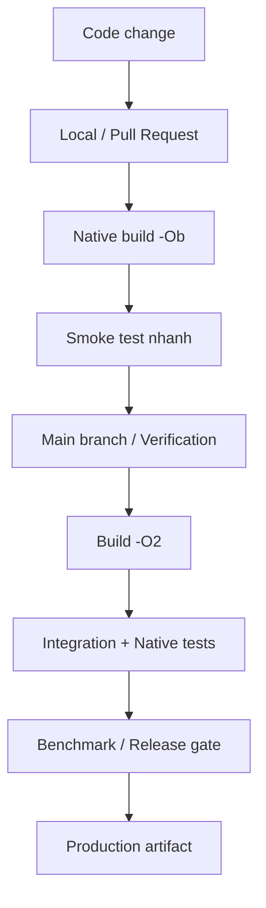

# Chọn mức tối ưu biên dịch theo yêu cầu thời gian build, kích thước và tốc độ

## 1. Bài toán chọn mức tối ưu

GraalVM Native Image biên dịch ứng dụng Java thành executable native tại build time. Quá trình này thực hiện phân tích reachability, xử lý metadata, tối ưu mã và liên kết với runtime native. Các lựa chọn tối ưu ảnh hưởng đến nhiều chỉ số cùng lúc:

- Thời gian và tài nguyên cần để tạo executable.
- Kích thước file native và container image.
- Tốc độ xử lý khi ứng dụng chạy.
- Thời gian khởi động và mức sử dụng memory trong workload thực tế.
- Khả năng debug, profiling và tương thích CPU khi triển khai.

Không có một mức tối ưu luôn tốt nhất cho mọi giai đoạn. Một cấu hình phù hợp cho vòng lặp phát triển nhanh có thể không phù hợp cho artifact production cần throughput cao. Ngược lại, ép tối ưu mạnh nhất trong mọi lần build có thể làm CI chậm, tốn RAM và kéo dài thời gian phản hồi của nhóm phát triển.

Bài này thuộc chương **Tối ưu** của module **SPRING_BOOT_NATIVE_IMAGE**. Nội dung tập trung vào cách chọn optimization level theo mục tiêu, cấu hình qua Maven/Gradle, đo benchmark có kiểm soát và quyết định khi nào cần tối ưu theo profile.

## 2. Các chỉ số cần cân nhắc

Trước khi chọn flag, hãy xác định mục tiêu cần cải thiện và chỉ số đo tương ứng.

| Chỉ số | Cách đo | Ý nghĩa |
| --- | --- | --- |
| Native build duration | Thời gian từ lúc bắt đầu đến khi tạo executable | Ảnh hưởng vòng lặp phát triển và thời gian CI |
| Peak build memory | RAM cao nhất trong quá trình build | Quyết định khả năng chạy song song và kích thước runner |
| Executable size | Kích thước file native | Ảnh hưởng lưu trữ, phân phối và thời gian tải |
| Container image size | Kích thước image cuối cùng | Ảnh hưởng registry, network transfer và rollout |
| Startup time | Thời gian từ lúc process bắt đầu đến khi readiness thành công | Quan trọng với scale-to-zero, autoscaling và restart |
| Throughput | Request/second dưới tải xác định | Đo năng lực xử lý tổng thể |
| Latency | p50, p95, p99 của request | Thể hiện thời gian phản hồi và tail latency |
| Runtime memory | RSS, heap và memory của container | Ảnh hưởng density và giới hạn cgroup |

Không đồng nhất executable size với container image size. Image còn chứa base image, thư viện hệ thống, certificate, timezone data và các file runtime khác. Một binary nhỏ hơn không nhất thiết làm container giảm đúng cùng tỷ lệ.

Cũng không đồng nhất startup time với throughput. Tối ưu mã thường tác động rõ hơn đến tốc độ xử lý khi chạy; thời gian khởi động còn phụ thuộc class initialization, filesystem, cấu hình, kết nối dependency và readiness checks.

## 3. Optimization level của Native Image

Native Image cung cấp tùy chọn `-O` để điều khiển mức tối ưu mã. Các mức phổ biến trong tài liệu GraalVM hiện hành:

| Option | Hành vi | Khi nên cân nhắc |
| --- | --- | --- |
| `-Ob` | Quick build mode, giảm các tối ưu tốn thời gian | Vòng lặp phát triển và kiểm tra nhanh |
| `-O0` | Không thực hiện tối ưu compiler | Điều tra/debug ở mức mã native |
| `-O1` | Tối ưu cơ bản, cân bằng build nhanh và hiệu năng | Build cần nhanh hơn nhưng vẫn muốn có tối ưu cơ bản |
| `-O2` | Tối ưu nâng cao; mặc định trong toolchain hiện hành | Baseline hợp lý cho production |
| `-O3` | Mức tối ưu đầy đủ, hướng đến hiệu năng cao nhất | Workload throughput quan trọng và build budget đủ lớn |
| `-Os` | Tối ưu kích thước, bỏ các tối ưu có thể làm binary lớn đáng kể | Giới hạn storage, image transfer hoặc footprint |

Một số điểm cần nhớ:

- `-Ob` là chế độ build nhanh, không phải tên khác của `-O0`.
- `-O0` tắt tối ưu compiler; thường hữu ích khi cần debug native code.
- `-O2` là mặc định của GraalVM Native Image hiện hành và hướng đến cân bằng giữa performance, size và build time.
- `-Os` thường tạo executable nhỏ hơn, nhưng có thể giảm runtime performance.
- Ý nghĩa chính xác của `-O1` và `-O3` phụ thuộc GraalVM distribution và phiên bản. Tài liệu Oracle GraalVM lưu ý `-O1` có mức tối ưu gần với `-O2` của GraalVM Community Edition. Trong GraalVM Community Edition hiện hành, `-O2` và `-O3` là tương đương; không nên kỳ vọng chỉ đổi từ `-O2` sang `-O3` sẽ tạo ra khác biệt hiệu năng trên distribution này.

Hãy kiểm tra output của native-image và tài liệu tương ứng với GraalVM version thực tế trước khi chuẩn hóa cấu hình.

## 4. Chọn mức tối ưu theo mục tiêu

Một ma trận lựa chọn thực tế:

| Bối cảnh | Mức khởi đầu | Lý do |
| --- | --- | --- |
| Chạy thử AOT trong local development | `-Ob` | Giảm thời gian chờ build để kiểm tra tích hợp |
| Debug lỗi native hoặc symbol | `-O0` kết hợp `-g` khi phù hợp | Giúp việc điều tra mã native dễ hơn |
| CI kiểm tra native build mỗi pull request | `-Ob` hoặc `-O1` | Cân bằng tốc độ feedback và mức tối ưu |
| Staging gần production | `-O2` | Dùng cấu hình tương tự production |
| Production API cần throughput ổn định | `-O2` trước, sau đó benchmark `-O3` nếu distribution hỗ trợ khác biệt | Có baseline trước khi tăng chi phí build |
| Function/container bị giới hạn dung lượng | `-Os` | Ưu tiên executable nhỏ |
| Workload có profile thực tế và cần tối ưu hot path | PGO nếu GraalVM distribution hỗ trợ | Compiler sử dụng dữ liệu hành vi đại diện |

Đây là điểm bắt đầu, không phải kết luận thay cho benchmark. Nếu `-Ob` cho binary đủ tốt trong môi trường nội bộ nhưng không đáp ứng SLA production, hãy dùng profile build khác cho artifact release.

### 4.1. Dùng build profile riêng

Có thể tách cấu hình theo mục tiêu:

- Profile development: `-Ob` để feedback nhanh.
- Profile verification: `-O1` hoặc `-O2` để phát hiện khác biệt với production sớm.
- Profile release: `-O2` hoặc mức đã được benchmark xác nhận.
- Profile size: `-Os` khi kích thước là tiêu chí chính.

Không nên để cùng một flag được thêm đồng thời ở nhiều nơi như Maven profile, plugin configuration và environment của Buildpacks mà không kiểm tra thứ tự ưu tiên. Khi build, ghi lại đầy đủ command line/options thực tế trong log.

## 5. Cấu hình optimization level với Maven

Nếu dự án Spring Boot sử dụng GraalVM Native Build Tools Maven Plugin, có thể truyền option qua cấu hình `buildArgs`.

Ví dụ cấu hình plugin:

```xml
<plugin>
    <groupId>org.graalvm.buildtools</groupId>
    <artifactId>native-maven-plugin</artifactId>
    <configuration>
        <buildArgs>
            <buildArg>-Ob</buildArg>
        </buildArgs>
    </configuration>
</plugin>
```

Trong profile release, thay `-Ob` bằng mức đã chọn, ví dụ `-O2`:

```xml
<profiles>
    <profile>
        <id>native-release</id>
        <build>
            <plugins>
                <plugin>
                    <groupId>org.graalvm.buildtools</groupId>
                    <artifactId>native-maven-plugin</artifactId>
                    <configuration>
                        <buildArgs>
                            <buildArg>-O2</buildArg>
                        </buildArgs>
                    </configuration>
                </plugin>
            </plugins>
        </build>
    </profile>
</profiles>
```

Build theo profile:

```bash
./mvnw -Pnative,native-release native:compile
```

Cấu hình plugin cụ thể phụ thuộc phiên bản Native Build Tools và cách dự án khai báo profile. Tránh khai báo cùng một optimization argument nhiều lần. Sau khi build, xem log để xác nhận GraalVM nhận đúng option.

## 6. Cấu hình optimization level với Gradle

Với Gradle Native Build Tools Plugin, có thể đặt build argument trên binary:

```groovy
graalvmNative {
    binaries {
        main {
            buildArgs.add("-Ob")
        }
    }
}
```

Đối với release build:

```groovy
graalvmNative {
    binaries {
        main {
            buildArgs.add("-O2")
        }
    }
}
```

Sau đó chạy:

```bash
./gradlew nativeCompile
```

Nếu dùng Kotlin DSL, cú pháp block có thể khác đôi chút theo plugin version, nhưng ý tưởng vẫn là thêm native-image argument vào binary configuration. Kiểm tra task output để xác nhận option đã được truyền tới native-image.

Không chỉnh sửa trực tiếp generated command hoặc file build output. Hãy lưu cấu hình trong build script/profile của dự án để CI và local build dùng cùng một quy tắc.

## 7. Sử dụng Buildpacks và Spring Boot build-image

Spring Boot có thể dùng Cloud Native Buildpacks để tạo container image chứa native executable. Khi build qua Buildpacks, optimization argument cần được chuyển đến Native Image builder thông qua cấu hình môi trường/buildpack mà phiên bản builder hỗ trợ.

Một số lưu ý:

- Xác định builder và buildpack version đang dùng.
- Xem log để xác nhận native-image command có optimization flag mong muốn.
- Không giả định flag cấu hình trong Maven/Gradle plugin tự động áp dụng cho mọi builder.
- Ghi lại builder image digest và GraalVM version để kết quả benchmark có thể tái lập.
- So sánh kích thước container image cuối cùng, không chỉ binary.

Với Buildpacks, builder có thể sử dụng môi trường build riêng và cache riêng. Thời gian build lần đầu thường khác các lần sau do dependency download, layer cache và native compilation. Khi so sánh optimization level, cần cố định trạng thái cache hoặc đo riêng cold build và warm build.

## 8. Build time và peak memory

Optimization level ảnh hưởng công việc compiler. Mức tối ưu cao hơn thường cần nhiều thời gian và tài nguyên hơn, nhưng độ chênh phụ thuộc kích thước ứng dụng, số class reachable, thư viện, target platform và GraalVM version.

Để so sánh:

1. Dùng cùng commit và dependency lock/version.
2. Dùng cùng JDK, GraalVM distribution và Native Build Tools version.
3. Dùng cùng máy/runner, số CPU và giới hạn RAM.
4. Xác định trạng thái cache: tất cả cold hoặc tất cả warm.
5. Chạy mỗi cấu hình nhiều lần và ghi median.
6. Ghi cả peak memory và thời gian build, không chỉ thời gian cuối cùng.
7. Tách thời gian resolve dependency khỏi thời gian native compilation nếu công cụ báo được.

Một bảng kết quả nên có dạng:

| Cấu hình | Build time | Peak RAM | Binary size | Container size |
| --- | ---: | ---: | ---: | ---: |
| `-Ob` | Đo thực tế | Đo thực tế | Đo thực tế | Đo thực tế |
| `-O1` | Đo thực tế | Đo thực tế | Đo thực tế | Đo thực tế |
| `-O2` | Đo thực tế | Đo thực tế | Đo thực tế | Đo thực tế |
| `-Os` | Đo thực tế | Đo thực tế | Đo thực tế | Đo thực tế |

Không điền số liệu từ một ứng dụng khác vào bảng của dự án. Một ứng dụng Spring Boot có nhiều reflection metadata, proxy và thư viện lớn có thể có đặc tính build rất khác một chương trình Java nhỏ.

## 9. Kích thước executable và container image

Nếu mục tiêu là giảm dung lượng, bắt đầu bằng `-Os`. Option này giữ các tối ưu `-O2` ngoại trừ những tối ưu có thể làm tăng đáng kể kích thước code/image.

Tuy nhiên, kích thước cuối cùng còn phụ thuộc:

- Reachability: class/resource nào thực sự được đưa vào image.
- Reflection/proxy metadata và resource configuration.
- Native library và static/dynamic linking.
- Debug information và symbol.
- Base image, CA certificates, timezone data và file hệ thống.
- Compression khi lưu trữ hoặc truyền image.

Đừng dùng `-Os` để thay thế việc kiểm tra dependency không cần thiết. Nếu ứng dụng kéo một adapter hoặc driver không dùng, loại dependency không cần thiết có thể giảm cả build work và artifact footprint.

### 9.1. Đo binary và container riêng

Sau build:

```bash
ls -lh target/application
docker image ls
```

Tên file và đường dẫn output tùy cấu hình dự án. Ghi riêng binary size và container image size. Nếu container dùng base image lớn, giảm binary vài MB có thể không tạo khác biệt đáng kể trong tổng image.

### 9.2. Debug information

Option `-g` tạo debug information hữu ích cho debugger và công cụ profiling native. Nó làm thay đổi artifact/debug symbols và có thể tăng dung lượng file phân phối nếu giữ debug data trong executable. Tùy toolchain, debug information có thể được tách hoặc lưu ở artifact riêng.

`-g` không phải optimization level. Có thể dùng kết hợp với `-O0` khi cần debug dễ hơn, nhưng không bắt buộc phải tắt toàn bộ optimization mới có thể debug. Hãy giữ symbol/build ID tương ứng với binary production trong kho artifact có kiểm soát.

## 10. Runtime performance và throughput

Mức tối ưu compiler có thể ảnh hưởng code quality, inlining, control flow và các quyết định tối ưu khác. Nhưng hiệu quả thực tế phụ thuộc workload. Một mức tối ưu cao hơn không bảo đảm mọi endpoint đều nhanh hơn.

Khi benchmark runtime:

- Dùng cùng dataset và request mix.
- Giữ số instance, CPU quota và memory limit giống nhau.
- Warm up theo quy trình phù hợp với native application, dù native executable không có JIT warmup như HotSpot.
- Đo latency p50, p95, p99 và throughput.
- Theo dõi CPU, RSS, GC/memory metrics và error rate.
- Chạy đủ lâu để quan sát steady state và tail latency.
- Lặp lại nhiều lần, tránh kết luận từ một lần chạy.

Native Image không có JIT compilation của HotSpot trong runtime thông thường. Vì vậy, cách warm-up nên nhằm làm ổn định connection pool, cache ứng dụng, DNS và dependency bên ngoài, không phải chờ JIT compile như benchmark JVM.

Nếu bottleneck nằm ở database, network hoặc lock contention, thay optimization level có thể gần như không thay đổi latency. Dùng profiler/metrics để xác định CPU hot path trước khi tăng compiler optimization.

## 11. Profile-Guided Optimization (PGO)

Profile-Guided Optimization dùng dữ liệu thu thập từ một lần chạy đại diện để compiler biết các đường code thường được thực thi. Nó hữu ích khi throughput là mục tiêu chính và workload production có tính ổn định đủ để profile mang ý nghĩa.

Quy trình khái quát:

1. Build một executable có instrumentation bằng `--pgo-instrument`.
2. Chạy executable đó với workload đại diện cho production.
3. Thu profile file, mặc định thường là `default.iprof`.
4. Build lại ứng dụng và truyền profile bằng `--pgo=default.iprof`.
5. Benchmark executable mới với cùng workload và so sánh với baseline.

Ví dụ các native-image arguments:

```text
--pgo-instrument
--pgo=default.iprof
```

Profile phải được tạo từ workload đủ đại diện: request mix, payload size, branch quan trọng, startup path và background task. Nếu profile chỉ chứa một endpoint thử nghiệm, compiler có thể tối ưu cho hành vi đó và không phản ánh workload production.

PGO có thể làm build tốn thêm thời gian và cần lưu giữ profile gắn với đúng version/source/configuration. Không dùng profile cũ một cách mù quáng sau khi thay đổi lớn code hoặc workload.

**Khả năng PGO phụ thuộc GraalVM distribution.** Tài liệu GraalVM hiện hành ghi nhận PGO không có trong GraalVM Community Edition. Trước khi thiết kế pipeline PGO, xác nhận edition/license, option được hỗ trợ và quy trình tạo profile của toolchain đang dùng.

## 12. Tối ưu cho CPU đích bằng -march

Native Image có option `-march` để chọn tập lệnh CPU mà compiler được phép sử dụng. Điều này ảnh hưởng hiệu năng và khả năng chạy binary trên các máy khác nhau.

Các lựa chọn thường gặp:

- `-march=native`: dùng các instruction feature có trên máy build. Có thể tăng hiệu năng trên máy tương thích, nhưng binary có thể không chạy trên CPU cũ hoặc khác feature set.
- `-march=compatibility`: ưu tiên khả năng chạy trên nhiều máy hơn, có thể giảm khả năng tận dụng instruction mới.
- `-march=list`: liệt kê target machine type mà toolchain hỗ trợ.

Trong CI, máy build có thể dùng CPU mới hơn node production. Nếu build với `-march=native` trên runner mới rồi deploy lên node cũ, executable có thể lỗi do thiếu instruction. Hãy build trên target tương thích hoặc chọn target CPU rõ ràng.

Không nên tối ưu CPU đích chỉ dựa vào máy developer. Cần biết tập CPU của toàn bộ deployment fleet, đặc biệt khi cùng một image được triển khai trên nhiều loại node.

## 13. Tách pipeline development, verification và release

Một pipeline thực tế có thể dùng cấu hình khác nhau theo mục tiêu:



Cách tổ chức này giúp giảm thời gian feedback mà vẫn kiểm tra artifact gần production trước khi phát hành.

Nếu release cần `-Os` hoặc PGO, hãy thêm stage build riêng và lưu metadata về compiler version, flags, profile và commit. Không dùng binary build `-Ob` trong production chỉ vì nó đã vượt qua smoke test.

Artifact phát hành nên được build một lần và promote giữa staging/production. Tránh build lại với cùng version nhưng flags hoặc builder khác nhau sau khi staging đã xác nhận.

## 14. Các yếu tố khác ảnh hưởng kích thước và tốc độ

Optimization level chỉ là một trong nhiều biến số.

### 14.1. Reachability và dependency

Native Image chỉ đưa những thành phần reachable vào image, cùng metadata/resource cần thiết. Loại dependency không dùng và tránh đăng ký reflection/resource quá rộng có thể giảm image footprint và build work.

Không xóa metadata chỉ để làm binary nhỏ nếu ứng dụng thực sự cần reflection, proxy hoặc resource đó. Hãy xác minh bằng native tests.

### 14.2. Class initialization

Khởi tạo class ở build time có thể giảm một phần công việc khi process bắt đầu, nhưng chỉ an toàn với trạng thái xác định và không phụ thuộc môi trường runtime. Không đóng băng hostname, environment variable, secret, random seed hoặc kết nối vào image.

Tối ưu startup bằng class initialization cần được benchmark riêng với compiler optimization level. Hai cơ chế giải quyết các chi phí khác nhau.

### 14.3. Garbage collector và memory

Native Image hỗ trợ các GC policy tùy phiên bản/runtime. Chọn GC dựa trên throughput, latency và memory footprint của workload. Không suy ra GC phù hợp chỉ từ kích thước executable.

Đo heap, RSS, pause/collection behavior và container memory dưới cùng tải. RSS bao gồm code, stack và native allocation, không chỉ Java heap.

### 14.4. Build resource và CI parallelism

Native Image compilation có thể tiêu thụ nhiều RAM và CPU. Tăng số build song song đôi khi làm tổng thời gian CI dài hơn do tranh chấp RAM, disk I/O hoặc CPU. Đặt concurrency dựa trên peak memory thực đo, không chỉ số core của runner.

Nếu gặp OutOfMemory trong native build, kiểm tra memory limit, parallelism và option compiler trước khi chỉ tăng heap builder. Tài nguyên build và memory runtime là hai giới hạn khác nhau.

## 15. Benchmark có thể tái lập

Để chọn mức tối ưu, tạo một benchmark matrix:

| Trục so sánh | Cố định hoặc ghi lại |
| --- | --- |
| Source | Commit SHA và trạng thái working tree |
| Java/GraalVM | JDK, vendor, edition và version |
| Build tooling | Maven/Gradle, Native Build Tools và Spring Boot version |
| Builder | Buildpacks builder digest nếu dùng |
| Machine | CPU model, core count, RAM, OS và architecture |
| Resource limits | CPU quota, memory limit và disk |
| Cache | Cold/warm cache, dependency cache và build cache |
| Runtime config | Environment, native arguments, GC và heap limit |
| Workload | Request mix, payload, concurrency, duration và dataset |
| Output | Build time, peak RAM, size, startup, p50/p95/p99, throughput, RSS |

Thực hiện mỗi biến thể nhiều lần, ghi median và độ phân tán. Không thay đồng thời optimization level, GC, CPU target và base image rồi kết luận yếu tố nào tạo ra khác biệt.

Một kết quả có thể trông như sau (các ô để điền bằng số đo thực tế):

| Variant | Build time | Binary size | Startup | p95 latency | Throughput |
| --- | ---: | ---: | ---: | ---: | ---: |
| `-Ob` | Đo | Đo | Đo | Đo | Đo |
| `-O2` | Đo | Đo | Đo | Đo | Đo |
| `-Os` | Đo | Đo | Đo | Đo | Đo |
| `-O2` + PGO nếu hỗ trợ | Đo | Đo | Đo | Đo | Đo |

Chọn cấu hình đáp ứng SLA và chi phí vận hành tổng thể. Nếu `-O3` hoặc PGO cải thiện throughput rất ít nhưng tăng mạnh build time, có thể không đáng dùng. Nếu `-Os` giảm image size đáng kể nhưng latency vượt SLA, không nên chọn chỉ vì binary nhỏ.

## 16. Lỗi thường gặp khi chọn optimization level

| Triệu chứng | Nguyên nhân có thể | Cách xử lý |
| --- | --- | --- |
| Build local nhanh nhưng CI rất chậm | Khác runner, cache, CPU hoặc concurrency | Cố định môi trường và đo riêng cold/warm build |
| Dùng `-O0` để build nhanh | Nhầm với quick build mode | Dùng `-Ob` cho vòng lặp phát triển |
| Đổi `-O2` sang `-O3` nhưng không khác | GraalVM Community Edition có thể xem hai mức này tương đương | Kiểm tra distribution và build output |
| `-Os` tạo binary nhỏ nhưng latency tăng | Đã đánh đổi runtime performance lấy size | Benchmark workload và xem lại SLA |
| Binary nhỏ nhưng container không giảm nhiều | Base image/libraries chiếm phần lớn dung lượng | Đo binary và container riêng |
| Build `-march=native` chạy lỗi trên node khác | CPU đích thiếu instruction feature | Dùng target tương thích hoặc build theo fleet |
| PGO không tạo profile | Instrumented run không chạy hoặc không ghi profile | Kiểm tra working directory và workload |
| PGO không được chấp nhận | Edition/toolchain không hỗ trợ | Xác nhận GraalVM distribution và license |
| Tăng build parallelism nhưng tổng CI chậm hơn | Tranh chấp RAM/CPU/I/O | Đo peak memory và giới hạn concurrency |
| Startup không cải thiện dù dùng `-O3` | Bottleneck ở config, class init, DNS hoặc dependency | Profile startup path và tối ưu đúng thành phần |

## 17. Bài thực hành: chọn cấu hình cho Spring Boot Native Image

**Bối cảnh:** Một Spring Boot service được build native để triển khai container. Nhóm phát triển muốn giảm thời gian build trong pull request, còn production cần kích thước image hợp lý và latency ổn định.

**Các bước:**

1. Ghi lại GraalVM vendor/edition/version, JDK, Spring Boot và Native Build Tools version.
2. Tạo baseline native build với mặc định `-O2`.
3. Build cùng source với `-Ob` và đo build duration, peak RAM, binary size.
4. Build với `-Os` và đo binary size cùng container image size.
5. Nếu distribution có khác biệt `-O3` so với `-O2`, build và benchmark cả hai.
6. Chạy cùng workload để đo startup, throughput, p50/p95/p99 và RSS.
7. Nếu PGO được hỗ trợ, tạo instrumented binary, chạy workload đại diện và build lại bằng profile.
8. Kiểm tra `-march` để bảo đảm binary tương thích với CPU của deployment fleet.
9. Chọn profile development, verification và release dựa trên số đo.
10. Lưu flags, toolchain version và benchmark result cùng build metadata.

**Tiêu chí đạt:**

- Giải thích được khác biệt giữa `-Ob`, `-O0`, `-O1`, `-O2`, `-O3` và `-Os`.
- Chọn mức tối ưu theo mục tiêu build time, size hoặc runtime performance.
- Truyền được option qua Maven hoặc Gradle plugin.
- Đo binary size riêng với container image size.
- Benchmark runtime dưới cùng workload và resource limit.
- Xác nhận edition hỗ trợ PGO trước khi sử dụng.
- Chọn CPU target không làm executable mất khả năng chạy trên deployment fleet.
- Ghi lại kết quả đủ để build và benchmark có thể tái lập.

## 18. Tổng kết

Chọn optimization level là quyết định cân bằng giữa thời gian build, kích thước artifact và runtime performance. Dùng `-Ob` để tăng tốc vòng lặp phát triển; dùng `-Os` khi ưu tiên kích thước; dùng `-O2` làm baseline production; cân nhắc `-O3` hoặc PGO khi toolchain hỗ trợ và benchmark chứng minh lợi ích. `-O0` chủ yếu phục vụ debug, không phải lựa chọn thay thế cho quick build mode.

Với Spring Boot Native Image, hãy truyền option qua Maven/Gradle hoặc Buildpacks theo đúng phiên bản plugin, kiểm tra command thực tế và đo cả binary lẫn container. Benchmark cần cố định source, GraalVM, CPU, cache, resource limit và workload. Kết quả đo của ứng dụng mới là cơ sở chọn cấu hình release; tên optimization level tự nó không bảo đảm SLA.

