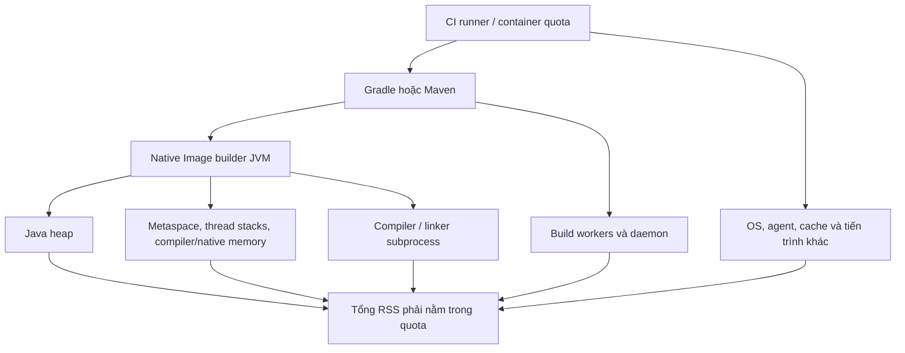

# Giới hạn RAM, số luồng build và đánh đổi khi biên dịch trong CI

> **Chương: Tối ưu.** Module **SPRING_BOOT_NATIVE_IMAGE** biên dịch ứng dụng Spring Boot thành GraalVM Native Image bằng Spring AOT để đánh giá thời gian khởi động, bộ nhớ và khả năng vận hành. Native Image compilation tiêu tốn CPU và RAM đáng kể; trong CI, nhiều build có thể chạy đồng thời trên cùng runner hoặc trong các module khác nhau. Bài học này hướng dẫn giới hạn bộ nhớ của Native Image builder, số luồng phân tích, số worker của Gradle/Maven và mức song song giữa các image để cân bằng thời gian build với độ ổn định.

## 1. Mục tiêu học tập

Sau bài học, bạn có thể:

1. Giải thích vì sao Native Image builder cần nhiều RAM và CPU hơn một bước compile Java thông thường.
2. Phân biệt heap của JVM chạy Native Image builder với RSS thực tế của process.
3. Giới hạn bộ nhớ builder bằng các tùy chọn JVM truyền qua native-image.
4. Giới hạn số luồng nội bộ bằng **--parallelism**.
5. Phân biệt giới hạn worker của Gradle/Maven với số luồng bên trong một Native Image build.
6. Tránh chạy nhiều native-image process đồng thời vượt quota của CI runner/container.
7. Đọc Build Output để nhận biết peak RSS, CPU load, GC time và giới hạn tài nguyên.
8. Chọn cấu hình phù hợp cho runner nhỏ, vừa và lớn; hiểu đánh đổi giữa tốc độ, chi phí và độ ổn định.

## 2. Vì sao native compilation cần nhiều tài nguyên?

Native Image builder chạy trên một JVM. Trong quá trình tạo executable, builder phải phân tích dependency graph, xác định các class/method reachable, xử lý reflection và metadata, tạo image heap, tối ưu code, biên dịch machine code và gọi native linker.

Các giai đoạn này tiêu tốn tài nguyên khác nhau:

- **Analysis:** points-to analysis duyệt đồ thị kiểu, field và method có thể được sử dụng. Ứng dụng có nhiều dependency, reflection metadata hoặc proxy có thể làm giai đoạn này nặng hơn.
- **Compilation:** Graal compiler tối ưu và biên dịch các method reachable thành machine code. Giai đoạn này có thể dùng nhiều CPU và bộ nhớ tạm.
- **Image heap/layout:** builder chuẩn bị object graph, metadata và vùng dữ liệu cho executable.
- **Native toolchain/linker:** compiler và linker của hệ điều hành có thể tạo thêm process hoặc sử dụng bộ nhớ ngoài heap của JVM builder.

Vì vậy, giới hạn heap của builder không phải giới hạn tuyệt đối cho tổng bộ nhớ. Process còn có metaspace, thread stack, code cache/compiler data, mapped files, native allocations và bộ nhớ của subprocess.



Một runner có 8 GiB RAM không thể dành toàn bộ 8 GiB cho builder heap. Nếu heap chạm giới hạn, process vẫn cần thêm bộ nhớ ngoài heap; nếu tổng RSS vượt memory limit, hệ điều hành hoặc container runtime có thể kill process.

## 3. Phân biệt builder heap, RSS và memory limit

Ba con số này trả lời ba câu hỏi khác nhau:

| Khái niệm | Ý nghĩa | Dùng để làm gì |
|---|---|---|
| Builder heap limit | Giới hạn Java heap của JVM chạy Native Image builder | Kiểm soát lượng object Java mà builder có thể giữ |
| Peak RSS | Bộ nhớ resident lớn nhất của process theo hệ điều hành | Ước lượng bộ nhớ thực tế mà runner cần |
| CI/container memory limit | Giới hạn cứng của runner hoặc container | Xác định ngưỡng process có thể bị OOM kill |

Native Image Build Output báo memory limit của builder và peak RSS ở cuối build. **Memory limit được báo là giới hạn Java heap; RSS thực tế có thể cao hơn.** Hãy đọc cả hai số, không suy ra runner cần đúng bằng giá trị heap.

Ví dụ, nếu builder được cấp heap tối đa 8 GiB nhưng peak RSS là 10 GiB, runner còn phải có chỗ cho Gradle/Maven, hệ điều hành, agent CI và các tiến trình khác. Nếu chạy hai image build cùng lúc, tổng RSS của hai builder có thể cộng dồn và vượt quota dù từng build riêng lẻ đều thành công.

### 3.1. Mặc định của Native Image builder trong CI

Theo tài liệu GraalVM hiện hành, khi chạy trong container hoặc môi trường CI có biến môi trường **CI=true**, Native Image dùng chế độ dedicated và mặc định đặt giới hạn heap khoảng 85% bộ nhớ hệ thống mà builder nhận diện được, với mức trần phụ thuộc GraalVM release. Ở môi trường developer, builder thường dùng shared mode để tránh chiếm hết bộ nhớ máy. Nếu bộ nhớ khả dụng thấp hơn ngưỡng quy định của release, builder có thể chuyển sang dedicated mode.

Điều này có nghĩa một CI runner nhỏ có thể tự nhận một heap limit khá lớn so với phần RAM cần dành cho Gradle/Maven và OS. Hãy kiểm tra Build Output để xem builder đã nhận diện bao nhiêu memory và bao nhiêu thread. Nếu CI provider không đặt **CI=true**, hành vi mặc định có thể khác dự kiến.

Không dựa vào một con số mặc định cố định cho mọi GraalVM version. Giới hạn trần và cách nhận diện container memory có thể thay đổi giữa các release.

## 4. Giới hạn heap của Native Image builder

Native Image dùng tiền tố **-J** để chuyển một JVM option tới JVM đang chạy builder. Có thể đặt heap tối đa tuyệt đối:

```bash
native-image -J-Xmx6g --parallelism=4 -jar orders-service.jar
```

Hoặc giới hạn theo tỷ lệ bộ nhớ builder nhận diện:

```bash
native-image -J-XX:MaxRAMPercentage=60.0 \
    --parallelism=4 \
    -jar orders-service.jar
```

Chọn một cách giới hạn phù hợp:

- **-J-Xmx6g** đặt trần heap tuyệt đối, dễ dự đoán khi CI runner có cấu hình cố định.
- **-J-XX:MaxRAMPercentage=60.0** đặt heap theo phần trăm RAM mà JVM builder nhận diện; hữu ích khi runner có nhiều kích cỡ.
- **-J-Xms** chỉ đặt heap khởi đầu tối thiểu. Không tăng Xms nếu không có lý do đo đạc, vì nó có thể làm builder giữ nhiều memory sớm hơn.

Đừng đặt heap builder bằng toàn bộ memory limit của container. Cần để khoảng trống cho bộ nhớ ngoài heap, linker, Gradle/Maven và OS. Nếu đặt **-J-Xmx** quá thấp, builder có thể gặp OutOfMemoryError hoặc GC nhiều; nếu đặt quá cao, process có thể bị container OOM kill trước khi JVM báo lỗi heap.

### 4.1. Giới hạn bằng Gradle Native Build Tools

Gradle Native Build Tools phân biệt hai nhóm option:

- **jvmArgs** truyền đối số trực tiếp tới JVM chạy Native Image builder.
- **buildArgs** truyền option cho công cụ native-image.

Ví dụ:

```groovy
graalvmNative {
    binaries {
        main {
            jvmArgs.add("-Xmx6g")
            buildArgs.add("--parallelism=4")
        }
    }
}
```

Ở đây **-Xmx6g** giới hạn heap builder; **--parallelism=4** giới hạn luồng nội bộ của Native Image. Không đưa -Xmx6g vào buildArgs như một option Native Image thông thường, vì đó là JVM argument của builder.

### 4.2. Giới hạn bằng Maven Native Build Tools

Với Maven, cấu hình jvmArgs và buildArgs riêng:

```xml
<plugin>
    <groupId>org.graalvm.buildtools</groupId>
    <artifactId>native-maven-plugin</artifactId>
    <configuration>
        <jvmArgs>
            <arg>-Xmx6g</arg>
        </jvmArgs>
        <buildArgs>
            <buildArg>--parallelism=4</buildArg>
        </buildArgs>
    </configuration>
</plugin>
```

Maven plugin truyền jvmArgs tới JVM chạy builder và buildArgs tới Native Image. Nếu Spring Boot plugin đang điều khiển native build, hãy đặt các giá trị vào đúng cấu hình được plugin đó chuyển tiếp sang Native Build Tools.

## 5. Giới hạn số luồng nội bộ bằng --parallelism

Native Image mặc định dùng các processor mà builder nhận diện được để tăng tốc build; tài liệu hiện hành nêu mức tối đa 32 luồng, không vượt số processor khả dụng. Giới hạn mặc định có thể thay đổi theo GraalVM release. Dùng **--parallelism** để đặt số luồng rõ ràng:

```bash
native-image --parallelism=2 -jar orders-service.jar
native-image --parallelism=4 -jar orders-service.jar
native-image --parallelism=8 -jar orders-service.jar
```

Giảm parallelism thường giúp:

- Giảm số tác vụ phân tích/biên dịch chạy đồng thời.
- Giảm áp lực CPU và một phần bộ nhớ tạm.
- Giảm nguy cơ tranh chấp tài nguyên khi runner chạy thêm build worker hoặc container.
- Làm build ổn định hơn trên runner nhỏ hoặc dùng chung.

Đổi lại, thời gian build có thể tăng. Tăng từ 4 lên 8 luồng không đảm bảo build nhanh gấp đôi; analysis, GC, linker và các giai đoạn tuần tự có giới hạn song song riêng. Nếu runner đã bị giới hạn CPU, đặt parallelism cao hơn số CPU được cấp thường chỉ tăng tranh chấp.

Một quy tắc khởi đầu thực tế là đặt parallelism bằng hoặc thấp hơn số CPU được cấp cho container. Sau đó đo thời gian và peak RSS để điều chỉnh. Nếu build CPU load thấp nhưng thời gian dài, hãy kiểm tra GC, I/O, dependency resolution và linker trước khi tăng thread.

## 6. Gradle: worker, project parallelism và native build concurrency

Gradle có nhiều cơ chế song song độc lập với Native Image:

| Cơ chế | Cách giới hạn | Phạm vi |
|---|---|---|
| Gradle worker count | **--max-workers=N** hoặc **org.gradle.workers.max=N** | Số worker Gradle được dùng |
| Parallel project execution | **--parallel** hoặc **org.gradle.parallel=true** | Số project/module có thể build song song |
| Native Image parallelism | **--parallelism=N** | Số luồng bên trong một native-image process |
| Concurrent native image builds | **org.graalvm.buildtools.max.parallel.builds=N** | Số native image được plugin cho phép build đồng thời khi Gradle chạy song song |

Ví dụ CI runner nhỏ:

```bash
./gradlew nativeCompile \
    --no-daemon \
    --max-workers=2 \
    --no-parallel
```

Kết hợp với cấu hình binary:

```groovy
graalvmNative {
    binaries {
        main {
            jvmArgs.add("-Xmx4g")
            buildArgs.add("--parallelism=2")
        }
    }
}
```

Với multi-project build, có thể cấu hình trong gradle.properties:

```properties
org.gradle.workers.max=2
org.gradle.parallel=false
org.graalvm.buildtools.max.parallel.builds=1
```

Native Build Tools Gradle plugin tự giới hạn số native image được build đồng thời khi bật parallel project builds; mặc định dựa trên số CPU core chia cho 16. Có thể thay đổi bằng property **org.graalvm.buildtools.max.parallel.builds** hoặc biến môi trường **GRAALVM_BUILDTOOLS_MAX_PARALLEL_BUILDS**.

Với CI runner có ít RAM, đặt concurrent native image builds bằng 1 thường là điểm khởi đầu an toàn. Khi đã đo được peak RSS và còn dư RAM, có thể tăng lên 2. Không nhầm **--max-workers=2** với **--parallelism=2**: một cái giới hạn worker Gradle, cái kia giới hạn luồng của builder.

### 6.1. gradle.properties và Gradle daemon heap

Ví dụ:

```properties
org.gradle.jvmargs=-Xmx1g -XX:MaxMetaspaceSize=512m
org.gradle.workers.max=2
org.gradle.parallel=false
org.graalvm.buildtools.max.parallel.builds=1
```

**org.gradle.jvmargs** giới hạn JVM của Gradle daemon, không giới hạn JVM chạy Native Image builder. Nếu chỉ đặt property này, builder vẫn có thể nhận heap lớn theo mặc định. Hãy quản lý riêng cả Gradle daemon và Native Image builder.

## 7. Maven: reactor threads và Native Image threads

Maven có thể chạy nhiều module trong reactor song song bằng tùy chọn **-T**:

```bash
# Chạy reactor tuần tự.
./mvnw -T 1 -Pnative package

# Chạy tối đa hai module song song.
./mvnw -T 2 -Pnative package

# Số thread theo bội số CPU core.
./mvnw -T 1C -Pnative package
```

**-T** điều khiển mức song song của Maven reactor, không điều khiển số luồng bên trong Native Image. Nếu hai module cùng kích hoạt native build, hai builder có thể chạy đồng thời. Mỗi builder lại có heap và parallelism riêng.

Ví dụ hai module cùng chạy native image:

- Maven reactor: **-T 2**.
- Mỗi Native Image builder: **--parallelism=4**.
- Tổng số luồng builder có thể xấp xỉ 8, chưa tính Maven, linker và các tiến trình khác.
- Heap của hai builder có thể cộng dồn; runner phải đủ RAM cho cả hai peak.

Với CI runner nhỏ, bắt đầu bằng **-T 1** và một native build tại một thời điểm. Chỉ tăng reactor threads khi các module thực sự độc lập và runner có đủ CPU/RAM. Không dùng **-T 1C** một cách máy móc trên runner có nhiều core nhưng memory quota thấp.

## 8. Cân đối RAM và CPU theo kích thước runner

Bảng sau là điểm khởi đầu để thử nghiệm, không phải cấu hình tối ưu cho mọi ứng dụng. Nó giả định một native image build tại một thời điểm trên mỗi runner:

| RAM runner/container | Builder heap khởi đầu | Native Image parallelism | Gradle/Maven concurrency |
|---:|---:|---:|---|
| 8 GiB | 3–4 GiB | 2 | Một native image; Gradle workers 1–2 hoặc Maven -T 1 |
| 16 GiB | 7–8 GiB | 4 | Một native image; Gradle workers 2–4 hoặc Maven -T 1 |
| 32 GiB | 14–16 GiB | 6–8 | Một image trước; thử 2 image nếu peak RSS cho phép |

Giá trị heap trong bảng không phải RSS. Hãy bắt đầu thấp hơn nếu ứng dụng có dependency nặng, nhiều reflection metadata, compiler/linker tốn memory hoặc container có process khác. Tăng dần theo dữ liệu peak RSS và thời gian build.

### 8.1. Ví dụ runner 8 GiB

Gradle:

```groovy
graalvmNative {
    binaries {
        main {
            jvmArgs.add("-Xmx3g")
            buildArgs.add("--parallelism=2")
        }
    }
}
```

Chạy:

```bash
./gradlew nativeCompile --max-workers=1 --no-parallel
```

Mục tiêu là giữ chỗ cho Gradle daemon, OS, linker và CI agent. Nếu build bị OOM trong Java heap, xem GC/build output trước khi tăng heap; nếu container bị OOM kill dù builder heap chưa đầy, cần giảm concurrency hoặc heap để tạo thêm khoảng trống ngoài heap.

### 8.2. Ví dụ runner 16 GiB

Maven:

```xml
<plugin>
    <groupId>org.graalvm.buildtools</groupId>
    <artifactId>native-maven-plugin</artifactId>
    <configuration>
        <jvmArgs>
            <arg>-Xmx8g</arg>
        </jvmArgs>
        <buildArgs>
            <buildArg>--parallelism=4</buildArg>
        </buildArgs>
    </configuration>
</plugin>
```

Chạy reactor tuần tự:

```bash
./mvnw -T 1 -Pnative package
```

Sau một số lần build, lấy peak RSS lớn nhất trong các lần build thành công và thất bại. Nếu RSS còn dư nhiều và CPU load cao, có thể thử tăng parallelism. Nếu RSS gần memory limit, giảm heap hoặc số luồng trước khi tăng runner size.

## 9. Giới hạn tài nguyên container

Khi build trong Docker hoặc Kubernetes, container memory/CPU quota là giới hạn thực tế mà builder phải tôn trọng. Ví dụ chạy build container với giới hạn:

```bash
docker run --rm \
    --memory=12g \
    --cpus=4 \
    -v "$PWD:/workspace" \
    -w /workspace \
    native-build-image \
    ./gradlew nativeCompile --max-workers=1 --no-parallel
```

Trong container 12 GiB/4 CPU, cấu hình builder cần để lại RAM cho daemon, linker, thread stack và OS. Không đặt **-Xmx12g** chỉ vì container có **--memory=12g**; heap tối đa bằng memory limit sẽ khiến RSS tổng vượt quota.

Trước khi build, có thể kiểm tra tài nguyên mà Linux container nhìn thấy:

```bash
nproc
free -h
cat /sys/fs/cgroup/memory.max
cat /sys/fs/cgroup/memory.current
```

Trên cgroup v1, đường dẫn và tên file memory controller khác. Giá trị **max** trong cgroup v2 cho biết không đặt giới hạn memory ở cấp cgroup đó; vẫn có thể có quota ở cấp parent hoặc CI runner.

Nếu CI chạy nhiều job song song trên cùng máy host, phải tính cả các job đó. Mỗi job nhìn thấy 8 CPU/16 GiB không có nghĩa host có thể cấp đồng thời toàn bộ tài nguyên ấy cho mọi job.

## 10. Đọc Native Image Build Output để điều chỉnh

Native Image Build Output cung cấp các số liệu cần theo dõi:

| Dòng output | Ý nghĩa | Hành động |
|---|---|---|
| Build resources: memory limit | Giới hạn Java heap builder nhận diện | So với cấu hình -J-Xmx hoặc MaxRAMPercentage |
| Build resources: thread count | Số luồng builder dùng | So với --parallelism và CPU quota |
| Memory theo từng stage | Mức memory tại từng giai đoạn | Xác định analysis hay compilation gây peak |
| GC time/count | Áp lực garbage collection của builder | Heap quá thấp hoặc allocation nhiều có thể làm build chậm |
| Peak RSS | Bộ nhớ resident lớn nhất của process | So với cgroup/runner limit, để lại headroom |
| CPU load | CPU time chia cho thời gian process | CPU load cao có thể hưởng lợi từ thêm core; thấp cần xem I/O/GC |

Ví dụ một lần build báo heap limit 8 GiB, peak RSS 10 GiB và CPU load cao. Nếu runner có 16 GiB, build có thể còn khoảng trống vừa phải; cần tính thêm Gradle/Maven và các process khác. Nếu runner chỉ có 10 GiB, cấu hình đó có nguy cơ bị kill.

### 10.1. Dùng Build Report khi cần điều tra sâu

Có thể yêu cầu Native Image xuất build report:

```bash
native-image --emit build-report \
    --parallelism=4 \
    -J-Xmx8g \
    -jar orders-service.jar
```

Build report giúp xem thêm thông tin về reachability, reflection, resource, image heap và các đóng góp vào executable. Nó không thay thế peak RSS hoặc container metrics; dùng cùng build log để tìm nguyên nhân image build nặng sau khi đã kiểm soát tài nguyên.

## 11. Đánh đổi khi tăng hoặc giảm tài nguyên

| Thay đổi | Lợi ích | Chi phí/rủi ro |
|---|---|---|
| Tăng builder heap | Giảm nguy cơ OOM trong Java heap, có thể giảm GC | RSS có thể tăng; dễ chạm memory limit của container |
| Giảm builder heap | Giữ headroom cho OS/daemon/linker | GC nhiều hơn, build chậm hoặc OOM trong builder |
| Tăng parallelism | Tận dụng CPU và rút ngắn một số stage | Tăng contention và memory tạm; không tăng tốc tuyến tính |
| Giảm parallelism | Hạ tải CPU/RAM và tăng độ ổn định | Build lâu hơn |
| Tăng Gradle workers/Maven -T | Nhiều module có thể hoàn tất đồng thời | Nhiều builder cùng lúc, tổng RAM/CPU tăng mạnh |
| Chạy một image tại một thời điểm | Peak RSS dễ dự đoán, giảm OOM | Tổng thời gian pipeline multi-module có thể dài hơn |
| Tăng runner size | Thêm headroom và CPU | Chi phí CI cao hơn; không sửa được cấu hình song song lãng phí |

Tốc độ build không chỉ phụ thuộc thread count. Nếu build đang GC liên tục, tăng thread có thể làm tệ hơn. Nếu CPU load thấp vì download dependency, filesystem hoặc linker chờ I/O, tăng parallelism analysis không giải quyết được nút thắt.

Không dùng việc tăng heap để chữa mọi lỗi. Phân biệt:

- OutOfMemoryError: Java heap space: builder heap có thể quá nhỏ hoặc object graph quá lớn.
- Container/pod bị OOM kill: tổng memory vượt quota; giảm heap, parallelism hoặc số build đồng thời.
- Build chậm nhưng không có memory pressure: xem CPU load, GC, dependency resolution, filesystem và linker.
- Native build fail do compiler/linker: kiểm tra toolchain, OS/architecture và log compiler; tăng heap Java có thể không giúp.

## 12. Cache và cách tổ chức pipeline

Cache dependency Gradle/Maven giúp tránh tải lại artifact và giảm thời gian chuẩn bị build. Nó không tự làm giảm đáng kể memory peak của Native Image analysis. Đừng coi cache dependency là giải pháp cho OOM.

Một pipeline CI có thể chia thành:

1. Resolve dependency và compile/test JVM.
2. Chạy Spring AOT preparation nếu build tool tách bước này.
3. Chạy một native image build trên runner có RAM phù hợp.
4. Chạy native tests và smoke tests.
5. Lưu build log, Build Report, peak RSS, exit code và test report.

Không chạy đồng thời native compilation với nhiều tác vụ memory-heavy như test suite lớn, Docker build nhiều stage hoặc một native image khác trên cùng runner nhỏ. Nếu muốn tận dụng multi-core, hãy đo song song có kiểm soát và đặt giới hạn tổng concurrency.

Với multi-module project, có thể build các module JVM độc lập song song trước; gom native image build vào một stage riêng tuần tự hoặc giới hạn số image đồng thời. Cách này thường giúp dễ dự đoán peak RAM hơn.

## 13. Quy trình tuning có kiểm soát

Không thay heap, thread count và module concurrency cùng lúc. Thực hiện theo từng vòng:

1. **Lấy baseline:** chạy một native build với cấu hình hiện tại, ghi thời gian, heap limit, peak RSS, CPU load và exit code.
2. **Xác nhận quota:** ghi RAM/CPU mà runner và container thực sự nhận diện; tính cả các job chạy cùng host.
3. **Giới hạn concurrency:** bắt đầu với một native image build tại một thời điểm.
4. **Đặt builder heap:** chọn -J-Xmx hoặc MaxRAMPercentage đủ thấp để giữ headroom ngoài heap.
5. **Đặt parallelism:** bắt đầu bằng số CPU được cấp hoặc thấp hơn; runner nhỏ thường dùng 2–4 luồng.
6. **Chạy lặp lại:** so sánh peak RSS, GC time và thời gian build qua nhiều lần.
7. **Điều chỉnh một biến:** nếu thiếu heap, tăng heap một bước; nếu vượt quota, giảm concurrency/parallelism hoặc tăng runner.
8. **Kiểm tra tính ổn định:** chạy native build trong tải CI gần thực tế, không chỉ chạy trên runner rảnh.
9. **Ghi lại cấu hình:** lưu GraalVM JDK, Native Build Tools, Gradle/Maven, RAM/CPU limit và option builder.

Mẫu bảng theo dõi:

| Lần chạy | Heap limit | Parallelism | Số image đồng thời | Thời gian | Peak RSS | GC time | Kết quả |
|---|---:|---:|---:|---:|---:|---:|---|
| Baseline | … | … | … | … | … | … | … |
| Thử nghiệm A | … | … | … | … | … | … | … |
| Thử nghiệm B | … | … | … | … | … | … | … |
| Cấu hình chọn | … | … | … | … | … | … | … |

Chọn cấu hình có thời gian phù hợp nhưng vẫn có khoảng trống an toàn so với memory limit. Không chọn cấu hình chỉ vì một lần build nhanh nhất nếu nó thường xuyên tiến sát OOM threshold.

## 14. Lỗi thường gặp

| Triệu chứng | Nguyên nhân có thể | Hướng xử lý |
|---|---|---|
| Native build bị OOM dù runner còn RAM | Builder heap bị giới hạn thấp hoặc process không nhìn thấy đủ cgroup memory | Kiểm tra build resources, -J-Xmx, MaxRAMPercentage và cgroup |
| Container bị OOMKilled dù builder chưa báo Java OOM | Tổng RSS vượt container limit | Giảm heap/parallelism/concurrency; xem memory.events hoặc container inspect |
| Tăng Gradle org.gradle.jvmargs nhưng native build vẫn dùng nhiều RAM | Đang giới hạn Gradle daemon, không phải builder JVM | Dùng jvmArgs của Native Build Tools hoặc Maven plugin |
| --max-workers=2 nhưng có nhiều thread native | Worker Gradle khác với luồng builder | Giới hạn thêm --parallelism |
| Maven -T 1C làm runner OOM | Nhiều module native build cùng lúc | Dùng -T 1, sau đó tăng có đo đạc |
| Tăng parallelism nhưng build chậm hơn | CPU/memory contention hoặc GC tăng | Giảm thread, xem CPU load và GC |
| Build pass trên máy developer nhưng fail trong CI | CI quota nhỏ hơn hoặc CI=true khiến builder chọn dedicated mode | Kiểm tra Build Output và giới hạn builder rõ ràng |
| Peak RSS cao hơn heap limit | Native memory, stack, metaspace, linker và mapped files | Dành headroom; không đặt heap bằng toàn bộ container memory |
| Cache hit nhưng build native vẫn lâu | Native Image analysis/compilation vẫn phải thực hiện | Tối ưu tài nguyên builder và số image build đồng thời |

## 15. Bài tập thực hành

Một dịch vụ Spring Boot native có build mất 18 phút trên CI runner 16 GiB RAM/4 CPU. Một số lần build bị OOM kill khi pipeline chạy hai module native song song.

Thực hiện:

1. Chạy baseline với một native image build tại một thời điểm; ghi heap limit, thread count, peak RSS, CPU load và GC time.
2. Cấu hình builder heap ban đầu 7–8 GiB và --parallelism=4.
3. Với Gradle, đặt org.gradle.workers.max=2, org.gradle.parallel=false và giới hạn native image concurrency bằng 1.
4. Với Maven, chạy -T 1 và chỉ tăng reactor thread khi module không cạnh tranh RAM.
5. Chạy ít nhất ba lần, so sánh peak RSS và thời gian build.
6. Thử parallelism 2 và 4; giữ các biến khác không đổi.
7. Thử heap thấp hơn một bước nếu RSS gần quota; kiểm tra builder có GC/OOM hay không.
8. Chỉ thử hai native image đồng thời nếu tổng peak RSS và memory headroom cho phép.
9. Chọn cấu hình ổn định, lưu option và build log làm baseline cho CI.

Mẫu báo cáo:

| Cấu hình | Heap | Parallelism | Image đồng thời | Peak RSS | Thời gian | OOM |
|---|---:|---:|---:|---:|---:|---|
| A | 8 GiB | 4 | 1 | … | … | Có/Không |
| B | 8 GiB | 2 | 1 | … | … | Có/Không |
| C | 6 GiB | 2 | 1 | … | … | Có/Không |
| D | … | … | 2 | … | … | Có/Không |

## 16. Câu hỏi tự kiểm tra

1. Vì sao giới hạn Java heap của Native Image builder không phải giới hạn RSS?
2. Biến CI=true ảnh hưởng thế nào tới chế độ cấp phát memory mặc định của Native Image?
3. -J-Xmx và --parallelism điều khiển hai khía cạnh nào?
4. Vì sao org.gradle.jvmargs không giới hạn heap của Native Image builder?
5. --max-workers khác --parallelism như thế nào?
6. Maven -T 2 kết hợp với hai native build có thể tạo ra áp lực tài nguyên gì?
7. Vì sao không nên dùng -T 1C trên mọi CI runner?
8. Peak RSS, GC time và CPU load giúp điều chỉnh cấu hình ra sao?
9. Khi container OOMKilled nhưng JVM builder không báo OutOfMemoryError, cần điều tra điều gì?
10. Vì sao phải thay đổi từng biến một khi tuning RAM và thread count?

## Ghi nhớ

**Hãy quản lý tài nguyên ở cả ba tầng: builder JVM, build tool và CI/container.** -J-Xmx giới hạn heap của builder; --parallelism giới hạn luồng nội bộ; Gradle workers/Maven reactor threads và plugin concurrency quyết định có bao nhiêu native image chạy cùng lúc. Đọc peak RSS thay vì chỉ nhìn heap limit, chừa headroom cho native memory và linker, rồi điều chỉnh từng biến dựa trên thời gian build, GC, CPU load và độ ổn định thực tế.

## Tài liệu tham khảo chính thức

- [GraalVM — Native Image Build Output](https://www.graalvm.org/latest/reference-manual/native-image/overview/BuildOutput/): Build Resources, peak RSS, CPU load và thông tin theo từng stage.
- [GraalVM — Native Image Build Configuration](https://www.graalvm.org/latest/reference-manual/native-image/overview/BuildConfiguration/): giới hạn heap của builder bằng -J và số luồng bằng --parallelism.
- [GraalVM Native Build Tools — Gradle Plugin](https://graalvm.github.io/native-build-tools/latest/gradle-plugin): jvmArgs, buildArgs và Max Parallel Builds.
- [GraalVM Native Build Tools — Maven Plugin](https://graalvm.github.io/native-build-tools/latest/maven-plugin.html): jvmArgs, buildArgs và cấu hình native image.
- [Gradle — Command-Line Interface](https://docs.gradle.org/current/userguide/command_line_interface.html): --max-workers, --parallel và các tùy chọn thực thi.
- [Gradle — Build Environment](https://docs.gradle.org/current/userguide/build_environment.html): org.gradle.jvmargs, worker limits và cấu hình daemon.
- [Maven — Guide to Working with Multiple Modules](https://maven.apache.org/guides/mini/guide-multiple-modules.html): Maven reactor và build module song song.
- [Maven — CLI Options](https://maven.apache.org/components/ref/current/maven-embedder/cli.html): tùy chọn -T điều khiển số thread của Maven.
