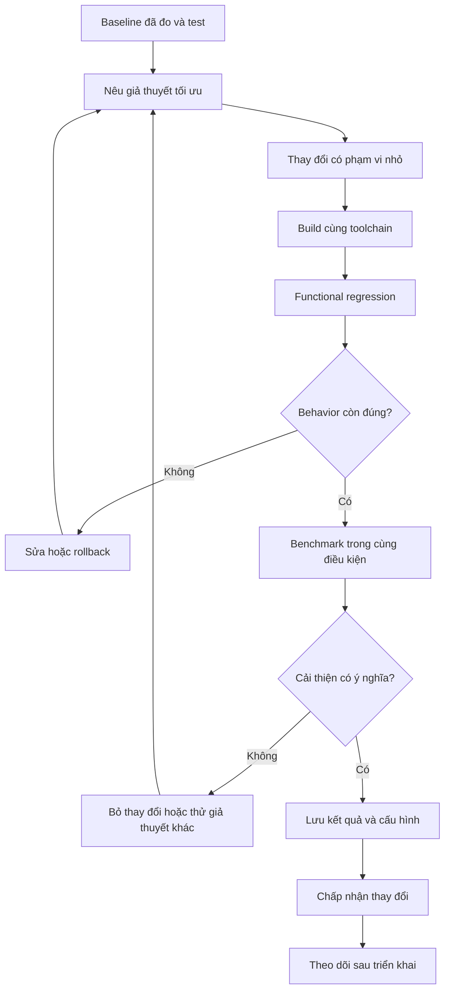
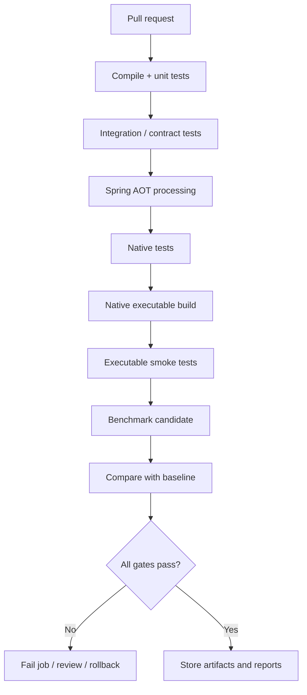

# Đo lại và chạy hồi quy chức năng sau mỗi thay đổi tối ưu

Tối ưu Spring Boot Native Image chỉ có ý nghĩa khi kết quả được đo trong cùng điều kiện và ứng dụng vẫn giữ đúng hành vi. Một thay đổi giúp startup nhanh hơn nhưng làm sai JSON response, bỏ sót resource, thay đổi transaction boundary hoặc gây lỗi ở nhánh hiếm không phải là một tối ưu có thể phát hành.

Sau mỗi thay đổi, cần trả lời hai câu hỏi độc lập:

1. **Hiệu năng có cải thiện thật không?** Đo lại đúng chỉ số mà thay đổi nhắm tới, với baseline, workload và môi trường có thể so sánh.
2. **Chức năng có còn đúng không?** Chạy hồi quy trên các luồng nghiệp vụ, edge case và đường truy cập động bị ảnh hưởng.

Bài học thuộc chương **Tối ưu** của mô-đun `SPRING_BOOT_NATIVE_IMAGE`. Ta sẽ xây dựng vòng lặp tối ưu có giả thuyết, baseline, thay đổi có kiểm soát, benchmark lặp lại, functional regression, tiêu chí chấp nhận và quy trình rollback. Các ví dụ áp dụng cho tối ưu startup, memory, throughput, Runtime Hints, resource, class initialization, cache và cấu hình native build.

## 1. Vòng lặp tối ưu phải có hai cổng kiểm chứng

Không đánh giá một thay đổi chỉ bằng cảm giác ứng dụng "có vẻ nhanh hơn". Mỗi thay đổi phải qua cổng chức năng và cổng hiệu năng.



Hai cổng này không thay thế lẫn nhau:

- Test pass không chứng minh hiệu năng tốt hơn.
- Benchmark tốt không chứng minh behavior vẫn đúng.
- Native build thành công không chứng minh cả hai.
- Một con số startup đẹp không bù cho regression ở endpoint ít được gọi.

Chỉ chấp nhận tối ưu khi behavior contract còn đúng và kết quả đo đạt mục tiêu đã định.

## 2. Lập baseline trước khi sửa

Baseline là mốc so sánh của phiên bản hiện tại. Cần lưu cả cấu hình và kết quả, không chỉ ghi một con số vào ticket.

Một baseline hữu ích gồm:

| Nhóm | Thông tin cần lưu |
| --- | --- |
| Source | Git commit, trạng thái working tree, patch đang áp dụng |
| Framework | Spring Boot, Spring Framework, GraalVM, Native Build Tools |
| Build | Maven/Gradle version, build profile, native-image options |
| Runtime | JVM flags hoặc native runtime arguments |
| Host | OS, kernel, CPU model, architecture, memory |
| Container | Base image, CPU/memory limits, UID, environment |
| Workload | Endpoint, method, payload, dataset, concurrency |
| External services | Database/cache/API version, network path |
| Correctness | Test suite, test report, native smoke test |
| Performance | Startup-to-ready, first request, p50/p95/p99, throughput, RSS, CPU |
| Repetition | Số lần chạy, warm-up, thời lượng đo, raw samples |

Ví dụ thư mục lưu kết quả:

```text
benchmark/
├── baseline/
│   ├── metadata.json
│   ├── startup-runs.csv
│   ├── latency.csv
│   ├── memory.csv
│   └── test-report/
└── candidate/
    ├── metadata.json
    ├── startup-runs.csv
    ├── latency.csv
    ├── memory.csv
    └── test-report/
```

Đường dẫn trên là một quy ước tổ chức minh họa. Có thể lưu artifact trong CI hoặc hệ thống benchmark riêng, miễn là commit, toolchain và raw measurements truy ngược được.

### 2.1. Baseline phải đại diện cho phiên bản có thể phát hành

Không lấy baseline từ một build lỗi, build debug hoặc một lần chạy có profiler nặng nếu production không dùng các cấu hình đó. Nếu đang đo một nhánh chưa ổn định, ghi rõ điều đó.

Trước khi bắt đầu:

- Chạy functional tests trên JVM.
- Chạy native tests hoặc native smoke test hiện có.
- Build native executable từ commit baseline.
- Xác nhận endpoint và dataset dùng cho benchmark.
- Ghi lại resource limits và dependency bên ngoài.
- Lưu raw data của nhiều lần chạy.

Nếu baseline đã có lỗi chức năng, không dùng nó làm chuẩn chấp nhận regression. Sửa hoặc ghi nhận lỗi đã biết trước khi đánh giá tối ưu mới.

## 3. Viết giả thuyết có thể kiểm chứng

Một đề xuất tối ưu cần nêu nguyên nhân, thay đổi và chỉ số dự kiến bị ảnh hưởng.

Mẫu giả thuyết:

> Khi [workload/điều kiện], [nguyên nhân hiện tại] làm [metric] tăng. Nếu thay [cơ chế A] bằng [cơ chế B], [metric mục tiêu] sẽ cải thiện trong khi [behavior cần giữ] không đổi.

Ví dụ:

| Thay đổi dự kiến | Giả thuyết | Metric chính | Regression cần ưu tiên |
| --- | --- | --- | --- |
| Lazy initialize một bean ít dùng | Không tạo bean ở startup sẽ giảm startup-to-ready | Startup-to-ready | Endpoint đầu tiên dùng bean, lỗi khởi tạo, thread safety |
| Thu hẹp Runtime Hints | Metadata dư thừa được loại có thể giảm image/build footprint | Image size, build time | Reflection, serialization, proxy trên các nhánh thực tế |
| Giảm resource pattern | Ít resource được đóng gói hơn sẽ giảm image size | Image size | Template, schema, message bundle, file include |
| Thay cache strategy | Giảm truy vấn lặp lại sẽ giảm latency dưới tải | p95, throughput | Cache invalidation, stale data, tenant isolation |
| Tối ưu query/database access | Giảm round trips sẽ giảm server processing time | p95, DB calls | Transaction, ordering, pagination, consistency |
| Điều chỉnh class initialization | Tránh khởi tạo sớm component không cần thiết có thể giảm startup | Startup-to-ready | Static state, environment-dependent initialization |
| Bật PGO | Profile đại diện có thể cải thiện code được tối ưu | Throughput, latency | Behavior phải giữ nguyên; kiểm tra profile không làm lệch workload |
| Thay GC/runtime options | Cấu hình mới có thể giảm pause hoặc footprint | RSS, GC pause, p99 | Allocation pressure, OOM, throughput |

Giả thuyết phải có tiêu chí thất bại. Nếu thay đổi không cải thiện metric mục tiêu hoặc gây regression, quay lại baseline và ghi nhận kết quả thay vì giữ thay đổi chỉ vì đã đầu tư công sức.

## 4. Mỗi lần thay đổi một nhóm nguyên nhân

Nếu cùng lúc đổi lazy initialization, GC, cache, Runtime Hints và logging, rất khó biết yếu tố nào tạo ra kết quả.

Quy trình an toàn:

1. Chọn một bottleneck đã đo hoặc quan sát được.
2. Tạo một thay đổi nhỏ.
3. Chạy test phù hợp.
4. Build lại artifact.
5. Đo đúng metric mục tiêu.
6. So sánh với baseline.
7. Chấp nhận, điều chỉnh hoặc rollback.
8. Chuyển sang giả thuyết tiếp theo.

Có thể gom nhiều thay đổi chỉ khi chúng phụ thuộc chặt chẽ vào nhau và được ghi nhận như một nhóm. Khi đó cần đo riêng từng phần nếu có thể để biết đóng góp của từng thay đổi.

Không thay đổi benchmark workload giữa baseline và candidate. Nếu workload thay đổi, tạo baseline mới hoặc chạy lại cả hai phiên bản với workload mới.

## 5. Chọn metric theo loại tối ưu

Một thay đổi cần được đánh giá bằng metric liên quan trực tiếp tới mục tiêu.

| Mục tiêu | Metric chính | Metric bảo vệ |
| --- | --- | --- |
| Giảm cold start | Startup-to-ready, startup-to-first-response | First request, error rate |
| Giảm first request latency | First-request p50/p95, server timer | Startup, steady p95 |
| Tăng throughput | Requests/second | p95/p99, CPU, error rate |
| Giảm tail latency | p95/p99 | Throughput, error rate |
| Giảm memory | RSS, peak RSS, container memory | GC behavior, latency, OOM |
| Giảm executable/image size | Binary size, container image size | Startup, dependency/resource availability |
| Giảm native build time | Build duration, peak build memory | Runtime performance, correctness |
| Giảm resource metadata | Image size/build diagnostics | Resource lookup và reflection behavior |

Đừng tuyên bố tối ưu thành công khi chỉ số mục tiêu tăng tốt nhưng metric bảo vệ suy giảm vượt ngưỡng. Ví dụ p50 giảm nhưng p99 tăng mạnh có thể khiến trải nghiệm người dùng tệ hơn.

### 5.1. Đặt ngưỡng chấp nhận trước khi chạy

Ngưỡng cần dựa trên SLA/SLO, mức nhiễu benchmark và chi phí vận hành. Ví dụ minh họa:

- Startup-to-ready giảm ít nhất 10%.
- Steady-state p95 không tăng quá 3%.
- Error rate không tăng.
- Peak RSS không vượt container memory budget.
- Tất cả functional/native regression tests pass.

Các con số trên không phải chuẩn chung. Đặt ngưỡng theo sản phẩm và baseline thực tế. Với metric không ổn định, dùng nhiều lần chạy và khoảng biến động thay vì kết luận từ một lần đo.

## 6. Đo baseline và candidate trong cùng điều kiện

Để phép so sánh có ý nghĩa, giữ cố định:

- Cùng source commit ngoại trừ patch đang đánh giá.
- Cùng JDK/GraalVM, Spring Boot, Gradle/Maven và dependency versions.
- Cùng OS/CPU architecture và host class.
- Cùng CPU/memory quota, container image base và runtime UID.
- Cùng database/cache/API và dataset.
- Cùng request payload, concurrency và thời lượng.
- Cùng logging, metrics, tracing và security settings.
- Cùng warm-up và số lần lặp.

Chạy baseline và candidate tuần tự, không để hai benchmark tranh CPU/RAM trên cùng host. Nếu dùng runner cloud có biến động tài nguyên, ghi nhận loại runner và lặp đủ lần để phát hiện nhiễu.

### 6.1. Build sạch khi thay đổi có ảnh hưởng AOT/native output

Khi thay đổi Runtime Hints, resource configuration, class initialization hoặc native-image options, cần chắc chắn artifact được build từ input mới. Build incremental có thể hợp lệ, nhưng khi đang điều tra kết quả bất thường nên thực hiện clean build có kiểm soát:

```bash
./gradlew clean test
./gradlew processAot
./gradlew nativeCompile
```

Với Maven, task/profile cụ thể phụ thuộc plugin đã cấu hình:

```bash
./mvnw clean test
./mvnw spring-boot:process-aot
./mvnw -Pnative native:compile
```

Các lệnh native là ví dụ cho project đã cấu hình Spring Boot/GraalVM Native Build Tools tương ứng. Xác nhận task/plugin/profile trong project trước khi đưa vào CI. Không chạy native compile nếu chỉ cần kiểm tra một unit test JVM; chọn gate theo phạm vi thay đổi.

## 7. Functional regression: kiểm tra điều gì?

Functional regression không chỉ là chạy lại unit tests. Sau mỗi tối ưu, hãy xác định những hành vi có thể bị ảnh hưởng.

Các nhóm cần xem xét:

| Nhóm behavior | Ví dụ kiểm tra |
| --- | --- |
| API contract | HTTP status, response schema, headers, content type |
| Validation | Input hợp lệ/không hợp lệ, boundary values |
| Business rules | Tính tiền, trạng thái đơn hàng, phân quyền, workflow |
| Persistence | Transaction, rollback, query result, pagination |
| Serialization | JSON property, enum, date/time, polymorphic subtype |
| Reflection | Constructor, method, field được truy cập động |
| Resource | Template, schema, message bundle, file cấu hình |
| Proxy/AOP | Transaction, security, caching, method interception |
| Concurrency | Race condition, thread safety, duplicate processing |
| Error handling | Exception mapping, retry, timeout, fallback |
| Security | Authentication, authorization, secret handling |
| Observability | Log fields, metrics, tracing context, correlation ID |

Không phải mọi thay đổi cần chạy mọi test trong danh sách. Chọn test theo dependency graph và phạm vi ảnh hưởng, nhưng luôn chạy bộ smoke/contract tests tối thiểu của ứng dụng.

## 8. Tạo regression matrix trước khi sửa

Một regression matrix liên kết thay đổi với các hành vi cần kiểm tra.

Ví dụ thay đổi Runtime Hints cho DTO được Jackson bind:

| Thay đổi | Hành vi có nguy cơ | Test bắt buộc |
| --- | --- | --- |
| Bỏ reflection hint cho constructor | Deserialize DTO không có constructor mặc định | JSON integration test trên native |
| Thu hẹp member category | Setter/field access không còn | Test payload có các field tương ứng |
| Bỏ resource pattern | Schema hoặc template không được đóng gói | Resource read test trên native |
| Thay proxy hint | Interface proxy không tạo được | Proxy invocation test trên native |
| Thay class initialization | Static config được đọc sai thời điểm | Startup test với nhiều environment values |

Tạo matrix trước khi sửa giúp tránh quên nhánh ít được gọi. Sau khi sửa, cập nhật matrix nếu thay đổi phát hiện một dependency mới.

### 8.1. Test theo tầng

| Tầng | Mục tiêu | Ví dụ |
| --- | --- | --- |
| Unit | Logic thuần, nhanh | Pricing rule, mapper, validator |
| Slice | Một phần Spring context | WebMvcTest, DataJpaTest |
| Integration | Nhiều component cùng hoạt động | HTTP + DB, serialization |
| Contract | Giữ API/message/event contract | JSON schema, status code, event fields |
| Native test | Phát hiện khác biệt Native Image | Reflection, resource, proxy |
| Executable smoke | Kiểm tra binary đóng gói | Startup, readiness, endpoint chính |
| Deployment smoke | Kiểm tra môi trường gần production | Container UID, volume, env, network |

Test JVM nhanh giúp phát hiện lỗi sớm. Native test và executable smoke bảo vệ các khác biệt liên quan AOT/native packaging.

## 9. Chạy regression tests trên JVM và Native Image

Một vòng kiểm tra thường gồm:

**JVM tests:**

```bash
./gradlew test
```

**Spring AOT processing:**

```bash
./gradlew processAot
./gradlew processTestAot
```

**Native tests:**

```bash
./gradlew nativeTest
```

**Build và chạy application executable:**

```bash
./gradlew nativeCompile
./gradlew nativeRun
```

Với Maven, các profile và goal phụ thuộc cấu hình project:

```bash
./mvnw test
./mvnw spring-boot:process-aot
./mvnw -PnativeTest test
./mvnw -Pnative native:compile
```

Không giả định mọi project có cùng profile tên hoặc task graph. Kiểm tra plugin version và lệnh có sẵn trong build. Quan trọng là regression suite phải chạy trên artifact native thực tế khi thay đổi có thể ảnh hưởng native behavior.

## 10. Ví dụ: tối ưu resource hints nhưng giữ behavior

Giả sử ứng dụng đọc hai template:

- `templates/invoice.html` cho endpoint tạo hóa đơn.
- `templates/statement.html` cho endpoint sao kê.

Ban đầu registrar đăng ký pattern rộng:

```java
hints.resources().registerPattern("templates/.*");
```

Sau khi đo image size, nhóm muốn giới hạn resource chỉ còn các file được dùng:

```java
hints.resources().registerPattern("templates/invoice.html");
hints.resources().registerPattern("templates/statement.html");
```

Đây có thể giảm metadata/resource dư thừa, nhưng phải kiểm tra:

1. Hai resource có thực sự được tìm thấy trong native image không?
2. Các template include hoặc fragment có bị bỏ sót không?
3. Locale/profile có chọn template khác không?
4. Error page hoặc email template có dùng chung pattern không?
5. Resource có được đọc qua tên động từ database/config không?

Regression test cần gọi cả hai luồng render trên native executable. Chỉ test registrar predicate không chứng minh template thực sự tồn tại và nội dung đúng.

Nếu một template chỉ dùng trong profile hiếm, thêm scenario test cho profile đó hoặc ghi rõ artifact nào không hỗ trợ profile đó. Không loại resource chỉ vì benchmark chính không gọi tới.

## 11. Ví dụ: lazy initialization và first-request regression

Một bean nặng có thể được chuyển sang lazy initialization để giảm startup:

```java
@Service
class ReportService {
    ReportService(ExpensiveReportCatalog catalog) {
        // Khởi tạo dữ liệu/report metadata.
    }
}
```

Nếu dùng lazy bean:

```java
@Service
@Lazy
class ReportService {
    ReportService(ExpensiveReportCatalog catalog) {
        // Khởi tạo dữ liệu/report metadata khi bean được yêu cầu.
    }
}
```

Thay đổi có thể giảm startup-to-ready nhưng chuyển chi phí sang request đầu tiên gọi ReportService. Do đó, cần đo đồng thời:

- Startup-to-ready.
- First request của endpoint không dùng ReportService.
- First request của endpoint có dùng ReportService.
- Các request tiếp theo của endpoint report.
- Concurrent first access để kiểm tra initialization contention.

Nếu production có warm-up job gọi report service trước khi readiness UP, benchmark phải giữ đúng hành vi đó. Nếu không, kết quả startup và first-request sẽ không đại diện môi trường thật.

## 12. Ví dụ: tối ưu cache và regression dữ liệu

Cache có thể giảm latency và database load, nhưng cũng tạo rủi ro stale data, invalidation sai và rò rỉ dữ liệu giữa tenant.

Khi thay cache policy, test cần bao gồm:

- Cache miss và cache hit.
- Update/delete và invalidation.
- TTL hết hạn.
- Concurrent requests cùng key.
- Hai tenant có cùng business key nhưng dữ liệu khác nhau.
- Database lỗi hoặc cache unavailable.
- Restart process và cache cold.
- Memory pressure khi cache tăng kích thước.

Benchmark nên ghi hit ratio, eviction, heap/RSS và p95/p99. Một cache làm p50 đẹp hơn nhưng tăng memory đến mức container OOM không phải cải thiện tổng thể.

## 13. Ví dụ: thay đổi class initialization

Native Image có thể thực hiện một số class initialization ở build time hoặc runtime. Thay đổi thời điểm initialization có thể ảnh hưởng startup, nhưng cũng có thể làm thay đổi thời điểm đọc environment, timezone, locale, file hoặc random seed.

Khi điều chỉnh initialization:

- Kiểm tra class có phụ thuộc environment-specific value không.
- Không vô tình đóng băng secret, endpoint hoặc file path từ máy build.
- Test với nhiều cấu hình runtime.
- Kiểm tra timezone/locale khác nhau nếu code phụ thuộc.
- Kiểm tra static cache và singleton state.
- Chạy native executable trong container có environment giống production.

Nếu một giá trị phải được đọc theo từng deployment, bảo đảm nó được đọc tại runtime. Đừng chuyển initialization sang build time chỉ để giảm startup mà không kiểm tra tính đúng đắn theo môi trường.

## 14. Đo lại đúng metric và dùng đủ lần chạy

Sau khi functional regression pass, chạy benchmark candidate theo cùng protocol baseline.

Với cold start:

- Dừng process hoàn toàn giữa các lần chạy.
- Lặp nhiều lần độc lập.
- Chờ cùng readiness signal.
- Gửi cùng first business request.
- Lưu raw startup/first-request samples.

Với steady state:

- Dùng cùng warm-up policy.
- Cùng concurrency và request mix.
- Đo đủ lâu để có percentile đáng tin cậy.
- Báo p50/p95/p99, throughput và error rate.

Với memory:

- Phân biệt RSS, heap và container memory.
- Đo peak và steady-state.
- Giữ cùng traffic profile và thời lượng.
- Ghi nhận memory limit và OOM events.

Không dùng một lần chạy nhanh nhất làm kết quả. So sánh median và độ phân tán, đồng thời xem outlier có nguyên nhân rõ ràng hay không.

## 15. Đánh giá cải thiện có ý nghĩa hay chỉ là nhiễu?

Giả sử baseline và candidate có kết quả:

| Metric | Baseline | Candidate | Nhận xét |
| --- | ---: | ---: | --- |
| Startup-to-ready | 480 ms | 430 ms | Cải thiện 10,4% |
| First-request p95 | 190 ms | 235 ms | Regression 23,7% |
| Steady p95 | 42 ms | 40 ms | Cải thiện nhẹ |
| Peak RSS | 180 MB | 176 MB | Giảm nhẹ |
| Error rate | 0% | 0% | Không đổi |

Candidate giảm startup nhưng làm first request chậm hơn đáng kể. Nếu mục tiêu là scale-to-zero, đây có thể là trade-off không chấp nhận được. Nếu bean được khởi tạo trong warm-up trước khi nhận traffic, cần đo lại với startup policy thực tế.

Một phép tính phần trăm:

[
	ext{Change %} = rac{	ext{Candidate} - 	ext{Baseline}}{	ext{Baseline}} 	imes 100
]

Số âm là metric giảm. Với latency và memory, giảm thường tốt; với throughput, tăng thường tốt. Luôn ghi rõ chiều tốt/xấu của từng metric để tránh diễn giải sai.

Không áp dụng một ngưỡng phần trăm chung cho mọi metric. Một cải thiện 2% có thể có ý nghĩa khi workload lớn và ổn định; cũng có thể chỉ là nhiễu ở benchmark có độ biến động cao.

## 16. Tiêu chí chấp nhận và rollback

Trước khi bắt đầu, định nghĩa các điều kiện:

| Cổng | Điều kiện chấp nhận |
| --- | --- |
| Correctness | Unit/integration/contract tests liên quan pass |
| Native compatibility | Native test hoặc executable smoke test pass |
| Performance target | Metric mục tiêu cải thiện theo ngưỡng đã thống nhất |
| Guardrail | Không vượt ngưỡng regression ở p95/p99, memory, throughput hoặc error rate |
| Reproducibility | Kết quả lặp lại được và metadata build đầy đủ |
| Operability | Log, metrics, health check và rollback path còn hoạt động |

Rollback khi:

- Functional regression không thể sửa trong phạm vi thay đổi.
- Native executable chỉ chạy được ở một môi trường không đúng target.
- Metric mục tiêu không cải thiện sau khi tính đến nhiễu.
- Metric bảo vệ vượt ngưỡng.
- Memory/CPU trade-off gây rủi ro vận hành.
- Thay đổi khiến build hoặc deployment khó tái lập.

Giữ commit/patch baseline để revert dễ dàng. Không giữ một optimization chỉ vì nó giảm một metric trong khi phá vỡ behavior hoặc tăng chi phí ở nơi quan trọng hơn.

## 17. Tự động hóa regression và benchmark trong CI

Một pipeline có thể phân thành các gate:



Không phải mọi pull request đều cần chạy benchmark dài. Có thể:

- Chạy unit/integration tests trên mỗi pull request.
- Chạy AOT/native tests khi thay đổi có ảnh hưởng native compatibility.
- Chạy benchmark ngắn cho thay đổi hiệu năng.
- Chạy benchmark đầy đủ trên dedicated runner hoặc nightly.
- Chạy executable/container smoke test trước release.

Benchmark CI cần runner có tài nguyên ổn định. Nếu runner chia sẻ CPU với nhiều job, không tự động fail một thay đổi chỉ vì một lần p95 tăng nhẹ. Dùng ngưỡng có hysteresis hoặc yêu cầu nhiều lần xác nhận khi biến động cao.

### 17.1. Lưu report gắn với commit

Mỗi candidate nên lưu:

- Commit và patch/PR identifier.
- Baseline commit.
- Build toolchain và native-image arguments.
- Test reports và native executable artifact identifier.
- Benchmark workload/configuration.
- Raw samples và summary.
- Pass/fail gates cùng lý do.
- Quyết định accept/rollback.

Không ghi credential hoặc dữ liệu production nhạy cảm vào report.

## 18. Theo dõi sau khi triển khai

Benchmark trong CI không thể đại diện mọi điều kiện production. Sau deploy, tiếp tục theo dõi:

- Startup/readiness duration khi instance restart hoặc scale out.
- First-request latency sau deploy hoặc scale-to-zero.
- p50/p95/p99 và throughput theo traffic thực.
- CPU, RSS, container memory và OOM.
- Error rate, timeout và retry.
- Database pool/cache hit ratio.
- Log/trace cho các đường code bị thay đổi.

So sánh canary hoặc staged rollout với baseline cùng thời gian và traffic mix. Nếu có thể, giữ tỷ lệ traffic đủ để so sánh nhưng không tạo hai nhóm có workload khác biệt lớn.

Một optimization có thể tốt trên synthetic benchmark nhưng xấu dưới traffic thực do payload, tenant distribution, cache hit ratio hoặc external service behavior khác nhau.

## 19. Các lỗi thường gặp khi tối ưu mà không hồi quy đầy đủ

| Sai lầm | Hậu quả | Cách khắc phục |
| --- | --- | --- |
| Chỉ đo trước/sau một lần | Kết quả bị chi phối bởi nhiễu | Lặp nhiều lần và lưu raw samples |
| Thay nhiều cơ chế cùng lúc | Không biết thay đổi nào gây cải thiện/regression | Chia nhỏ theo giả thuyết |
| Chỉ chạy unit test | Bỏ sót context, reflection, resource hoặc native behavior | Chạy integration/native tests theo phạm vi |
| Chỉ build native thành công | Không phát hiện lỗi khi thực thi đường hiếm | Native executable smoke/integration tests |
| Chỉ nhìn startup | Có thể chuyển chi phí sang first request | Đo startup và first request riêng |
| Chỉ nhìn p50 | Che tail latency | Báo p95/p99 và error rate |
| Thu hẹp Runtime Hints quá mức | Reflection/serialization/proxy lỗi | Regression test các target/member bị ảnh hưởng |
| Bỏ resource pattern quá rộng | Thiếu template/schema/locale | Test mọi resource path quan trọng |
| Lazy init mọi bean | Startup đẹp nhưng request đầu chậm hoặc contention | Đo first-use và concurrent access |
| Chuyển class init sang build time | Đóng băng environment-specific state | Test nhiều environment và initialization timing |
| Cache không test invalidation | Trả dữ liệu cũ hoặc lẫn tenant | Test TTL, update, isolation và concurrency |
| Không lưu build metadata | Không tái lập được kết quả | Version hóa toolchain/options và raw data |

## 20. Checklist sau mỗi thay đổi tối ưu

- [ ] Có baseline từ artifact và commit xác định.
- [ ] Có giả thuyết nêu nguyên nhân, metric mục tiêu và behavior cần giữ.
- [ ] Thay đổi có phạm vi nhỏ và được ghi lại.
- [ ] Workload và môi trường đo không đổi giữa baseline/candidate.
- [ ] Chạy unit/integration/contract tests liên quan.
- [ ] Chạy native tests nếu thay đổi có thể ảnh hưởng AOT/reachability/runtime.
- [ ] Chạy native executable smoke test khi main artifact hoặc packaging bị ảnh hưởng.
- [ ] Đo lại đúng metric mục tiêu và metric bảo vệ.
- [ ] Có nhiều lần chạy và raw samples.
- [ ] Đánh giá p50/p95/p99, throughput, error rate và memory phù hợp.
- [ ] Không có functional regression hoặc lỗi native-only.
- [ ] So sánh kết quả với ngưỡng đã đặt trước.
- [ ] Lưu report, toolchain, options và commit.
- [ ] Có quyết định accept, adjust hoặc rollback rõ ràng.
- [ ] Có kế hoạch theo dõi sau triển khai.

### Câu hỏi tự đánh giá

1. Vì sao cần cả cổng functional regression và cổng performance measurement?
2. Một giả thuyết tối ưu tốt cần nêu những yếu tố nào?
3. Vì sao thay nhiều cơ chế trong cùng một patch làm khó xác định nguyên nhân?
4. Khi thu hẹp Runtime Hints, những behavior nào cần được kiểm tra?
5. Lazy initialization có thể cải thiện metric nào và làm xấu metric nào?
6. Vì sao thay đổi class initialization có thể làm sai cấu hình theo môi trường?
7. Cần giữ những điều kiện nào giống nhau giữa baseline và candidate?
8. Vì sao p50 giảm nhưng p99 tăng có thể là regression?
9. Khi nào cần native test và khi nào cần smoke test trên application executable?
10. Những điều kiện nào khiến nhóm nên rollback một optimization?

## Tài liệu tham khảo

- [Spring Boot — GraalVM Native Images](https://docs.spring.io/spring-boot/reference/packaging/native-image/): quy trình build và các vấn đề tương thích native.
- [Spring Framework — Ahead-of-Time Optimizations](https://docs.spring.io/spring-framework/reference/core/aot.html): Spring AOT, Runtime Hints và các giới hạn runtime.
- [GraalVM Native Image — Build Configuration](https://www.graalvm.org/latest/reference-manual/native-image/overview/BuildConfiguration/): cấu hình native build và options.
- [GraalVM Native Image — Profile-Guided Optimization](https://www.graalvm.org/latest/reference-manual/native-image/optimizations-and-performance/PGO/): sử dụng profile để tối ưu native executable.
- [Micrometer — Histograms and Percentiles](https://docs.micrometer.io/micrometer/reference/concepts/histogram-quantiles.html): phân phối latency, histogram và percentile.
- [k6 — Test lifecycle](https://grafana.com/docs/k6/latest/using-k6/test-lifecycle/): setup, warm-up và measurement lifecycle.

**Kết quả cần đạt:** sau mỗi thay đổi tối ưu, có thể chứng minh ứng dụng vẫn giữ behavior contract, native executable vẫn chạy đúng và metric mục tiêu cải thiện trong điều kiện đo có thể tái lập. Một tối ưu chỉ được chấp nhận khi cả functional regression lẫn performance measurement đều đạt tiêu chí đã đặt trước.
