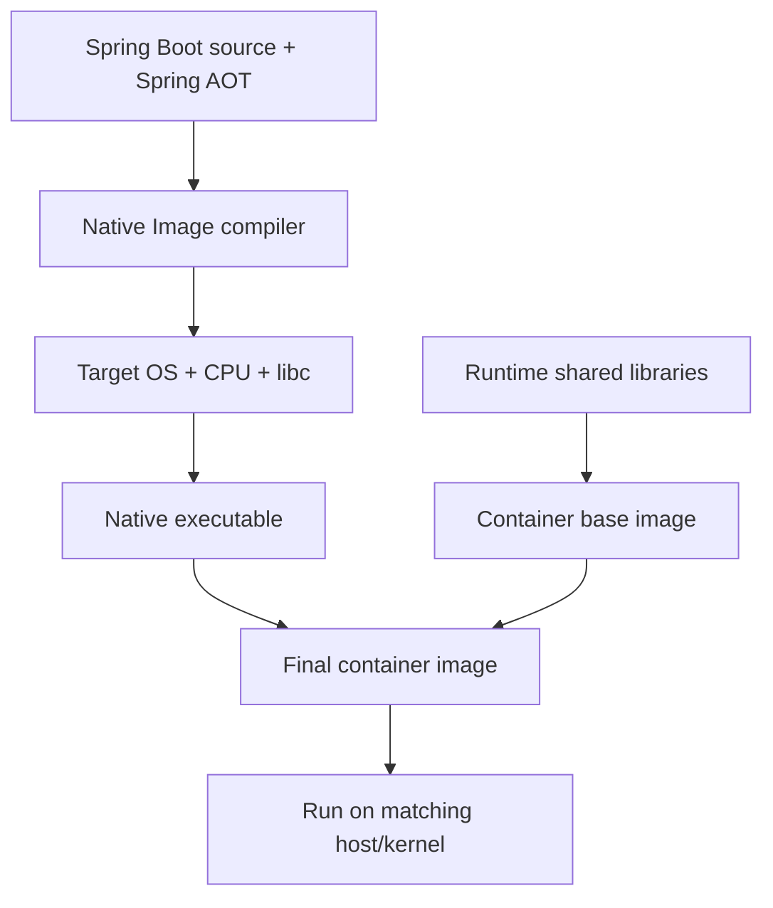

# Chọn runtime base image theo libc và các thư viện binary cần

## 1. Vì sao base image ảnh hưởng tới Native Image?

GraalVM Native Image tạo executable native theo hệ điều hành và kiến trúc CPU của target build. Binary này không phải Java bytecode portable có thể chạy trên mọi container. Nó phụ thuộc vào ABI, libc, dynamic loader và các shared libraries mà compiler/linker đã liên kết hoặc binary cần nạp lúc chạy.

Vì vậy, chọn container base image là một phần của thiết kế build và release. Một executable build trên Linux dùng glibc có thể không chạy trực tiếp trên image chỉ cung cấp musl; binary build cho amd64 không thể chạy như binary arm64; một shared library có trong builder nhưng thiếu ở runtime image cũng có thể gây lỗi khi process khởi động hoặc khi feature tương ứng được gọi.

Trong module **SPRING_BOOT_NATIVE_IMAGE**, cần ghép đúng ba yếu tố: target của native executable, runtime libraries cần thiết và base image triển khai. Image nhỏ nhất không phải lúc nào cũng là lựa chọn đúng nếu nó thiếu libc, CA certificates, timezone data hoặc thư viện hệ thống mà ứng dụng cần.



## 2. Phân biệt libc, ABI và shared library

**libc** là thư viện C runtime cung cấp các hàm cơ bản mà nhiều chương trình native phụ thuộc. Trên Linux, hai họ phổ biến là glibc và musl.

**ABI (Application Binary Interface)** xác định các quy ước nhị phân như calling convention, symbol, layout dữ liệu, dynamic linking và cách chương trình tương tác với thư viện/hệ điều hành. Cùng là Linux không có nghĩa mọi binary đều tương thích với nhau.

**Shared library** là thư viện native được nạp động khi process chạy, thường có dạng .so trên Linux. Một executable có thể cần libc, libstdc++, libgcc, thư viện SSL/crypto hoặc thư viện vendor khác tùy cách build và dependency.

| Khái niệm | Vai trò | Câu hỏi cần kiểm tra |
|---|---|---|
| OS/target | Môi trường binary được build cho | Linux, Windows hay macOS? |
| CPU architecture | Instruction set và binary format | amd64/x86_64 hay arm64/aarch64? |
| libc | C runtime và dynamic linking | glibc hay musl? |
| ABI | Tương thích nhị phân | Compiler/linker và libraries có cùng ABI? |
| Dynamic loader | Nạp executable/shared libraries | Loader path có tồn tại trong image? |
| Shared libraries | Dependency native lúc chạy | Mọi thư viện cần thiết có trong final image? |

## 3. glibc và musl

**glibc** là GNU C Library, được dùng rộng rãi trên nhiều Linux distribution như Debian, Ubuntu và các hệ thống enterprise Linux. Nó có hệ sinh thái package/debugging rộng và là lựa chọn phổ biến cho binary được build trong môi trường glibc.

**musl** là libc gọn nhẹ, thường được dùng trong Alpine Linux. Alpine có kích thước nhỏ, nhưng binary được build cho glibc không mặc nhiên chạy được trên musl. Một số binary cần dynamic loader hoặc symbol/version của glibc mà Alpine không cung cấp.

Không nên xem glibc luôn tốt hơn hoặc musl luôn nhỏ hơn trong mọi tình huống. Lựa chọn phụ thuộc target build, driver/native dependencies, chính sách bảo mật, kích thước image và khả năng hỗ trợ của vendor.

| Đặc điểm | glibc-based image | musl-based image |
|---|---|---|
| Ví dụ distribution | Debian, Ubuntu, UBI | Alpine |
| libc | glibc | musl |
| Binary compatibility | Với binary build phù hợp glibc/ABI | Với binary build phù hợp musl/ABI |
| Hệ sinh thái package | Rộng, phổ biến trong server | Nhỏ gọn, package theo Alpine |
| Rủi ro khi đổi nền | Thiếu shared library/version | Binary glibc không chạy trực tiếp nếu thiếu compatibility layer |
| Phù hợp | Native executable build target glibc | Executable build target musl và dependency hỗ trợ |

## 4. Chọn base image theo target binary

Trước khi chọn image, xác định executable được build cho target nào:

- Linux amd64 hay arm64.
- glibc hay musl.
- Dynamic hay static linking (nếu toolchain và dependencies hỗ trợ).
- Có cần thư viện native ngoài libc không.
- Có yêu cầu CA bundle, timezone database hoặc font không.

Nếu build binary Linux x86_64 liên kết động với glibc, hãy dùng runtime image có glibc tương thích. Debian slim hoặc Ubuntu minimal cùng kiến trúc thường là điểm khởi đầu dễ kiểm soát.

Nếu muốn dùng Alpine, cần build native executable tương thích musl theo hướng dẫn GraalVM/toolchain của version đang dùng và xác minh mọi dependency native. Chỉ đổi Dockerfile từ Debian sang Alpine không chuyển đổi ABI của binary đã build.

## 5. Dynamic linking và static linking

Với dynamic linking, executable tham chiếu tới shared libraries được nạp khi process chạy. Runtime image phải chứa các thư viện đó và dynamic loader phù hợp.

Với static linking, một số thư viện được liên kết vào executable, giảm phụ thuộc shared library tương ứng. Tuy nhiên, static linking không tự loại bỏ mọi dependency runtime: ứng dụng vẫn có thể cần DNS/NSS behavior, CA certificates, timezone data, file hệ thống hoặc thư viện được nạp động qua JNI.

Native Image có thể tạo binary với các lựa chọn linking tùy target/toolchain. Khả năng static linking, nhất là với musl, phụ thuộc GraalVM distribution, native toolchain và dependency. Không giả định chỉ thêm một flag là mọi thư viện đã được static link.

| Kiểu | Ưu điểm | Điều cần cân nhắc |
|---|---|---|
| Dynamic | Runtime image có thể chia sẻ thư viện hệ thống; dễ cập nhật package | Phải cung cấp đúng loader và shared libraries |
| Static | Giảm một số phụ thuộc runtime và đơn giản hóa image | Binary có thể lớn hơn; một số thư viện/behavior vẫn cần runtime files |
| Mixed | Một số thành phần static, một số dynamic | Cần kiểm tra chính xác dependency thực tế |

## 6. Kiểm tra binary trên Linux

Dùng công cụ của target environment để nhận diện binary:

```bash
file api-app
readelf -h api-app
readelf -l api-app
readelf -d api-app
```

Các lệnh này giúp xem ELF class và machine architecture, program interpreter/dynamic loader, dynamic section và shared library dependencies.

Xem các thư viện động:

```bash
ldd api-app
```

Chỉ chạy lệnh trên binary đáng tin cậy trong môi trường kiểm tra phù hợp. Với binary cross-compiled hoặc khi thiếu loader, ldd có thể không cung cấp kết quả như mong đợi; readelf là cách kiểm tra metadata ELF mà không cần thực thi binary.

Nếu image runtime chưa có ldd, kiểm tra binary trong builder/debug stage hoặc dùng công cụ tương ứng của distribution. Không cài thêm toolchain nặng vào final image chỉ để debug thường xuyên.

## 7. Kiểm tra dynamic loader

ELF có thể chỉ định interpreter, ví dụ đường dẫn dynamic loader glibc. Nếu đường dẫn này không tồn tại trong container, shell có thể báo lỗi kiểu “No such file or directory” dù file executable vẫn tồn tại.

Dùng:

```bash
readelf -l api-app | grep interpreter
```

Đối chiếu interpreter path với filesystem của runtime image. Binary musl và glibc có thể yêu cầu loader path khác nhau. Không tạo symlink giả tới loader khác libc để vượt qua lỗi; hai libc không thay thế nhị phân cho nhau một cách an toàn.

## 8. Kiểm tra shared libraries trong final image

Kiểm tra không chỉ executable mà cả JNI/native dependency. Một JDBC driver thường là Java bytecode, nhưng một số authentication provider, crypto provider, compression library hoặc client có thể dùng JNI/native code.

Các thư viện/dữ liệu cần có có thể gồm:

- libc và dynamic loader.
- libstdc++/libgcc nếu binary/dependency cần.
- OpenSSL hoặc crypto library nếu dependency liên kết động.
- CA certificates cho TLS.
- timezone database nếu ứng dụng cần timezone ngoài dữ liệu runtime tích hợp.
- fontconfig/fonts nếu xử lý PDF/image cần font hệ thống.
- thư viện vendor hoặc native client được nạp qua JNI.

Không cài mọi package theo danh sách này một cách mặc định. Dùng binary inspection, vendor documentation và integration tests để xác định dependency thực tế.

## 9. Debian slim làm runtime image

Debian slim thường là lựa chọn thuận tiện khi executable được build cho glibc. Ví dụ Dockerfile:

```dockerfile
FROM debian:bookworm-slim
WORKDIR /app

RUN apt-get update \
    && apt-get install -y --no-install-recommends ca-certificates \
    && rm -rf /var/lib/apt/lists/*

COPY build/native/nativeCompile/api-app /app/api-app

USER 10001
EXPOSE 8080
ENTRYPOINT ["/app/api-app"]
```

Đây là ví dụ minh họa. Chọn Debian release phù hợp với yêu cầu security/support và glibc version của binary. Cài package runtime cần thiết, giữ image cập nhật và pin digest trong pipeline nếu cần khả năng tái lập.

Nếu ứng dụng gọi HTTPS/database TLS, cần trust store phù hợp và phải test endpoint TLS trong final image.

## 10. Alpine làm runtime image

Alpine dùng musl. Dockerfile minh họa:

```dockerfile
FROM alpine:3.XX
WORKDIR /app
COPY build/native/nativeCompile/api-app /app/api-app
USER 10001
EXPOSE 8080
ENTRYPOINT ["/app/api-app"]
```

Placeholder version phải được thay bằng release Alpine được tổ chức hỗ trợ. Dockerfile này chỉ phù hợp nếu executable được build tương thích musl và các shared libraries/runtime files cần thiết đã có.

Nếu executable được build cho glibc, việc copy nó vào Alpine thường dẫn tới lỗi loader/library. Cài gói compatibility glibc không phải giải pháp mặc định; cần kiểm tra vendor support và toàn bộ dependency, vì compatibility layer không bảo đảm mọi symbol/behavior đều tương thích.

## 11. Distroless và image tối giản

Distroless image loại bỏ shell, package manager và nhiều công cụ quản trị khỏi runtime image. Lợi ích là giảm thành phần không cần thiết và bề mặt tấn công.

Tuy nhiên, image tối giản khiến việc debug trực tiếp khó hơn. Hãy xác minh:

- Có đúng libc và dynamic loader cần thiết.
- Có shared libraries mà executable cần.
- Có CA certificates/timezone/fonts nếu feature yêu cầu.
- User/group và filesystem permissions đúng.
- Entrypoint và signal handling đúng.
- Health check không phụ thuộc shell nếu image không có shell.

Nên kiểm tra executable trong debug stage hoặc image tương đương trước khi chuyển sang distroless. Không giả định distroless có mọi thư viện chỉ vì image có kích thước nhỏ hoặc được dùng cho Java.

## 12. Multi-stage build: builder và runtime không nhất thiết cùng image

Multi-stage build thường dùng một image/toolchain đầy đủ để compile và một image tối giản để chạy. Hai stage có thể khác nhau, nhưng runtime phải đáp ứng ABI và shared library requirements của binary được tạo ở builder.

Ví dụ khái quát:

```dockerfile
FROM ghcr.io/graalvm/native-image-community:VERSION AS builder
WORKDIR /workspace
COPY . .
RUN ./gradlew nativeCompile

FROM debian:bookworm-slim AS runtime
WORKDIR /app
COPY --from=builder /workspace/build/native/nativeCompile/api-app /app/api-app
USER 10001
EXPOSE 8080
ENTRYPOINT ["/app/api-app"]
```

Thay VERSION bằng image tag cụ thể và xác minh builder hỗ trợ đúng GraalVM Native Image version. Nếu builder tạo binary glibc, runtime Debian glibc tương thích thường dễ phối hợp. Nếu target musl, chọn toolchain/build image được hỗ trợ cho musl và runtime musl tương ứng.

Không copy toàn bộ thư mục build vào final image. Chỉ copy application executable và runtime files đã xác định.

## 13. Build target architecture đúng với runtime

Binary amd64 và arm64 khác instruction set. Một executable amd64 không chạy trực tiếp trên host arm64 nếu không có emulation phù hợp; emulation không phải mặc định production strategy.

Với Docker Buildx, có thể build multi-platform image, nhưng native compilation cần compiler/toolchain cho từng target hoặc cơ chế cross compilation được hỗ trợ. Không phải mọi Native Image toolchain đều cross-compile thuận tiện từ host architecture khác.

Quy trình đáng tin cậy là build binary cho từng target platform trong runner phù hợp, sau đó đóng gói manifest multi-arch. Kiểm tra ELF machine và thực thi smoke test trên runner/host architecture đích.

## 14. CA certificates, timezone và font

Một binary có thể khởi động nhưng một feature vẫn lỗi do thiếu dữ liệu hệ thống:

- TLS client không tin certificate vì thiếu CA bundle.
- Timezone formatting khác dự kiến do thiếu timezone database hoặc cấu hình.
- PDF/image rendering thiếu font hệ thống.
- Locale behavior khác nhau giữa image.
- DNS/NSS lookup không hoạt động theo cách dự kiến.

Các thành phần này không phải lúc nào cũng là shared library. Một số là file dữ liệu/runtime package. Hãy test chính feature cần chúng trong final image và cài đúng package tối thiểu.

Với timezone, xác định ứng dụng cần timezone nào và cấu hình TZ/timezone data theo runtime. Với font, phân phối font được cấp phép và đúng yêu cầu sản phẩm; tránh cài cả bộ font lớn nếu chỉ cần một family cụ thể.

## 15. JNI và thư viện native của dependency

Nếu thư viện Java gọi JNI, executable có thể cần shared library riêng. Kiểm tra:

- JNI library được build cho đúng OS/architecture.
- ABI/libc phù hợp.
- Dynamic dependencies của thư viện JNI cũng có trong image.
- Đường dẫn load library và quyền đọc/execute đúng.
- Runtime hints/JNI configuration phù hợp Native Image.
- Vendor hỗ trợ Native Image cho đúng version.

Một số thư viện giải nén native binary từ JAR vào thư mục tạm khi chạy. Khi đó container cần thư mục writable và file system policy phù hợp. Nếu root filesystem read-only, cấp writable temp volume theo yêu cầu thư viện.

## 16. Chọn image theo ma trận tương thích

| Native binary target | Runtime image | Điều kiện |
|---|---|---|
| Linux amd64 + glibc | Debian/Ubuntu/UBI glibc | glibc và shared libraries tương thích |
| Linux arm64 + glibc | Debian/Ubuntu/UBI arm64 | Đúng architecture và ABI |
| Linux amd64 + musl | Alpine amd64 | Binary và JNI dependencies build cho musl |
| Linux arm64 + musl | Alpine arm64 | Toolchain/vendor hỗ trợ target |
| Static/mixed binary | Image tối giản phù hợp | Vẫn xác minh runtime files và dynamic dependencies |

Đây là ma trận khái quát. Tag image, libc version và package thực tế phải được pin và kiểm thử theo release. Không kết luận chỉ từ tên distribution.

## 17. Quy trình kiểm thử final runtime image

Sau khi build image, chạy test trên image cuối cùng, không chỉ builder stage:

1. Xác nhận architecture và libc target của binary.
2. Kiểm tra dynamic loader và shared libraries.
3. Khởi động container bằng user production.
4. Chờ readiness endpoint.
5. Gọi endpoint nghiệp vụ có JSON/resource/database/TLS.
6. Kiểm tra JNI/native feature nếu ứng dụng dùng.
7. Kiểm tra volume, temp directory và filesystem permissions.
8. Gửi SIGTERM và xác nhận graceful shutdown.
9. Đo startup-to-ready, RSS và image size.
10. Ghi image digest, binary hash, toolchain và platform.

Nếu có nhiều target (amd64/arm64 hoặc glibc/musl), chạy pipeline cho từng target. Test trên một architecture không xác minh target còn lại.

## 18. Chẩn đoán lỗi do base image/libc

| Triệu chứng | Nguyên nhân có thể | Hướng kiểm tra |
|---|---|---|
| Executable tồn tại nhưng shell báo không tìm thấy | Dynamic loader path không có | readelf -l, kiểm tra interpreter |
| Error loading shared library | Thiếu .so hoặc sai library path | ldd/readelf -d, package list |
| GLIBC_x.y not found | Runtime glibc cũ hơn yêu cầu binary | Chọn base image glibc tương thích hoặc build target phù hợp |
| Binary glibc không chạy trên Alpine | musl không cung cấp ABI/symbol cần | Build musl target hoặc dùng glibc image |
| Exec format error | Sai CPU architecture hoặc binary format | file, ELF machine, image platform |
| TLS handshake fail | Thiếu CA/truststore hoặc TLS config | Kiểm tra CA bundle và driver config |
| PDF thiếu font | Final image không có font cần | Cài font cần thiết và test render |
| JNI UnsatisfiedLinkError | Native library thiếu/sai ABI | Kiểm tra library và dependency chain |
| Chỉ lỗi trong distroless | Thiếu runtime file/permission hoặc entrypoint | So sánh filesystem, user và loader |
| Chạy local nhưng fail container | Khác libc, loader, library hoặc permission | Reproduce trong final image |

Không xử lý lỗi ABI bằng cách copy ngẫu nhiên một file .so từ máy developer vào image. Dùng package tương thích với distribution và kiểm tra dependency chain.

## 19. Bảo mật và cập nhật base image

Base image là một phần của supply chain. Quản lý:

- Pin version hoặc digest theo chính sách.
- Theo dõi security updates của distribution.
- Rebuild image khi libc/openssl/CA package có bản vá.
- Quét CVE và đánh giá mức độ ảnh hưởng thực tế.
- Chạy process bằng non-root user.
- Giữ filesystem read-only khi ứng dụng hỗ trợ.
- Giảm package và shell không cần trong runtime.
- Lưu SBOM/image digest và build provenance.

Không giữ base image cũ chỉ vì binary từng chạy được. Nâng base image cần chạy lại native/container tests vì thay đổi libc hoặc shared libraries có thể ảnh hưởng behavior.

## 20. Checklist chọn runtime base image

- Đã xác định OS và CPU architecture của native executable.
- Đã xác định binary target glibc hay musl.
- Dynamic loader path tồn tại trong final image.
- Shared libraries và JNI dependencies cần thiết đều có.
- Runtime libc version đáp ứng symbol/version yêu cầu.
- CA certificates, timezone data, locale và fonts được cung cấp khi feature cần.
- User, permission, temp directory và read-only filesystem phù hợp.
- Builder/runtime compatibility được ghi lại.
- Native executable chạy feature tests trên final image.
- Multi-architecture targets được build/test riêng.
- Base image được pin, quét và cập nhật theo quy trình.

## 21. Câu hỏi tự kiểm tra

1. Vì sao Linux binary không mặc nhiên chạy được trên mọi Linux container?
2. Khác nhau giữa glibc và musl là gì?
3. ABI và dynamic loader ảnh hưởng thế nào tới native executable?
4. Làm thế nào dùng readelf và ldd để kiểm tra shared library dependencies?
5. Vì sao thêm compatibility package vào Alpine không phải lúc nào cũng giải quyết binary glibc?
6. Khi nào static linking vẫn cần runtime files như CA certificates hoặc timezone data?
7. Những yêu cầu nào cần kiểm tra khi dùng distroless?
8. Vì sao binary amd64 không thể được phát hành như binary arm64?
9. JNI dependency có thể làm phát sinh yêu cầu nào trong final image?
10. Những test nào phải chạy trên chính runtime image sẽ phát hành?

**Ghi nhớ:** chọn base image theo target OS/architecture, libc và shared libraries thực tế của native executable. Build đúng glibc hoặc musl, kiểm tra loader/ABI/dependencies, bổ sung runtime files cần thiết và chạy feature tests trên final container image trước khi phát hành.
