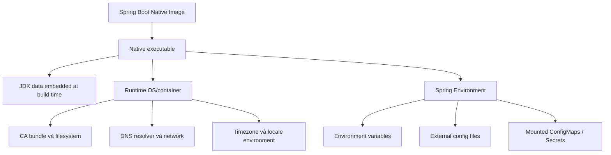

# Chứng thư CA, DNS, timezone, locale và tệp cấu hình ngoài

> **Chương:** Container  
> **Module:** `SPRING_BOOT_NATIVE_IMAGE`  
> **Mục tiêu:** Chuẩn bị môi trường container cho Spring Boot Native Image; quản lý CA trust store đúng theo build time/runtime; kiểm tra DNS và service discovery; cấu hình timezone, locale, charset; đưa cấu hình và secret ra ngoài executable; xác minh các thiết lập trên chính runtime image.

## 1. Vì sao môi trường container ảnh hưởng đến native executable?

Một native executable không mang theo toàn bộ hệ điều hành. Nó chứa application code, phần runtime cần thiết và các thành phần được Native Image đưa vào binary. Những dữ liệu và dịch vụ thuộc môi trường triển khai vẫn phải tồn tại trong container hoặc được mount vào lúc chạy.

Các lỗi thường gặp sau khi chuyển ứng dụng từ JVM sang native container:

- HTTPS tới API nội bộ lỗi vì CA của proxy doanh nghiệp không nằm trong trust store mà native executable sử dụng.
- Database hostname phân giải được trên máy phát triển nhưng không phân giải được trong Docker network hoặc Kubernetes namespace.
- Timestamp hiển thị sai vì timezone của builder, container và nghiệp vụ khác nhau.
- Số, tiền tệ, ngày tháng hoặc thông báo tiếng Việt sai định dạng vì locale data không được đưa vào native image.
- Ký tự Unicode bị lỗi khi đọc file, ghi log hoặc trao đổi với tiến trình khác vì charset mặc định khác môi trường build.
- Ứng dụng không nhận cấu hình sau khi deploy vì file nằm ngoài classpath nhưng không được mount hoặc import.
- Secret được đóng gói vào executable hoặc image, khiến việc xoay vòng credential cần build lại và làm lộ thông tin.

Cần phân biệt hai nhóm dữ liệu:

1. **Dữ liệu được cố định khi build native image:** reachability metadata, một số dữ liệu JDK được khởi tạo ở build time, default trust store mà Native Image capture, locale/charset data được chọn để đưa vào image.
2. **Dữ liệu được cung cấp khi chạy container:** DNS resolver, environment variables, file mount, secret, timezone environment, runtime trust store được cấu hình tường minh và application configuration.

Một cấu hình hoạt động trên JVM không tự động chứng minh nó sẽ hoạt động giống hệt trên native executable. Hãy kiểm tra trong final runtime image, với cùng filesystem, user, network và environment mà production sử dụng.

## 2. Bốn lớp cần phân biệt khi cấu hình container



| Lớp | Ví dụ | Thời điểm quyết định |
|---|---|---|
| Native executable | Default trust store được capture, locale/charset data được include | Build time, trừ cơ chế hỗ trợ override runtime |
| Runtime OS | `/etc/ssl/certs`, `/etc/resolv.conf`, `/etc/localtime`, zoneinfo | Khi tạo/chạy container |
| Spring Environment | `SPRING_DATASOURCE_URL`, `SPRING_CONFIG_IMPORT`, profile | Khi Spring Boot khởi động |
| External files | CA trust store, YAML, properties, secret files | Mount trước khi process khởi động hoặc reload theo cơ chế ứng dụng |

Không nên coi mọi tệp trong runtime image là resource của Native Image. Một file được mount ở `/etc/payment/application.yaml` là filesystem file; Spring Boot có thể đọc qua `file:` hoặc `configtree:` mà không cần khai báo nó như classpath resource. Ngược lại, file được đọc bằng `ClassPathResource` hoặc `ClassLoader.getResource()` phải có mặt trong artifact và có thể cần reachability metadata.

## 3. CA certificate, certificate chain và trust store

Khi ứng dụng kết nối HTTPS, client cần xác minh chứng thư máy chủ. Thông thường server gửi certificate cùng các intermediate certificate cần thiết; client xây dựng chain tới một root CA mà nó tin cậy, đồng thời kiểm tra thời hạn, mục đích sử dụng và hostname.

Một lỗi TLS không nhất thiết do Native Image thiếu reflection metadata. Hãy phân loại trước:

| Triệu chứng | Hướng điều tra |
|---|---|
| `PKIX path building failed` hoặc `unable to find valid certification path` | Root/intermediate CA không được tin cậy hoặc server gửi chain chưa đủ |
| `No subject alternative DNS name matching ...` | Hostname URL không khớp SAN của certificate |
| `certificate expired` hoặc `not yet valid` | Certificate hết hạn hoặc clock của container sai |
| `handshake_failure` | TLS protocol, cipher, client certificate hoặc security provider |
| `UnknownHostException` | DNS/name resolution, không phải CA trust |
| `Connection refused` hoặc timeout | Port, route, firewall, service endpoint hoặc server |

**Trust store** chứa các certificate mà client chấp nhận làm điểm tin cậy. CA certificate công khai có thể được đưa vào image hoặc trust store. Private key/client certificate dùng cho mutual TLS là dữ liệu nhạy cảm và phải được quản lý như secret; không đưa private key vào image build context.

Không tắt hostname verification, không dùng trust manager chấp nhận mọi certificate và không bỏ qua kiểm tra chain để “sửa nhanh” lỗi TLS. Hãy cài đúng CA và sửa chain/hostname ở phía phát hành certificate.

## 4. Điểm đặc biệt: Native Image capture default trust store ở build time

Đây là khác biệt rất quan trọng khi vận hành native executable.

Theo tài liệu GraalVM, mặc định Native Image builder capture default TrustStore của môi trường build và embed nội dung đó vào executable. TrustStore này thường được tạo từ root certificate file trong JDK; có thể chọn trust store khác bằng system property `javax.net.ssl.trustStore` khi build. Khi executable chạy, nếu không đặt các property `javax.net.ssl.trustStore*`, nó dùng trust store đã capture ở build time. [GraalVM — Certificate Management in Native Image](https://www.graalvm.org/latest/reference-manual/native-image/dynamic-features/CertificateManagement/)

Điều này dẫn đến ba tình huống:

| Cách cài CA | Tác động |
|---|---|
| CA chỉ được cài vào OS trust bundle của final runtime image | Các công cụ OS như `curl` có thể tin CA; không mặc định thay đổi trust store đã embed trong native executable |
| CA được thêm vào JDK trust store mà Native Image builder sử dụng trước khi compile | CA có thể được capture vào default trust store của executable |
| CA được cung cấp bằng trust store file và cấu hình `javax.net.ssl.trustStore*` lúc runtime | Native executable dùng trust store runtime nếu file tồn tại và có thể đọc |

Vì vậy, chỉ copy `company-root-ca.crt` vào `/usr/local/share/ca-certificates` trong final image rồi chạy `update-ca-certificates` có thể chưa đủ cho HTTPS do Java native executable thực hiện. Hãy xác minh trust store mà native binary thực sự sử dụng.

### 4.1. Chọn CA theo vòng đời triển khai

- Nếu CA ổn định, được quản lý cùng toolchain và có thể công khai trong binary, có thể đưa CA vào trust store của JDK ở build time.
- Nếu mỗi môi trường có CA khác nhau hoặc CA cần xoay vòng mà không build lại binary, cung cấp trust store riêng ở runtime.
- Nếu chỉ công cụ hệ điều hành cần truy cập HTTPS, OS CA bundle vẫn cần được cài trong runtime image.
- Nếu ứng dụng vừa gọi HTTPS bằng Java vừa chạy công cụ native ngoài, có thể phải quản lý cả JDK trust store và OS CA bundle.

Đừng đưa CA của môi trường staging hoặc production vào một binary dùng chung cho mọi môi trường nếu chính sách bảo mật không cho phép.

### 4.2. Cấu hình trust store runtime

GraalVM hỗ trợ đổi trust store lúc chạy bằng các system properties:

- `javax.net.ssl.trustStore`
- `javax.net.ssl.trustStoreType`
- `javax.net.ssl.trustStoreProvider`
- `javax.net.ssl.trustStorePassword`

Nếu một property thuộc nhóm này được đặt khi executable chạy, Native Image yêu cầu `javax.net.ssl.trustStore` trỏ tới file có thể truy cập. Nếu path không tồn tại hoặc không đọc được, có thể phát sinh `UnsupportedFeatureError`. Native Image không fallback giống OpenJDK sang `cacerts` trong JDK khi runtime path bị sai. [GraalVM — Runtime Trust Store Options](https://www.graalvm.org/latest/reference-manual/native-image/dynamic-features/CertificateManagement/)

Ví dụ cấu trúc mount:

```text
/run/certs/
  application-truststore.p12

/run/secrets/
  truststore-password
```

Có thể đọc path/password từ secret rồi đặt system properties trước khi khởi tạo HTTP client hoặc Spring context. Ví dụ minh họa:

```java
import java.nio.file.Files;
import java.nio.file.Path;

public final class RuntimeTrustStore {

    private RuntimeTrustStore() {
    }

    public static void configureFromEnvironment() throws Exception {
        String trustStorePath = System.getenv("APP_TRUST_STORE");
        String passwordFile = System.getenv("APP_TRUST_STORE_PASSWORD_FILE");

        if (trustStorePath == null || trustStorePath.isBlank()) {
            return; // Dùng trust store đã capture khi build.
        }

        Path store = Path.of(trustStorePath);
        if (!Files.isRegularFile(store) || !Files.isReadable(store)) {
            throw new IllegalStateException(
                    "Configured trust store is missing or unreadable");
        }

        System.setProperty("javax.net.ssl.trustStore", store.toString());
        System.setProperty("javax.net.ssl.trustStoreType", "PKCS12");

        if (passwordFile != null && !passwordFile.isBlank()) {
            String password = Files.readString(Path.of(passwordFile)).trim();
            System.setProperty(
                    "javax.net.ssl.trustStorePassword", password);
        }
    }
}
```

Gọi cấu hình này thật sớm, trước khi bất kỳ thư viện nào tạo default `SSLContext` hoặc khởi tạo HTTP client. Kiểm tra password file có quyền đọc giới hạn; không log password và không truyền password trong Dockerfile, image layer hoặc source control. Nếu HTTP client tự quản lý SSL context, hãy cấu hình trust store cho client đó theo API của thư viện.

Ví dụ gọi trước khi tạo Spring context:

```java
public static void main(String[] args) throws Exception {
    RuntimeTrustStore.configureFromEnvironment();
    SpringApplication.run(PaymentApplication.class, args);
}
```

### 4.3. Tạo trust store và kiểm tra certificate

Có thể dùng `keytool` của JDK để nhập root CA đã được xác minh vào PKCS12 trust store:

```bash
keytool -importcert -noprompt \
  -alias company-root \
  -file company-root-ca.crt \
  -keystore application-truststore.p12 \
  -storetype PKCS12
```

Lệnh sẽ yêu cầu password nếu không truyền password option. Hãy tạo file trong môi trường kiểm soát, xác minh fingerprint CA qua kênh tin cậy và chỉ mount trust store vào container cần dùng.

Có thể kiểm tra nội dung trust store:

```bash
keytool -list -keystore application-truststore.p12 -storetype PKCS12
```

Với HTTPS, kiểm tra chain và hostname từ đúng container/network path. Ví dụ khi image có `openssl`:

```bash
openssl s_client \
  -connect api.internal.example:443 \
  -servername api.internal.example \
  -verify_return_error
```

Đây là phép kiểm tra TLS từ OpenSSL, không thay thế integration test của Java HTTP client hoặc JDBC driver. Hai thành phần có thể dùng trust store khác nhau.

## 5. Cài CA vào Linux container image

Với Debian/Ubuntu, Docker hướng dẫn cài `ca-certificates`, copy certificate dạng `.crt` vào `/usr/local/share/ca-certificates/` và chạy `update-ca-certificates`. Các distro khác có package/path/lệnh tương ứng; không áp dụng nguyên xi lệnh Debian cho Alpine, RHEL hoặc distroless. [Docker Docs — Use CA Certificates with Docker](https://docs.docker.com/engine/network/ca-certs/)

Ví dụ cho runtime image Debian:

```dockerfile
FROM debian:bookworm-slim

RUN apt-get update \
    && apt-get install -y --no-install-recommends ca-certificates tzdata \
    && rm -rf /var/lib/apt/lists/*

COPY docker/certs/company-root-ca.crt \
    /usr/local/share/ca-certificates/company-root-ca.crt

RUN update-ca-certificates

COPY --from=build /workspace/target/application \
    /app/application

ENV TZ=Asia/Ho_Chi_Minh
ENV LANG=C.UTF-8
ENV LC_ALL=C.UTF-8

USER 10001:10001
ENTRYPOINT ["/app/application"]
```

Đây là ví dụ minh họa phần runtime stage; stage `build` cần được khai báo trước và phải tạo executable ở đúng đường dẫn. Nếu ứng dụng dùng trust store embed, certificate copy ở bước này chỉ cập nhật OS bundle; hãy đưa CA vào trust store của JDK builder hoặc cấu hình runtime trust store như phần trước.

Với image tối giản/distroless, có thể không có shell, package manager hoặc `update-ca-certificates`. Hãy chuẩn bị CA bundle trong stage có công cụ, sau đó copy bundle đã tạo vào đúng path mà runtime base image sử dụng. Kiểm tra tài liệu của base image, không giả định mọi image Linux có cùng đường dẫn trust store.

## 6. DNS và service discovery trong container

Ứng dụng native dùng resolver của môi trường runtime để phân giải hostname. Native compilation không biến hostname database thành IP cố định. Vì vậy, hãy cấu hình endpoint theo tên service và kiểm tra DNS trong network namespace của container.

### 6.1. Docker network

Docker có hai cách cấu hình resolver đáng chú ý:

- Container trên default bridge nhận bản sao cấu hình resolver từ host trong `/etc/resolv.conf`.
- Container trên user-defined network dùng embedded DNS server của Docker tại `127.0.0.11`. Resolver này chuyển tiếp truy vấn bên ngoài tới DNS server được cấu hình trên host.

Container có thể dùng service/container name trên user-defined network. Với Docker Compose, các service trong cùng network có thể kết nối bằng service name:

```yaml
services:
  payment-api:
    image: example/payment-api:native
    networks:
      - backend

  postgres:
    image: postgres:17
    networks:
      - backend

networks:
  backend:
```

URL database trong container:

```text
jdbc:postgresql://postgres:5432/payments
```

Không dùng `localhost` để trỏ tới một container khác. Trong container, `localhost` và `127.0.0.1` luôn trỏ về chính container đó. Nếu database chạy trên host, dùng cơ chế host gateway phù hợp với nền tảng hoặc địa chỉ host được quản trị viên cấp.

Docker có thể cấu hình DNS server tường minh bằng option `--dns`. Chỉ đặt DNS server nội bộ khi network thực tế cho phép container truy cập địa chỉ đó; không sao chép một địa chỉ resolver loopback của host vào container. [Docker Docs — Networking Overview](https://docs.docker.com/engine/network/)

### 6.2. Kubernetes service DNS

Trong Kubernetes, Service thường được phân giải theo tên trong namespace. Một service tên `postgres` trong namespace `database` thường có FQDN:

```text
postgres.database.svc.cluster.local
```

Cluster domain có thể được tùy chỉnh, vì vậy nên dùng DNS name do nền tảng công bố. Pod trong cùng namespace thường có thể dùng service name ngắn:

```text
jdbc:postgresql://postgres:5432/payments
```

Kubernetes tạo DNS records cho Service và cấu hình Pod dùng cluster DNS. Không hard-code ClusterIP vì địa chỉ đó có thể thay đổi khi service được tạo lại. [Kubernetes Docs — DNS for Services and Pods](https://kubernetes.io/docs/concepts/services-networking/dns-pod-service/)

### 6.3. Chẩn đoán DNS từ đúng network namespace

Nếu image có shell và công cụ tương ứng:

```bash
cat /etc/resolv.conf
getent hosts postgres
getent hosts api.internal.example
```

Nếu không có `getent`, `nslookup` hoặc shell trong distroless image, dùng debug container/ephemeral container hoặc một image chẩn đoán trên cùng network. Đừng cài công cụ debug vào production image chỉ để dùng tạm.

Phân biệt kết quả:

- DNS lookup thất bại: kiểm tra resolver, search domain, network policy và DNS service.
- DNS thành công nhưng TCP timeout: kiểm tra route, firewall, NetworkPolicy và endpoint.
- TCP kết nối được nhưng TLS lỗi: kiểm tra CA, certificate chain, hostname và clock.
- TLS thành công nhưng HTTP lỗi: kiểm tra authentication, path, proxy và application protocol.

Tránh cấu hình IP tĩnh trong application properties để che lỗi DNS. Hãy sửa service discovery hoặc resolver.

## 7. Timezone: phân biệt timezone của OS và timezone của ứng dụng

Timezone của container ảnh hưởng các công cụ hệ điều hành, log native và những API dựa trên system default. Java có thêm timezone rules database để tính offset lịch sử và daylight saving time theo ID vùng.

Dùng ID IANA rõ ràng, ví dụ:

- `UTC` hoặc `Etc/UTC` cho timestamp kỹ thuật và hệ thống phân tán.
- `Asia/Ho_Chi_Minh` cho hiển thị giờ địa phương Việt Nam.
- `America/New_York` hoặc `Europe/Paris` khi nghiệp vụ thực sự gắn với vùng đó.

Không dùng một offset cố định như `GMT+7` để thay thế timezone vùng nếu nghiệp vụ cần quy tắc lịch sử hoặc daylight saving time.

### 7.1. Cấu hình timezone của Linux container

Trên image có tzdata, có thể đặt:

```dockerfile
ENV TZ=Asia/Ho_Chi_Minh
```

Một số image cần package `tzdata` và file zoneinfo tại `/usr/share/zoneinfo`. Có thể kiểm tra:

```bash
date
readlink -f /etc/localtime
test -e /usr/share/zoneinfo/Asia/Ho_Chi_Minh
```

Nếu container dùng timezone UTC cho log và xử lý kỹ thuật, đặt `TZ=Etc/UTC`. Nếu cần hiển thị giờ Việt Nam, ưu tiên chuyển đổi ở lớp presentation theo timezone nghiệp vụ thay vì đổi toàn bộ clock hệ thống.

### 7.2. Cấu hình timezone trong Java/Spring

`ZoneId.systemDefault()` trả về timezone mặc định của runtime. `ZoneId.of("Asia/Ho_Chi_Minh")` biểu diễn một vùng cụ thể có quy tắc riêng. Java dùng TZDB để tra zone rules; quy tắc timezone có thể thay đổi theo quyết định của chính phủ và được cập nhật theo phiên bản dữ liệu mới. [Java SE — ZoneId](https://docs.oracle.com/en/java/javase/25/docs/api/java.base/java/time/ZoneId.html), [Java SE — ZoneRulesProvider](https://docs.oracle.com/en/java/javase/25/docs/api/java.base/java/time/zone/ZoneRulesProvider.html)

Trong nghiệp vụ, nên truyền timezone rõ ràng khi format:

```java
ZoneId businessZone = ZoneId.of("Asia/Ho_Chi_Minh");

ZonedDateTime localTime = instant.atZone(businessZone);

String display = DateTimeFormatter
        .ofPattern("dd/MM/yyyy HH:mm")
        .withLocale(Locale.forLanguageTag("vi-VN"))
        .format(localTime);
```

Với timestamp cần trao đổi giữa service, lưu `Instant` hoặc giá trị có offset; không lưu giờ địa phương dạng `LocalDateTime` rồi giả định mọi hệ thống hiểu cùng một timezone. `LocalDateTime` không chứa offset hoặc zone ID.

Nếu đặt system default ở build time hoặc khởi tạo timezone trong static initializer, native image có thể giữ trạng thái đã khởi tạo. Hãy kiểm tra executable trong runtime container có TZ khác builder và không cache `ZoneId.systemDefault()` ở build-time state nếu ứng dụng cần quyết định theo môi trường chạy.

Với dữ liệu JDBC, có thể cấu hình Hibernate dùng UTC cho thao tác timestamp:

```yaml
spring:
  jpa:
    properties:
      hibernate:
        jdbc:
          time_zone: UTC
```

Đồng bộ timezone giữa ứng dụng, database session và nghiệp vụ. Việc đặt `TZ` không tự thay thế cấu hình timezone của database hoặc formatter.

## 8. Locale và charset: OS locale không phải Java locale data

Locale ảnh hưởng định dạng số, tiền tệ, ngày tháng, tên ngôn ngữ và một số hành vi so sánh/format. Java xác định default locale khi runtime khởi động dựa trên các system properties như `user.language`, `user.country` và thông tin host. [Java SE — Locale](https://docs.oracle.com/en/java/javase/25/docs/api/java.base/java/util/Locale.html)

Charset quyết định cách byte được giải mã/ghi ra text. Java String dùng Unicode, nhưng khi đọc file, ghi stdout hoặc giao tiếp với native process, encoding mặc định và charset được chọn vẫn quan trọng.

### 8.1. Cấu hình locale của hệ điều hành

Trong image Debian/glibc, có thể đặt locale UTF-8 nếu locale đó được hỗ trợ:

```dockerfile
ENV LANG=C.UTF-8
ENV LC_ALL=C.UTF-8
```

Không phải base image nào cũng có cùng bộ locale hoặc cùng package. Kiểm tra bằng `locale`/`locale -a` khi image có các lệnh đó. Alpine, Debian, UBI và distroless có cách cung cấp locale khác nhau; không mặc định `C.UTF-8` tồn tại trên mọi image.

OS locale ảnh hưởng các chương trình native và một số thư viện hệ thống. Nó không tự bảo đảm Native Image có đủ locale data cho `java.text` và `java.util`.

### 8.2. Include locale data khi build Native Image

GraalVM cho phép chọn locale được include trong executable. Ví dụ nếu ứng dụng cần tiếng Việt và tiếng Anh:

```text
-Duser.language=vi
-Duser.country=VN
-H:IncludeLocales=vi,en
```

Đây là các build arguments cho Native Image; cấu hình chúng qua native build plugin hoặc buildpack arguments của phiên bản toolchain đang dùng. `-Duser.language` và `-Duser.country` chọn default locale; `-H:IncludeLocales` chỉ định locale data cần đóng gói.

Có thể dùng `-H:+IncludeAllLocales` để đưa tất cả locale vào image, nhưng binary sẽ lớn hơn. Chỉ include những locale ứng dụng thực sự cần. [GraalVM — Reachability Metadata: Locales](https://www.graalvm.org/latest/reference-manual/native-image/metadata/)

Trong code nghiệp vụ, truyền locale tường minh:

```java
Locale vietnamese = Locale.forLanguageTag("vi-VN");

NumberFormat currency = NumberFormat
        .getCurrencyInstance(vietnamese);

DateTimeFormatter formatter = DateTimeFormatter
        .ofLocalizedDate(FormatStyle.LONG)
        .withLocale(vietnamese);
```

Không phụ thuộc vào default locale của builder nếu ứng dụng có nhiều tenant hoặc người dùng ở nhiều quốc gia.

### 8.3. Charset và Unicode

Nếu ứng dụng chỉ dùng charset mặc định UTF-8 thì không cần include mọi charset. Nếu ứng dụng phải đọc/ghi các encoding bổ sung, Native Image hỗ trợ:

```text
-H:+AddAllCharsets
```

Option này có thể tăng kích thước binary. Hãy chọn theo yêu cầu thực tế, ví dụ tích hợp file CSV legacy, hệ thống mainframe hoặc dữ liệu có encoding không phải UTF-8. [GraalVM — Troubleshoot Native Image Run-Time Errors](https://www.graalvm.org/latest/reference-manual/native-image/guides/troubleshoot-run-time-errors/)

Native Image có thể mang theo các system properties như `file.encoding` và `native.encoding` được xác định khi build. Vì vậy, đặt builder environment và build configuration về UTF-8 một cách nhất quán, rồi kiểm tra giá trị trong executable. Không chỉ đổi `LANG` ở final runtime image rồi mặc định Java default encoding đã thay đổi theo.

Ví dụ kiểm tra lúc chạy:

```java
System.out.println("defaultLocale=" + Locale.getDefault());
System.out.println("defaultZone=" + ZoneId.systemDefault());
System.out.println("fileEncoding=" + System.getProperty("file.encoding"));
System.out.println("nativeEncoding=" + System.getProperty("native.encoding"));
```

Test cả chuỗi tiếng Việt có dấu, ký tự ngoài ASCII, đọc file UTF-8, ghi log và round-trip dữ liệu qua database/API.

## 9. Spring Boot externalized configuration

Spring Boot hỗ trợ cấu hình từ file, environment variables, system properties, command-line arguments và configuration trees. Đây là cách tách cùng một native executable khỏi cấu hình của từng môi trường.

Mặc định Spring Boot tìm `application.properties`/`application.yaml` trong classpath root, classpath `/config`, current directory và các thư mục cấu hình ngoài như `./config/`. File ngoài có thể ghi đè cấu hình mặc định được đóng gói trong application artifact.

Hai property cần phân biệt:

- `spring.config.location` thay thế các vị trí tìm cấu hình mặc định.
- `spring.config.additional-location` thêm vị trí ngoài vào danh sách mặc định; giá trị từ vị trí bổ sung có thể ghi đè giá trị trước đó.

Ví dụ cấu hình thêm thư mục ngoài:

```bash
SPRING_CONFIG_ADDITIONAL_LOCATION=file:/etc/payment/
```

Hoặc truyền trực tiếp khi khởi chạy:

```bash
./application --spring.config.additional-location=file:/etc/payment/
```

Các property quyết định nơi đọc config được xử lý rất sớm. Vì vậy, `spring.config.name`, `spring.config.location` và `spring.config.additional-location` cần được cung cấp qua environment, system property hoặc command line, không nên chờ tới khi bean ứng dụng đã được tạo. [Spring Boot — Externalized Configuration](https://docs.spring.io/spring-boot/reference/features/external-config.html)

### 9.1. File cấu hình ngoài image

Một thư mục triển khai có thể được mount như sau:

```text
/etc/payment/
  application.yaml
  application-production.yaml
```

Ví dụ `application.yaml` bên ngoài:

```yaml
spring:
  datasource:
    url: jdbc:postgresql://postgres.database.svc.cluster.local:5432/payments
  jpa:
    open-in-view: false

server:
  port: 8080
```

Chọn profile bằng environment:

```bash
SPRING_PROFILES_ACTIVE=production
```

Với native executable, file phải tồn tại và đọc được khi Spring Boot bắt đầu. File được mount sau khi process khởi động không tự động được nạp lại. Spring Boot chuẩn không tự watch mọi external file để refresh toàn bộ bean; nếu cần reload, hãy dùng cơ chế refresh được hỗ trợ hoặc restart instance sau khi cập nhật cấu hình.

### 9.2. Environment variables

Có thể đặt cấu hình trực tiếp bằng environment:

```text
SPRING_DATASOURCE_URL=jdbc:postgresql://postgres:5432/payments
SPRING_DATASOURCE_USERNAME=payment_app
SERVER_PORT=8080
SPRING_PROFILES_ACTIVE=production
```

Environment variables thuận tiện cho giá trị không bí mật và cấu hình ngắn. Không truyền password, token hoặc private key qua command line vì thông tin tiến trình có thể bị quan sát bởi công cụ quản trị.

## 10. Configuration tree cho secret và Docker/Kubernetes mounts

Spring Boot có thể đọc một thư mục file như một tập property bằng prefix `configtree:`. Tên file trở thành property key, nội dung file trở thành property value. Cách này phù hợp với Kubernetes Secrets, Docker Swarm secrets và secret volume do nền tảng cung cấp.

Ví dụ cấu trúc thư mục:

```text
/run/secrets/
  spring.datasource.username
  spring.datasource.password
  payment.partner.api-key
```

Import vào Spring Environment:

```yaml
spring:
  config:
    import: configtree:/run/secrets/
```

Khi cần cho phép secret không có ở một số môi trường, dùng prefix `optional:`:

```yaml
spring:
  config:
    import: optional:configtree:/run/secrets/
```

Nếu ứng dụng không thể hoạt động khi thiếu secret, bỏ `optional:` để startup thất bại sớm. Không dùng optional cho credential bắt buộc chỉ để container có thể “lên xanh” rồi mới lỗi khi xử lý request.

Có thể đặt secret ở một config tree riêng và import wildcard nếu có nhiều nhóm cấu hình:

```yaml
spring:
  config:
    import: optional:configtree:/etc/config/*/
```

Có thể truyền import từ environment nếu không muốn đặt trong file cấu hình:

```bash
SPRING_CONFIG_IMPORT=optional:configtree:/run/secrets/
```

Spring Boot cũng hỗ trợ đọc file extensionless bằng extension hint và hỗ trợ config tree values dưới dạng `String` hoặc `byte[]` tùy kiểu dữ liệu. [Spring Boot — Using Configuration Trees](https://docs.spring.io/spring-boot/reference/features/external-config.html#features.external-config.files.configtree)

### 10.1. Kubernetes ConfigMap và Secret

Ví dụ Deployment mount file cấu hình và secret read-only:

```yaml
apiVersion: apps/v1
kind: Deployment
metadata:
  name: payment-api
spec:
  replicas: 2
  selector:
    matchLabels:
      app: payment-api
  template:
    metadata:
      labels:
        app: payment-api
    spec:
      securityContext:
        runAsNonRoot: true
        runAsUser: 10001
        runAsGroup: 10001
      containers:
        - name: payment-api
          image: example/payment-api:native
          env:
            - name: SPRING_CONFIG_ADDITIONAL_LOCATION
              value: file:/etc/payment/
          volumeMounts:
            - name: app-config
              mountPath: /etc/payment
              readOnly: true
            - name: app-secrets
              mountPath: /run/secrets
              readOnly: true
      volumes:
        - name: app-config
          configMap:
            name: payment-api-config
        - name: app-secrets
          secret:
            secretName: payment-api-secrets
            defaultMode: 0440
```

Nếu ứng dụng dùng config tree, thêm import `configtree:/run/secrets/` trong cấu hình đã đóng gói hoặc environment. Kiểm tra user/group của container có quyền đọc volume. Với một số cluster, cần đặt `fsGroup` phù hợp theo chính sách bảo mật để process non-root đọc được secret volume.

Không mount secret read-write nếu ứng dụng chỉ cần đọc. Không copy secret vào image bằng Dockerfile `COPY` hoặc build argument. Khi cần thay đổi secret, xác nhận ứng dụng có reload hay cần restart Pod; file mount được cập nhật không có nghĩa Spring bean đã tự refresh.

### 10.2. Docker Compose và Docker secrets

Trong môi trường local, Compose có thể mount config và secret từ file:

```yaml
services:
  payment-api:
    image: example/payment-api:native
    environment:
      SPRING_CONFIG_ADDITIONAL_LOCATION: file:/etc/payment/
    volumes:
      - ./deploy/application.yaml:/etc/payment/application.yaml:ro
      - ./secrets:/run/secrets:ro
    networks:
      - backend
```

Thư mục `./secrets` phải được quản lý ngoài source control và có quyền truy cập phù hợp. Không commit file secret thật vào repository. Docker Compose file-based secrets có thể tiện cho local development; production nên dùng secret mechanism phù hợp với nền tảng.

## 11. External configuration và native image resource metadata

Cần phân biệt cách ứng dụng mở file:

| Cách truy cập | Ví dụ | Cách đóng gói |
|---|---|---|
| Classpath resource | `ClassPathResource("defaults.yaml")` | Phải nằm trong JAR/native build input; có thể cần resource metadata |
| File hệ điều hành | `file:/etc/payment/application.yaml` | Mount/copy vào filesystem runtime; kiểm tra quyền đọc |
| Configuration tree | `configtree:/run/secrets/` | Mount thư mục, tên file trở thành property key |
| Environment variable | `SPRING_DATASOURCE_URL` | Inject khi tạo container/Pod |

Native Image không cần nhúng một file cấu hình ngoài chỉ vì Spring Boot đọc nó bằng `file:`. Ngược lại, nếu ứng dụng gọi `getResource()` để đọc file từ classpath theo tên động, hãy kiểm tra resource có được giữ trong executable.

Không đưa environment-specific configuration vào binary nếu có thể cung cấp lúc deploy. Giữ default không nhạy cảm trong artifact; để hostname, port, credentials, feature flags và endpoint theo môi trường ở ngoài. Điều này giúp một binary đã ký có thể triển khai qua dev, staging và production với cấu hình khác nhau.

## 12. Ví dụ runtime image cho native executable

Một final image có thể chứa native executable cùng những thành phần OS thật sự cần thiết. Ví dụ Debian slim:

```dockerfile
FROM debian:bookworm-slim

RUN apt-get update \
    && apt-get install -y --no-install-recommends ca-certificates tzdata \
    && rm -rf /var/lib/apt/lists/*

WORKDIR /app

COPY --from=build /workspace/target/application /app/application

ENV TZ=Etc/UTC
ENV LANG=C.UTF-8
ENV LC_ALL=C.UTF-8

USER 10001:10001

ENTRYPOINT ["/app/application"]
```

Ví dụ giả định stage `build` đã tạo executable Linux đúng architecture/ABI với runtime image. Chọn base image tương thích với cách native executable được build, đặc biệt là glibc/musl và shared libraries mà binary cần. Một binary được build cho glibc không thể mặc định chạy trên Alpine/musl.

Nếu cần CA cho lệnh OS, cài OS package và update CA bundle trong final image. Nếu Java native executable cần một CA bổ sung, nhớ rằng default TrustStore có thể đã được capture lúc build; cài OS CA ở final stage không tự cập nhật TrustStore embedded. Với CA runtime thay đổi theo môi trường, mount trust store và cấu hình rõ ràng như mục 4.2.

Nếu bật read-only root filesystem, chỉ cấp writable path cho những thành phần thực sự cần ghi, ví dụ `/tmp` qua tmpfs/emptyDir. Application config, certificate và secret nên mount read-only. Chạy bằng non-root user và cấp quyền tối thiểu để đọc executable, config và trust store.

## 13. Kiểm tra cấu hình ngay trong container

Đừng chỉ kiểm tra trên host. Hãy chạy các phép thử từ đúng network namespace, filesystem, user và environment của final image.

### 13.1. DNS và network

```bash
cat /etc/resolv.conf
getent hosts postgres
getent hosts api.internal.example
```

Nếu final image không có `getent`, `nslookup` hoặc shell trong distroless image, dùng debug container/ephemeral container hoặc một image chẩn đoán trên cùng network. Đừng cài công cụ debug vào production image chỉ để dùng tạm.

Sau khi DNS thành công, kiểm tra TCP/HTTP/TLS tới đúng port và hostname. Phân biệt kết quả:

- DNS lookup thất bại: kiểm tra resolver, search domain, network policy và DNS service.
- DNS thành công nhưng TCP timeout: kiểm tra route, firewall, NetworkPolicy và endpoint.
- TCP kết nối được nhưng TLS lỗi: kiểm tra CA, certificate chain, hostname và clock.
- TLS thành công nhưng HTTP lỗi: kiểm tra authentication, path, proxy và application protocol.

### 13.2. CA và TLS

```bash
keytool -list -keystore /run/certs/application-truststore.p12 \
  -storetype PKCS12
```

Kiểm tra bằng Java HTTP client/JDBC integration test là bước bắt buộc nếu chính Java native executable thực hiện kết nối. `curl` hoặc `openssl` thành công chỉ chứng minh OS trust store và network path của công cụ đó hoạt động.

### 13.3. Timezone, locale và charset

```bash
date -Is
printenv TZ
printenv LANG
printenv LC_ALL
readlink -f /etc/localtime
```

Trong ứng dụng, ghi log các giá trị chẩn đoán sau khi khởi động:

```java
log.info("defaultZone={}", ZoneId.systemDefault());
log.info("defaultLocale={}", Locale.getDefault());
log.info("fileEncoding={}", System.getProperty("file.encoding"));
log.info("nativeEncoding={}", System.getProperty("native.encoding"));
```

Không log toàn bộ environment hoặc dump secret để chẩn đoán. Chỉ in các biến không nhạy cảm cần kiểm tra.

### 13.4. External configuration

Kiểm tra:

- Config file có mount đúng path và process non-root có thể đọc không.
- `SPRING_CONFIG_ADDITIONAL_LOCATION` có trỏ tới thư mục kết thúc bằng slash không.
- File profile-specific có tên và profile đúng không.
- Secret file có đúng tên property và nội dung không có newline thừa gây lỗi parsing.
- Required config thiếu thì ứng dụng có fail fast hay không.
- Giá trị được bind vào bean có đúng sau khi Spring context khởi tạo không.

Có thể kiểm tra một property không nhạy cảm qua log startup có chọn lọc hoặc test endpoint nội bộ đã được bảo vệ. Không expose Actuator `env` hoặc `configprops` công khai chỉ để debug cấu hình.

## 14. Những lỗi thường gặp và cách chẩn đoán

| Triệu chứng | Nguyên nhân có thể | Cần kiểm tra |
|---|---|---|
| Java HTTPS lỗi nhưng `curl` thành công | Native executable dùng TrustStore embed khác OS CA bundle | TrustStore build time và runtime properties |
| `UnsupportedFeatureError` khi TLS | Đặt một property `javax.net.ssl.trustStore*` nhưng file trust store không truy cập được | Path, type, permission và secret mount |
| `UnknownHostException` | Service name sai, resolver hoặc namespace sai | `/etc/resolv.conf`, Docker network, Kubernetes DNS |
| DNS được nhưng connection timeout | NetworkPolicy, firewall, route hoặc endpoint | TCP path và service endpoints |
| Timestamp sai | TZ của container/Java khác timezone nghiệp vụ hoặc zone rules cũ | `TZ`, tzdata, JDK TZDB, `ZoneId.systemDefault()` |
| Tiếng Việt bị lỗi trong log/file | Charset build/runtime hoặc tool đọc file không thống nhất | `file.encoding`, `native.encoding`, UTF-8 |
| Currency/date format không đúng | Locale mặc định hoặc locale data chưa include | `user.language`, `user.country`, `-H:IncludeLocales` |
| External YAML không được nạp | Dùng sai location property hoặc mount path | `spring.config.location` vs `spring.config.additional-location` |
| Secret property rỗng | Config tree không import hoặc tên file không map đúng key | `spring.config.import`, tree path và quyền đọc |
| ConfigMap đã cập nhật nhưng app không đổi | Spring context không tự reload mọi external file | Restart/refresh mechanism |
| Container chạy trên host nhưng fail ở Kubernetes | User, architecture, filesystem, DNS hoặc mounted volume khác | Test final image trên đúng runtime platform |

## 15. Quy trình kiểm chứng trước khi phát hành

1. **Chốt runtime base image:** xác định distro, libc, architecture, user và shared libraries cần thiết.
2. **Chọn chiến lược CA:** quyết định CA được capture vào JDK trust store lúc build hay được mount qua runtime trust store.
3. **Kiểm tra TLS:** xác minh chain, hostname, validity và Java HTTP/JDBC client trên native executable.
4. **Kiểm tra DNS:** dùng service DNS name trong Docker/Kubernetes và test từ đúng network namespace.
5. **Chọn timezone:** dùng IANA zone ID, thống nhất với database và quy tắc nghiệp vụ.
6. **Chọn locale/charset:** include đúng locale/charset cần thiết khi build; giữ UTF-8 nhất quán.
7. **Tách cấu hình:** đóng gói default không nhạy cảm, mount environment config và secret lúc runtime.
8. **Kiểm tra quyền:** chạy non-root, mount config/secret read-only và bảo đảm process đọc được file.
9. **Chạy test trong final image:** không chỉ test builder stage hoặc chạy executable trực tiếp trên máy phát triển.
10. **Kiểm tra xoay vòng:** thay CA/secret/config theo quy trình thực tế và xác nhận cần restart hay có reload.
11. **Ghi baseline:** lưu image digest, Native Image/GraalVM version, CA strategy, timezone, locale và cấu hình runtime đã kiểm thử.

## 16. Checklist CA, DNS, timezone, locale và external config

- [ ] Xác định rõ OS CA bundle và Java/native TrustStore là hai cơ chế có thể khác nhau.
- [ ] Đã biết Native Image capture default TrustStore từ môi trường build.
- [ ] Nếu dùng runtime trust store, file tồn tại và đọc được trước khi TLS khởi tạo.
- [ ] Không đặt `javax.net.ssl.trustStore*` trỏ tới file không tồn tại.
- [ ] CA certificate đã được xác minh fingerprint; private key không nằm trong image.
- [ ] Không tắt certificate chain hoặc hostname verification.
- [ ] DNS dùng service name/FQDN, không hard-code IP hoặc nhầm `localhost`.
- [ ] Đã kiểm tra resolver từ container/Pod thực tế.
- [ ] Timezone dùng IANA ID và có zone data cần thiết trong runtime.
- [ ] Timestamp kỹ thuật được chuẩn hóa; timezone hiển thị được chọn rõ ràng.
- [ ] Locale data cần thiết đã được include trong native executable.
- [ ] Charset UTF-8 được kiểm tra cả trong builder lẫn final runtime.
- [ ] `spring.config.location` và `spring.config.additional-location` được dùng đúng mục đích.
- [ ] Config tree được import bằng `configtree:` và file name map đúng property.
- [ ] Secret được mount read-only, không được bake vào image hoặc source control.
- [ ] Non-root process có quyền đọc config, certificate và secret.
- [ ] Final image đã được test với cùng network, filesystem và environment như production.
- [ ] Đã xác định quy trình restart/reload sau khi cập nhật config hoặc secret.

## 17. Ghi nhớ

Một native executable chỉ giải quyết phần code và runtime đã được đưa vào binary. CA trust store, DNS, timezone, locale, charset và cấu hình môi trường vẫn phụ thuộc vào cách build và runtime container được chuẩn bị.

Điểm cần nhớ nhất là default TrustStore của Native Image có thể được capture lúc build, nên OS CA bundle ở final image không mặc nhiên thay đổi trust store của Java. DNS phải được kiểm tra trong network namespace thực tế; timezone và locale cần được cấu hình nhất quán giữa builder, binary và runtime; cấu hình/secret nên được mount ngoài image và import bằng cơ chế externalized configuration của Spring Boot.

Hãy xác minh mọi thiết lập trên chính final runtime image, chạy bằng non-root user và với network, volume, CA, timezone, locale giống production. Khi đó một binary native có thể được tái sử dụng giữa các môi trường mà không phải nhúng hostname, credential hoặc cấu hình triển khai vào executable.

### Tài liệu tham khảo

- [Spring Boot — Externalized Configuration](https://docs.spring.io/spring-boot/reference/features/external-config.html)
- [Spring Boot — Using Configuration Trees](https://docs.spring.io/spring-boot/reference/features/external-config.html#features.external-config.files.configtree)
- [GraalVM — Certificate Management in Native Image](https://www.graalvm.org/latest/reference-manual/native-image/dynamic-features/CertificateManagement/)
- [GraalVM — Reachability Metadata and Locales](https://www.graalvm.org/latest/reference-manual/native-image/metadata/)
- [GraalVM — Troubleshoot Native Image Run-Time Errors](https://www.graalvm.org/latest/reference-manual/native-image/guides/troubleshoot-run-time-errors/)
- [Docker Docs — Use CA Certificates with Docker](https://docs.docker.com/engine/network/ca-certs/)
- [Docker Docs — Networking Overview](https://docs.docker.com/engine/network/)
- [Kubernetes Docs — DNS for Services and Pods](https://kubernetes.io/docs/concepts/services-networking/dns-pod-service/)
- [Java SE — Locale](https://docs.oracle.com/en/java/javase/25/docs/api/java.base/java/util/Locale.html)
- [Java SE — ZoneId](https://docs.oracle.com/en/java/javase/25/docs/api/java.base/java/time/ZoneId.html)
- [Java SE — ZoneRulesProvider](https://docs.oracle.com/en/java/javase/25/docs/api/java.base/java/time/zone/ZoneRulesProvider.html)
