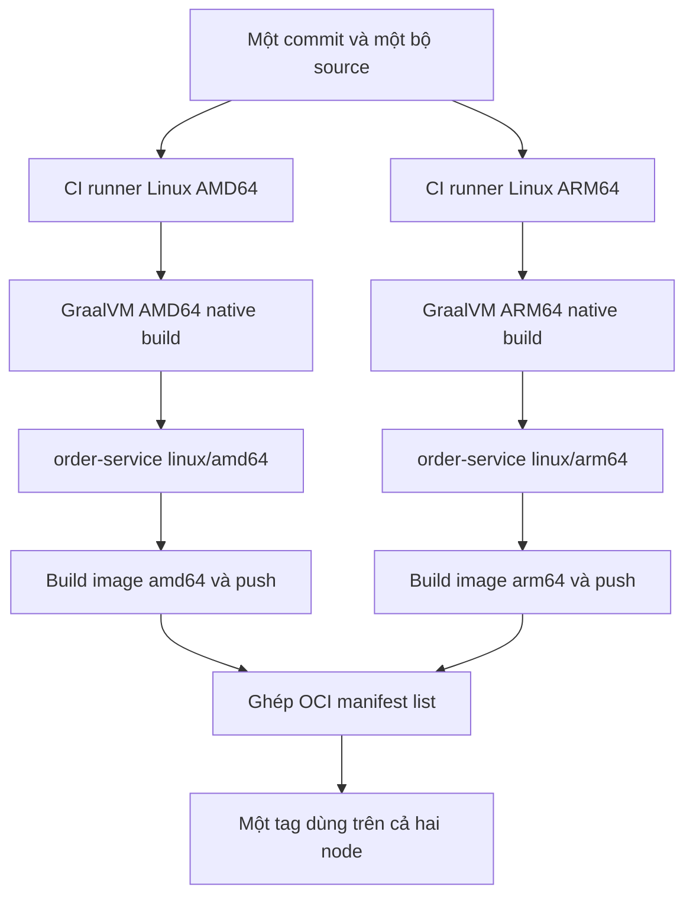

# Kiến trúc amd64, arm64 và chiến lược build cho từng đích

Một file JAR Spring Boot có thể chạy trên nhiều kiến trúc CPU nếu có JVM phù hợp. Nhưng khi biên dịch bằng **GraalVM Native Image**, kết quả là executable dành cho một hệ điều hành và kiến trúc cụ thể. Binary Linux AMD64 không thể chạy trực tiếp trên Linux ARM64; Docker image có tag đa kiến trúc cũng không biến một binary thành binary dùng được trên mọi CPU.

Để phát hành Spring Boot Native Image cho cả máy chủ x86-64 và ARM64, cần tạo **một native executable cho từng đích**, đóng gói từng executable vào image tương ứng, kiểm thử trên kiến trúc đích rồi ghép các image thành một OCI manifest list. Docker sẽ chọn image phù hợp với nền tảng của node khi người dùng pull cùng một tag.

## 1. Mục tiêu học tập

Sau bài học, bạn có thể:

- Phân biệt kiến trúc CPU `amd64` và `arm64`, tên hệ điều hành và ABI của executable.
- Giải thích vì sao native executable chỉ chạy trên nền tảng tương thích.
- Phân biệt Java bytecode/JAR đa nền tảng với native executable theo từng đích.
- Chọn GraalVM Native Image distribution và C toolchain cho Linux AMD64 hoặc AArch64.
- Hiểu ảnh hưởng của `glibc`, `musl`, shared libraries và CPU instruction set.
- Sử dụng `-march` để cân bằng hiệu năng với khả năng tương thích CPU.
- Phân biệt `native-image --target` với `docker buildx --platform`.
- Chọn chiến lược build bằng native runners, nhiều Buildx nodes, QEMU hoặc cross-compilation.
- Tạo image theo từng kiến trúc và ghép OCI multi-platform manifest.
- Xác minh binary, container image, native dependencies và runtime trên từng kiến trúc.
- Tổ chức CI cache, test matrix và phát hành artifact có thể truy vết.

## 2. amd64 và arm64 là gì?

Hai kiến trúc thường gặp trong môi trường server:

| Tên CPU/ABI thường gặp | Tên OCI/Docker platform | `uname -m` thường trả về | Ví dụ phần cứng |
| --- | --- | --- | --- |
| x86-64 / AMD64 | `linux/amd64` | `x86_64` | Intel Xeon, AMD EPYC |
| AArch64 / ARM64 | `linux/arm64` | `aarch64` | AWS Graviton, Ampere Altra, ARM server |

`amd64` và `arm64` là tên platform trong hệ sinh thái OCI/Docker. `x86_64` và `aarch64` là tên kiến trúc thường thấy từ Linux và toolchain. Chúng chỉ cùng một họ kiến trúc tương ứng, không phải cùng một tập lệnh máy.

### 2.1. Vì sao binary không dùng chung?

Native Image biên dịch bytecode và runtime thành machine code cho một đích cụ thể. Các thành phần phụ thuộc kiến trúc gồm:

- Instruction set và calling convention.
- ELF machine type và binary format.
- ABI của hệ điều hành và libc.
- Native libraries/JNI libraries được liên kết.
- Các tính năng CPU mà compiler được phép phát sinh.

Một executable ELF dành cho AMD64 chứa machine code x86-64. ARM64 CPU không thực thi trực tiếp các instruction đó. Ngược lại, binary AArch64 cũng không chạy trực tiếp trên CPU x86-64.

Java source, bytecode và phần lớn dependency JAR vẫn có thể dùng chung. Native executable và native libraries phải được build cho từng platform.

## 3. Phân biệt OS, architecture, libc và CPU features

Tên `linux/arm64` mới chỉ mô tả hệ điều hành và kiến trúc CPU ở mức OCI. Để executable chạy được, còn phải kiểm tra ABI và các thư viện runtime.

### 3.1. OS và architecture

Một số platform khác nhau:

- `linux/amd64`: Linux trên x86-64.
- `linux/arm64`: Linux trên AArch64.
- `windows/amd64`: Windows trên x86-64.
- `darwin/arm64`: macOS trên Apple Silicon.

Native executable Linux không thể chỉ đổi tên để chạy trên Windows hoặc macOS. Cần build lại trên toolchain và target OS phù hợp.

### 3.2. glibc và musl

Linux distributions có thể dùng libc khác nhau:

| Runtime base | libc thường dùng | Lưu ý |
| --- | --- | --- |
| Debian, Ubuntu, Red Hat, Oracle Linux, Amazon Linux | glibc | Phù hợp với executable được liên kết theo glibc |
| Alpine Linux | musl | Cần executable và native dependencies tương thích musl |
| Debian-based distroless | glibc | Có thể chạy mostly-static executable cần glibc |
| `scratch` | Không có libc/runtime files | Chỉ phù hợp với executable static và không cần file runtime bổ sung |

Một executable được build với glibc không tự động chạy trên Alpine chỉ vì cả hai đều là Linux. Kiểm tra interpreter và shared libraries bằng `readelf`/`ldd`, rồi chọn runtime base phù hợp.

Với executable liên kết động theo glibc, runtime image còn phải có phiên bản glibc đáp ứng các symbol version mà binary yêu cầu. Build trên distribution mới rồi chạy trên base image có glibc quá cũ có thể gây lỗi `GLIBC_x.y not found` dù cả hai image đều dùng glibc.

Native Image hỗ trợ lựa chọn libc theo toolchain. Tuy nhiên, giới hạn có thể khác theo kiến trúc và GraalVM release. Tài liệu compatibility hiện hành ghi nhận Linux AArch64 chưa hỗ trợ `musl`; do đó không giả định một chiến lược Alpine/musl dùng được cho cả AMD64 và ARM64.

### 3.3. Native dependencies

Nếu ứng dụng dùng JNI hoặc thư viện native, mỗi kiến trúc cần đúng binary:

- `libfoo-linux-x86_64.so` không thay thế được `libfoo-linux-aarch64.so`.
- Maven dependency có thể phân phối native binary bằng classifier riêng.
- Một số thư viện tự tải native library theo OS/architecture; phải xác minh cơ chế chọn artifact của chúng.
- Các thư viện `libstdc++`, `libgcc`, OpenSSL hoặc client native khác phải tương thích ABI và libc của runtime image.

Đừng copy nguyên thư mục native libraries từ AMD64 build vào ARM64 image.

## 4. GraalVM Native Image target

### 4.1. Builder tạo executable cho platform cụ thể

Native Image builder sử dụng Java toolchain, Native Image tool và C compiler/linker để tạo executable. Trên Linux, toolchain cần các thành phần như compiler, libc headers/development files và zlib development files. Tên package cụ thể phụ thuộc distribution.

Ví dụ kiểm tra trên Linux:

```bash
uname -m
java -version
native-image --version
gcc --version
```

Trên Linux AMD64, GraalVM distribution dành cho Linux x64 thường tạo executable AMD64; trên Linux AArch64, cần GraalVM distribution và toolchain tương ứng để tạo executable ARM64.

### 4.2. Build riêng bằng Maven hoặc Gradle

Maven:

```bash
./mvnw -Pnative native:compile
```

Gradle:

```bash
./gradlew nativeCompile
```

Kết quả nằm trong thư mục build của module, ví dụ:

```text
target/order-service
build/native/nativeCompile/order-service
```

Đường dẫn và tên file phụ thuộc Maven/Gradle plugin và cấu hình project. Khi chạy trên AMD64 runner, build thông thường tạo binary AMD64; khi chạy trên ARM64 runner có GraalVM/toolchain ARM64, build tạo binary ARM64.

### 4.3. `--target` không phải Docker `--platform`

Native Image có option:

```bash
native-image --target=linux-aarch64 ...
```

Option này chọn OS/architecture target của Native Image compiler. Nó không tự cài cross compiler, target libc headers, linker, sysroot hoặc native dependencies. Muốn cross-compile, phải có toolchain và thư viện target tương ứng, đồng thời target phải được GraalVM release đang dùng hỗ trợ.

Docker Buildx có option khác:

```bash
docker buildx build --platform linux/arm64 ...
```

Option này yêu cầu BuildKit tạo container image cho platform chỉ định. Nó không tự làm cho lệnh `native-image` trong build stage sinh ra binary ARM64 nếu build stage đang chạy builder AMD64. Build stage phải chạy trên builder target, dùng cross toolchain phù hợp, hoặc chạy dưới emulation.

Đừng coi hai option này là thay thế cho nhau.

## 5. Chọn CPU instruction set với -march

Ngoài OS và architecture, executable còn có thể phụ thuộc vào tập instruction cụ thể của CPU.

Native Image có option `-march`:

| Giá trị | Ý nghĩa | Cách dùng |
| --- | --- | --- |
| `-march=native` | Dùng các instruction compiler nhận diện trên máy build | Chỉ dùng khi máy deploy có CPU features tương đương |
| `-march=compatibility` | Hạn chế instruction để tăng khả năng chạy trên nhiều đời CPU | Phù hợp image phân phối rộng trong cùng kiến trúc |
| `-march=list` | Liệt kê machine types được hỗ trợ | Dùng để kiểm tra target của toolchain |

Theo tài liệu GraalVM 25.5, default machine type là `x86-64-v3` trên AMD64 và `armv8-a` trên AArch64. Giá trị mặc định có thể thay đổi theo release; hãy xem build output và tài liệu đúng phiên bản.

### 5.1. Khi nào dùng native?

Ví dụ build `-march=native` trên máy AMD64 có AVX-512 rồi deploy lên node AMD64 đời cũ không có AVX-512 có thể khiến executable lỗi illegal instruction. Cùng kiến trúc không đồng nghĩa CPU có cùng feature set.

Với một image dùng cho nhiều đời server cùng architecture, cân nhắc:

```bash
native-image -march=compatibility -jar target/order-service.jar
```

Với fleet được kiểm soát và CPU đồng nhất, có thể đo hiệu năng của `-march=native` trên đúng loại máy triển khai.

### 5.2. Không dùng một march cho cả hai kiến trúc

AMD64 và AArch64 có tập instruction khác nhau. Hãy build mỗi binary với option phù hợp cho architecture của nó. `-march=compatibility` chỉ tăng khả năng tương thích trong architecture tương ứng; nó không tạo ra một binary chạy được trên cả AMD64 lẫn ARM64.

## 6. Các chiến lược build đa kiến trúc

Docker Buildx/BuildKit hỗ trợ ba chiến lược chính:

1. Emulation bằng QEMU.
2. Nhiều native builder nodes.
3. Cross-compilation trong multi-stage build.

Với Native Image, lựa chọn chiến lược ảnh hưởng đáng kể tới thời gian build và độ ổn định.

### 6.1. Build trên native runners cho từng architecture

Đây là cách dễ kiểm soát nhất:



Mỗi runner:

- Chạy đúng GraalVM distribution và C toolchain của target.
- Build executable bằng Maven/Gradle.
- Chạy unit/native smoke tests trên chính architecture đó.
- Đóng gói binary vào runtime image đúng platform.
- Push image với tag riêng theo architecture.

Ưu điểm là không cần giả lập CPU trong giai đoạn compile nặng. Nhược điểm là phải duy trì hai loại runner hoặc hai nhóm build agents.

### 6.2. Nhiều native nodes trong Docker Buildx

Buildx có thể kết hợp nhiều Docker contexts thành một builder. Ví dụ đã có context `node-amd64` và `node-arm64`:

```bash
docker buildx create --use --name native-multi node-amd64
docker buildx create --append --name native-multi node-arm64
docker buildx inspect --bootstrap
```

Sau đó:

```bash
docker buildx build \
  --platform linux/amd64,linux/arm64 \
  --tag registry.example.com/order-service:1.0.0 \
  --push .
```

BuildKit có thể phân phối phần build theo platform đến native node phù hợp. Dockerfile phải chọn builder image tương ứng với target platform và thực thi native compilation trong stage đó. Builder image phải có GraalVM, Native Image, C toolchain và dependency cache tương ứng.

Đây là cách thuận tiện khi muốn một lệnh Buildx tạo manifest đa kiến trúc mà vẫn biên dịch trên phần cứng thật.

### 6.3. QEMU emulation

QEMU user-mode emulation cho phép chạy binary của architecture khác trên host hiện tại. Buildx có thể sử dụng QEMU khi builder hỗ trợ và emulator được đăng ký.

Ưu điểm:

- Dễ bắt đầu với một host.
- Không cần runner vật lý cho từng kiến trúc.
- Có thể dùng cùng Dockerfile cho nhiều platform.

Hạn chế:

- Native Image compilation là workload CPU và memory intensive; QEMU có thể chậm hơn đáng kể.
- Một số build hoặc toolchain có thể gặp vấn đề dưới emulation.
- Kết quả benchmark build time không đại diện cho build trên phần cứng thật.
- QEMU build thành công không thay thế kiểm thử trên ARM64/AMD64 thật.

Vì vậy, QEMU phù hợp cho thử nghiệm hoặc workload nhẹ. Với release build lớn, ưu tiên native nodes/runners khi có thể.

### 6.4. Cross-compilation

Cross-compilation có thể hữu ích khi toolchain hỗ trợ build target khác host. Tuy nhiên, phải có:

- Native Image target support cho cặp host/target.
- Cross C compiler và linker.
- Target sysroot, libc headers và native libraries.
- Build dependencies có đúng classifier/architecture.
- Cấu hình target CPU và ABI phù hợp.

Chỉ thêm `--target=linux-aarch64` không tự cung cấp các thành phần trên. Nếu chưa kiểm chứng toolchain cross-compile cụ thể, build trên native ARM64 runner sẽ ít rủi ro hơn.

## 7. Tổ chức Dockerfile và runtime image

### 7.1. Build binary trước, đóng gói runtime sau

Một cách dễ kiểm soát là CI build executable trên native runner rồi tạo image runtime từ artifact tương ứng.

Ví dụ `Dockerfile.runtime`:

```dockerfile
FROM --platform=$TARGETPLATFORM debian:bookworm-slim

WORKDIR /app
COPY --chown=10001:10001 order-service /app/order-service

USER 10001:10001
EXPOSE 8080
ENTRYPOINT ["/app/order-service"]
```

Build context chứa file `order-service` đã được compile cho platform tương ứng. Debian slim là ví dụ runtime base dùng glibc; hãy chọn base image phù hợp với libc và shared libraries của binary.

Trên AMD64 runner:

```bash
./mvnw -Pnative native:compile
mkdir -p dist-amd64
cp target/order-service dist-amd64/order-service

docker buildx build \
  --platform linux/amd64 \
  --file Dockerfile.runtime \
  --tag registry.example.com/order-service:1.0.0-amd64 \
  --push dist-amd64
```

Trên ARM64 runner, build lại executable rồi đóng gói:

```bash
./mvnw -Pnative native:compile
mkdir -p dist-arm64
cp target/order-service dist-arm64/order-service

docker buildx build \
  --platform linux/arm64 \
  --file Dockerfile.runtime \
  --tag registry.example.com/order-service:1.0.0-arm64 \
  --push dist-arm64
```

Trong mỗi job, `target/order-service` phải được build trên runner có architecture tương ứng. Không copy binary AMD64 từ job đầu sang job ARM64.

### 7.2. Runtime base image phải tương thích

Nếu binary liên kết động với glibc, runtime image cần cung cấp glibc tương thích. Nếu binary dùng musl, runtime phải phù hợp với musl và architecture đó. Ngoài libc, kiểm tra:

- Shared libraries mà `ldd` báo thiếu.
- CA certificates nếu ứng dụng gọi HTTPS.
- Timezone data nếu ứng dụng cần timezone database.
- Locale data nếu code phụ thuộc locale.
- File cấu hình, resource và thư mục ghi log/tmp.
- User/group và quyền filesystem.

Một image nhỏ không có nghĩa runtime dependencies có thể bị bỏ hết. `scratch` chỉ phù hợp nếu executable static và ứng dụng không cần file runtime bổ sung.

### 7.3. Multi-stage build trực tiếp bằng Buildx

Nếu builder image có manifest đa kiến trúc, có thể tạo build stage chạy trên target platform:

```dockerfile
# syntax=docker/dockerfile:1
ARG GRAALVM_BUILDER_IMAGE=registry.example.com/build-images/graalvm-native-builder:25.5

FROM --platform=$TARGETPLATFORM $GRAALVM_BUILDER_IMAGE AS build
WORKDIR /workspace
COPY . .
RUN ./mvnw -Pnative native:compile

FROM --platform=$TARGETPLATFORM debian:bookworm-slim AS runtime
WORKDIR /app
COPY --from=build --chown=10001:10001 /workspace/target/order-service /app/order-service
USER 10001:10001
EXPOSE 8080
ENTRYPOINT ["/app/order-service"]
```

`GRAALVM_BUILDER_IMAGE` là image do tổ chức chọn và pin version/digest; image phải có GraalVM Native Image và native toolchain. Cần bảo đảm builder image có variant cho cả `linux/amd64` và `linux/arm64`. Với multi-node Buildx, stage này có thể chạy trên native node tương ứng. Nếu chỉ có một node, BuildKit có thể cần QEMU để thực thi stage của architecture khác.

Tên image trong ví dụ là placeholder của registry nội bộ; thay bằng builder image đã được kiểm chứng và pin digest. Có thể truyền giá trị khác bằng `--build-arg GRAALVM_BUILDER_IMAGE=...` khi gọi Buildx.

Đây là Dockerfile khung. Hãy xác minh builder image, Maven wrapper, build context và output path trong dự án thực tế.

## 8. Tạo OCI multi-platform manifest

Sau khi đã push hai image architecture-specific:

```bash
docker buildx imagetools create \
  --tag registry.example.com/order-service:1.0.0 \
  registry.example.com/order-service:1.0.0-amd64 \
  registry.example.com/order-service:1.0.0-arm64
```

Tag `1.0.0` trỏ tới một manifest list/index. Manifest này chứa descriptor cho từng platform và digest của image tương ứng. Khi node AMD64 pull tag, runtime chọn image AMD64; node ARM64 chọn image ARM64.

**Manifest đa kiến trúc không chứa một executable universal.** Nó chỉ nhóm các image platform-specific dưới cùng một tag.

### 8.1. Kiểm tra manifest

```bash
docker buildx imagetools inspect registry.example.com/order-service:1.0.0
```

Kết quả cần có ít nhất:

- `linux/amd64`
- `linux/arm64`

Nếu chỉ thấy một platform, tag chưa phải multi-platform release như mong đợi. Kiểm tra lại image đã push và lệnh tạo manifest.

## 9. Kiểm tra binary và image trước khi phát hành

### 9.1. Kiểm tra host và binary architecture

Trên runner:

```bash
uname -m
file target/order-service
readelf -h target/order-service
```

Trong output ELF, kiểm tra `Machine`:

- AMD64 thường hiển thị `Advanced Micro Devices X86-64`.
- ARM64 thường hiển thị `AArch64`.

Không chỉ dựa vào tên file hoặc Docker tag để xác định binary architecture.

### 9.2. Kiểm tra dynamic dependencies

Với executable Linux liên kết động:

```bash
ldd target/order-service
```

Nếu có `not found`, runtime image có thể thiếu shared library. Nếu binary static, `ldd` có thể báo không phải dynamic executable; lúc đó cần kiểm tra loại liên kết bằng `readelf` và tài liệu build.

Chạy kiểm tra trên binary do chính pipeline tạo ra, không chạy `ldd` trên file không tin cậy.

### 9.3. Kiểm tra platform của image

```bash
docker image inspect \
  --format '{{.Os}}/{{.Architecture}}' \
  registry.example.com/order-service:1.0.0-amd64
```

Với manifest đa kiến trúc:

```bash
docker buildx imagetools inspect registry.example.com/order-service:1.0.0
```

Hai phép kiểm tra có mục đích khác nhau: ELF machine xác minh executable; image inspect/manifest inspect xác minh platform metadata của container image.

### 9.4. Chạy trên kiến trúc đích

Trên AMD64:

```bash
docker run --rm --platform linux/amd64 \
  registry.example.com/order-service:1.0.0
```

Trên ARM64:

```bash
docker run --rm --platform linux/arm64 \
  registry.example.com/order-service:1.0.0
```

`--platform` có thể kích hoạt emulation nếu host không cùng architecture và QEMU đã được cấu hình. Đối với release validation, hãy chạy smoke/integration tests trên node native của từng kiến trúc để kiểm tra ABI, native dependencies và CPU instructions trong môi trường thật.

## 10. Chiến lược kiểm thử cho mỗi kiến trúc

Không nên chỉ build thành công rồi publish. Mỗi platform cần có test evidence riêng.

| Lớp kiểm thử | AMD64 | ARM64 | Mục tiêu |
| --- | --- | --- | --- |
| JVM unit tests | Chạy | Có thể dùng chung source/test | Xác minh logic nghiệp vụ |
| Native compilation | Build trên runner AMD64 | Build trên runner ARM64 | Xác minh toolchain và metadata |
| Native test executable | Chạy native | Chạy native | Kiểm tra dynamic access và runtime |
| Container smoke test | Node AMD64 | Node ARM64 | Startup, health, config, filesystem |
| Integration test | Kết nối dependency thật/test | Kết nối dependency thật/test | TLS, DB, broker, DNS và native libraries |
| Load/performance test | Đo riêng | Đo riêng | Không giả định hiệu năng hai CPU tương đương |

### 10.1. Các trường hợp cần chú ý

- JNI library chỉ đóng gói classifier AMD64.
- Thư viện native sử dụng instruction không có trên CPU ARM64 hoặc AMD64 đời cũ.
- Khác biệt endian hoặc alignment trong native code.
- C library hoặc OpenSSL version khác giữa builder và runtime.
- File path và permission khác giữa image base.
- Architecture-specific resource được chọn sai bởi dependency.
- Build script hard-code tên binary hoặc output path.

### 10.2. Kiểm thử health và graceful shutdown

Với Spring Boot service, kiểm tra:

- Process khởi động và readiness endpoint trả trạng thái phù hợp.
- HTTP endpoint chính xử lý request.
- Kết nối database/message broker hoạt động.
- TLS và CA certificates có mặt nếu cần.
- SIGTERM được xử lý và application context shutdown đúng.
- Container chạy bằng non-root user.
- Log và temporary files có vị trí ghi được.

## 11. CI/CD matrix và cache

### 11.1. Một source commit, hai build jobs

Ví dụ ma trận CI:

```yaml
strategy:
  fail-fast: false
  matrix:
    include:
      - arch: amd64
        runner: linux-amd64
        platform: linux/amd64
      - arch: arm64
        runner: linux-arm64
        platform: linux/arm64
```

Các giá trị `runner` ở trên là tên nhãn minh họa; thay bằng runner labels thực tế của CI platform. Hai runner phải có cùng source commit nhưng khác architecture vật lý/ảo và được cài toolchain native tương ứng.

Mỗi job dùng cùng commit SHA, cùng Spring Boot/GraalVM/Native Build Tools versions và cùng build arguments đã định. Runner, GraalVM distribution, compiler và target native libraries thay đổi theo architecture.

### 11.2. Cache phải tách theo architecture

Cache key nên chứa tối thiểu:

- OS và architecture.
- GraalVM distribution/version và Java version.
- Maven/Gradle và Native Build Tools plugin version.
- Native Image build arguments, gồm `-march` và libc nếu có.
- Dependency lockfiles hoặc checksum của dependency inputs.

Không chia sẻ native executable output hoặc cache chứa object files giữa AMD64 và ARM64. Cache dependency JAR có thể dùng chung nếu artifact thực sự độc lập architecture; cache native library hoặc compilation output thì phải tách.

### 11.3. Artifact naming và provenance

Đặt tên artifact thể hiện target:

```text
order-service-1.0.0-linux-amd64
order-service-1.0.0-linux-arm64
```

Ghi kèm:

- Commit SHA.
- GraalVM distribution/version.
- Java version.
- OS/architecture và libc.
- Native Image build arguments.
- Image digest.
- Test report theo platform.

Không ghi một build là “multi-arch” nếu pipeline chỉ tạo binary AMD64 rồi đóng gói image tag ARM64.

## 12. Chọn chiến lược theo môi trường

| Tình huống | Chiến lược nên cân nhắc | Lý do |
| --- | --- | --- |
| Có runner AMD64 và ARM64 | Build riêng trên native runners | Dễ kiểm soát toolchain và test thực tế |
| Đã có Buildx builder nhiều node | Multi-node Buildx | Một lệnh tạo manifest, compile chạy trên node native |
| Thử nghiệm nhanh, không có ARM64 runner | QEMU emulation | Tiện để kiểm tra ban đầu; compile có thể chậm |
| Có cross toolchain đã được xác minh | Cross-compilation | Có thể giảm số runner nhưng phải quản lý sysroot/ABI |
| Chỉ deploy một architecture | Build một platform | Pipeline và artifact đơn giản hơn |
| Deploy nhiều đời CPU trong cùng architecture | Dùng `-march=compatibility` và test fleet đại diện | Giảm rủi ro illegal instruction |

## 13. Troubleshooting

| Triệu chứng | Nguyên nhân có thể | Cách xử lý |
| --- | --- | --- |
| `exec format error` | Binary architecture không khớp CPU/container platform | Kiểm tra `file`, `readelf -h`, image manifest |
| `Illegal instruction` | Binary dùng CPU feature không có trên node | Rebuild với `-march=compatibility` hoặc chọn đúng CPU fleet |
| `No such file or directory` dù executable tồn tại | Dynamic loader/interpreter hoặc shared library không có trong runtime image | Kiểm tra ELF interpreter và `ldd` |
| `libXYZ.so: cannot open shared object file` | Runtime image thiếu native dependency | Cài/copy đúng thư viện cho cùng OS/architecture |
| AMD64 chạy được, ARM64 build lỗi | GraalVM/toolchain/dependency chưa hỗ trợ ARM64 hoặc classifier sai | Kiểm tra GraalVM ARM64, compiler và native dependencies |
| ARM64 chạy được nhưng Alpine lỗi | musl/glibc không tương thích hoặc target chưa hỗ trợ musl | Chọn base image đúng libc; kiểm tra support matrix |
| `--target` không tạo được binary mong muốn | Thiếu cross compiler, sysroot hoặc target libraries | Dùng native runner hoặc cấu hình cross toolchain đầy đủ |
| Buildx báo thiếu platform | Builder không có node/emulator cho target | Thêm native node hoặc cài QEMU phù hợp |
| Build ARM64 qua QEMU rất lâu | Native Image compilation chạy dưới emulation | Chuyển sang ARM64 native runner/node |
| Manifest chỉ có AMD64 | Chưa push image ARM64 hoặc tạo manifest sai | Kiểm tra tag arch-specific và chạy lại `imagetools create` |
| Image metadata là ARM64 nhưng binary AMD64 | Đóng gói nhầm artifact vào build context | Kiểm tra ELF machine trong từng job trước khi push |
| Native dependency hoạt động trên một node nhưng lỗi node khác | CPU features, libc hoặc shared library versions khác nhau | Chuẩn hóa runtime base và `-march`, test trên fleet đại diện |

## 14. Bài thực hành tổng hợp

**Bối cảnh:** `order-service` cần chạy trên Kubernetes cluster có cả node AMD64 và ARM64. Nhóm phát triển muốn phát hành cùng tag `1.0.0` để Deployment không phải chọn tag theo node.

Thực hiện:

1. Xác nhận GraalVM distribution có Native Image cho Linux AMD64 và Linux AArch64.
2. Chọn runtime base image tương thích libc; dùng cùng dòng base image đa kiến trúc nếu phù hợp.
3. Tạo CI job trên native AMD64 runner và native ARM64 runner.
4. Cả hai job checkout cùng commit và chạy JVM unit tests.
5. Job AMD64 chạy Maven `native:compile` hoặc Gradle `nativeCompile`, sau đó kiểm tra ELF machine.
6. Job ARM64 chạy lại native build trên toolchain ARM64 và kiểm tra ELF machine.
7. Đóng gói hai executable vào image riêng, push tag `1.0.0-amd64` và `1.0.0-arm64`.
8. Chạy native smoke/integration tests trên node cùng architecture.
9. Dùng `docker buildx imagetools create` ghép manifest thành tag `1.0.0`.
10. Dùng `docker buildx imagetools inspect` xác nhận manifest có cả `linux/amd64` và `linux/arm64`.
11. Deploy tag `1.0.0` lên cluster và xác nhận mỗi node pull đúng image.
12. Lưu image digest, commit SHA, GraalVM version và test reports cho từng platform.

**Câu hỏi tự kiểm tra:** Vì sao `docker buildx build --platform linux/amd64,linux/arm64` không đảm bảo Native Image builder tạo ra đúng hai executable? Vì `--platform` điều khiển platform của container image. Nếu build stage vẫn chạy GraalVM AMD64 thì lệnh native compilation có thể vẫn tạo binary AMD64. Build stage phải chạy trên native node đúng architecture, dùng QEMU hoặc cross toolchain đã cấu hình và xác minh được.

## 15. Ghi nhớ

- Java source và JAR thường dùng chung được; Native Image executable phải được build theo OS/architecture đích.
- `amd64` tương ứng x86-64; `arm64` tương ứng AArch64. Tên platform OCI khác tên mà Linux trả về qua `uname -m`.
- Kiểm tra cả architecture, libc, ABI, shared libraries và CPU instruction set; chỉ nhìn `linux/amd64` hoặc `linux/arm64` là chưa đủ.
- Native Image cần GraalVM và C toolchain phù hợp. `--target` chọn target compiler nhưng không tự cung cấp cross compiler hoặc sysroot.
- `-march=compatibility` giúp binary chạy trên nhiều đời CPU trong cùng architecture; `-march=native` chỉ phù hợp với fleet CPU tương đương máy build.
- Docker Buildx `--platform` chọn platform của image. Nó không tự đổi architecture của binary được compile trong build stage.
- QEMU tiện cho thử nghiệm nhưng có thể làm Native Image build chậm; native runners hoặc multi-node Buildx phù hợp hơn cho release.
- Build một executable cho AMD64 và một executable cho ARM64, test trên architecture tương ứng rồi push image riêng.
- OCI manifest list gom các image platform-specific dưới một tag; runtime chọn image phù hợp với node.
- Tách cache và artifact theo OS/architecture, toolchain, libc và build arguments; lưu provenance và test evidence cho mỗi platform.

Khi build, đóng gói và kiểm thử theo từng đích, Spring Boot Native Image có thể được phát hành bằng một tag container thống nhất cho cluster hỗn hợp AMD64/ARM64 mà vẫn giữ đúng binary và native dependencies của từng node.

## Tài liệu tham khảo chính thức

- [GraalVM Native Image — Getting Started](https://www.graalvm.org/reference-manual/native-image/): Native Image tạo executable theo hệ điều hành và kiến trúc; yêu cầu local toolchain.
- [GraalVM Native Image — Command-line Options](https://www.graalvm.org/latest/reference-manual/native-image/overview/Options/): `--target`, `-march`, machine types và các tùy chọn build.
- [GraalVM Native Image — Optimizations and Performance](https://www.graalvm.org/jdk25.5/reference-manual/native-image/optimizations-and-performance/): machine-specific instruction set, `-march=native` và `-march=compatibility`.
- [GraalVM Native Image — Compatibility Guide](https://www.graalvm.org/dev/reference-manual/native-image/metadata/Compatibility/): giới hạn hỗ trợ theo platform, gồm Linux AArch64 và libc.
- [GraalVM Native Image — Static Executables](https://www.graalvm.org/latest/reference-manual/native-image/guides/build-static-executables/): fully static, mostly-static, glibc, musl và runtime base image.
- [Docker — Multi-platform builds](https://docs.docker.com/build/building/multi-platform/): QEMU, native multi-node builders, cross-compilation và `--platform`.
- [Docker Buildx — Building multi-platform images](https://github.com/docker/buildx): manifest list/index và cách Docker chọn image theo platform.
