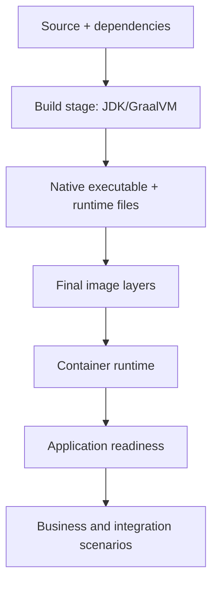

# Kiểm chứng image cuối cùng thay vì chỉ thử binary trên máy build

## 1. Vì sao phải kiểm tra đúng image sẽ triển khai?

Một native executable có thể chạy thành công trên máy build nhưng thất bại khi được đóng gói vào container. Máy build thường có nhiều thư viện hệ điều hành, CA certificates, timezone data, shell, biến môi trường và quyền truy cập filesystem mà runtime image tối giản không có. Binary cũng có thể được build cho architecture hoặc libc khác với môi trường triển khai.

Vì vậy, kết quả chạy trực tiếp `./orders-service` trên builder chỉ chứng minh binary hoạt động trong môi trường builder. Nó chưa chứng minh Docker image cuối có đủ dependency, cấu hình, quyền, network và dữ liệu hệ thống để phục vụ request.

Trong module **SPRING_BOOT_NATIVE_IMAGE**, bài học này hướng dẫn kiểm chứng artifact ở đúng ranh giới triển khai: image cuối cùng được build, chạy bằng đúng user và resource limits, nhận cấu hình runtime, kết nối dependency, xử lý request, ghi log và shutdown. Mọi kiểm thử quan trọng cần chạy từ container cuối cùng, không dựa trên builder stage.

## 2. Phân biệt các tầng artifact

Một pipeline container native thường có nhiều tầng:



| Tầng | Điều cần xác minh |
|---|---|
| Native executable | Binary đúng architecture, build thành công |
| Builder stage | Có toolchain và dependency để tạo binary |
| Final image | Chỉ chứa đúng binary và runtime files cần thiết |
| Container process | Chạy được với UID/GID, environment và filesystem thực tế |
| Application | Spring context khởi động, readiness và endpoint hoạt động |
| Integration | DNS, TLS, database, broker, volume và external services hoạt động |
| Deployment platform | Probe, resource limit, signal handling và rollout đúng |

Mỗi tầng có thể pass độc lập nhưng tầng sau vẫn fail. Ví dụ, Docker build pass không chứng minh entrypoint có quyền execute; container start pass không chứng minh database query chạy được.

## 3. Không chạy test cuối cùng trên builder stage

Multi-stage Dockerfile thường có builder chứa GraalVM, compiler, shell và package. Final stage có thể là distroless hoặc scratch, không có các công cụ đó.

Ví dụ cấu trúc:

```dockerfile
FROM build-image AS build
WORKDIR /workspace
COPY . .
RUN ./mvnw -Pnative -DskipTests package

FROM runtime-image AS runtime
WORKDIR /app
COPY --from=build /workspace/target/orders-service /app/orders-service
USER 10001:10001
ENTRYPOINT ["/app/orders-service"]
```

Kiểm thử trên stage `build` có thể che giấu lỗi vì binary nhìn thấy shared library hoặc file cấu hình chỉ tồn tại trong builder. Hãy build tag từ final stage, sau đó chạy container từ tag đó.

Không dùng `docker run --target build` làm bằng chứng cho image production. Test stage có thể hữu ích để debug compiler, nhưng nó không đại diện cho image phát hành.

## 4. Xác nhận image, tag và digest được kiểm thử

Trước khi chạy test, xác định chính xác image:

```bash
docker build -t orders-service:candidate .
docker image inspect orders-service:candidate
docker image ls orders-service:candidate
```

Ghi nhận:

- Image tag và immutable digest nếu đã push registry.
- Build commit và pipeline run.
- Target OS/architecture.
- Base image và version/tag.
- Thời điểm tạo image.
- Binary digest hoặc build provenance nếu pipeline cung cấp.

Tag có thể bị ghi đè. Với release pipeline, nên dùng digest hoặc tag bất biến để bảo đảm image đã test chính là image được triển khai. Nếu rebuild cùng tag sau khi test, kết quả trước đó không còn chứng minh cho image mới.

## 5. Kiểm tra architecture và OS compatibility

Image manifest và executable phải tương thích với node triển khai. Kiểm tra:

```bash
docker image inspect orders-service:candidate
docker image inspect --format '{{.Os}}/{{.Architecture}}' orders-service:candidate
```

Trên Linux builder, kiểm tra binary:

```bash
file target/orders-service
readelf -h target/orders-service
readelf -l target/orders-service
readelf -d target/orders-service
```

Các điểm cần đối chiếu:

- `linux/amd64` hay `linux/arm64`.
- ELF machine type.
- Dynamic loader và libc.
- Shared library requirements.
- CPU instruction set assumptions nếu build có target đặc biệt.
- Native libraries được đóng gói cùng binary.

Docker image build được trên máy ARM không tự bảo đảm chạy trên node AMD64. Nếu phát hành multi-architecture image, build và test từng platform hoặc dùng runner/emulator phù hợp, sau đó kiểm tra manifest list.

## 6. Xác minh shared libraries trong final image

Nếu binary liên kết động, final image cần cung cấp loader và shared libraries tương thích. Dùng builder/tooling phù hợp để phân tích:

```bash
ldd target/orders-service
readelf -d target/orders-service
```

Kết quả `ldd` trên builder chỉ phản ánh library resolution của builder. Để xác minh final image, dùng một debug image có cùng filesystem/runtime libraries hoặc công cụ phân tích image root filesystem. Với distroless/scratch, có thể export/copy filesystem layer để kiểm tra bằng công cụ bên ngoài.

Không cài thêm package tùy tiện vào production image chỉ để làm `ldd` chạy được. Hãy xác định dependency thật và bổ sung đúng runtime library vào final stage. Sau đó chạy executable trong final image để kiểm chứng dynamic loader thực tế.

## 7. Kiểm tra entrypoint và process signal

Native executable thường được chạy trực tiếp bằng exec-form:

```dockerfile
ENTRYPOINT ["/app/orders-service"]
```

Exec form giúp process nhận tín hiệu từ container runtime trực tiếp. Shell-form entrypoint có thể thêm shell làm PID 1 và làm thay đổi cách tín hiệu được chuyển tiếp.

Kiểm tra:

- Executable có quyền execute.
- Đường dẫn entrypoint tồn tại.
- Working directory đúng.
- Process chạy bằng user mong muốn.
- SIGTERM được nhận và ứng dụng shutdown graceful.
- Container không bị giữ sống bởi shell/wrapper không cần thiết.

Có thể thử dừng container:

```bash
docker stop --time 30 orders-service-test
docker inspect --format '{{.State.ExitCode}} {{.State.FinishedAt}}' orders-service-test
```

Exit code và thời gian dừng cần được đối chiếu với log ứng dụng. Nếu process bị SIGKILL sau timeout, điều tra shutdown hook, request đang xử lý và thời gian drain.

## 8. Kiểm chứng non-root và quyền filesystem

Image có thể chạy thành công khi root nhưng thất bại dưới UID production vì không đọc được file hoặc không ghi được thư mục cần thiết.

Dockerfile nên chỉ định user không đặc quyền:

```dockerfile
USER 10001:10001
```

Kiểm thử image cuối:

```bash
docker run --rm   --user 10001:10001   orders-service:candidate
```

Nếu Dockerfile đã khai báo user, lệnh trên vẫn giúp kiểm tra hành vi với UID/GID cụ thể. Cần xác minh:

- Binary và thư mục ứng dụng có quyền đọc/execute.
- Config mount đọc được.
- Thư mục tạm hoặc upload có quyền ghi nếu cần.
- Volume owner/permissions tương thích.
- Không cần ghi vào application directory.
- Không phụ thuộc home directory hoặc username có trong `/etc/passwd`.

Không giải quyết lỗi permission bằng cách chuyển process sang root. Cấp quyền đúng cho path cần thiết và giữ filesystem read-only ở những nơi có thể.

## 9. Chạy với filesystem read-only

Nếu ứng dụng không cần ghi vào root filesystem, thử chạy read-only:

```bash
docker run --rm   --read-only   --tmpfs /tmp:rw,noexec,nosuid,size=64m   -p 8080:8080   orders-service:candidate
```

Ví dụ này cung cấp `/tmp` riêng trong memory filesystem. Chỉ thêm tmpfs nếu ứng dụng hoặc thư viện thật sự cần thư mục tạm. Nếu ứng dụng ghi file export hoặc upload, mount volume riêng với quyền và quota rõ ràng.

Read-only root filesystem giúp phát hiện các dependency ngầm vào thư mục ghi được. Nếu container fail, xem path nào cần ghi và quyết định mount writable path tối thiểu. Không bật writable toàn bộ filesystem để che lỗi.

## 10. Cấu hình runtime và secret

Native Image đóng gói code và một số metadata ở build time, nhưng cấu hình deployment như URL, credentials, feature values và resource limits thường được cung cấp lúc chạy.

Ví dụ:

```bash
docker run --rm   -e SPRING_PROFILES_ACTIVE=container   -e INVENTORY_BASE_URL=https://inventory.internal   -p 8080:8080   orders-service:candidate
```

Không truyền secret thật qua command line trong shell history hoặc log CI. Dùng Docker/Kubernetes secrets hoặc secret manager phù hợp; mount file secret hoặc inject theo cơ chế bảo mật của nền tảng.

Kiểm tra:

- Profile runtime không làm thay đổi bean graph đã cố định sai ở AOT.
- Runtime property chỉ thay đổi giá trị mà artifact hỗ trợ.
- Secret không được ghi vào log hoặc image layer.
- File config được mount đúng path và quyền.
- Container nhận đủ environment cần thiết.
- Thiếu cấu hình bắt buộc tạo lỗi rõ ràng thay vì dùng fallback nguy hiểm.

Không bake credentials vào Dockerfile bằng `ARG` hoặc `ENV`. Các giá trị có thể tồn tại trong layer metadata hoặc build history.

## 11. Kiểm tra CA certificates và HTTPS

Nếu ứng dụng gọi HTTPS, chạy test từ container cuối cùng tới một endpoint TLS đại diện. Cần xác minh:

- CA bundle có trong image hoặc trust store được mount.
- Java/native TLS stack sử dụng đúng trust configuration.
- Proxy environment nếu hệ thống yêu cầu.
- Hostname verification không bị tắt.
- Certificate rotation và private CA được hỗ trợ theo policy.

Không kiểm tra TLS chỉ từ host vì host có thể có CA bundle mà final image không có. Test một request thật từ application code để xác nhận đường TLS mà Spring client/SDK sử dụng.

Nếu dùng private CA, cấp certificate theo runtime secret/config mechanism và kiểm tra rotation. Không đưa private key vào image.

## 12. Kiểm tra DNS và network policy

Container cần phân giải service names và truy cập đúng network. Kiểm tra trong cùng runtime platform:

- DNS name của database/broker/service.
- DNS search domain.
- Egress policy và firewall.
- Proxy settings.
- IPv4/IPv6 behavior nếu môi trường dùng cả hai.
- Connection timeout và retry behavior.

Không chỉ dùng IP tĩnh để test nếu production dùng DNS service discovery. Một image có thể chạy được nhưng fail khi DNS/NSS configuration khác.

Với distroless/scratch không có công cụ `nslookup` hoặc `curl`, dùng test endpoint trong ứng dụng, debug container cùng network namespace hoặc một test job riêng. Tránh thêm công cụ debug vào production image nếu không cần.

## 13. Kiểm tra readiness, liveness và startup probe

Kubernetes cần phân biệt:

- **Startup probe:** cho ứng dụng thời gian khởi động ban đầu.
- **Readiness probe:** xác định khi nào pod được nhận traffic.
- **Liveness probe:** xác định process có cần restart hay không.

Ví dụ:

```yaml
startupProbe:
  httpGet:
    path: /actuator/health/liveness
    port: 8080
  periodSeconds: 2
  failureThreshold: 30

readinessProbe:
  httpGet:
    path: /actuator/health/readiness
    port: 8080
  periodSeconds: 5
  failureThreshold: 3

livenessProbe:
  httpGet:
    path: /actuator/health/liveness
    port: 8080
  periodSeconds: 10
  failureThreshold: 3
```

Ví dụ cần được điều chỉnh theo Actuator configuration và policy của dịch vụ. Startup probe nên cho phép cold start và initialization cần thiết; readiness phản ánh khả năng phục vụ; liveness không nên restart process chỉ vì một dependency bên ngoài tạm thời không sẵn sàng.

Kiểm tra endpoint từ platform probe thực tế. Không dùng Docker HEALTHCHECK gọi `curl` nếu final image không có shell hoặc curl.

## 14. Chạy business smoke test từ container

Sau khi readiness pass, gửi request qua port publish hoặc network của test environment. Ví dụ:

```bash
curl -i   -H "Content-Type: application/json"   --data-binary @src/test/resources/contract/orders/valid-order.json   http://localhost:8080/api/orders
```

Đây là ví dụ kiểm tra từ host tới container. Trong CI có thể dùng contract test runner riêng để kiểm tra status, response schema và side effects.

Chọn các scenario đi qua capability quan trọng:

- JSON binding và polymorphic subtype.
- Validation và exception mapping.
- Resource/template loading.
- Resource bundle theo locale.
- Spring AOP/proxy và transaction.
- Database repository CRUD/query.
- HTTP/TLS tới dependency.
- JNI/native library nếu ứng dụng có dùng.

Một health endpoint trả 200 chỉ xác minh một phần nhỏ. Hãy chạy các luồng nghiệp vụ đại diện trên chính final image.

## 15. Kiểm tra database, broker và dependency ngoài

Nếu ứng dụng cần database hoặc message broker, test container trong network tương đương môi trường triển khai:

1. Khởi động dependency bằng version cố định.
2. Chờ dependency readiness.
3. Cấp endpoint/credential qua runtime configuration.
4. Chạy migration/schema initialization nếu thuộc trách nhiệm ứng dụng.
5. Thực hiện một thao tác đọc/ghi hoặc publish/consume.
6. Xác nhận transaction/acknowledgement.
7. Dừng container và kiểm tra shutdown.

Test cần phân biệt lỗi do native runtime với lỗi do dependency chưa sẵn sàng. Dùng timeout rõ ràng và lưu log của cả application lẫn dependency.

Nếu dùng Testcontainers trong native test process, kiểm tra compatibility của Testcontainers/Docker client và runtime environment. Một lựa chọn khác là khởi chạy native app container và test từ một process JVM riêng.

## 16. Kiểm tra locale, timezone và dữ liệu hệ thống

Image tối giản có thể thiếu timezone data hoặc locale resources cần thiết. Test trong final image với giá trị rõ ràng:

- `ZoneId.of("Asia/Ho_Chi_Minh")`.
- Locale `vi-VN` và locale khác được sản phẩm hỗ trợ.
- Định dạng ngày giờ qua API thực tế.
- Xử lý thời điểm qua ranh giới ngày/múi giờ.
- TLS certificate validity khi clock/timezone có ảnh hưởng hiển thị.
- Resource bundle và message fallback.

Không chỉ kiểm tra environment variable `TZ`; ứng dụng có thể dùng zone ID tường minh hoặc dữ liệu được đóng gói riêng. Hãy test output thực tế từ native executable trong image.

## 17. Logging, metrics và debug trong image cuối

Kiểm tra log được ghi ra stdout/stderr và được container platform thu thập. Với Actuator/Micrometer, xác nhận endpoint metrics có mặt và registry thực sự xuất dữ liệu.

Image distroless/scratch thường không có shell, debugger hoặc package manager. Chuẩn bị quy trình debug bên ngoài:

- Lưu image digest và binary build metadata.
- Giữ debug symbols tương ứng với binary theo chính sách.
- Lưu native build logs và build report.
- Dùng ephemeral debug container hoặc node-level tooling.
- Bảo vệ heap dump/JFR/core dump vì có thể chứa dữ liệu nhạy cảm.
- Đảm bảo log có correlation/request ID và không chứa secret.

Không đánh giá image cuối bằng cách yêu cầu cài công cụ vào trong container đang chạy. Debug workflow cần được thiết kế phù hợp với image bất biến.

## 18. Kiểm tra shutdown và rollout

Trong Kubernetes hoặc Docker, process thường nhận SIGTERM trước khi bị kill. Native executable cần đóng server, ngừng nhận request mới và hoàn tất công việc đang xử lý trong thời gian termination grace period.

Kiểm thử:

- Gửi SIGTERM.
- Xác nhận readiness chuyển sang false hoặc traffic được drain theo platform behavior.
- Kiểm tra request đang xử lý được hoàn tất hoặc hủy theo policy.
- Kiểm tra datasource/broker/client được đóng.
- Xác nhận exit code và shutdown duration.
- Thử rollout khi đang có traffic.

Cấu hình `terminationGracePeriodSeconds` đủ cho shutdown thực tế. Không giả định startup nhanh đồng nghĩa shutdown cũng nhanh.

## 19. Quy trình kiểm chứng image cuối cùng trong CI

Một pipeline có thể thực hiện tuần tự:

1. Build native executable và lưu logs/toolchain metadata.
2. Build final container image.
3. Ghi image digest và target architecture.
4. Kiểm tra image metadata, user, entrypoint và exposed ports.
5. Chạy image bằng non-root user.
6. Chạy startup/readiness probe.
7. Chạy contract/business smoke tests.
8. Kiểm tra HTTPS, DNS và dependency integration.
9. Chạy với filesystem read-only và writable mounts được kiểm soát.
10. Gửi SIGTERM và xác minh graceful shutdown.
11. Lưu logs, test report, image digest và kết quả.
12. Chỉ promote đúng digest đã vượt qua các bước.

Có thể chia thành smoke checks cho mỗi pull request và full integration/container suite trước release. Các kiểm tra về TLS, database, JNI và read-only filesystem phải được chạy ở môi trường tương đương production ít nhất trước khi phát hành.

## 20. Ma trận kiểm chứng và tiêu chí pass

| Hạng mục | Phép kiểm tra | Bằng chứng |
|---|---|---|
| Artifact identity | Digest, commit, architecture | Metadata được lưu |
| ELF/runtime | Loader, libc, shared libraries | Binary chạy trong final image |
| Process identity | UID/GID non-root | Container chạy đúng user |
| Filesystem | Read-only, tmp/volume | Chức năng cần ghi vẫn hoạt động |
| Configuration | Profile, env, secret mount | Ứng dụng nhận đúng cấu hình |
| TLS | HTTPS tới endpoint test | Handshake và certificate validation pass |
| DNS/network | Resolve service name, kết nối dependency | Request thực tế thành công |
| Readiness | Startup/readiness/liveness | Probe theo policy pass |
| Business behavior | Contract scenarios | Response và side effects đúng |
| Observability | Logs/metrics/traces | Dữ liệu tới collector |
| Shutdown | SIGTERM và drain | Exit đúng trong grace period |

Nếu hạng mục không áp dụng, đánh dấu N/A và ghi lý do. Không đánh dấu PASS chỉ vì container process ở trạng thái running.

## 21. Chẩn đoán lỗi thường gặp

| Triệu chứng | Nguyên nhân có thể | Cách điều tra |
|---|---|---|
| Binary chạy ở builder, fail final image | Thiếu loader/shared library hoặc file hệ thống | ELF inspection và runtime dependency inventory |
| Container exit code 126/127 | Entrypoint không execute hoặc interpreter không tồn tại | Kiểm tra path, mode và ELF interpreter |
| Container khởi động rồi exit | Config thiếu, port bind fail hoặc exception startup | Xem stdout/stderr và exit code |
| Readiness không pass | Endpoint sai, port/path sai hoặc app chưa sẵn sàng | Kiểm tra Actuator config và probe |
| HTTPS fail | CA bundle/trust store thiếu | Test TLS từ final image |
| DNS fail | Resolver/NSS/network policy | Test hostname trong cùng network |
| Permission denied | UID/GID hoặc mount owner sai | Kiểm tra file mode/security context |
| Export file fail | Read-only filesystem hoặc thiếu temp directory | Kiểm tra writable mount |
| Shutdown bị SIGKILL | Grace period ngắn hoặc shutdown hook treo | Đo drain/close duration |
| Chỉ một architecture fail | Binary hoặc native library không tương thích | Build/test riêng từng platform |

Điều tra từ đúng image digest và giữ log của container. Không rebuild image khác rồi dùng kết quả mới để giải thích một lần chạy cũ.

## 22. Bài thực hành: kiểm chứng final image của Order API

**Bối cảnh:** Order API native được đóng gói trong distroless image. Ứng dụng gọi HTTPS payment provider, kết nối database nội bộ, đọc invoice template và ghi file tạm khi xuất hóa đơn.

**Bước 1 — Build artifact.** Build native executable với toolchain đã pin, ghi commit và digest.

**Bước 2 — Tạo final image.** Dùng multi-stage build, copy binary/runtime dependencies cần thiết, đặt UID/GID non-root và exec-form entrypoint.

**Bước 3 — Inspect image.** Kiểm tra OS/architecture, base image, entrypoint, user, layers và runtime files.

**Bước 4 — Chạy container.** Chạy đúng tag/digest cuối với profile, environment và secret test được cấp qua runtime.

**Bước 5 — Kiểm tra startup/readiness.** Xác nhận process khởi động, Actuator probes phản ánh trạng thái đúng.

**Bước 6 — Kiểm tra integration.** Gọi database, HTTPS payment sandbox, DNS service name và invoice template.

**Bước 7 — Kiểm tra filesystem.** Chạy read-only root filesystem, mount temp volume cần thiết và xác minh export file.

**Bước 8 — Kiểm tra observability.** Thu log/metrics và xác nhận không có secret trong output.

**Bước 9 — Kiểm tra shutdown.** Gửi SIGTERM trong lúc có request, xác nhận drain và exit trong grace period.

**Bước 10 — Lưu bằng chứng.** Ghi image digest, platform, test reports, logs và các mục N/A.

Tiêu chí hoàn thành: image cuối cùng (đúng digest) chạy non-root; readiness và business scenarios pass; TLS/DNS/database/filesystem đúng; logs/metrics thu được; shutdown graceful; mọi kết quả gắn với image đã kiểm thử.

## 23. Kết luận

Kiểm chứng binary trên máy build chỉ xác nhận binary hoạt động trong môi trường build. Để chứng minh container có thể triển khai, cần chạy đúng final image với architecture, libc, user, filesystem, environment, secrets, certificates, DNS và network tương ứng production.

Hãy xác định image bằng digest, kiểm tra entrypoint và runtime dependencies, chạy non-root, kiểm tra readiness cùng các luồng nghiệp vụ thật, rồi xác minh shutdown và observability. Chỉ promote artifact đã vượt qua kiểm thử final image; kết quả phải gắn với đúng digest và môi trường đã chạy để có thể truy vết và tái lập.
