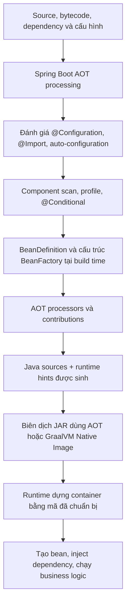
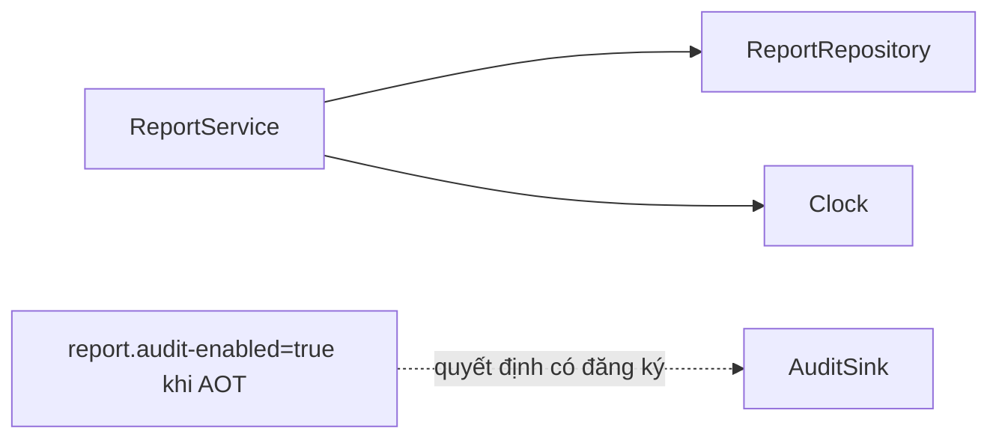

# Phân tích cấu hình và chuẩn bị BeanFactory trong giai đoạn AOT

Trong ứng dụng Spring Boot truyền thống, Spring Framework đọc cấu hình, khám phá component, đánh giá các điều kiện và chuẩn bị `BeanFactory` khi tiến trình bắt đầu chạy. **Spring AOT (Ahead-of-Time)** chuyển một phần đáng kể công việc này sang **giai đoạn build**: phân tích cấu trúc ứng dụng trong môi trường build, xác định các bean cần có và sinh mã để tái tạo cấu trúc container nhanh hơn khi khởi động.

Đây là một bước quan trọng khi biên dịch Spring Boot thành **GraalVM Native Image**. Native Image cần biết trước nhiều thành phần mà ứng dụng sẽ sử dụng; Spring AOT giúp làm rõ những phần trước đây được Spring phát hiện hoặc xử lý động. Cơ chế này cũng có thể hỗ trợ chạy ứng dụng trên JVM với mã AOT đã sinh; **Spring AOT không tự nó là trình biên dịch native**.

Sau bài này, người học có thể:

- Giải thích `BeanDefinition`, `BeanFactory` và *bean graph* liên quan như thế nào đến Spring AOT.
- Mô tả đường đi từ cấu hình Spring Boot đến mã khởi tạo `BeanFactory` được tạo trong quá trình build.
- Nhận diện tác động của `@Configuration`, component scanning, auto-configuration, `@Conditional` và profile lên tập bean được chuẩn bị.
- Phân biệt **phân tích bean tại build time** với **khởi tạo bean thực tế tại runtime**.
- Xác định khi nào cần kiểm tra xử lý động, bổ sung AOT contribution hoặc runtime hints, rồi kiểm thử bản native.

## 1. BeanFactory được chuẩn bị như thế nào khi chạy JVM thông thường?

Một ứng dụng Spring Boot thường bắt đầu từ `SpringApplication.run(...)`. Trong quá trình chuẩn bị `ApplicationContext`, Spring có thể:

1. Thu thập các nguồn cấu hình: các lớp `@Configuration`, component scanning, auto-configuration, `@Import` và những định nghĩa bean được đăng ký qua API.
2. Xem xét classpath, profile và thuộc tính môi trường để đánh giá những điều kiện như `@ConditionalOnClass`, `@ConditionalOnProperty` và `@Profile`.
3. Tạo hoặc hoàn thiện các `BeanDefinition`: mô tả kiểu bean, tên, scope, factory method, dependency, điều kiện khởi tạo và metadata liên quan.
4. Cho phép `BeanDefinitionRegistryPostProcessor` và `BeanFactoryPostProcessor` xử lý cấu trúc registry/factory theo hợp đồng Spring.
5. Dùng `BeanFactory` để tạo bean khi cần, giải quyết dependency injection và áp dụng lifecycle callbacks khi runtime thực sự khởi tạo ứng dụng.

**`BeanDefinition` không đồng nghĩa với bean instance.** Ví dụ: `BeanDefinition` có thể mô tả rằng bean `reportService` được tạo bởi constructor nhận `ReportRepository` và `Clock`. Đến lúc khởi tạo singleton, container mới gọi constructor, inject dependency và áp dụng các bước lifecycle phù hợp.

`BeanFactory` là thành phần quản lý các định nghĩa bean và việc tạo, tra cứu, kết nối các bean. `ApplicationContext` cung cấp thêm những chức năng cấp ứng dụng như event, resource và environment; bên dưới nó vẫn dựa vào một bean factory để quản lý bean.

Đối với ứng dụng lớn, việc khám phá cấu hình và xác định bean graph có chi phí CPU, bộ nhớ và số lượng lớp cần nạp. **Spring AOT nhắm đến việc đưa phần công việc có thể quyết định sớm này sang build time**, giúp runtime ít phải xử lý cấu trúc động hơn.

## 2. Spring AOT nhận gì và tạo ra gì?

Đầu vào của xử lý AOT là **ứng dụng Spring Boot cùng môi trường build**, gồm source/bytecode, dependencies, các nguồn cấu hình, thuộc tính và profile có ảnh hưởng đến graph. Công cụ dùng Spring để phân tích mô hình container có thể tạo ra trong điều kiện đó.

Kết quả thường gồm:

| Đầu ra AOT | Mục đích |
| --- | --- |
| **Mã Java được sinh** | Đăng ký `BeanDefinition`, thiết lập dependency và chuẩn bị các cấu trúc khởi tạo container đã biết trước |
| **Mã khởi tạo ApplicationContext/BeanFactory** | Nạp cấu trúc bean theo đường được tính toán trước, giảm các bước khám phá cấu hình động lúc chạy |
| **Runtime hints/metadata** | Mô tả một số nhu cầu reflection, proxy, resource, serialization, JNI… cho quá trình build Native Image |
| **Tài nguyên và lớp bổ sung** | Các thành phần cần thiết để mã AOT có thể được biên dịch và đóng gói cùng ứng dụng |

Đầu ra cụ thể, tên lớp được sinh và vị trí file phụ thuộc phiên bản Spring Boot/Spring Framework và công cụ build. Không nên viết ứng dụng phụ thuộc vào tên nội bộ của các lớp sinh tự động.

`Spring AOT` và `GraalVM Native Image` có vai trò khác nhau:

- **Spring AOT** hiểu mô hình cấu hình và bean của Spring; nó sinh mã chuẩn bị container và cung cấp hints.
- **Native Image** phân tích mã có thể truy cập và biên dịch thành executable native; quá trình này sử dụng cả mã sinh và hints mà Spring/ứng dụng cung cấp.
- **Runtime** vẫn thực hiện nhiều công việc thật: tạo các bean cần thiết, mở kết nối, chạy callback, thực thi nghiệp vụ và quản lý bộ nhớ.

`Spring AOT` vì thế là bước **chuẩn bị cấu trúc ứng dụng**, không phải hành động “chạy hết ứng dụng trong lúc build”.

## 3. Luồng phân tích cấu hình đến BeanFactory



### 3.1. Thu thập định nghĩa bean

Spring phân tích những nguồn bean có thể xác định trước, chẳng hạn:

- `@Component`, `@Service`, `@Repository`, `@Controller` từ component scanning.
- `@Configuration` và các phương thức `@Bean`.
- `@Import`, auto-configuration của Spring Boot và những cơ chế đăng ký bean tương thích.
- Các `BeanDefinition` do infrastructure hoặc phần mở rộng đã đăng ký khi phân tích context.

Ví dụ một service sử dụng repository và đồng hồ hệ thống:

```java
import java.time.Clock;
import org.springframework.boot.autoconfigure.condition.ConditionalOnProperty;
import org.springframework.context.annotation.Bean;
import org.springframework.context.annotation.Configuration;
import org.springframework.stereotype.Repository;
import org.springframework.stereotype.Service;

@Repository
class ReportRepository {
}

@Service
class ReportService {
    private final ReportRepository repository;
    private final Clock clock;

    ReportService(ReportRepository repository, Clock clock) {
        this.repository = repository;
        this.clock = clock;
    }
}

class AuditSink {
}

@Configuration(proxyBeanMethods = false)
class ReportConfiguration {
    @Bean
    Clock clock() {
        return Clock.systemUTC();
    }

    @Bean
    @ConditionalOnProperty(
        prefix = "report", name = "audit-enabled", havingValue = "true"
    )
    AuditSink auditSink() {
        return new AuditSink();
    }
}
```

Giả sử các lớp nằm trong package được application quét và có đủ dependency. Spring xác định `ReportService` cần `ReportRepository` và `Clock`; `AuditSink` chỉ tham gia graph nếu điều kiện của nó được thỏa trong môi trường phân tích.

Đây là *bean graph* ở mức dễ quan sát:



**Lưu ý:** ví dụ có lớp `@Service` và `@Repository` để minh họa cách Spring phát hiện cấu trúc dependency. Dữ liệu thực, kết nối database hoặc công việc của service chưa được “xử lý xong” chỉ vì Spring đã mô tả được các bean này.

### 3.2. Đánh giá điều kiện ở giai đoạn build

Khi AOT chuẩn bị mô hình container, các quyết định làm **thay đổi tập bean** cần được nhất quán với điều kiện build. Những yếu tố thường gặp:

| Nguồn điều kiện | Ví dụ | Điều cần chú ý |
| --- | --- | --- |
| **Classpath** | `@ConditionalOnClass` | Tập dependency và lớp nhìn thấy khi build cần khớp với artifact triển khai |
| **Profile** | `@Profile("prod")` | Profile ảnh hưởng cấu trúc bean khi xử lý AOT; đổi profile ở runtime không thể mặc nhiên dựng lại toàn bộ graph |
| **Property điều kiện** | `@ConditionalOnProperty` | Giá trị ảnh hưởng việc có/không đăng ký bean cần được kiểm soát từ giai đoạn build |
| **Bean hiện diện** | `@ConditionalOnBean`, `@ConditionalOnMissingBean` | Kết quả phụ thuộc tập bean đã khám phá và thứ tự xử lý các cấu hình liên quan |
| **Cấu hình tự định nghĩa** | `@Conditional` hoặc registrar tùy biến | Nếu điều kiện dựa vào thời gian, file runtime, network hay dữ liệu thay đổi, kết quả AOT dễ không còn phù hợp |

Ví dụ: nếu `report.audit-enabled=false` ở lúc phân tích AOT, không nên kỳ vọng chỉ đặt `report.audit-enabled=true` khi **chạy binary** là sẽ bổ sung `AuditSink` vào graph đã sinh. Đây là **thay đổi cấu trúc bean**, khác với thay đổi giá trị nghiệp vụ mà một bean đang đọc tại runtime.

Không phải *mọi* property của Spring Boot đều bị đóng băng ở build time. Những giá trị được đọc khi chạy và **không làm đổi bean graph** vẫn có thể được cấu hình theo cách thông thường, tùy cơ chế binding và thời điểm truy cập. Cần phân biệt:

- **Property lựa chọn bean/configuration:** cần ổn định giữa AOT processing và deployment.
- **Property dữ liệu runtime:** ví dụ địa chỉ endpoint, timeout hoặc bí mật được bean đọc khi khởi tạo/runtime; vẫn kiểm thử để xác định hành vi cụ thể.

Một quy tắc thiết kế là: **cấu trúc container ổn định, giá trị vận hành có thể thay đổi theo ranh giới được hỗ trợ**.

### 3.3. Xử lý và đóng góp thông tin AOT

Spring Framework có các extension point cho giai đoạn chuẩn bị container. Hai khái niệm quan trọng:

**`BeanFactoryInitializationAotProcessor`** xem xét `BeanFactory` ở cấp toàn bộ factory và có thể trả về một contribution để bổ sung mã khởi tạo tại runtime. Nó phù hợp khi phần mở rộng cần nhìn tổng thể container hoặc bổ sung hoạt động khởi tạo hạ tầng.

**`BeanRegistrationAotProcessor`** xử lý thông tin về một bean đã đăng ký (`RegisteredBean`) và có thể trả về contribution cho cách đăng ký/tạo bean đó. Nó phù hợp khi một bean cần mã tạo instance, wiring hoặc metadata đặc biệt mà cơ chế sinh mã mặc định chưa đáp ứng đầy đủ.

Hai nhóm contribution tham gia **sinh mã trong build**; chúng không đồng nghĩa với việc chạy logic nghiệp vụ ngay tại thời điểm build. Tên phương thức/API cụ thể cần kiểm tra với phiên bản Spring Framework của dự án.

Ngoài ra, **`RuntimeHints`** ghi nhận những nhu cầu kỹ thuật để native compilation không bỏ sót thành phần được sử dụng gián tiếp (như reflection hoặc resource). Runtime hints liên quan đến khả năng tiếp cận mã/tài nguyên trong native executable; chúng **không tự tạo `BeanDefinition` mới**.

### 3.4. Sinh mã khởi tạo BeanFactory

Sau khi biết những bean cần có, Spring AOT có thể sinh mã Java để đăng ký định nghĩa bean và cung cấp cách khởi tạo phù hợp. Nhờ đó, đường chạy AOT giảm nhu cầu quét và suy luận nhiều thông tin mà build time đã biết.

Đoạn sau là **mã giả giải thích ý tưởng**, không phải Java API của Spring AOT và không dùng để copy vào ứng dụng:

```text
prepareBeanFactory(factory):
    register("reportRepository", definition(ReportRepository))
    register("clock", definition(factoryMethod: ReportConfiguration.clock))
    register("reportService",
             definition(constructor: [ReportRepository, Clock]))
    if auditWasEnabledWhenGenerating:
        register("auditSink", definition(ReportConfiguration.auditSink))
```

Trong file thật, Spring có thể sinh các lớp, supplier, method reference và mã xử lý dependency phức tạp hơn. Điều cần hiểu là **lệnh đăng ký và wiring được viết sẵn từ kết quả phân tích**, thay vì mỗi lần khởi động lại đi qua toàn bộ quy trình khám phá như cách động thông thường.

### 3.5. Runtime còn làm gì?

Sinh mã `BeanFactory` **không** có nghĩa tất cả singleton đã được tạo trong lúc build. Khi tiến trình chạy, Spring vẫn có thể:

- Thực thi constructor, factory method và dependency injection.
- Chạy những callback/lifecycle phù hợp như `@PostConstruct`.
- Thiết lập connection pool, thread pool, scheduler và các integration thực tế.
- Đọc giá trị cấu hình runtime được hỗ trợ.
- Thực thi HTTP request, event listener và logic nghiệp vụ.

Điều này giải thích vì sao một ứng dụng dùng AOT vẫn có thể gặp lỗi kết nối cơ sở dữ liệu, sai credentials hoặc lỗi logic tại runtime. Spring AOT giảm một số chi phí **chuẩn bị container**, không tự xác minh rằng tất cả tài nguyên bên ngoài đều sẵn sàng.

## 4. Khác biệt giữa Spring AOT, bean initialization và GraalVM Native Image

| Khái niệm | Thời điểm chủ yếu | Trách nhiệm |
| --- | --- | --- |
| **Phân tích cấu hình Spring AOT** | Build | Xác định các bean/configuration được hỗ trợ theo điều kiện đã biết |
| **Sinh mã BeanFactory** | Build | Sinh Java code/metadata để tái tạo đăng ký và wiring |
| **GraalVM Native Image** | Build | Phân tích reachability và biên dịch mã máy native từ chương trình |
| **Bean instantiation/lifecycle** | Runtime | Tạo instance và chạy các bước khởi tạo thực |
| **Xử lý request và I/O** | Runtime | Chạy nghiệp vụ, giao tiếp với DB, message broker và dịch vụ ngoài |

Nếu đang tối ưu thời gian khởi động hoặc bộ nhớ, phải tách rõ đóng góp của từng lớp. Spring AOT có thể giảm công việc của framework lúc khởi tạo; Native Image còn thay đổi cách đóng gói, nạp mã và runtime; ứng dụng thực tế vẫn phụ thuộc thiết kế bean và dependencies.

## 5. Những trường hợp cấu hình động cần đánh giá kỹ

### 5.1. Đăng ký bean dựa trên dữ liệu chỉ xuất hiện khi chạy

Ví dụ một `BeanDefinitionRegistryPostProcessor` đọc danh sách tenant từ network rồi đăng ký mỗi tenant thành một bean riêng. Khi xử lý AOT, dữ liệu runtime đó có thể chưa có, thay đổi sau build hoặc khác giữa môi trường. Kết quả sinh mã sẽ không biết trước tập bean cần bổ sung.

Các hướng điều chỉnh tùy tình huống:

1. Nếu tập tenant là cố định cho mỗi bản build, cung cấp cấu hình build ổn định và kiểm thử kết quả được sinh.
2. Nếu tenant thay đổi liên tục, tránh biến mỗi tenant thành một `BeanDefinition` mới; dùng một service/registry thông thường lưu cấu hình tenant và tra cứu động ở tầng nghiệp vụ.
3. Nếu không thể tránh đăng ký động, đánh giá hợp đồng AOT của extension và thiết kế contribution rõ ràng; kiểm tra binary native trên đường chạy này.

**Nguyên tắc:** khi số lượng/kiểu bean phụ thuộc dữ liệu runtime không thể dự đoán, cần xem lại cách biểu diễn mô hình; thêm runtime hints đơn thuần không giải quyết được quyết định bean graph.

### 5.2. Thao tác reflection

Một thư viện có thể lấy tên lớp từ chuỗi rồi dùng `Class.forName(...)`, constructor hoặc field reflection. Spring AOT có thể tự cung cấp hints cho nhiều cơ chế Spring phổ biến, nhưng **không bảo đảm** nhận ra mọi reflection tùy biến của ứng dụng và thư viện.

Nếu loại cần phản chiếu đã xác định, có thể cung cấp `RuntimeHintsRegistrar`:

```java
import org.springframework.aot.hint.MemberCategory;
import org.springframework.aot.hint.RuntimeHints;
import org.springframework.aot.hint.RuntimeHintsRegistrar;
import org.springframework.context.annotation.Configuration;
import org.springframework.context.annotation.ImportRuntimeHints;

final class AuditPayload {
    public AuditPayload() {
    }
}

class AuditRuntimeHints implements RuntimeHintsRegistrar {
    @Override
    public void registerHints(RuntimeHints hints, ClassLoader classLoader) {
        hints.reflection().registerType(
            AuditPayload.class,
            MemberCategory.INVOKE_PUBLIC_CONSTRUCTORS
        );
    }
}

@Configuration(proxyBeanMethods = false)
@ImportRuntimeHints(AuditRuntimeHints.class)
class AuditNativeConfiguration {
}
```

Ví dụ này minh họa cách đăng ký constructor public để truy cập qua reflection nếu mã runtime thật sự dùng kiểu đó. Chỉ đăng ký đúng member cần thiết; nếu ứng dụng dùng field, phương thức, resource hoặc dynamic proxy thì cần hints tương ứng. Sau đó **kiểm thử binary native** để xác nhận đường chức năng chạy được.

`RuntimeHintsRegistrar` cũng có thể cung cấp resource patterns khi ứng dụng dùng các tệp trên classpath. Với `ResourceLoader` đọc file cấu hình đóng gói kèm ứng dụng, cần bảo đảm resource được đưa vào native executable, không chỉ xuất hiện trong `src/main/resources` khi phát triển.

### 5.3. Thay đổi profile hoặc property giữa build và runtime

Ví dụ một dịch vụ được build AOT với profile `dev` nhưng khi triển khai native lại mong chờ bean chỉ có ở profile `prod`. Nếu quyết định cấu trúc đó đã được cố định ở build time, cấu hình runtime không tự tái phân tích và sinh thêm bean.

Hãy ghi nhận profile và các property **ảnh hưởng đến graph** như một phần của công thức build. Nếu phải có nhiều graph khác nhau, cân nhắc build artifact riêng theo môi trường hoặc chỉnh thiết kế để logic khác biệt nằm trong một bean có thể xử lý dữ liệu runtime.

### 5.4. Tác dụng phụ trong bước phân tích

Một số component framework hoặc extension được gọi khi phân tích AOT. Mã ở những vị trí đó không nên mặc định có quyền truy cập endpoint production, tạo dữ liệu thật hoặc phụ thuộc vào secret chỉ có sau triển khai.

Nên giữ thao tác liên quan đến **cấu trúc bean** có tính quyết định và khả năng lặp lại. Việc mở kết nối, gửi request, chạy migration hoặc xử lý nghiệp vụ cần có thời điểm thực thi rõ ràng, được kiểm soát độc lập.

## 6. Thực hành quan sát đầu ra AOT

Ví dụ sau dành cho một dự án Spring Boot đã cấu hình plugin tương thích và sử dụng JDK/toolchain phù hợp. Tên artifact và đường dẫn tùy dự án; các lệnh minh họa không tự cài GraalVM hay plugin.

### 6.1. Với Maven

```bash
./mvnw -DskipTests spring-boot:process-aot
```

Trong một số cấu hình Maven Spring Boot, mã sinh có thể nằm dưới thư mục tương tự:

```text
target/spring-aot/main/sources/
target/spring-aot/main/resources/
```

Hãy mở mã sinh để tìm các đoạn liên quan đến `ReportService`, `Clock` hoặc tên bean của chính ứng dụng. Quan sát mã khởi tạo và đăng ký, nhưng không sửa trực tiếp các tệp do công cụ sinh; thay đổi nguồn cấu hình hoặc extension rồi tạo lại AOT.

### 6.2. Với Gradle

```bash
./gradlew processAot
```

Các phiên bản plugin có thể xuất mã tại thư mục tương tự `build/generated/aotSources` và tài nguyên/classes tương ứng. Xem output của task và cấu hình build để biết vị trí thực tế.

### 6.3. Kiểm thử Native Image

Sau khi có GraalVM Native Image toolchain và Native Build Tools tương thích, dự án có thể cung cấp những lệnh như:

```bash
# Maven (khi có profile native)
./mvnw -Pnative native:compile

# Hoặc Gradle
./gradlew nativeCompile
```

Chạy tệp native thực tế được tạo ra, truy cập endpoint và kiểm tra log. Ví dụ trên macOS/Linux với tên binary giả định:

```bash
./target/my-service
```

Với Gradle, artifact thường nằm trong `build/native/nativeCompile/`; trên Windows tên executable có thể có đuôi `.exe`. Tên `my-service` chỉ minh họa và cần thay bằng tên từ cấu hình project.

**Bài tập quan sát:** thay đổi `report.audit-enabled` ở build time và tạo lại output AOT. So sánh các đoạn mã sinh liên quan tới `AuditSink`, sau đó thử chạy bản native. Tiếp theo, đổi chỉ giá trị property ở runtime và quan sát xem bean graph có thay đổi như kỳ vọng hay không. Thí nghiệm này giúp thấy sự khác nhau giữa điều kiện xác định bean và dữ liệu thông thường.

## 7. Quy trình kiểm tra tính đúng đắn của BeanFactory sau AOT

Phân tích thành công chưa chứng minh rằng mọi nhánh của ứng dụng chạy đúng trong native executable. Với một service Spring Boot có database, JSON và tài nguyên tĩnh, nên kiểm tra:

| Kiểm tra | Cần xác nhận |
| --- | --- |
| **Bean graph** | Các bean quan trọng đều được đăng ký; dependency injection và scope có hành vi phù hợp |
| **Profile và condition** | Các lựa chọn build time khớp profile/feature dự định triển khai |
| **Lifecycle** | Constructor, `@PostConstruct`, listeners và các tác vụ khởi tạo hoạt động đúng |
| **Reflection/serialization** | JSON binding, DTO, thư viện bên thứ ba và dynamic proxy chạy được trên native |
| **Resource** | Các JSON/YAML/template/certificate cần đóng gói có thể đọc được ở runtime |
| **External service** | Database, broker và TLS được cấu hình đúng; lỗi kết nối được phát hiện/tái thử hợp lý |
| **Khởi động và bộ nhớ** | Ghi thời gian đến readiness, RSS và CPU của tiến trình trong cùng điều kiện benchmark |
| **Build reproducibility** | Cùng commit, dependency, profile và toolchain tạo ra graph và hành vi tương đương |

### Ví dụ điều tra khi native thiếu bean

**Triệu chứng:** ứng dụng JVM chạy ổn, nhưng binary native không khởi động được vì dependency yêu cầu `AuditSink` không có.

**Hướng điều tra:**

1. Xác định bean nào cần `AuditSink` và điều kiện nào khiến nó xuất hiện.
2. Kiểm tra giá trị `report.audit-enabled`, profile và classpath **trong lúc chạy AOT**.
3. Quan sát mã AOT sinh ra: có đăng ký `auditSink` hay không?
4. So sánh các giá trị và artifact tại runtime, đặc biệt nếu build và deploy dùng pipeline khác nhau.
5. Nếu lỗi do điều kiện thay đổi theo runtime, chọn cách cố định cấu trúc bean phù hợp hoặc thiết kế lại cơ chế chuyển tính năng; sau đó build và kiểm thử lại.

Nếu mã AOT **có** định nghĩa bean nhưng quá trình tạo instance thất bại, chuyển hướng điều tra sang constructor, dependency, lifecycle, reflection/resource và lỗi hạ tầng. Việc xác định lỗi thuộc **đăng ký bean** hay **khởi tạo bean** giúp tránh thêm hints sai vấn đề.

## 8. Các điểm dễ nhầm

**“AOT tạo toàn bộ bean object ngay khi build.”** Sai. AOT chủ yếu phân tích cấu hình và sinh mã phục vụ khởi tạo container; nhiều instance và lifecycle vẫn được thực hiện khi ứng dụng chạy.

**“Dùng Spring AOT nghĩa là đã có Native Image.”** Sai. Spring AOT chuẩn bị mô hình Spring; GraalVM Native Image là công đoạn biên dịch native riêng. Mã AOT cũng có thể chạy trong ngữ cảnh JVM phù hợp.

**“Có runtime hint thì điều kiện sẽ tự đăng ký mọi bean.”** Sai. Hint nói về khả năng truy cập mã, resource hoặc reflection; quyết định **có bean nào** thuộc cấu hình/`BeanFactory`.

**“Đổi profile khi chạy luôn dựng lại graph mới.”** Không nên giả định như vậy với AOT: các quyết định đã được đưa ra trong quá trình xử lý trước phải được kiểm soát xuyên suốt build và triển khai.

**“Native build thành công đồng nghĩa không có lỗi runtime.”** Sai. Những đường chạy hiếm, reflection tùy biến, resource và hệ thống ngoài vẫn cần integration test trên binary native.

## 9. Ghi nhớ và vận dụng

- `BeanDefinition` mô tả bean; `BeanFactory` đăng ký và quản lý việc tạo bean. Spring AOT chuẩn bị **cấu trúc đó** từ kết quả phân tích ở build time.
- Component scanning, auto-configuration, `@Conditional`, profile, classpath và bean post-processing có thể ảnh hưởng đến tập bean được biết trước.
- AOT processors cung cấp điểm mở rộng để đóng góp mã chuẩn bị `BeanFactory` hoặc từng bean; runtime hints mô tả nhu cầu truy cập động phục vụ Native Image.
- Sau khi sinh mã, runtime vẫn phải khởi tạo bean và chạy nghiệp vụ; tối ưu AOT không thay thế kiểm thử dependency, I/O và lifecycle.
- Khi đánh giá lợi ích Spring Boot Native Image về **startup** và **bộ nhớ**, hãy đo từ cùng commit, đồng thời xác minh cấu hình build/runtime, bean graph và tương thích chức năng.

Một cách thực hành có giá trị là lấy một Spring Boot service nhỏ, thêm một bean có điều kiện, chạy `process-aot`, đọc mã sinh và ghi nhận sự khác biệt khi thay đổi điều kiện **trước build** so với **sau build**. Kết quả quan sát trực tiếp sẽ làm rõ vì sao Spring AOT yêu cầu mô hình container ổn định và dự đoán được.
