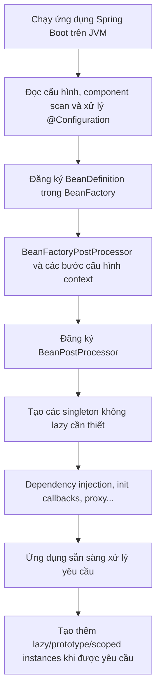
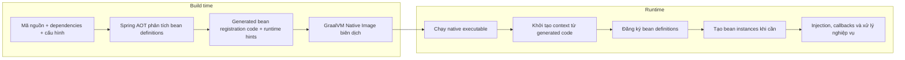
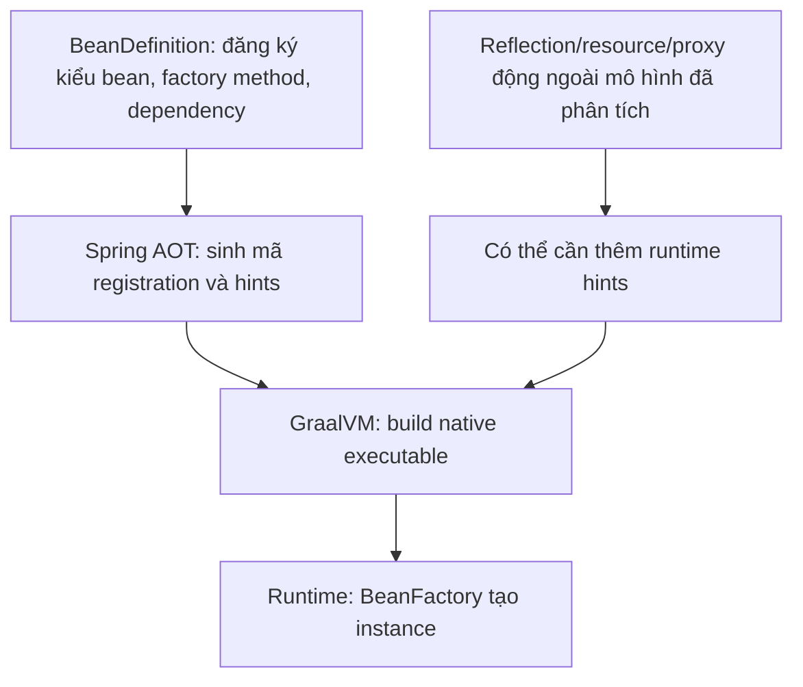

# Bean definition khác với bean instance và thời điểm xử lý mỗi loại

Trong **Spring AOT** (*Ahead-of-Time processing*), Spring Boot phân tích phần lớn cấu trúc của application context **trước khi ứng dụng chạy** để sinh mã khởi tạo phù hợp với GraalVM Native Image. Điều này thường dẫn đến một hiểu lầm: “Spring AOT đã xử lý bean khi build, vậy bean đã được tạo sẵn trong native executable?”. Câu trả lời là **không**, nếu đang nói về các object nghiệp vụ thông thường.

Để hiểu chính xác quá trình này, cần phân biệt **`BeanDefinition`** — bản mô tả cách Spring sẽ quản lý và tạo một bean — với **bean instance** — đối tượng Java thực tế mà ứng dụng sử dụng. Chúng có thời điểm tồn tại và vai trò khác nhau. Phân biệt này còn giúp giải thích những lỗi khi build Spring Boot thành GraalVM Native Image, đặc biệt với conditional configuration, đăng ký bean động, reflection và các tài nguyên cần thiết ở runtime.

## 1. Hai khái niệm cần tách biệt

### `BeanDefinition`: bản mô tả để Spring biết phải làm gì

`BeanDefinition` là metadata trong `BeanFactory`, mô tả **công thức tạo và quản lý bean**. Nó có thể chứa thông tin về:

- Kiểu bean, tên bean và nguồn đăng ký (chẳng hạn class được quét từ `@Component` hoặc phương thức `@Bean`).
- Cách khởi tạo: constructor, factory method, instance supplier, các tham số hoặc phụ thuộc cần được phân giải.
- Scope như `singleton` hoặc `prototype`; cờ `lazy-init`; tên phương thức khởi tạo hoặc hủy nếu có.
- Qualifier, vai trò của bean, và các metadata khác phục vụ lựa chọn, wiring, xử lý vòng đời.

`BeanDefinition` **không phải** là đối tượng nghiệp vụ. Việc Spring đã đăng ký `BeanDefinition` của `PaymentService` không đồng nghĩa constructor `PaymentService(...)` đã chạy, database đã được kết nối hay field nghiệp vụ đã có giá trị.

Đối với mã ứng dụng phổ biến, annotation là **nguồn đầu vào** để Spring phát hiện và đăng ký định nghĩa. Ví dụ:

```java
@Service
public class PaymentService {
    private final PaymentRepository repository;

    public PaymentService(PaymentRepository repository) {
        this.repository = repository;
    }

    public void pay(long orderId) {
        // Nghiệp vụ thanh toán.
    }
}
```

Annotation `@Service` giúp Spring nhận biết class và tạo bean definition tương ứng; constructor chỉ chạy khi Spring thật sự cần tạo instance theo vòng đời của bean.

### Bean instance: đối tượng được tạo từ bản mô tả

**Bean instance** là object thật, chẳng hạn một `PaymentService` cụ thể có tham chiếu đến `PaymentRepository`. Khi tạo bean, container thường:

1. Chọn định nghĩa và phân giải dependency.
2. Gọi constructor hoặc factory method, hoặc dùng supplier phù hợp.
3. Thực hiện injection và các bước xử lý của `BeanPostProcessor`.
4. Chạy callback khởi tạo như `@PostConstruct` hoặc `InitializingBean.afterPropertiesSet()` nếu có.
5. Đưa object đã khởi tạo vào sử dụng, có thể thông qua proxy được container quản lý.
6. Với những scope thích hợp, chạy logic hủy khi vòng đời kết thúc.

Một bean name thường trỏ tới một instance singleton trong mỗi `BeanFactory`, nhưng không phải lúc nào cũng vậy. `prototype` có thể tạo instance mới mỗi lần yêu cầu; request-scoped bean có instance gắn với một request; Spring cũng có thể trả về proxy, khiến loại object mà caller nhìn thấy khác với implementation đích.

| Thuộc tính | `BeanDefinition` | Bean instance |
| --- | --- | --- |
| Bản chất | Metadata/công thức tạo bean | Object Java thực tế |
| Được lưu/tra cứu bởi | `BeanDefinitionRegistry`, `BeanFactory` | BeanFactory và bộ quản lý instance/scope tương ứng |
| Có constructor nghiệp vụ đã chạy chưa? | Chưa nhất thiết | Đã có bước tạo object tương ứng |
| Có thể dùng để gọi nghiệp vụ? | Không | Có, sau khi khởi tạo phù hợp |
| Liên quan tới Spring AOT | Đầu vào quan trọng để phân tích và sinh registration code | Thông thường được tạo khi ứng dụng thực thi |
| Có thể có nhiều instance cho một định nghĩa? | Một định nghĩa mô tả cách cung cấp bean | Có, ví dụ `prototype` hoặc scope khác |

**Điểm nhớ:** “Spring biết cách tạo bean” và “Spring đã tạo bean” là hai mệnh đề khác nhau.

## 2. Trên JVM, định nghĩa và instance xuất hiện theo trình tự nào?

Ở chế độ chạy Spring Boot thông thường, quá trình khởi tạo context thường diễn ra theo thứ tự khái quát sau:



Sơ đồ cho thấy một trình tự **khái quát**: các bean hạ tầng có thể được tạo sớm để hỗ trợ những bước xử lý tiếp theo; một số hoạt động registration/processing diễn ra đan xen. Không nên hiểu mọi bean đều được tạo cùng lúc hoặc đợi cho tới khi ứng dụng đã phục vụ HTTP.

Với `singleton` thông thường, Spring tạo instance trong quá trình `ApplicationContext.refresh()`, trừ khi bean được cấu hình lazy hoặc có cơ chế đặc biệt. Với `@Lazy`, việc có definition chưa kích hoạt constructor: instance chỉ được tạo khi được yêu cầu, nếu không bị bean eager khác phụ thuộc trước đó. Với `prototype`, container tạo instance cho các yêu cầu phù hợp và không quản lý vòng hủy toàn diện như singleton.

## 3. Khi bật Spring AOT, phần nào chuyển sang build time?

Spring AOT tập trung vào việc **phân tích cấu hình của container** và sinh mã hỗ trợ khởi tạo context. Với Spring Boot tích hợp GraalVM Native Image, có hai pha cần phân biệt:

| Giai đoạn | Hoạt động chủ yếu | Có tạo bean nghiệp vụ để dùng về sau không? |
| --- | --- | --- |
| **AOT processing tại build time** | Xác định nhiều bean definitions, xử lý cấu hình/conditions có thể đánh giá trước, tổng hợp metadata, sinh mã đăng ký bean và runtime hints | **Không** tạo sẵn các instance nghiệp vụ rồi đóng băng chúng để tái sử dụng khi runtime |
| **Native-image compilation tại build time** | Phân tích reachability và biên dịch mã cùng metadata cần thiết | Không phải phiên khởi động ứng dụng phục vụ request |
| **Application startup tại runtime** | Chạy mã bootstrap đã được tạo, xây dựng context, đăng ký definitions, tạo các bean cần thiết, inject dependency và chạy lifecycle | **Có**, các instance cần dùng được tạo trong tiến trình thực thi |



Những đoạn mã được Spring AOT sinh ra có thể là generated bean definitions, instance suppliers, initializer và các đăng ký reflection/resource/proxy hints. Tên class và cấu trúc generated code thay đổi theo phiên bản Spring, vì vậy không nên phụ thuộc vào một mẫu tên file cố định.

Ví dụ về **ý tưởng** (pseudocode, không phải mã generated thực tế của một phiên bản Spring cụ thể):

```java
// BUILD TIME - diễn giải khái niệm, không phải API được khuyến nghị để copy.
BeanDefinition description = analyzeBeanConfiguration(...);
GeneratedCode output = generateRegistrationCode(description);

// RUNTIME - diễn giải thứ tự xảy ra sau khi chạy binary.
registerGeneratedDefinitions(beanFactory);
PaymentService service = beanFactory.getBean(PaymentService.class);
```

Tại runtime, `getBean(...)` có thể trả instance đã tạo hoặc kích hoạt việc tạo mới tùy scope và trạng thái của bean.

### Ngoại lệ quan trọng: một số bean có thể được tạo khi AOT đang phân tích

Không được hiểu câu “AOT phân tích definitions” thành quy luật **không có constructor nào chạy trong quá trình build**. Spring có thể cần khởi tạo **một số bean hạ tầng** — nhất là processor liên quan đến việc hoàn thiện bean factory, xử lý cấu hình và tham gia AOT — để lấy thông tin cần thiết.

Điều này **không có nghĩa** các instance hạ tầng hoặc bean ứng dụng được “mang nguyên object” từ máy build sang native runtime. Phải phân biệt **sự thực thi tạm thời phục vụ phân tích ở build time** và **đời sống của instance phục vụ ứng dụng ở runtime**.

Vì thế, đừng dựa vào side effect của constructor hay processor trong pha build để tạo dữ liệu nghiệp vụ, gửi email, migrate database hoặc gọi dịch vụ bên ngoài. Nếu một đoạn logic có khả năng bị thực thi lúc AOT analysis, hãy bảo đảm nó không phụ thuộc vào môi trường production và không gây tác dụng phụ ngoài ý muốn.

## 4. Ví dụ thực tế: definition đã có nhưng instance chưa được tạo

Xét ứng dụng có bean `DeliveryClient` chỉ được khởi tạo khi có nhu cầu sử dụng. Đoạn ví dụ đặt trong cùng package `com.example.delivery`, mỗi đoạn class có thể lưu thành file cùng tên.

```java
// DeliveryClient.java
package com.example.delivery;

public final class DeliveryClient {
    private final String endpoint;

    public DeliveryClient(String endpoint) {
        this.endpoint = endpoint;
        System.out.println("CONSTRUCTOR: DeliveryClient -> " + endpoint);
    }

    public String endpoint() {
        return endpoint;
    }
}
```

```java
// DeliveryConfiguration.java
package com.example.delivery;

import org.springframework.beans.factory.annotation.Value;
import org.springframework.context.annotation.Bean;
import org.springframework.context.annotation.Configuration;
import org.springframework.context.annotation.Lazy;

@Configuration(proxyBeanMethods = false)
public class DeliveryConfiguration {

    @Bean
    @Lazy
    DeliveryClient deliveryClient(@Value("${delivery.endpoint}") String endpoint) {
        System.out.println("FACTORY METHOD: deliveryClient");
        return new DeliveryClient(endpoint);
    }
}
```

Cấu hình minh họa trong `src/main/resources/application.properties`:

```properties
delivery.endpoint=https://delivery.example.test
```

Cấu hình `@Bean` tạo **definition** cho bean có tên `deliveryClient`, với cách tạo là gọi factory method `deliveryClient(...)`. `@Lazy` yêu cầu trì hoãn khởi tạo singleton cho đến khi bean cần được sử dụng (trừ khi một dependency khác buộc nó được tạo trước). `@Value` được Spring phân giải khi tạo bean; đây là ví dụ về **giá trị cấu hình cần thiết tại runtime**, khác với điều kiện dùng để xác định *có bean definition hay không* ở build time.

Có thể quan sát cả definition và trạng thái singleton qua context:

```java
// DeliveryApplication.java
package com.example.delivery;

import org.springframework.beans.factory.config.BeanDefinition;
import org.springframework.beans.factory.config.ConfigurableListableBeanFactory;
import org.springframework.boot.SpringApplication;
import org.springframework.boot.autoconfigure.SpringBootApplication;
import org.springframework.context.ConfigurableApplicationContext;

@SpringBootApplication
public class DeliveryApplication {
    public static void main(String[] args) {
        ConfigurableApplicationContext context =
                SpringApplication.run(DeliveryApplication.class, args);

        ConfigurableListableBeanFactory factory = context.getBeanFactory();
        BeanDefinition definition = factory.getBeanDefinition("deliveryClient");

        System.out.println("Definition exists: " + (definition != null));
        System.out.println("Lazy: " + definition.isLazyInit());
        System.out.println("Singleton created: " + factory.containsSingleton("deliveryClient"));

        DeliveryClient first = context.getBean(DeliveryClient.class);

        System.out.println("Singleton created: " + factory.containsSingleton("deliveryClient"));
        DeliveryClient second = context.getBean(DeliveryClient.class);
        System.out.println("Same instance: " + (first == second));
    }
}
```

Trong một ứng dụng mẫu không có bean eager khác yêu cầu `DeliveryClient` trước đó, kết quả dự kiến:

```text
Definition exists: true
Lazy: true
Singleton created: false
FACTORY METHOD: deliveryClient
CONSTRUCTOR: DeliveryClient -> https://delivery.example.test
Singleton created: true
Same instance: true
```

Thứ tự hoặc số lần xuất hiện của những dòng khác do framework ghi log phụ thuộc vào cấu hình. Đây là một **mẫu quan sát**: nếu singleton đã được nơi khác yêu cầu sớm, dòng `Singleton created: false` có thể là `true`.

Điểm liên hệ với AOT: **definition** được Spring AOT hiểu và chuyển thành generated registration code trong build; còn log từ factory method/constructor của bean lazy, trong trường hợp thông thường, xuất hiện khi **native executable đang chạy và bean được yêu cầu**. Mã tạo instance không cần thực thi ở build time chỉ để Spring biết factory method đó tồn tại.

## 5. Scope và lazy ảnh hưởng thế nào đến thời điểm tạo instance?

Một bean definition có thể tồn tại từ lúc context được dựng, nhưng thời điểm tạo instance phụ thuộc vào scope và cách sử dụng:

| Khai báo | Khi nào definition có hiệu lực? | Khi nào instance được tạo? | Hành vi dễ quan sát |
| --- | --- | --- | --- |
| `@Component`/`@Bean` singleton mặc định | Khi Spring đăng ký definitions vào context | Thường ở pha khởi tạo singleton của context | Hai lần `getBean` thường trả cùng instance |
| `@Lazy` singleton | Definition vẫn được đăng ký | Lần đầu cần bean, trừ khi bị phụ thuộc eager kích hoạt | Constructor chạy muộn |
| `@Scope("prototype")` | Definition vẫn được đăng ký | Mỗi lần container được yêu cầu tạo prototype | Hai lần `getBean` thường là hai object |
| Request scope trong web application | Definition được đăng ký | Khi một HTTP request cần bean đó | Mỗi request có instance theo scope |
| Singleton phụ thuộc vào prototype | Hai definitions được đăng ký | Prototype được tạo khi singleton cần injection | Prototype không tự thay đổi mỗi lần gọi method trên singleton |

Ví dụ scope:

```java
@Bean
@Scope(ConfigurableBeanFactory.SCOPE_PROTOTYPE)
ReportFormatter reportFormatter() {
    return new ReportFormatter();
}
```

Cần import `org.springframework.beans.factory.config.ConfigurableBeanFactory` và `org.springframework.context.annotation.Scope`. Với scope prototype, Spring tạo mới theo mỗi lần lookup từ container; nếu một prototype được inject trực tiếp vào singleton **một lần**, singleton tiếp tục giữ instance đó trừ khi sử dụng `ObjectProvider` hoặc cơ chế lookup tương ứng.

**AOT không đổi ý nghĩa của scope.** Nó tối ưu con đường đăng ký và tạo bean; bean vẫn phải tuân theo các quy tắc lifetime được Spring hỗ trợ.

## 6. `@Bean` và `@Configuration`: xử lý định nghĩa khác thực thi factory method

Một class `@Configuration` chứa phương thức `@Bean` thường được Spring dùng để đăng ký bean definitions. Có ba hoạt động riêng biệt:

1. **Phát hiện cấu hình:** Spring đọc thông tin `@Configuration`, `@Bean` và các annotation liên quan để biết ứng dụng có những definition nào.
2. **Xây dựng đường khởi tạo:** Spring chuẩn bị cách gọi factory method và phân giải tham số; ở AOT có thể sinh code cho những thao tác này.
3. **Tạo bean instance:** Spring gọi factory method khi bean thực sự cần được tạo, đồng thời thực thi mã bên trong method.

Ví dụ:

```java
@Configuration(proxyBeanMethods = false)
class AnalyticsConfiguration {

    @Bean
    AnalyticsService analyticsService(EventRepository repository) {
        // Thông thường chạy khi AnalyticsService instance được tạo.
        return new AnalyticsService(repository);
    }
}
```

Spring AOT có thể phân tích rằng bean `analyticsService` có dependency `EventRepository` và được tạo từ một factory method đã biết. **Phân tích được lời gọi không có nghĩa factory method đã chạy để tạo instance phục vụ application runtime.**

### `proxyBeanMethods = false` tác động điều gì?

Với `@Configuration(proxyBeanMethods = false)`, lời gọi Java **trực tiếp** từ một method cấu hình tới method `@Bean` khác không được CGLIB can thiệp để tra cứu singleton do container quản lý. Vì thế nên truyền dependency qua tham số method:

```java
@Configuration(proxyBeanMethods = false)
class MetricsConfiguration {

    @Bean
    MetricsRepository metricsRepository() {
        return new MetricsRepository();
    }

    @Bean
    MetricsService metricsService(MetricsRepository repository) {
        return new MetricsService(repository);
    }
}
```

Thay vì tự gọi `metricsRepository()` bên trong `metricsService(...)`. Dùng injection qua tham số giúp Spring nhìn thấy quan hệ dependency rõ ràng, hỗ trợ cả JVM và AOT. Tùy trường hợp, gọi factory method trực tiếp có thể tạo **một object Java ngoài vòng quản lý bean** và làm sai kỳ vọng về singleton; đây là lỗi thiết kế khác với việc AOT có sinh definitions hay không.

## 7. Điều kiện cấu hình ở build time khác dữ liệu runtime

Đây là khác biệt quan trọng khi triển khai Native Image cho nhiều môi trường.

Giả sử ứng dụng khai báo:

```java
@Configuration(proxyBeanMethods = false)
class StorageConfiguration {

    @Bean
    @ConditionalOnProperty(
        prefix = "storage",
        name = "provider",
        havingValue = "s3"
    )
    StorageClient s3StorageClient() {
        return new S3StorageClient();
    }
}
```

Lưu ý `@ConditionalOnProperty` thuộc `org.springframework.boot.autoconfigure.condition`; `StorageClient` và `S3StorageClient` là các kiểu ứng dụng giả định.

Trong chế độ JVM thông thường, điều kiện được đánh giá khi container xử lý cấu hình khởi động. Với Spring AOT, **những điều kiện được đánh giá ở build-time có thể quyết định luôn tập bean definitions được sinh ra**. Nếu build với cấu hình khiến định nghĩa S3 bị loại, không thể mặc nhiên kỳ vọng đổi `storage.provider` lúc chạy sẽ làm native executable tự xuất hiện definition đó. Muốn hỗ trợ nhiều kiểu bean thay đổi theo runtime, cần thiết kế cho các implementation thuộc tập đã biết tại build và chọn implementation bằng dữ liệu runtime theo cơ chế phù hợp.

Phân biệt hai nhóm giá trị:

| Câu hỏi | Ví dụ | Ảnh hưởng trong AOT/native |
| --- | --- | --- |
| **Có đăng ký definition này không?** | `@ConditionalOnProperty`, `@Profile`, một số điều kiện auto-configuration | Có thể được xác định ở AOT build time; thay đổi điều kiện sau build không nhất thiết tạo được definition mới |
| **Khi tạo instance, dùng dữ liệu nào?** | URL, timeout, token, credential được inject qua cấu hình runtime | Có thể vẫn đọc tại runtime nếu được lập trình và binding đúng; không mặc nhiên bị đóng băng cùng definitions |
| **Trong request này xử lý nhánh nào?** | Chọn chiến lược theo loại yêu cầu trong một tập đã build | Thường là quyết định runtime bình thường nếu mã và metadata cần thiết có trong binary |

Không nên suy ra rằng **mọi** thuộc tính đều cố định sau native build. Cũng không nên giả định có thể thay profile hoặc conditional property ở runtime để bổ sung tùy ý những bean definitions mà Spring AOT đã không đưa vào generated context. Các chi tiết phụ thuộc loại condition, pha xử lý và phiên bản Spring Boot.

### Lưu ý với cấu hình theo môi trường

Một lỗi triển khai thường gặp: build native image với tập profile/điều kiện A, sau đó chạy container trong môi trường B và mong các bean chỉ tồn tại dưới điều kiện B xuất hiện. Cần xác định rõ **cấu hình nào quyết định cấu trúc context khi build** và **cấu hình nào chỉ cung cấp giá trị cho instance khi chạy**. Với module Native Image, đây là điểm cần kiểm thử theo từng biến thể cấu hình hoặc thiết kế lại tập bean được hỗ trợ.

## 8. Bean factory post-processor và đăng ký bean động

Các extension point như `BeanDefinitionRegistryPostProcessor` hoặc `BeanFactoryPostProcessor` có thể thêm/chỉnh sửa definitions khi container khởi động trên JVM. Trong một ứng dụng chạy trên JVM, code đó có thể đưa thêm definition vào registry ở startup theo một quy tắc động.

Spring AOT cần phân tích được mô hình definitions và sinh mã tương ứng **trong pha xử lý trước khi native build**. Vì vậy, một component chỉ quyết định đăng ký bean dựa trên dữ liệu bất định ở runtime (chẳng hạn danh sách plugin từ database sau khi container chạy) rất dễ không tương thích với mô hình đã sinh. Nếu processor tham gia pha AOT, nó phải được thiết kế để cho ra mô hình có thể xây dựng ổn định tại build time; những thao tác tùy biến runtime phải được đánh giá về giới hạn riêng.

Ví dụ về yêu cầu nghiệp vụ:

> Hệ thống nhận danh sách kênh gửi thông báo từ database lúc khởi động rồi tự tạo mỗi kênh thành một Spring bean mới.

Thiết kế này có thể hoạt động trên JVM, nhưng đòi hỏi thận trọng ở Native Image vì tập lớp và metadata phải biết trước. Một hướng dễ kiểm soát hơn là đăng ký sẵn các implementation được hỗ trợ trong binary, sau đó **chọn hoặc cấu hình chúng theo database khi runtime** mà không tạo những lớp Java mới ngoài tập đã build. Nếu thực sự phải nạp plugin JAR mới, hãy xem xét ranh giới process/API riêng cho phần mở rộng.

Đừng nhầm `BeanFactoryPostProcessor` với `BeanPostProcessor`:

- `BeanFactoryPostProcessor` can thiệp **metadata/definitions** trước khi tạo phần lớn các bean thường.
- `BeanPostProcessor` can thiệp **instance** trong quá trình tạo hoặc khởi tạo, ví dụ áp dụng wrapping/proxy.

Cả hai có thể là hạ tầng quan trọng, nhưng chúng hoạt động ở những tầng khác nhau. Spring AOT còn có những contract riêng để đóng góp logic và mã sinh trước khi chạy; không thể kết luận một custom processor bất kỳ sẽ tự tương thích chỉ vì nó chạy tốt trên JVM.

## 9. Ảnh hưởng tới reflection, resource và GraalVM Native Image

GraalVM Native Image vận hành theo giả định *closed-world*: tập mã và những kiểu truy cập động mà chương trình có thể cần được xác định hoặc khai báo ở build time. Spring AOT tận dụng mô hình definitions để tạo code khởi tạo và nhiều **runtime hints** cần thiết.

Có ba tầng khác nhau:



Ví dụ: framework đã thấy `@Bean ReportService reportService(ReportRepository repo)` nên có thể sinh cách tạo `ReportService` mà không cần dò factory method bằng reflection lúc chạy. Nhưng nếu **bên trong `ReportService`** lại gọi `Class.forName` với tên lớp do request gửi đến, Spring AOT không tự biết mọi giá trị chuỗi có thể xảy ra. Trường hợp này vẫn có thể cần reflection hints hoặc thay đổi thiết kế.

Tương tự, việc có một `BeanDefinition` cho `TemplateRenderer` không tự đưa mọi tệp template được ghép tên động vào binary. Resource cần có trong đầu vào build và, khi framework chưa tự khai báo đủ, cần resource hints tương ứng.

**Nguyên tắc:** generated definition giải quyết việc Spring **biết cách cung cấp bean**; reachability metadata bảo đảm Native Image có **mã và khả năng truy cập động** mà đường thực thi của bean cần dùng. Hai vấn đề liên quan chặt chẽ nhưng không thay thế nhau.

## 10. Build, quan sát và kiểm thử đúng thời điểm

Đối với dự án Spring Boot đã tích hợp GraalVM Native Build Tools, các lệnh điển hình là:

```bash
# Dự án Maven đã cấu hình profile native và plugin tương ứng.
./mvnw -Pnative native:compile

# Dự án Gradle đã áp dụng plugin Native Build Tools.
./gradlew nativeCompile
```

Các lệnh này phụ thuộc cấu hình project, phiên bản Spring Boot và công cụ build đã cài. Trong quy trình thực tế, hãy quan sát **hai nơi khác nhau**:

1. **Log khi AOT/native build:** chỉ chứng minh phần xử lý và biên dịch build-time đã diễn ra; có thể nhìn thấy thông tin về phân tích context hoặc lỗi với processor.
2. **Log của native executable khi chạy:** cho thấy constructor, factory method, `@PostConstruct` và các tương tác nghiệp vụ runtime đã diễn ra lúc nào.

Không dùng một dòng log xuất hiện trong lúc build để kết luận instance nghiệp vụ đã được lưu sẵn trong binary. Ngược lại, constructor của bean lazy không xuất hiện khi khởi động cũng không chứng minh bean definition chưa được đăng ký.

### Checklist điều tra khi hành vi JVM và native khác nhau

| Hiện tượng | Phân biệt trước tiên | Hướng kiểm tra |
| --- | --- | --- |
| Không tìm thấy bean theo tên/kiểu | Definition có tồn tại trong context native không? | Kiểm tra `@Conditional`, profile, component scanning, custom registration và pha AOT |
| Bean có definition nhưng lỗi khi gọi `getBean` | Tạo instance/dependency/injection có lỗi không? | Xem constructor, factory method, init callback, phụ thuộc vòng, config runtime |
| Singleton khởi tạo trễ hơn dự kiến | Có `@Lazy`, scope hoặc provider không? | Xác định lúc nào `getBean`/injection được gọi |
| Bean khởi tạo được nhưng reflection bên trong lỗi | Metadata Native Image có thiếu không? | Kiểm tra type/member reflection hints theo đúng truy cập động |
| Đổi property runtime không tạo được bean mới | Property dùng để chọn definition hay làm tham số constructor? | Rà soát điều kiện đã được AOT đánh giá trong bản build |
| Logic có side effect bất ngờ lúc AOT build | Có bean hạ tầng/processor bị tạo khi phân tích không? | Tách logic build-time khỏi hành vi kết nối, ghi dữ liệu và thao tác runtime |

### Bốn câu hỏi giúp chẩn đoán đúng tầng

Với mỗi lỗi, hỏi lần lượt:

1. **Definition đã được đăng ký chưa?** Nếu không, đây là vấn đề cấu hình/đăng ký bean hoặc pha AOT; sửa constructor thường chưa đúng trọng tâm.
2. **Instance đã được tạo chưa?** Nếu chưa, kiểm tra `@Lazy`, scope, dependency resolution, và điểm `getBean`.
3. **Đã tạo nhưng chưa dùng được?** Kiểm tra injection, `BeanPostProcessor`, initialization callback, proxy và exception trong factory method.
4. **Bean hoạt động trên JVM nhưng native lỗi trong một nhánh cụ thể?** Kiểm tra reflection/resource/proxy/JNI và mức bao phủ kiểm thử native.

## 11. Bài tập tự kiểm tra

Xét tình huống sau:

```java
@Configuration(proxyBeanMethods = false)
class ReportConfiguration {

    @Bean
    @Lazy
    ReportService reportService(ReportRepository repository) {
        System.out.println("Creating ReportService");
        return new ReportService(repository);
    }
}
```

Giả sử Spring AOT phát hiện definition trên khi build một ứng dụng Native Image, ứng dụng không có bean eager khác phụ thuộc `ReportService` và Spring đã đăng ký các phụ thuộc cần thiết.

**Câu hỏi 1:** Ở build time, Spring có thể biết những thông tin gì về `ReportService`? Dòng `Creating ReportService` có bắt buộc được in trong pha AOT không?

**Câu hỏi 2:** Nếu lần đầu gọi `context.getBean(ReportService.class)` sau khi ứng dụng đã khởi động, khi nào constructor và factory method chạy? Hai lần lấy bean có trả cùng object không?

**Câu hỏi 3:** Đổi `@Lazy` thành `@Scope("prototype")` làm thay đổi điều gì về definition và instance? Trường hợp một prototype được inject một lần vào singleton có tạo object mới mỗi lần gọi nghiệp vụ không?

**Câu hỏi 4:** Nếu thêm `@ConditionalOnProperty` để chỉ đăng ký `ReportService` theo một profile/cấu hình đặc biệt, cần kiểm tra điều gì khi build native một lần nhưng chạy ở nhiều môi trường?

**Câu hỏi 5:** Sau khi `ReportService` được tạo, nó gọi `Class.forName(formatterName)` theo giá trị runtime. Definition của `ReportService` đã có có đủ để bảo đảm mọi formatter chạy trong native executable không? Vì sao?

### Gợi ý đối chiếu

- **1:** AOT có thể biết tên bean, factory method, type, dependency, scope/lazy và metadata liên quan; factory method của bean nghiệp vụ không cần chạy chỉ để tạo definition.
- **2:** Bean lazy được tạo khi lần đầu thực sự cần; singleton thường được tái sử dụng trong cùng context.
- **3:** Definition mô tả prototype, còn container tạo instance theo từng yêu cầu; injection trực tiếp vào singleton không tự biến thành lookup mỗi lần sử dụng.
- **4:** Phải xác định điều kiện nào đã quyết định tập definitions ở build time; không mặc định mọi điều kiện đều có thể chuyển runtime chỉ bằng đổi biến môi trường.
- **5:** Không đủ; tra cứu class động có thể cần reflection metadata và tất cả implementation cần thiết phải có trong đầu vào native build.

**Mục tiêu đạt:** giải thích được quan hệ giữa `BeanDefinition` và instance, xác định lúc nào mỗi loại được xử lý trên JVM và trong Spring AOT/native, đồng thời phân biệt lỗi **thiếu definition**, lỗi **khởi tạo instance** và lỗi **reachability metadata**.
