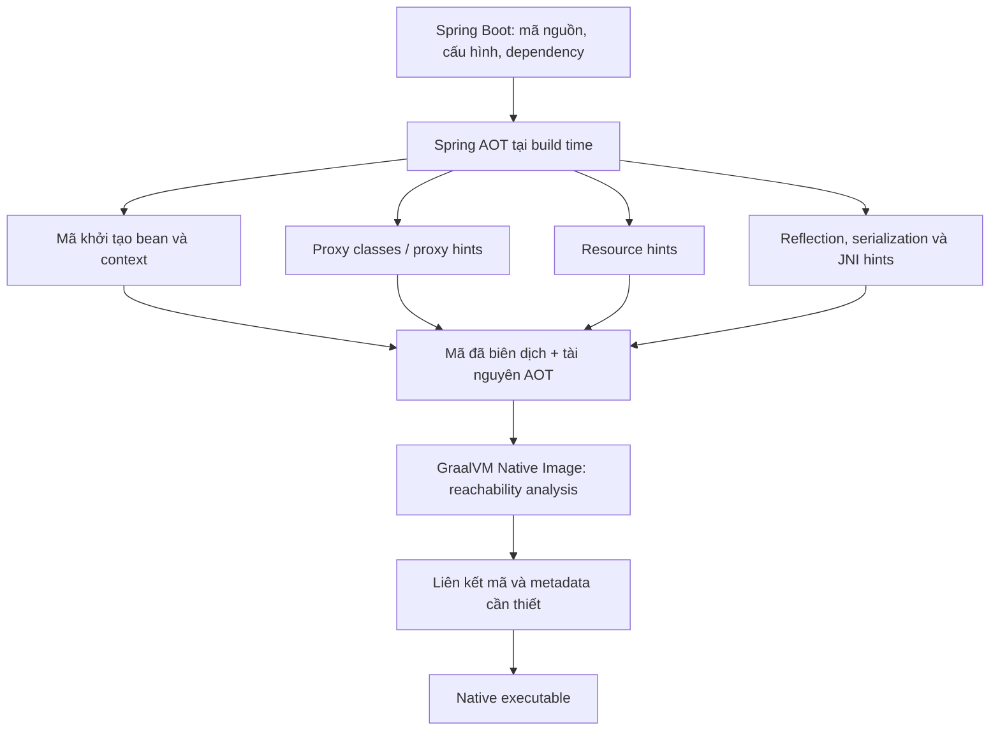

# Sinh proxy, tài nguyên và metadata để GraalVM tiếp tục phân tích

## 1. Vấn đề Spring AOT cần giải quyết

Khi chạy ứng dụng Spring Boot trên JVM, framework có thể tra cứu class, đọc annotation, tạo bean, tạo proxy và nạp tài nguyên ngay lúc chạy. Ví dụ, Spring có thể tạo proxy cho bean dùng `@Transactional` hoặc `@Cacheable`; ứng dụng có thể gọi `Class.forName(...)` hoặc đọc một tệp JSON từ classpath khi nhận request đầu tiên.

GraalVM Native Image sử dụng mô hình **phân tích khả năng truy cập** (*reachability analysis*) để xác định những đoạn mã và dữ liệu cần được biên dịch vào executable. Những thao tác có thể xác định tĩnh thường được phân tích tốt. Ngược lại, việc lựa chọn class bằng chuỗi, tạo proxy từ tên interface hoặc nạp resource theo đường dẫn được tính tại runtime có thể không đủ thông tin cho trình biên dịch.

**Spring Ahead-of-Time (Spring AOT)** chuyển một phần công việc khởi tạo Spring sang giai đoạn build, sinh mã và đăng ký các **runtime hints** cần thiết. GraalVM dùng đầu ra AOT cùng bytecode ứng dụng, thư viện và metadata để tiếp tục phân tích, biên dịch native executable.

Bài này tập trung vào ba nhóm thông tin có ảnh hưởng trực tiếp tới kết quả:

1. **Proxy:** lớp hoặc interface nào phải có khả năng được Spring hay ứng dụng sử dụng làm proxy.
2. **Resource:** tệp classpath và resource bundle nào cần được đóng gói để đọc ở runtime.
3. **Metadata:** những kiểu, constructor, method, field hoặc cơ chế đặc biệt nào cần được truy cập động, dù bộ phân tích tĩnh không thể suy ra hết.

Mục tiêu cuối cùng là giữ nguyên hành vi nghiệp vụ giữa ứng dụng Spring Boot chạy JVM và bản GraalVM Native Image, đồng thời tận dụng lợi ích về khởi động và mức sử dụng bộ nhớ khi đo trên tải thực tế.

## 2. Chuỗi xử lý: Spring AOT chuẩn bị, GraalVM phân tích tiếp



Ở giai đoạn AOT, Spring xem xét những bean definition và cấu hình có thể biết tại build time. Framework có thể sinh mã Java hỗ trợ tạo bean, đăng ký cấu hình khởi tạo `ApplicationContext` và chuẩn bị proxy cần thiết cho các tính năng Spring được nhận diện. Các cơ chế hỗ trợ AOT của Spring và các thư viện còn đóng góp **`RuntimeHints`**, trong đó mô tả truy cập reflection, Java dynamic proxy, resource, serialization hoặc JNI.

Khi GraalVM phân tích ứng dụng, metadata giúp nó hiểu thêm về những hành vi runtime vốn không thể suy từ lệnh gọi tĩnh. Nhưng cần tách rõ:

| Thành phần | Vai trò | Điều **không** làm |
| --- | --- | --- |
| Mã AOT khởi tạo Spring | Giảm công việc tra cứu, tạo cấu trúc bean lúc khởi động | Không biến mọi thành phần động thành mã tĩnh |
| Proxy sinh tại build time | Chuẩn bị proxy Spring biết trước | Không bảo đảm một thư viện có thể tạo subclass tùy ý tại runtime |
| `RuntimeHints` | Khai báo các truy cập động cần thiết | Không tự sửa logic ứng dụng hay bảo đảm mọi nhánh đã được test |
| Metadata Native Image | Cung cấp cấu hình cho GraalVM trong lúc phân tích/build | Không phải cơ chế cấu hình lại tùy ý sau khi executable đã tạo |
| Reachability analysis | Chọn các thành phần cần cho binary | Không tự biết mọi chuỗi tên class/resource được tạo theo dữ liệu runtime |

Một *hint* là thông tin đầu vào để trình biên dịch hỗ trợ một hành vi. Nó không đồng nghĩa mọi class được đăng ký sẽ được khởi tạo, mọi phương thức đều được gọi, hay mọi vấn đề tương thích đã được giải quyết.

## 3. Proxy trong Spring Boot: loại nào được sinh và vì sao?

### 3.1. Proxy có mặt trong những tính năng quen thuộc

Proxy chặn lời gọi đến một đối tượng để bổ sung hành vi như giao dịch, cache, bảo mật hoặc thực thi bất đồng bộ. Với Spring, ví dụ điển hình là:

```java
@Service
public class OrderService {

    @Transactional
    public void placeOrder(Order order) {
        // Thực hiện logic nghiệp vụ trong transaction.
    }
}
```

Thông thường, `@Transactional` được hiện thực qua Spring AOP proxy. Trong ứng dụng đủ điều kiện dùng proxy, code gọi **qua proxy** được intercept để mở/đóng transaction; lời gọi trực tiếp từ một method của bean đến method khác trong **chính cùng đối tượng** (*self-invocation*) không tự động đi qua proxy. Đó là quy tắc AOP cần lưu ý cả với bản JVM lẫn Native Image, không phải lỗi chỉ riêng native.

Có hai hướng phổ biến:

| Loại proxy | Cách hoạt động | Điều kiện và giới hạn chính |
| --- | --- | --- |
| **JDK dynamic proxy** | Tạo đối tượng hiện thực một tập interface | Chỉ proxy các lời gọi thông qua interface được triển khai |
| **Class-based proxy** (thường dựa trên CGLIB trong Spring AOP) | Tạo subclass của lớp đích | Phụ thuộc khả năng kế thừa và override; class/method `final` không thể được override theo cách thông thường |

Spring AOT có thể xác định và tạo trước các proxy Spring cần từ cấu hình bean được biết trong build. Metadata của JDK dynamic proxy cũng có thể được khai báo qua `RuntimeHints` nếu code ứng dụng hoặc thư viện tự gọi API tạo proxy. Hai trường hợp này liên quan nhưng không đồng nhất.

### 3.2. JDK proxy động cần khai báo những gì?

Giả sử tích hợp ngoài dùng interface sau:

```java
package com.example.nativeimage;

public interface RatePort {
    int rateFor(String category);
}
```

Một thư viện có thể tạo proxy bằng Java Reflection:

```java
RatePort port = (RatePort) java.lang.reflect.Proxy.newProxyInstance(
    RatePort.class.getClassLoader(),
    new Class<?>[] { RatePort.class },
    (proxy, method, arguments) -> {
        if ("rateFor".equals(method.getName())) {
            return 10;
        }
        throw new UnsupportedOperationException(method.getName());
    }
);
```

Lúc chạy trên JVM, lớp proxy có thể được tạo động. Trong native executable, danh sách interface cần được GraalVM biết trước theo cơ chế metadata được toolchain hỗ trợ. Khi AOT không tự thu thập được trường hợp này, ta đăng ký:

```java
hints.proxies().registerJdkProxy(RatePort.class);
```

Nếu proxy hiện thực **nhiều interface**, khai báo đúng tập interface mà lệnh tạo proxy thực sự yêu cầu, kể cả thứ tự khi hành vi/tổ hợp interface phụ thuộc thứ tự. Không nên đăng ký tất cả interface trong ứng dụng “để phòng xa”: metadata dư làm khó việc kiểm soát nguyên nhân tương thích và có thể tăng công việc phân tích.

### 3.3. Proxy dựa trên subclass khác gì?

JDK proxy metadata mô tả một danh sách **interface**; nó không phải cách biến mọi class thành subclass proxy. Với proxy class-based cho `@Transactional`, `@Async` hoặc `@Cacheable`, Spring AOT chuẩn bị các proxy mà framework xác định được từ bean definitions và các advisor tương ứng.

Nếu thư viện bên thứ ba dùng Byte Buddy, CGLIB hoặc thư viện sinh bytecode để **tạo một class tùy ý trong runtime**, chỉ thêm `registerJdkProxy` hay reflection hints sẽ không chắc giải quyết được. Cần kiểm tra hỗ trợ native của thư viện, khả năng tạo code ở build time, dùng cấu hình declarative hoặc thay bằng giải pháp không phụ thuộc runtime class generation.

Không nên ép `@Configuration(proxyBeanMethods = false)` một cách máy móc để “tránh proxy”. Lựa chọn này có thể hữu ích cho cấu hình dạng factory độc lập, nhưng có thể làm thay đổi ý nghĩa của các lời gọi trực tiếp giữa các method `@Bean`. Phải xét logic cấu hình thật.

## 4. Resource: tệp tồn tại trong JAR chưa chắc đã vào native binary

Trong JVM, tài nguyên nằm ở classpath thường được đọc qua `ClassLoader.getResourceAsStream`, `ResourceLoader` hoặc `ClassPathResource`. Native Image cần biết **những non-class resource nào phải được đưa vào image**. Một resource có sẵn trong `src/main/resources` hay trong JAR của dependency không bảo đảm nó luôn được đóng gói vào executable theo cách có thể đọc tại runtime.

Giả sử ứng dụng cần:

```text
src/main/resources/
  rules/
    pricing.json
  messages.properties
  messages_vi.properties
```

Ví dụ Java đọc file cấu hình:

```java
import java.io.IOException;
import java.io.InputStream;
import java.nio.charset.StandardCharsets;
import org.springframework.core.io.ClassPathResource;

public class PricingFileReader {

    public String readJson() throws IOException {
        var resource = new ClassPathResource("rules/pricing.json");
        try (InputStream stream = resource.getInputStream()) {
            return new String(stream.readAllBytes(), StandardCharsets.UTF_8);
        }
    }
}
```

Nếu đường dẫn này không được phát hiện bởi Spring AOT hoặc cơ chế thu thập metadata khác, đăng ký bằng:

```java
hints.resources().registerPattern("rules/pricing.json");
```

Với `ResourceBundle.getBundle("messages", locale)`, có thể khai báo bundle theo **tên cơ sở**:

```java
hints.resources().registerResourceBundle("messages");
```

Đừng nhầm `messages` là tên file `messages.properties` trong API đăng ký bundle. Khi áp dụng vào bản native, cần chạy thử đúng các locale được hỗ trợ để kiểm tra cơ chế fallback và khả năng tìm thấy tệp tương ứng.

**Chọn pattern hẹp khi có thể.** Một pattern kiểu `rules/**` hoặc `**/*` có thể đưa nhiều tệp không cần thiết vào binary và làm tăng dung lượng artifact. Tránh đưa private key, token hay cấu hình bí mật vào resource của executable. Những giá trị thay đổi theo môi trường hoặc cần xoay vòng nên được cấp từ nguồn cấu hình ngoài phù hợp với cách vận hành.

### Phân biệt resource nhúng với file ngoài

- **Classpath resource:** thuộc artifact và có thể được đóng gói trong binary thông qua metadata.
- **File hệ thống ngoài executable:** được đọc từ volume, working directory hoặc đường dẫn cấu hình lúc chạy; khai báo resource hint không khiến file ngoài tự xuất hiện.
- **Resource bundle:** một họ resource theo tên cơ sở và locale; xử lý qua cơ chế bundle riêng.
- **Class và bytecode:** được GraalVM xem xét qua reachability analysis; không nên dùng cơ chế resource pattern để giải quyết vấn đề thiếu lớp phản chiếu.

## 5. RuntimeHints: API trung tâm để đóng góp metadata

Spring cung cấp interface `org.springframework.aot.hint.RuntimeHintsRegistrar` cho các trường hợp ứng dụng hoặc thư viện phải báo thêm thông tin cho Native Image.

Ví dụ sau minh họa **đồng thời** JDK proxy, classpath resource, resource bundle và reflection. Giả định dự án đã có `RatePort` và `PricingRule` trong package `com.example.nativeimage`:

```java
package com.example.nativeimage;

import org.springframework.aot.hint.MemberCategory;
import org.springframework.aot.hint.RuntimeHints;
import org.springframework.aot.hint.RuntimeHintsRegistrar;
import org.springframework.context.annotation.Configuration;
import org.springframework.context.annotation.ImportRuntimeHints;

@Configuration(proxyBeanMethods = false)
@ImportRuntimeHints(AppNativeHints.class)
class NativeSupportConfiguration {
    // Được Spring phát hiện khi component scan hoặc import cấu hình này.
}

final class AppNativeHints implements RuntimeHintsRegistrar {

    @Override
    public void registerHints(RuntimeHints hints, ClassLoader classLoader) {
        // Java dynamic proxy mà ứng dụng hoặc thư viện tự tạo.
        hints.proxies().registerJdkProxy(RatePort.class);

        // Resource trong src/main/resources.
        hints.resources().registerPattern("rules/pricing.json");

        // ResourceBundle: messages.properties, messages_vi.properties...
        hints.resources().registerResourceBundle("messages");

        // Cho phép truy cập reflectively vào kiểu có thể được chọn động.
        hints.reflection().registerType(
            PricingRule.class,
            MemberCategory.INVOKE_DECLARED_CONSTRUCTORS,
            MemberCategory.INVOKE_PUBLIC_METHODS
        );
    }
}
```

Trong ví dụ này:

1. `@ImportRuntimeHints(AppNativeHints.class)` liên kết registrar với cấu hình Spring AOT.
2. `registerJdkProxy` bổ sung metadata cho tập interface cần proxy.
3. `registerPattern` xác định file classpath phải có ở runtime.
4. `registerResourceBundle` đăng ký gói chuỗi theo locale.
5. `registerType` cho phép những loại thao tác reflection đã chỉ định.

**Điều kiện để ví dụ thực sự phát huy tác dụng:** `NativeSupportConfiguration` phải được Spring sử dụng trong ứng dụng, `RatePort` và `PricingRule` phải tồn tại, và file tài nguyên phải được đặt đúng vị trí. Ví dụ sử dụng package placeholder; đổi các tên theo code thật.

### 5.1. Chọn mức quyền reflection tối thiểu

Các lựa chọn trong `MemberCategory` khác nhau về hoạt động được phép, chẳng hạn:

| Nhu cầu runtime | Hướng đăng ký |
| --- | --- |
| Chỉ cần biết một kiểu hiện hữu | Đăng ký kiểu, rồi xác minh hành vi thực tế |
| Gọi constructor qua reflection | Các member category cho constructor phù hợp |
| Gọi method qua reflection | Đăng ký method cần gọi hoặc member category tương ứng |
| Đọc/ghi field qua reflection | Đăng ký field/member category phù hợp với thao tác |
| Binding DTO bằng một framework hỗ trợ hint chuyên biệt | Ưu tiên cơ chế hint/binding của framework |

Có thể đăng ký từng constructor, method hoặc field cụ thể thay vì mở toàn bộ member category. Cần phân biệt **khám phá metadata** (ví dụ tra cứu method) với **quyền invoke** method qua reflection; test phải gọi đúng thao tác ứng dụng sử dụng.

Đối với việc binding dữ liệu theo kiểu (ví dụ một DTO dùng với message conversion), Spring cũng có annotation `@RegisterReflectionForBinding` để đóng góp các hint phản chiếu phục vụ binding:

```java
import org.springframework.aot.hint.annotation.RegisterReflectionForBinding;
import org.springframework.context.annotation.Configuration;

@Configuration(proxyBeanMethods = false)
@RegisterReflectionForBinding(ExternalPricingDto.class)
class BindingHintsConfiguration {
}
```

Đây là lựa chọn cho **trường hợp binding phù hợp**; không nên áp dụng cho mọi lớp theo thói quen. Các integration phổ biến trong hệ sinh thái Spring thường tự cung cấp những hint cần thiết. Trước tiên xác nhận một case có thiếu hint thật hay không.

### 5.2. Reflection, proxy, resource, serialization và JNI không thay thế nhau

`RuntimeHints` phân biệt rõ từng nhóm:

| Nhóm hint | Khi dùng | Ví dụ lỗi khi thiếu |
| --- | --- | --- |
| Reflection | `Class.forName`, truy cập constructor/method/field động | Không tìm thấy constructor hoặc method được phép invoke |
| JDK proxy | `Proxy.newProxyInstance` với interface không thể nhận diện tĩnh | Không tạo được proxy cho tổ hợp interface |
| Resource | Đọc tệp từ classpath | `getResourceAsStream` trả `null` hoặc resource không tìm thấy |
| Resource bundle | Thông điệp `ResourceBundle`, locale | `MissingResourceException` |
| Serialization | Java object serialization hoặc cơ chế cần metadata serialization | Class không được hỗ trợ cho deserialize theo cách sử dụng |
| JNI | Native interface gọi/được gọi theo tên ở runtime | Native lookup thất bại hoặc không truy cập được member |

Đăng ký một loại hint không có nghĩa các loại còn lại được bổ sung tự động. Chẳng hạn, đăng ký reflection cho một interface **không đủ** để đăng ký JDK dynamic proxy của interface đó.

## 6. Metadata GraalVM được hình thành và được tiêu thụ ra sao?

Trong nhiều cấu hình, các runtime hints được chuyển thành **reachability metadata** theo định dạng mà phiên bản GraalVM Native Image đang sử dụng. Có thể gặp các tệp như:

```text
META-INF/native-image/<group-id>/<artifact-id>/
  reflect-config.json
  proxy-config.json
  resource-config.json
  serialization-config.json
  ...
```

Đây là ví dụ về **tên và bố cục metadata thường gặp**; không phải mọi bản build đều tạo đủ những file này. Định dạng và vị trí sinh ra phụ thuộc phiên bản Spring Boot/Spring Framework, GraalVM và Native Build Tools; một số toolchain có thể dùng metadata tổng hợp.

Hãy hiểu các file bằng mục đích thay vì phụ thuộc tên file:

- **Reflection metadata:** tên kiểu và phạm vi constructor/method/field được phép truy cập.
- **Proxy metadata:** danh sách interface mà một JDK dynamic proxy có thể hiện thực.
- **Resource metadata:** tên/pattern resource sẽ có trong image.
- **Serialization metadata:** những kiểu cần hỗ trợ serialization theo cơ chế tương ứng.
- **JNI metadata:** truy cập thành phần Java từ native code nếu ứng dụng có tích hợp JNI.

Ví dụ sau minh họa ý nghĩa một khai báo reflection trong **định dạng JSON cấu hình truyền thống** (không bảo đảm giống byte-for-byte đầu ra từ registrar):

```json
[
  {
    "name": "com.example.nativeimage.PricingRule",
    "allDeclaredConstructors": true,
    "allPublicMethods": true
  }
]
```

Một proxy JDK cho interface `com.example.nativeimage.RatePort` có thể được biểu diễn trong định dạng proxy JSON truyền thống như sau:

```json
[
  ["com.example.nativeimage.RatePort"]
]
```

Khi viết ứng dụng Spring Boot, **ưu tiên `RuntimeHints` và khả năng đóng góp hint sẵn có của thư viện**. Chỉ quản lý JSON thủ công khi cần tích hợp một dependency không cung cấp metadata hoặc khi có yêu cầu đặc biệt. Nếu dùng JSON thủ công, đặt đúng thư mục classpath quy định, đúng schema của phiên bản GraalVM đang build và kiểm tra xung đột/trùng lặp với metadata do Spring sinh.

### Đừng nhầm metadata với việc phân tích đã hoàn tất

GraalVM vẫn phân tích mã, phụ thuộc và các đường đi có thể truy cập. Metadata bổ sung các khả năng đặc biệt cần giữ, nhưng không biến một lời gọi tùy ý vào plugin được tải sau khi build thành tính năng tương thích native. Nếu ứng dụng cần nạp class chưa có mặt tại build time, sinh bytecode mới hoặc thay đổi cấu trúc bean tùy ý, phải thiết kế lại hoặc xem khả năng native của thư viện.

## 7. Khảo sát đầu ra Spring AOT trong quá trình build

Các lệnh ví dụ sau yêu cầu dự án đã cấu hình Spring Boot plugin, GraalVM Native Build Tools và môi trường GraalVM phù hợp.

```bash
# Maven: với native profile đã cấu hình
./mvnw -Pnative native:compile

# Gradle: với nativeCompile task khả dụng
./gradlew nativeCompile
```

Thông thường Maven/Gradle có các task hoặc goal xử lý AOT, và một phần output được đặt trong thư mục sinh mã/tài nguyên của build như `target/spring-aot` hoặc `build/generated/aot*`. Đường dẫn chính xác khác nhau theo plugin/phiên bản. Để hiểu pipeline, hãy quan sát:

1. Các source Java/class được sinh để dựng `ApplicationContext` hoặc bean.
2. Mã proxy sinh trước phục vụ những tính năng Spring đã phân tích được.
3. Resource và metadata Native Image được tạo hoặc thu thập từ dependency.
4. Log/native-image report để biết trình biên dịch đã dùng những cấu hình nào và artifact được sinh cho kiến trúc nào.

Không nên sửa trực tiếp output trong `target` hoặc `build`: nó sẽ bị tạo lại ở lần build tiếp theo. Thay đổi phải nằm ở source/config/runtime hints trong mã nguồn hoặc metadata thư viện do nhóm sở hữu.

### Tình huống điều kiện Spring thay đổi theo môi trường

AOT có thể cố định những quyết định cấu trúc bean vốn được tính tại build time. Nếu cấu hình/profile chạy production khác môi trường build ở những điều kiện quyết định bean graph, ứng dụng có thể không giống ý định trên JVM. Hãy kiểm tra các profile, `@Conditional` và property quan trọng tại thời điểm build, rồi chạy integration test trong môi trường cấu hình sẽ triển khai. Thay đổi giá trị cấu hình vận hành thông thường và thay đổi **cấu trúc bean đã được xử lý AOT** là hai việc khác nhau.

## 8. Kiểm thử proxy, resource và metadata trước khi phát hành

### 8.1. Test đơn vị cho runtime hints

Spring cung cấp `RuntimeHintsPredicates` để kiểm tra registrar có đăng ký một trường hợp mong đợi không. Với registrar ở phần trên, có thể viết:

```java
package com.example.nativeimage;

import org.junit.jupiter.api.Test;
import org.springframework.aot.hint.RuntimeHints;
import org.springframework.aot.hint.predicate.RuntimeHintsPredicates;

import static org.junit.jupiter.api.Assertions.assertTrue;

class AppNativeHintsTests {

    @Test
    void registersProxyAndClasspathResource() {
        RuntimeHints hints = new RuntimeHints();
        new AppNativeHints().registerHints(
            hints, getClass().getClassLoader()
        );

        assertTrue(
            RuntimeHintsPredicates.proxies()
                .forInterfaces(RatePort.class)
                .test(hints)
        );

        assertTrue(
            RuntimeHintsPredicates.resource()
                .forResource("rules/pricing.json")
                .test(hints)
        );
    }
}
```

Test này xác nhận **có khai báo hint**, không chứng minh tệp tồn tại hay binary chạy hoàn toàn đúng. Test classpath resource bình thường và kiểm thử thực tế trên executable native vẫn cần thiết. Test cũng cần đưa thêm trường hợp reflection và resource bundle nếu hệ thống phụ thuộc chúng.

### 8.2. Kiểm thử tích hợp trên chính native executable

Lộ trình đề xuất:

1. Chạy toàn bộ unit/integration test có liên quan trên JVM để thiết lập kết quả chuẩn.
2. Sinh native executable thành công và kiểm tra output/log build.
3. Khởi động binary native với cấu hình mục tiêu (có thể trong container tương ứng).
4. Gọi endpoint hoặc job **thực sự sử dụng proxy**, kiểm tra transaction, cache hoặc async behavior có hiệu lực.
5. Gọi luồng **đọc resource** và so nội dung, mã hóa, locale với bản JVM.
6. Gọi nhánh **reflection/serialization** hiếm gặp, ví dụ loại sự kiện ít phát sinh hoặc tích hợp tùy chọn.
7. Kiểm tra log exception, status code, output nghiệp vụ, khả năng restart và các tác động tới DB/external service.

Nếu dự án đã cấu hình native test, có thể tham khảo các tác vụ thường dùng:

```bash
# Gradle, khi đã có nativeTest task từ cấu hình tương ứng
./gradlew nativeTest

# Maven, khi dự án có profile nativeTest phù hợp
./mvnw -PnativeTest test
```

Đừng giả định mọi dự án đã bật các task/profile này. Chỉ chạy lệnh tương ứng với cấu hình thật; một bản build thành công vẫn cần smoke test độc lập trên executable tạo ra.

### 8.3. Bảng phân loại lỗi để tìm nguyên nhân nhanh

| Hiện tượng trên native | Kiểm tra đầu tiên | Hướng xử lý |
| --- | --- | --- |
| Không tìm thấy resource classpath | Tên/path có đúng, file được đóng gói, pattern đã đăng ký? | Thêm hoặc sửa resource hint, kiểm tra output |
| `MissingResourceException` | Bundle name, locale, fallback và resource bundle hint | Đăng ký base name của bundle, test locale |
| Không truy cập được constructor/method bằng reflection | Kiểu và member category, đường đi gọi động | Bổ sung reflection hint hẹp, test lại thao tác thật |
| Không tạo được JDK dynamic proxy | Tập interface, thứ tự, code `newProxyInstance` | Đăng ký đúng JDK proxy hint |
| Class-based proxy không được sinh | Điều kiện bean/AOP advisor, giới hạn subclass/final | Xem AOT proxy support; điều chỉnh cấu hình/thư viện |
| Lỗi runtime bytecode generation | Thư viện tạo class tùy ý sau build | Chuyển sang build-time generation hoặc phương án native-compatible |
| Hành vi bean khác theo profile | Điều kiện `@Profile`/`@Conditional` bị ảnh hưởng khi AOT | Đối chiếu build-time và runtime configuration |
| Build xong nhưng JSON binding lỗi | DTO không được nhận diện hoặc metadata không đủ | Kiểm tra cơ chế binding, reflection hint và các adapter |

Không nên “sửa” bằng cách đăng ký reflection cho toàn bộ package rồi dừng lại. Cách đó dễ che đi cơ chế không tương thích, tăng metadata và làm việc bảo trì khó hơn. Lần lượt tái hiện lỗi, phân biệt proxy/resource/reflection, thêm hint vừa đủ rồi đưa trường hợp lỗi vào test.

## 9. Tích hợp thư viện bên thứ ba

Nhiều dependency của ứng dụng Spring Boot đã hỗ trợ AOT và đóng góp metadata qua Spring hoặc cơ chế GraalVM. Khi thêm thư viện mới, cần xem:

- Thư viện có **native support** và metadata phù hợp phiên bản đang dùng không?
- Thư viện tạo JDK proxy trên interface cố định hay sinh class động bằng bytecode?
- Resource (mẫu template, schema, file lookup, driver, native library) có được đóng gói đúng không?
- DTO hoặc kiểu được chọn bằng tên runtime có đủ reflection/serialization hints không?
- Có cơ chế khởi tạo lớp ở build time/runtime cần cấu hình riêng không? (Đó là vấn đề khác với proxy và resource hints.)

Nếu thư viện sở hữu metadata, nên sửa hoặc đóng góp vào thư viện để ứng dụng tiêu thụ đúng metadata khi nâng cấp. Với mã chỉ dùng trong một ứng dụng, đăng ký tại cấu hình AOT của ứng dụng là hợp lý. Tránh duy trì hai bản cấu hình mâu thuẫn ở ứng dụng và dependency.

## 10. Bài thực hành gợi ý: xác định và bổ sung đúng hint bị thiếu

**Bối cảnh:** Một API Spring Boot trả kết quả tính giá. Nó sử dụng `RatePort` được tạo qua Java dynamic proxy, đọc `rules/pricing.json` và chuyển đổi một `PricingRule` được chọn theo mã cấu hình qua reflection.

**Yêu cầu:**

1. Chạy luồng API trên JVM, ghi nhận status, JSON đầu ra, giá trị tính toán và log.
2. Build native executable với Spring AOT; gọi cùng endpoint và xác định đúng hành vi nào thất bại nếu có.
3. Sử dụng `RuntimeHintsRegistrar` ở phần 5 để đăng ký đúng JDK proxy, resource và member reflection mà luồng này sử dụng.
4. Thêm test cho việc đăng ký hints và integration/smoke test cho endpoint native.
5. So sánh thời gian khởi động, mức RSS và kết quả nghiệp vụ trước/sau khi xử lý tương thích; không quy lỗi hiệu năng cho native nếu chức năng còn sai.

**Tiêu chí đạt:**

| Hạng mục | Điều kiện chấp nhận |
| --- | --- |
| Tương đương hành vi | Endpoint/JVM và endpoint/native cho cùng dữ liệu nghiệp vụ |
| JDK proxy | Tạo được proxy và method nghiệp vụ thực thi đúng |
| Resource | Đọc đúng `rules/pricing.json` từ binary tại runtime |
| Reflection | Truy cập đúng constructor/method cần thiết |
| Kiểm thử | Unit test hint và native smoke test đều PASS |
| Build/đóng gói | Executable hoặc container chạy trên đúng OS/CPU đích |
| Đánh giá | Ghi được startup và RSS với cùng giới hạn tài nguyên |

**Câu hỏi tự đánh giá:** Nếu bạn đăng ký `PricingRule` qua reflection nhưng ứng dụng vẫn không đọc được `rules/pricing.json`, loại hint nào đang thiếu? Nếu `registerJdkProxy(RatePort.class)` đã có mà thư viện vẫn tạo subclass mới bằng Byte Buddy tại runtime, liệu bổ sung thêm reflection metadata có bảo đảm giải quyết được không? Hãy giải thích dựa trên cơ chế phân tích tại build time.

## 11. Tổng kết

Spring AOT giúp biến những thông tin framework xác định được thành **mã khởi tạo và proxy chuẩn bị trước**, đồng thời cung cấp **runtime hints** cho GraalVM Native Image phân tích các truy cập động. Proxy hints phục vụ JDK dynamic proxy; resource hints bảo đảm tệp và bundle cần thiết có trong native executable; reflection, serialization và JNI metadata xử lý những khả năng không đủ biểu đạt qua đường gọi tĩnh.

Muốn vận hành Spring Boot Native Image đáng tin cậy, cần hiểu nguồn phát sinh metadata, đăng ký **đúng loại hint và đúng phạm vi**, kiểm tra các proxy class-based và thư viện sinh mã động, rồi xác minh **trên binary native thực tế**. Build thành công mới chứng tỏ quá trình biên dịch hoàn tất; kết quả nghiệp vụ và kiểm thử tương thích mới chứng tỏ ứng dụng sẵn sàng triển khai.
