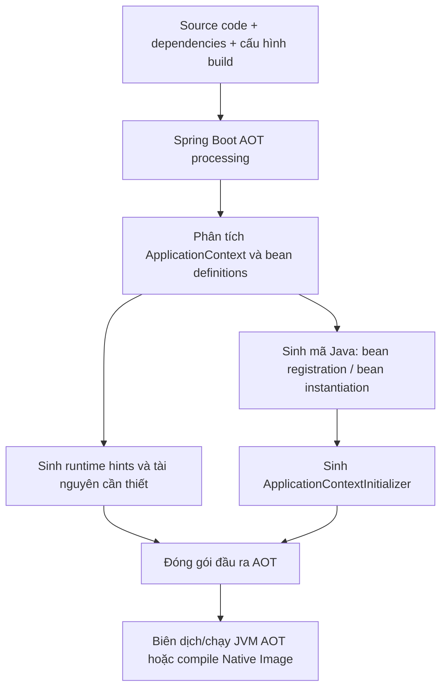
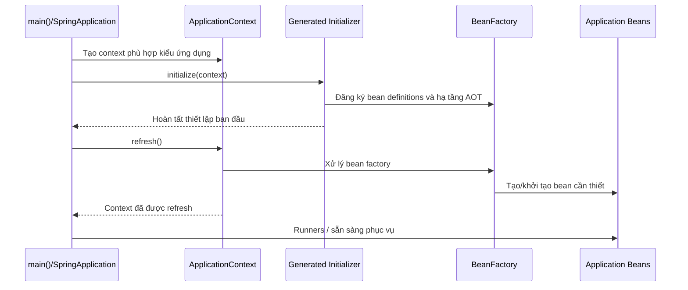

# ApplicationContextInitializer được sinh và khởi tạo ApplicationContext

## Mục tiêu bài học

Trong Spring Boot, `ApplicationContext` là nơi quản lý bean, dependency injection, cấu hình và các thành phần hạ tầng của ứng dụng. Khi sử dụng **Spring AOT (Ahead-of-Time)** để biên dịch ứng dụng thành **GraalVM Native Image**, Spring có thể phân tích mô hình bean trong lúc build và sinh mã Java để thiết lập `ApplicationContext` hiệu quả hơn lúc chạy.

Một thành phần quan trọng của quy trình này là **`ApplicationContextInitializer` được sinh tự động**. Hiểu đúng vai trò của nó sẽ giúp bạn đọc mã AOT, phân tích quá trình khởi động, xử lý lỗi bean khi chạy native và tránh nhầm lẫn giữa thao tác *khởi tạo cấu hình context* với việc *tạo bean* hay *hoàn tất khởi động ứng dụng*.

Sau bài này, bạn có thể:

- Giải thích vai trò của interface `ApplicationContextInitializer` trong vòng đời `ApplicationContext`.
- Mô tả cách Spring AOT sinh mã đăng ký bean và sử dụng initializer ở runtime.
- Phân biệt công việc thực hiện tại **build time** và **runtime**.
- Chạy tác vụ AOT bằng Maven/Gradle và tự kiểm tra các tệp mã nguồn được sinh.
- Nhận diện những lỗi phổ biến do cấu hình điều kiện, reflection, resource hoặc thay đổi môi trường giữa build và chạy.

> Phạm vi: bài tập trung vào cơ chế **Spring AOT và generated `ApplicationContextInitializer`** trong hệ sinh thái Spring Boot Native Image. Tên lớp và đường dẫn tệp được sinh có thể thay đổi theo phiên bản Spring Boot/Spring Framework và cấu hình dự án; hãy xem trực tiếp kết quả build của bạn để đối chiếu.

## 1. `ApplicationContextInitializer` là gì?

### 1.1. Vai trò trong Spring Framework

Spring Framework định nghĩa interface:

```java
public interface ApplicationContextInitializer<C extends ConfigurableApplicationContext> {
    void initialize(C applicationContext);
}
```

Một initializer nhận **context đã được tạo** và có cơ hội điều chỉnh hoặc đăng ký một số thành phần **trước khi context được refresh**. Ví dụ, mã khởi tạo có thể thiết lập property source, đăng ký bean definition hoặc chuẩn bị hạ tầng để `refresh()` tiếp tục hoàn thiện context.

Ba hành động sau khác nhau:

| Hành động | Ý nghĩa |
|---|---|
| **Tạo `ApplicationContext`** | Tạo đối tượng context phù hợp với kiểu ứng dụng (non-web, servlet, reactive...) |
| **`ApplicationContextInitializer.initialize(context)`** | Áp dụng các thiết lập/đăng ký vào context **đã tồn tại**, trước khi refresh |
| **`ApplicationContext.refresh()`** | Hoàn tất quá trình khởi tạo container: xử lý bean factory, đăng ký hậu xử lý, tạo các singleton không lazy, khởi động thành phần cần thiết... |

**Điểm cốt lõi:** initializer **không tự tạo** `ApplicationContext` và **không thay thế** toàn bộ `refresh()`. Trong ứng dụng Spring Boot, `SpringApplication` điều phối các giai đoạn này.

### 1.2. Initializer tự viết và initializer do Spring AOT sinh

Bạn có thể tự cài đặt interface `ApplicationContextInitializer` để điều chỉnh quá trình startup. Spring AOT cũng sử dụng chính khái niệm này, nhưng tạo implementation **tự động từ kết quả phân tích ứng dụng lúc build**.

| Initializer do lập trình viên viết | Initializer do Spring AOT sinh |
|---|---|
| Phục vụ một yêu cầu khởi tạo cụ thể của ứng dụng | Phục vụ bootstrap của mô hình bean đã được AOT phân tích |
| Mã được duy trì trong `src/main/java` | Mã được sinh trong thư mục build |
| Có thể chứa tùy chỉnh `Environment`, property source... | Thường phối hợp các lớp đăng ký bean definition và hạ tầng do AOT tạo ra |
| Lập trình viên chủ động đăng ký nếu cần | Spring Boot tích hợp việc sử dụng khi chạy ở chế độ AOT |

Không nên sửa mã generated bằng tay vì lần xử lý AOT tiếp theo sẽ tạo lại kết quả. Nếu ứng dụng cần tùy chỉnh cấu hình hoặc khai báo reflection/resource, hãy thay đổi **source code và metadata phù hợp**, sau đó chạy lại AOT.

## 2. Vì sao Spring AOT cần sinh `ApplicationContextInitializer`?

Khi khởi động theo cách thông thường trên JVM, Spring xử lý nhiều thông tin cấu hình ở runtime: tìm và phân tích các lớp cấu hình, quyết định bean nào tồn tại, chuẩn bị việc tạo bean, xử lý các thành phần hạ tầng và những quan hệ phụ thuộc.

Native Image có mô hình **closed world**: những loại mã và metadata có thể được sử dụng cần được nhận diện phù hợp trong quá trình biên dịch. Các thao tác động vốn thuận tiện trên JVM không phải lúc nào cũng có đủ thông tin để hoạt động tự động trong native executable.

Spring AOT giải quyết một phần bài toán bằng cách:

1. Phân tích cấu hình ứng dụng và các bean definition khi build.
2. Xác định những điều kiện và thành phần có thể được quyết định từ thông tin sẵn có lúc build.
3. Sinh mã Java để đăng ký bean definition và hỗ trợ quá trình tạo bean, thay vì lặp lại toàn bộ công việc phân tích cấu hình ở runtime.
4. Sinh hoặc tổng hợp các **runtime hints** phục vụ reflection, proxy, resource và serialization khi cần.
5. Sinh một `ApplicationContextInitializer` làm điểm vào cho phần thiết lập context đã được tạo từ trước.

Mục tiêu là giảm lượng công việc phải thực hiện khi startup và làm rõ những thành phần cần có trong bản native. Lợi ích thường được thể hiện ở **thời gian khởi động** và **mức sử dụng bộ nhớ**, nhưng phải được đo trên workload thực tế. Việc sinh initializer **không bảo đảm** mọi ứng dụng native có throughput cao hơn JVM.

## 3. Vòng đời: từ source code tới context đã sẵn sàng

### 3.1. Giai đoạn build (AOT processing)

Giả sử ứng dụng có lớp `@SpringBootApplication`, các lớp `@Configuration`, phương thức `@Bean` và cấu hình tự động của Spring Boot. Khi chạy tác vụ AOT:



Điểm cần hiểu: AOT processing có thể thực thi một phần logic cấu hình trong quá trình phân tích. Đừng mặc định mọi mã gắn với việc khai báo bean chỉ được gọi khi bản native chạy. Mặt khác, việc phân tích bean definition **không có nghĩa** mọi singleton của ứng dụng đã được tạo và mọi kết nối production đã mở ngay tại build time.

### 3.2. Giai đoạn runtime (AOT-enabled)

Khi bản native chạy, Spring Boot sử dụng những artifact đã được sinh để thiết lập context:



Sơ đồ mô tả **thứ tự trách nhiệm**, không phải toàn bộ lời gọi nội bộ của một phiên bản Spring cụ thể.

Ở chế độ AOT, initializer cung cấp những thông tin đăng ký đã được chuẩn bị trước. Phần còn lại của vòng đời Spring vẫn tồn tại: context cần được refresh, dependency cần được inject, bean cần được khởi tạo đúng thời điểm và web server/worker vẫn cần sẵn sàng.

### 3.3. Đừng nhầm bean definition với bean instance

- **Bean definition** là mô tả cách Spring tạo và quản lý một bean: kiểu, scope, factory method, dependency và thông tin cấu hình khác.
- **Bean instance** là đối tượng cụ thể trong bộ nhớ, được tạo khi Spring cần nó theo scope/lifecycle tương ứng.
- **Initializer được sinh** chủ yếu chuẩn bị đăng ký và kết nối phần bootstrap AOT. Việc nó đăng ký definition **không đồng nghĩa** mọi bean đã được instantiate.
- **`refresh()`** vẫn xử lý lifecycle của Spring; các bean lazy hoặc scoped bean có thể được tạo muộn hơn.

Ví dụ, một bean kết nối database có thể vẫn phải thực hiện network I/O lúc runtime. Native Image không “biên dịch sẵn” kết nối database đang hoạt động.

## 4. Ví dụ Spring Boot và cấu trúc mã được sinh

### 4.1. Ứng dụng mẫu nhỏ nhất

Giả sử dự án Spring Boot đã có cấu hình build hỗ trợ AOT. Tạo một ứng dụng với hai bean:

```java
package com.example.aotdemo;

import org.springframework.boot.ApplicationRunner;
import org.springframework.boot.SpringApplication;
import org.springframework.boot.autoconfigure.SpringBootApplication;
import org.springframework.context.annotation.Bean;

@SpringBootApplication(proxyBeanMethods = false)
public class AotDemoApplication {

    public static void main(String[] args) {
        SpringApplication.run(AotDemoApplication.class, args);
    }

    @Bean
    GreetingService greetingService() {
        return new GreetingService("Xin chao tu Spring AOT");
    }

    @Bean
    ApplicationRunner showGreeting(GreetingService greetingService) {
        return args -> System.out.println(greetingService.message());
    }
}

record GreetingService(String message) {}
```

Khi chạy thông thường trên JVM, Spring tìm và xử lý cấu hình để biết hai bean trên. Khi xử lý AOT, Spring phân tích mô hình này và sinh mã tương ứng để phục vụ bootstrap ở runtime AOT.

Chương trình ví dụ sẽ in ra lời chào sau khi context đã được khởi tạo và runner được thực thi. Mã không yêu cầu reflection tùy biến nên thích hợp để quan sát phần cơ bản của AOT.

### 4.2. Hình dung generated `ApplicationContextInitializer`

Các lớp generated thường có tên gợi liên hệ tới lớp ứng dụng và các thành phần đăng ký bean. Ví dụ **mã giả rút gọn** sau mô tả chức năng; đây **không phải bản sao chính xác** của source mà mọi phiên bản Spring Boot đều sinh:

```java
// Minh hoa: generated code, khong sao chep vao src/main/java
final class AotDemoApplication__ApplicationContextInitializer
        implements ApplicationContextInitializer<GenericApplicationContext> {

    @Override
    public void initialize(GenericApplicationContext context) {
        // Goi ma do Spring AOT sinh de dang ky bean definitions
        new AotDemoApplication__BeanFactoryRegistrations()
                .registerBeanDefinitions(context);
    }
}
```

Ý tưởng quan trọng nằm ở lệnh **đăng ký bean definitions**. Trong mã generated thực tế, bạn có thể thấy:

- Một lớp initializer triển khai `ApplicationContextInitializer`.
- Các lớp hoặc phương thức chuyên trách đăng ký bean definition, factory method và cấu hình hạ tầng.
- Lời gọi trực tiếp tới những constructor hoặc factory method mà trước đây framework cần khám phá/chuẩn bị ở runtime.
- Metadata được sinh để hỗ trợ runtime AOT; tùy phiên bản, một số thông tin được lưu trong thư mục resources.

Tên kiểu `AotDemoApplication__BeanFactoryRegistrations` và thân phương thức `registerBeanDefinitions` ở đoạn mã trên chỉ để minh họa quan hệ giữa initializer và phần đăng ký bean. **Không nên phụ thuộc vào tên class generated** như một hợp đồng API ổn định.

### 4.3. Ai gọi initializer?

Trong ứng dụng Spring Boot chuẩn, bạn vẫn viết:

```java
SpringApplication.run(AotDemoApplication.class, args);
```

Khi ứng dụng chạy **ở chế độ AOT** với các artifact đã sinh, Spring Boot tích hợp việc phát hiện/sử dụng initializer trong quy trình khởi động. Bạn **không cần** sửa `main()` để tự tạo hoặc gọi lớp `__ApplicationContextInitializer`.

Nếu thử nghiệm chế độ AOT trên JVM, ứng dụng cần được build kèm mã/tài nguyên AOT thích hợp và chạy với chế độ AOT được bật (chẳng hạn system property `spring.aot.enabled=true`). Với **Native Image**, các artifact AOT được sử dụng theo quy trình build/chạy native do Spring Boot hỗ trợ.

## 5. Tự sinh và quan sát initializer bằng Maven/Gradle

### 5.1. Điều kiện chuẩn bị

Sử dụng phiên bản Spring Boot hỗ trợ Spring AOT, Java phù hợp với phiên bản Spring Boot đó và plugin build tương thích. Với mục tiêu Native Image, cấu hình **GraalVM Native Build Tools**, môi trường GraalVM hỗ trợ `native-image` hoặc buildpack hỗ trợ native compilation.

Các ví dụ sau sử dụng script wrapper trên Unix/macOS. Trên Windows, thay `./mvnw` bằng `mvnw.cmd` hoặc `./gradlew` bằng `gradlew.bat`.

### 5.2. Maven

Khi dự án đã sử dụng Spring Boot Maven plugin:

```bash
# Sinh artifact AOT cho main application
./mvnw -DskipTests spring-boot:process-aot

# Build native khi du an da cau hinh native profile va plugin tuong ung
./mvnw -Pnative native:compile
```

Trong nhiều dự án Spring Boot dùng Maven, mã sinh được đặt dưới:

```text
target/spring-aot/main/
├── sources/      # Java source do Spring AOT sinh
├── resources/    # Resource/metadata do AOT tao
└── classes/      # Ket qua bien dich tuy task/build
```

Đường dẫn có thể thay đổi theo cấu hình plugin. Sau khi chạy `process-aot`, kiểm tra thư mục thực tế thay vì suy luận chỉ từ cấu trúc minh họa.

### 5.3. Gradle

Khi đã cấu hình Spring Boot Gradle plugin và GraalVM Native Build Tools:

```bash
# Sinh artifact AOT
./gradlew processAot

# Bien dich ung dung native
./gradlew nativeCompile
```

Đầu ra thường nằm trong các thư mục có tên tương tự:

```text
build/generated/
├── aotSources/     # Java source da sinh
└── aotResources/   # Resource/metadata AOT
```

Tên và cấu trúc cụ thể còn tùy phiên bản plugin. Trong IDE, đánh dấu nguồn generated theo cấu hình build nếu muốn tìm kiếm và điều hướng mã.

### 5.4. Cách đọc mã được sinh

Sau `process-aot`, bạn có thể tìm các tệp chứa `ApplicationContextInitializer` hoặc các lớp tên `__BeanFactoryRegistrations` trong cây generated source:

```bash
# Maven: tim cac file Java co ten lien quan den initializer
find target/spring-aot/main/sources -name '*ApplicationContextInitializer*.java'

# Gradle: tim trong thu muc generated sources
find build/generated/aotSources -name '*ApplicationContextInitializer*.java'
```

Trên PowerShell, một cách tìm tương đương:

```powershell
Get-ChildItem -Path target/spring-aot/main/sources -Recurse -Filter '*ApplicationContextInitializer*.java'
Get-ChildItem -Path build/generated/aotSources -Recurse -Filter '*ApplicationContextInitializer*.java'
```

Khi đã tìm thấy mã, hãy lần theo chuỗi:

1. Phương thức `initialize(...)` của initializer gọi thành phần nào?
2. Thành phần đó đăng ký bean definition nào cho `GreetingService` và `ApplicationRunner`?
3. Các definition ghi nhận factory method, constructor và dependency ra sao?
4. Phần metadata AOT nào đi kèm để hỗ trợ reflection, resources hoặc proxy?

Chú ý: Spring Framework có thể tạo nhiều helper class cho một context; đừng trông chờ mỗi bean luôn tương ứng đúng một generated class. Nếu đường dẫn khác tài liệu, dùng cây tệp thực tế và thông tin build của phiên bản đang học.

## 6. Cấu hình phụ thuộc build time: lỗi dễ bị bỏ sót

### 6.1. `@ConditionalOnProperty` và thay đổi số lượng bean

Một ứng dụng có thể khai báo bean có điều kiện:

```java
import org.springframework.boot.autoconfigure.condition.ConditionalOnProperty;
import org.springframework.context.annotation.Bean;
import org.springframework.context.annotation.Configuration;

@Configuration(proxyBeanMethods = false)
class ExportConfiguration {

    @Bean
    @ConditionalOnProperty(prefix = "export", name = "enabled", havingValue = "true")
    ExportService exportService() {
        return new ExportService();
    }
}

class ExportService {
    void export() {
        // Xu ly xuat du lieu
    }
}
```

Khi AOT xử lý cấu hình, nhiều điều kiện quyết định **bean có tồn tại hay không** đã được đánh giá theo environment hiện diện **lúc build**. Vì vậy, nếu `export.enabled` ảnh hưởng tới việc đăng ký bean, không thể mặc định chỉ cần đổi `EXPORT_ENABLED` khi chạy native là sẽ tạo thêm bean vốn không có trong đồ thị bean đã biên dịch.

Sự khác biệt quan trọng:

- **Thay đổi topology bean**: thêm/bớt bean, cấu hình hoặc dependency do điều kiện quyết định có thể yêu cầu **build lại** cho profile/môi trường tương ứng.
- **Thay đổi giá trị nghiệp vụ lúc chạy**: một bean đã được đưa vào image vẫn có thể đọc property runtime để quyết định hành vi thông thường, nếu thiết kế cho phép.

Ví dụ, thay vì mong điều kiện bean sinh thêm một thành phần ở runtime, có thể giữ bean và đọc feature flag trong phương thức xử lý của nó. Cách này chỉ phù hợp nếu ứng dụng thật sự cần đổi hành vi runtime; vẫn phải cân nhắc tính nhất quán và bảo mật.

### 6.2. `@Profile`, environment và classpath

Một số quyết định về cấu hình có thể được cố định khi xử lý AOT, đặc biệt khi chúng làm thay đổi tập bean được đăng ký. Do đó:

- Xác định profile và property ảnh hưởng tới bean graph ngay từ **AOT build**.
- Kiểm chứng bản native với đúng profile, property và phụ thuộc dùng khi deploy.
- Không suy luận rằng một image native chứa mọi biến thể bean configuration nếu chỉ được build với một cấu hình.
- Không đặt secret vào mã hoặc cấu hình build một cách tùy tiện; property thông thường dùng ở runtime nên được cấp qua cơ chế cấu hình bí mật phù hợp.

Build AOT không cấm toàn bộ property runtime. Vấn đề là phải phân biệt **property dùng để quyết định cấu trúc bean** với **property được bean đọc khi thực thi nghiệp vụ**.

### 6.3. Reflection và resource không được suy ra tự động

Việc initializer được sinh **không đảm bảo** mọi truy cập reflection hay resource của thư viện bên thứ ba đều hoạt động khi chạy native. Ví dụ:

```java
// Ten lop duoc lay tu config tai runtime:
Class<?> pluginClass = Class.forName(pluginClassName);
Object plugin = pluginClass.getDeclaredConstructor().newInstance();
```

Nếu `pluginClassName` là giá trị chỉ biết khi runtime, bộ phân tích AOT có thể không nhận diện được class và constructor cần giữ lại. Khi đó bạn có thể phải khai báo **`RuntimeHints`** hoặc metadata Native Image cho đúng loại truy cập.

Ví dụ khai báo Spring Runtime Hints:

```java
import org.springframework.aot.hint.MemberCategory;
import org.springframework.aot.hint.RuntimeHints;
import org.springframework.aot.hint.RuntimeHintsRegistrar;
import org.springframework.context.annotation.Configuration;
import org.springframework.context.annotation.ImportRuntimeHints;

final class PluginHints implements RuntimeHintsRegistrar {
    @Override
    public void registerHints(RuntimeHints hints, ClassLoader classLoader) {
        hints.reflection().registerType(
                SamplePlugin.class,
                MemberCategory.INVOKE_DECLARED_CONSTRUCTORS
        );
        hints.resources().registerPattern("plugin/defaults.json");
    }
}

@Configuration(proxyBeanMethods = false)
@ImportRuntimeHints(PluginHints.class)
class PluginHintConfiguration {}
```

`SamplePlugin` là class giả định; thay bằng class thật trong dự án. Với các lớp dùng proxy, serialization hoặc truy cập field/method bằng reflection, phải cấp **đúng metadata** cho thao tác thực tế. Runtime Hints và generated initializer có vai trò liên quan nhưng **không phải một**: initializer đăng ký cấu hình context, còn hints hướng dẫn native compiler giữ lại metadata/cơ chế cần thiết.

## 7. Kiểm thử cơ chế khởi tạo và chẩn đoán sự cố

### 7.1. Cách kiểm tra từ source đến runtime

Với ví dụ `AotDemoApplication`, thực hiện lần lượt:

1. **Chạy JVM bình thường:** xác nhận application chạy, `ApplicationRunner` in lời chào.
2. **Chạy `process-aot`:** xác nhận task hoàn tất và xuất hiện mã initializer/bean registrations trong generated source.
3. **Đọc generated code:** xác định lời gọi đăng ký definition của `GreetingService` và `ApplicationRunner`.
4. **Biên dịch/chạy native:** quan sát output tương tự, đồng thời thử endpoint, database hoặc resource nếu ứng dụng có những thành phần đó.
5. **So sánh các đường chạy:** kiểm tra bean graph, cấu hình được áp dụng và chức năng tương đương; sau đó mới benchmark startup, RSS và latency.

Nếu chạy AOT trên JVM, cần bảo đảm package thật sự chứa generated classes/resources và bật chế độ AOT cho runtime. Chỉ thêm property `spring.aot.enabled=true` vào một JAR chưa được AOT xử lý **không làm Spring sinh initializer khi chương trình đang chạy**.

### 7.2. Bảng chẩn đoán

| Triệu chứng | Khả năng cần kiểm tra | Hướng xử lý |
|---|---|---|
| Không tìm thấy generated initializer sau build | Chưa chạy `process-aot`, plugin chưa cấu hình hoặc đọc nhầm output directory | Kiểm tra tác vụ build, log và thư mục generated thực tế |
| Bật AOT trên JVM nhưng gặp lỗi thiếu generated artifact | Chế độ AOT được bật nhưng class/resource cần thiết chưa được đóng gói | Build artifact có AOT output và xác nhận classpath |
| Bean có trên JVM nhưng thiếu trong native | `@Conditional...`, profile hoặc classpath lúc build khác lúc chạy | So sánh điều kiện build time, kiểm tra generated bean definitions |
| `ClassNotFoundException` / lỗi reflection chỉ ở native | Class hoặc member dùng động chưa được native analysis/hints bao phủ | Kiểm tra runtime hints và luồng thực tế gây lỗi |
| `getResourceAsStream(...)` trả `null` trong native | Resource chưa được đưa vào image hoặc sai đường dẫn | Bổ sung resource hint/cấu hình đóng gói, kiểm tra tên resource |
| Khởi tạo context vẫn chậm | DB connection, bean init, I/O, chạy migration, network hoặc tải hạ tầng vẫn xảy ra lúc startup | Profile các pha startup và tối ưu nguyên nhân thực tế |
| Chạy cùng image nhưng đổi profile gây kết quả bất ngờ | Topology bean được quyết định theo điều kiện AOT build | Build/kiểm thử riêng cho cấu hình cần dùng và hạn chế biến đổi bean graph ở runtime |

### 7.3. Quan sát thứ tự khởi tạo bằng initializer tự viết

Để thấy initializer chạy **trước khi context refresh**, có thể tự thêm initializer đơn giản chỉ ghi thông tin:

```java
import org.springframework.boot.SpringApplication;
import org.springframework.context.ApplicationContextInitializer;
import org.springframework.context.ConfigurableApplicationContext;

public class AotDemoApplication {

    public static void main(String[] args) {
        SpringApplication app = new SpringApplication(AotDemoApplication.class);
        app.addInitializers((ApplicationContextInitializer<ConfigurableApplicationContext>)
                context -> System.out.println("Initializer: context da duoc tao"));
        app.run(args);
    }
}
```

**Đây là ví dụ độc lập về interface**, không phải hướng dẫn thay thế `main()` trong mục 4: khi thử thực tế, giữ các annotation và bean của ứng dụng đang dùng. Initializer tự viết minh họa thời điểm gọi; initializer AOT sinh ra được Spring Boot đưa vào quy trình bootstrap qua cơ chế của framework.

Chú ý rằng log in từ initializer chỉ chứng minh **context object đã có**. Nó **chưa chứng minh** tất cả bean hay web server đã sẵn sàng; để xác định readiness phải dùng cơ chế kiểm tra thích hợp như Spring Boot Actuator health/readiness.

## 8. Sai lầm thường gặp khi đọc generated initializer

| Nhận định sai | Cách hiểu đúng |
|---|---|
| “Initializer tạo ra toàn bộ `ApplicationContext`.” | Spring Boot tạo context rồi mới áp dụng initializer trước `refresh()`. |
| “Có initializer nghĩa là mọi bean đã được tạo tại build time.” | AOT phân tích và sinh code đăng ký; phần lớn lifecycle instance vẫn diễn ra khi chạy. |
| “Chỉ cần gọi initializer thủ công trong `main()` để bật native.” | Spring Boot và build tool quản lý AOT mode; phải có generated artifacts và native compilation tương ứng. |
| “Generated class là nơi phù hợp để sửa logic nghiệp vụ.” | Sửa source/config gốc rồi chạy lại AOT; mã generated có thể bị ghi đè. |
| “Mọi cấu hình runtime vẫn làm thay đổi tập bean như khi chạy JVM.” | Nhiều điều kiện được quyết định ở build time, cần kiểm tra tính nhất quán của bean graph. |
| “Initializer tự giải quyết mọi lỗi reflection/resource.” | Những truy cập động chưa được nhận diện có thể cần runtime hints và kiểm thử native. |
| “Khởi động nhanh hơn luôn có nghĩa xử lý request nhanh hơn.” | Startup, throughput, latency ổn định và memory là các phép đo khác nhau. |

## 9. Bài thực hành gợi ý

Với `AotDemoApplication` ở mục 4:

1. Sinh AOT output bằng Maven hoặc Gradle; tìm lớp `ApplicationContextInitializer` do build sinh ra.
2. Tìm đường gọi tới phần đăng ký `GreetingService` và `ApplicationRunner`; mô tả vì sao đăng ký definition chưa đồng nghĩa tạo bean instance.
3. Thêm một `@ConditionalOnProperty` vào bean mới. Thử hai giá trị property ở thời điểm build AOT và quan sát sự khác nhau của generated code/bean graph.
4. Chạy bản native với cấu hình build tương ứng; xác nhận chương trình đúng chức năng trước khi đo thời gian startup và RSS.
5. Tự trả lời: Spring Boot gọi `refresh()` trước hay sau generated initializer? Điều gì có thể vẫn tốn thời gian sau khi initializer hoàn tất?

**Kết luận:** trong Spring Boot Native Image, Spring AOT chuẩn bị phần bootstrap bằng cách sinh mã Java và một `ApplicationContextInitializer` để **thiết lập các đăng ký vào context đã được Spring Boot tạo**. Sau đó, Spring vẫn refresh context, quản lý vòng đời bean và khởi động ứng dụng ở runtime. Hiểu ranh giới giữa **AOT build**, **initialize(context)** và **refresh()** là cơ sở để phân tích lỗi tương thích, cấu hình reflection/resource và đánh giá đúng lợi ích startup, bộ nhớ của bản native.
