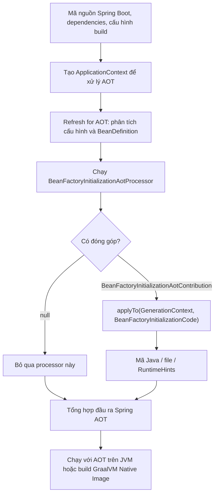

# Vai trò của `BeanFactoryInitializationAotProcessor` trong Spring AOT

> **Chương:** Spring AOT  
> **Module:** `SPRING_BOOT_NATIVE_IMAGE`  
> **Mục tiêu:** Hiểu `BeanFactoryInitializationAotProcessor` là điểm mở rộng ở cấp `BeanFactory` trong quá trình xử lý Ahead-of-Time (AOT) của Spring; biết khi nào cần triển khai, cách tạo `BeanFactoryInitializationAotContribution`, cách đăng ký processor, cũng như tác động tới GraalVM Native Image và kiểm thử.

## 1. Bài toán mà cơ chế này giải quyết

Khi chạy ứng dụng Spring Boot trên JVM theo cách thông thường, Spring dành một phần thời gian khởi động để tìm cấu hình, áp dụng các điều kiện, đăng ký `BeanDefinition`, chọn cách tạo bean, thiết lập dependency injection và cấu hình bean factory. Các quyết định này thường phụ thuộc vào classpath, annotation và một phần môi trường ứng dụng.

**Spring AOT** chuyển phần công việc có thể xác định trước từ lúc ứng dụng chạy sang **lúc build**. Nó phân tích mô hình bean đã biết, tạo mã Java và metadata cần thiết, rồi sử dụng những đầu ra đó khi ứng dụng khởi động ở chế độ AOT. Đây cũng là một nền tảng giúp Spring Boot chạy bằng **GraalVM Native Image**, vốn hạn chế khả năng khám phá động so với HotSpot JVM.

Tuy nhiên, Spring Framework không thể đoán mọi quy tắc khởi tạo của thư viện hoặc hạ tầng tùy biến. Một thư viện có thể cần sinh thêm mã khởi tạo bean factory, đưa resource vào binary hoặc khai báo quyền reflection cho kiểu dữ liệu sẽ được dùng khi chạy. **`BeanFactoryInitializationAotProcessor`** là một giao diện để thư viện hoặc ứng dụng đóng góp các tối ưu đó ở **phạm vi toàn bộ bean factory**.

Giao diện này thuộc package:

```java
org.springframework.beans.factory.aot.BeanFactoryInitializationAotProcessor
```

Nó có mặt từ Spring Framework 6.0. Khi học Spring Boot Native Image, cần phân biệt rõ: **processor tạo AOT contribution**, Spring AOT tập hợp các contribution, còn **GraalVM Native Image** về sau biên dịch mã ứng dụng và xử lý metadata thành executable native. Processor không tự biên dịch ứng dụng thành mã máy.

## 2. Processor nằm ở đâu trong pipeline Spring AOT?



Chi tiết theo thứ tự thực thi:

1. **Tạo context ở chế độ AOT.** `ApplicationContextAotGenerator` hoạt động trên mô hình `GenericApplicationContext` và một `GenerationContext` để chuẩn bị nội dung cần sinh.
2. **Refresh riêng cho AOT.** Spring xử lý configuration class, component scanning, `@Import`, `BeanFactoryPostProcessor` và các điều kiện phù hợp để thu được các `BeanDefinition`. Đây không phải full refresh: ứng dụng **không tạo toàn bộ bean nghiệp vụ** như lúc runtime.
3. **Khám phá và gọi processor.** Spring gọi từng `BeanFactoryInitializationAotProcessor` khả dụng với trạng thái bean factory đã chuẩn bị.
4. **Thu thập các contribution.** Mỗi processor có thể trả về một contribution hoặc `null` nếu không áp dụng.
5. **Áp dụng contribution.** Contribution có thể tạo phương thức khởi tạo, tệp nguồn/tài nguyên hay `RuntimeHints` cho các hành vi cần ở runtime.
6. **Sinh đầu ra AOT.** Những kết quả này được đưa vào quá trình chạy AOT hoặc pipeline GraalVM Native Image. Với native, các hints giúp sinh metadata cấu hình cho việc phân tích và đóng gói.

**Điểm mấu chốt:** thông tin mà processor nhìn thấy là **mô hình bean tại thời điểm build**. Một điều kiện `@Profile` hoặc `@Conditional` làm thay đổi sự tồn tại của bean có thể đã được quyết định ở bước AOT. Không nên kỳ vọng processor quyết định lại mọi nhánh theo môi trường runtime của binary native.

## 3. Hợp đồng API: một processor và một contribution

Giao diện có một phương thức chức năng:

```java
// Chữ ký rút gọn; annotation nullable có thể thay đổi theo phiên bản.
@FunctionalInterface
public interface BeanFactoryInitializationAotProcessor {

    BeanFactoryInitializationAotContribution processAheadOfTime(
            ConfigurableListableBeanFactory beanFactory);
}
```

Thực tế phương thức có khả năng **trả về `null`** (được ghi trong Javadoc). Đây là cách hợp lệ để báo rằng bean factory hiện tại không cần hành vi AOT bổ sung nào của processor.

| Thành phần | Vai trò |
|---|---|
| `ConfigurableListableBeanFactory` | Cho processor xem toàn bộ mô hình `BeanDefinition` hiện có và metadata liên quan |
| `processAheadOfTime(...)` | Phân tích trạng thái bean factory **ở build time**; quyết định có cần đóng góp hay không |
| `BeanFactoryInitializationAotContribution` | Đối tượng giữ cách áp dụng đóng góp được chọn |
| `applyTo(GenerationContext, BeanFactoryInitializationCode)` | Áp dụng đóng góp vào hạ tầng sinh mã, file và runtime hints |
| `GenerationContext` | Quản lý lớp được sinh, tệp được sinh và `RuntimeHints` |
| `BeanFactoryInitializationCode` | Quản lý những phương thức và initializer được sinh để thiết lập bean factory khi khởi động AOT |

Phần tách đôi **“phát hiện nhu cầu” → “ghi đóng góp”** là chủ ý thiết kế. `processAheadOfTime` đọc bean factory và lựa chọn hành động; `applyTo` dùng hạ tầng sinh mã để biểu diễn hành động đó.

### 3.1. Processor nên phân tích metadata nào?

Trong `processAheadOfTime`, những thao tác phù hợp thường là:

- Kiểm tra một `BeanDefinition` có tồn tại không: `containsBeanDefinition("beanName")`.
- Đọc bean name, kiểu bean dự kiến, scope, property hoặc các annotation có thể xác định từ mô hình.
- Tính toán danh sách hành vi cần phục hồi bằng mã sinh trước hoặc loại resource cần đưa vào native image.
- Trả về `null` khi điều kiện áp dụng không thỏa.

Nên tránh gọi `getBean("someService")` chỉ để dò trạng thái, vì hành động đó có thể **khởi tạo bean thật ngay tại build time**. Khởi tạo có thể kéo theo truy vấn cơ sở dữ liệu, gọi HTTP, mở socket, đọc secret, hoặc tạo trạng thái khác với môi trường chạy thật.

Một số **infrastructure bean** bắt buộc được khởi tạo trong quá trình xử lý AOT; đó là ngoại lệ có kiểm soát, không phải lý do để tự do tạo các bean nghiệp vụ.

### 3.2. Contribution có thể sinh ra những gì?

Một `BeanFactoryInitializationAotContribution` là functional interface với phương thức:

```java
void applyTo(
        GenerationContext generationContext,
        BeanFactoryInitializationCode beanFactoryInitializationCode);
```

Nó có hai nhóm trách nhiệm thường gặp:

**Tạo mã khởi tạo:** Sử dụng `beanFactoryInitializationCode.getMethods()` để tạo phương thức hoặc `addInitializer(...)` để đăng ký lời gọi khởi tạo sẽ xuất hiện trong mã AOT. Nhờ vậy, một hành vi từng được thực hiện bằng logic khám phá ở startup có thể được biểu diễn sẵn bằng mã sinh.

**Cung cấp metadata/hạ tầng đầu ra:** Sử dụng `generationContext.getRuntimeHints()` để khai báo nhu cầu reflection, resources, serialization hay JDK proxy; sử dụng các API generated classes/files khi cần tạo lớp, mã nguồn hoặc tài nguyên.

Ví dụ khung mã để hình dung luồng:

```java
@Override
public BeanFactoryInitializationAotContribution processAheadOfTime(
        ConfigurableListableBeanFactory beanFactory) {

    if (!beanFactory.containsBeanDefinition("someInfrastructureBean")) {
        return null;
    }

    // Hành động được áp dụng ở giai đoạn sinh mã AOT,
    // không phải chạy như một callback mỗi khi ứng dụng native khởi động.
    return (generationContext, initializationCode) -> {
        generationContext.getRuntimeHints().resources()
                .registerPattern("config/custom-rules.json");

        // Với bài toán cần sinh initializer, sử dụng:
        // initializationCode.getMethods()
        // initializationCode.addInitializer(...)
    };
}
```

Không phải contribution nào cũng bắt buộc gọi cả hai API: **một contribution chỉ thêm runtime hints vẫn hoàn toàn hợp lệ**. Ngược lại, với logic khởi tạo tùy biến, chỉ thêm hints có thể chưa đủ; phải sinh mã tái hiện hành vi cần thiết.

## 4. Ví dụ đầy đủ: giữ lại template mà một bean Spring sử dụng

Giả sử ứng dụng có bean tên `invoiceRenderer`. Bean này đọc file `classpath:reports/invoice.html` lúc runtime. Trong quá trình build Native Image, nếu resource bị loại khỏi binary, chức năng render hóa đơn có thể lỗi dù ứng dụng build thành công.

Ta muốn đăng ký resource **chỉ khi** bean `invoiceRenderer` xuất hiện trong mô hình Spring AOT. Đây là ví dụ có điều kiện ở cấp bean factory.

**Bước 1 — Bean nghiệp vụ minh họa**

```java
package com.example.invoice;

import org.springframework.context.annotation.Bean;
import org.springframework.context.annotation.Configuration;

@Configuration(proxyBeanMethods = false)
public class InvoiceConfiguration {

    @Bean
    InvoiceRenderer invoiceRenderer() {
        return new InvoiceRenderer();
    }
}
```

`InvoiceRenderer` là lớp giả định do ứng dụng tự định nghĩa, có logic đọc `reports/invoice.html` qua classpath khi cần dựng hóa đơn. Tệp phải thật sự nằm tại:

```text
src/main/resources/reports/invoice.html
```

**Bước 2 — Triển khai AOT processor**

```java
package com.example.invoice.aot;

import org.springframework.beans.factory.aot.BeanFactoryInitializationAotContribution;
import org.springframework.beans.factory.aot.BeanFactoryInitializationAotProcessor;
import org.springframework.beans.factory.config.ConfigurableListableBeanFactory;

public final class InvoiceTemplateAotProcessor
        implements BeanFactoryInitializationAotProcessor {

    @Override
    public BeanFactoryInitializationAotContribution processAheadOfTime(
            ConfigurableListableBeanFactory beanFactory) {

        // Chỉ kiểm tra metadata, không tạo InvoiceRenderer tại build time.
        if (!beanFactory.containsBeanDefinition("invoiceRenderer")) {
            return null;
        }

        return (generationContext, initializationCode) ->
                generationContext.getRuntimeHints()
                        .resources()
                        .registerPattern("reports/invoice.html");
    }
}
```

**Đọc ví dụ theo hai giai đoạn:**

- **Giai đoạn phát hiện:** `processAheadOfTime` nhìn vào bean factory. Nếu thiếu `invoiceRenderer`, processor không có công việc gì và trả về `null`.
- **Giai đoạn đóng góp:** Nếu có bean, contribution thêm pattern vào `RuntimeHints`. Khi dùng GraalVM Native Image, Spring AOT có thể chuyển thông tin đó thành metadata tài nguyên tương ứng.

Dòng `registerPattern(...)` **không tự tạo tệp**; nó chỉ yêu cầu giữ lại resource đã có trên classpath. Đường dẫn phải đúng cả chữ hoa/thường và phải được đóng gói trong đầu vào của build.

**Bước 3 — Đăng ký processor với hạ tầng Spring AOT**

Tạo file tại:

```text
src/main/resources/META-INF/spring/aot.factories
```

Nội dung:

```properties
org.springframework.beans.factory.aot.BeanFactoryInitializationAotProcessor=\
com.example.invoice.aot.InvoiceTemplateAotProcessor
```

Đây là cơ chế đăng ký processor theo file cấu hình AOT, thích hợp khi viết phần mở rộng đóng gói trong thư viện. Lớp processor cần có constructor có thể khởi tạo bởi cơ chế nạp này (ví dụ constructor mặc định không tham số như đoạn mã trên).

**Bước 4 — Chạy AOT và kiểm tra binary**

Ví dụ với dự án Spring Boot đã cấu hình plugin build AOT/native tương ứng:

```bash
# Maven: sinh đầu ra Spring AOT, chưa phải biên dịch native
./mvnw spring-boot:process-aot

# Maven: build Native Image khi có cấu hình GraalVM Native Build Tools
./mvnw -Pnative native:compile

# Gradle: tác vụ tương đương nếu dự án dùng Spring Boot và native plugin
./gradlew processAot
./gradlew nativeCompile
```

Sau khi build, cần chạy executable thực tế và gọi đường chức năng sử dụng template. **Build PASS chưa bảo đảm resource được load thành công ở runtime.** Tùy phiên bản Spring Boot, Maven/Gradle và cấu trúc dự án, thư mục mã sinh AOT có thể khác nhau; hãy xác nhận đầu ra theo cấu hình build hiện có.

### 4.1. Có cần viết processor riêng chỉ để khai báo resource?

Không nhất thiết. Nếu resource luôn cần thiết, không phụ thuộc điều kiện trong bean factory, có thể dùng `RuntimeHintsRegistrar` cùng `@ImportRuntimeHints` hoặc cơ chế hints phù hợp mà Spring cung cấp. Cách đó thường ít phức tạp hơn.

Ví dụ trên chọn `BeanFactoryInitializationAotProcessor` để minh họa **phân tích trạng thái của toàn bộ bean factory trước khi quyết định đóng góp**. Đây là điểm khác biệt có giá trị của nó.

## 5. Đăng ký dưới dạng bean: lợi ích và các bẫy thường gặp

Ngoài `META-INF/spring/aot.factories`, Spring cho phép một **bean** trực tiếp triển khai `BeanFactoryInitializationAotProcessor`. Chẳng hạn:

```java
package com.example.invoice.aot;

import org.springframework.beans.factory.aot.BeanFactoryInitializationAotProcessor;
import org.springframework.context.annotation.Bean;
import org.springframework.context.annotation.Configuration;

@Configuration(proxyBeanMethods = false)
class InvoiceAotConfiguration {

    @Bean
    static BeanFactoryInitializationAotProcessor invoiceTemplateAotProcessor() {
        return new InvoiceTemplateAotProcessor();
    }
}
```

**Chỉ chọn một cách đăng ký** cho cùng một processor: qua `aot.factories` *hoặc* qua bean. Đăng ký cả hai có thể dẫn đến xử lý đóng góp lặp lại và khó tìm nguyên nhân.

Một số đặc điểm cần nhớ:

1. Khi processor được đăng ký như một bean, **bean processor và các dependency của nó được khởi tạo trong giai đoạn xử lý AOT**. Điều này làm cho constructor, dependency graph và side effect của nó trở thành một phần của build.
2. Theo hợp đồng của Spring AOT, **bean processor dạng này không được đóng góp như một bean ứng dụng vào context đã tối ưu AOT**. Nó phục vụ bước build, không phải service nghiệp vụ của bản native.
3. Spring khuyến nghị dùng giao diện này cho **infrastructure bean** có dependency hạn chế, chẳng hạn các thành phần vốn đã được tạo sớm trong vòng đời bean factory.
4. Nếu đăng ký bằng `@Bean`, nên khai báo factory method là **`static`**. Nếu không, Spring có thể phải tạo instance của lớp `@Configuration` bao ngoài sớm hơn dự kiến chỉ để tạo processor.

Không được suy luận rằng mọi bean triển khai processor đều cần được lưu lại để chạy trong executable native. Chức năng của nó là **đóng góp mã/metadata ở build time**.

## 6. So sánh với những giao diện dễ nhầm lẫn

| Giao diện / cơ chế | Thời điểm và phạm vi | Nhiệm vụ chính | Khi nào chọn? |
|---|---|---|---|
| `BeanFactoryPostProcessor` | Khi chuẩn bị bean factory trong vòng đời Spring thông thường; cũng có thể chạy trong bước refresh AOT | Thay đổi hoặc kiểm tra `BeanDefinition`, cấu hình factory | Cần tác động tới định nghĩa bean trong mô hình Spring |
| `BeanDefinitionRegistryPostProcessor` | Rất sớm trong giai đoạn đăng ký định nghĩa | Thêm/sửa các `BeanDefinition` qua registry | Cần đăng ký bean programmatically để Spring AOT nhìn thấy |
| **`BeanFactoryInitializationAotProcessor`** | **Build time**, phạm vi **bean factory** | Phân tích bean factory, trả contribution cho mã/hints khởi tạo | Cần AOT hóa một hành vi cấu hình xuyên nhiều bean hoặc phụ thuộc mô hình factory |
| `BeanFactoryInitializationAotContribution` | Giai đoạn áp dụng kết quả AOT | Ghi mã sinh, initializer và/hoặc hints | Đây là **kết quả** của processor, không phải cơ chế phát hiện |
| `BeanRegistrationAotProcessor` | Build time, phạm vi **từng đăng ký bean** | Tùy biến cách sinh mã đăng ký/tạo một bean cụ thể | Cần xử lý chi tiết riêng cho `RegisteredBean` |
| `RuntimeHintsRegistrar` | Giai đoạn thu thập hints | Khai báo reflection, resource, proxy, serialization, JNI theo yêu cầu | Chủ yếu cần metadata native, không cần phân tích trạng thái bean factory |
| GraalVM Native Image | Bước biên dịch native | Phân tích reachable code và biên dịch executable | Cần tạo bản chạy native từ đầu ra ứng dụng/AOT |

### 6.1. Phân biệt `BeanFactoryInitializationAotProcessor` với `BeanRegistrationAotProcessor`

Đây là hai lớp mở rộng có cấp độ khác nhau:

- **Factory-level:** processor nhận `ConfigurableListableBeanFactory`, quan sát nhiều bean cùng lúc và có thể góp phần khởi tạo cả factory.
- **Registration-level:** processor nhận một `RegisteredBean` và tập trung vào mã sinh cho **một đăng ký bean**.

Một implementation cốt lõi của `BeanFactoryInitializationAotProcessor` trong Spring có nhiệm vụ đi qua các `BeanDefinition` ứng viên và tập hợp contribution tương ứng của `BeanRegistrationAotProcessor`. Nhờ vậy cơ chế per-bean được tích hợp vào luồng tổng hợp cấp factory.

Ví dụ: muốn thay đổi cách sinh mã injection cho một loại bean cụ thể, hãy xem xét `BeanRegistrationAotProcessor`; muốn khảo sát toàn bộ những bean tích hợp cùng một thư viện rồi sinh một bước cấu hình chung, hãy xem xét `BeanFactoryInitializationAotProcessor`.

### 6.2. Phân biệt với `BeanFactoryPostProcessor`

`BeanFactoryPostProcessor` có chức năng tác động vào **mô hình cấu hình bean**. `BeanFactoryInitializationAotProcessor` có chức năng sinh **đầu ra AOT tương ứng với mô hình đó**. Hai giao diện có thể được một infrastructure component triển khai đồng thời nếu nó cần thay đổi mô hình lúc xử lý cấu hình và cần bảo tồn hành vi phù hợp khi chạy AOT.

Đừng đổi mọi `BeanFactoryPostProcessor` thành AOT processor. Nhiều processor chuẩn đã hoạt động tốt ở bước AOT; một extension mới chỉ cần thiết khi có hành vi runtime không được khôi phục đúng bằng mã sinh mặc định.

## 7. Từ contribution tới mã chạy thực tế: hiểu đúng lifecycle

Hãy tách ba thời điểm:

| Thời điểm | Những gì xảy ra | Những gì không nên giả định |
|---|---|---|
| **Build time: tạo bean model** | Spring tính toán cấu hình và `BeanDefinition` hợp lệ | Không phải mọi bean nghiệp vụ đã được tạo |
| **Build time: chạy processor/contribution** | Phân tích factory, thêm methods/initializers/runtime hints | Đây không phải callback sẽ chạy lại khi binary khởi động |
| **Runtime: chạy JVM AOT hoặc native binary** | Mã sinh khởi tạo context và bean factory theo kế hoạch AOT | Không tự chạy lại `processAheadOfTime` để phát hiện mọi thay đổi cấu hình |

Ví dụ, một processor có thể thấy bean `reportRenderer` và thêm đoạn initializer cần thiết vào `BeanFactoryInitializationCode`. Khi ứng dụng native chạy, phần **mã đã sinh** được thực thi trong luồng khởi động context; còn processor làm ra nó chỉ cần tham gia ở build time.

Các API đáng chú ý:

- `generationContext.getRuntimeHints()`: ghi nhu cầu reflection/resource/proxy/serialization.
- `generationContext.getGeneratedClasses()` và `getGeneratedFiles()`: quản lý mã/tệp được sinh.
- `beanFactoryInitializationCode.getMethods()`: thêm phương thức sinh qua `GeneratedMethods`.
- `beanFactoryInitializationCode.addInitializer(...)`: gắn phương thức khởi tạo đã sinh vào luồng setup của bean factory.

Nếu viết contribution sinh mã, cần kiểm tra kiểu dữ liệu/constructor/method mà mã sinh tham chiếu có sẵn ở runtime native. Không nên đưa object từ giai đoạn build vào code generated một cách ngầm định; trạng thái cần được mô tả bằng **mã, constants, resource hoặc runtime hints** có thể tái lập.

## 8. Các lỗi điển hình khi tự triển khai

### 8.1. Khởi tạo bean nghiệp vụ lúc build

**Triệu chứng:** build native thử kết nối database, gọi API bên ngoài, đọc secret hoặc treo trước khi sinh mã.

**Nguyên nhân:** processor gọi `getBean(...)` hoặc constructor infrastructure phụ thuộc nặng vào bean nghiệp vụ.

**Hướng xử lý:** đọc `BeanDefinition`, annotation và metadata; giữ dependency của processor nhỏ; nếu cần trạng thái thật thì cân nhắc thiết kế lại cách cấu hình và hợp đồng build/runtime.

### 8.2. Sai thời điểm của điều kiện cấu hình

**Triệu chứng:** native image chạy với profile khác nhưng thiếu bean hoặc resource.

**Nguyên nhân:** điều kiện ảnh hưởng **sự hiện diện của bean** được cố định trong lần xử lý AOT; một cấu hình build không giống môi trường đích.

**Hướng xử lý:** công bố rõ profile/property cần có ngay khi build, giữ những thông số thực sự động (như URL endpoint, credential) ở tầng runtime, và build/test riêng nếu cần những topology bean khác nhau.

### 8.3. Lạm dụng runtime hints

**Triệu chứng:** đã đăng ký resource hoặc reflection nhưng code vẫn lỗi.

**Nguyên nhân:** đăng ký sai resource path, thiếu class/method trong hint, hoặc bản thân logic khởi tạo dynamic không được chuyển đổi thành code AOT phù hợp.

**Hướng xử lý:** xác định lỗi nằm ở **metadata reachable** hay **hành vi cần sinh mã**, kiểm tra tệp thực sự có trên classpath và chạy đúng nhánh chức năng bằng native executable.

### 8.4. Processor không được gọi

**Triệu chứng:** build hoàn tất nhưng contribution không xuất hiện trong AOT output.

**Nguyên nhân có thể:** `aot.factories` sai đường dẫn/key/class name; processor không được đăng ký thành bean; bean definition điều kiện không tồn tại; hoặc `processAheadOfTime` trả `null`.

**Hướng xử lý:** kiểm tra cơ chế đăng ký, điều kiện phát hiện và log build AOT; đặt log/điểm dừng tại `processAheadOfTime` trong giai đoạn build, phân biệt với log startup native.

### 8.5. Kỳ vọng AOT giải quyết mọi động lực runtime

**Triệu chứng:** plugin được nạp bằng tên lớp từ dữ liệu mới ở runtime không có trong binary native.

**Nguyên nhân:** Native Image dùng phân tích reachability và metadata trong bối cảnh chương trình đóng; processor chỉ biết những thứ nó phát hiện được lúc build.

**Hướng xử lý:** cố định tập plugin được phép đóng gói, đăng ký hints phù hợp, hoặc tổ chức kiến trúc plugin theo cách tương thích native. Không dựa vào khả năng nạp class tùy ý từ ngoài binary.

## 9. Quy trình kiểm thử thiết thực

Không cần viết processor chỉ để “tăng hiệu năng”; cần một **hành vi cụ thể bị thiếu hoặc phải tính toán ở runtime** để chứng minh giá trị của extension.

Đề xuất quy trình đối với ví dụ `invoiceRenderer`:

1. **Kiểm tra JVM thường.** Dịch vụ tạo hóa đơn đúng với `invoice.html` có trên classpath. Đây là đường baseline.
2. **Chạy tác vụ AOT.** Xác minh processor được load trong build; kết quả `processAheadOfTime` không phải `null` khi có bean, và trở thành `null` khi không có bean.
3. **Kiểm tra đầu ra.** Với build có thể xem file hints, xác minh pattern `reports/invoice.html` được đưa vào metadata AOT/native phù hợp; không mặc định tên hoặc vị trí file generated giống nhau giữa mọi phiên bản plugin.
4. **Chạy binary native.** Test endpoint hoặc use case sinh hóa đơn thật. Kiểm tra nội dung template được tải và render đúng, kể cả khi cấu hình runtime khác với môi trường build ở các thuộc tính được phép thay đổi.
5. **Thử nhánh âm tính.** Bỏ cấu hình tạo `invoiceRenderer` ở một cấu hình build riêng; đảm bảo processor không góp hints không cần thiết và AOT vẫn build thành công.
6. **Kiểm tra lặp lại.** Build lại cùng commit/configuration để xác minh việc sinh metadata không phụ thuộc timestamp, network hoặc trạng thái mutable của máy build.

### Bảng kết quả kiểm thử mẫu

| Tình huống | Kỳ vọng | Bằng chứng |
|---|---|---|
| Bean `invoiceRenderer` có mặt khi build AOT | Processor trả contribution | Log hoặc kiểm tra trực tiếp lần gọi AOT |
| Bean không có mặt | Processor trả `null` | Test tình huống không chứa bean |
| Resource có trên classpath | Native binary đọc được resource | Integration/smoke test với executable |
| Resource bị bỏ khỏi source/build | Kiểm thử phát hiện thiếu tài nguyên | Build/test báo lỗi phù hợp, không kết luận chỉ từ hints |
| Đổi property runtime không ảnh hưởng bean topology | Ứng dụng hoạt động theo property mới | Test khởi động binary với cấu hình runtime |
| Đổi profile làm khác topology bean | Xác định nhu cầu build AOT riêng | So sánh `BeanDefinition` theo profile build |

Các chỉ số **startup**, **RSS/PSS** và **thời gian build** thuộc mục tiêu benchmark của module Spring Boot Native Image. Khi thêm processor tùy biến, đo lại các chỉ số này nếu tối ưu có tác động đáng kể. Tự thân việc khai báo `RuntimeHints` không đồng nghĩa startup hoặc RAM giảm.

## 10. Câu hỏi tự kiểm tra

1. Nếu `processAheadOfTime` trả `null`, Spring có coi đó là lỗi không? **Không**. Nó có nghĩa processor không có contribution trong lần AOT này.
2. Vì sao không nên gọi `getBean` để đọc một flag? Vì điều này có thể kéo theo khởi tạo bean và side effect ngay tại build time.
3. Khi chỉ cần giữ một file template luôn có mặt, có nhất thiết phải tạo processor này không? **Không**. `RuntimeHintsRegistrar` hoặc cơ chế hints đơn giản hơn thường phù hợp.
4. Vì sao `@Bean` tạo processor nên là `static`? Để tránh tạo instance của lớp `@Configuration` bao ngoài quá sớm trong giai đoạn AOT.
5. Processor khác GraalVM native compiler thế nào? Processor phân tích model Spring và tạo đóng góp AOT; compiler nhận đầu ra và bytecode để biên dịch chương trình native.
6. Khi cần xử lý chi tiết cách sinh mã cho **một bean**, giao diện nào đáng xem xét trước? `BeanRegistrationAotProcessor`.
7. Đã build thành công có chứng minh native đọc được resource qua reflection không? **Chưa**. Phải chạy executable và kiểm thử đường chức năng tương ứng.

## 11. Kết luận

`BeanFactoryInitializationAotProcessor` là **điểm mở rộng build-time của Spring AOT ở cấp bean factory**. Nó phân tích những `BeanDefinition` đã biết rồi trả về `BeanFactoryInitializationAotContribution` để sinh mã khởi tạo hoặc khai báo metadata cần cho runtime. Đây là mắt xích giúp các cơ chế cấu hình tùy biến của Spring có thể tương thích với chế độ AOT và GraalVM Native Image.

Khi triển khai, hãy giữ ranh giới rõ: **phân tích tại build time, biểu diễn hành vi thành contribution, kiểm thử hành vi bằng bản native chạy thật**. Chỉ viết processor tùy biến khi cơ chế AOT mặc định và các phương án gọn hơn như `RuntimeHintsRegistrar` không đáp ứng yêu cầu.

### Tài liệu tham khảo

- [Spring Framework Reference — Ahead of Time Optimizations](https://docs.spring.io/spring-framework/reference/core/aot.html)
- [Javadoc — BeanFactoryInitializationAotProcessor](https://docs.spring.io/spring-framework/docs/current/javadoc-api/org/springframework/beans/factory/aot/BeanFactoryInitializationAotProcessor.html)
- [Javadoc — BeanFactoryInitializationAotContribution](https://docs.spring.io/spring-framework/docs/current/javadoc-api/org/springframework/beans/factory/aot/BeanFactoryInitializationAotContribution.html)
- [Javadoc — GenerationContext](https://docs.spring.io/spring-framework/docs/current/javadoc-api/org/springframework/aot/generate/GenerationContext.html)
- [Javadoc — BeanFactoryInitializationCode](https://docs.spring.io/spring-framework/docs/current/javadoc-api/org/springframework/beans/factory/aot/BeanFactoryInitializationCode.html)
