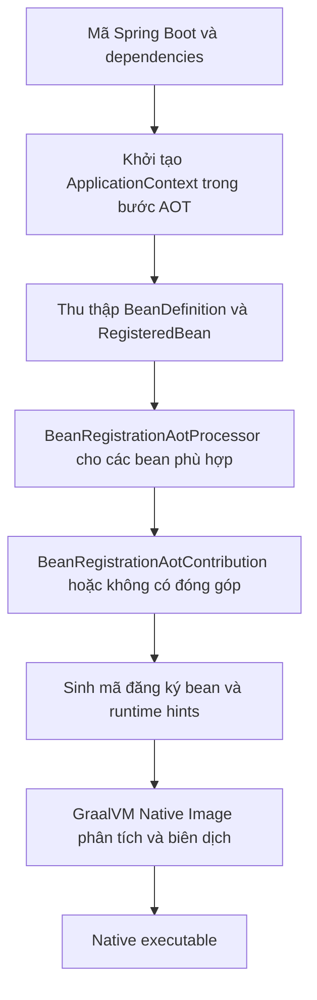

# Vai trò của BeanRegistrationAotProcessor

## 1. Bối cảnh: tại sao Spring cần xử lý đăng ký bean trước khi chạy?

Trong ứng dụng Spring Boot trên JVM, Spring Framework có thể đọc metadata, đánh giá cấu hình, đăng ký `BeanDefinition`, tạo đối tượng và áp dụng nhiều quy tắc xử lý bean khi ứng dụng khởi động. Một số bước sử dụng reflection, suy luận kiểu hoặc khám phá cấu trúc ứng dụng tại runtime.

Khi biên dịch **Spring Boot Native Image** bằng **Spring AOT** và **GraalVM Native Image**, phần công việc có thể xác định trước nên được chuyển sang **build time**. Spring AOT phân tích application context và sinh mã khởi tạo, còn GraalVM phân tích reachability và biên dịch mã Java thành executable native. Nhờ đó ứng dụng thường giảm thời gian khởi động và có tiềm năng giảm lượng bộ nhớ sử dụng; hiệu quả thực tế vẫn phải đo theo workload.

**`BeanRegistrationAotProcessor`** là một điểm mở rộng ở mức **từng bean registration** trong Spring Framework. Nó cho phép một thành phần tích hợp quan sát thông tin của bean đang được đăng ký và cung cấp đóng góp AOT riêng cho bean đó. Đóng góp này có thể bổ sung mã khởi tạo/đăng ký phù hợp hoặc runtime hints phục vụ các thao tác động. Đây không phải bộ biên dịch native; nó hoạt động trong pipeline Spring AOT **trước** khi GraalVM Native Image tạo executable.

> Mấu chốt: `BeanRegistrationAotProcessor` xử lý **đăng ký một bean cụ thể**; nó không thay thế việc tạo bean hay toàn bộ vòng đời IoC container.

## 2. Vị trí của processor trong chu trình Spring AOT

Quy trình ở mức khái niệm:



Một `RegisteredBean` là cách Spring biểu diễn một bean đã được đăng ký bằng metadata và ngữ cảnh bean factory. Nó khác đối tượng instance đang chạy: processor làm việc với **thông tin đăng ký bean**, không có nghĩa nó được phép dựa vào mọi trạng thái runtime của bean.

Quy trình cần tách thành ba trách nhiệm:

| Thành phần | Trách nhiệm |
|---|---|
| Spring AOT engine | Duyệt và chuẩn bị cấu trúc container, tạo mã phục vụ khởi tạo ứng dụng |
| `BeanRegistrationAotProcessor` | Nhìn từng `RegisteredBean` và quyết định có đóng góp AOT nào đặc thù cho đăng ký đó hay không |
| `BeanRegistrationAotContribution` | Áp dụng đóng góp đã xác định vào quá trình sinh mã và/hoặc runtime hints |
| GraalVM Native Image | Dựa trên mã và metadata đã chuẩn bị để phân tích reachability, biên dịch AOT và liên kết runtime native |

Điểm quan trọng là **processor xác định cần làm gì**, còn **contribution thực hiện phần bổ sung trong giai đoạn tạo mã**. Việc tách hai vai trò giúp component tích hợp quyết định nhanh rằng một bean không cần xử lý bằng cách trả về `null`.

## 3. Hợp đồng API và thời điểm được gọi

Giao diện cốt lõi nằm trong package `org.springframework.beans.factory.aot`:

```java
public interface BeanRegistrationAotProcessor {
    BeanRegistrationAotContribution processAheadOfTime(
            RegisteredBean registeredBean);
}
```

Đây là cách trình bày hợp đồng tối thiểu, lược bỏ chú thích và các chi tiết khác của framework. Ý nghĩa:

1. Spring gọi `processAheadOfTime(registeredBean)` khi xử lý AOT cho một đăng ký bean.
2. Processor kiểm tra loại bean, metadata và điều kiện xử lý được xác định tại build time.
3. Nếu đăng ký đó **không cần** xử lý đặc thù, trả về `null`.
4. Nếu cần, trả về một `BeanRegistrationAotContribution`. Spring sẽ áp dụng đóng góp đó khi sinh mã đăng ký bean.

Một contribution có phương thức cốt lõi:

```java
void applyTo(
        GenerationContext generationContext,
        BeanRegistrationCode beanRegistrationCode);
```

`GenerationContext` cung cấp bối cảnh tạo mã và runtime hints. `BeanRegistrationCode` là điểm tương tác với phần mã đăng ký bean đang được sinh ra. Tùy bài toán, contribution có thể chỉ thêm hints hoặc can thiệp vào mã sinh thông qua API do phiên bản Spring Framework hỗ trợ.

Đừng diễn giải `processAheadOfTime` thành callback mỗi lần bean được tạo tại runtime. Logic này thuộc **giai đoạn AOT processing**; kết quả mới được phản ánh trong native executable.

## 4. Ví dụ: bổ sung reflection hints cho một bean đặc thù

Giả sử thư viện ứng dụng cung cấp bean `LegacyInvoiceFormatter`. Một thành phần khác của hệ thống cần gọi constructor của formatter qua reflection. Trên JVM, việc tìm constructor thường diễn ra khi chương trình chạy; với native, cần bảo đảm metadata phản chiếu được đăng ký.

```java
package example.invoice;

public final class LegacyInvoiceFormatter {
    public LegacyInvoiceFormatter() {
    }

    public String format(long amount) {
        return "Invoice total: " + amount;
    }
}
```

Có thể tạo processor để nhận diện **đăng ký bean thuộc kiểu này** và đóng góp hint:

```java
package example.invoice;

import org.springframework.aot.hint.MemberCategory;
import org.springframework.beans.factory.aot.BeanRegistrationAotContribution;
import org.springframework.beans.factory.aot.BeanRegistrationAotProcessor;
import org.springframework.beans.factory.support.RegisteredBean;

public final class InvoiceFormatterRegistrationAotProcessor
        implements BeanRegistrationAotProcessor {

    @Override
    public BeanRegistrationAotContribution processAheadOfTime(
            RegisteredBean registeredBean) {

        if (!LegacyInvoiceFormatter.class.isAssignableFrom(
                registeredBean.getBeanClass())) {
            return null;
        }

        return (generationContext, beanRegistrationCode) ->
                generationContext.getRuntimeHints()
                        .reflection()
                        .registerType(
                                LegacyInvoiceFormatter.class,
                                MemberCategory.INVOKE_DECLARED_CONSTRUCTORS
                        );
    }
}
```

Đây là ví dụ tập trung vào **đóng góp runtime hint**; tham số `beanRegistrationCode` không được sử dụng vì không cần thay đổi mã khởi tạo bean. `INVOKE_DECLARED_CONSTRUCTORS` đăng ký quyền gọi các constructor được khai báo. Nếu thư viện còn gọi một phương thức hoặc truy cập field bằng reflection, phải đăng ký đúng member tương ứng, không tự suy ra rằng hint constructor đã đủ.

Để Spring AOT sử dụng processor, cần **đăng ký processor trong bean factory** (chẳng hạn dưới dạng một bean cấu hình), đồng thời bảo đảm nó hiện diện trong bối cảnh được Spring AOT xử lý:

```java
package example.invoice;

import org.springframework.context.annotation.Bean;
import org.springframework.context.annotation.Configuration;
import org.springframework.beans.factory.aot.BeanRegistrationAotProcessor;

@Configuration(proxyBeanMethods = false)
class InvoiceAotConfiguration {

    @Bean
    static BeanRegistrationAotProcessor invoiceRegistrationProcessor() {
        return new InvoiceFormatterRegistrationAotProcessor();
    }

    @Bean
    LegacyInvoiceFormatter legacyInvoiceFormatter() {
        return new LegacyInvoiceFormatter();
    }
}
```

`@Bean static` là cách khai báo phù hợp khi processor không cần phụ thuộc vào instance của configuration class. Lớp cấu hình phải được đưa vào application context của ứng dụng. Cách phát hiện/đăng ký processor chính xác có thể phụ thuộc phiên bản Spring Framework hoặc cơ chế tích hợp mà thư viện sử dụng.

**Giới hạn của ví dụ:** với một lớp do Spring quản lý thông thường, Spring AOT hoặc thư viện có thể đã đăng ký metadata constructor cần thiết. Mục tiêu ở đây là minh họa cách viết processor khi **một thành phần ngoài cơ chế bean thông thường** cần reflection bổ sung. Không nên thêm processor chỉ vì thấy một lớp là Spring bean.

## 5. Khi nào nên dùng BeanRegistrationAotProcessor?

Điểm mở rộng này phù hợp nhất cho **framework hoặc thư viện tự quản lý cách dùng bean**, ví dụ:

- Một thư viện có các bean handler đặc biệt và muốn sinh mã hỗ trợ riêng cho từng handler đã đăng ký.
- Một tích hợp cần đăng ký metadata phản chiếu phụ thuộc vào **kiểu hoặc annotation của từng bean**.
- Một cơ chế custom bean registration có dữ liệu tại build time giúp sinh phần mã đăng ký hiệu quả hơn.
- Một framework cần tạo các thành phần hỗ trợ khác nhau theo metadata cụ thể của bean.

Giả sử thư viện dùng annotation `@MessageHandler` trên nhiều loại bean. Một processor có thể kiểm tra metadata của `RegisteredBean`, chỉ tạo contribution cho những bean là message handler và ghi metadata hoặc sinh mã phục vụ thư viện. Việc này tránh duy trì danh sách handler thủ công, miễn metadata có thể suy ra trong bước AOT.

Không phù hợp khi chỉ cần đăng ký một resource path hoặc reflection hint **không phụ thuộc từng bean**. Khi đó `RuntimeHintsRegistrar` thường đơn giản hơn. Cũng không nên sử dụng processor để đọc trạng thái mạng, kết quả truy vấn database production hoặc biến môi trường deployment mà build không thể bảo đảm giống runtime.

## 6. Phân biệt các điểm mở rộng AOT của Spring

| API | Phạm vi | Trường hợp điển hình |
|---|---|---|
| `BeanRegistrationAotProcessor` | Một bean registration | Sinh đóng góp đặc thù cho từng loại bean |
| `BeanFactoryInitializationAotProcessor` | Toàn bean factory ở giai đoạn khởi tạo | Phân tích cấu hình tổng thể và bổ sung mã/hints ở mức container |
| `RuntimeHintsRegistrar` | Khai báo runtime hints | Đăng ký reflection, resource, proxy, serialization, JNI khi biết rõ những gì cần hỗ trợ |
| `BeanFactoryPostProcessor` | Can thiệp `BeanDefinition` khi chuẩn bị bean factory | Thay đổi metadata đăng ký bean trong lifecycle thông thường |
| `BeanPostProcessor` | Xử lý instance bean quanh giai đoạn khởi tạo | Tạo wrapper, proxy hoặc điều chỉnh bean instance tại runtime |

Hai API ở cuối bảng **không phải cơ chế contribution AOT tương đương**. Các `BeanFactoryPostProcessor` và `BeanPostProcessor` có thể ảnh hưởng quá trình Spring chuẩn bị application context, nhưng không trực tiếp thay thế giao diện sinh `BeanRegistrationAotContribution`.

Cũng cần phân biệt **Spring AOT** với **GraalVM Native Image**: Spring AOT chuẩn bị mã sinh và hints của ứng dụng Spring; GraalVM sử dụng đầu ra để tạo executable. Một processor chạy thành công không tự động bảo đảm tất cả thư viện đều tương thích Native Image.

## 7. Quy tắc thiết kế processor an toàn và hiệu quả

### Chỉ dùng dữ liệu ổn định tại build time

Giá trị được phân tích có thể đến từ tên bean, kiểu bean và annotation đã có. Hạn chế side effect khi thực thi processor:

```java
// Ý tưởng: quyết định dựa trên loại bean đã biết
if (SupportedHandler.class.isAssignableFrom(
        registeredBean.getBeanClass())) {
    // Tạo contribution phù hợp
}
```

Tránh gọi API production, mở kết nối tới hệ thống ngoài hoặc đọc secret trong quá trình AOT. Những giá trị thay đổi giữa build và deployment có thể khiến native executable phản ánh cấu hình cũ hoặc thất bại lúc build.

### Xử lý nhiều bean độc lập

Processor có thể gặp nhiều đăng ký bean. Hãy để `processAheadOfTime` quyết định dựa trên từng `RegisteredBean`; tránh lưu trạng thái mutable dùng chung khiến thứ tự xử lý ảnh hưởng kết quả. Nếu đóng góp cần nhiều member, hãy chỉ đăng ký những member thực sự cần thiết để kiểm soát kích thước và khả năng tương thích.

### Có điều kiện thoát rõ ràng

Trả về `null` cho bean không thuộc phạm vi. Không áp dụng reflection hints vô điều kiện cho mọi bean trong application context, vì điều đó có thể giữ lại nhiều metadata hoặc tạo ràng buộc không cần thiết.

### Tránh thao tác runtime ở contribution

Phần `applyTo` được dùng trong pipeline tạo mã và metadata, không phải nơi thực thi nghiệp vụ. Nếu cần quyết định tại runtime, đóng góp nên sinh mã/metadata cho phép runtime đưa ra quyết định trên **tập khả năng đã biết**, thay vì thực thi quyết định ngay tại thời điểm build.

## 8. Kiểm tra processor có tạo tác dụng như mong đợi

Với dự án Spring Boot có plugin AOT phù hợp, có thể thực hiện quy trình sau:

1. Chạy bước Spring AOT của build, chẳng hạn Maven `./mvnw spring-boot:process-aot` hoặc Gradle `./gradlew processAot` khi plugin và phiên bản hỗ trợ task tương ứng.
2. Kiểm tra log build, mã sinh và runtime hints được tạo. Đường dẫn output khác nhau theo Maven/Gradle và phiên bản plugin; không dựa vào một đường dẫn cố định.
3. Build native executable bằng cấu hình đã chuẩn bị, ví dụ `./mvnw -Pnative native:compile` hoặc `./gradlew nativeCompile` nếu GraalVM Native Build Tools đã được cấu hình.
4. Chạy executable và kích hoạt đúng code path cần reflection/resource. So sánh với bản JVM ở cùng profile và đầu vào.
5. Kiểm tra chức năng rồi mới đo startup time, readiness, RSS, throughput và latency. Kết quả native có thể khác theo dependency, runtime và tải thực tế.

Ví dụ tình huống thử:

```java
@Autowired
LegacyInvoiceFormatter formatter;

@Test
void formattingWorks() {
    assertEquals("Invoice total: 500", formatter.format(500));
}
```

Bài test trên chỉ xác minh logic Java bình thường; nó **không** chứng minh hint reflection được sử dụng đúng. Cần thêm một đường đi chủ động gọi `getDeclaredConstructor().newInstance()` từ chương trình chạy native, và kiểm tra kết quả. Đối với logic quan trọng, ưu tiên native integration test (hoặc chạy executable thật) vì unit test trên JVM không phát hiện hết các hạn chế closed world.

## 9. Những lỗi dễ nhầm và cách xử lý

| Hiện tượng | Nguyên nhân đáng kiểm tra | Hướng xử lý |
|---|---|---|
| Processor không chạy trong build AOT | Chưa đăng ký bean processor vào context hoặc cấu hình không được nạp | Kiểm tra `@Configuration`, điều kiện cấu hình và build task |
| `processAheadOfTime` chạy nhưng contribution không có | Điều kiện lọc loại bean sai hoặc trả `null` | Kiểm tra `RegisteredBean` và điều kiện chọn |
| Native vẫn lỗi khi gọi constructor bằng reflection | Đăng ký hints cho sai class/member hoặc code path dùng loại reflection khác | Kiểm tra chính xác class và member được gọi |
| JVM chạy tốt, native thiếu resource | Reflection hint không dùng để đóng gói resource | Thêm resource hints đúng pattern |
| Build phụ thuộc profile/môi trường | Processor dựa vào cấu hình không ổn định giữa build và runtime | Chuyển quyết định sang runtime hoặc cố định input build rõ ràng |
| Startup native nhanh nhưng một nghiệp vụ lỗi | Nhánh động hiếm gặp chưa được đưa vào image | Chạy test kích hoạt nhánh đó và hoàn thiện metadata |

Khi debug, hãy xác nhận processor thực sự được Spring phát hiện, contribution được áp dụng và GraalVM nhận được metadata phù hợp. Ba bước này có thể lỗi độc lập; tránh kết luận rằng chỉ cần thêm `@Bean` là mọi lỗi phản chiếu đều biến mất.

## 10. Thực hành tổng hợp và kết luận

Thực hành đề xuất cho chủ đề **Spring AOT** trong module `SPRING_BOOT_NATIVE_IMAGE`:

1. Tạo một ứng dụng Spring Boot nhỏ với hai bean formatter có cùng interface và một code path dùng reflection để gọi constructor đã xác định.
2. Viết `BeanRegistrationAotProcessor` chỉ chọn một loại bean, trả `null` với bean còn lại và tạo contribution đăng ký constructor reflection.
3. Quan sát bằng log/debug trong bước AOT rằng processor được gọi ở build time, không phải mỗi request.
4. Build native, kiểm thử đúng code path phản chiếu và bổ sung trường hợp âm để chứng minh phạm vi processor.
5. Đóng gói executable vào container có thư viện hệ thống tương thích, chạy smoke test và đo startup/bộ nhớ với bản JVM có chức năng tương đương.

`BeanRegistrationAotProcessor` là điểm mở rộng có phạm vi **từng bean registration**, giúp framework bổ sung khả năng sinh mã hoặc metadata từ thông tin đã biết trước khi chạy. Hiểu ranh giới giữa **processor**, **contribution**, **runtime hints** và **GraalVM compiler** giúp chọn đúng API, tránh side effect build time và kiểm thử chính xác ứng dụng Spring Boot Native Image.
