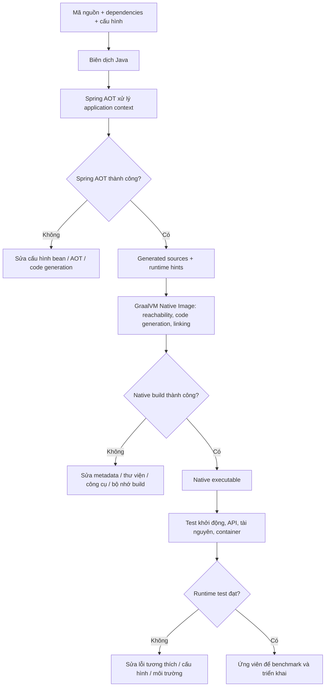

# Phân biệt Spring AOT thành công với biên dịch native thành công

## 1. Hai cột mốc khác nhau trong cùng quy trình

Trong module **SPRING_BOOT_NATIVE_IMAGE**, mục tiêu là biên dịch ứng dụng Spring Boot thành **GraalVM Native Image** nhờ **Spring AOT**, sau đó đánh giá thời gian khởi động, bộ nhớ, kiểm thử tương thích và vận hành executable hoặc container native. Muốn chẩn đoán lỗi chính xác, cần phân biệt hai tuyên bố thường bị đánh đồng:

- **Spring AOT thành công**: bước phân tích ngữ cảnh Spring tại build time, sinh mã nguồn và metadata cần thiết đã kết thúc thành công theo phạm vi tác vụ được chạy.
- **Biên dịch native thành công**: GraalVM Native Image đã hoàn tất phân tích reachability, biên dịch, liên kết và tạo ra tệp thực thi native hợp lệ cho nền tảng đích.

Hai cột mốc có quan hệ thứ tự trong một build Spring Boot native thông thường, nhưng **AOT thành công không bảo đảm native-image build thành công**. Thậm chí **native-image build thành công vẫn chưa chứng minh ứng dụng hoạt động đúng trên môi trường production**.



Ba trạng thái **AOT PASS**, **Native Build PASS**, **Runtime PASS** nên được ghi nhận riêng trong log CI và báo cáo. Không dùng một dòng `BUILD SUCCESS` đơn lẻ để thay thế cả ba, vì đó là kết quả của tác vụ vừa chạy, chưa chắc là toàn bộ pipeline.

## 2. Spring AOT thực sự làm gì?

Spring AOT (Ahead-of-Time) đưa một phần công việc thường diễn ra lúc runtime sang lúc build. Nó đọc những thành phần Spring có thể xác định trước, phân tích cấu hình, chuẩn bị code tạo bean và đăng ký *Runtime Hints* cho những thao tác động như reflection, JDK proxy, resource hoặc serialization. Kết quả phục vụ cho quá trình tạo native image.

Ví dụ một ứng dụng có controller, service và cấu hình bean:

```java
@Configuration
class PaymentConfiguration {
    @Bean
    PaymentService paymentService(PaymentRepository repository) {
        return new PaymentService(repository);
    }
}
```

Ở chế độ AOT, Spring có thể sinh mã phục vụ khởi tạo bean và kết nối dependency thay vì phải khám phá mọi thứ qua reflection khi khởi động runtime. Điều này giúp Native Image nhìn thấy nhiều kiểu và tuyến khởi tạo hơn qua phân tích tĩnh.

Bước AOT có thể xuất ra:

| Đầu ra | Ý nghĩa | Có chứng minh native đã được biên dịch? |
|---|---|---|
| Java source sinh từ AOT | Mã để đăng ký và tạo bean, hỗ trợ khởi tạo context | Không |
| Resource sinh từ AOT | Dữ liệu hỗ trợ framework | Không |
| Runtime Hints / metadata | Khai báo nhu cầu reflection, proxy, resource… cho Native Image | Không |
| Log AOT thành công | Bước xử lý của Spring đã chạy xong trong phạm vi được gọi | Không |

Các thư mục đầu ra phụ thuộc plugin, build tool và phiên bản. Với Maven thường gặp các đường dẫn dưới `target/`; với Gradle là dưới `build/`. Không nên dựa vào một vị trí cố định nếu chưa kiểm tra phiên bản của dự án.

Spring AOT có những ràng buộc liên quan trạng thái lúc build: các điều kiện hoặc lựa chọn bean được quyết định tại build time có thể không thể đổi tùy ý sau khi executable đã được biên dịch. Vì vậy cần kiểm thử những profile, property và điều kiện dùng để build và chạy; không mặc định rằng thay biến môi trường runtime có thể tái dựng toàn bộ bean graph của native executable.

## 3. GraalVM Native Image làm gì sau AOT?

Sau khi có bytecode ứng dụng và kết quả AOT, công cụ GraalVM Native Image thực hiện thêm nhiều giai đoạn:

1. Phân tích *reachability*: xác định thành phần có thể được gọi và dữ liệu cần giữ trong thế giới đóng (*closed-world assumption*).
2. Kết hợp thông tin từ mã, dependencies và metadata native để xử lý reflection, resource, proxy, JNI và những cơ chế động khác.
3. Phân tích, tối ưu, biên dịch mã và xây dựng image heap theo khả năng công cụ.
4. Liên kết với native runtime và các thư viện theo môi trường đích để tạo executable.

Do đó, một ứng dụng có thể tạo xong các file Spring AOT nhưng vẫn bị lỗi ở các bước sau:

- **Thiếu metadata** cho reflection, resource hoặc proxy được truy cập theo đường động mà Spring AOT chưa biết.
- **Dependency không tương thích** với phân tích AOT hoặc cơ chế native; có thể dùng bytecode generation hoặc dynamic class loading tại runtime.
- **Thiếu native toolchain**, thư viện hệ điều hành hoặc cấu hình liên kết không phù hợp.
- **Hết RAM/đĩa** khi native-image phân tích và sinh mã; tải build thường lớn hơn nhiều so với runtime.
- **Mã khởi tạo ở build time có vấn đề**, ví dụ gọi dịch vụ ngoài hoặc giữ trạng thái không phù hợp trong image heap.

Để hiểu lỗi, đọc *bước phát sinh lỗi đầu tiên* trong log thay vì chỉ dòng thông báo lỗi cuối cùng của Maven/Gradle. Có thể build native không thành công dù AOT đã tạo được mã, và cũng có thể AOT thành công nhưng mã sinh sau đó gặp lỗi khi biên dịch Java.

## 4. Minh họa bằng Maven

Giả sử project Spring Boot dùng Maven, có plugin Spring Boot và GraalVM Native Build Tools tương thích, cùng profile `native` được cấu hình như mẫu dự án Spring Boot hỗ trợ Native Image.

Chạy riêng quá trình xử lý AOT:

```bash
./mvnw spring-boot:process-aot
```

Lệnh này yêu cầu plugin Spring Boot xử lý AOT theo cấu hình dự án; để biên dịch và chạy các nguồn AOT sinh ra, cần các bước build phù hợp trong lifecycle. **Lệnh này không tự tạo executable native**.

Để build executable native thông qua native profile:

```bash
./mvnw -Pnative native:compile
```

Với cấu hình Maven Spring Boot phổ biến, profile native và vòng đời plugin sẽ tích hợp AOT trước bước tạo native executable. Tuy nhiên, cấu hình lifecycle thực tế của từng project vẫn phải được kiểm tra; nếu báo thành công ở `process-aot`, đó chỉ là thành công của AOT.

Một cách phân định sau khi chạy:

| Dấu hiệu | Diễn giải hợp lý |
|---|---|
| `spring-boot:process-aot` kết thúc thành công | Spring AOT chạy xong |
| Có generated sources dưới `target/` | Có artifact AOT; chưa có bằng chứng native executable |
| Log cho biết native-image đang phân tích reachable methods | Đang trong quá trình native build; chưa thể kết luận |
| Tác vụ `native:compile` kết thúc thành công và có executable đích | Native build có bằng chứng thành công |
| Executable chạy và health endpoint trả kết quả đúng | Qua kiểm tra runtime cụ thể; chưa đủ để kết luận tất cả tính năng đều đúng |

Không nên suy luận chỉ từ sự tồn tại của một file có tên gần giống executable: file đó có thể là artifact cũ. Để đánh giá, hãy xóa hoặc cô lập artifact của build trước theo quy trình dự án và ghi rõ thời điểm build, rồi kiểm tra exit code, đường dẫn artifact và chạy thử chính artifact vừa được tạo. Việc dọn artifact cần thực hiện có chủ đích trên môi trường build do bạn kiểm soát.

## 5. Minh họa bằng Gradle

Với Gradle, plugin Spring Boot cung cấp tác vụ xử lý AOT, còn GraalVM Native Build Tools cung cấp tác vụ biên dịch native khi dự án đã cấu hình phù hợp:

```bash
./gradlew processAot
```

Lệnh trên chạy **giai đoạn Spring AOT**, có thể tạo mã/metadata trong `build/generated/` hoặc những thư mục do plugin sử dụng.

```bash
./gradlew nativeCompile
```

Lệnh này nhắm tới **native executable**. Trong tích hợp chuẩn, tác vụ `nativeCompile` phụ thuộc các đầu ra cần thiết, bao gồm xử lý AOT; thứ tự thực tế có thể xem trong Gradle task graph.

Nếu `processAot` hoàn tất nhưng `nativeCompile` lỗi, cần kiểm tra task nào thất bại: `compileAotJava`, `nativeCompile`, tác vụ tạo resource hay link. Trạng thái PASS của một task không tự mở rộng sang task khác.

## 6. Ví dụ chẩn đoán ba kiểu thất bại

### Tình huống A — AOT thất bại trước khi biên dịch native

Một cấu hình Spring yêu cầu bean hoặc property không sẵn có ở build time:

```text
> Task :processAot FAILED
...
BeanCreationException: Error creating bean ...
```

Lỗi xuất hiện khi Spring AOT cố chuẩn bị application context. Kiểm tra điều kiện tạo bean, profile, property, logic khởi tạo và thành phần truy cập tài nguyên bên ngoài. **Không thể sửa trực tiếp lỗi này bằng cách tăng heap của Native Image hoặc khai báo reflection metadata tùy tiện.**

Khi có lỗi kiểu `BeanCreationException`, cần đọc nguyên nhân sâu nhất vì lỗi bean cũng có thể do cấu hình environment, truy cập I/O hoặc mã người dùng. Mục tiêu là làm cho quá trình AOT tái tạo được cấu hình hợp lệ theo thiết kế.

### Tình huống B — AOT PASS, native build FAIL

Ví dụ log có thể trông như sau:

```text
> Task :processAot SUCCESS
> Task :nativeCompile FAILED
Error: ...
```

AOT đã hoàn thành, nhưng Native Image phát hiện một hạn chế phân tích, thiếu metadata, không đủ tài nguyên hoặc lỗi toolchain. Phân loại bằng thông báo cụ thể của `nativeCompile`:

- Có tên class/member, dynamic proxy hoặc resource: kiểm tra Runtime Hints và metadata của thư viện.
- Có thông báo `OutOfMemoryError` hoặc tiến trình bị OOM kill: kiểm tra bộ nhớ build runner và cấu hình heap của builder.
- Có lỗi linker/compiler: kiểm tra C toolchain, hệ điều hành, kiến trúc và native dependencies.
- Có lỗi về initialization: xem class được khởi tạo khi build hay runtime, tránh đẩy state phụ thuộc môi trường vào image heap.

Thành công của AOT chỉ chứng minh Spring đã tạo được đầu ra AOT, không chứng minh GraalVM chấp nhận hoặc biên dịch thành công mọi dependency.

### Tình huống C — Native build PASS, runtime FAIL

Executable được tạo nhưng một endpoint động chưa được kiểm thử gặp lỗi:

```text
$ ./build/native/nativeCompile/app
...
java.lang.IllegalStateException: invoice template not found
```

Có thể template chưa được đưa vào image, path resource bị sai, hoặc thư mục runtime không được mount. Một trường hợp khác là thư viện JNI thiếu binary trên Linux container hoặc dữ liệu cấu hình khác môi trường build. Native Build PASS chỉ có nghĩa tệp thực thi được tạo thành công, **không tự xác nhận đầy đủ hành vi runtime**.

Nếu lỗi phát sinh do metadata, hãy bổ sung Spring Runtime Hints hoặc metadata GraalVM, build lại image, rồi chạy lại kịch bản. Nếu do file được mount, chỉnh cấu hình đóng gói hoặc triển khai thay vì đưa dữ liệu môi trường vào executable.

## 7. Xác minh bằng artifact và kiểm thử

Một quy trình kiểm thử có thể sử dụng bảng chấp nhận sau:

| Cổng kiểm tra | Điều kiện PASS | Bằng chứng nên giữ |
|---|---|---|
| **AOT** | Tác vụ AOT thoát thành công | Log task/goal, phiên bản plugin và generated outputs |
| **Native build** | Native compile và linking hoàn tất, executable mới tồn tại | Log native-image, exit code, đường dẫn artifact, hệ điều hành/kiến trúc |
| **Runtime smoke test** | Executable khởi động, readiness thành công | Command chạy, profile, log, health/readiness status |
| **Integration / compatibility** | Các luồng quan trọng chạy đúng, gồm reflection/resource/proxy/JNI nếu có | Test report và các endpoint/test case đã thực thi |
| **Container** | Image native chạy đúng trong môi trường đích | Image digest/tag, kiến trúc, memory limits, cấu hình mount |
| **Performance** | Đo startup, RAM, throughput/latency theo bài toán | Điều kiện tải, cách đo, số lần lặp, số liệu JAR/native |

Ví dụ chạy executable và kiểm tra readiness:

```bash
./target/app
```

Trong terminal khác:

```bash
curl -fsS http://localhost:8080/actuator/health
```

Đây là ví dụ khi dự án có Spring Boot Actuator, bật endpoint health và executable thực tế tên `app`. Đường dẫn artifact có thể khác nhau; không được coi một kết quả HTTP 200 là bằng chứng tất cả luồng nghiệp vụ đúng.

Để so sánh JAR với native, giữ cố định mã nguồn, profile, dữ liệu, cấu hình chức năng, tải, concurrency và môi trường đo. Đo **thời điểm ready**, RSS khi idle và dưới tải, cùng latency/throughput. Một native build chạy thành công không bảo đảm tự động nhanh hơn hay dùng ít RAM hơn trong mọi workload.

## 8. Những giới hạn thường bị hiểu sai

| Nhận định | Kết luận |
|---|---|
| “`processAot` BUILD SUCCESS nên đã có native executable.” | Sai; đó là thành công của AOT. |
| “`nativeCompile` thất bại nghĩa là Spring AOT chắc chắn lỗi.” | Sai; lỗi có thể nằm ở GraalVM, linker, metadata hoặc tài nguyên build. |
| “Có file native nên mọi API đều chạy đúng.” | Sai; phải kiểm thử các đường chạy động và môi trường runtime. |
| “Reflection vẫn hoạt động trên JVM nên Native Image cũng tự biết.” | Không luôn đúng; một số trường hợp cần Runtime Hints hoặc reachability metadata. |
| “Đổi profile runtime sẽ làm Spring tính lại toàn bộ AOT bean graph.” | Không thể giả định; nhiều quyết định đã cố định khi build. |
| “Lỗi runtime sau build chắc chắn do metadata.” | Sai; cũng có thể do config, filesystem, JNI library, kiến trúc, network hoặc lỗi ứng dụng. |

## 9. Bài thực hành gợi ý

Tạo một Spring Boot API nhỏ có `/actuator/health` và một endpoint đọc template từ classpath. Trên cùng commit:

1. Chạy riêng `processAot` bằng Maven hoặc Gradle và ghi lại các generated outputs; xác nhận không xuất hiện executable native chỉ do bước này.
2. Chạy `native:compile` hoặc `nativeCompile`, ghi rõ bước AOT và Native Image trong log, thời gian và peak RAM build.
3. Khởi động executable mới, gọi health và endpoint sử dụng template; xác nhận resource có trong native image.
4. Đóng gói native executable vào container theo cấu hình dự án, chạy lại những request tương tự; chú ý kiến trúc, quyền filesystem và resource ngoài.
5. Chạy ứng dụng JAR truyền thống với cùng tải để đo startup time, RSS và latency; mô tả rõ điều kiện đo.
6. Thử cố ý gây một lỗi cấu hình bean trong bản thử nghiệm rồi xem nó dừng ở giai đoạn nào; hoàn nguyên trước khi tiếp tục.

Ghi kết quả bằng ba ô **AOT**, **Native build**, **Runtime** với trạng thái PASS/FAIL độc lập. Khi có FAIL, lưu log của task đầu tiên bị lỗi và nguyên nhân gốc.

## 10. Câu hỏi tự kiểm tra

1. Spring AOT tạo ra những đầu ra nào để hỗ trợ Native Image, và vì sao chúng chưa phải executable?
2. Tại sao `processAot` thành công không bảo đảm `nativeCompile` thành công?
3. Một build native báo lỗi linker nên kiểm tra giai đoạn nào trước? Vì sao?
4. Native executable khởi động được nhưng request tải template thất bại. Những nguyên nhân nào cần phân biệt?
5. Vì sao cần kiểm tra profile và property tại cả build time lẫn runtime?
6. Các bằng chứng tối thiểu để tuyên bố “ứng dụng Spring Boot native đã sẵn sàng kiểm thử hiệu năng” là gì?

**Ghi nhớ:** Spring AOT là giai đoạn tạo mã và metadata hỗ trợ phân tích trước; GraalVM Native Image là giai đoạn biên dịch, liên kết executable; còn smoke test và kiểm thử tương thích mới xác nhận các hành vi thực tế. Theo dõi ba cổng độc lập giúp chẩn đoán đúng lỗi và đánh giá lợi ích khởi động, bộ nhớ của Spring Boot Native Image có cơ sở.
