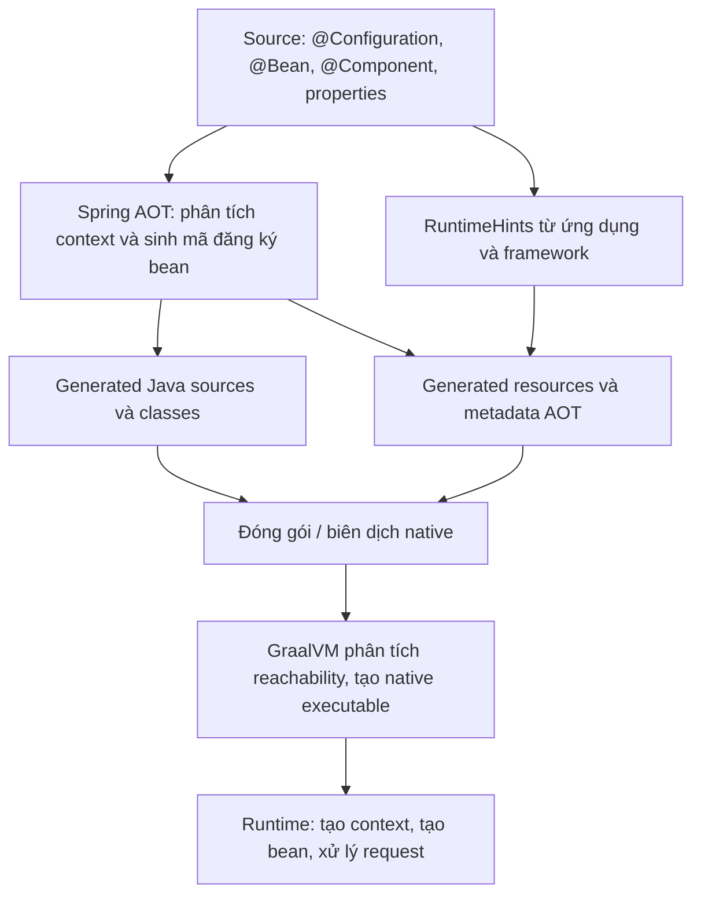
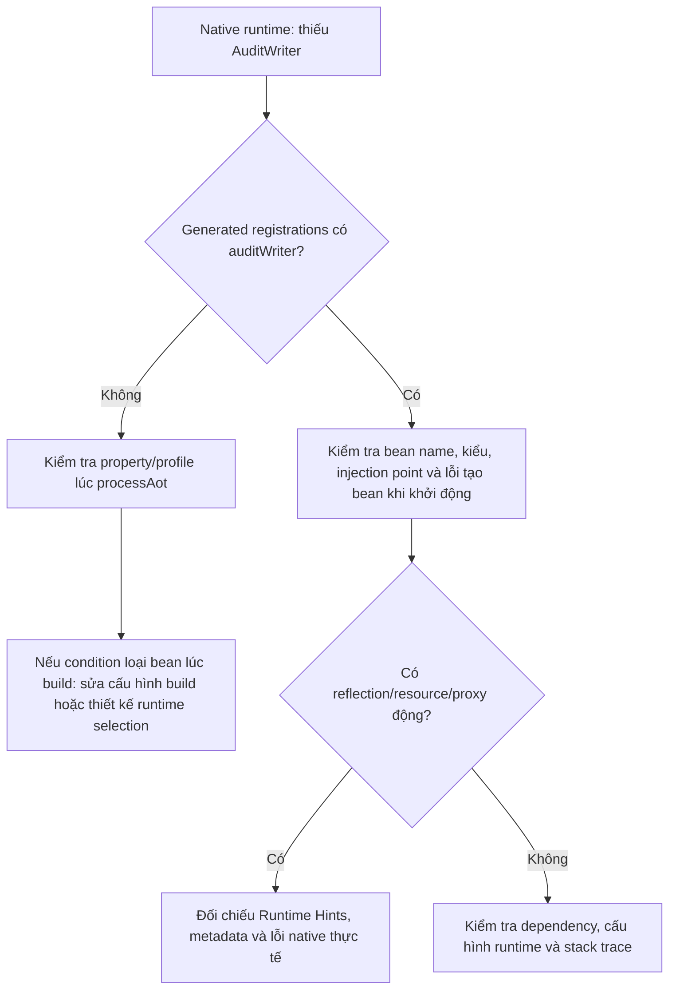

# Đọc mã, lớp và metadata được sinh để giải thích hành vi ứng dụng

Khi chạy Spring Boot bằng GraalVM Native Image, một phần công việc Spring thường thực hiện lúc khởi động JVM đã được chuyển sang giai đoạn **Spring Ahead-of-Time (AOT)**. Để hiểu vì sao một bean được tạo, một điều kiện cấu hình không còn tác dụng như mong đợi, hoặc reflection hoạt động trên JVM nhưng lỗi trong binary native, ta cần biết cách **đọc sản phẩm do AOT sinh ra**: mã Java, các lớp được biên dịch từ mã ấy và metadata cung cấp cho GraalVM.

Bài học thuộc chương **Spring AOT** của mô-đun `SPRING_BOOT_NATIVE_IMAGE`. Mục tiêu là lần theo mối quan hệ từ mã ứng dụng đến cấu trúc Spring context đã được chuẩn bị trước, xác định ranh giới build time/runtime và biết phải mở loại artifact nào khi cần giải thích hành vi native. Đây cũng là cơ sở để thực hành build Maven/Gradle, xử lý reflection/resource, kiểm thử tương thích và vận hành container native.

## 1. Ta đang đọc đầu ra của bước nào?



Ba thành phần có vai trò khác nhau:

| Thành phần | Mô tả | Trả lời câu hỏi nào? |
| --- | --- | --- |
| **Generated Java source** | Mã do Spring AOT tạo để khởi tạo `ApplicationContext`, đăng ký bean definitions, cấu hình các factory/supplier và tối ưu một số thao tác framework. | Spring đã biết những bean nào? Đăng ký và tạo chúng theo đường đi nào? |
| **Generated classes** | Bytecode được biên dịch từ generated Java; native compiler phân tích cùng với mã ứng dụng và thư viện. | Mã sinh đã được biên dịch thành những lớp nào? Có tên lớp/hàm nào cho phép truy ngược về source? |
| **AOT/native metadata** | Thông tin cho những khả năng động như reflection, resource, proxy hay serialization; có thể đến từ Spring, thư viện hoặc cấu hình bổ sung. | Native Image có được phép truy cập một thành viên qua reflection, đưa resource vào binary hoặc tạo proxy không? |

**Spring AOT không phải là GraalVM Native Image compiler.** Spring AOT chuẩn bị cấu trúc ứng dụng và hints; GraalVM tiếp tục phân tích toàn chương trình, loại bỏ mã không thể tới được và tạo executable. Vì vậy, **có tên trong generated source không đồng nghĩa mọi dòng bytecode cuối cùng đều được giữ nguyên trong binary**. Ngược lại, việc không thấy một lớp trong file generated cũng không đủ chứng minh lớp ấy vắng mặt: lớp có thể được gọi trực tiếp từ mã ứng dụng hoặc được cung cấp bởi framework/thư viện.

## 2. Ví dụ xuyên suốt: dự đoán Spring sẽ tạo những gì

Giả sử có ứng dụng đơn giản:

```java
package com.example.aotdemo;

import org.springframework.boot.SpringApplication;
import org.springframework.boot.autoconfigure.SpringBootApplication;

@SpringBootApplication
public class AotDemoApplication {
    public static void main(String[] args) {
        SpringApplication.run(AotDemoApplication.class, args);
    }
}
```

Một cấu hình định nghĩa hai bean:

```java
package com.example.aotdemo;

import java.time.Clock;
import org.springframework.boot.autoconfigure.condition.ConditionalOnProperty;
import org.springframework.context.annotation.Bean;
import org.springframework.context.annotation.Configuration;

@Configuration(proxyBeanMethods = false)
class DemoConfiguration {

    @Bean
    Clock applicationClock() {
        return Clock.systemUTC();
    }

    @Bean
    @ConditionalOnProperty(name = "feature.audit.enabled", havingValue = "true")
    AuditWriter auditWriter() {
        return new AuditWriter();
    }
}

class AuditWriter {
    void write(String message) {
        System.out.println("AUDIT: " + message);
    }
}
```

Và một component sử dụng `Clock`:

```java
package com.example.aotdemo;

import java.time.Clock;
import java.time.Instant;
import org.springframework.stereotype.Service;

@Service
class TimeService {
    private final Clock clock;

    TimeService(Clock clock) {
        this.clock = clock;
    }

    String now() {
        return Instant.now(clock).toString();
    }
}
```

Sau khi xử lý AOT, ta muốn xác minh ba dự đoán:

1. Spring đã biết cách đăng ký `applicationClock` và `timeService` mà không cần làm lại toàn bộ quá trình quét và suy luận như lúc khởi động JVM thông thường.
2. Cơ chế sinh mã có thể thể hiện cách cung cấp `Clock` cho constructor của `TimeService` hoặc cho phương thức factory tương ứng.
3. `auditWriter` phụ thuộc vào `feature.audit.enabled` trong **môi trường xử lý AOT**. Nếu điều kiện không khớp ở thời điểm ấy, không nên kỳ vọng đổi property ở lần chạy native sẽ làm xuất hiện bean đã bị loại.

Điều quan trọng là đọc **file thực tế do phiên bản Spring Boot đang dùng sinh ra**, thay vì cố ghi nhớ tên lớp hay lời gọi nội bộ; các chi tiết sinh mã có thể thay đổi giữa các phiên bản.

## 3. Sinh artifact AOT để kiểm tra

Đầu ra AOT có thể được tạo trước khi biên dịch hoàn chỉnh thành native executable. Điều này giúp kiểm tra bean graph và hints mà chưa phải đợi toàn bộ bước native compilation vốn tốn tài nguyên.

### 3.1. Maven

Với dự án Spring Boot 3.x có cấu hình `spring-boot-maven-plugin` phù hợp:

```bash
./mvnw spring-boot:process-aot
```

Đầu ra thường nằm dưới `target/spring-aot/main/`, chẳng hạn:

```text
target/
└── spring-aot/
    └── main/
        ├── sources/       # Java source do AOT sinh
        ├── resources/     # Tài nguyên và metadata do AOT sinh
        └── classes/       # Class do quá trình build tạo ra (tùy cấu hình)
```

Build native Maven thường dùng:

```bash
./mvnw -Pnative native:compile
```

Profile `native`, plugin version, vị trí output và tên executable phụ thuộc dự án. Khi cần xem mã sinh, nên chạy mục tiêu `process-aot` trước và kiểm tra thư mục thực tế trong log build.

### 3.2. Gradle

Với dự án Spring Boot/Gradle đã áp dụng các plugin tương ứng:

```bash
./gradlew processAot
```

Ở các phiên bản phổ biến, generated source, resources và classes nằm trong những thư mục tương tự:

```text
build/
└── generated/
    ├── aotSources/
    ├── aotResources/
    └── aotClasses/
```

Để build native bằng GraalVM Native Build Tools:

```bash
./gradlew nativeCompile
```

Các đường dẫn trên chỉ là **vị trí thường gặp**, không phải hợp đồng bất biến của mọi plugin version. Nếu không có file ở đúng đường dẫn mẫu, hãy xem kết quả task, cấu hình build và thư mục output được báo trong log trước khi kết luận AOT không chạy.

### 3.3. Tìm file đáng đọc

Ví dụ trong terminal có `rg` (ripgrep), sau khi chạy AOT:

```bash
# Maven: xem các lớp/cấu hình liên quan đến ví dụ
rg -n 'TimeService|DemoConfiguration|auditWriter|applicationClock' target/spring-aot

# Gradle: tìm trong các nguồn và tài nguyên được sinh
rg -n 'TimeService|DemoConfiguration|auditWriter|applicationClock' build/generated
```

Có thể tìm thêm theo tên hậu tố hay gặp như `__BeanDefinitions`, `__BeanFactoryRegistrations` hoặc `__ApplicationContextInitializer`. Các hậu tố này là **gợi ý tìm kiếm**, không phải quy tắc tên file luôn đúng. Đặc biệt, tên package và định dạng metadata không nên được suy từ một ví dụ cũ.

## 4. Cách đọc generated source theo một đường thực thi

Khi tìm thấy các file `.java` do AOT sinh, hãy đi theo trình tự: **initializer → đăng ký bean definition → bean instance supplier/factory → dependency injection**.

### 4.1. Context initializer làm gì?

Một lớp khởi tạo do AOT sinh có nhiệm vụ kết nối mã đã sinh với quá trình dựng Spring context. Nội dung có thể gọi tới những lớp hỗ trợ đăng ký các bean definitions và cấu hình hạ tầng. Khi đọc file, nên ghi nhận:

- Nó gọi những lớp đăng ký bean nào?
- Có thấy đăng ký `DemoConfiguration`, `TimeService` hoặc các bean từ auto-configuration không?
- Có phần nào khởi tạo property source, bean factory hay hạ tầng cần thiết trước khi tạo các bean thông thường không?

Đừng xem toàn bộ lời gọi trong initializer là **thao tác đã chạy lúc build**. Mã sinh là mã **sẽ thực thi khi tiến trình khởi động** để tái tạo cấu trúc Spring đã được chuẩn bị trước.

### 4.2. Bean definition không phải bean instance

Trong generated code, bạn có thể bắt gặp những yếu tố tương tự sau:

```java
// MÃ MINH HỌA Ý TƯỞNG — không phải bản trích chính xác từ Spring AOT.
// Tên API, phương thức và cách tổ chức thực tế thay đổi theo phiên bản.

void registerBeanDefinitions(/* BeanDefinitionRegistry registry */) {
    // Đăng ký định nghĩa cho bean "timeService".
    // Chỉ dẫn constructor/factory có thể được sinh ra hoặc tham chiếu ở đây.

    // Đăng ký định nghĩa cho bean "applicationClock".
    // Khi context khởi động, Spring dùng factory tương ứng để tạo Clock.
}
```

Đoạn trên cố ý mô tả **vai trò**, không nhằm đưa ra một implementation có thể biên dịch. Trong output thật, hãy tìm các cấu trúc như `RootBeanDefinition`, `BeanInstanceSupplier`, đăng ký bean vào registry, lời gọi constructor hoặc factory method, và các hàm tạo instance được sinh ra. Hãy phân biệt:

| Thứ xuất hiện trong generated code | Ý nghĩa | Điều **không** thể suy ra chỉ từ đó |
| --- | --- | --- |
| Bean name / bean definition | Spring dự kiến có thể tạo và quản lý bean ấy trong context. | Đối tượng bean đã được tạo sẵn ở build time. |
| Constructor hoặc instance supplier | Đường tạo instance đã được xác định trước. | Phương thức nghiệp vụ đã được chạy ở build time. |
| Thông tin dependency / lời gọi lấy dependency | Spring biết cần liên kết những thành phần nào. | Mọi dependency thực tế đã kết nối thành công ở runtime. |
| Factory method `@Bean` | Spring sẽ gọi factory theo cách đã chuẩn bị. | Kết quả factory là hằng số hoặc luôn giống nhau ở mọi môi trường. |
| Tham chiếu tới bean từ auto-configuration | Cấu hình tự động đã tham gia vào bean graph. | Mọi khả năng tùy chọn của starter đều được giữ trong native binary. |

Ví dụ, `Clock.systemUTC()` nằm trong factory method. Đầu ra AOT có thể biết **phương thức nào** tạo bean, nhưng chiếc `Clock` thông thường vẫn được tạo trong quá trình khởi động context của tiến trình. `TimeService.now()` tiếp tục trả thời gian thay đổi theo mỗi lần gọi.

### 4.3. Truy ngược từ lớp sinh ra mã nguồn của ứng dụng

Nếu một file được đặt tên tương tự `TimeService__BeanDefinitions.java`, thử thực hiện chuỗi đọc này:

1. Tìm chuỗi `TimeService` để xác nhận kiểu bean đang được đăng ký.
2. Tìm cách BeanDefinition được xây dựng và instance supplier được chọn.
3. Tìm tham số `Clock` và cách Spring yêu cầu bean dependency từ context/bean factory.
4. Truy ngược mã ứng dụng: `TimeService(Clock clock)`, `@Bean Clock applicationClock()`.
5. Kết luận: AOT đã biết đường tạo bean, còn giá trị từ clock và luồng xử lý request là dữ liệu runtime.

Đây là kỹ thuật hiệu quả hơn việc mở hàng trăm generated file ngẫu nhiên, vì mỗi dòng đọc đều phục vụ một câu hỏi có thể kiểm chứng.

## 5. Điều kiện và profile: tìm lý do bean xuất hiện hoặc biến mất

Xét `auditWriter()` trong ví dụ. Nếu xử lý AOT diễn ra khi `feature.audit.enabled` không bằng `true`, condition có thể loại bean này khỏi cấu trúc đã sinh. Bạn sẽ thấy bằng chứng từ việc **bean definition không được đăng ký** trong kết quả AOT, đồng thời cần đối chiếu điều kiện tại thời điểm build.

| Tình huống | Dự kiến ở generated bean registrations | Hành vi cần hiểu |
| --- | --- | --- |
| Build AOT với `feature.audit.enabled=true` | Có thể xuất hiện bean definition cho `auditWriter`. | Runtime dùng bean theo cấu trúc đã chuẩn bị; không mặc định coi điều kiện sẽ được đánh giá lại như JVM thường. |
| Build AOT khi property bị thiếu và `matchIfMissing` là mặc định (`false`) | Bean có thể bị loại khỏi registrations. | Đặt property thành `true` chỉ khi chạy native không đủ để thêm một bean đã bị loại lúc AOT. |
| Bean luôn được đăng ký, chỉ nhận `@Value` hoặc `@ConfigurationProperties` làm giá trị | Bean definition có thể giữ nguyên giữa hai môi trường. | Giá trị runtime thường thay đổi được giữa các lần khởi động nếu không tác động đến lựa chọn bean/đường mã. |

Với `@Profile`, `@ConditionalOnClass`, `@ConditionalOnProperty` và các condition được phân tích khi AOT, cần xét cả profile, classpath và properties **tại lúc AOT chạy**. Với ứng dụng native, Spring Boot có những ràng buộc về việc thay đổi profile/condition giữa build time và runtime. Một số logic điều kiện do ứng dụng tự viết còn có thể không tương thích tốt với AOT nếu phụ thuộc vào thứ chỉ tồn tại khi chạy.

Lưu ý hai giới hạn của cách đọc:

1. **Không thấy một bean trong một file chưa đủ để kết luận bean vắng mặt.** Có thể bạn đang xem sai tập output, bean đến từ configuration khác, hoặc việc đăng ký nằm trong file sinh khác.
2. **Thấy tên class không chứng minh một bean đã được đăng ký.** Tên có thể nằm trong metadata, code path tham chiếu hoặc annotation khác. Cần tìm đúng đoạn đăng ký bean definition và kiểm tra điều kiện tương ứng.

Trong quá trình giải thích lỗi, nên lưu lại ba bằng chứng: **thuộc tính/profile dùng khi AOT**, **file/đoạn đăng ký bean**, và **hành vi quan sát khi chạy binary**.

## 6. Đọc native metadata: thứ không thể suy ra từ lời gọi trực tiếp

Spring AOT có thể sinh hoặc tổng hợp **Runtime Hints** cho những thao tác mà GraalVM không tự suy ra chắc chắn từ call graph. Các thư viện cũng có thể cung cấp metadata riêng, và native-image build tool có thể lấy metadata từ những nguồn khác. Vì vậy, vị trí và định dạng cuối cùng phụ thuộc phiên bản Spring/GraalVM và cách cấu hình dự án.

Các dạng cần biết:

| Loại | Thường giúp native compiler xử lý | Dấu hiệu cần tìm |
| --- | --- | --- |
| Reflection | Constructor, method, field, annotation metadata hoặc member được truy cập động. | Loại và member có được cho phép truy cập không? Chỉ đủ query metadata hay cần invoke? |
| Resource | File trên classpath cần mang theo vào native image. | Pattern có khớp đúng đường dẫn tài nguyên đang đọc không? |
| JDK dynamic proxy | Proxy động cho tập interface cần thiết. | Tập interface mong muốn có được khai báo/đăng ký không? |
| Serialization | Loại được cơ chế Java serialization hay cơ chế tương ứng truy cập động. | Kiểu dữ liệu và thành phần cần thiết đã được đăng ký chưa? |
| JNI | Kiểu và thành viên được mã native bên ngoài truy cập. | Có metadata tương ứng cho đường JNI không? |

Trong một số phiên bản/toolchain, bạn có thể thấy các file JSON như:

```text
META-INF/native-image/...
    reflect-config.json
    resource-config.json
    proxy-config.json
    serialization-config.json
    jni-config.json
```

Đây là **ví dụ những tên file metadata thường gặp**, không bảo đảm mọi dự án sinh đủ năm file hoặc đặt chúng ở đúng đường dẫn ấy. Toolchain mới cũng có thể dùng cách đóng gói metadata khác. Hãy đọc artifact thực tế và log của native-image build; không suy luận rằng file không tồn tại tức là không có metadata tương ứng.

### 6.1. Ví dụ phản chiếu: reflection được phép làm đến đâu?

Giả sử ứng dụng nhận tên loại từ cấu hình rồi gọi:

```java
Class<?> type = Class.forName(className);
Object instance = type.getDeclaredConstructor().newInstance();
```

Với tên lớp chỉ được biết lúc chạy, phân tích tĩnh có thể không xác định đầy đủ constructor cần giữ. Có thể bổ sung hint bằng API Spring:

```java
package com.example.aotdemo;

import org.springframework.aot.hint.MemberCategory;
import org.springframework.aot.hint.RuntimeHints;
import org.springframework.aot.hint.RuntimeHintsRegistrar;
import org.springframework.context.annotation.Configuration;
import org.springframework.context.annotation.ImportRuntimeHints;

@Configuration(proxyBeanMethods = false)
@ImportRuntimeHints(DynamicTypeHints.class)
class DynamicTypeConfiguration { }

class DynamicTypeHints implements RuntimeHintsRegistrar {
    @Override
    public void registerHints(RuntimeHints hints, ClassLoader classLoader) {
        hints.reflection().registerType(
                ReportPayload.class,
                MemberCategory.INVOKE_DECLARED_CONSTRUCTORS
        );
        hints.resources().registerPattern("templates/report.txt");
    }
}

class ReportPayload {
    ReportPayload() { }
}
```

Ví dụ minh họa một constructor không `public`, đúng với cách gọi `getDeclaredConstructor()`; nếu muốn gọi qua Java reflection từ một lớp khác không có quyền truy cập, còn phải xét quy tắc truy cập Java và `setAccessible(true)` khi phù hợp. **Hint cho phép GraalVM giữ metadata**, nhưng không tự nới lỏng mọi quy tắc truy cập của ngôn ngữ Java.

Khi đọc metadata reflection (ví dụ định dạng JSON truyền thống), có thể gặp nội dung tương tự:

```json
[
  {
    "name": "com.example.aotdemo.ReportPayload",
    "allDeclaredConstructors": true
  }
]
```

Đây là **ví dụ dạng dữ liệu**, không phải cam kết rằng Spring sẽ tạo chính xác đoạn JSON ấy. Cần phân biệt quyền **truy vấn metadata** với quyền **gọi constructor/method** trong những API và định dạng hỗ trợ mức phân quyền khác nhau. Đừng thêm mọi member một cách vô điều kiện vì điều đó làm tăng lượng metadata và có thể ảnh hưởng kích thước native image.

### 6.2. Resource: file được đọc từ đâu?

`hints.resources().registerPattern("templates/report.txt")` giúp khai báo tài nguyên classpath cần mang vào binary. Nếu ứng dụng dùng:

```java
try (var input = getClass().getResourceAsStream("/templates/report.txt")) {
    if (input == null) {
        throw new IllegalStateException("Không tìm thấy report template");
    }
    // Đọc nội dung từ input...
}
```

hãy kiểm tra file nguồn ở `src/main/resources/templates/report.txt`, output resources của AOT và khả năng đọc resource khi chạy native. File nhúng vào binary thường **không thay đổi** chỉ vì file cùng tên ở filesystem được sửa sau build. Nếu cần thay template lúc vận hành, hãy thiết kế đọc file bên ngoài (`Path`, volume container, object storage...) và tách đường đọc ấy khỏi classpath resource.

Một resource hint không chứng minh nội dung file đã tồn tại lúc build, và một file có mặt trong source tree cũng chưa đủ chứng minh nó được nhúng đúng. Cần kiểm tra cả **pattern**, **artifact thực tế** và **kết quả đọc trong runtime**.

### 6.3. Proxy và serialization

Nếu ứng dụng chủ động gọi `Proxy.newProxyInstance(...)`, cần kiểm tra tập interface proxy và hints phù hợp. Spring tự sinh nhiều proxy cần thiết cho AOP, transaction và các tính năng framework, nên chỉ bổ sung hint khi có đường truy cập động mà quá trình AOT chưa nhận ra.

Tương tự, JSON mapping thông thường với Jackson và Java native serialization không hoàn toàn giống nhau: cấu hình metadata cần dựa trên **cơ chế framework thực sự sử dụng**. Không nên nhìn thấy lỗi JSON rồi lập tức thêm Java serialization hint, hoặc ngược lại.

## 7. Đọc generated classes và những giới hạn quan sát

Khi `.java` đã được biên dịch, các lớp sinh tương ứng có thể xuất hiện trong output classes. Nếu có JDK và cần so khớp, dùng `javap` để xem chữ ký hoặc bytecode của một lớp đã biết:

```bash
# Minh họa: thay <ten-lop> và classpath bằng giá trị xuất hiện trong dự án.
javap -classpath target/spring-aot/main/classes -p '<ten-lop>'
```

Bạn cũng có thể xem source sinh thay vì bytecode; **source là điểm bắt đầu tốt nhất** để đọc bean registrations. Khi compiler tối ưu và gộp mã vào native executable, không thể giả định rằng từng class/method trong output JVM còn giữ nguyên hình dạng trong binary. Native Image không phải JAR có thể mở và duyệt theo cùng cách.

Một số file/classes sinh ra hỗ trợ những phần nội bộ của Spring, chẳng hạn registration của auto-configuration hoặc xử lý bean properties. Đừng gán ý nghĩa nghiệp vụ cho tên generated class chỉ vì nó dài hoặc có hậu tố lạ. Hãy tìm call site, bean name, loại đích và factory/supplier của nó.

## 8. Điều tra một lỗi cụ thể bằng bằng chứng AOT

Giả sử bản JVM có endpoint ghi audit, nhưng native binary chạy với `--feature.audit.enabled=true` lại báo không có bean `AuditWriter`.



Các bước điều tra có thể thực hiện theo thứ tự:

1. **Xác nhận build nào đang chạy:** version code, profile, properties tại lúc AOT, toolchain và binary/container image tương ứng.
2. **Tìm artifact sinh:** tìm `auditWriter` trong toàn bộ generated source/resources, xác định nơi condition được xử lý và nơi có (hoặc không có) bean registration.
3. **Tách hai loại thay đổi:** `feature.audit.enabled` quyết định cấu trúc bean; các giá trị như địa chỉ database, port hoặc timeout của bean đã tồn tại thường có thể cung cấp lúc khởi động.
4. **Nếu bean đã có registration:** đọc đường khởi tạo và lỗi thực tế; không tự động quy mọi thất bại cho AOT conditions. Constructor, dependency, quyền truy cập reflection và resource đều có thể là nguyên nhân.
5. **Nếu lỗi liên quan metadata:** kiểm tra `RuntimeHintsRegistrar`, thư viện/framework và metadata được native compiler tiếp nhận; sửa khai báo tối thiểu, build lại và chạy đúng đường sử dụng.

Một cách ghi nhận kết quả hữu ích là lập bảng:

| Câu hỏi | Bằng chứng cần lưu | Kết luận được phép rút ra |
| --- | --- | --- |
| AOT có đăng ký bean không? | File generated và đoạn đăng ký đúng bean name. | Xác định cấu trúc bean mà AOT chuẩn bị. |
| Vì sao bean vắng mặt? | Điều kiện nguồn + cấu hình lúc AOT + kết quả đăng ký. | Có cơ sở kết luận condition đã loại bean. |
| Vì sao reflection lỗi? | Stack trace native + điểm gọi reflection + metadata/hints. | Xác định khả năng truy cập động nào thiếu. |
| Vì sao template không đọc được? | Đường dẫn classpath, resource pattern, resource thực tế và kết quả chạy. | Phân biệt resource không nhúng, sai đường dẫn hoặc lỗi đọc. |
| Vì sao JVM và native cho kết quả khác nhau? | Cùng dữ liệu, cùng chức năng, cấu hình build/runtime, log cả hai bản. | Khoanh vùng khác biệt do AOT, metadata hay môi trường. |

## 9. Thực hành tự kiểm chứng trên một project nhỏ

Hãy dùng project Spring Boot 3.x có thể chạy JVM và có native build toolchain phù hợp. Các bước bên dưới là **hướng dẫn thực hành**, không phải kết quả đo đã được chạy sẵn.

**Bước 1 — Nhìn thấy mã sinh.** Thêm `TimeService`, `DemoConfiguration` và `AuditWriter` như ví dụ. Chạy `spring-boot:process-aot` (Maven) hoặc `processAot` (Gradle). Tìm generated source và trả lời: đâu là initializer, đâu là bean definition, cách tạo `TimeService` được biểu diễn thế nào?

**Bước 2 — Thay condition trước khi build.** Sinh AOT với `feature.audit.enabled=false` (hoặc thiếu property), rồi sinh lại với `true` trong một build mới. So sánh generated registrations. Điều kiện muốn kiểm tra ở đây là **thay đổi bean graph tại thời điểm AOT**. Đừng chỉ đổi command-line parameter khi chạy và kết luận từ một binary cũ.

**Bước 3 — Thử runtime value.** Thêm một bean luôn hiện diện và inject `@Value("${app.message:default}")`. Chạy cùng binary native hai lần với hai giá trị `--app.message=...`, quan sát giá trị mà bean nhận ở lúc khởi động. Cùng binary có thể nhận giá trị khác nhau miễn là property ấy không chi phối cấu trúc bean đã đóng ở build time.

**Bước 4 — Kiểm tra reflection/resource.** Viết một đường gọi thực tế dùng `Class.forName` với tên lớp chỉ biết khi chạy hoặc đọc `/templates/report.txt`. Nếu cần, thêm `RuntimeHintsRegistrar`, sinh AOT và so sánh metadata trước/sau. Không đoán từ tên file JSON: kiểm thử đúng đường code trên bản native.

**Bước 5 — So sánh JVM và native.** Chạy các request tương đương, đối chiếu output, log khởi tạo, lỗi và trạng thái bean. Sau khi chức năng tương thích, mới đo thời gian cold start, RSS/bộ nhớ tiến trình và hành vi chịu tải trong điều kiện tương đương. Artifact AOT giúp **giải thích** cấu trúc chương trình; chỉ phép đo runtime mới cho biết lợi ích hiệu năng thực tế.

## 10. Các lỗi diễn giải thường gặp

| Nhận định sai | Cách đọc đúng |
| --- | --- |
| “Có generated bean definition nghĩa là bean được tạo từ lúc build.” | Definition/factory mô tả cách tạo; bean thông thường vẫn được khởi tạo khi context runtime chạy. |
| “Không thấy lớp trong `__BeanDefinitions` nghĩa là lớp vắng khỏi native image.” | Lớp có thể được gọi bởi mã khác hoặc nằm trong artifact khác. Phải xét reachability và build thực tế. |
| “Có `reflect-config.json` là mọi reflection đều hoạt động.” | Chỉ những loại/member đã được nhận biết hoặc khai báo đúng mới có khả năng truy cập tương ứng. |
| “Không có `reflect-config.json` nghĩa là không có hint.” | Metadata có thể được đóng gói hoặc cung cấp theo định dạng/nguồn khác, tùy toolchain. |
| “Đổi property runtime luôn đổi bean graph.” | Condition được AOT xử lý có thể đã cố định việc đăng ký bean. |
| “AOT source là source duy nhất mà native compiler dùng.” | Compiler còn phân tích mã ứng dụng, thư viện, JDK và metadata reachability khác. |
| “Mọi file trong `resources/` sẽ tự cập nhật sau build.” | Classpath resource đã nhúng vào binary không phải file ngoài được đọc lại tự động. |
| “Class generated nào cũng đại diện cho một tính năng nghiệp vụ.” | Nhiều class do Spring sinh phục vụ đăng ký bean và hạ tầng framework. |

## 11. Checklist khi đọc một bản build AOT

- **Xác nhận phạm vi:** đúng phiên bản code, Spring Boot, profile và properties dùng khi `processAot`?
- **Tìm đường vào:** đã xác định initializer hoặc lớp registration tổng hợp của ứng dụng?
- **Đọc đúng tầng:** đang xem generated Java, bytecode, metadata native hay log của native compiler?
- **Truy vết bean:** có tên bean, kiểu, đường tạo instance và dependency tương ứng?
- **Đối chiếu điều kiện:** bean đó có phụ thuộc điều kiện/profile được AOT xử lý không?
- **Kiểm tra khả năng động:** reflection, resource, proxy, serialization hoặc JNI có hint/metadata phù hợp không?
- **Xác minh runtime:** nhận định từ generated files có khớp với kết quả chạy bản native thực tế không?
- **Lưu bằng chứng tái hiện:** command build, cấu hình đầu vào, đường dẫn artifact và log lỗi có đủ để người khác điều tra lại không?

### Câu hỏi tự đánh giá

1. Tại sao có `BeanInstanceSupplier` hoặc một factory trong generated source mà vẫn không thể nói bean đã được tạo lúc build?
2. Nếu một `@ConditionalOnProperty` loại bean khi `processAot`, vì sao sửa property khi chạy binary thường không thể khôi phục bean ấy?
3. Khi native lỗi `Class.forName` hoặc `getDeclaredConstructor().newInstance()`, bạn kiểm tra thêm artifact nào ngoài generated bean definitions?
4. Tại sao một file classpath resource có mặt trong source tree nhưng vẫn có thể không đọc được từ native image?
5. Cần bằng chứng nào để kết luận một sai khác JVM/native đến từ xử lý AOT, thay vì nguồn cấu hình hoặc dependency không khả dụng ở runtime?

Đọc sản phẩm của Spring AOT là quá trình **đối chiếu ý định trong mã nguồn với cấu trúc Spring đã sinh và khả năng native compiler được cung cấp**. Khi phân biệt được generated bean registrations, runtime hints và trạng thái thực tế của tiến trình, bạn có thể giải thích hành vi ứng dụng bằng chứng cứ, khoanh vùng lỗi tương thích trước khi đóng gói container và quyết định chính xác phần nào cần rebuild, phần nào chỉ cần thay đổi cấu hình vận hành.
