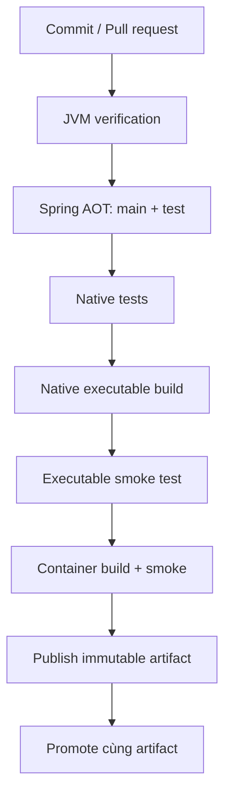

# Tách các cổng kiểm tra JVM, AOT, native build và smoke test

Một pipeline CI/CD cho Spring Boot Native Image cần kiểm tra nhiều giai đoạn khác nhau. Test chạy trên JVM xác nhận logic và hợp đồng ứng dụng; Spring AOT xác nhận context có thể được phân tích và sinh mã; native build xác nhận GraalVM có thể tạo executable; native test và smoke test xác nhận các đường chạy quan trọng hoạt động trong môi trường Native Image.

Các giai đoạn này liên quan nhưng không thay thế nhau. Một JVM test pass không chứng minh reflection/resource metadata đầy đủ. AOT processing thành công không chứng minh native compiler tạo được binary. Native compilation thành công cũng không chứng minh executable khởi động được, kết nối dependency hoặc trả response đúng.

Bài học thuộc chương **CI/CD** của mô-đun `SPRING_BOOT_NATIVE_IMAGE`. Ta sẽ thiết kế pipeline theo các cổng kiểm tra có đầu vào, đầu ra và điều kiện pass rõ ràng; ánh xạ task Maven/Gradle; tổ chức pull request, main branch và release; lưu artifact; chạy smoke test trên executable/container; và điều tra lỗi theo đúng giai đoạn.

## 1. Vì sao cần tách các cổng CI?

Mỗi bước phát hiện một nhóm lỗi khác nhau:

| Cổng | Kiểm tra | Ví dụ lỗi có thể phát hiện |
| --- | --- | --- |
| JVM verification | Compile, unit/integration tests, static checks | Logic sai, API contract thay đổi, dependency lỗi |
| Spring AOT | Phân tích main/test ApplicationContext và sinh AOT assets | Bean condition không tương thích AOT, dynamic bean registration không hỗ trợ |
| Native tests | Chạy test suite trong Native Image | Reflection, proxy, resource, serialization thiếu metadata |
| Native build | Biên dịch executable ứng dụng | Native compiler error, unsupported feature, toolchain mismatch |
| Executable smoke | Khởi động binary và gọi endpoint | Runtime initialization, config, file permission, port hoặc dependency lỗi |
| Container smoke | Chạy image theo cách triển khai | Sai entrypoint, thiếu file, UID không có quyền, sai environment |
| Release gate | Kiểm tra artifact và metadata phát hành | Sai version, sai architecture, thiếu checksum/SBOM hoặc artifact không được kiểm thử |

Một luồng logic:



Tách gate giúp pipeline dừng sớm khi lỗi thuộc compile hoặc test JVM, đồng thời vẫn giữ kiểm tra native ở những thay đổi có ảnh hưởng đến AOT, reachability, resource hoặc runtime.

## 2. Định nghĩa điều kiện pass/fail trước khi cấu hình pipeline

Mỗi gate cần có một điều kiện pass có thể kiểm tra tự động.

| Gate | Điều kiện pass tối thiểu | Điều kiện fail |
| --- | --- | --- |
| JVM | Build thành công; test được phát hiện và chạy; không có test failure | Compile/test failure, test suite rỗng ngoài dự kiến |
| AOT | Main và test AOT processing kết thúc thành công | Context initialization hoặc AOT generation lỗi |
| Native test | Native test executable được tạo và test thực sự chạy | Native compile/test runtime lỗi hoặc không phát hiện test |
| Native build | Executable đúng tên/target được tạo | GraalVM build thất bại hoặc thiếu output |
| Executable smoke | Process ready và endpoint nghiệp vụ trả kết quả mong đợi | Timeout, process exit, HTTP error hoặc response sai |
| Container smoke | Image khởi động với config/resource/permission tương tự production | Image không start, thiếu file hoặc endpoint lỗi |
| Publish | Artifact gắn với commit/version và có report đi kèm | Artifact không truy xuất được nguồn build hoặc thiếu kiểm tra bắt buộc |

Đặc biệt, log có dòng BUILD SUCCESS không đủ để chứng minh native test đã chạy. Hãy kiểm tra test count, report và exit code. Một task bị skip hoặc không tìm thấy test cần được xem xét rõ ràng.

## 3. Tổ chức pipeline theo loại thay đổi

Native compilation thường tốn thời gian và tài nguyên hơn JVM tests. Có thể phân tầng pipeline mà vẫn bảo đảm các thay đổi rủi ro cao đi qua native gates.

| Sự kiện | Gate nên chạy | Mục đích |
| --- | --- | --- |
| Pull request thông thường | JVM verification, AOT, native tests theo chính sách dự án | Phát hiện sớm lỗi chức năng và tương thích |
| Pull request thay đổi Runtime Hints/resource/class initialization | JVM, AOT main/test, native tests, native build và smoke liên quan | Bảo vệ các đường dynamic access |
| Merge vào main | Đầy đủ native build và executable/container smoke | Tạo artifact ứng viên có thể triển khai |
| Tag/release | Build artifact bất biến, test lại đúng artifact, scan và publish | Phát hành có thể truy vết |
| Nightly | Full integration, native tests, benchmark, nhiều target | Phát hiện lỗi theo thời gian và môi trường |
| Dependency/toolchain upgrade | Toàn bộ AOT/native compatibility gates | Phát hiện thay đổi reachability và runtime |

Không nên chỉ chạy native build ở release cuối cùng nếu pull request có thể thay đổi Runtime Hints hoặc cấu hình AOT. Có thể dùng path filter để chọn gate, nhưng cần tránh bỏ sót file dùng chung như build script, dependency catalog hoặc cấu hình native.

## 4. Ánh xạ gate với Maven và Gradle

Tên task phụ thuộc plugin và phiên bản. Bảng dưới đây là các lệnh phổ biến trong project đã cấu hình Spring Boot AOT và GraalVM Native Build Tools tương ứng.

| Gate | Maven | Gradle |
| --- | --- | --- |
| JVM tests | `./mvnw -B verify` | `./gradlew test check` |
| Main AOT | `./mvnw spring-boot:process-aot` | `./gradlew processAot` |
| Test AOT | `./mvnw spring-boot:process-test-aot` | `./gradlew processTestAot` |
| Native tests | `./mvnw -PnativeTest test` khi đã cấu hình profile | `./gradlew nativeTest` |
| Native application build | `./mvnw -Pnative native:compile` khi đã cấu hình profile | `./gradlew nativeCompile` |
| Chạy application native | Chạy executable được tạo bởi native plugin | `./gradlew nativeRun` |

Một số lưu ý:

- Maven profile `native` và `nativeTest` phải được khai báo trong project; tên profile không tự xuất hiện chỉ vì đã thêm Spring Boot plugin.
- Native Maven Plugin cần được cấu hình goal và toolchain phù hợp.
- Gradle task `nativeTest` có thể kéo theo AOT/test processing theo dependency graph của plugin.
- Không thêm dependency task thủ công trước khi kiểm tra plugin đã nối task hay chưa.
- Khi task không tồn tại, xem plugin ID/version và `tasks --all` hoặc `help --task`.
- Chạy `--dry-run` và `--info` để xác nhận task nào thực sự được thực thi, task nào UP-TO-DATE hoặc SKIPPED.

### 4.1. Chuỗi lệnh Maven tham khảo

Với project Maven đã cấu hình các goal/profile native:

```bash
# Gate 1: JVM verification
./mvnw -B verify

# Gate 2: Spring AOT
./mvnw -B spring-boot:process-aot
./mvnw -B spring-boot:process-test-aot

# Gate 3: Native test
./mvnw -B -PnativeTest test

# Gate 4: Native application build
./mvnw -B -Pnative native:compile
```

Nếu project không có profile native test hoặc native build, cần bổ sung cấu hình theo tài liệu của phiên bản plugin đang dùng. Không copy các lệnh này vào CI rồi giả định chúng chạy đúng mà không kiểm tra task/goal.

### 4.2. Chuỗi lệnh Gradle tham khảo

Với project Gradle đã áp dụng Spring Boot Gradle Plugin và Native Build Tools:

```bash
# Gate 1: JVM verification
./gradlew test check

# Gate 2: Spring AOT
./gradlew processAot processTestAot

# Gate 3: Native test
./gradlew nativeTest

# Gate 4: Native application build
./gradlew nativeCompile

# Gate 5: Run native application
./gradlew nativeRun
```

Nếu muốn kiểm tra task graph trước khi chạy:

```bash
./gradlew nativeTest --dry-run
./gradlew nativeTest --info
```

Không kết luận native test pass chỉ từ output task name. Kiểm tra report để xác nhận test được phát hiện và thực thi.

## 5. Chuẩn hóa toolchain và môi trường build

Native build phụ thuộc chặt vào GraalVM, Native Image toolchain, OS và CPU architecture. CI cần pin và ghi lại:

- Java/GraalVM distribution và version.
- Native Image version.
- Spring Boot và Spring Framework versions.
- Maven/Gradle wrapper version.
- Native Build Tools plugin version.
- OS, architecture và libc/base image.
- Build arguments, environment variables và profiles.
- Container builder image nếu dùng Buildpacks.

Ví dụ kiểm tra toolchain trong runner:

```bash
java -version
native-image --version
./mvnw --version
```

Với Gradle:

```bash
java -version
native-image --version
./gradlew --version
```

Dùng Maven/Gradle Wrapper đã commit để CI không vô tình dùng phiên bản build tool cài toàn cục. Pin version của action, container image hoặc runner image theo chính sách repository.

### 5.1. Runner cần đủ tài nguyên

Native compilation có thể dùng nhiều CPU và RAM. Runner quá nhỏ dễ gặp:

- Native compiler bị kill do out-of-memory.
- Build kéo dài hoặc timeout.
- Nhiều job cạnh tranh CPU/RAM làm kết quả không ổn định.
- Disk đầy do cache và artifact lớn.

Chọn runner theo kích thước ứng dụng và đặt timeout phù hợp. Nếu cần giới hạn native build parallelism hoặc heap, cấu hình theo Native Build Tools/GraalVM version đang dùng và ghi lại trong build metadata.

### 5.2. Kiểm soát OS và architecture

Native executable thường gắn với target OS/architecture và có thể phụ thuộc libc. Binary Linux x64 không thể mặc nhiên chạy trên Windows, macOS hoặc Linux ARM64.

Tạo artifact riêng cho từng target, ví dụ:

| Target | Artifact label |
| --- | --- |
| Linux x64 | `linux-x64` |
| Linux ARM64 | `linux-arm64` |
| Windows x64 | `windows-x64` |
| macOS ARM64 | `macos-arm64` |

Cross-compilation có các giới hạn riêng. Nếu chưa thiết lập cross toolchain được hỗ trợ, build trên runner tương ứng target và test executable trong môi trường tương thích.

## 6. Caching: tăng tốc mà không làm mất tính tái lập

Có thể cache dependency và build output để giảm thời gian CI:

- Maven local repository hoặc Gradle dependency cache.
- Gradle build cache nếu đã cấu hình.
- Native build cache nếu plugin/toolchain hỗ trợ và cache key phù hợp.
- Base container layers khi build image.

Cache key cần gắn với các yếu tố ảnh hưởng kết quả, chẳng hạn OS/architecture, JDK/GraalVM version, build tool version, dependency lockfiles và native build configuration.

Không cache artifact native như thể nó có thể dùng chung giữa mọi OS/architecture. Không dùng cache để thay thế việc xác minh build từ source. Với release quan trọng, có thể chạy clean/reproducible build hoặc xác minh artifact từ một job độc lập.

Nếu build đột nhiên pass chỉ khi dùng cache, kiểm tra task inputs/outputs và dependency declarations. Cache hit không nên che một task thiếu input tracking.

## 7. Thiết kế artifact handoff giữa các gate

Một gate tạo output để gate tiếp theo sử dụng. Hãy đặt tên và lưu output có thể truy vết:

| Gate | Artifact/output |
| --- | --- |
| JVM verification | Test reports, JAR nếu cần |
| AOT | Generated AOT source/resources và logs phục vụ chẩn đoán |
| Native tests | Native test reports và logs |
| Native build | Native executable, build log, toolchain metadata |
| Container build | OCI image digest, SBOM, scan report |
| Release | Version, checksum, provenance và test evidence |

Khi smoke test, nên kiểm tra đúng binary đã được tạo ở native build job. Không build lại một binary khác trong smoke job rồi test binary mới, vì như vậy artifact được publish có thể chưa từng được kiểm tra.

Nếu pipeline truyền artifact giữa jobs, upload/download bằng artifact store có retention phù hợp. Gắn commit SHA, version và target architecture vào metadata.

## 8. Ví dụ GitHub Actions với Maven

Ví dụ dưới đây tách JVM/AOT verification và native job. Native runner dùng label tự quản lý để biểu thị đã cài GraalVM Native Image và có tài nguyên phù hợp. Thay label và version theo hạ tầng thật.

```yaml
name: spring-boot-native-ci

on:
  pull_request:
  push:
    branches: [main]
  workflow_dispatch:

permissions:
  contents: read

jobs:
  jvm:
    runs-on: ubuntu-latest
    steps:
      - uses: actions/checkout@v4

      - uses: actions/setup-java@v4
        with:
          distribution: temurin
          java-version: "21"
          cache: maven

      - name: JVM verification
        run: ./mvnw -B verify

  aot:
    needs: jvm
    runs-on: ubuntu-latest
    steps:
      - uses: actions/checkout@v4

      - uses: actions/setup-java@v4
        with:
          distribution: temurin
          java-version: "21"
          cache: maven

      - name: Process main and test AOT
        run: |
          ./mvnw -B spring-boot:process-aot
          ./mvnw -B spring-boot:process-test-aot

  native:
    # Chỉ chạy trên push vào main đáng tin cậy vì runner này là self-hosted.
    # PR cần native gate thì dùng runner ephemeral/isolated riêng.
    if: github.event_name == 'push' && github.ref == 'refs/heads/main'
    needs: [jvm, aot]
    runs-on: [self-hosted, linux, x64, graalvm]
    steps:
      - uses: actions/checkout@v4

      - name: Verify native toolchain
        run: |
          java -version
          native-image --version
          ./mvnw --version

      - name: Native tests
        run: ./mvnw -B -PnativeTest test

      - name: Compile native application
        run: ./mvnw -B -Pnative native:compile

      - name: Smoke test executable
        shell: bash
        run: |
          set -euo pipefail

          ./target/orders-service &
          app_pid=$!
          trap 'kill "$app_pid" 2>/dev/null || true' EXIT

          ready=0
          for attempt in $(seq 1 60); do
            if curl -fsS http://127.0.0.1:8080/actuator/health/readiness >/dev/null; then
              ready=1
              break
            fi

            if ! kill -0 "$app_pid" 2>/dev/null; then
              echo "Application exited before readiness"
              exit 1
            fi

            sleep 1
          done

          if [ "$ready" -ne 1 ]; then
            echo "Readiness timeout"
            exit 1
          fi

          curl -fsS http://127.0.0.1:8080/api/orders/100
```

Đây là mẫu minh họa. Cần điều chỉnh:

- `target/orders-service` phải khớp với output path và final name của native Maven build.
- `/actuator/health/readiness` cần được bật và expose trong cấu hình test.
- `/api/orders/100` phải là endpoint smoke test thật của ứng dụng và có dữ liệu test hợp lệ.
- Runner self-hosted phải có GraalVM version đúng, native-image, curl và đủ RAM/disk.
- Không chạy code từ pull request không tin cậy trên self-hosted runner có secret hoặc quyền truy cập nội bộ. Dùng runner ephemeral/isolated và chính sách bảo mật phù hợp.
- Trong workflow mẫu, native job chỉ chạy sau push vào `main`; job AOT trên pull request là gate độc lập. Native job checkout cùng commit và chạy native profile của Maven, profile đó có thể thực hiện lại AOT processing. Nếu muốn native gate ngay trên pull request, dùng runner ephemeral/isolated không có secret nhạy cảm và giới hạn quyền truy cập.
- Nếu dùng runner hosted có cài GraalVM qua action, pin action/version theo chính sách repository và kiểm tra toolchain thực tế.

## 9. Ví dụ cấu hình tương đương với Gradle

Với Gradle, thay các lệnh Maven trong native job bằng:

```yaml
- name: JVM verification
  run: ./gradlew test check

- name: Spring AOT
  run: ./gradlew processAot processTestAot

- name: Native tests
  run: ./gradlew nativeTest

- name: Native application build
  run: ./gradlew nativeCompile

- name: Native application run
  run: ./gradlew nativeRun
```

Nếu cần smoke test endpoint với binary cụ thể, xác định output path do Gradle Native Build Tools tạo ra và chạy process theo cách triển khai. Task `nativeRun` có thể hữu ích để kiểm tra nhanh, nhưng container smoke vẫn cần build image và chạy container nếu production phát hành container.

Không chạy cả Maven lẫn Gradle trong cùng một pipeline trừ khi repository thực sự duy trì hai build system. Chọn một build authority để tránh artifact khác nhau giữa local, CI và release.

## 10. Smoke test phải kiểm tra behavior

Smoke test chỉ kiểm tra readiness có thể bỏ sót lỗi ở endpoint nghiệp vụ. Một smoke test tốt nên xác nhận ít nhất:

1. Process khởi động và không thoát sớm.
2. Readiness chuyển sang UP trong timeout.
3. Endpoint nghiệp vụ chính trả status mong đợi.
4. Response có field hoặc value quan trọng.
5. Một đường serialization/resource/reflection quan trọng hoạt động nếu thay đổi liên quan.
6. Log không chứa lỗi khởi tạo nghiêm trọng.

Ví dụ shell kiểm tra response JSON:

```bash
response=$(curl -fsS http://127.0.0.1:8080/api/orders/100)
printf '%s' "$response" | jq -e '.status == "ACCEPTED"'
```

Nếu không có jq trên runner, dùng test client đã có trong repository hoặc script kiểm tra response. Không chỉ kiểm tra HTTP 200 nếu contract yêu cầu một giá trị cụ thể.

Smoke test nên nhanh, ổn định và dùng fixture dữ liệu xác định. Integration suite đầy đủ vẫn cần chạy ở gate phù hợp.

## 11. Container build và smoke test

Nếu production triển khai OCI image, cần có gate kiểm tra chính image đó. Binary chạy trực tiếp trên runner chưa kiểm tra được:

- Docker entrypoint và command.
- File cấu hình, resource và certificate được copy/mount.
- UID/GID và filesystem permission.
- Environment variables và port mapping.
- Runtime library cần thiết.
- Health check và signal handling.

Ví dụ Dockerfile đơn giản cho native executable liên kết động với glibc:

```dockerfile
FROM debian:bookworm-slim

WORKDIR /app
COPY target/orders-service /app/orders-service

RUN useradd --system --uid 10001 appuser
USER 10001

EXPOSE 8080
ENTRYPOINT ["/app/orders-service"]
```

Base image phải tương thích với native executable và các shared libraries mà binary cần. Không dùng image cực nhỏ như scratch nếu executable vẫn phụ thuộc glibc hoặc thư viện runtime chưa được đóng gói.

Build và chạy smoke:

```bash
docker build -t orders-service:ci .
docker run -d --name orders-smoke -p 8080:8080 orders-service:ci
```

Sau đó chờ readiness và gọi endpoint nghiệp vụ giống executable smoke. Dọn container trong bước cleanup dù test pass hay fail. Trong CI thực tế, dùng trap/finally hoặc post-job cleanup để tránh container còn sót.

Nếu production dùng Kubernetes, có thể thêm deployment smoke trong namespace tạm để xác minh probes, ConfigMap/Secret mount, resource limits và service routing. Đây là gate triển khai riêng, không thay thế native build/test.

## 12. Kiểm tra artifact trước khi publish

Trước khi publish, xác minh artifact:

- Đúng version và commit.
- Đúng OS/architecture.
- Có executable permission.
- Đã qua native build và smoke test.
- Có checksum.
- Có build metadata/toolchain versions.
- Có SBOM hoặc provenance nếu chính sách tổ chức yêu cầu.
- OCI image có digest bất biến và scan report tương ứng.

Ví dụ checksum:

```bash
sha256sum target/orders-service > target/orders-service.sha256
```

Không build lại sau khi smoke test rồi publish binary mới cùng tag. Nếu cần rebuild, binary mới phải đi qua các gate tương ứng. Với container registry, promote cùng image digest giữa staging và production để bảo đảm artifact được triển khai chính là artifact đã kiểm thử.

## 13. Pull request, main branch và release

Một chiến lược phổ biến:

| Stage | JVM | AOT | Native test | Native compile | Smoke | Publish |
| --- | --- | --- | --- | --- | --- | --- |
| Pull request nhỏ | Có | Có | Theo risk/policy | Theo risk/policy | Theo risk/policy | Không |
| PR đổi hints/resource | Có | Có | Có | Có | Có | Không |
| Merge main | Có | Có | Có | Có | Có | Artifact snapshot |
| Release tag | Có | Có | Có | Có | Có | Versioned artifact |
| Nightly | Full suite | Có | Full suite | Có | Container/deployment | Không nhất thiết |

Nếu chi phí native build cao, có thể tách job native trên runner riêng hoặc chạy native suite theo lịch. Tuy nhiên, mọi release phải có native artifact được build và smoke test. Những thay đổi ảnh hưởng dynamic access nên có native coverage trước khi merge theo chính sách chất lượng của dự án.

## 14. Cache và artifact không được che lỗi

Một số nguyên tắc:

- Cache dependency bằng lockfile/wrapper/version key.
- Cache native output theo OS/architecture và toolchain.
- Không chia sẻ native binary giữa các target không tương thích.
- Lưu generated AOT output khi cần chẩn đoán, không coi nó là source of truth.
- Giữ native executable và container image theo retention phù hợp.
- Lưu test reports ngay cả khi job fail.
- Ghi rõ task SKIPPED, UP-TO-DATE và test count.
- Có thể chạy clean build định kỳ để phát hiện phụ thuộc cache.

Nếu build cache làm thay đổi kết quả hoặc chỉ CI cache hit mới pass, kiểm tra task input declarations và dependency graph.

## 15. Bảo mật trong pipeline native

Native build và smoke test vẫn chạy code của repository. Pipeline cần áp dụng nguyên tắc bảo mật CI chung:

- Không đưa production secrets vào job chạy code pull request không tin cậy.
- Giới hạn permissions của workflow/token ở mức cần thiết.
- Dùng runner ephemeral hoặc cách ly cho native compilation nếu có thể.
- Không chia sẻ GraalVM cache chứa dữ liệu nhạy cảm giữa các trust boundary.
- Pin action/container image và kiểm tra nguồn cung cấp.
- Scan dependency và container image theo chính sách.
- Không publish artifact từ pull request fork.
- Chỉ ký/publish artifact sau khi các gate bắt buộc pass.

Đặc biệt, self-hosted runner có quyền truy cập mạng nội bộ hoặc credential cần được cách ly khỏi pull request từ fork. Không dùng cùng một persistent runner cho code không tin cậy và release job có secret.

## 16. Điều tra lỗi theo đúng gate

Khi pipeline fail, bắt đầu từ gate đầu tiên thất bại:

| Gate fail | Dữ liệu cần xem | Hướng xử lý |
| --- | --- | --- |
| JVM verification | Compiler output, test report, dependency resolution | Sửa source/test/dependency trước khi xem native |
| Main AOT | ApplicationContext startup log, condition report, AOT logs | Kiểm tra bean graph, profile, property và dynamic registration |
| Test AOT | Test context, test fixture, active profile, property source | Kiểm tra test configuration và context customizer |
| Native tests | Native stack trace, test report, reachability diagnostics | Kiểm tra Runtime Hints, resource, proxy, serialization |
| Native compile | GraalVM version, compiler diagnostics, build args, memory | Kiểm tra unsupported feature, toolchain và runner resource |
| Executable smoke | Process logs, exit code, readiness timeout, endpoint response | Kiểm tra config, permission, port, dependency và runtime init |
| Container smoke | Image logs, entrypoint, filesystem, UID, mounted config | Kiểm tra Dockerfile/base image và runtime environment |
| Publish | Artifact path, checksum, version, digest, permissions | Kiểm tra handoff và immutable artifact policy |

Không thêm Runtime Hints để xử lý lỗi AOT bean graph nếu nguyên nhân là condition/property. Không sửa Dockerfile khi lỗi nằm ở native compiler. Phân loại đúng giai đoạn giúp tránh thay đổi không liên quan.

## 17. Mẫu báo cáo CI cho một native build

Mỗi lần pipeline tạo artifact nên lưu một báo cáo có cấu trúc:

```text
Application:
Git commit:
Build number:
Spring Boot:
Spring Framework:
JDK / GraalVM:
Native Image:
Maven / Gradle:
Native Build Tools:
OS / architecture:
Container base image:

JVM verification: PASS / FAIL
Main AOT: PASS / FAIL
Test AOT: PASS / FAIL
Native tests: PASS / FAIL / SKIPPED
Native compile: PASS / FAIL
Executable smoke: PASS / FAIL
Container smoke: PASS / FAIL / NOT RUN

Artifact path:
Artifact SHA-256:
OCI image digest:
SBOM / provenance:
Test report links:
Build log:
Known limitations:
```

Không ghi PASS nếu bước bị skip. Dùng NOT RUN hoặc SKIPPED và nêu lý do. Report cần liên kết được tới commit và artifact đã phát hành.

## 18. Checklist trước khi phát hành native artifact

- [ ] Build tool và plugin versions được pin.
- [ ] GraalVM/Native Image toolchain đúng version và target.
- [ ] JVM compile/unit/integration tests pass.
- [ ] Main Spring AOT processing pass.
- [ ] Test AOT processing pass nếu project dùng AOT test contexts.
- [ ] Native tests thực sự được compile và chạy.
- [ ] Native application executable được tạo từ commit dự kiến.
- [ ] Executable smoke test chờ readiness và gọi endpoint nghiệp vụ.
- [ ] Container smoke test chạy image giống cách triển khai production.
- [ ] Resource/config/secret mount và filesystem permission được kiểm tra.
- [ ] Artifact có checksum, version, commit và architecture.
- [ ] Test reports/logs được lưu kể cả khi job fail.
- [ ] Artifact được promote bằng digest bất biến.
- [ ] Không publish artifact từ job chưa qua các gate bắt buộc.
- [ ] Runner, cache và secret permissions phù hợp trust boundary.

### Câu hỏi tự đánh giá

1. Vì sao JVM verification không thể thay thế native tests?
2. Main AOT và test AOT phát hiện những vấn đề khác nhau nào?
3. Native compilation thành công có chứng minh executable khởi động được không?
4. Smoke test nên kiểm tra những gì ngoài readiness endpoint?
5. Vì sao phải test chính binary hoặc OCI image sẽ được publish?
6. Khi nào cần runner GraalVM riêng và vì sao cần kiểm soát OS/architecture?
7. Vì sao không nên publish artifact được build lại sau smoke test mà không chạy lại gate?
8. Cache key native build cần bao gồm những yếu tố nào?
9. Vì sao self-hosted runner có secret không nên chạy code pull request không tin cậy?
10. Khi pipeline fail ở AOT, native compile hoặc container smoke, dữ liệu nào cần xem đầu tiên?

## Tài liệu tham khảo

- [Spring Boot — GraalVM Native Images](https://docs.spring.io/spring-boot/reference/packaging/native-image/): quy trình build native và các giới hạn runtime.
- [Spring Boot Gradle Plugin — AOT](https://docs.spring.io/spring-boot/gradle-plugin/aot.html): main/test AOT tasks trong Gradle.
- [Spring Boot Maven Plugin — AOT](https://docs.spring.io/spring-boot/maven-plugin/aot.html): process AOT goals trong Maven.
- [GraalVM Native Build Tools — Maven Plugin](https://graalvm.github.io/native-build-tools/latest/maven-plugin.html): native Maven goals và cấu hình.
- [GraalVM Native Build Tools — Gradle Plugin](https://graalvm.github.io/native-build-tools/latest/gradle-plugin.html): nativeCompile, nativeTest và nativeRun.
- [GitHub Actions — Workflow artifacts](https://docs.github.com/en/actions/using-workflows/storing-workflow-data-as-artifacts): truyền artifact giữa jobs và lưu test output.
- [GitHub Actions — Security hardening](https://docs.github.com/en/actions/security-for-github-actions/security-guides/security-hardening-for-github-actions): permissions, untrusted code và bảo vệ runner.

**Kết quả cần đạt:** thiết kế được pipeline Spring Boot Native Image có các gate JVM, AOT, native tests, native build và smoke test riêng biệt; biết ánh xạ task Maven/Gradle, kiểm soát toolchain/runner/cache, truyền artifact có truy vết và chỉ phát hành đúng executable/container đã được kiểm thử.
