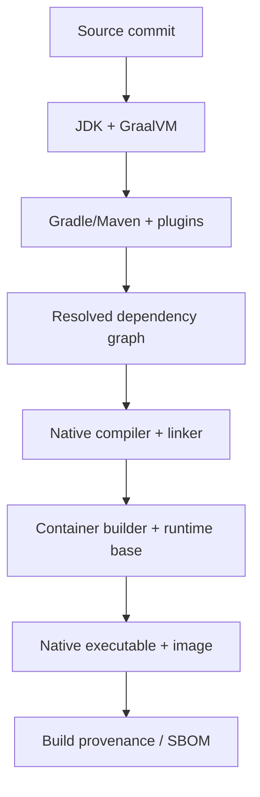

# Ghim phiên bản JDK, GraalVM, plugin, builder và dependency

## 1. Vì sao cần pin toàn bộ toolchain?

Native Image build là kết quả của nhiều thành phần phối hợp: JDK, GraalVM distribution, Native Image compiler, Spring Boot/Spring Framework, Gradle hoặc Maven, plugin build, native compiler/linker, container builder và toàn bộ dependency graph. Chỉ cần một thành phần thay đổi, generated AOT output, reachability analysis, binary hoặc runtime behavior cũng có thể thay đổi.

Nếu CI luôn tải phiên bản mới nhất, hai lần build từ cùng một commit có thể tạo ra kết quả khác nhau. Điều này gây khó khăn khi tái hiện lỗi, so sánh benchmark, điều tra CVE hoặc rollback một bản phát hành.

Với module **SPRING_BOOT_NATIVE_IMAGE**, cần biến toolchain thành một phần có thể kiểm soát của source/release process. Pin version giúp build có tính lặp lại, tạo bằng chứng rõ ràng về môi trường đã tạo binary và cho phép nâng cấp có chủ đích.

Pin version không có nghĩa giữ mãi phiên bản cũ. Nó có nghĩa mọi thay đổi phiên bản đều được review, kiểm thử và ghi nhận như một thay đổi kỹ thuật.



## 2. Các lớp version cần quản lý

Không chỉ pin JDK hoặc GraalVM. Lập inventory các thành phần ảnh hưởng build:

| Lớp | Thành phần cần ghi nhận | Nơi quản lý thường gặp |
|---|---|---|
| JDK | Vendor, major/minor/patch, distribution | CI image, toolchain config |
| GraalVM | Distribution, version, Native Image component | CI image/toolchain |
| Build tool | Gradle Wrapper hoặc Maven Wrapper | Wrapper properties |
| Build plugin | Spring Boot, Native Build Tools, compiler plugin | Plugin management |
| Framework | Spring Boot, Spring Framework | BOM/dependency management |
| Runtime libraries | JDBC driver, JSON, logging, JNI libraries | Lockfile/dependency constraints |
| Native toolchain | C compiler, linker, binutils, SDK | Builder image/package manifest |
| Container builder | Buildpacks builder, lifecycle, buildpacks | Builder image reference |
| Runtime image | OS release, libc, shared libraries | Dockerfile/buildpack config |
| Platform | OS, architecture, ABI | CI runner/build matrix |

Ghi nhận cả version gián tiếp. Ví dụ GraalVM build trên Linux có thể phụ thuộc GCC, binutils, zlib headers và glibc; một builder image mới có thể thay các thành phần đó dù source code không đổi.

## 3. Pin JDK bằng Gradle toolchain

Gradle Java toolchain giúp khai báo Java version mà project cần. Ví dụ:

```groovy
java {
    toolchain {
        languageVersion = JavaLanguageVersion.of(21)
    }
}
```

Cấu hình này chọn Java language/toolchain version, nhưng chưa tự pin vendor và patch distribution trong mọi môi trường. Nếu build yêu cầu GraalVM JDK, cần đảm bảo Gradle và Native Build Tools thực sự sử dụng đúng GraalVM installation.

Có thể đặt toolchain resolver/repository theo chính sách tổ chức hoặc dùng CI image đã pin digest. Kiểm tra runtime thực tế trong job:

```bash
java -version
./gradlew --version
native-image --version
```

Ghi output vào build log/artifact. Đừng chỉ dựa vào biến JAVA_HOME vì runner có thể cài nhiều JDK hoặc plugin có thể dùng toolchain khác.

## 4. Pin Gradle Wrapper

Commit Gradle Wrapper vào repository để mọi developer và CI sử dụng cùng Gradle distribution:

```properties
distributionUrl=https\://services.gradle.org/distributions/gradle-8.10.2-bin.zip
distributionSha256Sum=REPLACE_WITH_VERIFIED_SHA256
```

Version minh họa phải được chọn theo compatibility matrix của Spring Boot, Native Build Tools và JDK. Điền SHA-256 đã xác minh từ nguồn phân phối chính thức; không copy checksum không rõ nguồn.

Wrapper checksum bảo vệ tính toàn vẹn của distribution được tải. Nó không pin plugin/dependency và cũng không pin JDK/GraalVM. Đây là các lớp độc lập cần quản lý riêng.

Không dùng dynamic version như `8.+` hoặc `latest.release` cho Gradle distribution/plugin. Chúng khiến kết quả resolve thay đổi theo thời gian.

## 5. Pin Maven bằng Maven Wrapper

Commit Maven Wrapper và cấu hình distribution URL/version rõ ràng. Ví dụ:

```properties
distributionUrl=https\://repo.maven.apache.org/maven2/org/apache/maven/apache-maven/3.9.9/apache-maven-3.9.9-bin.zip
wrapperSha256Sum=REPLACE_WITH_VERIFIED_SHA256
```

Version minh họa cần được kiểm tra với plugin và JDK mục tiêu. Dùng checksum được xác minh từ nguồn phát hành Maven chính thức.

CI nên gọi `./mvnw` thay vì dùng Maven cài sẵn trên runner. Điều này giảm khác biệt giữa máy developer và CI.

Maven Wrapper pin Maven distribution; nó không tự pin JDK, GraalVM, plugin hay dependency graph.

## 6. Pin GraalVM distribution và Native Image

GraalVM có nhiều distribution và cách phân phối theo version. Chọn đúng distribution có Native Image support cho target build, rồi pin version cụ thể.

Có thể dùng CI image đã chứa GraalVM hoặc cài từ nguồn chính thức theo version và checksum đã xác minh. Ví dụ kiểm tra:

```bash
java -version
native-image --version
native-image --help
```

Lưu ý:

- Ghi vendor/distribution, không chỉ major JDK.
- Xác nhận Native Image component được cài.
- Kiểm tra target OS/architecture.
- Ghi compiler/linker version.
- Không dùng tag container dạng latest.
- Pin image digest nếu dùng GraalVM builder container.

Một tag version cụ thể vẫn có thể được cập nhật hoặc thay đổi tùy registry policy; digest là định danh bất biến hơn cho một image manifest.

## 7. Pin Spring Boot và plugin version

Spring Boot plugin, Spring Framework và Native Build Tools phải nằm trong tập version tương thích. Với Gradle, dùng plugin version rõ ràng:

```groovy
plugins {
    id 'java'
    id 'org.springframework.boot' version '3.4.2'
    id 'io.spring.dependency-management' version '1.1.7'
}
```

Các version trên chỉ là ví dụ minh họa, không phải khuyến nghị phiên bản mới nhất. Chọn version được tổ chức hỗ trợ và kiểm tra compatibility với JDK/GraalVM hiện tại.

Nếu dùng Native Build Tools plugin riêng, pin version trong plugin management và xác minh compatibility. Tránh khai báo cùng plugin ở nhiều nơi với version khác nhau.

Với Maven, khai báo version Spring Boot parent/plugin rõ ràng trong POM và kiểm tra effective POM để biết version cuối cùng được sử dụng.

## 8. Quản lý dependency bằng BOM và constraints

Spring Boot BOM giúp đồng bộ version cho nhiều dependency thuộc hệ sinh thái Spring. Ví dụ Gradle:

```groovy
dependencies {
    implementation(platform(
        "org.springframework.boot:spring-boot-dependencies:3.4.2"
    ))
    implementation("org.springframework.boot:spring-boot-starter-web")
    runtimeOnly("org.postgresql:postgresql")
}
```

Maven có thể import BOM trong dependencyManagement hoặc dùng Spring Boot parent. Chỉ dùng một cơ chế quản lý version nhất quán để tránh override khó theo dõi.

BOM không nhất thiết quản lý mọi thư viện ngoài hệ sinh thái. Với dependency vendor hoặc thư viện đặc biệt, khai báo version rõ ràng, dùng constraints và ghi nhận lý do.

Không dùng dynamic dependency versions như `1.+`, `latest.release` hoặc snapshot không kiểm soát trong release build. Snapshot có thể thay đổi nội dung dù tọa độ version không đổi.

## 9. Dependency locking trong Gradle

Gradle dependency locking ghi lại resolved version cho từng configuration được khóa. Bật locking:

```groovy
dependencyLocking {
    lockAllConfigurations()
}
```

Tạo/cập nhật lock state khi chủ động nâng dependency:

```bash
./gradlew dependencies --write-locks
```

Commit các lockfiles sinh ra. CI chạy với dependency locking để phát hiện thay đổi resolution không được cập nhật trong repository.

Locking chỉ có tác dụng với configuration và dependency được lock. Kiểm tra các configuration runtime, test và native build liên quan. Nếu dùng version catalog, catalog quản lý khai báo version; lockfile quản lý version đã resolve, hai cơ chế bổ trợ nhau.

## 10. Dependency verification trong Gradle

Dependency verification có thể xác minh checksum hoặc chữ ký của artifact tải về. Tạo metadata ban đầu:

```bash
./gradlew --write-verification-metadata sha256 help
```

Review file verification metadata, chỉ chấp nhận checksum từ artifact đã xác minh. Không chạy chế độ ghi metadata rồi commit kết quả một cách tự động mà không review, vì attacker hoặc repository lỗi có thể khiến checksum không đáng tin được chấp nhận.

Khi dependency thay đổi, cập nhật checksum/chữ ký theo quy trình review. Verification giúp phát hiện artifact bị thay đổi ngoài dự kiến; nó không thay thế dependency locking hoặc kiểm tra nguồn phát hành.

## 11. Pin dependency trong Maven

Maven có thể quản lý version bằng parent/BOM và khai báo rõ version trong dependencyManagement. Enforcer plugin có thể áp dụng quy tắc cấm version range hoặc dependency convergence theo chính sách dự án.

Ví dụ kiểm tra dependency tree:

```bash
./mvnw dependency:tree
./mvnw help:effective-pom
```

Có thể dùng repository manager nội bộ để proxy/cache artifact và áp dụng allowlist. Với release build, tránh version range, snapshot không kiểm soát và repository không tin cậy.

Maven không có cơ chế dependency lockfile built-in giống Gradle theo cùng cách. Nếu cần reproducibility mạnh, kết hợp version/BOM cố định, repository immutability, artifact checksum/provenance và kiểm soát plugin.

## 12. Pin container builder image bằng digest

Nếu build Native Image trong container, pin builder image theo digest:

```dockerfile
FROM ghcr.io/graalvm/native-image-community:21 AS builder
```

Trong pipeline thực tế, nên dùng reference có digest đã xác minh:

```dockerfile
FROM registry.example.com/build/native-image:21.0.x@sha256:VERIFIED_DIGEST AS builder
```

Các registry/reference chỉ là ví dụ. Thay bằng image được tổ chức phê duyệt và digest thực tế. Tag version giúp người đọc hiểu version; digest đảm bảo cùng một image content được sử dụng.

Ghi cả platform của image (amd64/arm64) và manifest digest nếu là multi-arch. Một tag multi-arch có thể trỏ tới manifest khác nhau tùy platform.

## 13. Pin Buildpacks builder và buildpack versions

Spring Boot Buildpacks có thể tạo container image mà không cần Dockerfile do dự án tự quản lý. Tuy vậy, builder và buildpacks vẫn là đầu vào build quan trọng.

Cấu hình builder image cụ thể thay vì dùng mặc định không được kiểm soát. Nếu buildpack hỗ trợ pin version/buildpack order, ghi nhận các version tương ứng và kiểm tra log build.

Ghi nhận:

- Builder image tag và digest.
- Buildpack IDs và versions.
- Lifecycle version.
- Run image reference/digest.
- Environment variables và build arguments.
- OS/architecture của builder và target image.

Builder và run image có vai trò khác nhau: builder chứa công cụ build; run image chứa nền tảng runtime. Không giả định package trong builder tự có trong run image.

## 14. Pin native compiler và hệ điều hành build

Native Image build có thể phụ thuộc compiler/linker hệ thống. Trên Linux thường gặp GCC/Clang, binutils, glibc development files, zlib và các header/library khác.

Ghi lại:

```bash
gcc --version
clang --version
ld --version
ldd --version
uname -a
```

Chỉ gọi công cụ thực sự có trong builder. Không nhất thiết cài cả GCC lẫn Clang nếu toolchain chỉ dùng một compiler. Package version nên được pin thông qua builder image digest hoặc repository snapshot/lock mechanism của distribution.

Thay đổi OS release của builder có thể thay glibc, linker và package dependency. Vì vậy, pin GraalVM nhưng không pin builder OS vẫn chưa đảm bảo cùng môi trường native compilation.

## 15. Ma trận tương thích và manifest build

Tạo một manifest cho mỗi native artifact:

```yaml
build:
  sourceCommit: "COMMIT_SHA"
  target: "linux-amd64"
  jdk:
    vendor: "GRAALVM_DISTRIBUTION"
    version: "PINNED_VERSION"
  graalvm:
    version: "PINNED_VERSION"
    nativeImage: true
  buildTool:
    name: "Gradle"
    version: "PINNED_WRAPPER_VERSION"
  springBoot:
    version: "PINNED_VERSION"
  nativeBuildTools:
    version: "PINNED_VERSION"
  builderImage:
    reference: "IMAGE@sha256:DIGEST"
  runtimeImage:
    reference: "IMAGE@sha256:DIGEST"
  dependencyLock:
    revision: "LOCKFILE_REVISION"
```

Đây là schema minh họa do nhóm có thể tự định nghĩa, không phải schema chuẩn GraalVM. Có thể lưu thông tin tương đương trong build provenance, SBOM hoặc CI artifact metadata.

Manifest giúp truy nguyên binary đã được tạo bằng toolchain nào và target nào. Không đưa secret hoặc credential vào manifest.

## 16. Nâng phiên bản theo một thay đổi có kiểm soát

Không nâng đồng thời JDK, GraalVM, Spring Boot, Gradle, Native Build Tools và base image nếu không cần. Khi nhiều lớp thay đổi cùng lúc, lỗi build/runtime khó quy về nguyên nhân.

Quy trình nâng cấp:

1. Chọn một thành phần cần nâng và đọc release notes/compatibility matrix.
2. Kiểm tra yêu cầu tối thiểu của các plugin/framework liên quan.
3. Tạo branch hoặc change riêng.
4. Cập nhật pin/lock/verification metadata.
5. Chạy JVM unit/integration tests.
6. Chạy Spring AOT processing.
7. Build Native Image.
8. Chạy native tests và application smoke tests.
9. Chạy container integration tests trên target platform.
10. So sánh startup, RSS, binary/image size và build duration.
11. Lưu manifest/provenance và kết quả review.

Nếu cần nâng nhiều thành phần cùng lúc do compatibility constraint, ghi rõ dependency giữa các thay đổi và xác minh bằng ma trận build.

## 17. Cập nhật bảo mật mà vẫn giữ tính lặp lại

Pin version không được biến thành cơ chế trì hoãn security updates. Theo dõi advisory của JDK/GraalVM, Spring, build plugins, dependencies, builder và base image.

Khi có CVE:

- Xác định component/version bị ảnh hưởng.
- Kiểm tra exploitability và mức độ sử dụng trong ứng dụng.
- Chọn bản vá được hỗ trợ.
- Cập nhật pin/lock/digest.
- Build lại từ source đã xác định.
- Chạy test tương thích/native/container.
- Quét image và SBOM.
- Lưu artifact/provenance mới.

Không thay image tag bằng latest để “lấy bản vá” mà không biết chính xác nội dung mới. Cập nhật có version/digest rõ ràng để có thể audit và rollback.

## 18. Cache CI mà không làm mất tính đúng đắn

Gradle/Maven cache giúp giảm thời gian tải dependencies và build. Cache không nên là nguồn chân lý về version.

- Key cache theo OS/architecture, JDK/GraalVM, wrapper và lockfiles.
- Không chia sẻ native build output giữa target architecture khác nhau.
- Không dùng cache cũ để bỏ qua dependency verification.
- Tách cache dependency khỏi artifact phát hành.
- Có thể xóa cache và build lại để xác minh build không phụ thuộc file cục bộ không được khai báo.
- Ghi lại cache key trong CI log khi điều tra build không tái lập.

Cache hit không chứng minh dependency đã được pin; lockfile và verification mới quản lý resolution/integrity.

## 19. Checklist audit toolchain trước release

- JDK vendor/version/patch đã được pin.
- GraalVM distribution/version và Native Image component đã được pin.
- Gradle/Maven Wrapper version và checksum đã được xác minh.
- Spring Boot, Spring Framework và build plugins có version rõ.
- Dependency graph runtime/test được quản lý bằng BOM/constraints/lock.
- Dependency artifacts có checksum/signature verification theo chính sách.
- Native compiler/linker và builder OS được ghi nhận.
- Builder image và run image được pin digest.
- Buildpack/lifecycle versions được ghi nhận nếu sử dụng.
- Target OS/architecture/libc được xác định.
- Build manifest/provenance gắn với source commit và artifact digest.
- Có quy trình nâng cấp, security patch và rollback.
- CI có thể build lại từ môi trường sạch mà không dựa vào trạng thái máy cá nhân.

## 20. Câu hỏi tự kiểm tra

1. Vì sao pin JDK nhưng không pin GraalVM và native toolchain vẫn chưa đủ?
2. Gradle Wrapper checksum bảo vệ điều gì và không bảo vệ điều gì?
3. Khác nhau giữa version catalog, dependency locking và dependency verification là gì?
4. BOM có quản lý tất cả dependency bên ngoài Spring Boot không?
5. Vì sao builder image và runtime image cần được ghi nhận riêng?
6. Buildpacks builder tag và digest có ý nghĩa gì?
7. Native compiler/linker và OS packages ảnh hưởng ra sao tới binary?
8. Làm thế nào nâng GraalVM hoặc Spring Boot mà vẫn tái lập được kết quả?
9. Pin version có mâu thuẫn với việc cập nhật bảo mật không?
10. Manifest/provenance cần chứa dữ liệu nào để truy nguyên executable?

**Ghi nhớ:** build Native Image có thể thay đổi khi JDK, GraalVM, plugin, dependency, compiler hoặc builder thay đổi. Pin version và checksum/digest cho từng lớp, lưu manifest gắn với commit/artifact, rồi nâng cấp có kiểm soát bằng AOT, native, container tests và benchmark.
