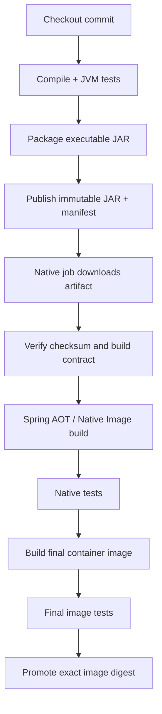

# Chuyển JAR có kết quả AOT sang native tại job chuyên biệt

## 1. Vì sao nên tách job native khỏi job build ứng dụng thông thường?

Một pipeline Spring Boot có thể cần chạy compile, unit tests, integration tests và đóng gói executable JAR ở mọi pull request. Native Image bổ sung các bước tốn tài nguyên hơn: Spring AOT, Native Image compilation, native integration tests và đóng gói container runtime. Nếu chạy toàn bộ quy trình native ở mọi job, thời gian phản hồi CI và mức tiêu thụ CPU/RAM có thể tăng đáng kể.

Một cách tổ chức là tạo một job chuyên biệt nhận artifact JAR cùng thông tin build đã được xác minh từ job trước, sau đó thực hiện native compilation. Job này dùng đúng source revision, dependency graph, profile và toolchain đã được pin. Kết quả native được kiểm thử và gắn provenance với đầu vào trước khi được promote.

Trong module **SPRING_BOOT_NATIVE_IMAGE**, bài học này giải thích cách thiết kế ranh giới giữa job tạo JAR/AOT và job native: artifact nào cần bàn giao, điều kiện tái lập build, cách cấu hình Maven/Gradle, kiểm thử, cache, bảo mật và xử lý failure. Mục tiêu là giảm lặp công việc nhưng vẫn bảo đảm native artifact được tạo từ đầu vào có thể truy vết.

## 2. Phân biệt artifact JAR với kết quả AOT

Một executable JAR và output Spring AOT không nhất thiết là cùng một artifact. Cần xác định pipeline đang bàn giao gì:

| Artifact | Nội dung | Cách dùng |
|---|---|---|
| Executable JAR | Application classes, dependencies hoặc layout theo packaging | Có thể là input cho một số native build workflows |
| Compiled classes | Output compile của source code | Dùng nếu pipeline native build cần tái chạy AOT |
| Spring AOT generated sources/resources | Mã và metadata được sinh từ ApplicationContext đã phân tích | Cần tương thích với source, dependencies và structural inputs |
| Reachability metadata | Reflection/resource/proxy/JNI/serialization metadata | Input native build nếu không được đóng gói/đóng góp tự động |
| Build manifest | Commit, toolchain, profile, dependency versions, checksums | Bằng chứng để tái lập và kiểm tra artifact |
| Native executable | Binary do Native Image compiler tạo | Runtime artifact cần native integration tests |

Không gọi JAR là “JAR có AOT” nếu pipeline chỉ chạy `package` và chưa thực hiện Spring AOT. Ngược lại, nếu plugin tự động chạy AOT như một phần native build, cần xác định output đó có được lưu và tái sử dụng hay được tạo lại ở job native.

## 3. Chọn mô hình handoff phù hợp

Có hai mô hình thường gặp:

**Mô hình A — JAR là input cho job native.** Job native tải JAR, dùng Native Build Tools/Spring Boot plugin để tạo native executable theo workflow được hỗ trợ. Phù hợp khi build tool có thể chạy AOT/native processing từ executable archive và toàn bộ cấu hình cần thiết có sẵn.

**Mô hình B — Source và generated AOT output là input.** Job native tải source artifact hoặc checkout đúng commit, tái sử dụng compiled/generated outputs phù hợp rồi thực hiện Native Image compilation. Phù hợp khi build cần source-level AOT processing, test AOT hoặc plugin lifecycle không hỗ trợ JAR-only workflow.

Không phải mọi Spring Boot version/plugin đều hỗ trợ cùng một kiểu chuyển JAR sang native. Kiểm tra tài liệu Native Build Tools và Spring Boot plugin theo version. Nếu workflow cần source để chạy AOT, chỉ bàn giao JAR là chưa đủ.

## 4. Kiến trúc pipeline theo job

Một pipeline có thể chia thành các job độc lập:



Job native chỉ bắt đầu khi job tạo JAR đã thành công. Native job cần xác minh artifact đúng commit và manifest, sau đó chạy các bước AOT/native mà version plugin yêu cầu.

Có thể chạy native job trên runner riêng có RAM/CPU cao hơn, trong khi JVM tests chạy trên runner thông thường. Điều này giúp phân bổ tài nguyên theo workload và tránh native compiler chiếm tài nguyên của toàn bộ pipeline.

## 5. Build contract phải đi cùng JAR

JAR đơn lẻ không chứa đầy đủ thông tin cần thiết để tái lập native build. Hãy tạo manifest đi kèm:

```json
{
  "service": "orders-service",
  "gitCommit": "8a12f3c",
  "artifact": "orders-service.jar",
  "artifactSha256": "…",
  "javaVersion": "21",
  "graalvmDistribution": "pinned-distribution",
  "graalvmVersion": "pinned-version",
  "springBootVersion": "pinned-version",
  "nativeBuildToolsVersion": "pinned-version",
  "aotProfile": "native-prod",
  "structuralProperties": {
    "search.enabled": "true"
  }
}
```

Các giá trị là ví dụ. Manifest thực tế cần ghi version chính xác và checksum thật. Không ghi secret hoặc giá trị property nhạy cảm; chỉ ghi tên property và giá trị không nhạy cảm cần cho cấu trúc build.

Manifest giúp job native kiểm tra rằng JAR và cấu hình thuộc cùng commit, đúng profile và toolchain. Nếu JAR được build bằng JDK/Spring Boot version khác với native job dự kiến, pipeline cần fail sớm hoặc có chính sách tương thích được xác nhận.

## 6. Kiểm tra checksum và tính toàn vẹn artifact

Sau khi publish JAR, tính checksum và lưu trong manifest hoặc metadata của artifact store:

```bash
sha256sum target/orders-service.jar
```

Ở job native:

```bash
sha256sum --check orders-service.jar.sha256
```

Tên file checksum và format cần khớp cách tạo. Trên Windows runner có thể dùng `Get-FileHash`. Mục đích là xác nhận file tải về đúng artifact đã publish, không bị thay đổi hoặc nhầm giữa các build.

Không dùng tên artifact chung như `latest.jar` làm định danh duy nhất. Dùng build ID, commit SHA hoặc immutable artifact version; checksum cung cấp kiểm tra nội dung độc lập với tên.

## 7. Toolchain parity giữa hai job

Job tạo JAR và job native không nhất thiết phải dùng cùng loại runner, nhưng phải kiểm soát các version ảnh hưởng đến output:

- JDK distribution/version và target bytecode.
- Spring Boot và Spring Framework versions.
- Maven/Gradle wrapper.
- Compiler/plugin versions.
- GraalVM distribution/edition/version.
- Native Build Tools version.
- OS/architecture target.
- Dependency lock/BOM và repository resolution.
- Spring profiles và structural properties.
- Native build arguments và metadata inputs.

Nếu native job dùng GraalVM version khác với version được dự án kiểm thử, kết quả có thể khác. Ghi version trong manifest và xác nhận tương thích trước khi build.

Không dùng `latest` cho builder image hoặc toolchain trong pipeline production. Pin tag/digest và cập nhật có kiểm soát.

## 8. JAR có thể dùng trực tiếp cho native compilation khi nào?

Khả năng tạo native executable từ JAR phụ thuộc Spring Boot version, Native Build Tools plugin và cấu hình. Một số workflow cho phép native-image plugin xử lý executable archive; workflow khác cần source project để chạy Spring AOT và tạo generated code.

Trước khi thiết kế job:

1. Xác định chính xác Spring Boot và Native Build Tools version.
2. Đọc cách plugin yêu cầu application input.
3. Kiểm tra AOT processing có chạy trong job native hay không.
4. Xác nhận runtime hints/reachability metadata được tìm thấy.
5. Tạo proof-of-concept từ JAR đã publish, không dùng workspace source vô tình còn tồn tại.
6. Build và chạy một native scenario.
7. Ghi rõ artifact nào là đầu vào chính thức.

Nếu JAR-only path không được hỗ trợ, job native nên tải source archive/checkout đúng commit và xác minh source revision trùng manifest. Không tạo một quy trình copy JAR vào thư mục build rồi giả định plugin sẽ tự sinh đầy đủ Spring AOT output.

## 9. Phân biệt Application AOT với Test AOT

Application AOT tạo initialization code/metadata cho ApplicationContext của ứng dụng. TestContext AOT xử lý context của các test class và có lifecycle riêng.

Nếu job native chỉ tạo production executable, có thể cần application AOT nhưng không nhất thiết cần test AOT. Nếu job còn build native test executable, cần xác định test classes, TestContext AOT processing và dependencies tương ứng.

| Quy trình | Đầu vào | Mục đích |
|---|---|---|
| Application AOT | Application source/configuration | Chuẩn bị application context |
| TestContext AOT | Test classes/context metadata | Chuẩn bị test contexts |
| Native application build | Application output + AOT/metadata | Tạo executable production |
| Native test build | Test output + test AOT support | Tạo/chạy native tests |

Không đánh dấu “AOT completed” chỉ vì một trong hai quy trình đã chạy. Build log và manifest nên ghi rõ stage nào được thực hiện.

## 10. Truyền profile và structural properties vào job native

Spring AOT phân tích ApplicationContext theo profile, property và classpath tại build time. Job native phải sử dụng đúng structural inputs của artifact.

Ví dụ profile:

```bash
SPRING_PROFILES_ACTIVE=native-prod
```

Ví dụ property condition:

```bash
SEARCH_ENABLED=true
```

Nếu `search.enabled` điều khiển `@ConditionalOnProperty`, giá trị phải được cung cấp cho đúng process chạy Spring AOT. Đưa biến vào shell của job nhưng không truyền tới AOT JVM không bảo đảm context nhận được nó.

Tạo một build contract rõ ràng và xác minh qua log/configuration diagnostics. Runtime values như URL/timeout có thể được cung cấp lúc chạy nếu chúng không thay đổi bean graph đã sinh.

## 11. Ví dụ job native với Maven

Một job native có thể tải artifact và manifest, kiểm tra checksum rồi thực hiện workflow plugin phù hợp. Pseudocode shell:

```bash
set -euo pipefail

sha256sum --check orders-service.jar.sha256

native-image --version
java -version

SPRING_PROFILES_ACTIVE=native-prod \
SEARCH_ENABLED=true \
./mvnw -Pnative -DskipTests package
```

Đây là ví dụ minh họa cho job có source/build project. Nếu job chỉ có JAR, không thể gọi Maven wrapper từ artifact JAR trừ khi wrapper/POM/source project cũng được cung cấp. Cần dùng đúng workflow JAR-only mà plugin hỗ trợ hoặc tải source artifact cùng commit.

Một số dự án chạy goal AOT riêng trước native package; dự án khác gắn AOT vào lifecycle plugin. Kiểm tra POM và task execution log để tránh chạy AOT hai lần không cần thiết hoặc bỏ sót.

## 12. Ví dụ job native với Gradle

Tương tự, job Gradle có thể tải artifact và source/build workspace đã được xác minh:

```bash
set -euo pipefail

sha256sum --check orders-service.jar.sha256

./gradlew --version
native-image --version

SPRING_PROFILES_ACTIVE=native-prod \
SEARCH_ENABLED=true \
./gradlew nativeCompile
```

Lệnh trên giả định workspace có Gradle wrapper, build scripts và source/build inputs cần thiết. Nếu job chỉ nhận JAR, task `nativeCompile` không thể tự xuất hiện từ file JAR; phải dùng workflow được plugin hỗ trợ hoặc cung cấp source project.

Ghi rõ task native có tự chạy `processAot` hay không. Kiểm tra `./gradlew tasks --all` và task graph trên đúng plugin version.

## 13. Ví dụ cấu trúc GitHub Actions

Một workflow có thể publish JAR ở job JVM và tải artifact trong job native:

```yaml
jobs:
  package:
    runs-on: ubuntu-latest
    steps:
      - uses: actions/checkout@v4
      - uses: actions/setup-java@v4
        with:
          distribution: temurin
          java-version: '21'
      - run: ./mvnw -DskipTests package
      - uses: actions/upload-artifact@v4
        with:
          name: application-jar
          path: target/orders-service.jar

  native:
    needs: package
    runs-on: ubuntu-latest
    steps:
      - uses: actions/download-artifact@v4
        with:
          name: application-jar
      # Cần thêm source/build workspace hoặc JAR-native workflow
      # phù hợp với Spring Boot/Native Build Tools version.
```

Đây là skeleton minh họa, chưa phải workflow hoàn chỉnh. Job native cần toolchain GraalVM/Native Build Tools, build contract, checksum, source/build inputs nếu yêu cầu, native compilation, tests và upload native artifact. Pin action versions theo policy của tổ chức và ưu tiên commit SHA khi cần supply-chain control.

Nếu checkout lại source trong native job, checkout đúng commit SHA từ job package; không mặc định branch head vẫn là cùng revision khi job chạy sau đó.

## 14. Artifact handoff không được làm mất metadata

Khi upload/download artifact, bảo đảm các file cần thiết được giữ nguyên:

- Executable JAR.
- Checksum.
- Build manifest.
- SBOM/provenance nếu pipeline tạo.
- Reachability metadata riêng nếu không nằm trong JAR/dependency.
- AOT generated outputs nếu workflow yêu cầu.
- Test reports và kết quả quality gates liên quan.

Không upload toàn bộ workspace một cách thiếu kiểm soát vì có thể chứa secret, local cache, build logs nhạy cảm hoặc file không cần thiết. Dùng danh sách artifact rõ ràng và xác minh file sau khi download.

Nếu artifact store nén/giải nén làm thay đổi permission hoặc timestamp, kiểm tra những thuộc tính có ý nghĩa cho bước native/container. JAR thường không phụ thuộc executable permission, nhưng script/build wrapper có thể cần quyền execute nếu được bàn giao.

## 15. Cache cho job native

Native compilation thường tốn tài nguyên, vì vậy cache có thể giúp giảm thời gian. Tuy nhiên cache key cần gắn với các yếu tố ảnh hưởng output:

- GraalVM distribution/version.
- Native Build Tools/plugin version.
- OS/architecture.
- JDK/compiler version.
- Dependency lock/BOM.
- Native build arguments.
- AOT structural properties/profile.
- Source revision hoặc inputs liên quan.
- Cache schema/version nếu công cụ thay đổi format.

Không chia sẻ cache giữa các toolchain khác nhau chỉ vì project name giống nhau. Cache không hợp lệ có thể gây build lỗi hoặc output khó tái lập.

Phân biệt dependency cache, Gradle/Maven build cache và Native Image compiler cache. Chúng có lifecycle và invalidation khác nhau. Chỉ cache thư mục được tài liệu toolchain hỗ trợ; không tự cache toàn bộ native output như thể nó luôn có thể tái sử dụng giữa mọi commit.

## 16. Tách runner theo tài nguyên

Native job thường cần nhiều RAM hơn JVM package job. Có thể chọn runner khác:

| Job | Tài nguyên mục tiêu | Lý do |
|---|---|---|
| Compile/JVM tests | Runner tiêu chuẩn | Công việc thường nhẹ hơn |
| Spring AOT | Runner trung bình | Phân tích ApplicationContext và sinh code |
| Native compile | Runner CPU/RAM lớn | Reachability analysis, code generation, linking |
| Native tests | Runner phù hợp runtime test | Chạy executable và external dependencies |
| Container image | Runner có container engine | Build, inspect và test final image |

Chọn runner dựa trên peak memory/time đã đo. Đặt timeout và memory limit hợp lý, lưu thông tin OOM. Không giải quyết build fail bằng cách tăng tài nguyên vô hạn; kiểm tra heap, parallelism, dependency và cache trước.

## 17. Bảo mật artifact và supply chain

JAR chuyển giữa các job là một artifact có thể được promote hoặc phát hành. Bảo vệ:

- Chỉ tải artifact từ pipeline run đáng tin cậy.
- Dùng immutable artifact ID và checksum.
- Không để untrusted pull request ghi vào cache dùng bởi protected branch.
- Không truyền secret vào build output hoặc generated source.
- Quản lý repository credentials qua secret store.
- Gắn SBOM/provenance và commit identity.
- Scan dependency và container image theo policy.
- Ký image/artifact nếu supply-chain policy yêu cầu.

Job native cần kiểm tra manifest trước khi thực thi build. Không chạy script được đóng gói trong artifact không tin cậy với quyền runner rộng. Với pull request từ fork, giới hạn secret và quyền publish registry.

## 18. Failure handling và retry

Không phải mọi lỗi đều nên retry. Phân loại:

| Failure | Hành động |
|---|---|
| Checksum mismatch | Fail ngay, tải lại artifact từ nguồn đáng tin cậy |
| Toolchain version mismatch | Fail và sửa build contract |
| Native compiler OOM | Thu metrics, điều chỉnh runner/parallelism có kiểm soát |
| Dependency repository outage | Retry có giới hạn/backoff |
| Native compilation error | Không retry mù; phân tích diagnostics |
| Native integration test fail | Giữ artifact/log, fail quality gate |
| Container test fail | Không promote image |
| Artifact upload failure | Retry theo semantics của store, xác minh checksum sau upload |

Một retry có thể tạo output khác nếu toolchain/cache không ổn định. Ghi từng attempt và không ghi đè artifact thành công bằng artifact từ retry chưa được kiểm tra.

## 19. Native tests và final image tests trước promote

Native job không nên dừng ở việc binary được tạo. Cần kiểm tra:

1. Native executable khởi động.
2. ApplicationContext dùng đúng profile/structural properties.
3. Reflection/resource/proxy/serialization/JNI scenarios quan trọng.
4. HTTP contract/business flows.
5. External dependencies được cung cấp đúng.
6. Runtime container có đủ libc, CA, timezone và native libraries.
7. Container chạy non-root và có filesystem permissions đúng.
8. Readiness/liveness probes hoạt động.
9. SIGTERM/shutdown graceful.
10. Image digest được ghi lại.

Chọn tập native tests theo risk; giữ phần lớn logic tests trên JVM. Với release, final image tests cần chạy trên đúng image digest được promote.

## 20. Promotion và rollback

Sau khi native build/test pass, publish artifact với tag bất biến hoặc digest. Promotion nên chỉ tham chiếu đến artifact đã kiểm thử; không rebuild lại native image ở bước deploy nếu mục tiêu là triển khai đúng binary đã được xác minh.

Một luồng:

```text
JAR artifact + manifest
        |
        v
Native build job
        |
        v
Native executable + test report
        |
        v
Final container image
        |
        v
Image digest + provenance
        |
        v
Staging validation
        |
        v
Production promotion
```

Giữ JVM artifact hoặc image trước đó làm rollback target trong giai đoạn rollout. Nếu native image fail startup, health check hoặc SLO, rollback về digest đã biết tốt. Không dùng tag mutable để xác định rollback artifact.

## 21. Chẩn đoán lỗi thường gặp

| Triệu chứng | Nguyên nhân có thể | Cách xử lý |
|---|---|---|
| Native job không tìm thấy POM/build script | Chỉ tải JAR nhưng workflow cần source | Bàn giao source artifact hoặc dùng JAR workflow được hỗ trợ |
| JAR checksum mismatch | Artifact sai build/run hoặc truyền file lỗi | Xác minh immutable artifact ID và checksum |
| AOT dùng profile khác | Environment không tới đúng process AOT | Kiểm tra plugin process và build contract |
| Native job dùng dependency khác | Không pin BOM/lockfile hoặc resolve lại | Khóa dependency và xác minh graph |
| Build trên runner fail OOM | RAM/parallelism không phù hợp | Đo peak memory và chọn runner phù hợp |
| Cache gây output không ổn định | Cache key thiếu toolchain/input | Tách cache theo version/platform/config |
| Native binary chạy local, fail container | Runtime image thiếu dependency | Kiểm tra final image và ELF/shared libraries |
| Test report không gắn với binary | Build/test artifact bị thay thế hoặc rebuild | Gắn commit/digest và giữ immutable artifacts |
| Promotion deploy image khác image test | Dùng tag mutable hoặc rebuild | Promote theo digest |

## 22. Bài thực hành: tách native job khỏi pipeline Maven

**Bối cảnh:** pipeline hiện tại build executable JAR và chạy JVM tests. Nhóm muốn native compilation trên runner có 16 GiB RAM riêng.

**Bước 1 — Chuẩn hóa job package.** Build JAR từ commit SHA, chạy JVM tests và upload JAR cùng checksum/manifest.

**Bước 2 — Xác nhận workflow plugin.** Kiểm tra Spring Boot/Native Build Tools version để xác định native build có thể nhận JAR hay cần source workspace.

**Bước 3 — Tạo native job.** Dùng runner GraalVM đã pin; tải artifact bất biến và xác minh checksum.

**Bước 4 — Truyền build contract.** Cố định profile, structural properties, dependency versions, architecture và native build arguments.

**Bước 5 — Chạy AOT/native compile.** Xác nhận AOT được thực hiện đúng một lần trong lifecycle cần thiết và Native Image compiler nhận đúng inputs.

**Bước 6 — Chạy native tests.** Chạy các scenario reflection, JSON, resource, proxy và business flow được chọn.

**Bước 7 — Build final image.** Đóng gói runtime dependencies, non-root user và entrypoint phù hợp; lưu image digest.

**Bước 8 — Test và promote.** Chạy final image tests, lưu reports/provenance và chỉ promote digest đã pass.

**Bước 9 — Kiểm tra rollback.** Giữ JVM artifact hoặc image trước đó và diễn tập rollback nếu native candidate không đạt SLO.

Tiêu chí hoàn thành: JAR và manifest được bàn giao có checksum; native job xác minh đúng commit/toolchain/structural inputs; workflow AOT/native được plugin hỗ trợ; native tests và final image tests pass; artifact được promote theo digest.

## 23. Kết luận

Tách native compilation sang job chuyên biệt giúp phân bổ runner theo nhu cầu CPU/RAM và giữ JVM feedback loop nhanh. Tuy nhiên, JAR không tự mang theo mọi thông tin cần cho Spring AOT/native build. Pipeline phải xác định rõ workflow plugin hỗ trợ, có cần source/generated AOT outputs hay không, và bàn giao manifest, checksum, metadata cùng toolchain versions.

Một native job đáng tin cậy xác minh đầu vào bất biến, dùng đúng profile/structural properties, chạy AOT/native compilation theo lifecycle được hỗ trợ, thực thi native tests và kiểm tra final image. Chỉ promote artifact/image digest đã vượt qua các quality gates; giữ provenance và rollback target để có thể truy vết khi phát hành gặp sự cố.
