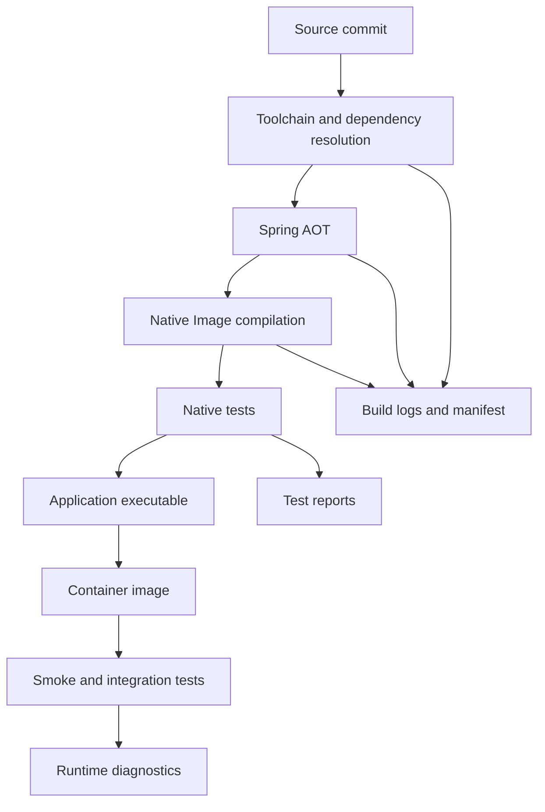

# Lưu log build, báo cáo kiểm thử và thông tin chẩn đoán khi thất bại

## 1. Vì sao cần lưu bằng chứng của mỗi lần build?

Pipeline Spring Boot Native Image có nhiều giai đoạn: resolve dependency, compile, Spring AOT processing, Native Image compilation, native tests, tạo application executable, đóng gói container và kiểm thử image cuối. Khi một bước thất bại, chỉ nhìn dòng lỗi cuối cùng thường không đủ để xác định nguyên nhân.

Log đầy đủ, test reports và thông tin chẩn đoán giúp nhóm biết build thất bại ở stage nào, CI đã dùng toolchain nào, Spring AOT chạy với profile nào, compiler nhận arguments gì, test nào pass/fail/skip, và binary/container nào được tạo từ commit đó.

Với module **SPRING_BOOT_NATIVE_IMAGE**, CI cần lưu đủ bằng chứng để điều tra cả lỗi build lẫn lỗi chỉ xuất hiện lúc chạy native executable/container. Một log tổng quát kiểu “build failed” không đủ để tái hiện vấn đề.



## 2. Các loại artifact cần thu thập

| Artifact | Nội dung | Mục đích |
|---|---|---|
| Build console log | Output Gradle/Maven và native-image | Xác định bước và thông báo lỗi |
| Test reports | XML/HTML, test summary, stack trace | Biết test nào fail/skip |
| Toolchain manifest | JDK, GraalVM, plugin, compiler, OS | Tái tạo môi trường |
| Dependency report | Runtime/test graph, lockfiles | Điều tra version/conflict |
| AOT metadata | Generated source/resource inventory, hints | Điều tra Spring AOT |
| Native diagnostics | Compiler args, analysis/build reports | Điều tra reachability/linking |
| Application artifact | Executable/JAR và checksum | Xác định binary được kiểm thử |
| Container metadata | Image digest, base image, architecture, SBOM | Truy nguyên image |
| Runtime diagnostics | Application log, crash/core dump | Điều tra lỗi sau build |
| Benchmark results | Startup, RSS, latency, throughput | Đánh giá regression |

Không phải lần chạy nào cũng cần lưu mọi file lớn. Thiết kế retention theo loại pipeline: pull request, main branch, release và failure investigation.

## 3. Lưu console log đầy đủ

Giữ stdout/stderr của từng bước với timestamp và tên stage. Không chỉ lưu phần output cuối hoặc đoạn đã lọc lỗi.

Ví dụ Gradle:

```bash
./gradlew --no-daemon --stacktrace --info clean test nativeCompile
```

Khi điều tra lỗi khó tái hiện, có thể tăng log level:

```bash
./gradlew --no-daemon --stacktrace --debug nativeCompile
```

Debug log có thể rất lớn và có nguy cơ in thông tin nhạy cảm từ plugin hoặc môi trường. Chỉ bật trong job điều tra có kiểm soát, áp dụng masking và retention ngắn.

Ví dụ Maven:

```bash
./mvnw --batch-mode --no-transfer-progress --errors verify
```

Khi cần debug Maven:

```bash
./mvnw --batch-mode --errors -X package
```

Maven -X cũng có thể tiết lộ property, URL nội bộ hoặc thông tin môi trường. Không bật verbose debug trên mọi build release nếu không cần.

## 4. Chia log theo stage

Tách pipeline thành các stage có tên ổn định:

1. Checkout/source metadata.
2. Toolchain verification.
3. Dependency resolution.
4. JVM tests.
5. Spring AOT processing.
6. Native Image compilation.
7. Native tests.
8. Application executable smoke test.
9. Container build.
10. Container integration test.
11. Artifact publish.

Mỗi stage nên lưu command, exit code, start/end time và log riêng. Nếu stage thất bại, giữ log stage đó và metadata của các stage trước.

Không ghi đè log của lần chạy trước bằng tên cố định như build.log. Dùng CI run ID, commit SHA hoặc attempt number để định danh artifact.

## 5. Lưu test reports và phân biệt test status

Gradle thường tạo test reports trong build directory, ví dụ:

```text
build/reports/tests/test/
build/test-results/test/
```

Maven Surefire thường tạo:

```text
target/surefire-reports/
```

Maven Failsafe thường tạo:

```text
target/failsafe-reports/
```

Đường dẫn cụ thể phụ thuộc project/plugin configuration. Native test plugin có thể tạo report ở vị trí khác; kiểm tra task output và cấu hình report thực tế.

Báo cáo cần phân biệt:

- **Passed**: test thực sự chạy và pass.
- **Failed/Error**: test chạy và thất bại.
- **Skipped/Disabled**: test bị bỏ qua hoặc vô hiệu hóa.
- **Not run**: stage không thực thi test.
- **Infrastructure failure**: test không chạy do runner/container/database/toolchain lỗi.

Không báo “tests passed” nếu test stage chưa chạy. Nếu native test bị skip vì runner không hỗ trợ, ghi rõ đây là giới hạn của lần build.

## 6. Upload report ngay cả khi test thất bại

CI nên upload test reports trong bước luôn chạy, kể cả khi bước trước trả exit code khác 0. Ví dụ GitHub Actions:

```yaml
- name: Run JVM tests
  run: ./gradlew test

- name: Upload test reports
  if: always()
  uses: actions/upload-artifact@v4
  with:
    name: test-reports-RUN_ID-ATTEMPT
    path: |
      **/build/reports/tests/**
      **/build/test-results/**
    if-no-files-found: warn
    retention-days: 14
```

RUN_ID và ATTEMPT là placeholder cần thay bằng expression của CI provider. Với Maven, thêm target/surefire-reports/** và target/failsafe-reports/**. Cấu hình glob theo repository layout để không upload report không liên quan hoặc file nhạy cảm.

Nếu report không tồn tại vì test stage chưa bắt đầu, artifact upload nên cảnh báo thay vì coi report rỗng là test pass.

## 7. Thu thập thông tin toolchain đầu job

Ngay sau checkout, ghi phiên bản công cụ vào log/artifact:

```bash
java -version
./gradlew --version
native-image --version
gcc --version
ld --version
uname -a
```

Chỉ chạy lệnh tương ứng với tool có trong builder. Với Maven, ghi ./mvnw --version. Trên Windows/macOS, dùng lệnh phù hợp.

Lưu thêm GraalVM distribution/vendor, JDK vendor/version, Native Image component, Spring Boot và Native Build Tools plugin, compiler/linker, runner OS, architecture và libc, container builder/runtime image digest.

Tránh chỉ ghi một dòng “Java 21”. Hai distribution cùng major version có thể khác compiler, Native Image support và patch level.

## 8. Lưu dependency graph và lock state

Gradle:

```bash
./gradlew dependencies --configuration runtimeClasspath
./gradlew dependencies --configuration testRuntimeClasspath
```

Maven:

```bash
./mvnw dependency:tree
./mvnw help:effective-pom
```

Trong multi-module, chạy trên đúng application module và lưu output theo stage. Giữ Gradle lockfiles, dependency verification metadata hoặc Maven effective POM theo chính sách repository.

Không upload toàn bộ Gradle cache hoặc Maven local repository như artifact mặc định. Chúng thường rất lớn; lockfiles, dependency reports và repository manager thường đủ để tái tạo resolution.

## 9. Lưu thông tin Spring AOT

Spring AOT output giúp điều tra khác biệt giữa context thông thường và generated context. Lưu metadata có ích:

- Profile/property build-time.
- Task/goal processAot đã chạy.
- Generated source/resource inventory.
- RuntimeHints/registrar được sử dụng.
- Dependency graph tại thời điểm AOT.
- AOT log và exit code.
- Artifact digest sau packaging.

Generated source có thể chứa tên class, cấu trúc bean và thông tin nội bộ. Chỉ lưu ở artifact store có kiểm soát truy cập; không công khai nếu thuộc phạm vi nội bộ.

Không nhất thiết upload mọi generated file cho mọi pull request. Có thể giữ inventory/hash và chỉ lưu đầy đủ khi build fail, release hoặc điều tra AOT regression.

## 10. Lưu Native Image compiler diagnostics

Native Image compilation có thể chạy lâu và sinh nhiều output. Khi thất bại, cần lưu:

- Full compiler console output.
- Native Image version và command line.
- Build arguments và optimization options.
- Reachability metadata/runtime hints được đưa vào.
- Build report/analysis output nếu version hỗ trợ.
- Exit code và thời gian compile.
- Peak memory/runner resource nếu CI cung cấp.

Tên option tạo build report thay đổi theo GraalVM version. Kiểm tra native-image --help của toolchain đang dùng và lưu đúng option được hỗ trợ. Không copy flag từ version khác mà chưa xác minh.

Khi build bị OOM, log cuối có thể chỉ cho thấy process bị kill. Lưu runner memory limit, container memory events và system diagnostics nếu CI provider cho phép.

## 11. Ghi command line mà không làm lộ secret

Build script có thể tạo command line khác nhau theo environment, profile và plugin. Ghi effective configuration đủ để biết compiler thực sự nhận gì.

Không dump toàn bộ environment variables vì chúng thường chứa secrets. Tạo allowlist các biến không nhạy cảm như active profile, target OS/architecture, build mode, feature flags không bí mật, toolchain version và builder reference.

Mask token, password, private key, signed URL và credential trước khi lưu log. Masking pattern cần được kiểm tra; không giả định CI tự nhận diện mọi secret.

## 12. Chẩn đoán khi native executable không khởi động

Khi application binary fail, lưu:

- stdout/stderr đầy đủ.
- Exit code và signal nếu process bị terminate.
- Command line đã loại secret.
- Runtime environment allowlist.
- OS/kernel/architecture.
- Binary SHA-256/build identity.
- Dynamic loader/shared library inspection.
- Health/readiness polling timeline.
- Container logs và image digest nếu chạy trong container.

Phân biệt process startup với readiness timeout. Process có thể còn sống nhưng chưa sẵn sàng do database/migration; hoặc process crash trước khi mở port. Ghi cả process state và readiness probe result.

## 13. Thu thập runtime diagnostics và crash dump

Nếu process crash hoặc có native fault, core dump/crash dump có thể giúp phân tích bằng GDB, LLDB hoặc WinDbg. Việc bật dump phụ thuộc chính sách hệ điều hành, container runtime và bảo mật.

Trước khi lưu dump:

- Xác định dung lượng tối đa và retention.
- Giới hạn quyền đọc.
- Mã hóa khi lưu/truyền.
- Xác định có chứa secret, token hoặc dữ liệu người dùng không.
- Chỉ cấp cho nhóm điều tra có thẩm quyền.
- Xóa theo retention policy.

Không upload core dump lên artifact công khai hoặc issue tracker bên ngoài. Nếu không thể lưu dump, giữ stack trace, signal, binary identity và system log có thể thu thập an toàn.

## 14. Container build và image diagnostics

Khi container build fail hoặc app chỉ fail trong image, lưu:

- Builder image reference/digest.
- Run image/base image reference/digest.
- Buildpack IDs/versions hoặc Dockerfile revision.
- Build logs đầy đủ.
- OS/architecture và libc.
- SBOM và image scan report.
- Image digest nếu image được tạo.
- Entrypoint, command và non-secret runtime configuration.
- Container exit code, logs, events và health status.

Không chỉ lưu tag như latest; tag có thể trỏ tới image content khác ở lần chạy sau. Digest là định danh chính xác hơn.

Với Docker/Buildpacks, lưu kết quả kiểm tra binary/shared libraries từ debug stage nếu lỗi liên quan loader/ABI. Không đưa toàn bộ toolchain debug vào final runtime image chỉ để tiện điều tra.

## 15. Tạo build manifest cho từng CI run

Một manifest giúp liên kết source, toolchain, test và artifact. Ví dụ schema minh họa:

```yaml
run:
  id: CI_RUN_ID
  attempt: ATTEMPT
  commit: COMMIT_SHA
  branch: main
  startedAt: UTC_TIMESTAMP
target:
  os: linux
  architecture: amd64
  libc: glibc
toolchain:
  jdk: VENDOR_VERSION
  graalvm: DISTRIBUTION_VERSION
  nativeImage: VERSION
  gradle: WRAPPER_VERSION
  springBoot: PLUGIN_VERSION
tests:
  jvm: passed
  native: passed
  applicationSmoke: passed
artifacts:
  executableSha256: SHA256
  imageDigest: sha256:DIGEST
```

Đây không phải schema chuẩn của GitHub/GraalVM; nhóm có thể điều chỉnh theo CI platform. Không đưa credential, secret hoặc thông tin cá nhân vào manifest.

Manifest nên lưu cạnh log/report và gắn với artifact digest. Nếu stage chưa chạy, ghi not_run thay vì passed.

## 16. Retention và phân loại artifact

Không cần giữ mọi log vô thời hạn. Thiết lập retention theo loại:

| Loại pipeline | Artifact nên giữ | Retention gợi ý |
|---|---|---|
| Pull request | Log, JVM test report, native failure summary | Ngắn, theo chính sách repo |
| Main branch | Test reports, build manifest, executable/image metadata | Dài hơn PR |
| Release | Full logs, reports, SBOM, provenance, symbols | Theo chính sách release/audit |
| Failure investigation | Debug logs, diagnostic bundle, dump nếu được phép | Theo ticket và thời hạn rõ |
| Benchmark | Raw samples, protocol, environment manifest | Đủ để so sánh các release |

Số ngày là gợi ý chính sách, không phải yêu cầu cố định. Tuân theo chính sách bảo mật, pháp lý, dung lượng và retention của tổ chức.

## 17. Khi nào nên bật log chi tiết?

Mặc định dùng log level đủ để tái hiện pipeline và nhận diện lỗi. Chỉ bật debug/trace khi cần:

- Lỗi phụ thuộc thứ tự classpath hoặc plugin.
- Dependency resolution khác giữa local và CI.
- Spring AOT bean graph khác kỳ vọng.
- Native Image analysis không tìm thấy class/resource.
- Container runtime không load được shared library.
- Lỗi intermittent cần thêm timeline.

Sau khi điều tra, quay lại mức log thông thường. Không để debug logging lộ cấu hình nhạy cảm hoặc làm tăng chi phí lưu trữ vô hạn.

## 18. Quy trình xử lý một build thất bại

1. Xác định stage đầu tiên thất bại và exit code.
2. Mở log đầy đủ của stage và các stage phụ thuộc.
3. Kiểm tra toolchain manifest và commit.
4. Đọc test report để xác định test fail, error, skipped hay not run.
5. Kiểm tra dependency graph/lock state nếu lỗi resolve hoặc classpath.
6. Kiểm tra AOT output và profile nếu lỗi context/generated code.
7. Kiểm tra compiler diagnostics và runtime hints nếu Native Image compile fail.
8. Nếu binary đã tạo, chạy lại bằng đúng target runtime và thu process diagnostics.
9. Nếu container-only failure, kiểm tra image digest, libc, loader, permission và environment.
10. Tạo reproduction trên môi trường cùng toolchain; ghi kết luận và artifact liên quan.

Không bắt đầu bằng cách xóa cache hoặc nâng tất cả dependency. Trước tiên dùng bằng chứng để xác định stage và lớp nguyên nhân.

## 19. Checklist cấu hình CI artifact collection

- Mỗi stage có tên, command, exit code và log riêng.
- Console log được giữ cả khi job fail.
- JVM/native test reports được upload trong bước always/finally.
- Trạng thái passed/failed/skipped/not_run được phân biệt.
- Toolchain manifest ghi JDK/GraalVM/plugin/compiler/OS/architecture.
- Dependency graph và lock state có thể truy xuất.
- Spring AOT profile/property và output inventory được ghi.
- Native Image command/diagnostics được lưu khi cần.
- Executable hash, image digest và SBOM gắn với commit.
- Runtime/container logs được giữ khi smoke/integration fail.
- Core/crash dump được bảo vệ, mã hóa và giới hạn retention.
- Secrets được mask và không dump toàn bộ environment.
- Artifact names có CI run ID/attempt/commit để tránh ghi đè.
- Retention phù hợp PR, main, release và investigation.

## 20. Câu hỏi tự kiểm tra

1. Vì sao chỉ lưu dòng lỗi cuối của Native Image build không đủ?
2. Những test statuses nào cần phân biệt trong CI report?
3. Vì sao phải upload report ngay cả khi test stage fail?
4. Toolchain manifest cần ghi những version và target nào?
5. Khi nào cần lưu Spring AOT output và Native Image diagnostics?
6. Làm thế nào ghi command line mà không làm lộ secrets?
7. Vì sao image digest quan trọng hơn chỉ lưu tag?
8. Core dump có thể chứa dữ liệu gì và cần được bảo vệ thế nào?
9. Khi nào nên bật debug log và vì sao không nên bật liên tục?
10. Quy trình nào giúp phân loại lỗi build, test, executable và container?

**Ghi nhớ:** lưu log theo stage, test reports kể cả khi thất bại, toolchain/dependency manifest và identity của executable/container. Thu thập diagnostics có chọn lọc, phân biệt test bị skip với test pass, bảo vệ secrets/core dump và giữ artifact đủ lâu để tái hiện đúng lần build gặp lỗi.
