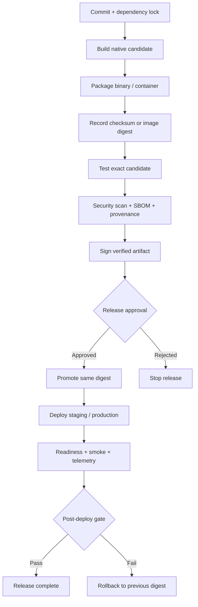

# Chỉ phát hành sau khi binary hoặc container cuối cùng vượt qua kiểm chứng

> **Chương: CI/CD.** Module **SPRING_BOOT_NATIVE_IMAGE** biên dịch ứng dụng Spring Boot thành GraalVM Native Image bằng Spring AOT để đánh giá thời gian khởi động và bộ nhớ, đồng thời triển khai binary hoặc container native. Một native build thành công mới chỉ chứng minh compiler tạo được executable. Trước khi phát hành, nhóm cần kiểm chứng chính artifact sẽ chạy ở production, xác nhận nền tảng đích, cấu hình runtime, bảo mật, khả năng quan sát và phương án rollback. Bài học này xây dựng release gate để chỉ promotion artifact đã được kiểm tra tới môi trường tiếp theo.

## 1. Mục tiêu học tập

Sau bài học, bạn có thể:

1. Phân biệt thành công của native compilation với điều kiện đủ để phát hành.
2. Thiết kế release pipeline có các gate build, test, scan, ký artifact, approval và deploy.
3. Kiểm chứng executable trên đúng hệ điều hành và kiến trúc đích.
4. Kiểm chứng container image cuối cùng, bao gồm run image, cấu hình, health check và dependency.
5. Dùng image digest để bảo đảm staging và production chạy cùng một artifact.
6. Xác minh SBOM, provenance và chữ ký của image trước khi deploy.
7. Kiểm thử từng nền tảng trong image đa kiến trúc.
8. Theo dõi rollout, phát hiện lỗi sau deploy và rollback về digest đã biết là tốt.
9. Ghi lại bằng chứng release để có thể truy nguyên commit, toolchain, test và artifact.

## 2. Nguyên tắc: phát hành đúng artifact đã được kiểm chứng

Một pipeline có thể chạy qua các bước compile, unit test và đóng gói nhưng vẫn phát hành một image khác với image đã test. Điều này xảy ra khi pipeline build lại ở bước deploy, đổi builder/run image, thay cấu hình container hoặc dùng tag có thể bị ghi đè.

Release gate phải gắn kết quả kiểm thử với định danh bất biến của artifact:

- Với executable độc lập: dùng checksum mật mã, ví dụ SHA-256, cùng chữ ký artifact nếu tổ chức yêu cầu.
- Với container: dùng image digest dạng **repository@sha256:...**.
- Với image đa kiến trúc: lưu digest của image index/manifest list và kiểm chứng từng platform image được tham chiếu.

Tag như **latest**, **staging** hoặc **1.2.3** hữu ích để con người tra cứu, nhưng registry có thể cập nhật tag để trỏ sang digest khác. Vì vậy, dùng tag để tìm artifact trong bước build, sau đó ghi nhận digest và dùng digest cho test, promotion và deployment.



**Nếu artifact thay đổi sau khi kiểm chứng, kết quả kiểm chứng cũ không còn áp dụng.** Ví dụ, thay base image, run image, binary, resource, certificate bundle hoặc startup command đều có thể thay đổi hành vi. Artifact mới phải đi qua những gate bị ảnh hưởng trước khi phát hành.

## 3. Các giai đoạn của release gate

| Giai đoạn | Mục tiêu | Điều kiện để đi tiếp |
|---|---|---|
| Source validation | Kiểm tra commit, dependency, policy và test JVM | Source/test/quality gate pass |
| Native build | Tạo native executable bằng toolchain đã pin | Compiler exit code 0, binary tồn tại |
| Packaging | Đóng gói binary hoặc tạo OCI image cuối cùng | Package có định danh và metadata |
| Artifact verification | Chạy test trên đúng binary/image candidate | Native test, startup, readiness và smoke test pass |
| Security and supply chain | Quét lỗ hổng, tạo SBOM/provenance, ký artifact | Policy security pass, chữ ký/attestation hợp lệ |
| Approval | Xác nhận release có thể triển khai | Environment protection/approval pass |
| Promotion | Đưa cùng artifact sang registry/environment tiếp theo | Digest không thay đổi |
| Deployment verification | Kiểm tra rollout và hành vi production | Readiness, smoke, telemetry trong ngưỡng |
| Release record | Lưu bằng chứng và thông tin rollback | Có manifest, digest và report |

Các bước có thể được tổ chức thành nhiều job hoặc workflow. Điều quan trọng là mỗi gate có đầu vào, đầu ra và tiêu chí pass/fail rõ ràng.

## 4. Chuẩn bị artifact và thông tin build

Native Image phụ thuộc vào hệ điều hành, kiến trúc CPU, GraalVM distribution/version, Native Build Tools, Spring Boot, toolchain C/C++ và thư viện hệ thống. Hãy lưu thông tin này cùng artifact:

- Git commit SHA và trạng thái working tree.
- Version Spring Boot, JDK/GraalVM, Native Build Tools và Gradle/Maven.
- OS/architecture của build runner và target runtime.
- Builder image, run image hoặc Docker base image cùng digest.
- Native Image build arguments và Spring AOT configuration.
- Dependency lockfile hoặc danh sách dependency đã resolve.
- Tên artifact, checksum hoặc OCI digest.
- Test report, scan report, SBOM và provenance reference.

Không chỉ ghi tên builder image bằng tag như latest; hãy pin version hoặc digest khi có thể. Nếu builder/run image được cập nhật, đó là thay đổi đầu vào build và cần đánh giá lại artifact.

### 4.1. Native build thành công chưa đủ

Build gate nên kiểm tra tối thiểu:

1. Native compilation trả exit code 0.
2. File executable hoặc image được tạo ở đúng đường dẫn.
3. Artifact không rỗng và có quyền thực thi phù hợp.
4. Target OS/architecture khớp môi trường triển khai.
5. Build log không có cảnh báo bị policy cấm.
6. Checksum/digest được tính và lưu ngay sau khi tạo artifact.

Với Gradle, dự án thường có task nativeCompile; với Maven, task/goal phụ thuộc cấu hình Native Build Tools và Spring Boot plugin. Khi dùng Spring Boot Buildpacks, có thể tạo image native qua bootBuildImage hoặc spring-boot:build-image sau khi AOT/native configuration được bật. Hãy xác minh log cho thấy buildpack thực sự tạo native executable, không phải JVM image.

## 5. Kiểm chứng executable độc lập

Nếu phát hành binary trực tiếp, cần kiểm tra binary trong môi trường giống production:

### 5.1. Kiểm tra định dạng và dependency hệ thống

Trên Linux, có thể dùng:

```bash
file orders-service
readelf -h orders-service
readelf -d orders-service
ldd orders-service
sha256sum orders-service
```

Các lệnh giúp xác định định dạng, kiến trúc, dynamic library dependency và checksum. ldd chỉ nên dùng với executable do pipeline tin cậy tạo ra; với file không tin cậy, ưu tiên công cụ phân tích ELF tĩnh như readelf.

Một binary build trên glibc không mặc nhiên chạy trên Alpine/musl. Kiểm tra dynamic linker và thư viện hệ thống cần thiết; bảo đảm production image/host cung cấp đúng ABI. Nếu binary liên kết động, ghi nhận các thư viện runtime cần có.

### 5.2. Chạy test trên đúng target

Chạy binary trong OS/architecture tương ứng với production:

```bash
./orders-service --version
./orders-service --help
```

Nếu ứng dụng không hỗ trợ các tham số trên, dùng lệnh smoke test được thiết kế cho ứng dụng. Với web service, chạy binary, đợi readiness endpoint, gọi một request nghiệp vụ và xác nhận response. Test phải bao gồm resource, reflection, serialization, proxy, TLS certificate, locale và JNI nếu ứng dụng sử dụng các khả năng đó.

### 5.3. Gắn checksum với report

Tạo checksum sau khi hoàn tất build:

```bash
sha256sum orders-service > orders-service.sha256
sha256sum --check orders-service.sha256
```

Lưu binary, checksum, test report và build manifest trong cùng một release bundle. Nếu binary được copy hoặc tải sang runner khác, xác minh checksum trước khi test hoặc deploy. Nếu tổ chức ký binary, chữ ký phải bao phủ chính file đã kiểm chứng.

## 6. Kiểm chứng container image cuối cùng

Với container, cần test image sau khi đã đóng gói đầy đủ. Test executable trước khi đóng image không phát hiện được mọi vấn đề ở lớp container:

- Run image thiếu thư viện hệ thống, CA certificates, timezone data hoặc file resource.
- Entrypoint, command, port hoặc environment variable sai.
- User chạy container không có quyền đọc/ghi thư mục cần thiết.
- Container filesystem read-only làm ứng dụng không ghi được temp/log/cache.
- Health check hoặc readiness endpoint chưa được cấu hình.
- Runtime limit, signal handling hoặc graceful shutdown khác môi trường test.
- Base image/run image thay đổi ABI so với môi trường native build.

Spring Boot hỗ trợ tạo OCI image qua Cloud Native Buildpacks bằng Maven và Gradle. Ví dụ thông thường là **mvn spring-boot:build-image** hoặc **./gradlew bootBuildImage**; cấu hình native image phụ thuộc plugin và buildpack đang dùng. Khi chuyển AOT executable JAR thành native image qua Buildpacks, kiểm tra đúng builder, run image và biến môi trường native image theo tài liệu của phiên bản Spring Boot/Buildpacks đang pin.

### 6.1. Kiểm tra cấu hình image

Trước khi test, kiểm tra:

| Thuộc tính | Điều cần xác minh |
|---|---|
| Entrypoint/CMD | Khởi chạy đúng native executable |
| User | Chạy bằng non-root user nếu ứng dụng cho phép |
| Port | Port container khớp Service/Ingress |
| Environment | Profile, config location và biến môi trường cần thiết |
| Filesystem | Thư mục ghi tạm có quyền và dung lượng phù hợp |
| CA certificates | HTTPS outbound hoạt động với trust store dự kiến |
| Timezone/locale | Kết quả ngày giờ và định dạng phù hợp |
| Health check | Liveness/readiness phản ánh trạng thái thật |
| Resource limits | Memory/CPU đủ cho startup và tải dự kiến |
| Signals | SIGTERM được xử lý để graceful shutdown |

### 6.2. Build image candidate và lấy digest

Với Docker Buildx, có thể build và push image candidate kèm metadata:

```bash
IMAGE_TAG="registry.example.com/orders-service:candidate-12345"

docker buildx build \
    --platform linux/amd64 \
    --tag "$IMAGE_TAG" \
    --push \
    --metadata-file image-metadata.json \
    --provenance=true \
    --sbom=true \
    .

IMAGE_DIGEST="$(jq -r '."containerimage.digest"' image-metadata.json)"
IMAGE_REF="registry.example.com/orders-service@$IMAGE_DIGEST"
printf '%s\n' "$IMAGE_REF" > verified-image-ref.txt
```

--metadata-file lưu digest của kết quả build. BuildKit có thể gắn provenance và SBOM vào image index/manifest; cần kiểm tra driver/image store đang dùng hỗ trợ attestations. Khi build với driver không hỗ trợ attestations, cấu hình builder hoặc exporter phù hợp trước khi dùng các tùy chọn này.

Tag candidate giúp tìm image trong registry. Sau khi lấy digest, các bước test, scan, sign và deploy nên tham chiếu IMAGE_REF có digest. Không dùng lại tag để quyết định artifact cần phát hành.

### 6.3. Test đúng image digest

Pull image theo digest rồi chạy smoke test:

```bash
docker pull "$IMAGE_REF"
docker run --rm --entrypoint /app/orders-service "$IMAGE_REF" --version
```

Đường dẫn executable và tham số phụ thuộc image. Với web service, khởi chạy container ở chế độ detached, đợi readiness, gửi request nghiệp vụ và thu log trước khi cleanup:

```bash
set -Eeuo pipefail

container_name="orders-candidate"
cleanup() {
    docker logs "$container_name" > container-smoke.log 2>&1 || true
    docker inspect "$container_name" > container-inspect.json 2>&1 || true
    docker rm -f "$container_name" >/dev/null 2>&1 || true
}
trap cleanup EXIT

docker run -d --name orders-candidate \
    -p 18080:8080 \
    "$IMAGE_REF"

ready=0
for attempt in $(seq 1 30); do
    if curl --fail --silent http://127.0.0.1:18080/actuator/health/readiness; then
        ready=1
        break
    fi
    if [ "$(docker inspect -f '{{.State.Running}}' "$container_name" 2>/dev/null || true)" != "true" ]; then
        break
    fi
    sleep 2
done

if [ "$ready" -ne 1 ]; then
    echo "Container did not become ready before the deadline" >&2
    exit 1
fi

curl --fail --silent --show-error \
    http://127.0.0.1:18080/api/orders/health-check

```

Ví dụ cần điều chỉnh endpoint, port, authentication và thời gian chờ theo ứng dụng. Trong script CI thực tế, nếu readiness hoặc smoke request thất bại, phải trả exit code khác 0 và vẫn thu log/inspect trước cleanup. Không chỉ kiểm tra container có trạng thái Running; ứng dụng có thể đang chạy nhưng chưa bind port hoặc chưa kết nối được dependency.

### 6.4. Kiểm tra image đa kiến trúc

Nếu image hỗ trợ linux/amd64 và linux/arm64, build có thể tạo một OCI index tham chiếu nhiều manifest theo platform:

```bash
docker buildx build \
    --platform linux/amd64,linux/arm64 \
    --tag registry.example.com/orders-service:candidate-12345 \
    --push \
    --metadata-file image-metadata.json \
    --provenance=true \
    --sbom=true \
    .

docker buildx imagetools inspect \
    registry.example.com/orders-service:candidate-12345
```

Không nên chỉ test image index trên một kiến trúc rồi kết luận mọi platform đều tương thích. Hãy chạy smoke/integration test trên runner native cho từng kiến trúc đích. QEMU có thể hỗ trợ kiểm tra chức năng cơ bản trong một số pipeline, nhưng không thay thế phép đo hiệu năng hoặc xác nhận hoàn toàn hành vi JNI/native library trên máy thật.

Với mỗi platform, kiểm tra:

- OS và CPU architecture trong manifest.
- Native executable được build đúng target.
- Dynamic library và ABI có mặt trong run image.
- JNI/native library có binary đúng kiến trúc.
- Startup, health, request và graceful shutdown.
- SBOM/scan result tương ứng với platform image.

## 7. Kiểm thử chức năng và vận hành trước khi phát hành

Release gate nên kiểm tra nhiều lớp thay vì chỉ chạy một endpoint:

### 7.1. Native application tests

- Chạy native test suite đã cấu hình cho dự án.
- Kiểm tra các code path dùng reflection, resource, serialization và proxy.
- Kiểm tra profile/configuration khác nhau.
- Kiểm tra database migration, transaction, cache và messaging.
- Kiểm tra TLS, DNS, outbound HTTP và connection pool.
- Kiểm tra locale, timezone, file system và temp directory.
- Kiểm tra graceful shutdown và xử lý SIGTERM.

### 7.2. Container integration tests

Chạy image candidate cùng các dependency test như database, cache, broker hoặc mock service. Xác minh service-to-service networking, DNS, TLS, timeout, retry và authentication. Dùng cùng image digest khi chạy local integration environment và CI environment.

### 7.3. Runtime/resource tests

Đặt CPU/memory limit gần với cấu hình production. Đo startup tới readiness, RSS, CPU, thread count, request latency, error rate và restart. Native Image có thể có footprint khác JVM; cần kiểm tra OOM, throttling, thread pool và graceful shutdown dưới tải.

### 7.4. Security tests

Quét image theo digest đã push:

- OS package và thư viện native.
- Java dependencies còn nằm trong SBOM.
- CVE theo severity và exploitability policy.
- Secret hoặc private key bị copy vào image.
- User/root, quyền file, exposed port và cấu hình runtime.
- License/policy nếu tổ chức yêu cầu.

Một image nhỏ hoặc scratch không có shell không có nghĩa không có lỗ hổng. SBOM của final stage có thể không bao gồm toolchain/build dependencies ở các stage trước; nếu cần đánh giá chuỗi cung ứng đầy đủ, cấu hình SBOM scan thêm build stage/context.

## 8. SBOM, provenance và chữ ký artifact

Ba loại bằng chứng này phục vụ các câu hỏi khác nhau:

| Bằng chứng | Câu hỏi |
|---|---|
| SBOM | Artifact chứa những package, thư viện và thành phần nào? |
| Provenance | Artifact được tạo từ source, builder, tham số và môi trường nào? |
| Signature | Artifact có đúng là được danh tính/khóa đáng tin cậy ký không và nội dung có bị thay đổi không? |

Với Docker Buildx, --sbom=true yêu cầu tạo SBOM attestation; --provenance=true yêu cầu tạo provenance attestation. Provenance mặc định của BuildKit có thể ở mức tối thiểu; chọn mức đầy đủ theo policy của tổ chức. Hãy kiểm tra attestations được lưu cùng image và registry có bảo toàn chúng.

### 8.1. Ký image theo digest

Sau khi image vượt qua test và security gate, có thể ký bằng Sigstore Cosign:

```bash
cosign sign "$IMAGE_REF"
```

Luôn ký digest thay vì tag để chữ ký gắn với đúng image đã kiểm chứng. Với keyless signing, pipeline dùng OIDC identity để lấy chứng thư ngắn hạn; với key/KMS, quản lý quyền truy cập và rotation theo chính sách tổ chức.

Với image đa kiến trúc, xác định policy ký của tổ chức: chữ ký trên OCI index xác nhận manifest list được phát hành; nếu policy yêu cầu ký cả từng manifest theo platform, dùng chế độ recursive của Cosign và xác minh các manifest tương ứng.

### 8.2. Verify chữ ký trước deploy

Ví dụ xác minh keyless signature:

```bash
cosign verify "$IMAGE_REF" \
    --certificate-identity "$EXPECTED_CERTIFICATE_IDENTITY" \
    --certificate-oidc-issuer "$EXPECTED_OIDC_ISSUER"
```

Pipeline production cần pin danh tính signer và OIDC issuer được phép. Không dùng regex rộng hoặc bỏ qua claim validation trong release gate. Nếu tổ chức dùng public key/KMS thay keyless signing, xác minh bằng đúng public key hoặc trust policy đã quản lý.

### 8.3. Verify provenance và policy

Chữ ký chứng minh artifact được ký bởi identity phù hợp; provenance cho biết artifact được build như thế nào. Policy có thể yêu cầu:

- Source repository và commit nằm trong allowlist.
- Workflow/build service là workflow được tin cậy.
- Builder image và GraalVM version thuộc phiên bản được duyệt.
- Build parameters không chứa option bị cấm.
- SBOM có đủ metadata và không có dependency bị policy chặn.
- Image digest trong attestation trùng digest đang deploy.

Nếu attestation không tồn tại, không đọc được hoặc subject digest không khớp image, dừng promotion và điều tra.

## 9. Promotion giữa staging và production

Promotion là đưa artifact đã kiểm chứng sang môi trường khác. Với container, cách an toàn nhất là deploy cùng image digest:

```yaml
apiVersion: apps/v1
kind: Deployment
metadata:
  name: orders-service
spec:
  template:
    spec:
      containers:
        - name: orders-service
          image: registry.example.com/orders-service@sha256:REPLACE_WITH_VERIFIED_DIGEST
```

Kubernetes hỗ trợ image reference theo digest. Digest xác định một image cụ thể, tránh tình trạng tag bị thay đổi khiến các Pod mới kéo code khác với Pod cũ.

Nếu phải copy image sang registry khác, xác minh digest ở registry đích sau khi copy. Một số thao tác chuyển đổi media type hoặc manifest có thể làm digest thay đổi; nếu digest khác, artifact ở đích phải được xác minh và kiểm thử lại theo policy trước khi deploy.

Không chạy lại nativeCompile, bootBuildImage hoặc docker build trong job production deploy. Nếu rebuild vì lý do bắt buộc, đó là artifact mới: tạo digest mới, chạy lại test/scan/sign/approval và cập nhật release record.

### 9.1. Thay đổi cấu hình giữa môi trường

Staging và production có thể dùng ConfigMap, Secret, endpoint và resource limit khác nhau. Các cấu hình này cần được quản lý riêng và kiểm tra trước deploy. Không bake secret hoặc thông tin môi trường vào native binary/image.

Nếu thay đổi cấu hình làm thay đổi hành vi quan trọng, hãy có smoke test cho cấu hình production-like. Đảm bảo native executable nhận được trust store, timezone, writable directory, port, profile và environment variable như dự kiến.

## 10. Approval, deployment protection và quyền hạn

Production deployment nên có một gate approval độc lập với build:

- Chỉ branch/tag hoặc workflow đáng tin cậy được deploy.
- Chỉ release job được truy cập production credentials.
- Approval gắn với commit và image digest cụ thể.
- Job production verify lại signature, provenance và policy trước khi deploy.
- Secret chỉ được cấp sau khi environment protection rules đã pass.
- Không cho pull request từ fork truy cập production signing/deploy credentials.

Với GitHub Actions, có thể dùng Environment protection rules để yêu cầu reviewer, giới hạn branch và kiểm soát secret theo environment. CI provider khác có cơ chế tương đương như protected environment, manual approval hoặc deployment policy.

Approval không thay thế kỹ thuật kiểm chứng. Reviewer cần thấy digest, test summary, scan result, SBOM/provenance và thay đổi release để đưa ra quyết định.

## 11. Kiểm chứng sau khi deploy

Deploy thành công về mặt API chưa chứng minh ứng dụng đã phục vụ tốt. Sau rollout:

1. Kiểm tra rollout status và số replica ready.
2. Kiểm tra image digest thực tế của Pod/Task/Container trùng digest được duyệt.
3. Chạy readiness và smoke request qua đường truy cập thực tế.
4. Kiểm tra liveness, restart count, OOMKilled và lỗi startup.
5. Quan sát log, metrics và distributed traces.
6. So sánh latency, error rate, CPU/RSS và saturation với baseline.
7. Kiểm tra dependency như database, cache, broker và outbound API.
8. Giữ theo dõi trong khoảng thời gian canary/observation đã định trước khi hoàn tất release.

Với Kubernetes:

```bash
kubectl rollout status deployment/orders-service --timeout=5m
kubectl get pods -l app=orders-service -o wide
kubectl describe deployment orders-service
```

Kiểm tra image ID/digest trên Pod đang chạy để bảo đảm rollout dùng đúng artifact. kubectl rollout status chỉ xác nhận tiến trình rollout theo readiness; smoke test và telemetry vẫn cần thiết để phát hiện lỗi nghiệp vụ.

## 12. Rollback về artifact đã biết là tốt

Trước khi release, lưu digest hiện tại và digest mới. Nếu post-deploy gate thất bại, rollback về digest cũ đã từng chạy ổn định:

```bash
kubectl set image deployment/orders-service \
    orders-service=registry.example.com/orders-service@sha256:PREVIOUS_VERIFIED_DIGEST

kubectl rollout status deployment/orders-service --timeout=5m
```

Có thể dùng Helm revision hoặc GitOps revert nếu đó là cơ chế quản lý deployment. Dù dùng cách nào, rollback phải khôi phục cả cấu hình tương thích với image trước đó.

Database migration cần hỗ trợ rollback an toàn. Ưu tiên migration tương thích ngược theo kiểu expand/contract:

1. Thêm schema mới mà code cũ vẫn đọc/ghi được.
2. Deploy code mới và kiểm chứng.
3. Chuyển dữ liệu/traffic.
4. Chỉ xóa schema cũ sau khi không còn cần rollback về code cũ.

Nếu migration phá vỡ tương thích ngược, rollback image có thể không đủ để phục hồi dịch vụ.

## 13. Release manifest và bằng chứng kiểm chứng

Mỗi release nên có một manifest liên kết source, toolchain, artifact và kết quả gate. Ví dụ:

```json
{
  "service": "orders-service",
  "sourceCommit": "COMMIT_SHA",
  "build": {
    "graalvmVersion": "GRAALVM_VERSION",
    "springBootVersion": "SPRING_BOOT_VERSION",
    "nativeBuildToolsVersion": "NATIVE_BUILD_TOOLS_VERSION",
    "targetPlatforms": ["linux/amd64"]
  },
  "artifact": {
    "type": "container",
    "reference": "registry.example.com/orders-service@sha256:DIGEST",
    "builderImageDigest": "sha256:BUILDER_DIGEST",
    "runImageDigest": "sha256:RUN_IMAGE_DIGEST"
  },
  "verification": {
    "nativeTests": "passed",
    "containerSmokeTest": "passed",
    "vulnerabilityScan": "passed",
    "sbom": "attached",
    "provenance": "attached",
    "signature": "verified"
  },
  "deployment": {
    "environment": "production",
    "approval": "APPROVAL_REFERENCE",
    "rollbackDigest": "sha256:PREVIOUS_DIGEST"
  }
}
```

Các giá trị trong ví dụ là placeholder. Không đưa secret, token hoặc thông tin nhạy cảm vào release manifest. Lưu manifest cùng log, JUnit report, native smoke test, vulnerability report, SBOM, provenance và chữ ký.

## 14. Ma trận release gate

| Gate | Pass | Fail |
|---|---|---|
| Source | Commit và dependency được xác định, test source pass | Working tree không rõ nguồn, test/quality fail |
| Native build | Exit code 0, binary/image tồn tại | Compiler/linker fail, artifact thiếu |
| Artifact identity | Checksum/digest được ghi nhận | Không xác định được artifact đã test |
| Platform | OS/architecture và native dependencies khớp | Sai architecture/ABI hoặc thiếu library |
| Native tests | Test thực sự chạy, report hợp lệ | Test fail, skipped ngoài policy hoặc report thiếu |
| Final image | Đúng digest, startup/readiness/smoke pass | Chỉ test binary trung gian hoặc image khác |
| Security | Scan đạt policy, SBOM/provenance hợp lệ | Vulnerability bị chặn, thiếu attestation bắt buộc |
| Signature | Chữ ký hợp lệ, signer được tin cậy | Sai signer, digest hoặc signature |
| Approval | Production environment approval pass | Chưa được duyệt |
| Promotion | Digest không đổi giữa môi trường | Rebuild hoặc digest thay đổi không được kiểm chứng |
| Deployment | Rollout, smoke và telemetry đạt ngưỡng | Crash, OOM, readiness fail hoặc error rate vượt ngưỡng |
| Rollback | Có digest trước đó và cách khôi phục | Không xác định được artifact để rollback |

Nếu một gate không áp dụng, ghi rõ lý do và gate thay thế. Không coi một bước bị bỏ qua hoặc không có dữ liệu là pass.

## 15. Ví dụ pipeline ở mức khái niệm

Pipeline sau minh họa cách tách build, verify và deploy. Tên task, action và secret cần điều chỉnh theo CI provider và cấu hình thực tế:

```yaml
stages:
  - validate
  - build-native
  - package-candidate
  - verify-candidate
  - secure-artifact
  - approve-release
  - deploy
  - post-deploy-check

build-native:
  script:
    - run-jvm-tests
    - run-native-build
    - save-native-build-log
  artifacts:
    - native-executable
    - native-build-report

package-candidate:
  needs: [build-native]
  script:
    - build-final-container
    - push-candidate-image
    - capture-image-digest
  artifacts:
    - image-digest.txt
    - build-metadata.json

verify-candidate:
  needs: [package-candidate]
  script:
    - pull-image-by-digest
    - run-native-integration-tests
    - run-container-smoke-tests
    - scan-image-by-digest
  artifacts:
    - junit-reports
    - smoke-test-log
    - vulnerability-report

secure-artifact:
  needs: [verify-candidate]
  script:
    - verify-sbom-and-provenance
    - sign-image-digest
    - verify-image-signature
    - write-release-manifest
  artifacts:
    - release-manifest.json

deploy-production:
  needs: [secure-artifact]
  environment: production
  when: manual
  script:
    - verify-release-manifest
    - deploy-the-same-image-digest
    - wait-for-rollout
    - run-post-deploy-smoke-tests
```

Pipeline thực tế phải cấu hình dependency giữa job sao cho test fail thì security/release/deploy không được chạy. Bước thu thập artifact nên chạy cả khi job thất bại để giữ log và report. Approval chỉ mở sau khi toàn bộ bằng chứng của candidate đã có.

## 16. Lỗi thường gặp

| Triệu chứng | Nguyên nhân có thể | Cách xử lý |
|---|---|---|
| Native build pass nhưng container crash | Run image thiếu thư viện, CA hoặc resource | Test image cuối trong môi trường target |
| Staging pass nhưng production chạy code khác | Deploy theo tag có thể thay đổi hoặc rebuild | Deploy bằng digest và kiểm tra digest thực tế |
| Binary chạy trên runner nhưng không chạy trên production | Sai OS/architecture, glibc/musl hoặc dynamic dependency | Build/test trên target platform và kiểm tra ABI |
| AMD64 pass nhưng ARM64 fail | Chỉ test một manifest/platform | Chạy test trên runner native cho từng architecture |
| Image scan pass nhưng thiếu dependency build-time | SBOM chỉ scan final stage | Mở rộng SBOM scan sang build stage/context |
| Signature hợp lệ nhưng không đúng image | Ký theo tag hoặc không kiểm tra digest claim | Ký và verify theo digest |
| Rollout pass nhưng API lỗi | Readiness chỉ kiểm tra trạng thái process | Thêm smoke request và theo dõi telemetry |
| Rollback không khôi phục được | Image cũ hoặc config cũ không còn | Giữ digest/config release trước và test rollback |
| Release job build lại image | Build và deploy không dùng cùng artifact | Tách build/verify khỏi deploy; promote digest đã kiểm chứng |
| Test bị skip nhưng release vẫn chạy | Gate chỉ kiểm tra exit code mà không kiểm tra report | Kiểm tra test count, skipped và report bắt buộc |

## 17. Bài tập thực hành

Một dịch vụ Spring Boot được build thành native container cho linux/amd64 và linux/arm64. Staging chạy tốt, nhưng production đôi lúc chạy một version khác do tag stable được cập nhật bởi pipeline khác.

Thực hiện:

1. Build multi-platform image và push candidate tag.
2. Lấy OCI index digest từ Buildx metadata.
3. Dùng runner AMD64 và ARM64 để pull đúng digest, chạy native integration và smoke tests.
4. Tạo SBOM/provenance, quét image theo digest và ký digest sau khi gate pass.
5. Verify signature bằng signer identity/issuer được cho phép.
6. Ghi image digest và kết quả test vào release manifest.
7. Deploy staging bằng digest; kiểm tra Pod image ID trùng release manifest.
8. Yêu cầu approval production, sau đó deploy đúng digest đó.
9. Chạy post-deploy smoke test và quan sát error rate, latency, RSS, restart/OOM.
10. Cố ý làm smoke test fail và diễn tập rollback về digest trước đó.

Mẫu báo cáo:

| Hạng mục | Kết quả |
|---|---|
| Source commit | … |
| Native toolchain | … |
| Platform manifests | … |
| OCI index digest | … |
| AMD64 native test | Pass/Fail |
| ARM64 native test | Pass/Fail |
| Container smoke test | Pass/Fail |
| Vulnerability scan | Pass/Fail |
| SBOM/provenance | Có/Không |
| Signature verification | Pass/Fail |
| Staging digest | … |
| Production digest | … |
| Rollback digest | … |

## 18. Câu hỏi tự kiểm tra

1. Vì sao native compilation thành công chưa đủ để phát hành?
2. Checksum của executable và OCI image digest khác nhau như thế nào?
3. Vì sao không nên test bằng tag rồi deploy bằng một tag khác?
4. Khi nào cần kiểm thử riêng image đa kiến trúc?
5. Vì sao container cuối cùng phải được test sau khi đóng gói?
6. SBOM và provenance cung cấp hai loại thông tin nào?
7. Vì sao chữ ký phải gắn với digest và cần xác minh signer identity?
8. Vì sao production deploy không nên build lại image?
9. Readiness, smoke test và telemetry sau deploy bổ sung cho nhau như thế nào?
10. Những điều kiện nào có thể khiến rollback image không đủ để khôi phục dịch vụ?

## Ghi nhớ

**Release gate phải bảo đảm artifact được test chính là artifact được deploy.** Tạo binary/container candidate, ghi checksum hoặc digest, kiểm chứng trên đúng nền tảng và runtime cuối, quét bảo mật, lưu SBOM/provenance, ký digest, lấy approval rồi promote cùng artifact. Sau deploy, kiểm tra rollout, readiness, smoke request và telemetry; nếu gate thất bại, rollback về digest đã biết là tốt.

## Tài liệu tham khảo chính thức

- [Spring Boot — Advanced Native Image Topics](https://docs.spring.io/spring-boot/reference/packaging/native-image/advanced-topics.html): chuyển executable JAR đã xử lý AOT thành native image bằng Buildpacks hoặc GraalVM.
- [Spring Boot — Packaging OCI Images with Maven](https://docs.spring.io/spring-boot/maven-plugin/build-image.html): builder, run image, platform, tags, cache và cấu hình image.
- [Spring Boot — Packaging OCI Images with Gradle](https://docs.spring.io/spring-boot/gradle-plugin/packaging-oci-image.html): bootBuildImage và cấu hình Buildpacks.
- [Docker — Buildx build](https://docs.docker.com/reference/cli/docker/buildx/build/): platform, push, metadata file và image digest.
- [Docker — Build attestations](https://docs.docker.com/build/metadata/attestations/): SBOM/provenance và cách gắn attestation vào image.
- [Docker — SBOM attestations](https://docs.docker.com/build/metadata/attestations/sbom/): nội dung SBOM và phạm vi scan build stage/context.
- [Docker — Provenance attestations](https://docs.docker.com/build/metadata/attestations/slsa-provenance/): thông tin nguồn và quy trình tạo image.
- [Kubernetes — Images](https://kubernetes.io/docs/concepts/containers/images/): dùng digest để pin đúng image và tránh tag mutable.
- [Sigstore — Signing containers](https://docs.sigstore.dev/cosign/signing/signing_with_containers/): ký image bằng Cosign và attestations.
- [Sigstore — Verifying signatures](https://docs.sigstore.dev/cosign/verifying/verify/): xác minh chữ ký, digest claim và signer identity.
- [GitHub Actions — Deployment environments](https://docs.github.com/en/actions/concepts/workflows-and-actions/deployment-environments): approval, branch restrictions, deployment protection và environment secrets.
