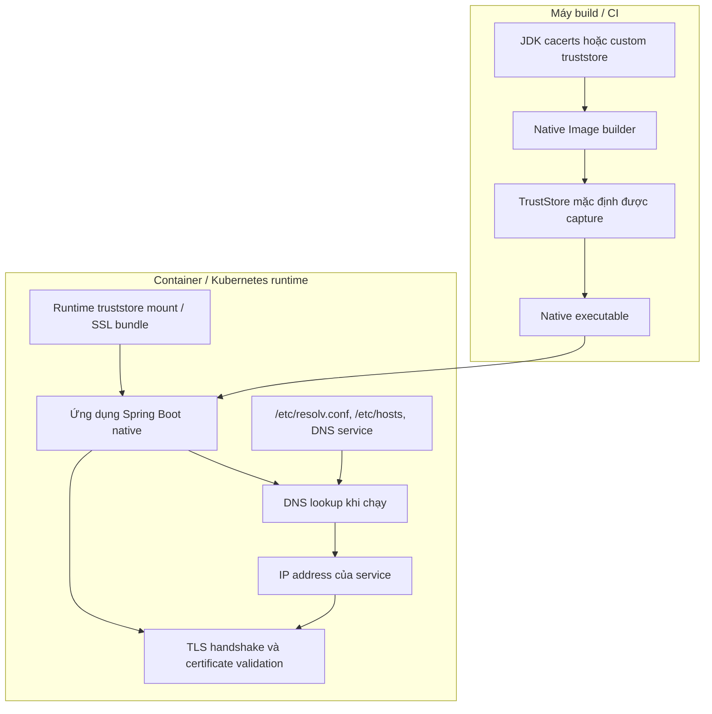

# Chứng thư, truststore, DNS và sự khác nhau giữa máy build với môi trường chạy

## 1. Vì sao cần tách cấu hình bảo mật và mạng theo thời điểm?

Một Spring Boot service thường kết nối HTTPS tới API nội bộ, database có TLS, message broker, LDAP hoặc dịch vụ cloud. Các kết nối này phụ thuộc vào hai nhóm thông tin:

- **Trust material:** chứng thư CA mà ứng dụng tin cậy, chứng thư và private key của chính ứng dụng, cấu hình TLS và hostname verification.
- **Network environment:** DNS resolver, `/etc/hosts`, DNS search domains, proxy, route và chính sách mạng của container hoặc Kubernetes Pod.

Trên JVM, ứng dụng thường đọc truststore và cấu hình mạng của môi trường đang chạy. Với GraalVM Native Image, một phần trust material mặc định được thu thập ở **build time**, trong khi DNS thông thường được phân giải ở **runtime** theo cấu hình mạng của môi trường triển khai.

Nếu không phân biệt hai thời điểm, một executable build thành công trên máy developer có thể thất bại trong production: máy build tin CA nội bộ nhưng image không chứa CA của production; hoặc máy build phân giải được hostname nhưng Pod không có DNS search domain đúng. Ngược lại, một truststore được capture từ máy build có thể đưa CA chỉ dành cho dev vào executable phát hành.

Sau bài học, bạn có thể:

- Phân biệt truststore và keystore, CA root và server certificate.
- Giải thích cách GraalVM Native Image capture default TrustStore ở build time.
- Chọn giữa truststore embed vào executable và truststore mount tại runtime.
- Cấu hình Spring Boot SSL Bundles cho JKS/PKCS12 và PEM.
- Kiểm tra DNS runtime, cache TTL và search domains trong Docker/Kubernetes.
- Phân tích lỗi TLS, hostname verification và DNS bằng công cụ phù hợp.
- Thiết kế kiểm thử chạy trên đúng native executable và container production.

## 2. Phân biệt truststore, keystore và certificate chain

### 2.1. Truststore và keystore có vai trò khác nhau

| Thành phần | Chứa gì? | Dùng khi nào? |
|---|---|---|
| Truststore | CA certificate hoặc certificate được ứng dụng tin cậy | Xác minh certificate của server khi client kết nối TLS; xác minh client certificate khi server yêu cầu mTLS |
| Keystore | Certificate của chính ứng dụng và private key tương ứng | Server trình bày danh tính TLS; client trình bày client certificate khi dùng mTLS |
| Certificate chain | Leaf/server certificate và các intermediate CA dẫn tới trust anchor | Cho bên kia xác minh đường dẫn từ certificate đầu cuối tới CA được tin cậy |

Ví dụ khi `order-service` gọi `https://inventory.internal.example`:

- `order-service` cần truststore chứa CA phát hành certificate của inventory service.
- Inventory service cần gửi leaf certificate cùng intermediate certificate cần thiết.
- Nếu inventory yêu cầu mutual TLS, `order-service` còn cần keystore chứa client certificate và private key.

### 2.2. Nên tin CA thay vì nhập tùy tiện leaf certificate

Trong hệ thống nội bộ, thường nên thêm root CA hoặc intermediate CA do tổ chức quản lý vào truststore. Server cần gửi đủ intermediate certificate để client xây dựng certificate chain.

Chỉ import leaf certificate khi tổ chức chủ động dùng certificate pinning và có quy trình xoay vòng certificate. Nếu import leaf certificate của một server vào truststore, khi server thay certificate, ứng dụng có thể phải cập nhật trust material ngay cả khi certificate mới vẫn được ký bởi cùng CA.

Không tắt hostname verification hoặc dùng trust-all manager để xử lý lỗi certificate. Trust chain hợp lệ vẫn chưa đủ: hostname trong URL phải khớp Subject Alternative Name (SAN) của certificate, certificate phải còn hạn và đồng hồ hệ thống phải chính xác.

### 2.3. Tạo và kiểm tra PKCS12 truststore

Ví dụ import CA nội bộ vào PKCS12:

```bash
keytool -importcert -noprompt \
  -alias company-root-ca \
  -file company-root-ca.pem \
  -keystore internal-truststore.p12 \
  -storetype PKCS12 \
  -storepass "$TRUSTSTORE_PASSWORD"
```

Liệt kê certificate đã import:

```bash
keytool -list -v \
  -keystore internal-truststore.p12 \
  -storetype PKCS12 \
  -storepass "$TRUSTSTORE_PASSWORD"
```

Kiểm tra subject, issuer, validity dates và fingerprint. So sánh fingerprint với nguồn CA được quản lý chính thức trước khi đưa certificate vào truststore.

## 3. Default TrustStore của GraalVM Native Image

### 3.1. Native Image capture truststore từ máy build

Theo cơ chế mặc định của GraalVM Native Image, trong quá trình build, Native Image builder capture default TrustStore của môi trường build và embed nội dung certificate vào executable. TrustStore này thường được tạo từ file root certificates trong JDK đang dùng để build.

Hệ quả:

- Executable có thể xác minh TLS bằng các CA đã được capture mà không cần mang theo file `cacerts` của JDK trên máy chạy.
- Certificate store mặc định phản ánh trust material của máy build tại thời điểm tạo image.
- Nếu container production có thêm CA trong hệ điều hành nhưng CA đó không có trong truststore đã capture, không nên mặc định rằng native executable sẽ tự đọc các CA mới từ container.
- Nếu build trên máy có corporate proxy CA, CA đó có thể được embed vào artifact và được tin cậy trong mọi môi trường triển khai artifact đó.

Đây là khác biệt quan trọng so với cách nhiều đội vận hành JVM: cập nhật file truststore trong base image hoặc mount một file CA vào container không tự động thay đổi truststore đã được embed trong native executable.

GraalVM cũng đọc danh sách certificate không tin cậy từ `<java.home>/lib/security/blacklisted.certs` trong lúc build. Danh sách này được dùng khi xác minh certificate ở cả build time và runtime, kể cả khi ứng dụng thay truststore bằng file runtime. Vì vậy, việc cập nhật blacklist trong JDK của container sau khi executable đã build không tự động cập nhật danh sách blacklist đã capture; cần kiểm soát JDK/GraalVM build version và rebuild khi cần cập nhật security data này.

### 3.2. Sơ đồ build time và runtime



Truststore mặc định được capture là dữ liệu build-time. DNS lookup thông thường xảy ra lúc ứng dụng chạy và dùng cấu hình resolver của container/Pod. Nếu code của ứng dụng chủ động resolve hostname trong static initializer được chạy ở build time, kết quả đó lại có thể bị lưu vào image heap; không nên thực hiện network lookup trong code được build-time initialize.

### 3.3. Capture custom truststore ở build time

Nếu một executable chỉ được phát hành cho một môi trường có CA ổn định, có thể cấu hình truststore riêng trong lúc build:

```bash
native-image \
  -J-Djavax.net.ssl.trustStore=/workspace/certs/production-truststore.p12 \
  -J-Djavax.net.ssl.trustStoreType=PKCS12 \
  -J-Djavax.net.ssl.trustStorePassword="$BUILD_TRUSTSTORE_PASSWORD" \
  -jar target/order-service.jar \
  order-service
```

`-J` chuyển system property vào JVM chạy Native Image builder. File truststore phải có mặt và đọc được trên máy build. Native Image capture nội dung certificate; file không cần có trên target runtime chỉ để phục vụ default TrustStore đã embed.

Nếu dùng Maven Native Build Tools, các option tương ứng có thể được truyền qua `buildArgs`:

```xml
<plugin>
    <groupId>org.graalvm.buildtools</groupId>
    <artifactId>native-maven-plugin</artifactId>
    <configuration>
        <buildArgs>
            <buildArg>-J-Djavax.net.ssl.trustStore=${env.BUILD_TRUSTSTORE_PATH}</buildArg>
            <buildArg>-J-Djavax.net.ssl.trustStoreType=PKCS12</buildArg>
            <buildArg>-J-Djavax.net.ssl.trustStorePassword=${env.BUILD_TRUSTSTORE_PASSWORD}</buildArg>
        </buildArgs>
    </configuration>
</plugin>
```

Với Gradle Native Build Tools:

```groovy
graalvmNative {
    binaries {
        main {
            buildArgs.addAll(
                    "-J-Djavax.net.ssl.trustStore=${System.getenv('BUILD_TRUSTSTORE_PATH')}",
                    '-J-Djavax.net.ssl.trustStoreType=PKCS12',
                    "-J-Djavax.net.ssl.trustStorePassword=${System.getenv('BUILD_TRUSTSTORE_PASSWORD')}"
            )
        }
    }
}
```

Các đoạn cấu hình trên minh họa cách truyền property; hãy dùng secret store của CI, không commit password hoặc file truststore chứa private key vào repository. Nếu build log hiển thị command line đầy đủ, kiểm tra masking và chính sách lưu log của CI. Với truststore chỉ dùng để xác minh server, thường chỉ cần CA certificates; không đưa private key của ứng dụng vào truststore này.

### 3.4. Khi nào không nên embed truststore theo môi trường?

Không nên embed truststore riêng của dev/test/prod vào một executable dùng chung nếu các môi trường có trust policy khác nhau. Một artifact có CA dev được embed có thể vô tình tin cậy endpoint dev khi chạy production.

Build-time truststore phù hợp khi:

- Danh sách CA giống nhau trong mọi môi trường dùng artifact.
- Trust material thay đổi theo release và quy trình build/deploy có thể phát hành lại executable khi CA thay đổi.
- Tổ chức muốn trust policy bất biến theo artifact.

Truststore runtime phù hợp khi:

- CA do nền tảng triển khai cấp và thay đổi độc lập với application release.
- Mỗi khách hàng hoặc cluster có trust roots khác nhau.
- CA cần xoay vòng mà không rebuild executable.
- Secret/certificate được mount bằng Kubernetes Secret hoặc secret manager.

## 4. Thay default TrustStore tại runtime

### 4.1. Runtime `javax.net.ssl.trustStore*` properties

GraalVM hỗ trợ thay default TrustStore khi executable chạy bằng các system properties:

- `javax.net.ssl.trustStore`
- `javax.net.ssl.trustStoreType`
- `javax.net.ssl.trustStoreProvider`
- `javax.net.ssl.trustStorePassword`

Nếu bất kỳ property nào trong nhóm này được đặt lúc runtime, `javax.net.ssl.trustStore` cũng phải được đặt và phải trỏ tới một file certificate store có thể đọc được. Nếu không, Native Image có thể ném `UnsupportedFeatureError`.

Ví dụ:

```bash
./order-service \
  -Djavax.net.ssl.trustStore=/run/secrets/internal-truststore.p12 \
  -Djavax.net.ssl.trustStoreType=PKCS12 \
  -Djavax.net.ssl.trustStorePassword="$INTERNAL_TRUSTSTORE_PASSWORD"
```

Đường dẫn phải tồn tại bên trong container, không phải đường dẫn trên máy host. Mount secret read-only và giới hạn quyền đọc cho user chạy ứng dụng.

Không đặt riêng `javax.net.ssl.trustStorePassword` mà quên đường dẫn truststore. Hành vi này khác với một số kỳ vọng khi chạy HotSpot: Native Image không thể fallback tới `cacerts` trong JDK runtime nếu file đó không tồn tại bên cạnh executable.

### 4.2. Cẩn thận với password và process arguments

Truyền password bằng command-line argument có thể làm lộ giá trị qua process inspection, crash report hoặc log khởi động. Với ứng dụng production, ưu tiên cấu hình client TLS theo Spring SSL Bundle và lấy password từ secret injection của nền tảng. Nếu bắt buộc dùng global JSSE properties, đặt chúng trước khi bất kỳ client/SSLContext nào được tạo và áp dụng quy trình bảo vệ secret phù hợp.

Không nhúng truststore password vào `application.yml` đã commit hoặc vào `Dockerfile ENV`. Native executable không biến một secret đã đóng gói thành secret an toàn.

### 4.3. Global JSSE truststore và Spring SSL Bundle không phải một cấu hình

`javax.net.ssl.trustStore` thay đổi default TrustStore mà JSSE sử dụng. Spring SSL Bundle là một bộ trust/key material có tên, được Spring Boot cấu hình và áp dụng cho những server/client được chỉ định.

Hai cách có thể cùng tồn tại:

- Dùng default JSSE truststore cho các thư viện dựa vào default `SSLContext`.
- Dùng SSL Bundle riêng cho một client gọi một API nội bộ với CA riêng.

Nếu cấu hình SSL Bundle cho một client, hãy kiểm tra client thực sự dùng bundle đó. Không giả định mọi thư viện HTTP, database driver hoặc SDK đều tự động lấy cùng một Spring SSL Bundle.

## 5. Cấu hình Spring Boot SSL Bundles

### 5.1. Truststore JKS/PKCS12 cho outbound HTTPS

Spring Boot hỗ trợ named SSL Bundles qua prefix `spring.ssl.bundle`. Ví dụ cấu hình truststore riêng cho inventory API:

```yaml
spring:
  ssl:
    bundle:
      jks:
        inventory-api:
          truststore:
            location: file:/run/secrets/inventory-truststore.p12
            password: ${INVENTORY_TRUSTSTORE_PASSWORD}
            type: PKCS12
```

Truststore ở trên được đọc từ filesystem runtime. Vì vậy, container phải mount file tại `/run/secrets/inventory-truststore.p12`. Nếu dùng `classpath:inventory-truststore.p12`, resource phải được đóng gói vào native image theo cách ứng dụng truy cập được.

### 5.2. Áp dụng bundle cho WebClient

Ví dụ theo API Spring Boot 4.2:

```java
package com.example.orders.inventory;

import org.springframework.boot.webclient.autoconfigure.WebClientSsl;
import org.springframework.beans.factory.annotation.Value;
import org.springframework.stereotype.Component;
import org.springframework.web.reactive.function.client.WebClient;

@Component
public class InventoryClient {

    private final WebClient webClient;

    public InventoryClient(
            WebClient.Builder builder,
            WebClientSsl ssl,
            @Value("${inventory.base-url}") String baseUrl) {
        this.webClient = builder
                .baseUrl(baseUrl)
                .apply(ssl.fromBundle("inventory-api"))
                .build();
    }

    public WebClient webClient() {
        return webClient;
    }
}
```

Spring Boot cũng hỗ trợ áp dụng SSL Bundle cho `RestClient` qua `RestClientSsl`. Nếu dùng Spring Boot 3.x, kiểm tra package/import tương ứng với minor version thay vì sao chép package 4.x.

### 5.3. Truststore PEM

Nếu nền tảng cung cấp CA dưới dạng PEM, có thể dùng bundle PEM:

```yaml
spring:
  ssl:
    bundle:
      pem:
        inventory-api:
          truststore:
            certificate: file:/run/secrets/inventory-ca.pem
```

Hoặc dùng `classpath:` nếu certificate là resource được phát hành cùng ứng dụng. PEM truststore chứa certificate CA được tin cậy; nó không cần private key của server bên kia.

### 5.4. Keystore cho HTTPS inbound

Khi native executable mở HTTPS server, ứng dụng cần certificate và private key của chính nó. Ví dụ:

```yaml
spring:
  ssl:
    bundle:
      jks:
        web-server:
          key:
            alias: order-service
          keystore:
            location: file:/run/secrets/order-service.p12
            password: ${SERVER_KEYSTORE_PASSWORD}
            type: PKCS12

server:
  ssl:
    bundle: web-server
```

Đây là keystore của server, khác với truststore dùng để xác minh server certificate khi outbound. Nếu bật mTLS, server còn cần truststore để xác minh certificate của client và cấu hình `client-auth` phù hợp.

### 5.5. Reload certificate khi file được cập nhật

Spring Boot hỗ trợ `reload-on-update` cho một số SSL Bundle và consumer tương thích. Ví dụ PEM bundle dùng cho embedded Tomcat/Netty server có thể đọc certificate và private key từ file, sau đó reload khi file thay đổi.

```yaml
spring:
  ssl:
    bundle:
      pem:
        web-server:
          reload-on-update: true
          keystore:
            certificate: file:/run/secrets/fullchain.pem
            private-key: file:/run/secrets/privkey.pem

server:
  ssl:
    bundle: web-server
```

Không giả định mọi HTTP client hoặc database driver tự reload SSL context. Spring Boot hiện tài liệu hóa khả năng reload cho một số consumer như Tomcat và Netty server; kiểm tra consumer cụ thể trước khi dựa vào cơ chế này.

## 6. URL protocol và TLS support trong Native Image

### 6.1. HTTPS không chỉ là một truststore

Một kết nối HTTPS cần nhiều bước:

1. Phân giải hostname thành địa chỉ IP.
2. Thiết lập TCP connection.
3. Thực hiện TLS handshake.
4. Xác minh certificate chain và hostname.
5. Thực hiện HTTP request.

Truststore chỉ giải quyết bước xác minh trust chain. Nếu native executable thiếu URL handler, DNS không phân giải được hoặc client library thiếu native support, việc thêm CA vào truststore sẽ không sửa được lỗi đó.

### 6.2. JDK `URL`/`HttpsURLConnection` có handler riêng

Native Image chỉ đưa URL protocol handlers có thể reachable vào executable. Theo tài liệu GraalVM hiện hành, `file` và `resource` được bật mặc định; các JDK handler như `http` và `https` cần metadata cho constructor của handler nếu ứng dụng dùng `URL.openConnection()` hoặc `HttpsURLConnection`.

Ví dụ metadata cho HTTPS handler:

```json
{
  "reflection": [
    {
      "type": "sun.net.www.protocol.https.Handler",
      "methods": [
        {
          "name": "<init>",
          "parameterTypes": []
        }
      ]
    }
  ]
}
```

Đặt file trong `META-INF/native-image/<groupId>/<artifactId>/reachability-metadata.json` trên classpath. Nếu ứng dụng cũng dùng `http` URL handler, đăng ký `sun.net.www.protocol.http.Handler` tương tự.

Các option `--enable-http`, `--enable-https` và `--enable-url-protocols` đã được đánh dấu deprecated trong tài liệu Native Image mới; ưu tiên reachability metadata theo version GraalVM đang sử dụng. Không thêm metadata URL handler chỉ vì ứng dụng có URL `https://`; trước tiên xác định HTTP client thực tế dùng `java.net.URL`, JDK `HttpClient`, Reactor Netty hay Apache HttpClient.

## 7. DNS được phân giải ở đâu?

### 7.1. JDK resolver dùng cấu hình của môi trường chạy

JDK `InetAddress` built-in resolver phân giải hostname bằng kết hợp cấu hình máy cục bộ và naming services như DNS hoặc LDAP. Nguồn resolver cụ thể phụ thuộc hệ điều hành và cấu hình của môi trường.

Trong trường hợp thông thường, khi native executable gọi `InetAddress.getByName("inventory")`, DNS lookup xảy ra khi executable đang chạy. Kết quả không được lấy từ máy build chỉ vì native image được biên dịch ở đó.

Các cấu hình runtime có thể ảnh hưởng:

- `/etc/hosts`: ánh xạ hostname tĩnh.
- `/etc/resolv.conf`: nameserver, search domains và resolver options trên Linux.
- Cấu hình resolver của hệ điều hành hoặc container runtime.
- DNS service của Kubernetes, Docker network hoặc DNS nội bộ của doanh nghiệp.
- DNS cache trong JDK hoặc cache của HTTP client riêng.

### 7.2. Không resolve hostname trong build-time initializer

Native Image có thể thực thi một số code trong lúc build, đặc biệt khi class được initialize ở build time. Nếu static initializer gọi DNS và lưu kết quả vào static field, IP của máy build có thể bị lưu vào image heap.

Tránh các mẫu như:

```java
static final InetAddress INVENTORY_ADDRESS = resolve("inventory.internal.example");
```

đặc biệt nếu class này có thể được initialize tại build time. Thay vào đó, giữ hostname trong configuration và để HTTP client hoặc DNS resolver phân giải lúc runtime. Không tạo connection, resolve hostname hoặc đọc cấu hình network của production trong static initializer.

### 7.3. Docker DNS

Container thường kế thừa DNS settings của host qua `/etc/resolv.conf`. Với Docker custom network, Docker cung cấp embedded DNS resolver tại `127.0.0.11` và forward truy vấn bên ngoài tới DNS server của host.

Có thể kiểm tra trong container:

```bash
cat /etc/resolv.conf
getent hosts inventory.internal.example
```

Nếu cần chỉ định DNS server cho container, Docker hỗ trợ cấu hình `--dns`. Chỉ làm điều này khi DNS server đó có thể truy cập từ network namespace của container và có quyền phân giải zone nội bộ cần thiết.

### 7.4. Kubernetes Pod DNS

Kubernetes thường cấu hình Pod với `dnsPolicy: ClusterFirst`. Kubelet tạo `/etc/resolv.conf` chứa cluster DNS server và search domains. Một Pod trong namespace `orders` có thể phân giải service `inventory` bằng tên ngắn trong namespace đó; để gọi service ở namespace khác, dùng tên có namespace hoặc FQDN.

Ví dụ DNS đầy đủ:

```text
inventory.supply.svc.cluster.local
```

Ví dụ cấu hình Pod dùng DNS mặc định:

```yaml
spec:
  dnsPolicy: ClusterFirst
  containers:
    - name: order-service
      image: example/order-service:native
```

Nếu cần DNS riêng:

```yaml
spec:
  dnsPolicy: None
  dnsConfig:
    nameservers:
      - 10.20.0.53
    searches:
      - supply.svc.cluster.local
      - svc.cluster.local
      - cluster.local
    options:
      - name: ndots
        value: "5"
  containers:
    - name: order-service
      image: example/order-service:native
```

Chỉ dùng `dnsPolicy: None` khi bạn muốn tự quản lý nameserver/search/options. Cấu hình sai có thể làm Pod mất khả năng phân giải cả service trong cluster lẫn hostname bên ngoài.

### 7.5. Ưu tiên service DNS thay vì IP cố định

Không hard-code IP của Pod, database hoặc service load balancer vào executable. Dùng Kubernetes Service DNS, internal DNS name hoặc hostname cấu hình theo môi trường. IP có thể thay đổi khi Pod được tạo lại, node thay đổi hoặc service được migrate.

Nếu cần truy cập service khác namespace, dùng `service.namespace` hoặc FQDN để tránh phụ thuộc search domain ngầm định. Điều này cũng giúp ứng dụng chạy nhất quán giữa local Docker Compose, staging và Kubernetes.

## 8. DNS cache và thay đổi địa chỉ service

### 8.1. JDK cache cả kết quả thành công và thất bại

`InetAddress` cache kết quả DNS để giảm lookup và bảo vệ ứng dụng. Các Java Security properties thường dùng:

| Security property | Ý nghĩa |
|---|---|
| `networkaddress.cache.ttl` | Số giây giữ kết quả phân giải thành công; giá trị âm nghĩa là cache vô thời hạn, `0` nghĩa là không cache |
| `networkaddress.cache.negative.ttl` | Số giây cache kết quả phân giải thất bại; mặc định thường là 10 giây theo JDK documentation |
| `networkaddress.cache.stale.ttl` | Khoảng thời gian cho phép dùng địa chỉ cũ khi refresh thất bại, nếu JDK version hỗ trợ |

Đây là **security properties**, không phải system properties. Không cấu hình chúng bằng `-Dnetworkaddress.cache.ttl=...` hoặc `System.setProperty(...)`. Có thể đặt trong `java.security` hoặc dùng `java.security.Security.setProperty(...)` trước lần DNS lookup đầu tiên.

Ví dụ đặt sớm trong entry point trước khi tạo HTTP clients:

```java
package com.example.orders;

import java.security.Security;

import org.springframework.boot.SpringApplication;
import org.springframework.boot.autoconfigure.SpringBootApplication;

@SpringBootApplication
public class OrderApplication {

    public static void main(String[] args) {
        Security.setProperty("networkaddress.cache.ttl", "30");
        Security.setProperty("networkaddress.cache.negative.ttl", "5");
        SpringApplication.run(OrderApplication.class, args);
    }
}
```

Các giá trị chỉ là ví dụ. Phải đặt trước lần lookup đầu tiên; nếu DNS đã được tra cứu, thay đổi TTL có thể không ảnh hưởng các entry đang cache. Kiểm tra hành vi trên đúng GraalVM/JDK version và resolver của HTTP client đang dùng.

### 8.2. DNS TTL và JDK cache là hai lớp khác nhau

DNS record có TTL do DNS server quản lý; JDK có cache riêng. Một DNS record hết TTL không có nghĩa `InetAddress` lập tức truy vấn lại nếu Java cache vẫn còn hiệu lực. Ngược lại, đặt Java cache TTL thấp không làm DNS server trả lời nhanh hơn hoặc bỏ qua cache ở resolver trung gian.

Với Kubernetes Service, DNS thường trả về ClusterIP ổn định của Service, còn EndpointSlice cập nhật các Pod backend. Client thường không cần resolve từng Pod IP. Với headless Service, DNS có thể trả nhiều Pod IP; khi dùng kiểu này, cache và connection pooling cần được đánh giá kỹ hơn.

### 8.3. Connection pool có thể giữ địa chỉ cũ

Ngay cả khi DNS lookup được refresh, HTTP client có thể giữ connection TCP đã mở tới IP cũ trong pool. DNS TTL không tự đóng các connection hiện tại. Khi service thay đổi endpoint, hãy kiểm tra:

- DNS cache TTL.
- Connection pool max lifetime/idle timeout.
- Retry policy khi connection cũ bị đóng.
- Load balancer hoặc Kubernetes Service behavior.

Không đặt TTL bằng 0 một cách mặc định để xử lý lỗi DNS. Chọn TTL và connection lifetime dựa trên cách service được triển khai và khả năng chịu lỗi.

## 9. Kiểm tra chứng thư và DNS trong môi trường chạy

### 9.1. Kiểm tra truststore thực sự được dùng

Trước khi build native, ghi lại:

- GraalVM distribution/version và JDK version dùng build.
- Default JDK truststore hoặc custom truststore path.
- Certificate alias, subject, issuer, validity và fingerprint.
- CA nào chỉ thuộc dev/test và CA nào được phép xuất hiện trong production.
- Truststore runtime được mount từ đâu, user nào có quyền đọc.

Khi chạy native executable, xác nhận property `javax.net.ssl.trustStore*` có đang được đặt không. Nếu không, executable dùng truststore đã capture lúc build. Nếu có, file được chỉ định phải tồn tại và đọc được trong container.

### 9.2. Kiểm tra TLS handshake

Từ môi trường network tương đương với container:

```bash
openssl s_client \
  -connect inventory.internal.example:443 \
  -servername inventory.internal.example \
  -showcerts \
  -verify_return_error
```

Nếu cần kiểm tra với CA cụ thể:

```bash
openssl s_client \
  -connect inventory.internal.example:443 \
  -servername inventory.internal.example \
  -CAfile company-root-ca.pem \
  -verify_return_error
```

Lệnh này giúp xem certificate chain và handshake. Nó không chứng minh Java native executable đang dùng đúng truststore hoặc cùng HTTP client implementation; vẫn cần chạy request thật từ ứng dụng native.

### 9.3. Kiểm tra DNS trong container/Pod

```bash
cat /etc/hosts
cat /etc/resolv.conf
getent hosts inventory.internal.example
```

Trong Kubernetes:

```bash
kubectl exec deploy/order-service -- cat /etc/resolv.conf
kubectl exec deploy/order-service -- getent hosts inventory.supply.svc.cluster.local
```

Nếu image production là distroless và không có `getent`, `nslookup` hoặc `openssl`, dùng ephemeral debug container hoặc một debug image cùng network namespace để kiểm tra. Không cần cài công cụ debug vào image production chỉ để xử lý sự cố tạm thời.

### 9.4. Kiểm tra bằng Java resolver

Một test hoặc diagnostic tạm thời trong ứng dụng có thể kiểm tra resolver mà JDK đang dùng:

```java
import java.net.InetAddress;
import java.util.Arrays;

public class DnsDiagnostic {

    public static void main(String[] args) throws Exception {
        InetAddress[] addresses = InetAddress.getAllByName(args[0]);
        Arrays.stream(addresses).forEach(address ->
                System.out.println(address.getHostAddress()));
    }
}
```

Chạy test này trên native executable trong cùng container/Pod. `getent` kiểm tra OS resolver; `InetAddress` kiểm tra resolver JDK; ứng dụng dùng Netty hoặc resolver riêng có thể cần test thêm đúng client đó.

## 10. Lỗi thường gặp và cách phân tích

| Triệu chứng | Nguyên nhân có thể | Hướng xử lý |
|---|---|---|
| `PKIX path building failed` | CA không có trong truststore được dùng, thiếu intermediate certificate hoặc truststore runtime không được nạp | Kiểm tra chain server gửi, truststore build-time capture và `javax.net.ssl.trustStore*` runtime |
| `UnsupportedFeatureError` khi tạo TrustStore | Một property `javax.net.ssl.trustStore*` đã đặt nhưng `javax.net.ssl.trustStore` không trỏ tới file đọc được | Đặt path runtime hợp lệ và mount file vào container; hoặc bỏ các override nếu muốn dùng embedded truststore |
| `No subject alternative DNS name matching ...` | Hostname trong URL không khớp SAN của server certificate | Dùng đúng DNS name có trong SAN hoặc cấp certificate đúng hostname; không tắt hostname verification |
| `CertificateExpiredException` | Certificate hết hạn, đồng hồ hệ thống sai hoặc certificate chain có phần tử hết hạn | Kiểm tra thời gian hệ thống, validity và quy trình rotate certificate |
| Chạy JVM được nhưng native báo lỗi TLS | Default TrustStore build-time khác môi trường JVM test, thiếu URL handler hoặc security provider | Kiểm tra build-time truststore, client implementation, URL protocol metadata và native runtime log |
| Dev gọi HTTPS được nhưng production lỗi | CA dev đã được capture nhưng CA production chưa có trong executable/runtime truststore | Dùng artifact trust policy phù hợp hoặc mount truststore production và cấu hình runtime |
| Production tin CA không mong muốn | Native executable được build trên máy có corporate/dev CA trong default truststore | Build bằng JDK/CA baseline sạch, kiểm soát CA capture và rà soát truststore trước phát hành |
| `UnknownHostException` | DNS name sai, resolver không truy cập được, Pod DNS policy/search domain sai | Kiểm tra `/etc/resolv.conf`, `getent`, Kubernetes DNS service và namespace suffix |
| Local chạy được nhưng Pod không phân giải tên service | Local dùng hostname/hosts file khác hoặc Pod thiếu search domain | Dùng Service DNS đúng namespace/FQDN và kiểm tra `dnsPolicy` |
| `curl` phân giải được nhưng ứng dụng native không được | HTTP client dùng resolver riêng, cache khác hoặc native support của dependency chưa đầy đủ | Test `InetAddress` và đúng Reactor Netty/HTTP client trong native executable |
| DNS trả IP cũ sau rollout | JDK cache hoặc connection pool giữ kết quả/connection cũ | Đánh giá DNS TTL, stale cache, connection max lifetime và retry |
| `https` URL handler không tìm thấy trong native | Ứng dụng dùng `URL.openConnection`/`HttpsURLConnection` nhưng handler chưa reachable | Đăng ký `sun.net.www.protocol.https.Handler` trong reachability metadata theo GraalVM version |
| Certificate mới không được nhận sau khi rotate | Truststore đã embed trong executable hoặc consumer không hỗ trợ reload | Cập nhật artifact hoặc dùng runtime SSL Bundle/TrustStore và xác minh consumer reload support |

## 11. Bài thực hành: chạy order-service trong Kubernetes với CA nội bộ

**Bối cảnh:** `order-service` là Spring Boot native application gọi `inventory.supply.svc.cluster.local` qua HTTPS. Cluster cấp CA nội bộ bằng Kubernetes Secret. Bạn cần bảo đảm truststore và DNS được đọc từ môi trường runtime.

### Bước 1 — Chuẩn bị CA và truststore

1. Nhận root/intermediate CA từ nguồn quản lý certificate chính thức.
2. Kiểm tra subject, issuer, validity và fingerprint.
3. Tạo `internal-truststore.p12` chứa CA cần thiết.
4. Lưu password trong secret manager, không commit vào source.

### Bước 2 — Cấu hình SSL Bundle

```yaml
spring:
  ssl:
    bundle:
      jks:
        inventory-api:
          truststore:
            location: file:/run/secrets/internal-truststore.p12
            password: ${INTERNAL_TRUSTSTORE_PASSWORD}
            type: PKCS12
```

Áp dụng bundle vào `WebClient` hoặc `RestClient` thực sự dùng để gọi inventory. Xác nhận client không tự tạo SSL context bỏ qua cấu hình của Spring Boot.

### Bước 3 — Mount Kubernetes Secret

```yaml
apiVersion: v1
kind: Secret
metadata:
  name: order-service-truststore
type: Opaque
data:
  internal-truststore.p12: <BASE64_FROM_SECRET_PIPELINE>
```

Deployment mount file read-only và inject password từ Secret key riêng:

```yaml
spec:
  containers:
    - name: order-service
      image: example/order-service:native
      env:
        - name: INTERNAL_TRUSTSTORE_PASSWORD
          valueFrom:
            secretKeyRef:
              name: order-service-truststore
              key: truststore-password
      volumeMounts:
        - name: truststore
          mountPath: /run/secrets
          readOnly: true
  volumes:
    - name: truststore
      secret:
        secretName: order-service-truststore
        items:
          - key: internal-truststore.p12
            path: internal-truststore.p12
```

Trong Secret thực tế, thêm key `truststore-password` theo quy trình secret management của cluster. Không lưu password dạng literal trong ConfigMap hoặc Git.

### Bước 4 — Dùng DNS Service name

Đặt base URL theo service DNS:

```yaml
inventory:
  base-url: https://inventory.supply.svc.cluster.local
```

Không lưu IP của Pod. Kiểm tra Pod `order-service` có `dnsPolicy: ClusterFirst` và có thể phân giải FQDN service.

### Bước 5 — Build và chạy native executable

Build native image với JDK/GraalVM và toolchain đã pin. Nếu dùng runtime SSL Bundle, không cần đưa truststore runtime vào build context để capture default TrustStore; truststore được mount khi container chạy.

Chạy native executable trong cùng image/container và gọi endpoint inventory. Kiểm tra TLS handshake, hostname verification, DNS resolution và retry behavior.

### Bước 6 — Kiểm tra rotate CA

Thay truststore Secret bằng bộ CA mới theo quy trình phát hành. Xác định consumer có hỗ trợ reload hay cần restart Pod. Chạy lại request HTTPS và xác nhận certificate mới được chấp nhận; đồng thời kiểm tra certificate cũ đã bị loại khỏi trust policy khi quy trình yêu cầu.

### Phiếu kết quả

| Hạng mục | Kết quả cần ghi |
|---|---|
| GraalVM/JDK version dùng build | _(ghi)_ |
| Default TrustStore được capture | _(ghi nguồn)_ |
| Runtime truststore path | _(ghi)_ |
| Truststore format | JKS / PKCS12 / PEM |
| CA subject và fingerprint | _(ghi)_ |
| Spring SSL Bundle name | _(ghi)_ |
| HTTP client implementation | _(ghi)_ |
| DNS FQDN | _(ghi)_ |
| `/etc/resolv.conf` trong Pod | _(ghi)_ |
| `InetAddress` lookup | PASS/FAIL |
| TLS handshake trên native | PASS/FAIL |
| Hostname verification | PASS/FAIL |
| CA rotation | PASS/FAIL |

## 12. Checklist trước khi phát hành

- [ ] Đã xác định truststore mặc định nào được capture ở build time.
- [ ] Đã loại CA chỉ dành cho dev/test khỏi artifact production.
- [ ] Đã phân biệt truststore với keystore và client certificate.
- [ ] Đã kiểm tra certificate chain, SAN, validity và clock.
- [ ] Nếu dùng runtime truststore, file tồn tại trong container và mọi `javax.net.ssl.trustStore*` property được cấu hình nhất quán.
- [ ] Password/private key được cung cấp qua secret manager hoặc Kubernetes Secret.
- [ ] Nếu dùng Spring SSL Bundle, đã xác minh đúng HTTP client/consumer sử dụng bundle.
- [ ] Nếu dùng `URL`/`HttpsURLConnection`, đã kiểm tra reachability metadata của URL handler.
- [ ] Không có DNS lookup hoặc network call trong static initializer/build-time initialization.
- [ ] Đã kiểm tra `/etc/resolv.conf`, `/etc/hosts`, DNS search domains và `dnsPolicy` của Pod.
- [ ] Đã kiểm thử DNS và TLS từ native executable trong container tương đương production.
- [ ] Đã kiểm tra DNS cache, connection pool và quy trình rotate certificate.

## 13. Ghi nhớ

GraalVM Native Image mặc định capture default TrustStore từ máy build và embed certificate vào executable. Vì vậy, trust policy có thể khác giữa máy build và container runtime. Có thể chọn embed truststore ổn định theo artifact hoặc mount truststore riêng ở runtime; khi runtime đặt bất kỳ `javax.net.ssl.trustStore*` property nào, phải cung cấp path truststore đọc được.

Spring Boot SSL Bundles giúp cấu hình truststore/keystore theo từng client hoặc server, hỗ trợ JKS/PKCS12 và PEM. DNS thông thường được phân giải lúc runtime theo resolver của container/Pod; Docker và Kubernetes cung cấp DNS configuration riêng, còn JDK có cache positive/negative riêng. Hãy kiểm tra đúng native executable, đúng HTTP client và đúng network namespace trước khi kết luận TLS/DNS đã hoạt động.

### Tài liệu tham khảo chính thức

- [GraalVM — Certificate Management in Native Image](https://www.graalvm.org/latest/reference-manual/native-image/dynamic-features/CertificateManagement/)
- [GraalVM — URL Protocols in Native Image](https://www.graalvm.org/latest/reference-manual/native-image/dynamic-features/URLProtocols/)
- [GraalVM — Reachability Metadata](https://www.graalvm.org/latest/reference-manual/native-image/metadata/)
- [GraalVM — Native Image Basics: Build Time and Run Time](https://www.graalvm.org/latest/reference-manual/native-image/basics/)
- [Spring Boot — SSL Bundles](https://docs.spring.io/spring-boot/reference/features/ssl.html)
- [Spring Boot — Calling REST Services and SSL Support](https://docs.spring.io/spring-boot/reference/io/rest-client.html)
- [Oracle JDK 25 — `InetAddress` and DNS Cache](https://docs.oracle.com/en/java/javase/25/docs/api/java.base/java/net/InetAddress.html)
- [Oracle JDK 25 — Networking Properties](https://docs.oracle.com/en/java/javase/25/docs/api/java.base/java/net/doc-files/net-properties.html)
- [Docker — Networking and DNS Services](https://docs.docker.com/engine/network/)
- [Kubernetes — DNS for Services and Pods](https://kubernetes.io/docs/concepts/services-networking/dns-pod-service/)
