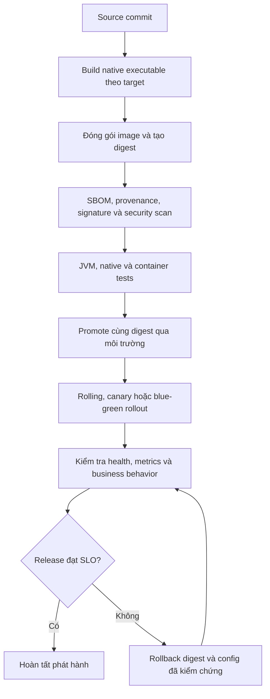

# Đóng gói, cập nhật và quay lại bản trước bằng sản phẩm đã được kiểm chứng

Vận hành Spring Boot Native Image cần một quy trình phát hành có thể truy vết từ source code tới container đang chạy. Một binary build thành công chưa đủ để đưa lên production: cần xác minh đúng kiến trúc CPU, thư viện native, cấu hình runtime, security metadata, health checks và hành vi shutdown. Khi cập nhật phiên bản, hệ thống phải thay thế instance cũ theo cách có kiểm soát; khi bản mới gặp lỗi, đội vận hành cần khôi phục đúng artifact đã chạy ổn định.

Nguyên tắc xuyên suốt bài học là **build một lần, kiểm chứng artifact, phát hành theo digest và triển khai cùng một artifact đã kiểm chứng**. Tag dễ đọc vẫn hữu ích cho người vận hành, nhưng digest của OCI image manifest hoặc index định danh chính xác nội dung đã phát hành.

## 1. Mục tiêu học tập

Sau bài học, bạn có thể:

- Chuẩn hóa native executable và container image thành release artifact có version, digest và provenance.
- Kiểm tra architecture, libc, shared libraries, CA certificates, timezone data và filesystem trước khi đóng gói.
- Tạo SBOM, build provenance, scan image và xác minh chữ ký theo policy của tổ chức.
- Tách cấu hình môi trường và secrets khỏi native executable/container image.
- Triển khai phiên bản mới bằng rolling update, canary hoặc blue-green deployment.
- Cấu hình startup, liveness và readiness probes cho Spring Boot.
- Cho ứng dụng ngừng nhận request mới và hoàn tất request đang xử lý khi container bị thay thế.
- Theo dõi rollout, xác nhận đúng image digest đang chạy và thực hiện smoke tests sau deploy.
- Rollback về release đã được kiểm chứng, bao gồm cả cấu hình tương thích.
- Nhận diện giới hạn rollback khi database schema hoặc external contract đã thay đổi.
- Lập release record và runbook đủ thông tin để điều tra, khôi phục và audit.



## 2. Release artifact của Native Image gồm những gì?

Một release production thường bao gồm nhiều thành phần liên quan:

| Thành phần | Nội dung cần quản lý | Vì sao cần |
| --- | --- | --- |
| Native executable | Binary theo OS, architecture, libc và CPU target | Chạy ứng dụng trên runtime host |
| Container image | Executable, shared libraries và runtime files cần thiết | Đơn vị triển khai được registry phân phối |
| Image digest | SHA-256 digest của image manifest hoặc multi-platform index | Định danh chính xác nội dung đã phát hành |
| SBOM | Danh sách package, dependency, version và license | Phân tích thành phần và lỗ hổng |
| Build provenance | Source commit, builder, base image, build parameters | Truy vết cách artifact được tạo |
| Signature/attestation | Chữ ký và tuyên bố gắn với digest | Xác minh nguồn phát hành và policy |
| Test evidence | JVM/native tests, container smoke tests, security scan | Chứng minh artifact đã qua kiểm chứng |
| Runtime configuration | Endpoint, resource limits, feature flags, secret references | Điều chỉnh theo môi trường mà không build lại |
| Release metadata | Version, commit SHA, digest, GraalVM version, architecture | Hỗ trợ deploy, rollback và audit |

Đối với multi-platform image, digest của OCI index đại diện cho tập hợp các image theo platform. Docker/Kubernetes chọn image con phù hợp với node, nhưng toàn bộ index vẫn được định danh bằng digest. Nếu release chỉ hỗ trợ một architecture, digest trỏ trực tiếp tới image manifest của architecture đó.

## 3. Tạo artifact có thể tái lập và truy vết

### 3.1. Cố định đầu vào của build

Ghi nhận ít nhất:

- Git commit SHA và trạng thái working tree.
- Java/GraalVM distribution và version.
- Spring Boot, Maven/Gradle và Native Build Tools versions.
- OS, architecture, libc và C toolchain.
- Native Image build arguments, bao gồm GC, march, monitoring và static/dynamic linking options.
- Dependency lockfiles hoặc dependency checksums.
- Base image theo version và digest.

Không dùng tag latest làm version duy nhất cho GraalVM builder hoặc runtime base image trong release pipeline. Một tag có thể được cập nhật sang nội dung khác; pin digest giúp build record mô tả chính xác base image đã dùng.

### 3.2. Build native executable

Maven:

```bash
./mvnw -Pnative native:compile
```

Gradle:

```bash
./gradlew nativeCompile
```

Nếu phát hành nhiều architecture, build một binary cho từng target trên toolchain phù hợp. Không đóng gói binary AMD64 vào image ARM64 hoặc dùng chung cache chứa object files giữa hai architecture.

### 3.3. Kiểm tra binary trước khi đóng gói

Trên Linux:

```bash
file target/order-service
readelf -h target/order-service
ldd target/order-service
```

Xác nhận:

- ELF machine đúng với target.
- Dynamic loader và shared libraries có mặt trong runtime image.
- ldd không báo dependency not found.
- Binary tương thích libc của runtime base image.
- CPU instruction set không vượt quá tập CPU của fleet triển khai.
- File được cấp quyền execute và user runtime có quyền đọc/chạy.

Nếu build fully static, ldd có thể trả về thông báo binary không phải dynamic executable. Hãy dùng readelf và build metadata để xác minh loại liên kết. Một mostly-static binary vẫn cần libc tương thích.

### 3.4. Đóng gói container

Ví dụ Dockerfile runtime cho binary đã được build:

```dockerfile
FROM debian:bookworm-slim

WORKDIR /app
COPY --chown=10001:10001 order-service /app/order-service

USER 10001:10001
EXPOSE 8080
ENTRYPOINT ["/app/order-service"]
```

Đây là ví dụ cho binary tương thích glibc. Runtime image thực tế cần chứa mọi shared library, CA certificates, timezone data hoặc resource mà ứng dụng yêu cầu. Với executable fully static, có thể chọn base image tối giản hơn sau khi kiểm chứng toàn bộ runtime behavior.

Nên:

- Chạy process bằng non-root user.
- Giữ root filesystem read-only nếu ứng dụng hỗ trợ.
- Chỉ mount writable directory cần thiết như /tmp.
- Không đưa private key, access token hoặc production truststore password vào image layer.
- Dùng base image tối thiểu nhưng vẫn đủ libc, CA certificates và runtime files.
- Gắn OCI labels như version, source revision và build timestamp theo chuẩn của tổ chức.

### 3.5. Tag dễ đọc, digest để triển khai

Push image với version tag:

```bash
docker buildx build \
  --platform linux/amd64,linux/arm64 \
  --tag registry.example.com/order-service:2.4.0 \
  --sbom=true \
  --provenance=mode=max \
  --push .
```

Lệnh trên giả định build stage tạo native executable đúng architecture cho từng platform. BuildKit cần native nodes, QEMU hoặc cross toolchain đã được xác minh. --platform chọn platform của image; nó không tự biến một native binary thành binary đa kiến trúc.

Sau khi push, lấy digest của artifact từ registry:

```bash
docker buildx imagetools inspect registry.example.com/order-service:2.4.0
```

Ghi nhận digest dạng:

```text
registry.example.com/order-service@sha256:REPLACE_WITH_VERIFIED_DIGEST
```

Không tự điền digest mẫu vào production. Dùng digest thực tế được registry trả về và lưu nó trong release record. Không ghi đè version tag đã phát hành; mỗi release mới cần tag mới.

## 4. Kiểm chứng artifact trước khi phát hành

### 4.1. Chạy test trên đúng artifact

Pipeline nên kiểm tra theo từng lớp:

1. JVM unit/integration tests để xác minh logic.
2. Spring AOT processing và test AOT trên JVM khi phù hợp.
3. Native JUnit tests để kiểm tra test code và application code trong Native Image.
4. Native executable smoke tests.
5. Container smoke/integration tests trên runtime image cuối cùng.
6. Kiểm tra theo từng architecture nếu image đa kiến trúc.

Nếu chỉ test JAR nhưng production chạy native executable, vẫn còn rủi ro khác biệt runtime. Nếu test executable bên ngoài container nhưng production dùng container tối giản, vẫn cần kiểm tra shared libraries, certificate store, user, filesystem và network trong container cuối.

### 4.2. Kiểm tra SBOM và provenance

SBOM mô tả thành phần có trong image và có thể bao gồm package/build inputs. Provenance mô tả cách image được tạo, chẳng hạn source, builder, base image và build parameters.

BuildKit hỗ trợ tạo attestations:

```bash
docker buildx build \
  --tag registry.example.com/order-service:2.4.0 \
  --sbom=true \
  --provenance=mode=max \
  --push .
```

Trước khi phát hành, kiểm tra:

- SBOM được tạo cho đúng digest.
- Provenance chỉ ra source repository và commit dự kiến.
- Base image và builder image khớp release policy.
- Image scan không có lỗ hổng vượt ngưỡng policy.
- Attestation được registry lưu giữ và công cụ triển khai có thể đọc.

Lưu ý: provenance mức max có thể ghi các build arguments. Không truyền password, token hoặc secret bằng build arguments; dùng build secret mechanism nếu build cần credential.

### 4.3. Ký và xác minh image

Nếu tổ chức dùng Cosign hoặc hệ thống ký khác, ký digest thay vì chỉ ký tag:

```bash
cosign sign registry.example.com/order-service@sha256:REPLACE_WITH_VERIFIED_DIGEST
```

Xác minh trước deploy:

```bash
cosign verify registry.example.com/order-service@sha256:REPLACE_WITH_VERIFIED_DIGEST
```

Đây là cú pháp minh họa; cách xác thực identity, keyless signing, key management và trust policy phụ thuộc hệ thống của tổ chức. Một chữ ký hợp lệ chứng minh digest được ký bởi identity được chấp nhận; nó không thay thế kiểm tra test reports, SBOM, vulnerability policy hoặc cấu hình runtime.

### 4.4. Release record

Tạo một record cho mỗi lần phát hành, ví dụ:

```yaml
release:
  application: order-service
  version: 2.4.0
  sourceCommit: 8a1b2c3d4e5f
  image: registry.example.com/order-service
  digest: sha256:REPLACE_WITH_VERIFIED_DIGEST
  platforms:
    - linux/amd64
    - linux/arm64
  javaVersion: "25"
  graalvmVersion: "25.1"
  springBootVersion: "4.2.0"
  runtimeBase: debian:bookworm-slim
  tests:
    jvm: passed
    native: passed
    containerSmoke: passed
  securityScan: passed
```

Các version trong ví dụ chỉ minh họa cấu trúc. Hãy ghi version và digest thực tế của pipeline, không sao chép các giá trị mẫu thành metadata production.

## 5. Quản lý cấu hình và secrets tách khỏi image

Native executable có thể được dùng ở nhiều môi trường nếu endpoint và cấu hình được cấp lúc runtime:

- Base URL của service ngoài.
- Database URL và pool settings.
- Feature flags.
- Log level và tracing exporter.
- CPU/memory requests và limits.
- Truststore/keystore path hoặc SSL Bundle.
- Secret references và credential rotation.

Không đóng gói cấu hình production vào image trong lúc build. Cùng một image digest nên được promote từ test sang staging rồi production; mỗi môi trường cung cấp cấu hình riêng qua ConfigMap, Secret hoặc secret manager.

### 5.1. ConfigMap và Secret

Ví dụ Deployment truyền cấu hình không nhạy cảm:

```yaml
env:
  - name: SPRING_PROFILES_ACTIVE
    value: production
  - name: PARTNER_API_URL
    valueFrom:
      configMapKeyRef:
        name: order-service-config-v7
        key: partner-api-url
  - name: PARTNER_API_TOKEN
    valueFrom:
      secretKeyRef:
        name: order-service-secrets-v12
        key: partner-api-token
```

Secret trong Kubernetes được quản lý riêng với image. Bảo vệ quyền đọc bằng RBAC, bật encryption at rest theo policy của cluster và cân nhắc external secret manager. Không đưa giá trị secret vào release record, manifest Git hoặc log.

### 5.2. Gắn version cấu hình vào Pod template

Kubernetes Deployment revision chủ yếu theo dõi thay đổi Pod template. Thay đổi nội dung ConfigMap/Secret không phải lúc nào cũng tự tạo Pod mới, đặc biệt khi ứng dụng đọc chúng qua environment variables. Một pattern là gắn version/checksum cấu hình vào annotation của Pod template:

```yaml
spec:
  template:
    metadata:
      annotations:
        release.example.com/config-version: "config-v7-secret-v12"
```

Khi cấu hình thay đổi, cập nhật annotation hoặc dùng checksum do Helm/Kustomize/CI tạo để kích hoạt rollout có chủ đích. Giữ release record ánh xạ image digest với config version tương ứng.

### 5.3. Cấu hình native runtime

Native Image có thể cần file runtime bên ngoài:

- CA certificates.
- Truststore/keystore mount.
- Timezone database.
- File license hoặc policy.
- Thư mục ghi tạm.

Kiểm tra file có mặt và quyền đọc bên trong container. Với dynamic executable, bảo đảm libc và shared libraries tương thích. Với static executable, vẫn cần kiểm tra CA, timezone, filesystem và các resource mà ứng dụng đọc lúc runtime.

## 6. Chuẩn bị Spring Boot cho rollout

### 6.1. Health endpoints

Spring Boot Actuator có thể cung cấp liveness và readiness state:

```properties
management.endpoint.health.probes.enabled=true
management.endpoints.web.exposure.include=health
```

Các endpoint:

- /actuator/health/liveness: process có còn hoạt động ở mức ứng dụng không?
- /actuator/health/readiness: instance đã sẵn sàng nhận traffic chưa?

Liveness nên phản ánh lỗi không thể tự phục hồi như deadlock hoặc application process không tiến triển. Không đưa database, broker hoặc service ngoài vào liveness một cách tùy tiện; dependency chập chờn có thể làm Kubernetes restart hàng loạt Pod và khuếch đại sự cố.

Readiness có thể kiểm tra điều kiện để instance phục vụ request: startup tasks đã xong, cấu hình cần thiết đã nạp và dependency bắt buộc có thể sử dụng. Chỉ thêm dependency check khi ứng dụng thực sự không thể phục vụ request nếu dependency đó unavailable.

### 6.2. Startup probe

Native Image thường khởi động nhanh, nhưng startup vẫn có thể chậm do khởi tạo Spring context, kết nối database, migration, cache warm-up hoặc tải file. Startup probe giúp Kubernetes chờ ứng dụng khởi động trước khi bắt đầu kiểm tra liveness/readiness.

Ví dụ:

```yaml
startupProbe:
  httpGet:
    path: /actuator/health/liveness
    port: http
  periodSeconds: 5
  failureThreshold: 24

livenessProbe:
  httpGet:
    path: /actuator/health/liveness
    port: http
  periodSeconds: 10
  timeoutSeconds: 2
  failureThreshold: 3

readinessProbe:
  httpGet:
    path: /actuator/health/readiness
    port: http
  periodSeconds: 5
  timeoutSeconds: 2
  failureThreshold: 3
```

Với cấu hình ví dụ, startup probe cho phép khoảng thời gian khởi động tối đa theo số lần kiểm tra và chu kỳ đã đặt. Chọn giá trị dựa trên startup time đo được trong môi trường tương tự production. Không đặt failure threshold quá thấp nếu startup có thể cần thời gian nạp cấu hình hoặc kết nối dependency.

### 6.3. Graceful shutdown

Spring Boot hỗ trợ graceful shutdown cho embedded web server. Khi application context bắt đầu đóng, server ngừng nhận request mới và cho các request đang xử lý hoàn tất trong thời gian grace period.

Cấu hình tường minh:

```properties
server.shutdown=graceful
spring.lifecycle.timeout-per-shutdown-phase=25s
```

Kubernetes cần có terminationGracePeriodSeconds dài hơn thời gian shutdown của ứng dụng và đủ cho các bước drain khác:

```yaml
spec:
  terminationGracePeriodSeconds: 40
```

Khi Pod bị xóa trong rollout, Kubernetes cập nhật endpoint routing và gửi SIGTERM cho container. Spring Boot đóng context, ngừng nhận request mới và chờ request đang chạy trong timeout đã cấu hình. Nếu hết grace period, container runtime có thể gửi SIGKILL.

Không giả định preStop sleep luôn cần thiết. Nếu ingress, load balancer hoặc service mesh cần thêm thời gian để cập nhật routing, hãy đo propagation delay và chỉ thêm drain hook khi cần. Thời gian hook cũng tiêu thụ termination grace period.

## 7. Triển khai phiên bản mới

### 7.1. Rolling update

Rolling update thay thế Pod theo từng đợt. Với Deployment:

- maxUnavailable giới hạn số Pod có thể unavailable trong rollout.
- maxSurge giới hạn số Pod mới được tạo vượt replica count mong muốn.
- Readiness probe ngăn Pod mới nhận traffic trước khi sẵn sàng.

Ví dụ Deployment:

```yaml
apiVersion: apps/v1
kind: Deployment
metadata:
  name: order-service
spec:
  replicas: 3
  revisionHistoryLimit: 10
  strategy:
    type: RollingUpdate
    rollingUpdate:
      maxUnavailable: 0
      maxSurge: 1
  selector:
    matchLabels:
      app: order-service
  template:
    metadata:
      labels:
        app: order-service
      annotations:
        release.example.com/config-version: "config-v7-secret-v12"
    spec:
      terminationGracePeriodSeconds: 40
      containers:
        - name: app
          image: registry.example.com/order-service@sha256:REPLACE_WITH_VERIFIED_DIGEST
          imagePullPolicy: IfNotPresent
          ports:
            - name: http
              containerPort: 8080
          startupProbe:
            httpGet:
              path: /actuator/health/liveness
              port: http
            periodSeconds: 5
            failureThreshold: 24
          livenessProbe:
            httpGet:
              path: /actuator/health/liveness
              port: http
            periodSeconds: 10
            timeoutSeconds: 2
            failureThreshold: 3
          readinessProbe:
            httpGet:
              path: /actuator/health/readiness
              port: http
            periodSeconds: 5
            timeoutSeconds: 2
            failureThreshold: 3
```

Thay digest mẫu bằng digest đã xác minh của release. Với digest reference, nội dung được pin; imagePullPolicy IfNotPresent cho phép node dùng cache nếu đã có đúng image digest. Chính sách pull thực tế cần phù hợp với registry authentication và node lifecycle.

maxUnavailable 0 và maxSurge 1 cần cluster còn đủ tài nguyên để chạy thêm Pod. Nếu thiếu CPU/RAM hoặc quota, rollout có thể bị pending dù cấu hình update đúng. Với một replica, cân nhắc surge capacity và khả năng ứng dụng phục vụ song song trong giai đoạn chuyển tiếp.

### 7.2. Áp dụng và theo dõi rollout

Triển khai manifest:

```bash
kubectl apply -f deployment.yaml
kubectl rollout status deployment/order-service --timeout=5m
```

Theo dõi ReplicaSet và Pod:

```bash
kubectl get deployment,replicaset,pods -l app=order-service
kubectl describe deployment order-service
kubectl get events --sort-by=.lastTimestamp
```

Xác minh image ID/digest của Pod:

```bash
kubectl get pods -l app=order-service \
  -o jsonpath='{range .items[*]}{.metadata.name}{" "}{.status.containerStatuses[0].imageID}{"\n"}{end}'
```

Đừng chỉ kiểm tra field spec.containers[].image: nó cho biết reference đã khai báo. status.containerStatuses[].imageID là định danh image do container runtime báo lại. Với multi-platform image, imageID có thể đại diện image con/config digest của platform được chọn, không nhất thiết bằng digest OCI index trong release record. Hãy giữ cả index digest và platform manifest digests trong release metadata; đối chiếu imageID với descriptor của đúng architecture bằng công cụ registry/runtime.

### 7.3. Canary hoặc blue-green

Rolling update phù hợp với nhiều service, nhưng release có rủi ro cao có thể cần canary hoặc blue-green:

| Chiến lược | Cách hoạt động | Phù hợp khi |
| --- | --- | --- |
| Rolling update | Thay Pod cũ bằng Pod mới theo batch | Release thường xuyên, có readiness và capacity phù hợp |
| Canary | Đưa một tỷ lệ traffic nhỏ tới release mới rồi tăng dần | Muốn quan sát lỗi/latency trên traffic thật với blast radius nhỏ |
| Blue-green | Dựng môi trường mới song song, chuyển traffic sau khi kiểm chứng | Cần chuyển đổi nhanh và giữ môi trường cũ để quay lại |

Canary và blue-green thường cần ingress controller, service mesh, traffic manager hoặc deployment controller hỗ trợ. Chỉ tạo hai Deployment không tự tạo được traffic split an toàn.

## 8. Xác minh sau khi deploy

Sau khi rollout hoàn tất, kiểm tra theo thứ tự:

1. Tất cả Pod mới ở trạng thái Ready.
2. image reference của Pod dùng digest OCI index đã duyệt; imageID do runtime báo phải ánh xạ được về manifest con đúng architecture.
3. Startup, liveness và readiness probes ổn định.
4. Smoke test các endpoint quan trọng.
5. Xác minh database, broker, TLS và dịch vụ ngoài.
6. Kiểm tra log startup, warning và exception.
7. Theo dõi request rate, error rate, p95/p99 latency và saturation.
8. Theo dõi restart count, OOMKilled, CPU throttling và memory usage.
9. Xác minh background jobs/consumers không xử lý trùng hoặc bỏ sót message.
10. So sánh với baseline trước rollout trong một khoảng quan sát đã định.

Một rollout có thể báo complete nhưng vẫn có lỗi nghiệp vụ chỉ xuất hiện khi có request cụ thể hoặc tải thật. Hãy giữ release ở trạng thái theo dõi cho tới khi metrics và smoke tests đạt tiêu chí chấp nhận.

### 8.1. Tiêu chí dừng rollout

Định nghĩa trước các điều kiện dừng, ví dụ:

- Readiness không đạt trong thời gian startup cho phép.
- Tỷ lệ HTTP 5xx vượt ngưỡng.
- p95/p99 vượt error budget hoặc SLO.
- CrashLoopBackOff hoặc restart count tăng.
- OOMKilled hoặc CPU throttling vượt ngưỡng.
- Lỗi kết nối database, broker, TLS hoặc dependency tăng đột biến.
- Business metric như đơn hàng lỗi hoặc payment failure tăng bất thường.

Ngưỡng phải dựa trên SLO và baseline của service. Không dùng một giá trị chung cho mọi ứng dụng.

## 9. Rollback về bản đã kiểm chứng

Rollback có nghĩa là đưa traffic trở lại artifact và cấu hình đã biết hoạt động ổn định. Cần giữ image digest, config version, release metadata và database compatibility của bản trước.

### 9.1. Xem rollout history

```bash
kubectl rollout history deployment/order-service
```

Xem chi tiết một revision:

```bash
kubectl rollout history deployment/order-service --revision=4
```

Revision history của Deployment được lưu qua ReplicaSets. Giá trị revisionHistoryLimit quyết định số ReplicaSet cũ được giữ lại; nếu xóa history, khả năng rollback bằng kubectl rollout undo bị giới hạn.

### 9.2. Rollback về revision trước

```bash
kubectl rollout undo deployment/order-service
kubectl rollout status deployment/order-service --timeout=5m
```

Rollback về revision cụ thể:

```bash
kubectl rollout undo deployment/order-service --to-revision=4
kubectl rollout status deployment/order-service --timeout=5m
```

Sau rollback, xác minh lại:

- Pod đã chạy đúng image digest cũ.
- Config version tương thích với release cũ.
- Readiness và smoke tests đạt.
- Error rate/latency quay về baseline.
- Database schema vẫn tương thích với code cũ.

### 9.3. Rollback bằng GitOps hoặc Helm

Trong hệ thống GitOps, trạng thái Git là nguồn khai báo mong muốn. Một lệnh kubectl rollout undo có thể bị controller reconcile và đưa Deployment trở lại trạng thái đang khai báo trong Git. Cách rollback bền vững là revert commit release hoặc cập nhật manifest về digest/config version đã được kiểm chứng rồi để controller đồng bộ.

Nếu dùng Helm, có thể xem lịch sử và rollback release:

```bash
helm history order-service --namespace production
helm rollback order-service 12 --namespace production
helm status order-service --namespace production
```

Revision 12 chỉ là ví dụ; chọn revision đã xác minh trong Helm history. Sau lệnh rollback vẫn cần đợi rollout, kiểm tra Pod image digest và chạy smoke tests.

### 9.4. Rollback thủ công về digest cụ thể

Trong tình huống cần khôi phục khẩn cấp:

```bash
kubectl set image deployment/order-service \
  app=registry.example.com/order-service@sha256:REPLACE_WITH_PREVIOUS_VERIFIED_DIGEST

kubectl rollout status deployment/order-service --timeout=5m
```

Đây là thao tác imperative. Nếu deployment được quản lý bằng GitOps/Helm, hãy cập nhật nguồn khai báo tương ứng ngay sau khi khôi phục để tránh controller đưa release lỗi trở lại.

Không dùng tag như stable hoặc previous nếu registry cho phép ghi đè tag. Một tag cũ có thể đã trỏ tới nội dung khác; digest mới là tham chiếu artifact cụ thể.

## 10. Những gì rollback ứng dụng không tự hoàn tác

Rollback Deployment chủ yếu khôi phục Pod template. Nó không tự khôi phục tất cả tài nguyên ngoài Pod:

| Thành phần | Rollback Deployment có tự khôi phục không? | Việc cần làm |
| --- | --- | --- |
| Image reference trong Pod template | Có, nếu revision cũ còn được lưu | Kiểm tra digest và rollout |
| ConfigMap data | Không nhất thiết | Quản lý version/checksum và khôi phục config tương thích |
| Secret data | Không | Quản lý version và quy trình rotate/restore an toàn |
| Database schema/data | Không | Dùng migration tương thích hoặc forward-fix/restore có kế hoạch |
| Message schema/event contract | Không | Duy trì tương thích producer/consumer qua giai đoạn chuyển đổi |
| External API behavior | Không | Phối hợp version contract và dependency rollout |
| Persistent volume data | Không | Có backup/restore và kiểm chứng recovery plan |

### 10.1. Database migration và expand-contract

Rollback code chỉ an toàn khi database vẫn tương thích với code cũ. Ví dụ release mới thêm cột bắt buộc, đổi kiểu dữ liệu hoặc xóa cột mà release trước còn dùng thì rollback image có thể khiến ứng dụng cũ lỗi ngay.

Dùng chiến lược expand-contract:

1. **Expand:** thêm cột/table/index mới theo cách không phá code cũ.
2. **Deploy tương thích:** release mới có thể đọc/ghi theo cách tương thích với schema cũ và mới.
3. **Backfill:** chuyển dữ liệu theo batch, có kiểm tra và khả năng tiếp tục.
4. **Switch:** chuyển code sang cấu trúc mới sau khi dữ liệu sẵn sàng.
5. **Contract:** chỉ xóa cột hoặc contract cũ sau khi rollback window đã kết thúc và mọi consumer cũ đã được loại bỏ.

Migration destructive không nên tự chạy trong lúc triển khai nếu chưa có kế hoạch recovery. Nếu schema đã bị thay đổi không tương thích, có thể cần forward-fix hoặc restore backup thay vì rollback ứng dụng đơn thuần.

### 10.2. Message và event compatibility

Nếu service publish event mới hoặc thay đổi schema message, consumer cũ có thể không đọc được. Giữ field mới optional, không đổi ý nghĩa field hiện tại và duy trì compatibility trong thời gian producer/consumer được nâng cấp. Kiểm thử cả chiều đọc event cũ và event mới trước release.

## 11. Xử lý sự cố trong rollout

| Triệu chứng | Nguyên nhân có thể | Hướng xử lý |
| --- | --- | --- |
| Pod ImagePullBackOff | Digest sai, registry auth lỗi hoặc platform không có image | Kiểm tra events, registry permissions và manifest platforms |
| exec format error | Binary không đúng architecture của node | Kiểm tra ELF machine và OCI platform image |
| CrashLoopBackOff | Startup exception, thiếu config/secret, native library hoặc permission | Đọc kubectl logs --previous, describe Pod và kiểm tra runtime dependencies |
| Startup probe fail | Startup chậm hơn threshold hoặc app không khởi tạo được | Đo startup time, kiểm tra logs và chỉnh startup budget có cơ sở |
| Readiness fail | App chưa sẵn sàng hoặc dependency bắt buộc unavailable | Kiểm tra readiness contributors và dependency health |
| Liveness fail hàng loạt | Probe quá nhạy hoặc app bị quá tải | Kiểm tra deadlock/CPU pressure; tránh đưa dependency chập chờn vào liveness |
| Pod mới Ready nhưng request lỗi | Smoke test chưa bao phủ đường nghiệp vụ hoặc config khác | Kiểm tra config version, endpoint, credentials và business metrics |
| Rollout bị treo | Thiếu capacity, Pod pending hoặc readiness không đạt | Kiểm tra events, resource requests/limits và rollout status |
| Rollback chạy nhưng GitOps đưa image lỗi trở lại | Desired state trong Git vẫn là release mới | Revert commit hoặc cập nhật manifest về digest cũ |
| Rollback code nhưng database lỗi | Schema đã thay đổi không tương thích | Dùng forward-fix hoặc recovery plan đã kiểm chứng |
| SIGTERM làm mất request | Shutdown grace period quá ngắn hoặc server dừng ngay | Cấu hình graceful shutdown và đồng bộ termination grace period |
| Tag cũ chạy nội dung mới | Registry tag bị ghi đè | Deploy bằng digest và giữ release record |

## 12. Runbook phát hành

Một runbook có thể dùng cho mỗi release:

### Trước deploy

1. Xác nhận source commit và release version.
2. Build native executable cho từng architecture được hỗ trợ.
3. Kiểm tra binary format, libc và native dependencies.
4. Build container image và push version tag mới.
5. Ghi digest của image/index.
6. Xác minh SBOM, provenance, chữ ký và vulnerability policy.
7. Chạy JVM tests, native tests và container smoke tests.
8. Lưu release record, test evidence và config version.
9. Xác nhận rollback digest/config version còn sẵn sàng.
10. Kiểm tra database migration có tương thích với release cũ không.

### Trong deploy

1. Cập nhật manifest/Helm release bằng digest đã kiểm chứng.
2. Xác nhận config version và secret references.
3. Theo dõi startup/readiness/liveness.
4. Chờ rollout hoàn tất.
5. Xác minh image reference và imageID trên tất cả Pod, đối chiếu platform manifest với architecture của node.
6. Chạy smoke tests và kiểm tra metrics/logs.
7. Tăng traffic theo từng bước nếu dùng canary.

### Khi cần rollback

1. Dừng rollout hoặc giảm traffic tới release mới.
2. Xác định release digest và config version gần nhất đã ổn định.
3. Khôi phục manifest/GitOps/Helm về release đó.
4. Theo dõi rollout rollback.
5. Xác minh imageID, config, readiness và smoke tests.
6. Kiểm tra database/message compatibility.
7. Theo dõi error rate, latency và business metrics.
8. Lưu incident timeline và nguyên nhân để xử lý release tiếp theo.

## 13. Bài thực hành tổng hợp

**Bối cảnh:** order-service phiên bản 2.4.0 được phát hành dưới dạng multi-platform native image. Sau rollout, p99 latency tăng và tỷ lệ HTTP 5xx vượt ngưỡng. Phiên bản 2.3.2 trước đó đã được kiểm chứng và database schema vẫn tương thích.

Thực hiện:

1. Build và test native executable trên từng architecture.
2. Đóng gói image, tạo SBOM/provenance và ghi image index digest.
3. Xác minh chữ ký, scan report và test evidence.
4. Tạo release record ánh xạ version, digest, source commit và config version.
5. Triển khai 2.4.0 bằng digest với rolling update và health probes.
6. Theo dõi rollout status, Pod imageID, p99, 5xx và restart count.
7. Khi vượt ngưỡng, dừng tăng traffic và chọn release digest 2.3.2 đã xác minh.
8. Revert manifest/Helm/GitOps về digest và config version của 2.3.2.
9. Chờ rollback rollout hoàn tất, xác minh Pod imageID và readiness.
10. Chạy smoke test, xác nhận error rate và p99 trở lại baseline.
11. Kiểm tra database schema và message contract vẫn tương thích.
12. Lưu incident record, digest của hai release và kết quả rollback.

**Câu hỏi tự kiểm tra:** Vì sao kubectl rollout undo không đảm bảo hệ thống trở lại đúng trạng thái trước release? Vì Deployment revision chủ yếu lưu Pod template. ConfigMap/Secret, database schema, external API và persistent data có vòng đời riêng. Muốn rollback an toàn cần khôi phục đúng image digest cùng cấu hình tương thích và bảo đảm dữ liệu vẫn dùng được với code cũ.

## 14. Ghi nhớ

- Một release Native Image phải có executable/container image, digest, SBOM, provenance, test evidence và runtime configuration record.
- Kiểm tra architecture, libc, shared libraries, CA certificates, timezone và filesystem trước khi phát hành.
- Build một lần, kiểm chứng artifact rồi promote cùng digest qua staging và production.
- Tag giúp người đọc nhận biết version; digest định danh nội dung image và nên được dùng trong production Deployment.
- Không đưa secrets vào image hoặc build arguments; quản lý cấu hình theo version và cấp qua runtime secret mechanism.
- Dùng startup probe cho giai đoạn khởi tạo, readiness để điều khiển traffic và liveness để phát hiện lỗi ứng dụng không thể tự phục hồi.
- Graceful shutdown cần phối hợp timeout Spring Boot với terminationGracePeriodSeconds của Kubernetes.
- Rolling update cần readiness và đủ capacity; canary/blue-green cần cơ chế điều phối traffic.
- Sau deploy, xác minh imageID/digest, health, smoke tests, latency, errors, restart count và business metrics.
- Rollback về digest/config version đã kiểm chứng; kubectl rollout undo chỉ khôi phục Pod template.
- Database schema, message contract, ConfigMap, Secret và persistent data cần kế hoạch tương thích/recovery riêng.
- Khi schema đã thay đổi phá vỡ tương thích, forward-fix hoặc restore có kiểm soát có thể cần thiết hơn rollback binary.

Khi artifact được định danh bằng digest, cấu hình có version và rollout/rollback có kiểm chứng, đội vận hành có thể đưa Spring Boot Native Image vào production với khả năng truy vết và khôi phục rõ ràng.

## Tài liệu tham khảo chính thức

- [GraalVM Native Image — Containerize a Native Executable](https://www.graalvm.org/latest/reference-manual/native-image/guides/containerise-native-executable-and-run-in-docker-container/): đóng gói native executable, runtime image và kiểm tra phụ thuộc.
- [GraalVM Native Image — Static and Mostly-Static Executables](https://www.graalvm.org/jdk25/reference-manual/native-image/guides/build-static-executables/): khác biệt static/mostly-static và lựa chọn base image.
- [Docker — Build attestations](https://docs.docker.com/build/metadata/attestations/): SBOM, provenance và metadata gắn với image.
- [Docker — SBOM attestations](https://docs.docker.com/build/metadata/attestations/sbom/): tạo và xác minh SBOM bằng BuildKit.
- [Docker — Trusted container delivery pipeline](https://docs.docker.com/learn/content/build-a-trusted-delivery-pipeline/): digest, signature, attestations và quy trình phát hành tin cậy.
- [Kubernetes — Update a Deployment Without Downtime](https://kubernetes.io/docs/tasks/run-application/update-deployment-rolling/): rolling update, rollout history và rollback.
- [Kubernetes — Deployments](https://kubernetes.io/docs/concepts/workloads/controllers/deployment/): Deployment revisions, ReplicaSets và rollout undo.
- [Kubernetes — Liveness, Readiness, and Startup Probes](https://kubernetes.io/docs/concepts/configuration/liveness-readiness-startup-probes/): ý nghĩa và cách cấu hình health probes.
- [Spring Boot — Graceful Shutdown](https://docs.spring.io/spring-boot/reference/web/graceful-shutdown.html): ngừng nhận request mới và hoàn tất request đang xử lý.
- [Spring Boot — Actuator Endpoints](https://docs.spring.io/spring-boot/reference/actuator/endpoints.html): application availability và health endpoints.
