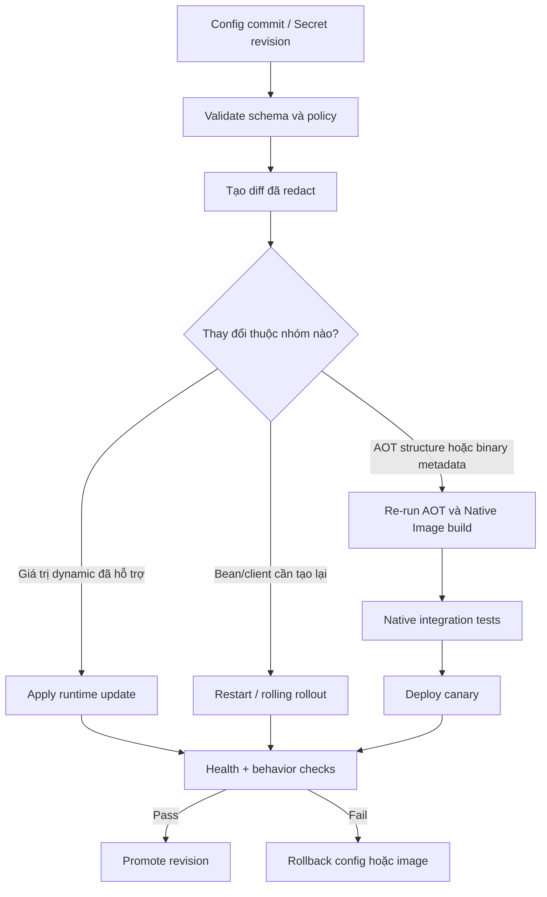

# Theo dõi thay đổi cấu hình vượt quá những gì bản build hiện tại hỗ trợ

## 1. Vì sao cần theo dõi giới hạn cấu hình?

Một ứng dụng Spring Boot thông thường có thể đọc cấu hình từ file, environment variables, command line hoặc Config Server. Khi cấu hình thay đổi, một số thành phần có thể nhận giá trị mới; một số khác cần khởi động lại để tạo lại bean. Với ứng dụng được xử lý bằng Spring AOT và biên dịch thành GraalVM Native Image, còn có một giới hạn ở build time: cấu trúc ứng dụng đã được phân tích và cố định trước khi executable được tạo.

Vì vậy, không phải mọi thay đổi cấu hình đều có thể áp dụng cho binary hiện tại. Ví dụ, thay ngưỡng cảnh báo hoặc một giá trị timeout mà code đọc động có thể được hỗ trợ. Nhưng bật một module mới bằng property nếu module đó được đăng ký qua điều kiện AOT, thêm class vào classpath, thay profile làm đổi bean graph hoặc thêm subtype cần reflection metadata có thể vượt quá những gì bản build đã chứa.

Bài này thuộc chương **Vận hành** của module **SPRING_BOOT_NATIVE_IMAGE**. Mục tiêu là phân loại thay đổi cấu hình, theo dõi config drift, phát hiện thay đổi vượt phạm vi AOT, chọn hành động reload/restart/rebuild và thiết kế quy trình triển khai có thể rollback.

## 2. Spring AOT cố định những gì?

Spring AOT phân tích ApplicationContext trong lúc build để tạo mã khởi tạo, bytecode hỗ trợ và RuntimeHints. Quá trình này dựa trên classpath và Environment tại thời điểm AOT.

Các quyết định quan trọng gồm:

- Bean definition nào tồn tại trong ApplicationContext.
- Cấu hình nào được chọn qua `@Profile`.
- Điều kiện nào khớp qua `@Conditional`, `@ConditionalOnProperty`, `@ConditionalOnClass` và các điều kiện liên quan.
- Proxy, reflection, resource, serialization và JDK proxy metadata cần được tạo.
- Những class và thành phần nào có thể reachable trong Native Image.

Spring Framework nêu rõ classpath phải cố định tại build time; bean definitions không thể thay đổi tại runtime; profile và Environment properties ảnh hưởng sự hiện diện của bean chỉ được xét trong quá trình AOT. Những profile chỉ thay đổi giá trị property mà không tác động đến điều kiện tạo bean vẫn có thể dùng trong ứng dụng AOT. Xem tài liệu [Spring AOT conditions](https://docs.spring.io/spring-boot/how-to/aot.html) và [Spring Framework AOT restrictions](https://docs.spring.io/spring-framework/reference/core/aot.html).

Điều này có nghĩa một property vẫn có thể tồn tại trong Environment ở runtime, nhưng việc đổi property đó không tự tạo lại bean definition đã bị loại bỏ trong quá trình AOT.

### 2.1. Ví dụ về điều kiện tạo bean

Giả sử ứng dụng có hai adapter thanh toán:

```java
@Configuration(proxyBeanMethods = false)
class PaymentConfiguration {

    @Bean
    @ConditionalOnProperty(
        name = "payment.provider",
        havingValue = "stripe"
    )
    PaymentGateway stripeGateway() {
        return new StripePaymentGateway();
    }

    @Bean
    @ConditionalOnProperty(
        name = "payment.provider",
        havingValue = "bank"
    )
    PaymentGateway bankGateway() {
        return new BankTransferGateway();
    }
}
```

Nếu AOT chạy với `payment.provider=stripe`, bean Stripe được đưa vào cấu trúc đã sinh. Đổi environment thành `payment.provider=bank` lúc container khởi động không bảo đảm bean Bank được tạo; điều kiện đã được đánh giá ở build time.

Nếu cả hai adapter phải có trong cùng binary, hãy thiết kế bean graph sao cho cả hai đều được đăng ký ở build time, rồi chọn adapter bằng logic runtime có kiểm soát. Nếu việc bật adapter còn yêu cầu class, dependency, reflection metadata hoặc native library chưa có trong binary, cần build lại.

## 3. Phân loại thay đổi: runtime, restart hay rebuild

Trước khi nhận một thay đổi cấu hình, phân loại nó theo tác động lên ứng dụng:

| Nhóm thay đổi | Ví dụ | Hành động phù hợp |
| --- | --- | --- |
| Giá trị đọc động | Ngưỡng nghiệp vụ, giới hạn hiển thị, tỷ lệ thử lại do code đọc từ một cấu hình động | Có thể cập nhật runtime nếu ứng dụng có cơ chế nạp, xác thực và áp dụng an toàn |
| Giá trị được bind lúc startup | URL database, TLS truststore, connection pool, executor size, endpoint của SDK tạo một lần | Thường cần restart hoặc rollout để bean khởi tạo lại |
| Cấu trúc Spring/AOT | Active profile làm đổi bean, `@ConditionalOnProperty`, auto-configuration branch, bean mới | Re-run AOT và build lại |
| Thành phần của binary | Thêm dependency, class, native library, resource, serializer, subtype, proxy hoặc reflection target mới | Cập nhật metadata/AOT và build lại Native Image |
| Thay đổi nền tảng | OS/architecture/libc, GraalVM runtime, Spring Boot/Spring Cloud version | Tạo và kiểm thử artifact tương thích mới |

Bảng này là hướng phân loại ban đầu. Hành vi cụ thể phụ thuộc cách ứng dụng tiêu thụ property. Ví dụ, pool size có thể hỗ trợ thay đổi trực tiếp nếu pool implementation cung cấp API cập nhật; nếu property chỉ được bind khi tạo pool, cần restart.

Không nên đánh dấu mọi property trong file YAML là runtime-reloadable. Hãy truy ngược từ property đến bean hoặc code sử dụng nó để biết thời điểm giá trị được đọc.

## 4. Ba câu hỏi trước khi áp dụng thay đổi

Với mỗi config change, người vận hành nên trả lời:

1. **Giá trị có được đọc lại không?** Nếu property chỉ được bind vào constructor hoặc dùng để tạo client lúc startup, đổi file không làm instance đang chạy tự thay đổi.
2. **Thay đổi có làm thay đổi cấu trúc bean không?** Nếu property được dùng trong `@Conditional`, `@Profile` hoặc auto-configuration decision, nó thuộc build-time structure.
3. **Binary có chứa đầy đủ thành phần cần thiết không?** Nếu thay đổi đòi hỏi class, dependency, reflection hint, proxy, resource hoặc native library chưa có trong image, phải build lại.

Nếu chưa trả lời được một trong ba câu hỏi, không tự động rollout config vào production. Đưa thay đổi vào staging, kiểm tra startup/AOT behavior và xác định hành động trước khi áp dụng rộng.

## 5. Theo dõi config revision và build identity

Muốn phát hiện config drift, cần biết process đang chạy binary nào và đang dùng revision cấu hình nào.

Mỗi release nên ghi lại ít nhất:

| Metadata | Mục đích |
| --- | --- |
| Application version và Git commit | Xác định source code |
| Container image digest | Xác định chính xác binary được triển khai |
| Spring Boot và Spring Cloud versions | Đối chiếu tương thích framework |
| GraalVM vendor, edition và version | Xác định toolchain tạo native executable |
| AOT profiles | Biết profile đã được dùng khi xử lý AOT |
| Build flags và target architecture | Xác định cách tạo binary |
| Runtime config revision | Xác định revision cấu hình đang được áp dụng |
| Secret version/reference | Theo dõi phiên bản secret mà không ghi giá trị |

Không ghi password, token, private key hoặc nội dung secret vào metadata. Với secret manager, lưu version ID hoặc rotation reference. Nếu tạo fingerprint cho config, loại secret ra khỏi canonical payload; hash một secret có entropy thấp vẫn có thể hỗ trợ dò đoán offline.

Có thể công bố build identity qua Actuator Info hoặc log startup có cấu trúc, nhưng chỉ đưa các trường không nhạy cảm và giới hạn quyền truy cập nếu metadata tiết lộ topology nội bộ.

## 6. Theo dõi thay đổi từ Config Server hoặc Git

Spring Cloud Config Client có thể lấy property từ Config Server thông qua Spring Boot Config Data:

```properties
spring.application.name=orders-api
spring.config.import=configserver:https://config.example.internal
spring.cloud.config.label=release-2026-11
```

Label có thể là branch, tag hoặc commit ID tùy backend. Với release production, ưu tiên revision bất biến như commit ID hoặc tag đã được kiểm soát thay vì trỏ vào branch có thể thay đổi trong lúc các instance khởi động.

Config Client tải cấu hình trong quá trình khởi động. Tài liệu Spring Cloud Config cũng lưu ý rằng trong AOT/native mode, data source cấu hình cần sẵn sàng khi build AOT; các property ảnh hưởng bean creation phải có giá trị nhất quán giữa build time và runtime. Vì vậy, nếu dùng Config Server để cung cấp property ảnh hưởng `@Conditional` hoặc profile, hãy kiểm soát revision và môi trường AOT một cách rõ ràng. Xem [Spring Cloud Config Client](https://docs.spring.io/spring-cloud-config/reference/client.html).

### 6.1. Sự khác nhau giữa lấy cấu hình lúc startup và refresh

Hai hành động này khác nhau:

- **Config fetch at startup:** process tải property sources khi khởi động và dùng chúng để tạo Environment.
- **Refresh đang chạy:** ứng dụng nhận thay đổi, cập nhật Environment, rebind bean hoặc tạo lại bean.

Việc Config Client hỗ trợ native image không đồng nghĩa mọi cơ chế refresh của Spring Cloud đều được hỗ trợ. Tài liệu Spring Cloud Commons hiện hành nêu Context Refresh/`@RefreshScope` không được hỗ trợ cho Spring AOT transformations và Native Image; cấu hình native client cần đặt `spring.cloud.refresh.enabled=false`. Do đó, không xây runbook native dựa trên `/actuator/refresh` hoặc `@RefreshScope`. Xem [Spring Cloud Context refresh limitations](https://docs.spring.io/spring-cloud-commons/reference/spring-cloud-commons/application-context-services.html).

Cấu hình client native có thể thể hiện rõ giới hạn này:

```properties
spring.cloud.refresh.enabled=false
```

Spring Cloud Config Client cũng không mặc định polling Config Server để tìm thay đổi. Trên JVM có thể tổ chức event/bus để phát thông báo thay đổi, nhưng với native image hãy dùng thông báo đó để kích hoạt pipeline phân loại và rollout/restart đã kiểm soát, thay vì giả định refresh scope sẽ thay bean tại chỗ.

## 7. Không giả định file cấu hình thay đổi sẽ tự cập nhật bean

Một ConfigMap, Secret volume hoặc file cấu hình được mount có thể thay đổi trên filesystem. Nhưng điều đó không tự bảo đảm Spring Boot đọc lại file, cập nhật Environment hoặc rebind các bean đã được tạo.

Thông thường, Spring Config Data được nạp khi application context khởi tạo. Nếu nền tảng cập nhật file sau đó, process có thể vẫn tiếp tục dùng giá trị cũ. Để áp dụng revision mới, có thể cần:

- Restart pod/container để Spring đọc cấu hình mới.
- Rollout deployment để thay thế toàn bộ instance theo chiến lược an toàn.
- Xây cơ chế dynamic configuration riêng cho một tập giá trị được cho phép, nếu cần cập nhật không restart.

Với Native Image, lựa chọn restart/rollout thường dễ kiểm soát hơn việc cố refresh toàn bộ ApplicationContext. Nếu cần dynamic update, chỉ triển khai cho giá trị mà code được thiết kế để đọc và áp dụng lại an toàn.

## 8. Thiết kế dynamic configuration cho giá trị thật sự cần cập nhật

Nếu một giá trị nghiệp vụ phải thay đổi trong khi process đang chạy, không nhất thiết phải làm mới toàn bộ Spring context. Có thể xây một cấu hình runtime riêng, xác thực dữ liệu mới rồi thay thế một snapshot bất biến.

Ví dụ:

```java
import java.math.BigDecimal;

public record PricingPolicy(
    BigDecimal discountLimit,
    int maximumItems
) {
    public PricingPolicy {
        if (discountLimit.signum() < 0
                || discountLimit.compareTo(BigDecimal.ONE) > 0) {
            throw new IllegalArgumentException(
                "discountLimit must be between 0 and 1"
            );
        }
        if (maximumItems < 1) {
            throw new IllegalArgumentException(
                "maximumItems must be positive"
            );
        }
    }
}
```

Một holder có thể thay snapshot bằng thao tác atomic:

```java
import java.util.concurrent.atomic.AtomicReference;

import org.springframework.stereotype.Component;

@Component
class PricingPolicyHolder {

    private final AtomicReference<PricingPolicy> current =
        new AtomicReference<>(new PricingPolicy(
            new BigDecimal("0.10"), 50
        ));

    PricingPolicy current() {
        return current.get();
    }

    void update(PricingPolicy candidate) {
        // Constructor đã xác thực trước khi snapshot được thay thế.
        current.set(candidate);
    }
}
```

Nguồn cập nhật có thể là API nội bộ, message bus hoặc một config watcher do ứng dụng quản lý. Trước khi gọi update, cần xác thực schema, version, phạm vi giá trị và revision; chỉ thay snapshot khi toàn bộ cấu hình hợp lệ.

Thiết kế này chỉ thay đổi dữ liệu mà code chủ động đọc từ holder. Nó không thêm bean, class, serializer, route hoặc native metadata mới. Với các giá trị gắn vào client/pool được tạo một lần, cần một API cập nhật riêng hoặc restart thành phần tương ứng.

## 9. Phân biệt rebind, refresh và restart

Các từ này thường bị dùng lẫn nhau:

| Cơ chế | Ý nghĩa | Giới hạn cần biết |
| --- | --- | --- |
| Rebind | Gán property mới vào một `@ConfigurationProperties` bean hiện có | Không tự tạo bean mới hoặc thay đổi bean graph |
| Refresh scope | Làm mới target của bean qua proxy | Context refresh/`@RefreshScope` không được hỗ trợ trong Spring AOT và Native Image |
| Restart process | Tạo ApplicationContext mới trong process mới | Nạp lại config và khởi tạo bean từ binary hiện tại |
| Rebuild Native Image | Chạy lại Spring AOT và GraalVM compilation | Cần khi thay đổi vượt cấu trúc hoặc metadata của binary |

Spring Cloud trên JVM có thể phát `EnvironmentChangeEvent` để rebind một số `@ConfigurationProperties` và cập nhật logger levels. Tuy nhiên, không suy rộng hành vi JVM đó thành cam kết refresh cho native executable. Với native mode, hãy kiểm tra rõ feature và phiên bản; mặc định nên tắt Spring Cloud refresh theo hướng dẫn chính thức.

## 10. Xác định thay đổi nào buộc phải rebuild

Các trường hợp sau thường vượt quá phạm vi binary hiện tại:

- Thêm hoặc bỏ dependency, class hoặc module.
- Bật một bean/configuration branch mà AOT không đưa vào bean graph.
- Đổi profile làm thay đổi bean definitions đã được xử lý.
- Thêm subtype JSON, serializer/deserializer hoặc type discriminator mới cần được nhận diện.
- Thêm reflection, JDK proxy, serialization hoặc resource access chưa có RuntimeHints.
- Thay native library, JNI binding hoặc protocol implementation cần binary/linking mới.
- Đổi Spring Boot, Spring Framework, Spring Cloud, GraalVM hoặc target architecture.
- Thay đổi code xử lý dynamic configuration hoặc schema cấu hình.

Ví dụ, nếu binary chỉ có adapter thanh toán Stripe, việc đổi `payment.provider=bank` trong Config Server không thể bổ sung class Bank adapter vào binary. Cần thêm implementation, kiểm thử hints/AOT và build lại.

## 11. Chọn profile đúng khi chạy AOT

Spring Boot đánh giá `@Conditional` trong quá trình AOT. Profile có điều kiện tạo bean cần được chọn khi build. Profile chỉ thay đổi property không ảnh hưởng điều kiện có thể thay đổi theo quy tắc cấu hình thông thường.

Ví dụ Maven, cấu hình profile cho execution `process-aot`:

```xml
<execution>
    <id>process-aot</id>
    <configuration>
        <profiles>production,metrics</profiles>
    </configuration>
</execution>
```

Ví dụ Gradle:

```groovy
tasks.withType(
    org.springframework.boot.gradle.tasks.aot.ProcessAot
).configureEach {
    args('--spring.profiles.active=production,metrics')
}
```

Đây là cấu hình profile được dùng khi AOT xử lý bean graph. Nếu cần thêm một profile có điều kiện làm thay đổi bean, hãy cập nhật cấu hình AOT, chạy lại AOT processing, build native và kiểm thử artifact mới.

Không cố bật profile khác ở runtime để mong các bean đã bị loại trong AOT xuất hiện. Spring Boot mô tả cách chọn profile cho Maven và Gradle trong [Ahead-of-Time Processing](https://docs.spring.io/spring-boot/how-to/aot.html).

## 12. Quy trình phân loại và phê duyệt config change

Một pipeline quản lý cấu hình nên nhận revision mới, tạo diff và phân loại trước khi rollout:



Pipeline nên lưu:

- Config revision trước và sau.
- Danh sách key đã thay đổi sau khi redact secret.
- Nhóm tác động và lý do phân loại.
- Image digest đang chạy và image digest mới nếu cần build.
- Kết quả validation, AOT/native tests, canary và rollback.

Không tự động áp dụng property chưa được phân loại. Nếu key không có trong allowlist runtime-changeable, đưa nó vào luồng restart/rebuild để review.

## 13. Phát hiện config drift trong môi trường đang chạy

Config drift xảy ra khi instance không dùng revision mà deployment mong đợi. Một số nguyên nhân phổ biến:

- Pod cũ chưa được restart sau khi config thay đổi.
- Một instance tải được revision mới, instance khác vẫn giữ revision cũ.
- Environment variable ghi đè property từ Config Server.
- Một secret version mới đã được mount nhưng process chưa nạp lại.
- Instance chạy image digest khác với release manifest.
- Config Server label trỏ vào branch đã thay đổi.

Có thể giám sát bằng các tín hiệu:

1. Build ID và image digest của mỗi instance.
2. Config revision/label đã tải khi startup.
3. AOT profile manifest của binary.
4. Secret version reference, không phải secret value.
5. Thời điểm tải cấu hình gần nhất và trạng thái fetch.
6. Số instance còn chạy revision cũ trong rollout.

Tập hợp các tín hiệu này thành metric hoặc log event có cardinality thấp. Tránh dùng từng property value làm metric label; điều đó vừa có thể lộ thông tin vừa tạo cardinality lớn.

## 14. Kiểm tra tương thích trước khi restart hoặc rebuild

Trước khi áp dụng config revision mới, thực hiện các bước:

- Validate cấu trúc file, kiểu dữ liệu, range và required key.
- Kiểm tra config revision có phù hợp với image version/AOT profile không.
- Kiểm tra property nào tác động đến `@Conditional`, `@Profile` hoặc classpath decision.
- Xác minh dependency ngoài và secret version sẵn sàng.
- Chạy test cấu hình với cùng native artifact hoặc artifact ứng viên.
- Thực hiện canary trước khi rollout toàn bộ instance.
- Xác nhận health, business behavior, error rate và latency sau cập nhật.

Với thay đổi AOT structure, test trên JVM thường là chưa đủ. Hãy chạy AOT processing và native integration test để xác minh executable mới chứa bean, metadata và resource cần thiết.

## 15. Rollback khi config mới không tương thích

Config rollback và binary rollback là hai hành động khác nhau:

- Nếu lỗi chỉ do giá trị runtime được hỗ trợ, quay về config revision trước.
- Nếu lỗi do bean/client được tạo từ config lúc startup, rollback config rồi restart/rollout để tạo lại bean.
- Nếu lỗi do AOT structure hoặc native metadata, cần quay lại image digest tương thích trước đó và config revision đi cùng release.
- Nếu secret đã rotate, bảo đảm credential cũ còn hiệu lực trong khoảng rollback hoặc có kế hoạch cấp lại an toàn.

Mỗi release nên lưu cặp image digest + config revision đã được xác nhận. Không rollback config về revision không tương thích với binary đang chạy chỉ vì hai revision có cùng tên profile.

## 16. Kiểm thử và diễn tập thay đổi cấu hình

Bộ test vận hành nên bao gồm:

| Kịch bản | Kết quả mong đợi |
| --- | --- |
| Thay giá trị runtime được thiết kế để đọc động | Instance áp dụng snapshot mới sau validation |
| Thay property chỉ được bind khi startup | Cần restart; process cũ không bị coi là đã cập nhật |
| Đổi `@ConditionalOnProperty` sau AOT | Không tự thay bean graph; pipeline yêu cầu rebuild |
| Bật profile mới có bean condition | AOT/native build mới chứa đúng bean |
| Thêm subtype cần reflection | Native test thất bại trước khi bổ sung hints; build mới phải pass |
| Config Server không sẵn sàng khi startup | Hành vi fail-fast/retry đúng policy |
| Config revision lệch giữa các replica | Alert config drift hoặc rollout không hoàn tất |
| Rollback config có thay đổi bean | Restart/rollout và xác minh behavior |
| Rollback image | Chạy cặp image/config đã được xác nhận |
| Refresh endpoint được gọi trong native mode | Không phụ thuộc `@RefreshScope`/context refresh; request bị vô hiệu hóa hoặc policy từ chối |

Có thể chạy ứng dụng AOT-processed trên JVM trong giai đoạn kiểm tra để phát hiện khác biệt bean graph trước khi build native. Sau đó, chạy native integration test trên đúng artifact sẽ triển khai.

## 17. Runbook xử lý config change vượt giới hạn binary

Khi nhận yêu cầu thay đổi cấu hình:

1. Ghi lại config revision, image digest và AOT profiles của instance hiện tại.
2. Tạo diff đã redact; xác định các key bị thay đổi.
3. Truy ngược mỗi key tới bean hoặc code sử dụng nó.
4. Phân loại: dynamic runtime, startup-bound/restart, hay AOT/build-time.
5. Nếu dynamic, kiểm tra cơ chế update, validation và tính nguyên tử.
6. Nếu startup-bound, tạo rollout restart với config revision mới.
7. Nếu AOT/build-time, cập nhật profile/condition/dependency/hints rồi build lại native image.
8. Chạy test JVM AOT, native integration và canary phù hợp.
9. Theo dõi revision trên toàn bộ replica và xác nhận không còn drift.
10. Nếu lỗi, rollback cặp image/config đã được kiểm chứng và ghi lại nguyên nhân.

Runbook cần nêu rõ ai phê duyệt config revision, ai có quyền phát hành image, thời gian rollback và cách xử lý secret rotation đi kèm.

## 18. Bài thực hành: phát hiện thay đổi vượt quá AOT build

**Bối cảnh:** Một service có `payment.provider` để chọn adapter, `pricing.discount-limit` để điều chỉnh chính sách giảm giá và `partner.timeout` để cấu hình HTTP client.

**Các bước:**

1. Tạo hai adapter thanh toán được đăng ký bằng `@ConditionalOnProperty`.
2. Chạy AOT với `payment.provider=stripe` và tạo native executable.
3. Đổi `payment.provider=bank` trong runtime config, quan sát rằng bean graph không tự thay đổi.
4. Thêm adapter Bank vào build-time configuration hoặc thiết kế cả hai bean có mặt rồi chọn bằng logic runtime.
5. Với `pricing.discount-limit`, tạo dynamic configuration holder có validation và version.
6. Với `partner.timeout`, xác định HTTP client có API cập nhật hay phải tạo lại client qua restart.
7. Ghi build ID, AOT profiles và config revision vào startup metadata.
8. Tạo config diff và phân loại ba key theo hành vi thực tế.
9. Mô phỏng config revision mới trên một canary; kiểm tra health, behavior và log.
10. Mô phỏng thay đổi cần reflection metadata mới, chạy native test để xác nhận build hiện tại không hỗ trợ.
11. Re-run AOT/native build cho thay đổi cấu trúc và kiểm thử image mới.
12. Diễn tập rollback config revision và image digest.

**Tiêu chí đạt:**

- Phân biệt được property value runtime với bean definition được quyết định ở AOT.
- Biết profile và điều kiện nào phải cố định lúc build.
- Không phụ thuộc `@RefreshScope` hoặc context refresh trong Native Image.
- Theo dõi được build identity và config revision của từng instance.
- Tự động phân loại thay đổi không rõ phạm vi thành review/restart/rebuild.
- Có test cho runtime update, restart, rebuild và rollback.
- Không ghi secret value vào log, metric hoặc config diff.

## 19. Tổng kết

Spring AOT giúp Native Image khởi động từ cấu trúc ứng dụng đã được phân tích trước, nhưng đổi lại classpath và bean graph phải ổn định theo những quyết định ở build time. Giá trị cấu hình vẫn có thể được cấp ở runtime nếu binary đã chứa code và bean cần thiết; việc thay file hoặc Config Server property không tự tạo bean, class, proxy hay metadata mới.

Hãy theo dõi đồng thời build identity và config revision, phân loại thay đổi thành dynamic runtime, startup-bound hoặc AOT/build-time, rồi chọn cập nhật, restart hay rebuild. Với Spring Cloud, Config Client có thể lấy cấu hình khi startup nhưng `@RefreshScope`/context refresh không được hỗ trợ cho AOT và Native Image. Một quy trình diff, compatibility check, canary và rollback rõ ràng sẽ ngăn cấu hình mới vượt quá khả năng của binary đang triển khai.

## Tài liệu tham khảo

- [Spring Boot — Ahead-of-Time Processing](https://docs.spring.io/spring-boot/how-to/aot.html)
- [Spring Framework — Ahead of Time Optimizations](https://docs.spring.io/spring-framework/reference/core/aot.html)
- [Spring Cloud Config — Client](https://docs.spring.io/spring-cloud-config/reference/client.html)
- [Spring Cloud Commons — Application Context Services](https://docs.spring.io/spring-cloud-commons/reference/spring-cloud-commons/application-context-services.html)
- [GraalVM Native Image — Reference Manual](https://www.graalvm.org/reference-manual/native-image/)

