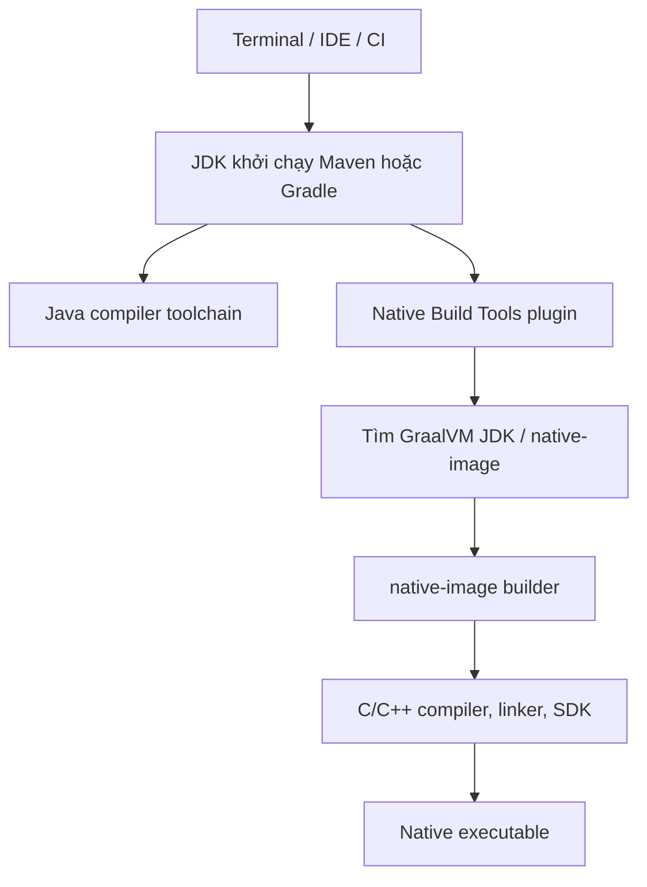

# Không tìm thấy native-image hoặc chọn nhầm JDK, toolchain

## 1. Nhận diện đúng lỗi trước khi sửa PATH

Khi build Spring Boot Native Image, có thể gặp các lỗi như:

- Shell báo `native-image: command not found`, `native-image is not recognized` hoặc không tìm thấy file thực thi.
- `java -version` hiển thị một JDK, nhưng Maven/Gradle lại chạy bằng JDK khác.
- Native Build Tools báo không tìm thấy GraalVM hoặc tìm thấy JDK thường không có `native-image`.
- Build chạy được trong terminal nhưng thất bại trong IDE hoặc CI.
- Maven/Gradle chọn nhầm phiên bản JDK, dẫn tới lỗi tương thích bytecode hoặc toolchain.
- Lệnh `native-image --version` chạy được nhưng build thất bại khi gọi compiler C/C++ của hệ điều hành.

Các lỗi này có thể xuất hiện gần nhau nhưng thuộc những lớp khác nhau. Không nên thay đổi hàng loạt biến môi trường trước khi xác định process nào đang chọn JDK nào và tool `native-image` được tìm ở đâu.

Bài học này thuộc chương **Chẩn đoán** của module **SPRING_BOOT_NATIVE_IMAGE**. Module hướng dẫn biên dịch Spring Boot thành GraalVM Native Image bằng Spring AOT, thực hành build Maven/Gradle, cấu hình reflection/resource, kiểm thử tương thích, đóng gói container và vận hành bản native. Bài này giúp xác định nguyên nhân khi không tìm thấy Native Image hoặc build tool chọn sai JDK/toolchain.

Sau bài học, người học có thể:

- Phân biệt JDK chạy build, JDK compiler toolchain và GraalVM chứa Native Image.
- Kiểm tra `JAVA_HOME`, `GRAALVM_HOME` và thứ tự `PATH`.
- Xác định JDK thực tế mà Maven, Gradle daemon, IDE và CI sử dụng.
- Hiểu thứ tự tìm executable của GraalVM Native Build Tools Gradle plugin.
- Sửa cấu hình Maven/Gradle mà không nhầm toolchain biên dịch Java với Native Image compiler.
- Phân biệt lỗi thiếu `native-image` với lỗi thiếu compiler C/C++ hoặc SDK của hệ điều hành.

## 2. Phân biệt bốn thành phần trong quá trình build

Một lệnh `nativeCompile` không chỉ dùng một Java executable. Cần phân biệt bốn thành phần:

| Thành phần | Nhiệm vụ | Cách xác minh |
|---|---|---|
| JDK chạy Maven/Gradle | Khởi chạy build tool và plugin | `mvn -version`, `gradlew --version` |
| Java compiler toolchain | Biên dịch source và chạy một số task/test | Gradle toolchains, Maven Toolchains |
| GraalVM JDK có Native Image | Cung cấp `native-image` để tạo binary | `native-image --version` và đường dẫn executable |
| Native C/C++ toolchain | Compiler, linker, header và SDK mà Native Image cần | `gcc --version`, `clang --version`, `cl.exe`/Visual Studio |

Có thể hình dung luồng chọn công cụ:



Ví dụ, `mvn -version` cho thấy Maven đang chạy trên Temurin JDK. Điều đó không chứng minh máy đã có Native Image. Ngược lại, `native-image --version` chạy được cũng chưa chứng minh Maven đang dùng cùng GraalVM installation.

`sourceCompatibility`, `targetCompatibility` hoặc `--release` chỉ mô tả mức API/bytecode của source Java. Chúng không tự cài GraalVM, không thêm `native-image` vào PATH và không quyết định Maven/Gradle daemon chạy bằng JDK nào.

## 3. Kiểm tra GraalVM distribution và Native Image component

Trước tiên xác định chính xác bản phân phối đang cài:

- Oracle GraalVM hoặc GraalVM Community Edition.
- GraalVM JDK được đóng gói bởi nhà cung cấp khác, ví dụ Liberica Native Image Kit.
- Một JDK thông thường như Temurin, Corretto hoặc Microsoft Build of OpenJDK.
- Một bản GraalVM cũ có cơ chế cài component riêng.

Ở các GraalVM distribution hiện hành, `native-image` thường nằm trong thư mục `bin` của GraalVM JDK. Tuy nhiên, cách đóng gói thay đổi theo nhà cung cấp và phiên bản. Một số bản cũ yêu cầu cài Native Image component riêng bằng GraalVM Updater (`gu`). Không áp dụng lệnh cài component cũ cho mọi bản GraalVM: GraalVM for JDK 21 đã loại bỏ `gu`, và tài liệu hiện hành hướng dẫn dùng executable có sẵn trong `bin` của distribution.

Cấu trúc cài đặt thường có dạng:

```text
graalvm-jdk/
├── bin/
│   ├── java
│   ├── javac
│   ├── native-image
│   └── ...
├── conf/
├── include/
└── lib/
```

Trên Windows, tên executable có thể có hậu tố `.cmd`, ví dụ `native-image.cmd`. Một số distribution có cách đặt tên hoặc package khác; kiểm tra trực tiếp thư mục cài đặt.

Không nhầm các trường hợp:

- Có `java` nhưng không có `native-image`: có thể đang dùng JDK thường hoặc distribution chưa có Native Image.
- Có `native-image` trong một thư mục nhưng PATH trỏ tới thư mục khác: shell có thể gọi nhầm phiên bản.
- Có `native-image` nhưng build báo thiếu `gcc`, MSVC hoặc header: executable đã được tìm thấy; vấn đề nằm ở native build toolchain của hệ điều hành.
- Có nhiều GraalVM cài song song: cần chọn đúng version tương thích với Spring Boot, Java và Native Build Tools plugin của dự án.

Hãy đối chiếu release notes và hướng dẫn cài đặt đúng phiên bản GraalVM thay vì mặc định rằng mọi bản đều hỗ trợ cùng một lệnh cài component.

## 4. Kiểm tra trên Windows PowerShell

PowerShell có lệnh `where` là alias của `Where-Object`, vì vậy khi muốn tìm executable theo PATH hãy dùng `where.exe` hoặc `Get-Command`.

Chạy bộ kiểm tra:

```powershell
$env:JAVA_HOME
$env:GRAALVM_HOME
$env:Path -split ';'

Get-Command java -All |
    Select-Object CommandType, Source, Definition

Get-Command native-image -All |
    Select-Object CommandType, Source, Definition

where.exe java
where.exe native-image

java -XshowSettings:properties -version 2>&1 |
    Select-String 'java.home|java.vendor|java.version'

java -version
native-image --version
```

Đọc kết quả theo thứ tự:

1. `JAVA_HOME` phải trỏ tới thư mục gốc của JDK/GraalVM, không phải thư mục `bin` và không phải file `java.exe`.
2. `Get-Command -All` cho biết PowerShell đang resolve command nào và có bao nhiêu bản cùng tên.
3. `where.exe` liệt kê các executable tìm thấy qua PATH.
4. `java.home`, `java.vendor` và `java.version` cho biết JVM đang thực sự chạy.
5. `native-image --version` xác nhận lệnh Native Image mà shell đang gọi.

Nếu `JAVA_HOME` đã đúng nhưng `native-image` vẫn không được tìm thấy, kiểm tra executable trong chính installation:

```powershell
$nativeImageCmd = Join-Path $env:JAVA_HOME 'bin\native-image.cmd'
$nativeImageExe = Join-Path $env:JAVA_HOME 'bin\native-image.exe'

Get-ChildItem (Join-Path $env:JAVA_HOME 'bin') -Filter 'native-image*'

if (Test-Path $nativeImageCmd) {
    & $nativeImageCmd --version
} elseif (Test-Path $nativeImageExe) {
    & $nativeImageExe --version
} else {
    Write-Error 'Native Image executable is not present in JAVA_HOME/bin'
}
```

Nếu file chạy được bằng đường dẫn tuyệt đối nhưng lệnh `native-image` không chạy, vấn đề nằm ở PATH hoặc thứ tự PATH. Nếu file không tồn tại, hãy xác minh distribution/version đã cài có cung cấp Native Image hay chưa.

### 4.1. Sửa biến môi trường trong phiên PowerShell hiện tại

Giả sử GraalVM được cài tại `C:\tools\graalvm-jdk-25`:

```powershell
$env:GRAALVM_HOME = 'C:\tools\graalvm-jdk-25'
$env:JAVA_HOME = $env:GRAALVM_HOME
$env:Path = "$env:GRAALVM_HOME\bin;$env:Path"

java -version
native-image --version
where.exe java
where.exe native-image
```

Các lệnh trên chỉ thay đổi môi trường của cửa sổ PowerShell hiện tại. Sau khi xác nhận đúng toolchain, mới cập nhật User/System Environment Variables theo chính sách máy. Nếu vừa đổi biến môi trường trong Windows Settings, mở terminal mới để process nhận giá trị mới; terminal và IDE đang chạy không tự nhận thay đổi.

## 5. Kiểm tra trên Linux và macOS

Trong shell Bash/Zsh, dùng:

```bash
printf 'JAVA_HOME=%s\n' "$JAVA_HOME"
printf 'GRAALVM_HOME=%s\n' "$GRAALVM_HOME"

type -a java
type -a native-image
command -v java
command -v native-image

java -version
java -XshowSettings:properties -version 2>&1 \
  | grep -E 'java.home|java.vendor|java.version'

native-image --version
```

`type -a` hữu ích khi có alias, function hoặc nhiều executable trùng tên. `command -v` chỉ cho biết command được resolve đầu tiên. Trên Linux, có thể kiểm tra thêm:

```bash
readlink -f "$(command -v java)"
readlink -f "$(command -v native-image)"
printf '%s\n' "$PATH" | tr ':' '\n'
```

Trên macOS, `readlink -f` không có sẵn trong mọi môi trường. Dùng `type -a`, `which -a` và kiểm tra symlink bằng `ls -l`:

```bash
which -a java
which -a native-image
ls -l "$(command -v java)"
ls -l "$(command -v native-image)"
```

Nếu muốn gọi đúng GraalVM mà không phụ thuộc PATH:

```bash
"$GRAALVM_HOME/bin/java" -version
"$GRAALVM_HOME/bin/native-image" --version
```

Nếu đường dẫn tuyệt đối chạy được nhưng command không tìm thấy, sửa PATH. Nếu cả đường dẫn tuyệt đối cũng không tồn tại, kiểm tra lại vị trí giải nén, tên thư mục, architecture và package của GraalVM.

## 6. Hiểu vai trò của JAVA_HOME, GRAALVM_HOME và PATH

Ba giá trị thường bị dùng thay thế cho nhau nhưng có ý nghĩa khác nhau:

- `JAVA_HOME` thường chỉ JDK mặc định mà Java-based build tool dùng để khởi chạy.
- `GRAALVM_HOME` chỉ định rõ GraalVM installation; GraalVM Native Build Tools Gradle plugin có thể dùng biến này để tìm `native-image`.
- `PATH` quyết định shell tìm executable nào trước khi gọi command. Đặt `JAVA_HOME` không tự động thay đổi PATH nếu thư mục `bin` của JDK chưa được thêm vào PATH.

Trong cấu hình đơn giản, cả hai biến có thể cùng trỏ tới GraalVM:

```bash
export GRAALVM_HOME=/opt/graalvm-jdk-25
export JAVA_HOME="$GRAALVM_HOME"
export PATH="$GRAALVM_HOME/bin:$PATH"
hash -r

java -version
native-image --version
```

Nếu Gradle version chưa tương thích với GraalVM JDK đang cài, có thể cần dùng một JDK tương thích để chạy Gradle và để GraalVM riêng cho Native Image:

```bash
export JAVA_HOME=/opt/temurin-jdk-25
export GRAALVM_HOME=/opt/graalvm-jdk-25
export PATH="$JAVA_HOME/bin:$GRAALVM_HOME/bin:$PATH"

java -version
"$GRAALVM_HOME/bin/native-image" --version
./gradlew --version
```

Ví dụ này chỉ phù hợp khi GraalVM version đã được kiểm tra tương thích với Java/toolchain của dự án. Nếu cả hai thư mục đều có `java`, thứ tự PATH quyết định `java` nào được gọi; gọi Native Image bằng đường dẫn tuyệt đối giúp kiểm tra chính xác distribution.

Trên Windows PowerShell, cách tương tự là:

```powershell
$env:JAVA_HOME = 'C:\tools\temurin-jdk-25'
$env:GRAALVM_HOME = 'C:\tools\graalvm-jdk-25'
$env:Path = "$env:JAVA_HOME\bin;$env:GRAALVM_HOME\bin;$env:Path"

java -version
& "$env:GRAALVM_HOME\bin\native-image.cmd" --version
```

Không đặt `JAVA_HOME` thành đường dẫn có dấu ngoặc kép nằm bên trong giá trị biến, không thêm `\bin` vào cuối `JAVA_HOME`, và không trộn đường dẫn của nhiều JDK trong PATH mà không kiểm tra thứ tự.

## 7. Maven đang chạy bằng JDK nào?

Maven Wrapper không tự tải GraalVM chỉ vì dự án có profile `native`. Wrapper cố định phiên bản Maven; JDK chạy Maven vẫn đến từ môi trường hoặc cách khởi chạy của IDE/CI.

Kiểm tra Maven thực tế sử dụng:

```bash
./mvnw -version
./mvnw -Pnative help:active-profiles
./mvnw -Pnative help:effective-pom
```

Trên Windows:

```powershell
.\mvnw.cmd -version
.\mvnw.cmd -Pnative help:active-profiles
.\mvnw.cmd -Pnative help:effective-pom
```

Trong output `mvnw -version`, chú ý các dòng Maven home, Java version và Java home. Nếu Java home không phải GraalVM installation dự kiến, sửa `JAVA_HOME` trong đúng terminal/IDE/CI process rồi chạy lại.

Theo hướng dẫn GraalVM Native Image, cách cấu hình chuẩn cho Native Build Tools Maven là để `JAVA_HOME` trỏ tới GraalVM installation có `native-image`. Đảm bảo thư mục `bin` của cùng installation được đưa lên PATH nếu plugin hoặc script cần resolve executable qua PATH.

### 7.1. Phân biệt Maven Toolchains với Native Image compiler

Maven Toolchains cho phép các plugin như Compiler, Surefire hoặc Javadoc dùng một JDK được chọn riêng, độc lập với JRE/JDK khởi chạy Maven. File `~/.m2/toolchains.xml` có thể khai báo nhiều JDK và project có thể chọn theo version/vendor.

Điều đó không có nghĩa mọi plugin tự động dùng cùng một JDK. Native Build Tools vẫn cần một GraalVM JDK có Native Image. Nếu compiler toolchain trỏ tới Temurin nhưng Maven runtime/GraalVM compiler được chọn từ một đường dẫn khác, hãy kiểm tra riêng từng lựa chọn. Đừng sửa `toolchains.xml` để chữa lỗi PATH trước khi biết plugin nào đang đọc toolchain đó.

### 7.2. Kiểm tra profile và plugin trước khi kết luận thiếu native-image

Với Spring Boot Maven project dùng `spring-boot-starter-parent`, profile `native` cấu hình các execution cần thiết cho AOT/native build. Project cũng cần khai báo Native Build Tools Maven plugin theo tài liệu Spring Boot.

Lệnh build thường dùng:

```bash
./mvnw -Pnative native:compile
```

Nếu nhận lỗi:

```text
No plugin found for prefix 'native'
```

thì Maven chưa resolve được plugin prefix hoặc profile/plugin declaration chưa đúng. Đây không phải thông báo chứng minh rằng executable `native-image` bị thiếu. Kiểm tra `help:active-profiles`, `help:effective-pom`, khai báo `org.graalvm.buildtools:native-maven-plugin`, repositories và kết nối Maven Central.

Nếu plugin đã chạy nhưng báo không tìm thấy GraalVM hoặc Native Image, quay lại kiểm tra `JAVA_HOME`, PATH và distribution. Khi cần, bật log chi tiết:

```bash
./mvnw -X -Pnative native:compile
```

Trong dự án không dùng Spring Boot parent, phải cấu hình thủ công các execution AOT và Native Build Tools theo hướng dẫn phiên bản Spring Boot/Native Build Tools đang dùng.

## 8. Gradle: client JVM, daemon JVM và Native Image launcher

Gradle có thể dùng nhiều JDK trong cùng một build:

- **Gradle client JVM:** process khởi chạy khi gọi `gradle` hoặc `./gradlew`; thường lấy từ `JAVA_HOME`, `java` trên PATH hoặc IDE.
- **Gradle daemon JVM:** process nền thực thi build; có thể được chọn bằng `org.gradle.java.home`, Tooling API/IDE hoặc daemon JVM criteria.
- **Java toolchain:** JDK dùng cho các task compile/test theo cấu hình project.
- **Native Image launcher:** GraalVM JDK chứa executable `native-image` mà Native Build Tools plugin lựa chọn.

Do đó, `java -version` trong terminal không đủ để xác định daemon hoặc native compiler đang dùng JDK nào.

Kiểm tra:

```bash
./gradlew --version
./gradlew -q javaToolchains
./gradlew --stop
./gradlew --version
```

Trên Windows:

```powershell
.\gradlew.bat --version
.\gradlew.bat -q javaToolchains
.\gradlew.bat --stop
.\gradlew.bat --version
```

`--stop` dừng Gradle daemons của user hiện tại để lần chạy tiếp theo tạo daemon mới theo cấu hình môi trường hiện hành. Lệnh này không sửa toolchain và không thay đổi file cấu hình.

### 8.1. Kiểm tra thứ tự tìm native-image của Gradle plugin

GraalVM Native Build Tools Gradle plugin tìm `native-image` theo thứ tự sau:

1. `javaLauncher` được cấu hình tường minh cho native binary.
2. Launcher được Gradle toolchain detection chọn, nếu bật.
3. Biến môi trường `GRAALVM_HOME`.
4. Biến môi trường `JAVA_HOME`.
5. JVM đang chạy Gradle.

Điểm quan trọng: nếu `javaLauncher` được cấu hình tường minh, nó là lựa chọn có thẩm quyền. Installation được chọn phải có `bin/native-image`; plugin không tự chuyển sang GraalVM khác nếu executable không tồn tại. Toolchain detection tự động sẽ kiểm tra executable trước khi sử dụng và có thể tiếp tục fallback nếu JDK được chọn không có `native-image`.

Có thể bật toolchain detection trong `build.gradle`:

```groovy
graalvmNative {
    toolchainDetection.set(true)
}
```

Sau đó chạy:

```bash
./gradlew nativeCompile --info
```

Đọc log để xác định launcher/toolchain được chọn. Nếu build script đã cấu hình `javaLauncher` tường minh, kiểm tra đúng JDK tại cấu hình đó trước khi thay đổi `GRAALVM_HOME`.

### 8.2. Kiểm tra gradle.properties và IDE

Tìm các nguồn cấu hình có thể ghi đè môi trường shell:

- `org.gradle.java.home` trong `gradle.properties` của project hoặc user.
- `gradle/gradle-daemon-jvm.properties` nếu project dùng daemon JVM criteria.
- Gradle JVM được chọn trong IDE.
- Java launcher/toolchain khai báo trong `build.gradle` hoặc `build.gradle.kts`.
- Tooling API request do IDE gửi tới Gradle.

Daemon JVM criteria, nếu được cấu hình, có ưu tiên cao hơn `JAVA_HOME` và `org.gradle.java.home`. Vì vậy, đổi `JAVA_HOME` mà daemon vẫn chạy trên JDK cũ có thể là hành vi đúng theo cấu hình hiện tại.

Nếu terminal build thành công nhưng IDE thất bại, so sánh Gradle JVM trong IDE với `./gradlew --version` ở terminal. Nếu IDE build thành công nhưng terminal thất bại, kiểm tra `JAVA_HOME`, `GRAALVM_HOME`, `gradle.properties` và daemon criteria trong shell/project.

## 9. Phân biệt lỗi Native Image với lỗi compiler của hệ điều hành

Khi `native-image --version` chạy thành công, bước tìm executable đã hoạt động. Native Image vẫn cần toolchain C/C++ phù hợp với hệ điều hành và architecture của máy build.

| Hệ điều hành | Thành phần thường cần | Cách kiểm tra |
|---|---|---|
| Linux | GCC, header libc, zlib development headers; một số distro cần static libstdc++ | `gcc --version`, kiểm tra package development |
| macOS | Xcode Command Line Tools và linker/SDK | `xcode-select -p`, `clang --version` |
| Windows | Visual Studio 2022 Build Tools/Visual Studio, MSVC và Windows SDK | Developer Command Prompt, `cl` |

Ví dụ cài prerequisite trên Ubuntu:

```bash
sudo apt-get update
sudo apt-get install build-essential zlib1g-dev
gcc --version
```

Trên macOS:

```bash
xcode-select --install
xcode-select -p
clang --version
```

Trên Windows, cài Visual Studio Build Tools hoặc Visual Studio với workload C++ phù hợp và Windows SDK. Sau khi cài, mở **x64 Native Tools Command Prompt for VS** hoặc Developer PowerShell rồi chạy lại build. Native Image có thể tự phát hiện Visual Studio nếu installation và SDK được cài ở vị trí phù hợp.

Một số dấu hiệu để phân loại:

- `native-image is not recognized`: shell không tìm thấy executable.
- `native-image --version` thành công nhưng báo thiếu `gcc`, `cl.exe`, linker hoặc header khi build: thiếu native compiler toolchain.
- Build báo sai architecture hoặc binary không chạy trên máy đích: kiểm tra OS/architecture của GraalVM builder và target runtime.
- `Unsupported class file major version` hoặc Gradle/Maven không hỗ trợ Java version: kiểm tra build tool compatibility, không chỉ cài lại Native Image.

Native Image tạo executable cho OS/architecture của môi trường build; không giả định có thể cross-compile tùy ý. Ví dụ, build bên trong Linux/WSL thường tạo binary Linux, không phải Windows executable.

## 10. Bảng chẩn đoán các thông báo lỗi thường gặp

| Thông báo hoặc triệu chứng | Lớp có vấn đề | Cách xử lý đầu tiên |
|---|---|---|
| `native-image: command not found` / `not recognized` | Shell/PATH | Kiểm tra `where.exe`, `type -a`, `JAVA_HOME`, `GRAALVM_HOME` và thư mục `bin` |
| `JAVA_HOME is not set` hoặc trỏ tới thư mục không tồn tại | Môi trường build | Đặt `JAVA_HOME` tới thư mục gốc JDK, mở terminal mới |
| `native-image` chạy nhưng phiên bản không đúng | PATH có nhiều GraalVM | Dùng đường dẫn tuyệt đối, sửa thứ tự PATH và kiểm tra lại `native-image --version` |
| `No plugin found for prefix 'native'` | Maven profile/plugin | Kiểm tra Native Build Tools plugin và profile `native` trong effective POM |
| `No toolchain found for requested specification` | Maven/Gradle Java toolchain | Kiểm tra version/vendor criteria, toolchain installation và cấu hình project |
| Gradle chọn JDK thường thay vì GraalVM | Native Image launcher discovery | Kiểm tra `javaLauncher`, toolchain detection, `GRAALVM_HOME`, `JAVA_HOME`, daemon JVM |
| `The selected Java installation does not contain native-image` | Launcher được chọn không có Native Image | Chọn đúng GraalVM JDK; nếu `javaLauncher` tường minh thì sửa chính lựa chọn đó |
| `Unsupported class file major version` | Java/build tool compatibility | Đối chiếu JDK chạy Gradle/Maven, plugin version và version bytecode |
| `Could not find or load main class` khi chạy Maven/Gradle | JDK/build process hoặc classpath | Kiểm tra Java home, wrapper, classpath và plugin configuration; không mặc định là lỗi Native Image |
| `gcc`, `cl.exe`, linker hoặc header không tìm thấy | Native C/C++ toolchain | Cài compiler/SDK phù hợp và mở đúng developer shell |
| Native build báo sai architecture | Builder/target platform | Build trên OS và architecture đích hoặc dùng builder tương ứng |
| `bootBuildImage` lỗi Docker daemon dù local không có `native-image` | Buildpacks/container builder | Kiểm tra Docker daemon, builder image, registry và JDK version theo Spring Boot docs |

### Phân biệt hai lỗi Maven dễ bị nhầm

- `No plugin found for prefix 'native'`: Maven chưa tìm thấy plugin goal. Kiểm tra plugin declaration, profile, repository và dependency resolution.
- Plugin đã khởi chạy nhưng không tìm thấy `native-image`: kiểm tra GraalVM JDK, `JAVA_HOME`, PATH và cách plugin chọn tool.

Không cài lại GraalVM để sửa lỗi Maven chưa resolve được plugin. Ngược lại, không sửa POM nếu shell đã không tìm thấy executable được yêu cầu.

### Phân biệt hai lỗi Gradle dễ bị nhầm

- `No matching toolchain`: Gradle không tìm thấy JDK đáp ứng language version/vendor criteria của project.
- `native-image` missing from selected installation: Gradle đã chọn được một JDK nhưng installation đó không có Native Image.

Nếu lỗi xảy ra sau khi khai báo `javaLauncher`, kiểm tra launcher được chọn trước. Theo tài liệu Native Build Tools, launcher cấu hình tường minh là authoritative và plugin không fallback sang installation khác.

## 11. IDE, CI và Cloud Native Buildpacks có thể chọn tool khác terminal

### 11.1. IDE

IDE có thể khởi chạy Maven/Gradle bằng JDK được cấu hình riêng. Vì vậy, kết quả trong terminal và IDE có thể khác nhau dù cùng source code.

Kiểm tra các cấu hình sau:

- JDK của IDE hoặc project SDK.
- Maven runner JRE/JDK.
- Gradle JVM trong phần Build Tools.
- Gradle toolchain và daemon JVM criteria trong project.
- Environment variables được truyền vào Run/Build Configuration.

Nếu terminal build thành công, ghi lại output của `java -version`, `native-image --version`, `mvnw -version` hoặc `gradlew --version`. Sau đó đối chiếu JDK và environment mà IDE đang dùng. Đừng chỉ thay Project SDK rồi giả định Maven runner hoặc Gradle daemon cũng đổi theo.

### 11.2. CI pipeline

CI thường chạy build trong process/container mới, vì vậy biến môi trường ở máy developer không tự xuất hiện trong runner. Trong job native build, in thông tin toolchain trước khi build:

Linux:

```bash
echo "JAVA_HOME=$JAVA_HOME"
echo "GRAALVM_HOME=$GRAALVM_HOME"
which java
which native-image
java -version
native-image --version
./mvnw -version
./gradlew --version
```

Windows PowerShell:

```powershell
Write-Output "JAVA_HOME=$env:JAVA_HOME"
Write-Output "GRAALVM_HOME=$env:GRAALVM_HOME"
Get-Command java -All
Get-Command native-image -All
java -version
native-image --version
.\mvnw.cmd -version
.\gradlew.bat --version
```

Ghi nhận thêm:

- GraalVM distribution, version, vendor và architecture.
- JDK chạy build tool và JDK toolchain compile/test.
- Native Build Tools plugin version.
- Native C/C++ compiler và SDK version.
- OS/architecture của runner hoặc build container.
- Docker/Buildpacks builder image digest nếu build bằng container.

Pin version của GraalVM, Maven/Gradle wrapper và plugin. Tránh dùng tag builder trôi nổi hoặc một PATH phụ thuộc vào image runner không được kiểm soát. Nếu build trong container, kiểm tra toolchain bên trong container build; máy host có GraalVM không có nghĩa container cũng nhìn thấy installation đó.

### 11.3. Build bằng Cloud Native Buildpacks

Khi dùng Spring Boot `build-image` hoặc `bootBuildImage`, Native Image có thể được build bên trong Cloud Native Buildpacks builder. Trong luồng này, local shell có thể không cần cài executable `native-image`; builder image và buildpack cung cấp môi trường build riêng.

Nếu Buildpacks build thất bại, phân loại lỗi trước:

- Docker daemon không truy cập được: kiểm tra Docker Desktop/daemon, quyền socket và trạng thái service.
- Builder image không tải được: kiểm tra registry, network, proxy và image reference.
- Buildpack không hỗ trợ JDK/version được chọn: kiểm tra Spring Boot và buildpack release đang dùng.
- Buildpack đã chạy Native Image nhưng thiếu compiler/dependency: kiểm tra builder stack và log buildpack.

Yêu cầu JDK của Buildpacks thay đổi theo Spring Boot/buildpack version. Ví dụ tài liệu Spring Boot 4.2 hiện hành yêu cầu ít nhất JDK 25 cho luồng Paketo native image được mô tả ở đó. Không lấy yêu cầu của phiên bản hiện tại áp dụng cho dự án Spring Boot cũ; luôn kiểm tra tài liệu tương ứng với version thực tế.

## 12. Quy trình chẩn đoán theo thứ tự

Dùng quy trình này để tránh sửa nhầm lớp:

1. **Xác định lệnh build và môi trường:** terminal, IDE, CI hay Buildpacks.
2. **Xác định JDK chạy build tool:** chạy `mvnw -version` hoặc `gradlew --version`.
3. **Xác định executable shell gọi:** chạy `where.exe`/`Get-Command` trên Windows hoặc `type -a`/`command -v` trên Linux/macOS.
4. **Kiểm tra GraalVM trực tiếp:** gọi `<GRAALVM_HOME>/bin/native-image --version`.
5. **So sánh các đường dẫn:** `JAVA_HOME`, `GRAALVM_HOME`, PATH, Maven toolchains, Gradle daemon JVM và native launcher.
6. **Kiểm tra plugin/profile:** xác nhận Native Build Tools plugin được khai báo và profile native đã kích hoạt.
7. **Kiểm tra C/C++ toolchain:** chỉ làm bước này khi `native-image` đã chạy được nhưng build compiler báo thiếu công cụ hệ điều hành.
8. **Build lại với log chi tiết:** Maven dùng `-X`; Gradle dùng `--info` hoặc `--debug` khi cần.
9. **Ghi lại kết quả:** lưu version, đường dẫn executable, command, OS/architecture và thông báo lỗi đầu tiên.

Một kết quả chẩn đoán tốt cần trả lời được ba câu hỏi: process build đang chạy bằng JDK nào, plugin gọi `native-image` từ installation nào, và nếu executable đã chạy thì lỗi tiếp theo thuộc toolchain nào.

## 13. Bài tập thực hành

### Bài tập A — Tìm JDK đang được shell sử dụng

Trên Windows, chạy bộ lệnh PowerShell ở mục 4. Trên Linux/macOS, chạy bộ lệnh ở mục 5. Máy có sẵn một JDK thường và một GraalVM JDK.

Ghi lại:

- Giá trị `JAVA_HOME` và `GRAALVM_HOME`.
- Đường dẫn đầu tiên mà shell resolve cho `java` và `native-image`.
- Kết quả `java -version` và `native-image --version`.
- Kết quả khi gọi `native-image` bằng đường dẫn tuyệt đối trong GraalVM.

**Tiêu chí hoàn thành:** giải thích được vì sao `java` và `native-image` có thể đến từ hai installation khác nhau.

### Bài tập B — Chẩn đoán Maven

1. Chạy `./mvnw -version` hoặc `.\mvnw.cmd -version`.
2. Chạy `help:active-profiles` và `help:effective-pom` với profile `native`.
3. Xác nhận `org.graalvm.buildtools:native-maven-plugin` có trong build.
4. Chạy `native:compile` với log chi tiết nếu cần.
5. Phân loại lỗi là plugin resolution, JDK selection, Native Image discovery hay C/C++ toolchain.

**Tiêu chí hoàn thành:** đưa ra được đường dẫn GraalVM mà Maven build cần sử dụng và lý do chọn đường dẫn đó.

### Bài tập C — Chẩn đoán Gradle daemon

1. Chạy `./gradlew --version` và `./gradlew -q javaToolchains`.
2. Kiểm tra `org.gradle.java.home`, daemon JVM criteria và Gradle JVM trong IDE.
3. Kiểm tra `GRAALVM_HOME` và thứ tự discovery của Native Build Tools.
4. Dừng daemon bằng `./gradlew --stop`.
5. Chạy `nativeCompile --info` và ghi lại launcher được chọn.

**Câu hỏi:** vì sao thay đổi `JAVA_HOME` có thể không làm Gradle daemon chuyển sang JDK mới?

### Bài tập D — Tách lỗi Native Image và lỗi native compiler

Chạy `native-image --version` trước. Nếu lệnh thành công nhưng build không chạy, kiểm tra GCC/Clang hoặc MSVC/Windows SDK. Ghi lại thông báo đầu tiên và xác định nó xảy ra trước hay sau khi Native Image builder bắt đầu.

**Tiêu chí hoàn thành:** không nhầm lỗi PATH với lỗi C/C++ toolchain.

### Bài tập E — Chuẩn hóa toolchain trong CI

Tạo một bước diagnostics chạy trước native build, in GraalVM version, Java home, Native Image path, Maven/Gradle version và OS/architecture. Cố định phiên bản toolchain và so sánh output CI với máy developer.

**Tiêu chí hoàn thành:** khi build thất bại, log đủ thông tin để xác định JDK/toolchain được chọn mà không cần suy đoán từ máy local.

## 14. Checklist trước khi báo lỗi hoặc sửa môi trường

- [ ] Đã xác định đang build bằng terminal, IDE, CI hay Cloud Native Buildpacks.
- [ ] `JAVA_HOME` trỏ tới thư mục gốc JDK, không phải `bin` hoặc file `java`.
- [ ] Đã kiểm tra `java -version` và `java.home`.
- [ ] Đã kiểm tra `GRAALVM_HOME` và distribution/version thực tế.
- [ ] Đã chạy `native-image --version`.
- [ ] Đã xác định đường dẫn executable được shell resolve đầu tiên.
- [ ] Đã gọi thử `native-image` bằng đường dẫn tuyệt đối của GraalVM.
- [ ] Đã phân biệt JDK chạy Maven/Gradle với Java compiler toolchain.
- [ ] Maven đã kích hoạt đúng profile và khai báo Native Build Tools plugin.
- [ ] Gradle daemon JVM, toolchain và Native Image launcher đã được kiểm tra riêng.
- [ ] Đã kiểm tra `org.gradle.java.home`, daemon JVM criteria và cấu hình IDE nếu dùng Gradle.
- [ ] Đã kiểm tra compiler C/C++, linker và SDK của hệ điều hành nếu Native Image đã được tìm thấy.
- [ ] Đã xác nhận OS/architecture của builder phù hợp với binary cần tạo.
- [ ] CI đã in version/path của toolchain và pin các phiên bản cần thiết.
- [ ] Đã phân loại lỗi theo thông báo đầu tiên thay vì thay đổi nhiều biến cùng lúc.

## Tài liệu tham khảo

- [GraalVM Native Image — Reference Manual](https://www.graalvm.org/latest/reference-manual/native-image/): vị trí `native-image` trong GraalVM installation, prerequisite theo hệ điều hành và cách build bằng Maven/Gradle.
- [GraalVM for JDK 21 — Release Notes](https://www.graalvm.org/release-notes/JDK_21/): thay đổi distribution và loại bỏ GraalVM Updater (`gu`) từ GraalVM for JDK 21.
- [GraalVM Native Build Tools — Gradle Plugin](https://graalvm.github.io/native-build-tools/latest/gradle-plugin): thứ tự discovery của Native Image executable, toolchain detection, `GRAALVM_HOME`, `JAVA_HOME` và `javaLauncher`.
- [GraalVM Native Build Tools — Maven Plugin](https://graalvm.github.io/native-build-tools/latest/maven-plugin.html): yêu cầu GraalVM JDK, cấu hình plugin, native goals và diagnostics build.
- [Gradle — Gradle Daemon](https://docs.gradle.org/current/userguide/gradle_daemon.html): khác biệt giữa client JVM và daemon JVM, `org.gradle.java.home`, Tooling API và daemon JVM criteria.
- [Gradle — Toolchains for JVM projects](https://docs.gradle.org/current/userguide/toolchains.html): lựa chọn JDK toolchain cho compile/test.
- [Apache Maven — Toolchains Plugin](https://maven.apache.org/plugins/maven-toolchains-plugin/): discovery và lựa chọn JDK toolchain độc lập với JVM chạy Maven.
- [Spring Boot — Developing Your First GraalVM Native Application](https://docs.spring.io/spring-boot/how-to/native-image/developing-your-first-application.html): cấu hình Maven/Gradle Native Build Tools và Buildpacks cho Spring Boot.
- [GraalVM — Installation on Windows](https://www.graalvm.org/docs/getting-started/windows/): Visual Studio, Windows SDK và cách chạy Native Image trên Windows.

## Kết luận

Khi không tìm thấy `native-image` hoặc build dùng nhầm JDK, hãy xác định riêng JDK khởi chạy Maven/Gradle, Java compiler toolchain và GraalVM installation chứa Native Image. Kiểm tra `JAVA_HOME`, `GRAALVM_HOME`, thứ tự PATH và đường dẫn thực tế của executable; sau đó kiểm tra Maven profile/plugin hoặc Gradle daemon, toolchain và launcher discovery. Nếu `native-image --version` đã chạy được, chuyển sang kiểm tra compiler C/C++, linker, SDK và architecture của môi trường build. Cách phân lớp này giúp sửa đúng nguồn cấu hình và làm cho local, IDE, CI cùng sử dụng một toolchain có thể tái tạo.
