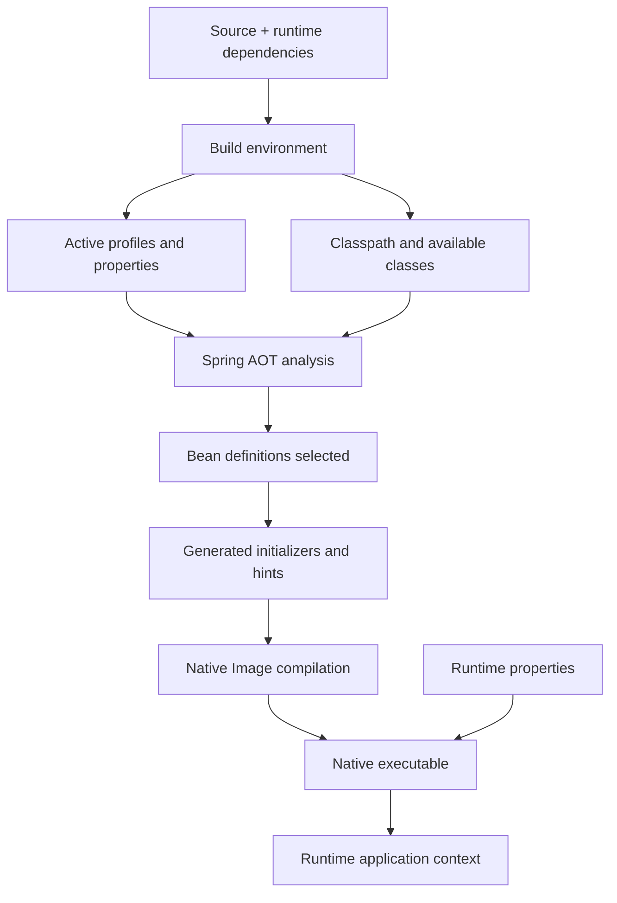

# Binary thiếu bean do profile, condition hoặc classpath tại thời điểm build

## 1. Vì sao bean có trong source nhưng không có trong binary?

Một ứng dụng Spring Boot có thể chạy đúng trên JVM nhưng khi chuyển sang GraalVM Native Image lại thiếu một bean, controller hoặc integration. Một nguyên nhân thường gặp là Spring AOT đã tạo application context trong môi trường build với profile, property hoặc classpath khác môi trường mà nhóm kỳ vọng khi chạy.

Spring AOT phân tích cấu trúc ApplicationContext và sinh mã khởi tạo cùng metadata cho cấu hình đó. Những điều kiện như `@Profile`, `@ConditionalOnProperty`, `@ConditionalOnClass`, `@ConditionalOnBean` và các điều kiện auto-configuration có thể ảnh hưởng bean definition được đưa vào generated output. Khi một bean không được chọn trong quá trình AOT, đổi property lúc chạy không nhất thiết có thể làm bean đó xuất hiện trở lại trong native executable.

Vì vậy, khi gặp lỗi “NoSuchBeanDefinitionException”, endpoint 404 hoặc integration không được khởi tạo trong native binary, cần kiểm tra cả môi trường build-time lẫn runtime. Chỉ kiểm tra `application.yml` đang deploy là chưa đủ.

Trong module **SPRING_BOOT_NATIVE_IMAGE**, hãy xem profile, conditional properties và dependency classpath như một phần của cấu hình tạo artifact. Mỗi binary cần được build với feature set mà nó sẽ cung cấp.

## 2. Spring AOT và bean graph được quyết định khi nào?

Ở ứng dụng Spring truyền thống, nhiều bean definition và auto-configuration được đánh giá khi ApplicationContext khởi tạo. Trong quy trình AOT, Spring khởi tạo/phân tích context trong giai đoạn build, áp dụng điều kiện cấu hình và sinh mã tương ứng.

Quy trình khái quát:



Runtime properties vẫn điều khiển những cấu hình được thiết kế để thay đổi lúc chạy, ví dụ database URL, port, log level hoặc một số feature behavior. Nhưng chúng không thể tùy ý bổ sung class/bean đã bị loại khỏi generated bean graph.

Cần phân biệt:

- **Build-time condition**: điều kiện được đánh giá khi AOT tạo context.
- **Runtime configuration**: giá trị được đọc lúc ứng dụng chạy.
- **Classpath condition**: phụ thuộc class có tồn tại trong dependency graph khi AOT chạy.
- **Runtime class loading/reflection**: thao tác động cần reachability metadata và vẫn phải phù hợp giới hạn Native Image.

## 3. Các condition thường làm bean không được sinh

| Condition | Điều kiện quyết định | Câu hỏi chẩn đoán |
|---|---|---|
| `@Profile("production")` | Profile active khi AOT phân tích | Profile production có active lúc build AOT không? |
| `@ConditionalOnProperty` | Property và giá trị tại thời điểm đánh giá | Property có được cấp trong AOT process không? |
| `@ConditionalOnClass` | Class có trên AOT classpath | Dependency có trong đúng application module không? |
| `@ConditionalOnMissingBean` | Bean khác đã tồn tại hay chưa | Auto-configuration bị back-off do bean nào? |
| `@ConditionalOnBean` | Bean phụ thuộc đã được đăng ký | Bean prerequisite có được tạo trong AOT context không? |
| `@ConditionalOnResource` | Resource có sẵn theo điều kiện | Resource có trong build classpath không? |
| Custom condition | Logic condition của ứng dụng/thư viện | Condition đọc environment hoặc filesystem nào? |

Một condition có thể được đặt trên configuration class, method tạo bean hoặc auto-configuration. Hãy tìm đúng vị trí khai báo và xác định nó được đánh giá trong giai đoạn nào.

## 4. Chẩn đoán bean bị thiếu theo thứ tự

Khi bean không có trong native binary, kiểm tra lần lượt:

1. Xác nhận bean class có trong source và được compile.
2. Xác nhận module chứa bean có nằm trong application build.
3. Kiểm tra package/component scan và import configuration.
4. Xác định mọi annotation condition áp dụng lên class/method.
5. Ghi nhận profile và property trong AOT process.
6. Kiểm tra dependency/classpath để thỏa `@ConditionalOnClass`.
7. Kiểm tra bean prerequisite và thứ tự auto-configuration.
8. Kiểm tra generated AOT output có registration cho bean hay không.
9. Build lại native executable với cấu hình đúng.
10. Test behavior trên chính binary mới tạo.

Không bắt đầu bằng cách thêm reflection hints. Reflection hints giúp Native Image giữ metadata cho thao tác động; chúng không tạo lại bean definition đã bị condition loại khỏi AOT context.

## 5. Profile được active trong giai đoạn AOT

Ví dụ ứng dụng có hai implementation:

```java
@Configuration
@Profile("local")
class LocalPaymentConfiguration {

    @Bean
    PaymentGateway paymentGateway() {
        return new SandboxPaymentGateway();
    }
}

@Configuration
@Profile("production")
class ProductionPaymentConfiguration {

    @Bean
    PaymentGateway paymentGateway(ProductionClient client) {
        return new ProductionPaymentGateway(client);
    }
}
```

Nếu AOT chạy với profile `local`, generated context có thể chứa sandbox gateway. Đưa native executable đó lên production rồi đặt `SPRING_PROFILES_ACTIVE=production` không bảo đảm production bean sẽ xuất hiện; bean graph đã được tạo từ cấu hình build.

Cách xử lý là build AOT cho profile mục tiêu. Nếu cần nhiều cấu hình triển khai có bean graph khác nhau, tạo artifact riêng cho từng cấu hình hoặc thiết kế bean graph ổn định và để runtime property chọn behavior bên trong các bean đã được tạo.

## 6. Xác định profile thực tế của AOT process

Không suy đoán profile từ file YAML. Ghi rõ profile được truyền cho process chạy AOT và kiểm tra log.

Có thể dùng environment variable hoặc system property trong môi trường build, tùy cách plugin khởi chạy AOT process:

```bash
SPRING_PROFILES_ACTIVE=production ./gradlew :api-app:processAot
```

Với Maven, gọi goal AOT của Spring Boot Maven Plugin theo version dự án và truyền profile/property bằng cơ chế được plugin hỗ trợ. Cách cấu hình arguments/environment cho goal có thể khác giữa các version; xác minh bằng plugin documentation và build log.

Trong CI, ghi lại tên profile và các property không nhạy cảm đã cấp cho AOT. Không in toàn bộ environment vì có thể chứa password/token.

Lưu ý: profile cần dùng để tạo bean graph phải có hiệu lực trong AOT process. Chỉ đặt `SPRING_PROFILES_ACTIVE` ở deployment manifest sau khi binary đã build không thay đổi generated bean graph.

## 7. Conditional property bị đánh giá sai

Ví dụ:

```java
@Configuration
@ConditionalOnProperty(
    prefix = "app.payment",
    name = "enabled",
    havingValue = "true"
)
class PaymentConfiguration {

    @Bean
    PaymentService paymentService(PaymentGateway gateway) {
        return new PaymentService(gateway);
    }
}
```

Nếu property `app.payment.enabled` không được đặt thành `true` khi AOT chạy, configuration có thể không được đưa vào generated context. Sau đó set property này thành true trong deployment environment không nhất thiết khôi phục bean.

Cần quyết định rõ property đó là:

- Điều kiện chọn bean graph tại build-time; hoặc
- Cờ runtime chỉ điều khiển behavior bên trong bean luôn tồn tại.

Nếu muốn bật/tắt behavior lúc runtime, có thể tạo bean ổn định rồi kiểm tra property trong method/service hoặc dùng một strategy bean luôn được đăng ký. Nếu muốn loại hẳn integration khỏi binary, build artifact riêng theo feature configuration.

## 8. Phân biệt property build-time và runtime

| Property | Thường thuộc giai đoạn | Ví dụ |
|---|---|---|
| Profile chọn implementation bean | Build-time AOT | local/production |
| Property bật auto-configuration | Có thể build-time | app.payment.enabled |
| Database URL | Runtime | spring.datasource.url |
| Database password | Runtime secret | spring.datasource.password |
| HTTP port | Runtime | server.port |
| Log level | Runtime nếu framework hỗ trợ | logging.level.root |
| Feature behavior trong bean đã có | Runtime | app.checkout.read-only |

Đây là phân loại theo thiết kế ứng dụng, không phải danh sách cứng cho mọi property. Một property có thể được dùng trong cả build-time condition và runtime logic. Hãy tìm annotation/condition đang tiêu thụ nó.

Không đưa secret vào AOT build để thỏa một condition nếu secret chỉ cần thiết khi kết nối database lúc chạy. Tách cấu trúc bean khỏi giá trị kết nối.

## 9. Classpath condition và dependency bị thiếu

Ví dụ auto-configuration:

```java
@AutoConfiguration
@ConditionalOnClass(name = "com.vendor.sdk.PaymentClient")
class VendorPaymentAutoConfiguration {

    @Bean
    PaymentGateway vendorPaymentGateway(
            PaymentClient paymentClient) {
        return new VendorPaymentGateway(paymentClient);
    }
}
```

Nếu dependency chứa `PaymentClient` không có trên classpath khi AOT chạy, condition không thỏa và bean không được sinh. Thêm JAR vào runtime container sau khi binary đã build không thể bổ sung class vào executable đã đóng gói.

Kiểm tra dependency graph của đúng application module:

```bash
./gradlew :api-app:dependencies --configuration runtimeClasspath
./gradlew :api-app:dependencyInsight --dependency vendor-sdk --configuration runtimeClasspath
```

Với Maven:

```bash
./mvnw -pl api-app dependency:tree
```

Đảm bảo dependency nằm trong runtime classpath, version đúng và không bị exclude. Nếu integration là optional, kiểm tra starter/module tương ứng đã được thêm vào application build trước AOT.

## 10. Component scan và package boundaries

Một bean có thể không được phát hiện vì package nằm ngoài component scan. Ví dụ class main ở `com.example.api`, nhưng implementation ở package sibling `com.example.payment` không được scan theo cấu hình hiện tại.

Kiểm tra:

- Package của `@SpringBootApplication`.
- `scanBasePackages` hoặc `@ComponentScan`.
- `@Import` configuration.
- Module dependency giữa application và feature module.
- Conditional configuration bao quanh package/module.

Ví dụ khai báo scan rõ ràng:

```java
@SpringBootApplication(scanBasePackages = {
    "com.example.api",
    "com.example.payment"
})
public class ApiApplication {
}
```

Chỉ mở rộng scan khi package đó thực sự thuộc ứng dụng. Component scan quá rộng có thể vô tình kéo configuration không mong muốn vào bean graph.

## 11. Auto-configuration back-off do bean khác tồn tại

Nhiều Spring Boot auto-configuration dùng `@ConditionalOnMissingBean`. Nếu ứng dụng tự khai báo bean cùng type, auto-configuration mặc định có thể back-off.

Ví dụ:

```java
@Bean
Clock applicationClock() {
    return Clock.systemUTC();
}
```

Một auto-configuration khác có thể chỉ tạo `Clock` khi chưa có bean type tương ứng. Khi profile hoặc component scan làm bean tự định nghĩa xuất hiện trong AOT context, auto-configuration mặc định không còn được áp dụng.

Khi bean thiếu, tìm condition evaluation report để biết auto-configuration match hay back-off và bean nào khiến điều kiện sai. Không xóa bean tự định nghĩa nếu nó được feature khác sử dụng; điều chỉnh configuration theo chủ đích.

## 12. Dùng condition evaluation report để tìm nguyên nhân

Spring Boot có condition evaluation report cho auto-configuration. Có thể bật debug logging trong môi trường chẩn đoán để xem các điều kiện match/no-match:

```yaml
debug: true
```

Hoặc dùng logging category phù hợp với Spring Boot version:

```yaml
logging:
  level:
    org.springframework.boot.autoconfigure: DEBUG
```

Report hữu ích để biết auto-configuration nào được áp dụng, bị loại hoặc back-off. Output cụ thể phụ thuộc version và cách context được khởi tạo. Với AOT, hãy thu report/log từ đúng process và môi trường build; report của một lần chạy JVM với profile khác không chứng minh điều kiện của AOT build.

Không để debug logging bật không kiểm soát trong production vì log có thể lớn và lộ thông tin cấu hình.

## 13. Kiểm tra generated AOT output

Sau khi chạy AOT processing, tìm generated sources/resources trong output directory do plugin tạo. Vị trí khác nhau giữa Gradle/Maven và version plugin.

Tìm các dấu hiệu:

- Generated initializer cho ApplicationContext.
- Bean registration/invocation tương ứng configuration.
- RuntimeHints registrar hoặc generated hints.
- Resource metadata.
- AOT log ghi profile/condition.

Không chỉnh sửa generated source trực tiếp. Đây là output được tái tạo từ source và build configuration; sửa tay sẽ mất ở lần build tiếp theo. Hãy sửa annotation, configuration, dependency hoặc AOT arguments ở nguồn.

Nếu bean không xuất hiện trong generated registration, tập trung vào condition/classpath/component scan. Nếu bean có registration nhưng native runtime vẫn lỗi, điều tra class reachability, reflection/proxy metadata và resource riêng.

## 14. Kiểm tra runtime classpath và AOT classpath

Classpath lúc AOT chạy quyết định class nào có thể được phát hiện bởi condition. Runtime classpath của application cũng phải chứa dependencies cần để chạy.

So sánh:

- Compile classpath.
- Runtime classpath.
- AOT process classpath.
- Test classpath.
- Native Image build inputs.

Không để dependency chỉ có trong `testImplementation` hoặc Maven `test` scope nếu application cần ở production. Một test có thể pass vì test classpath chứa SDK, trong khi application AOT build không thấy SDK đó.

Với multi-module build, xác minh application module phụ thuộc đúng module feature. Đừng chỉ nhìn root project's dependency report.

## 15. Nhiều profile cần nhiều binary hay một binary?

Có hai chiến lược chính:

**Một bean graph ổn định, runtime configuration thay đổi.** Dùng khi các environment cần cùng tập bean nhưng khác URL, credentials, port, endpoint hoặc behavior. Build một binary rồi cấp runtime properties.

**Nhiều bean graph khác nhau.** Nếu local, production hoặc từng deployment cần implementation/configuration class khác nhau được chọn bằng profile/condition, build artifact AOT riêng cho từng graph. Gắn tên profile/target vào artifact metadata và image tag.

Không build một binary với profile test rồi kỳ vọng nó tự trở thành production binary chỉ bằng cách thay environment variable. Nếu dùng nhiều profile đồng thời, xác minh rõ thứ tự và semantics của profile trong AOT process.

## 16. Thiết kế lại condition nếu cần runtime flexibility

Nếu một bean chỉ tồn tại khi `app.feature.enabled=true`, nhưng tổ chức muốn bật/tắt feature mà không build lại, cân nhắc giữ bean trong graph và để property quyết định behavior:

```java
@Service
class OptionalFeatureService {

    private final FeatureProperties properties;

    OptionalFeatureService(FeatureProperties properties) {
        this.properties = properties;
    }

    public Result execute(Command command) {
        if (!properties.enabled()) {
            throw new FeatureDisabledException();
        }
        return perform(command);
    }
}
```

Ví dụ minh họa; cần định nghĩa properties và error handling phù hợp. Cách này giữ bean luôn có mặt, còn behavior được quyết định runtime.

Nếu feature kéo theo dependency lớn hoặc native library không cần trong mọi deployment, artifact riêng có thể hợp lý hơn. Lựa chọn dựa trên chi phí image, security boundary, deployment model và yêu cầu vận hành.

## 17. Kiểm thử profile/condition trên JVM và Native Image

Tạo test cho từng cấu hình được hỗ trợ:

- Profile production tạo đúng gateway.
- Profile local tạo sandbox implementation.
- Property enabled/disabled cho kết quả đúng.
- Thiếu dependency optional làm auto-configuration back-off như mong đợi.
- Bean override không làm mất integration khác.
- Endpoint/service gọi đúng implementation.

Sau đó chạy test trên AOT-processed application và native executable tương ứng. JVM test thông thường với profile runtime không thay thế xác minh generated AOT graph.

Test native nên bao gồm cả positive path và negative path. Ví dụ kiểm tra feature được bật, feature bị tắt, bean optional không có và endpoint trả status phù hợp.

## 18. Lỗi thường gặp và cách xử lý

| Triệu chứng | Nguyên nhân có thể | Hướng kiểm tra |
|---|---|---|
| `NoSuchBeanDefinitionException` | Profile/condition không tạo bean | Kiểm tra AOT profile/property và generated registration |
| Controller trả 404 | Controller không nằm trong scan/bean graph | Kiểm tra package scan và profile |
| Auto-configuration không chạy | `@ConditionalOnClass` không thỏa | Kiểm tra AOT runtime classpath |
| Bean mặc định biến mất | `@ConditionalOnMissingBean` back-off | Xem condition report và bean override |
| Runtime bật property nhưng bean vẫn thiếu | Condition đã được đánh giá lúc AOT | Build lại với cấu hình đúng hoặc giữ bean ổn định |
| JVM pass, native thiếu integration | Test classpath khác application classpath | Kiểm tra runtime/AOT dependency graph |
| Generated initializer thiếu configuration | AOT không chọn configuration | Kiểm tra profile, scan, import và condition |
| Bean có nhưng reflection lỗi | Thiếu reachability metadata | Kiểm tra RuntimeHints và native stack trace |

## 19. Checklist điều tra binary thiếu bean

- Đã xác định bean type và configuration class cần tạo bean.
- Đã tìm mọi `@Profile` và `@Conditional*` trên configuration/bean method.
- Đã ghi profile/property thực tế trong AOT process.
- Đã kiểm tra dependency và classpath của đúng application module.
- Đã xác minh component scan/import boundaries.
- Đã kiểm tra auto-configuration condition report và back-off.
- Đã kiểm tra generated AOT registration.
- Đã phân biệt bean graph issue với reflection/resource reachability issue.
- Đã build lại native executable sau khi sửa build-time condition.
- Đã chạy test cho từng profile/feature configuration được hỗ trợ.
- Đã xác minh đúng binary/image digest được triển khai.

## 20. Câu hỏi tự kiểm tra

1. Vì sao đổi `SPRING_PROFILES_ACTIVE` lúc runtime không luôn khôi phục bean bị loại trong AOT?
2. `@ConditionalOnProperty` và `@ConditionalOnClass` quyết định bean graph theo dữ liệu nào?
3. Làm thế nào xác minh profile thực sự active trong process chạy AOT?
4. Vì sao dependency chỉ có trong test classpath không đủ cho production?
5. Condition evaluation report giúp chẩn đoán auto-configuration back-off ra sao?
6. Generated AOT source có thể cho biết điều gì khi bean bị thiếu?
7. Khi nào nên tạo binary riêng cho từng profile?
8. Làm thế nào thiết kế feature flag để behavior đổi runtime mà bean vẫn có mặt?

**Ghi nhớ:** bean bị thiếu trong native executable thường bắt nguồn từ bean graph đã được quyết định bởi profile, condition hoặc classpath khi AOT chạy. Xác minh build-time environment và generated registration trước, sửa đúng điều kiện/dependency rồi build và test lại artifact cho cấu hình triển khai.
