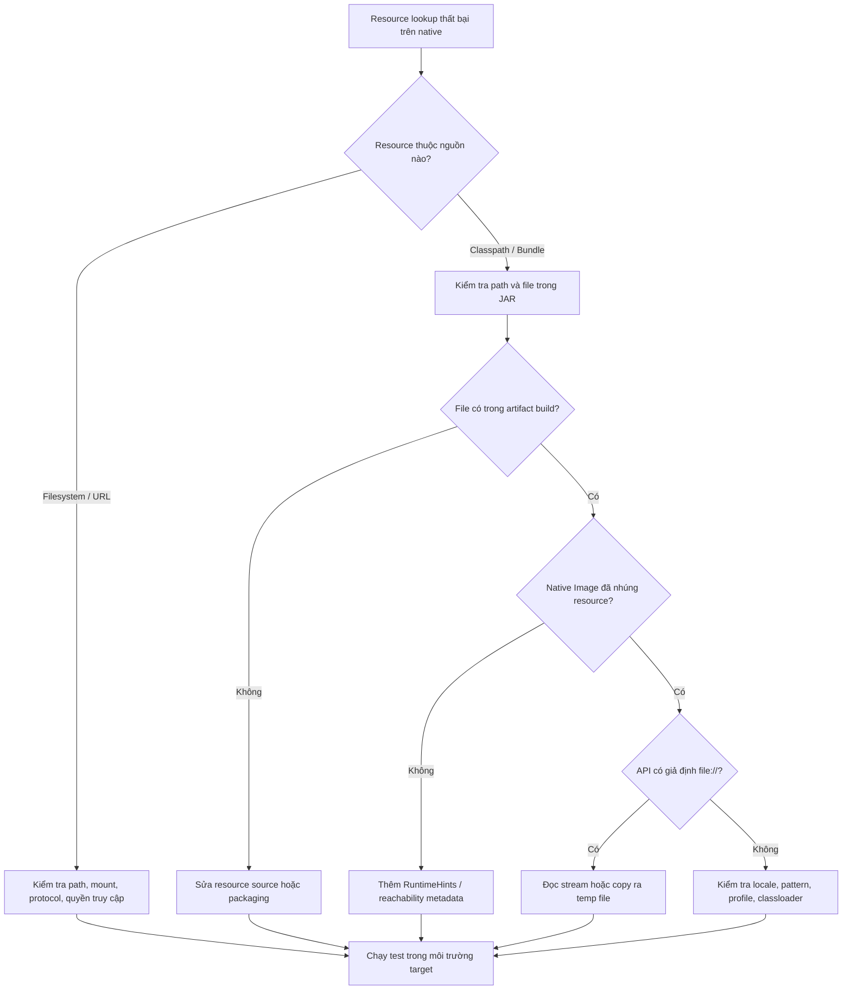

# Không tìm thấy resource, template, bundle hoặc tài nguyên migration

> **Chương: Chẩn đoán.** Module **SPRING_BOOT_NATIVE_IMAGE** biên dịch ứng dụng Spring Boot thành GraalVM Native Image bằng Spring AOT để cải thiện thời gian khởi động và bộ nhớ. Một ứng dụng có thể chạy đúng trên JVM nhưng báo không tìm thấy file cấu hình, template, message bundle hoặc migration sau khi chuyển sang native. Nguyên nhân thường nằm ở đường dẫn classpath, cách tra cứu động, resource chưa được đưa vào executable hoặc thư viện đang giả định resource luôn là file trên filesystem. Bài học này hướng dẫn lần theo resource từ source tree đến native executable, bổ sung RuntimeHints đúng phạm vi và xác minh bằng native test.

## 1. Mục tiêu học tập

Sau bài học, bạn có thể:

1. Phân biệt resource trên classpath với file bên ngoài filesystem.
2. Chẩn đoán ClassPathResource, ResourceLoader, ClassLoader và Class.getResource() khi đường dẫn không khớp.
3. Giải thích vì sao Native Image không tự đưa mọi classpath resource vào executable.
4. Đăng ký template, file cấu hình, message bundle và migration bằng Spring RuntimeHints.
5. Phân biệt glob pattern của Spring/GraalVM với regex của metadata cũ.
6. Kiểm tra resource thực tế đã được nhúng bằng Build Report hoặc embedded-resources.json.
7. Xử lý các trường hợp template được chọn theo tên động, locale thay đổi và resource nằm trong thư viện phụ thuộc.
8. Kiểm tra riêng SQL migration, Java migration, Liquibase changelog và các file được changelog tham chiếu.
9. Viết test chạy trên native executable để xác nhận tài nguyên có thể đọc và nội dung đúng.

## 2. Vì sao resource chạy trên JVM nhưng mất trong Native Image?

Trên JVM thông thường, classpath và các JAR có thể được duyệt khi ứng dụng chạy. Một thư viện có thể tìm file theo tên được ghép từ cấu hình, quét thư mục resource hoặc thử nhiều đường dẫn.

Native Image thực hiện phân tích tĩnh lúc build. Để giữ executable nhỏ và xác định được những gì cần thiết, builder không mặc định nhúng toàn bộ resource có trên classpath. Resource cần được phát hiện qua lời gọi có tham số hằng hoặc được khai báo bằng reachability metadata/RuntimeHints. Nếu tên resource chỉ được tạo ra khi chạy, builder có thể không biết file nào cần giữ.

Ví dụ:

```java
// Tên resource là hằng số: Native Image có thể nhận diện lời gọi này.
InputStream input = InvoiceRenderer.class
        .getResourceAsStream("/templates/invoice.html");

// Tên resource được ghép từ dữ liệu runtime: cần khai báo resource pattern.
String path = "templates/" + templateName + ".html";
InputStream dynamicInput = classLoader.getResourceAsStream(path);
```

Trường hợp thứ hai cần metadata bao phủ các template được phép sử dụng. Nếu thiếu metadata, getResourceAsStream() có thể trả về null, mặc dù file vẫn có trong JAR nguồn.

Một điểm khác biệt quan trọng: resource đã nhúng trong native executable có thể được trả về dưới URL scheme resource: thay vì file:. Vì vậy, thư viện dùng URL.getFile() hoặc ép URL thành đường dẫn filesystem có thể thất bại dù resource đã được đóng gói. Đọc bằng stream; nếu API bắt buộc nhận một file vật lý, hãy copy resource ra thư mục tạm trước.

## 3. Phân loại nguồn resource trước khi sửa

Đừng bắt đầu bằng cách thêm pattern rộng. Trước tiên xác định ứng dụng đang đọc loại tài nguyên nào:

| Loại | Ví dụ | Cách phân biệt |
|---|---|---|
| Classpath resource | classpath:config/app.yml, templates/invoice.html | Được đóng gói trong src/main/resources hoặc JAR dependency |
| Resource theo package | com/example/messages.properties | Nằm cạnh package/class trong JAR |
| Filesystem resource | /opt/orders/templates/invoice.html | File phải tồn tại trong filesystem của host/container khi chạy |
| URL resource | https://..., jar:... | Cần URL protocol và kết nối/runtime phù hợp |
| Resource bundle | com.example.i18n.messages | ResourceBundle chọn file theo base name và locale |
| Database migration | db/migration/V1__init.sql | Được Flyway hoặc Liquibase tìm theo location/changelog |

Spring có thể biểu diễn các nguồn này bằng Resource, nhưng metadata của Native Image chỉ giúp đưa classpath resource vào executable. Nó không tự tạo file filesystem, không mount volume và không bảo đảm một URL từ xa có thể truy cập.

### 3.1. Phân biệt đường dẫn classpath và filesystem

Với resource trong src/main/resources:

```text
src/main/resources/
  application.yml
  templates/
    invoice.html
    mail/
      receipt.html
  i18n/
    messages.properties
    messages_en.properties
    messages_vi.properties
  db/
    migration/
      V1__create_orders.sql
      V2__add_status.sql
    changelog/
      db.changelog-master.yaml
      changes/
        001-create-orders.yaml
```

Khi đóng gói, các đường dẫn tương ứng thường được tính từ root của classpath, ví dụ templates/invoice.html, i18n/messages_vi.properties và db/migration/V1__create_orders.sql.

Không đưa src/main/resources/ vào resource path lúc runtime. Ví dụ classpath:src/main/resources/templates/invoice.html thường sai vì src/main/resources là vị trí source của build, không phải một phần của classpath path trong JAR.

### 3.2. Quy tắc của ClassLoader và Class.getResource()

- ClassLoader.getResource("templates/invoice.html") nhận đường dẫn tương đối với root classpath, thường không có dấu / ở đầu.
- InvoiceRenderer.class.getResource("invoice.html") tìm tương đối với package của class InvoiceRenderer.
- InvoiceRenderer.class.getResource("/templates/invoice.html") tìm từ root classpath.
- ClassPathResource("templates/invoice.html") nhận path tương đối với root classpath; tránh thêm prefix classpath: vào constructor này.
- Đường dẫn resource phân biệt chữ hoa/chữ thường trên Linux. Invoice.html và invoice.html là hai tên khác nhau.

Nếu đường dẫn có dấu / đầu hoặc không có dấu / khác nhau giữa các API, hãy kiểm tra chính xác API đang được gọi trước khi sửa metadata.

## 4. Quy trình chẩn đoán theo từng lớp

Sử dụng quy trình sau để tìm vị trí resource bị mất:



Thực hiện lần lượt:

1. Ghi lại exception đầy đủ, resource path và API lookup.
2. Xác nhận file có trong source tree và được copy vào JAR hoặc dependency.
3. Xác nhận file có trong artifact sau packaging.
4. Kiểm tra resource có được native builder nhúng hay không.
5. Kiểm tra code có đang dùng API yêu cầu file: URL hoặc filesystem path hay không.
6. Kiểm tra profile, locale, working directory và cấu hình location.
7. Chạy native test cho đúng nhánh sử dụng resource.

## 5. Kiểm tra resource trong JAR trước khi điều chỉnh Native Image

Trước tiên xác nhận resource đã đi qua bước packaging. Với executable JAR:

```bash
jar tf target/orders-service.jar | grep -E \
  'templates/|i18n/|db/migration/|db/changelog/'
```

Với Spring Boot executable JAR, resource ứng dụng thường nằm dưới BOOT-INF/classes/; resource từ dependency nằm trong các JAR lồng nhau dưới BOOT-INF/lib/. Kiểm tra cả hai nơi nếu resource đến từ thư viện:

```bash
jar tf target/orders-service.jar | grep 'BOOT-INF/classes/templates/'
```

Nếu resource không có trong JAR:

- Kiểm tra file nằm đúng source resource directory.
- Kiểm tra build plugin có loại trừ file qua exclude, includes hoặc resource filtering hay không.
- Kiểm tra module chứa resource có được khai báo dependency với scope phù hợp hay không.
- Với Kotlin/Gradle hoặc build có source set riêng, kiểm tra resource directory bổ sung có được đưa vào output.
- Kiểm tra tên file có khác chữ hoa/chữ thường giữa source và code hay không.

Không thêm RuntimeHints để xử lý file chưa được packaging. RuntimeHints chỉ hướng dẫn native builder đưa resource đã có trong classpath vào executable.

## 6. Kiểm tra resource đã được nhúng vào native executable

Sau khi xác nhận resource có trong JAR, kiểm tra output của Native Image builder.

### 6.1. Tạo Build Report

Thêm tùy chọn build report:

```bash
native-image --emit build-report -jar target/orders-service.jar
```

Mở Build Report và xem tab **Resources**. Danh sách cho biết resource nào đã được đăng ký, nguồn gốc và trạng thái của resource. Nếu file có trong JAR nhưng không xuất hiện trong danh sách, hãy kiểm tra metadata và resource pattern.

### 6.2. Tạo danh sách embedded resources

Có thể yêu cầu builder tạo file JSON liệt kê resource được nhúng:

```bash
native-image -H:+GenerateEmbeddedResourcesFile \
    -jar target/orders-service.jar
```

Tìm file embedded-resources.json trong output build. Kiểm tra:

- Name: path mà code runtime cần tìm.
- Origin: vị trí resource được lấy từ lúc build.
- Type: loại resource; chú ý trạng thái missing.
- Size: kích thước resource.
- Module: module nguồn nếu ứng dụng dùng Java module.

Đối chiếu Name với đường dẫn trong code, không chỉ đối chiếu tên file. Nếu resource có cùng tên ở nhiều JAR, kiểm tra Origin để biết builder đang lấy bản nào.

## 7. Đăng ký resource bằng Spring RuntimeHints

Với Spring Boot, ưu tiên khai báo resource gần component đang sử dụng nó bằng RuntimeHintsRegistrar và @ImportRuntimeHints. Spring AOT gọi registrar trong quá trình xử lý build và chuyển hints thành metadata cho Native Image.

Ví dụ dịch vụ render invoice theo tên template, đọc SQL migration và tải message bundle:

```java
package com.example.orders.resource;

import org.springframework.aot.hint.RuntimeHints;
import org.springframework.aot.hint.RuntimeHintsRegistrar;
import org.springframework.context.annotation.ImportRuntimeHints;
import org.springframework.stereotype.Component;

@Component
@ImportRuntimeHints(OrderResourceHints.class)
public class OrderResourceConfiguration {
}

final class OrderResourceHints implements RuntimeHintsRegistrar {

    @Override
    public void registerHints(RuntimeHints hints, ClassLoader classLoader) {
        hints.resources().registerPattern("templates/**");
        hints.resources().registerPattern("db/migration/*.sql");
        hints.resources().registerPattern("db/changelog/**");
        hints.resources().registerResourceBundle("com.example.i18n.messages");
    }
}
```

Các pattern trên minh họa một ứng dụng có template trong templates/, SQL migration trong db/migration/, Liquibase changelog trong db/changelog/ và bundle có base name com.example.i18n.messages. Hãy thu hẹp pattern theo layout thật của ứng dụng; không đăng ký toàn bộ classpath nếu chỉ cần vài thư mục.

### 7.1. Quy tắc pattern của Spring ResourceHints

Spring ResourceHints.registerPattern(...) dùng glob pattern cho classpath resource:

| Pattern | Ý nghĩa |
|---|---|
| application.yml | Một resource ở root classpath |
| templates/invoice.html | Một template cụ thể |
| templates/*.html | Các file HTML trong templates/ và thư mục con |
| templates/** | Tất cả resource trong templates/ và thư mục con |
| db/migration/*.sql | Các file SQL migration dưới db/migration/ |

Pattern là đường dẫn tương đối với root classpath và dùng dấu /. Không đặt dấu / ở đầu. Spring pattern không phải Java regex; không viết .*\\.html$ trong registerPattern.

@ImportRuntimeHints nên được đặt gần bean/component cần resource. Nếu component không tham gia vào ApplicationContext được xử lý AOT, registrar gắn với component đó cũng có thể không được đóng góp.

### 7.2. Đăng ký resource cụ thể và resource bundle

Nếu biết chính xác một file:

```java
hints.resources().registerPattern("config/payment-rules.yml");
```

Nếu code dùng ResourceBundle:

```java
hints.resources().registerResourceBundle("com.example.i18n.messages");
```

Base name là tên bundle không có hậu tố locale hoặc .properties. Với base name com.example.i18n.messages, các file thường có dạng:

```text
com/example/i18n/messages.properties
com/example/i18n/messages_en.properties
com/example/i18n/messages_vi.properties
```

Resource bundle chỉ dùng được với locale đã được đưa vào native executable. Nếu ứng dụng hỗ trợ một tập locale xác định, khai báo locale tương ứng trong cấu hình Native Image, ví dụ:

```bash
native-image -H:IncludeLocales=en,vi -jar target/orders-service.jar
```

Chỉ dùng -H:+IncludeAllLocales khi thực sự cần tất cả locale vì nó có thể làm tăng kích thước executable. Kiểm tra cả fallback locale và file base messages.properties; nếu chỉ có messages_vi.properties, hành vi fallback khi không tìm được locale cần được xác định rõ.

## 8. Reachability metadata khi không dùng Spring RuntimeHints

Với thư viện không tích hợp Spring AOT hoặc một native executable không chạy qua Spring, có thể khai báo reachability metadata trong:

```text
META-INF/native-image/<groupId>/<artifactId>/reachability-metadata.json
```

Ví dụ schema metadata hiện hành:

```json
{
  "resources": [
    {
      "glob": "templates/**"
    },
    {
      "glob": "db/migration/**"
    },
    {
      "glob": "db/changelog/**"
    },
    {
      "bundle": "com.example.i18n.messages"
    }
  ]
}
```

Native Image đọc resource metadata từ reachability-metadata.json trên classpath. Trong schema này:

- glob chỉ định resource path cần đưa vào executable.
- bundle chỉ định base name của Java ResourceBundle.
- module có thể được dùng khi resource thuộc một Java module cụ thể.

Glob của GraalVM reachability metadata chỉ hỗ trợ tập ký tự wildcard được tài liệu quy định (* và **). Không nhầm schema hiện hành này với resource-config.json cũ, trong đó resources.includes[].pattern dùng Java regular expression. Không copy regex từ metadata cũ sang trường glob.

Nếu ứng dụng Spring đã có RuntimeHintsRegistrar, nên duy trì hints ở một nơi để tránh hai cấu hình khác nhau cùng khai báo resource. Dùng JSON khi đó là cơ chế phù hợp của thư viện hoặc build pipeline.

## 9. Resource động, classpath scanning và URL protocol

Một số API hoạt động tốt trên JVM nhưng không thể được suy luận đầy đủ ở build time:

- ClassLoader.getResource(dynamicName).
- ResourceBundle.getBundle(baseNameFromConfig).
- PathMatchingResourcePatternResolver.getResources("classpath*:**/*.xml").
- Quét package hoặc thư mục classpath khi ứng dụng khởi động.
- Thư viện tự dò template, plugin hoặc migration bằng cách duyệt URL/JAR.

### 9.1. Tên resource được tạo lúc runtime

Nếu resource path được ghép từ input hoặc cấu hình, khai báo pattern bao phủ tập resource hợp lệ. Ví dụ:

```java
String templatePath = "templates/" + templateName + ".html";
Resource template = resourceLoader.getResource("classpath:" + templatePath);
```

Khai báo:

```java
hints.resources().registerPattern("templates/*.html");
```

Không nhận đường dẫn file tùy ý từ request rồi dùng pattern rộng để nhúng mọi resource. Hãy giới hạn tên template bằng allowlist hoặc enum, vừa giảm kích thước binary vừa tránh path traversal.

### 9.2. Runtime classpath scanning

Native Image không giữ mô hình classpath động như HotSpot. Spring AOT thực hiện discovery cần thiết trong build time; việc quét classpath tùy ý lúc runtime không phải cách thay thế cho AOT. Nếu ứng dụng cần phát hiện plugin hoặc resource:

1. Xác định tập plugin/resource ở build time.
2. Tạo registry hoặc danh sách tường minh trong cấu hình ứng dụng.
3. Đăng ký resource pattern cho các file mà registry sẽ đọc.
4. Kiểm tra tất cả nhánh bằng native integration test.

Nếu thư viện phụ thuộc vào quét JAR runtime, hãy xác minh thư viện đó có hỗ trợ Native Image. Thêm resource hints không làm một thuật toán quét JAR không tương thích tự hoạt động.

### 9.3. URL protocol jar, https và resource URL

Spring Boot ghi nhận rằng URL protocol jar không được bật mặc định trong Native Image. Nếu một dependency thực sự cần mở URL jar:, có thể cần build với:

```bash
native-image --enable-url-protocols=jar -jar target/orders-service.jar
```

Chỉ bật protocol mà dependency cần. Với Flyway 12.3 trở lên, Spring Boot wiki cũng ghi nhận một trường hợp Flyway tạo URL https: trong startup; trên cấu hình Spring Boot 4.1 mặc định, có thể cần --enable-url-protocols=https để tránh lỗi protocol chưa được bật. Đây là yêu cầu về URL protocol, khác với việc đưa file SQL migration vào executable.

Khi resource đã được nhúng, URL có thể có dạng resource:. Tránh code như:

```java
URL url = resource.getURL();
File file = new File(url.getFile()); // Sai với resource URL được nhúng.
```

Đọc stream:

```java
try (InputStream input = resource.getInputStream()) {
    // Parse nội dung trực tiếp từ stream.
}
```

Nếu một thư viện chỉ nhận File, copy resource ra file tạm:

```java
Path temporaryFile = Files.createTempFile("invoice-template-", ".html");
try (InputStream input = resource.getInputStream()) {
    Files.copy(input, temporaryFile, StandardCopyOption.REPLACE_EXISTING);
}
try {
    legacyRenderer.render(temporaryFile.toFile());
}
finally {
    Files.deleteIfExists(temporaryFile);
}
```

Đảm bảo thư mục tạm có quyền ghi và dọn file sau khi sử dụng.

## 10. Chẩn đoán template không tìm thấy

Với template engine như Thymeleaf, FreeMarker hoặc Mustache, kiểm tra đồng thời template prefix, suffix, resource path và cách engine nạp template.

### 10.1. Kiểm tra prefix và suffix

Ví dụ cấu hình Thymeleaf:

```yaml
spring:
  thymeleaf:
    prefix: classpath:/templates/
    suffix: .html
    check-template-location: true
```

Nếu code yêu cầu template mail/receipt, resource path thực tế thường là templates/mail/receipt.html. Hãy kiểm tra file có trong JAR và pattern có bao phủ thư mục con.

### 10.2. Các nguyên nhân phổ biến

| Triệu chứng | Nguyên nhân có thể | Cách kiểm tra |
|---|---|---|
| TemplateInputException hoặc template resolver trả về không tồn tại | Sai prefix/suffix hoặc tên template | Log tên template đã resolve; kiểm tra file trong JAR |
| Chỉ template ở root chạy được | Pattern không bao phủ thư mục con | Dùng pattern phù hợp như templates/** |
| JVM chạy, native báo không tìm thấy template | Resource không được nhúng | Xem Build Report/embedded-resources |
| Template tồn tại nhưng lỗi khi render | File được đọc nhưng thiếu include/fragment/layout | Kiểm tra các file th:insert, include hoặc partial |
| Lỗi chỉ xảy ra trong Linux container | Sai chữ hoa/chữ thường | So sánh chính xác tên file và path |
| Template được chọn từ database/config | Dynamic path không được khai báo | Allowlist template và đăng ký pattern tương ứng |

Nếu template chứa fragment hoặc include tới resource khác, kiểm tra toàn bộ dependency của template. Một file chính có thể đã được nhúng nhưng fragment mà nó tham chiếu lại bị thiếu.

## 11. Chẩn đoán ResourceBundle và message không tìm thấy

Lỗi thường gặp:

- MissingResourceException.
- Message key tồn tại trong JVM nhưng không tìm thấy trong native.
- Locale vi hoạt động nhưng locale en hoặc locale fallback không hoạt động.
- Ứng dụng dùng base name khác với bundle path thực tế.

Ví dụ:

```java
ResourceBundle messages = ResourceBundle.getBundle(
        "com.example.i18n.messages", Locale.forLanguageTag("vi"));
String title = messages.getString("invoice.title");
```

Đăng ký:

```java
hints.resources().registerResourceBundle("com.example.i18n.messages");
```

Kiểm tra:

1. Base name có khớp package và tên file không?
2. Có file messages.properties mặc định không?
3. Locale runtime có nằm trong locale được include lúc build không?
4. Key cần dùng có trong file locale tương ứng không?
5. Có nhiều bundle trùng base name ở các dependency khác nhau không?
6. Có dùng ResourceBundle.Control tùy chỉnh hoặc logic nạp bundle động không?

Với Spring MessageSource, kiểm tra spring.messages.basename, encoding và file locale. Nếu cấu hình base name khác messages, hãy đăng ký đúng bundle name. Không đăng ký tên file kèm hậu tố locale nếu API đang dùng base name.

## 12. Chẩn đoán Flyway migration

Flyway phân biệt location theo prefix:

- classpath: hoặc location không có prefix: package trên classpath, có thể chứa SQL và Java-based migrations.
- filesystem: thư mục trên filesystem; đường dẫn tương đối được tính từ working directory của process.

Với Spring Boot, cấu hình thường gặp:

```yaml
spring:
  flyway:
    locations:
      - classpath:db/migration
```

Flyway API mặc định thường tìm classpath:db/migration. Maven/Gradle Flyway plugin có default location filesystem:src/main/resources/db/migration, vì plugin chạy trong môi trường build. Không bê nguyên đường dẫn filesystem:src/main/resources/... từ build plugin vào native application runtime; trong container production, source directory này thường không tồn tại.

### 12.1. Kiểm tra SQL migration

Kiểm tra:

1. Các file V1__...sql, V2__...sql có nằm trong JAR không?
2. spring.flyway.locations có trỏ đúng classpath:db/migration không?
3. Tên file có tuân theo naming convention của Flyway không?
4. Có file SQL được include hoặc load từ thư mục con không?
5. Có cấu hình profile làm thay đổi location giữa build và runtime không?
6. Native executable có thể kết nối database và đọc migration trước khi migrate không?

Nếu migration path được cấu hình động, đăng ký pattern bao phủ các thư mục migration hợp lệ, sau đó chạy native integration test với database test. Xác minh bảng flyway_schema_history có version mong đợi và migration thực sự được áp dụng.

### 12.2. Java-based migration

Spring Boot với GraalVM ghi nhận automatic detection Java migrations của Flyway không được hỗ trợ trong native image. Cần đăng ký migration tường minh qua FlywayConfigurationCustomizer:

```java
@Component
class JavaMigrationsFlywayCustomizer implements FlywayConfigurationCustomizer {

    @Override
    public void customize(FluentConfiguration configuration) {
        configuration.javaMigrations(
                new V1__CreateOrders(),
                new V2__AddOrderStatus());
    }
}
```

Đảm bảo các migration class được đưa vào native image và metadata cần thiết cho reflection/JDBC driver đã được hỗ trợ. Nếu migration dùng classpath resource bổ sung, đăng ký riêng các resource đó.

### 12.3. Cảnh báo unsupported protocol: resource

Spring Boot GraalVM wiki ghi nhận một số log Flyway như:

```text
WARN FlywayExecutor: Unable to scan location: /db/migration
(unsupported protocol: resource)
```

Đây là cảnh báo đã được ghi nhận trong tích hợp Flyway với Native Image và có thể là thông báo phụ do cách Flyway quét resource URL. Tuy nhiên, không bỏ qua mọi cảnh báo migration một cách máy móc. Hãy xác nhận bằng native integration test rằng:

- Flyway nhận được đúng location.
- Migration mong đợi có trong schema history.
- Database đạt schema version dự kiến.
- Startup không tiếp tục trong trạng thái chưa migrate nếu migration là bắt buộc.

Nếu migration thực sự không được phát hiện, kiểm tra version Flyway, Spring Boot, location và cơ chế resource accessor trước khi thêm metadata.

## 13. Chẩn đoán Liquibase changelog

Spring Boot mặc định sử dụng changelog:

```yaml
spring:
  liquibase:
    change-log: classpath:db/changelog/db.changelog-master.yaml
```

Liquibase sử dụng ResourceAccessor để tìm changelog và các file được changelog tham chiếu. Nếu master changelog tồn tại nhưng startup báo thiếu file, kiểm tra cả cây include:

```text
db/changelog/
  db.changelog-master.yaml
  changes/
    001-create-orders.yaml
    002-add-status.yaml
  data/
    seed-orders.csv
  sql/
    create-index.sql
```

Các tham chiếu như include, includeAll, sqlFile, loadData hoặc file dữ liệu khác đều phải trỏ tới resource có thể truy cập ở runtime. Việc nhúng master changelog không tự động chứng minh mọi file con đã có trong executable.

### 13.1. Kiểm tra path của changelog

Với mỗi file:

1. Xác định path tương đối với master changelog hoặc search path đang cấu hình.
2. Kiểm tra relativeToChangelogFile nếu dùng trong include hoặc sqlFile.
3. Kiểm tra tên file, phần mở rộng và chữ hoa/chữ thường.
4. Kiểm tra resource trong JAR và trong Build Report.
5. Kiểm tra file CSV/SQL được tham chiếu có được đưa vào image.
6. Chạy native integration test với database test và xác minh DATABASECHANGELOG.

Nếu file nằm ngoài classpath và được mount từ volume, cấu hình filesystem path và mount container riêng. RuntimeHints không thể nhúng một file production chỉ có mặt trên máy developer.

### 13.2. Kiểm tra changelog có tham chiếu resource động

Nếu changelog dùng đường dẫn được tạo theo environment, profile hoặc parameter, hãy xác định toàn bộ file hợp lệ trước khi build. Cân nhắc tách các changelog theo module/profile rõ ràng để AOT và native build có thể biết tập resource cần đóng gói.

Không thay đổi classpath: thành filesystem: chỉ để hết lỗi. Chọn location theo nơi file thực sự tồn tại ở runtime và cách Liquibase ResourceAccessor được cấu hình.

## 14. Test RuntimeHints và test resource trên native

Nên có hai lớp test:

- Unit test kiểm tra registrar đã khai báo các pattern/bundle mong đợi.
- Native integration test kiểm tra executable thực sự đọc được file và chạy được luồng sử dụng resource.

### 14.1. Kiểm tra registrar bằng RuntimeHintsPredicates

Ví dụ:

```java
class OrderResourceHintsTests {

    @Test
    void registersTemplatesAndMessages() {
        RuntimeHints hints = new RuntimeHints();
        new OrderResourceHints().registerHints(hints, getClass().getClassLoader());

        assertThat(RuntimeHintsPredicates.resource()
                .forResource("templates/invoice.html"))
                .accepts(hints);

        assertThat(RuntimeHintsPredicates.resource()
                .forResource("db/migration/V1__create_orders.sql"))
                .accepts(hints);

        assertThat(RuntimeHintsPredicates.resource()
                .forBundle("com.example.i18n.messages"))
                .accepts(hints);
    }
}
```

Test này chứng minh registrar tạo đúng hint theo expectation. Nó không chứng minh file tồn tại trong JAR hoặc native executable; cần test riêng cho các điều đó.

### 14.2. Kiểm tra resource có thể đọc

Ví dụ kiểm tra template và migration qua ClassLoader:

```java
@Test
void requiredClasspathResourcesCanBeOpened() throws IOException {
    ClassLoader classLoader = getClass().getClassLoader();

    try (InputStream template =
                 classLoader.getResourceAsStream("templates/invoice.html")) {
        assertThat(template).isNotNull();
        assertThat(new String(template.readAllBytes(), StandardCharsets.UTF_8))
                .contains("Invoice");
    }

    try (InputStream migration =
                 classLoader.getResourceAsStream(
                         "db/migration/V1__create_orders.sql")) {
        assertThat(migration).isNotNull();
        assertThat(new String(migration.readAllBytes(), StandardCharsets.UTF_8))
                .contains("CREATE TABLE");
    }
}
```

Chạy test này trên JVM có thể pass trong khi native vẫn thiếu resource. Hãy đưa test vào native test suite hoặc chạy binary native với một smoke/integration test tương đương.

### 14.3. Kiểm tra template và bundle qua service thực tế

Ngoài việc mở file trực tiếp, hãy gọi service/template engine thật:

- Render một template ở root và một template trong thư mục con.
- Render template có include/fragment.
- Đọc message bằng locale mặc định, en và vi.
- Gọi nhánh chọn template theo tên động.
- Kiểm tra fallback khi locale không có file riêng.

Nếu template engine có cache, chạy test với tên template mới để chắc rằng đường đọc file thực sự được thực thi.

### 14.4. Kiểm tra migration qua database test

Với Flyway:

- Chạy ứng dụng native với database test sạch.
- Xác nhận tất cả versioned migration cần thiết đã chạy.
- Kiểm tra bảng flyway_schema_history.
- Chạy lần hai để xác nhận không áp dụng lại migration đã hoàn thành.

Với Liquibase:

- Chạy native application với database test sạch.
- Xác nhận changelog master và toàn bộ include/SQL/CSV reference được đọc.
- Kiểm tra bảng DATABASECHANGELOG.
- Kiểm tra rollback/precondition nếu ứng dụng phụ thuộc vào các khả năng đó.

Không dùng database developer đã có schema đầy đủ làm test duy nhất; migration thiếu có thể bị che khuất vì không còn pending changes.

## 15. Ma trận triệu chứng và hướng xử lý

| Triệu chứng | Nguyên nhân thường gặp | Hướng xử lý |
|---|---|---|
| getResourceAsStream() trả null | Resource không được nhúng hoặc sai path | Kiểm tra JAR, Build Report, RuntimeHints |
| FileNotFoundException trên native nhưng file có trong JAR | Code yêu cầu filesystem path | Dùng stream hoặc copy ra temp file |
| MissingResourceException | Bundle chưa đăng ký hoặc locale không được include | Đăng ký bundle và locale |
| Template không tìm thấy | Prefix/suffix sai, pattern không đủ rộng | Kiểm tra resolver và resource path |
| Chỉ template root hoạt động | Pattern không bao phủ thư mục con | Dùng pattern templates/** |
| classpath* trả ít resource hơn JVM | Runtime classpath scanning không được hỗ trợ theo cách cũ | Chuyển discovery sang build time, khai báo registry |
| Migration SQL không được phát hiện | Sai locations, sai naming hoặc resource không nhúng | Kiểm tra Flyway location và embedded resources |
| Flyway Java migration không chạy | Automatic detection không được hỗ trợ trong native | Đăng ký tường minh qua customizer |
| Liquibase tìm thấy master nhưng thiếu file con | include, sqlFile, CSV hoặc path tương đối sai/thiếu metadata | Kiểm tra từng resource được tham chiếu |
| unsupported protocol: resource | Thư viện quét resource URL chưa xử lý native URL | Kiểm tra version/integration và xác minh migration thực tế |
| URL jar: hoặc https: bị từ chối | Protocol chưa được bật trong image | Chỉ bật protocol dependency thực sự cần |
| Resource có trong Build Report nhưng code vẫn lỗi | Sai API URL, path normalization hoặc locale | Dùng stream, kiểm tra path/base name và runtime config |

## 16. Checklist chẩn đoán trước khi sửa metadata

- [ ] Ghi exception đầy đủ và tên resource chính xác.
- [ ] Xác định lookup dùng classpath, filesystem hay URL.
- [ ] Kiểm tra file có trong source resource directory.
- [ ] Kiểm tra file có trong JAR hoặc dependency chứa resource.
- [ ] Kiểm tra path có đúng root, dấu / và chữ hoa/chữ thường.
- [ ] Kiểm tra code có ghép tên resource từ dữ liệu runtime hay không.
- [ ] Kiểm tra API có giả định URL file: hoặc physical file hay không.
- [ ] Xem Build Report/embedded-resources để xác nhận resource đã nhúng.
- [ ] Kiểm tra bundle base name và locale.
- [ ] Kiểm tra mọi include/fragment/SQL/CSV reference của template hoặc migration.
- [ ] Kiểm tra profile và cấu hình resource location được cố định lúc AOT build.
- [ ] Chạy native test trên binary/container cuối cùng.

## 17. Bài tập thực hành

Một dịch vụ Spring Boot native có ba lỗi sau sau khi deploy:

1. Template mail/receipt.html không tìm thấy.
2. Message invoice.title chỉ lỗi khi locale là vi.
3. Flyway không áp dụng migration V3__add_invoice_status.sql.

Thực hiện:

1. Kiểm tra JAR để xác nhận ba resource có được packaging.
2. Kiểm tra template prefix/suffix, message bundle base name và Flyway locations.
3. Thêm RuntimeHints cho templates/**, bundle com.example.i18n.messages và db/migration/*.sql nếu build report xác nhận chúng chưa được include.
4. Bổ sung locale vi trong cấu hình native image.
5. Tạo Build Report hoặc embedded-resources.json, xác nhận ba resource đã được nhúng.
6. Chạy native test render mail/receipt.html, đọc message invoice.title bằng locale vi.
7. Chạy native integration test với database sạch, xác nhận version 3 xuất hiện trong flyway_schema_history.
8. Kiểm tra log startup để phân biệt cảnh báo scan resource với migration thực sự thất bại.

Mẫu báo cáo:

| Tài nguyên | Path/base name | Có trong JAR? | Có trong native image? | Native test |
|---|---|---|---|---|
| Email template | templates/mail/receipt.html | Có/Không | Có/Không | Pass/Fail |
| Message bundle | com.example.i18n.messages | Có/Không | Có/Không | Pass/Fail |
| Flyway migration | db/migration/V3__add_invoice_status.sql | Có/Không | Có/Không | Pass/Fail |

## 18. Câu hỏi tự kiểm tra

1. Vì sao resource có trong JAR vẫn có thể không tồn tại trong native executable?
2. Class.getResource() và ClassLoader.getResource() khác nhau thế nào về path?
3. Vì sao URL.getFile() không phù hợp với resource đã nhúng trong Native Image?
4. RuntimeHintsRegistrar và @ImportRuntimeHints được dùng ở giai đoạn nào?
5. Spring resource pattern templates/** khác Java regex như thế nào?
6. Resource bundle cần đăng ký thông tin nào và vì sao locale cũng quan trọng?
7. Build Report và embedded-resources.json giúp xác minh điều gì?
8. Vì sao classpath scanning tùy ý ở runtime không phải giải pháp tốt cho Native Image?
9. Flyway classpath: và filesystem: khác nhau thế nào trong ứng dụng runtime?
10. Vì sao cần test migration trên database sạch bằng native executable?

## Ghi nhớ

**Hãy xác định resource bị thiếu ở tầng nào trước khi thêm metadata.** Kiểm tra file trong source và JAR, xác minh resource có được nhúng vào native executable, sau đó kiểm tra API đọc resource và cấu hình runtime. Dùng Spring RuntimeHints cho template, bundle và migration được chọn động; kiểm tra mọi file con mà template/changelog tham chiếu; cuối cùng chạy native test để chứng minh resource và migration thực sự hoạt động.

## Tài liệu tham khảo chính thức

- [Spring Framework — Ahead of Time Optimizations](https://docs.spring.io/spring-framework/reference/core/aot.html): RuntimeHints, RuntimeHintsRegistrar, @ImportRuntimeHints và kiểm tra resource.
- [Spring Framework API — ResourceHints](https://docs.spring.io/spring-framework/docs/current/javadoc-api/org/springframework/aot/hint/ResourceHints.html): đăng ký resource pattern và resource bundle.
- [Spring Framework API — ResourcePatternHint](https://docs.spring.io/spring-framework/docs/current/javadoc-api/org/springframework/aot/hint/ResourcePatternHint.html): quy tắc glob cho resource path.
- [GraalVM — Reachability Metadata](https://www.graalvm.org/latest/reference-manual/native-image/metadata/): resource metadata, resource bundle, glob và embedded resource report.
- [GraalVM Native Build Tools — Maven Plugin](https://graalvm.github.io/native-build-tools/latest/maven-plugin.html): generateResourceConfig, resource patterns và tracing agent.
- [Spring Boot — GraalVM Native Image](https://github.com/spring-projects/spring-boot/wiki/Spring-Boot-with-GraalVM): các giới hạn resource, WebJars, Flyway Java migration và URL protocol.
- [Flyway — Locations Setting](https://documentation.red-gate.com/flyway/reference/configuration/flyway-namespace/flyway-locations-setting): classpath, filesystem và vị trí migration.
- [Flyway — Migrations](https://documentation.red-gate.com/flyway/flyway-concepts/migrations): cách Flyway tìm và thực thi migration.
- [Liquibase — Spring Boot Configuration](https://contribute.liquibase.com/extensions-integrations/directory/integration-docs/springboot/configuration/): changelog mặc định và spring.liquibase.change-log.
- [Liquibase — Configure File Access](https://contribute.liquibase.com/extensions-integrations/integration-guides/configure-file-access/): ResourceAccessor, search path và cách đọc file changelog.
