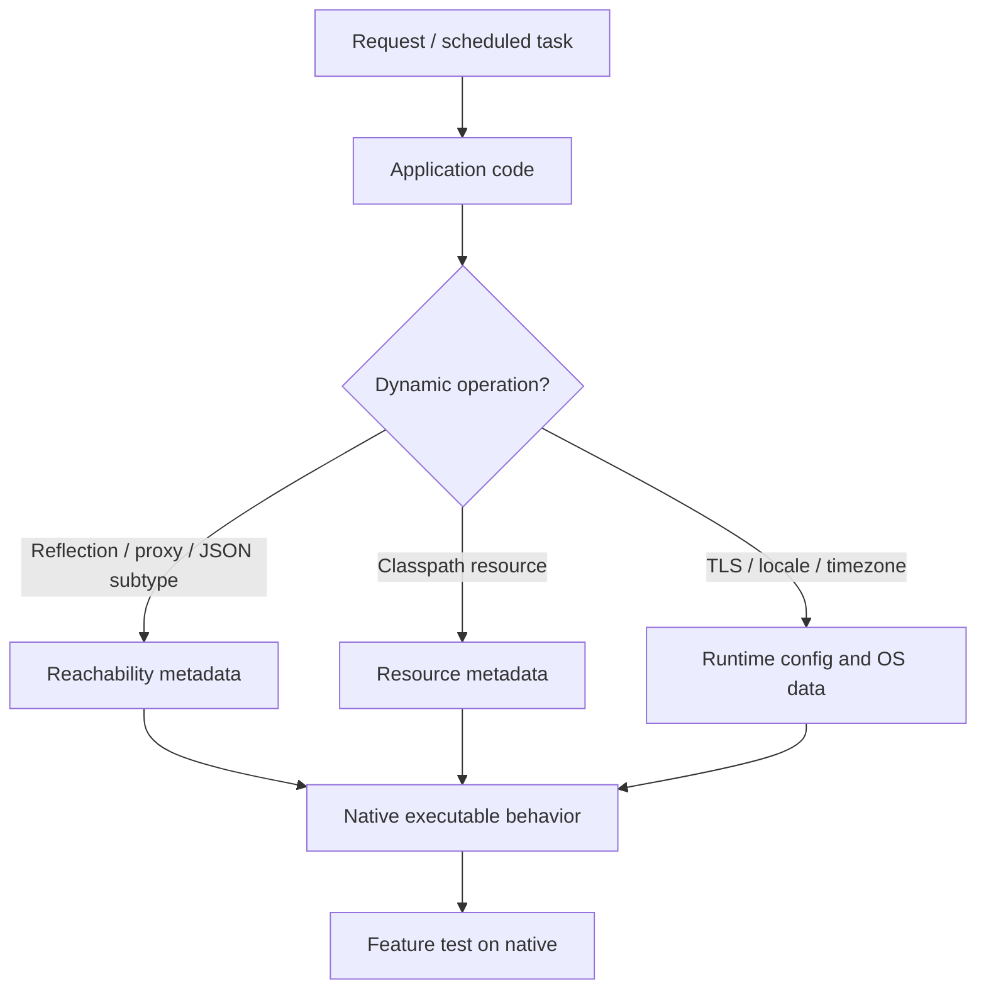

# JVM chạy đúng nhưng native sai ở JSON, TLS, locale hoặc nhánh ít được thử

## 1. Vì sao lỗi chỉ xuất hiện trên native executable?

Một ứng dụng Spring Boot có thể chạy ổn trên JVM nhưng thất bại sau khi biên dịch bằng GraalVM Native Image. Lỗi thường xuất hiện trong các đường chạy ít được thực thi: deserialize một subtype JSON hiếm, nạp certificate TLS, định dạng ngày theo locale khác, đọc resource bằng tên tạo động hoặc gọi method qua reflection.

JVM thường có thể nạp class và metadata trong lúc chạy theo cơ chế động. Native Image phân tích reachability khi build và chỉ đưa những thành phần được xác định cần thiết vào executable. Các thao tác động cần metadata phù hợp; tài nguyên cần đọc phải được đưa vào image hoặc được cung cấp như file runtime. Vì vậy, một đường chạy chưa được test có thể hoạt động trên JVM nhưng lỗi trong native.

Trong module **SPRING_BOOT_NATIVE_IMAGE**, hãy tách ba nhóm nguyên nhân: (1) AOT/reachability metadata và resource bị thiếu; (2) cấu hình runtime như TLS, locale, timezone hoặc environment không đúng; (3) khác biệt môi trường container/OS và thư viện native. Không nên mặc định mọi lỗi native đều do reflection.

## 2. Native Image thay đổi hành vi nạp class và resource ra sao?

Native Image thực hiện phân tích tĩnh để xác định phần code có thể reachable từ entry points và cấu hình build. Kết quả là executable native đã được đóng gói với code, metadata và resource cần thiết theo phân tích đó.

- Class được gọi trực tiếp thường dễ được phân tích reachability hơn class chỉ được tìm bằng tên runtime.
- Reflection, dynamic proxy, serialization và JNI có thể cần hints/metadata.
- Classpath resource được nạp theo pattern/tên động cần được đăng ký hoặc kiểm tra cách đóng gói.
- File cấu hình, certificate và secret được mount lúc chạy phải tồn tại trong runtime filesystem.
- Giá trị runtime như URL, password, locale hoặc timezone không tự trở thành build-time metadata.



## 3. Phân loại triệu chứng trước khi sửa

| Triệu chứng | Nhóm cần kiểm tra đầu tiên |
|---|---|
| Jackson không tìm thấy constructor/property hoặc subtype | JSON mapping, reflection/serialization metadata |
| Endpoint JSON trả 500 chỉ với một payload | DTO graph, polymorphism, custom serializer |
| TLS handshake fail | Truststore, CA bundle, protocol/cipher, provider |
| Certificate không được tìm thấy | File path, classpath resource, secret mount |
| Ngày/tiền tệ hiển thị khác JVM | Locale, timezone, default locale/timezone |
| Template/schema/message bundle thiếu | Resource pattern, resource path, locale suffix |
| Lỗi khi chọn plugin/provider | ServiceLoader, classpath condition, reflection |
| Class/method not found ở nhánh hiếm | Dependency/runtime classpath hoặc dynamic loading |
| Chỉ fail trong container | libc, shared library, file permission, CA/timezone data |

Lưu exception type, stack trace, request fixture, runtime configuration không nhạy cảm, image digest và binary hash. HTTP 500 chung chung không đủ để xác định nguyên nhân.

## 4. JSON: vì sao happy path không đủ?

Jackson có thể serialize/deserialize POJO, record, generic type, enum, date/time, polymorphic type và custom serializer/deserializer. Một test DTO phổ biến chưa bao phủ hết object graph thực tế.

Các tình huống dễ bị bỏ sót:

- DTO có constructor không public hoặc creator annotation.
- Field/private accessor được truy cập qua reflection.
- Polymorphic deserialization với subtype hiếm.
- Generic collection/map lồng nhau.
- Enum có giá trị fallback hoặc custom name.
- Custom serializer/deserializer được đăng ký gián tiếp.
- Jackson module cho Java Time hoặc parameter names.
- DTO đến từ thư viện bên ngoài.
- Payload chứa null, field thiếu, unknown property hoặc format cũ.

Xác định contract JSON được hỗ trợ và tạo fixture cho từng biến thể. Nếu API nhận nhiều version payload, mỗi version cần test riêng.

## 5. Ví dụ kiểm thử JSON round-trip

```java
public record PaymentRequest(
        String reference,
        BigDecimal amount,
        PaymentMethod method) {
}

public enum PaymentMethod {
    CARD, BANK_TRANSFER
}
```

Test round-trip với ObjectMapper do Spring cấu hình:

```java
@SpringBootTest
class PaymentJsonTest {

    @Autowired
    ObjectMapper objectMapper;

    @Test
    void serializesAndDeserializesPayment() throws Exception {
        var input = new PaymentRequest(
            "PAY-1001",
            new BigDecimal("125.50"),
            PaymentMethod.CARD
        );

        String json = objectMapper.writeValueAsString(input);
        PaymentRequest output =
            objectMapper.readValue(json, PaymentRequest.class);

        assertThat(output).isEqualTo(input);
    }
}
```

Đây là test cơ bản trên Spring context. Cần chạy test tương ứng trên native executable/native test setup để kiểm tra metadata của đúng runtime. Không chỉ test ObjectMapper độc lập nếu production dùng HTTP message converters với cấu hình khác.

## 6. JSON polymorphism và subtype hiếm

Ví dụ API có nhiều loại event:

```java
@JsonTypeInfo(
    use = JsonTypeInfo.Id.NAME,
    include = JsonTypeInfo.As.PROPERTY,
    property = "type"
)
@JsonSubTypes({
    @JsonSubTypes.Type(value = CardPayment.class, name = "card"),
    @JsonSubTypes.Type(value = BankPayment.class, name = "bank")
})
public interface PaymentEvent {
}

public record CardPayment(String token, BigDecimal amount)
        implements PaymentEvent {
}

public record BankPayment(String account, BigDecimal amount)
        implements PaymentEvent {
}
```

Test cả hai subtype, đặc biệt nhánh ít được gọi:

```json
{
  "type": "bank",
  "account": "ACCT-42",
  "amount": 125.50
}
```

Nếu JVM pass nhưng native fail, xác minh subtype có được đăng ký trong Jackson configuration và metadata cần thiết có mặt. Với Spring Boot/Spring Framework version hiện hành, ưu tiên cơ chế hints/serialization support được framework cung cấp; chỉ bổ sung RuntimeHints thủ công khi test và tài liệu cho thấy cần.

Không thêm toàn bộ package vào reflection chỉ để làm test pass. Hãy đăng ký đúng type và access cần thiết, rồi giữ regression test cho subtype đó.

## 7. Serialization metadata và RuntimeHints

Spring cung cấp RuntimeHints API để mô tả các thao tác runtime cần được Native Image hỗ trợ. Cách đăng ký phụ thuộc serializer và Spring/GraalVM version. Một số framework tích hợp có hints sẵn; thư viện khác có thể cung cấp reachability metadata.

Quy trình chẩn đoán:

1. Xác định type nào được serialize/deserialize trong stack trace.
2. Kiểm tra thư viện/framework version có metadata built-in không.
3. Chạy native test để tái hiện chính xác.
4. Kiểm tra Native Image agent output nếu phù hợp.
5. Viết RuntimeHintsRegistrar/hints có phạm vi hẹp khi cần.
6. Test lại trên native executable với payload gây lỗi.

Ví dụ minh họa reflection hint:

```java
hints.reflection().registerType(
    BankPayment.class,
    MemberCategory.INVOKE_DECLARED_CONSTRUCTORS
);
```

Member category phải phù hợp cách serializer tạo object và version Spring đang dùng. Không copy nguyên ví dụ nếu framework đã tự cung cấp hints hoặc serializer cần access khác.

## 8. HTTP message conversion khác ObjectMapper test đơn lẻ

Spring MVC/WebFlux có thể dùng HttpMessageConverter/codec với ObjectMapper được customize bởi auto-configuration, module, mixin và customizer. Một test ObjectMapper tự tạo có thể không phản ánh production.

Nên có ba tầng test:

- Unit test serializer/deserializer với cấu hình mapper thực tế.
- MVC/WebFlux integration test gửi payload qua endpoint.
- Native application test gọi endpoint trên executable được build.

Kiểm tra content type, charset, date format, unknown fields, validation và exception mapping. Lưu request/response fixture để so sánh JVM/native.

## 9. TLS: phân biệt certificate, truststore và protocol

TLS failure có nhiều nguyên nhân:

- Server certificate hết hạn hoặc hostname không khớp.
- CA root/intermediate không nằm trong truststore.
- Truststore path/password sai hoặc file không được mount.
- TLS protocol/cipher không tương thích.
- Client certificate thiếu khi server yêu cầu mutual TLS.
- Provider/crypto implementation khác môi trường.
- Native library hoặc shared library crypto bị thiếu.

Không tắt certificate verification để “sửa” lỗi. Đầu tiên xác định exception chain: certificate path validation, hostname verification, protocol negotiation hay lỗi load provider.

Kiểm tra certificate chain và xác minh thời gian hệ thống. Đồng hồ container sai có thể làm certificate bị coi là chưa hợp lệ hoặc hết hạn.

## 10. CA bundle trong container

Nếu ứng dụng gọi HTTPS, runtime image thường cần CA certificates phù hợp. Base image tối giản có thể không chứa trust bundle mà môi trường developer có sẵn.

Kiểm tra:

- CA package có trong final runtime image.
- Truststore path đúng với HTTP client/JDK configuration.
- Certificate nội bộ được mount đúng path và readable.
- Process non-root có quyền đọc.
- Không copy private key hoặc truststore password vào image layer.
- DNS và clock trong container hoạt động đúng.

Với Debian-based image, package thường dùng là ca-certificates; distribution khác có package/path riêng. Xác minh trên chính image cuối, không chỉ builder stage.

## 11. Cấp truststore qua runtime configuration

Nếu dùng truststore riêng, mount file read-only và truyền path qua environment/configuration:

```yaml
app:
  tls:
    trust-store: ${TLS_TRUST_STORE:/var/run/certs/service-truststore.p12}
    trust-store-password: ${TLS_TRUST_STORE_PASSWORD:}
```

Đây là property minh họa của ứng dụng; cần bind vào HTTP client cụ thể và bảo vệ password bằng secret manager. Không giả định mọi HTTP client tự đọc property tùy chỉnh này.

Nếu dùng JVM system properties, kiểm tra cách Native Image runtime xử lý system properties trong GraalVM version đang dùng và test trên binary. Đối với native HTTP clients hoặc JNI crypto providers, kiểm tra tài liệu vendor về CA/truststore support.

## 12. TLS test phải gọi endpoint thật

TLS test không chỉ kiểm tra certificate file tồn tại. Cần kết nối qua đúng HTTP client/driver và đúng container runtime.

Một bộ test nên bao gồm:

- Certificate hợp lệ, hostname đúng.
- Certificate không được trust.
- Certificate hết hạn hoặc hostname sai.
- Mutual TLS nếu sản phẩm dùng.
- CA nội bộ được mount runtime.
- Rotation/reload certificate nếu được hỗ trợ.
- Database TLS nếu JDBC driver dùng TLS.

Negative test cần xác nhận ứng dụng từ chối kết nối không hợp lệ. Điều này ngăn thay đổi cấu hình vô tình làm tắt verification.

## 13. Locale và timezone là hai cấu hình khác nhau

**Locale** quyết định quy tắc ngôn ngữ/vùng cho format số, tiền tệ, ngày tháng và thông điệp. **Timezone** quyết định cách chuyển instant sang local date/time.

Cùng một instant có thể hiển thị thành ngày/giờ khác theo timezone; cùng một số có thể được format với dấu thập phân khác theo locale.

Không dùng default locale/timezone của host như một hợp đồng ngầm. Đặt rõ locale/timezone khi nghiệp vụ yêu cầu và test với giá trị xác định.

```java
Locale locale = Locale.forLanguageTag("vi-VN");
ZoneId zone = ZoneId.of("Asia/Ho_Chi_Minh");

String amount = NumberFormat
    .getCurrencyInstance(locale)
    .format(new BigDecimal("125000.50"));

ZonedDateTime localTime =
    Instant.parse("2026-11-23T10:00:00Z").atZone(zone);
```

Kết quả format phụ thuộc JDK locale data version. Nếu output là contract bên ngoài, test output theo runtime distribution/version mà ứng dụng phát hành.

## 14. Locale data và Native Image

Một số runtime/Native Image configurations có thể giới hạn locale data được đóng gói so với full JDK. GraalVM có các tùy chọn liên quan locale/character sets theo version và distribution. Không giả định mọi locale có sẵn chỉ vì chạy được trên JDK developer.

Kiểm tra locale được hỗ trợ, locale data được build vào executable, default locale của process/container, charset cần dùng, message bundle theo locale và output thực tế trên native executable.

Nếu build cần locale bổ sung, dùng option Native Image được hỗ trợ trong đúng version và kiểm tra build log. Không copy flag từ tài liệu version khác mà chưa xác minh.

## 15. Message bundles và resource theo locale

Spring message source có thể đọc resource như messages.properties, messages_vi.properties hoặc messages_en.properties. Nếu resource name được framework tạo từ locale runtime, cần xác minh các bundle cần thiết được đóng gói trong native image.

Ví dụ cấu trúc:

```text
src/main/resources/
  messages.properties
  messages_vi.properties
  messages_en.properties
```

Tạo test cho từng locale được hỗ trợ và fallback khi thiếu key. Nếu dùng resource hints, đăng ký pattern đúng với bundle naming. Không chỉ test locale mặc định vì nhánh locale khác có thể là resource chưa được đưa vào image.

## 16. Resource lookup theo tên động

Một số ứng dụng đọc template/schema theo tên từ database, tenant hoặc request. Static analysis có thể không nhìn thấy mọi tên runtime.

```java
Resource resource = resourceLoader.getResource(
    "classpath:templates/" + templateName + ".html"
);
try (InputStream input = resource.getInputStream()) {
    // Read template bytes.
}
```

Nếu templateName chỉ được chọn lúc runtime, đăng ký resource patterns bao phủ các template hợp lệ hoặc dùng cơ chế resource metadata tương ứng. Đồng thời dùng allowlist để không cho phép người dùng truyền path tùy ý.

Test từng template/tenant/locale được hỗ trợ trên native executable. Một test với invoice.html không chứng minh receipt.html cũng đã được đóng gói.

## 17. Lập ma trận kiểm thử cho nhánh ít được thử

Đừng chỉ chạy happy path. Liệt kê input và điều kiện có thể thay đổi hành vi:

| Feature | Nhánh cần test |
|---|---|
| JSON | subtype hiếm, field null/thiếu, enum mới, payload cũ |
| TLS | CA nội bộ, hostname mismatch, certificate rotation |
| Locale | vi-VN, en-US, fallback locale |
| Timezone | UTC, Asia/Ho_Chi_Minh, DST zone nếu hỗ trợ |
| Resource | từng template/schema/bundle, resource thiếu |
| Reflection | constructor/method chỉ gọi ở nhánh hiếm |
| Proxy/AOP | method qua interface, concrete class, async path |
| JDBC | driver discovery, TLS, reconnect và migration |
| Error handling | exception hiếm, fallback và retry path |
| Serialization | nested type, generic collection, custom serializer |

Mỗi nhánh cần fixture cụ thể và tiêu chí pass/fail. Ghi rõ feature nào không được hỗ trợ thay vì để test coverage tạo cảm giác đã kiểm tra mọi trường hợp.

## 18. So sánh JVM và native bằng cùng fixture

Để tìm khác biệt, chạy cùng request fixtures và cùng external dependencies trên hai runtime:

1. Cùng source commit và application configuration.
2. Cùng JSON payloads và expected responses.
3. Cùng CA/truststore và endpoint TLS.
4. Cùng locale/timezone được chỉ định rõ.
5. Cùng resource files và external mounts.
6. So sánh status code, response body, headers và side effects.
7. Lưu logs/stack traces khi có khác biệt.

Không so sánh output phụ thuộc default timezone/locale của hai máy khác nhau rồi kết luận do Native Image. Trước tiên chuẩn hóa môi trường.

## 19. Quy trình chẩn đoán theo bằng chứng

Khi JVM pass nhưng native fail:

1. Tạo test nhỏ nhất tái hiện lỗi bằng input cụ thể.
2. Xác định lỗi xảy ra lúc startup, lần gọi feature đầu tiên hay sau một thời gian.
3. Kiểm tra stack trace và class/resource/provider liên quan.
4. Nếu JSON/reflection/proxy: kiểm tra framework hints và reachability metadata.
5. Nếu resource: xác minh resource có trong image và runtime path đúng.
6. Nếu TLS: kiểm tra CA chain, truststore, hostname, clock và provider.
7. Nếu locale/timezone: ghi default values và xác minh locale data.
8. Nếu container-only: kiểm tra libc, shared libraries, permission, filesystem và environment.
9. Sửa nguyên nhân tại source/build/runtime configuration tương ứng.
10. Thêm regression test chạy trên native executable/container.

Chỉ bật tracing/debug output cần thiết. Không log password, private key, raw token hoặc payload nhạy cảm.

## 20. Lỗi thường gặp

| Triệu chứng | Nguyên nhân có thể | Hướng xử lý |
|---|---|---|
| Jackson fail với subtype hiếm | Type/constructor metadata chưa được đăng ký | Kiểm tra polymorphic config và hints |
| ObjectMapper unit test pass nhưng HTTP fail | MVC converter dùng mapper/config khác | Test endpoint qua HTTP layer |
| TLS trust failure trong container | Thiếu CA/truststore hoặc permission | Kiểm tra final image và mounted trust material |
| TLS chỉ fail trên một host | Clock, DNS, proxy hoặc protocol khác | So sánh runtime environment |
| Currency/date format khác | Default locale/timezone khác | Chỉ định locale/ZoneId rõ ràng |
| Message key không tìm thấy | Bundle resource thiếu | Kiểm tra resource patterns và locale files |
| Template hiếm không tồn tại | Dynamic resource chưa được include | Đăng ký pattern và test từng template |
| JVM pass, native fail ở nhánh hiếm | Test chưa kích hoạt dynamic code path | Bổ sung fixture và native regression test |
| Chỉ lỗi ở image tối giản | Thiếu CA, timezone, font hoặc shared library | Kiểm tra runtime files của final image |

## 21. Checklist trước khi phát hành

- JSON test bao phủ DTO, subtype, generic type và custom serializer.
- HTTP endpoint được test với payload thực tế trên native executable.
- Reflection/serialization hints chỉ bổ sung khi có bằng chứng.
- TLS test xác minh certificate chain và hostname validation.
- CA/truststore có trong runtime image hoặc được mount đúng.
- Secret TLS được cấp runtime và không đóng gói vào binary/image.
- Locale/timezone được chỉ định và test theo feature contract.
- Locale data/message bundles cần thiết có trong native runtime.
- Mọi resource name hợp lệ đều được kiểm tra.
- Nhánh hiếm có fixture và native regression test.
- JVM/native dùng cùng inputs và external dependencies khi so sánh.
- Final container image được test với đúng user, filesystem và base image.
- Logs/diagnostics không làm lộ dữ liệu nhạy cảm.

## 22. Câu hỏi tự kiểm tra

1. Vì sao JVM có thể chạy một nhánh JSON mà native executable lại thiếu metadata?
2. Làm thế nào phân biệt lỗi Jackson mapping với lỗi HTTP message converter?
3. Những nguyên nhân nào có thể gây TLS handshake failure trong native container?
4. Vì sao không nên tắt certificate verification để khắc phục TLS?
5. Locale khác timezone như thế nào?
6. Vì sao cần test message bundle và template theo từng locale?
7. Khi resource được chọn bằng tên runtime, cần làm gì để Native Image đóng gói đúng?
8. Làm thế nào chuẩn hóa JVM/native test để loại trừ khác biệt môi trường?
9. Khi nào cần RuntimeHints và khi nào cần runtime file/config?
10. Vì sao nhánh ít được thử cần fixture và regression test riêng?

**Ghi nhớ:** khi JVM chạy đúng nhưng native sai, hãy tái hiện bằng input cụ thể rồi phân loại lỗi thành metadata/reachability, resource, runtime configuration hoặc môi trường container. Test JSON, TLS, locale, timezone và mọi nhánh ít được gọi trên chính native executable và image sẽ phát hành.
