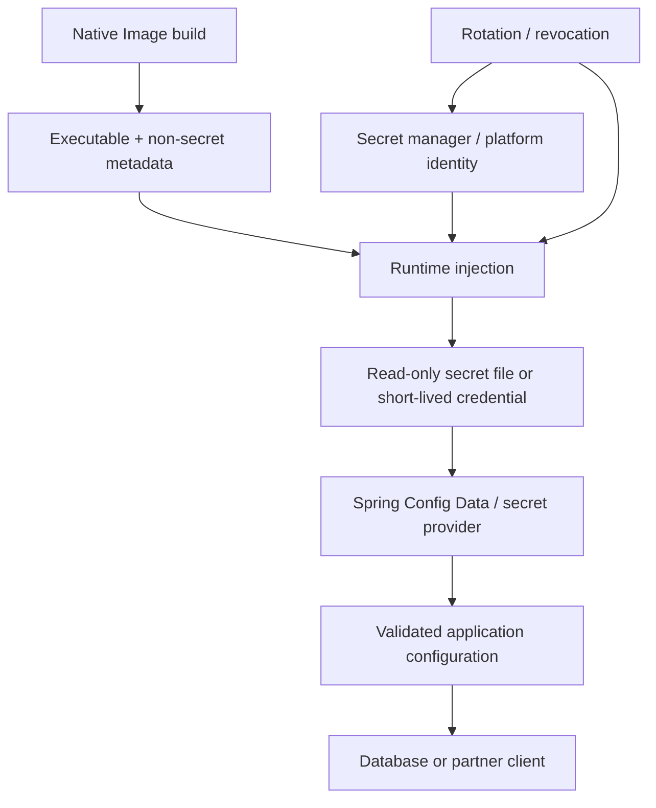

# Giữ secret và dữ liệu gắn với môi trường ở giai đoạn runtime phù hợp

## 1. Vì sao phải tách secret khỏi Native Image?

Một ứng dụng Spring Boot thường cần password database, API token, private key, thông tin TLS, URL dịch vụ và các giá trị khác nhau theo local, staging hoặc production. Các dữ liệu này phải được cấp khi ứng dụng chạy, theo đúng môi trường và quyền của workload.

GraalVM Native Image tạo executable từ chương trình đã phân tích trước. Một số class có thể được khởi tạo trong lúc build; trạng thái static của class được khởi tạo ở build time có thể được lưu trong image heap và trở thành một phần của binary. Nếu static initializer đọc secret hoặc dữ liệu riêng của máy build, giá trị đó có thể bị đóng vào executable.

Vì vậy, nguyên tắc quan trọng là: **binary chứa code và metadata cần để chạy; môi trường triển khai cấp secret và dữ liệu phụ thuộc môi trường khi process khởi động hoặc trong lúc chạy**. Không đưa credential production vào source, resource đóng gói, build argument, image layer hoặc static state của Native Image.

Bài này thuộc chương **Bảo mật** của module **SPRING_BOOT_NATIVE_IMAGE**. Nội dung hướng dẫn cách phân loại dữ liệu, cấp secret lúc runtime, bind bằng Spring Boot, bảo vệ TLS material, kiểm soát quyền truy cập, rotation và kiểm thử artifact native.

## 2. Build time và runtime trong Native Image

Native Image có hai giai đoạn:

- **Build time:** GraalVM phân tích reachability, chạy một số thao tác AOT, xử lý metadata và có thể khởi tạo một số class.
- **Runtime:** container hoặc process khởi chạy executable; ứng dụng nhận environment, command-line arguments, file mount, secret provider và kết nối tới dependency.

Khi một class được khởi tạo ở build time, các giá trị static của nó được lưu trong image heap. Nếu class đó đọc biến môi trường, file, hostname, thời gian hoặc credential trong static initializer, executable có thể giữ lại trạng thái của môi trường build.

Ví dụ rủi ro:

```java
final class PartnerCredentials {

    static final String API_TOKEN =
        System.getenv("PARTNER_API_TOKEN");
}
```

Nếu class này được khởi tạo trong quá trình build, token có thể trở thành dữ liệu trong binary. Điều này phụ thuộc class initialization thực tế; không phải mọi lời gọi System.getenv đều tự động chạy ở build time. Rủi ro xuất hiện khi lời gọi nằm trong class initializer được thực thi lúc build hoặc trong code AOT chạy lúc build.

GraalVM mặc định khởi tạo phần lớn application class ở runtime trừ khi chứng minh được class an toàn để khởi tạo sớm hoặc cấu hình yêu cầu khác. Không nên dựa vào mặc định này để quản lý secret. Hãy loại việc đọc secret khỏi static initializer và chỉ lấy dữ liệu qua Spring Environment hoặc secret provider ở runtime.

Khi một class bị khởi tạo ở build time, static state của nó được lưu trong image heap. Xem [Native Image Basics](https://www.graalvm.org/latest/reference-manual/native-image/basics/) và [Class Initialization](https://www.graalvm.org/latest/reference-manual/native-image/optimizations-and-performance/ClassInitialization/).

## 3. Phân loại dữ liệu trước khi đóng gói

Không phải mọi cấu hình đều là secret. Phân loại giúp chọn đúng nơi lưu trữ và vòng đời.

| Loại dữ liệu | Ví dụ | Nơi phù hợp |
| --- | --- | --- |
| Secret dài hạn | Database password, API key, signing key | Secret manager hoặc secret volume được cấp lúc runtime |
| Credential ngắn hạn | OAuth access token, cloud workload token, database lease | Identity provider hoặc secret provider lúc runtime |
| Private key | TLS server key, client certificate private key | Secret store hoặc volume mount có quyền hạn chế |
| Certificate/CA public | CA certificate, public certificate | Có thể đóng gói nếu dùng chung và không phụ thuộc môi trường; nếu thay theo môi trường thì mount/config runtime |
| Environment configuration | Service URL, port, region, feature flag, timeout | Environment variables hoặc external config file |
| Build identity | Commit SHA, image digest, GraalVM version | Build metadata hoặc Actuator Info đã lọc |
| AOT structure | Profile/condition làm thay đổi bean graph | Xác định và cố định khi chạy Spring AOT |

Không gọi URL, username hoặc certificate công khai là secret nếu chúng không chứa thông tin xác thực. Tuy nhiên, các giá trị này vẫn có thể nhạy cảm vì tiết lộ topology, tenant hoặc hạ tầng nội bộ.

## 4. Luồng cấp và sử dụng secret

Một luồng an toàn nên có dạng:



Build pipeline tạo executable mà không cần biết production password hoặc private key. Nền tảng triển khai cấp secret cho đúng workload. Ứng dụng đọc, xác thực và sử dụng secret; khi credential đổi, quy trình rotation cập nhật provider và restart/reload client theo khả năng được thiết kế.

## 5. Cấu hình Spring Boot và thứ tự ưu tiên property

Spring Boot hỗ trợ externalized configuration từ file, environment variables, system properties, JSON property source và command-line arguments. Các property có độ ưu tiên cao hơn có thể ghi đè nguồn thấp hơn.

Với ứng dụng thông thường, thứ tự rút gọn từ cao xuống thấp gồm:

1. Command-line arguments.
2. `SPRING_APPLICATION_JSON`.
3. Java system properties.
4. OS environment variables.
5. Config data như `application.yaml` và file profile-specific.
6. Default properties.

Thứ tự đầy đủ còn có các nguồn như JNDI, servlet parameters và test property sources. Hãy đối chiếu tài liệu đúng phiên bản Spring Boot khi có nhiều nguồn cùng đặt một key.

Environment variable thường phù hợp với cấu hình không nhạy cảm:

| Spring property | Environment variable |
| --- | --- |
| `spring.profiles.active` | `SPRING_PROFILES_ACTIVE` |
| `server.port` | `SERVER_PORT` |
| `partner.api.base-url` | `PARTNER_API_BASEURL` |
| `spring.datasource.url` | `SPRING_DATASOURCE_URL` |

Không truyền password, token hoặc private key qua command line vì chúng có thể xuất hiện trong process listing, shell history, CI logs hoặc metadata của hệ thống triển khai. Environment variables cũng có thể bị lộ qua process inspection, diagnostic endpoint hoặc dump; với secret, ưu tiên file mount hoặc secret provider được quản lý.

Tham khảo [Spring Boot Externalized Configuration](https://docs.spring.io/spring-boot/reference/features/external-config.html).

## 6. Nạp secret từ file bằng Config Tree

Spring Boot hỗ trợ `configtree:` để ánh xạ tên file thành property key và nội dung file thành property value. Cách này phù hợp với Docker Swarm secrets, Kubernetes Secret volume và các CSI secret provider.

Ví dụ volume trong container:

```text
/run/secrets/
  spring.datasource.username
  spring.datasource.password
  partner.api.api-key
```

Thêm import trong `application.yaml`:

```yaml
spring:
  config:
    import: "configtree:/run/secrets/"
```

Hoặc dùng environment variable:

```bash
SPRING_CONFIG_IMPORT=configtree:/run/secrets/
```

File `spring.datasource.password` được ánh xạ thành property `spring.datasource.password`. File `partner.api.api-key` được ánh xạ thành `partner.api.api-key`, sau đó có thể bind vào field `apiKey` nhờ relaxed binding.

Trong production, bỏ tiền tố `optional:` nếu secret là bắt buộc. Khi file không tồn tại, ứng dụng nên fail fast thay vì khởi động với credential rỗng rồi chỉ lỗi khi nhận request. Chỉ dùng `optional:configtree:` cho profile mà secret thực sự không bắt buộc, chẳng hạn local development.

Giá trị config tree có thể bind thành String hoặc byte[] tùy nội dung. Dùng byte[] nếu cần giữ nguyên dữ liệu nhị phân như key material; không chuyển private key thành chuỗi log hoặc nội dung diagnostic.

## 7. Bind và xác thực cấu hình có chứa secret

Dùng `@ConfigurationProperties` để bind một nhóm cấu hình có cấu trúc. Ví dụ:

```java
import java.net.URI;
import java.time.Duration;

import jakarta.validation.constraints.NotBlank;
import jakarta.validation.constraints.NotNull;

import org.springframework.boot.context.properties.ConfigurationProperties;
import org.springframework.validation.annotation.Validated;

@ConfigurationProperties(prefix = "partner.api")
@Validated
public class PartnerApiProperties {

    @NotNull
    private URI baseUrl;

    @NotBlank
    private String apiKey;

    @NotNull
    private Duration timeout = Duration.ofSeconds(3);

    public URI getBaseUrl() {
        return baseUrl;
    }

    public void setBaseUrl(URI baseUrl) {
        this.baseUrl = baseUrl;
    }

    public String getApiKey() {
        return apiKey;
    }

    public void setApiKey(String apiKey) {
        this.apiKey = apiKey;
    }

    public Duration getTimeout() {
        return timeout;
    }

    public void setTimeout(Duration timeout) {
        this.timeout = timeout;
    }
}
```

Đăng ký class bằng `@ConfigurationPropertiesScan` hoặc `@EnableConfigurationProperties(PartnerApiProperties.class)`. Ví dụ cần có validation provider, thường là dependency `spring-boot-starter-validation`. Validation giúp ứng dụng từ chối cấu hình thiếu URL hoặc API key ngay khi khởi động.

Không tự sinh `toString()` có chứa secret. Java record tự tạo `toString()` từ tất cả component; Lombok `@Data` cũng thường sinh `toString()` gồm các field. Nếu cấu hình có password/token, tránh log toàn bộ object và không đưa object đó vào exception message. Chỉ log trạng thái đã nạp, không log giá trị.

Với secret bắt buộc, không đặt giá trị mặc định giả như password=changeme hoặc token rỗng trong production config. Dùng validation và startup failure để tránh chạy ở trạng thái không an toàn.

## 8. Sử dụng secret mà không làm lộ giá trị

Secret chỉ nên được truyền tới thành phần cần dùng. Ví dụ, API key chỉ được cấp cho outbound client tương ứng; database password chỉ được dùng để tạo datasource hoặc lấy credential cho connection.

Các nguyên tắc:

- Không log request header Authorization, cookie, API key hoặc database URL có credential.
- Không đưa token vào query string vì URL thường được ghi vào access log, proxy log và tracing span.
- Không ghi cấu hình secret vào exception message.
- Không serialize configuration bean vào JSON response.
- Không dùng secret làm metric label, trace attribute hoặc correlation ID.
- Tránh giữ secret trong nhiều bản sao không cần thiết hoặc cache không có TTL.
- Chỉ cấp quyền đọc secret cho service account/workload thực sự cần nó.

Khi tạo HTTP client, dùng API header phù hợp để truyền bearer token; không ghép token vào URL. Khi tạo JDBC datasource, để Spring Boot dùng property chuẩn và tránh log connection string đầy đủ.

Nếu dùng `@ConfigurationProperties`, chỉ inject bean vào nơi cần thiết. Không truyền toàn bộ configuration object qua nhiều tầng nếu chỉ một thành phần cần API key.

## 9. Không để secret lọt vào build pipeline hoặc Native Image

Kiểm soát secret từ lúc checkout đến lúc publish image:

### 9.1. Source code và config đóng gói

Không commit secret vào:

- application.yaml, application.properties hoặc profile-specific config.
- src/main/resources, test fixture hoặc native image resource configuration.
- Dockerfile, Compose file hoặc Kubernetes manifest.
- Script build, shell history hoặc CI variable được in ra log.
- Native Image build arguments hoặc generated metadata.

File cấu hình đóng gói có thể chứa default không nhạy cảm như timeout hoặc pool size. Secret phải được cung cấp từ môi trường triển khai.

### 9.2. Docker build arguments và layers

Không dùng Dockerfile `ARG` hoặc `ENV` để truyền secret trong lúc build. Giá trị có thể lưu trong image history, layer, build cache hoặc image configuration.

Nếu build cần credential để tải dependency từ private repository, dùng secret mount của build system, chỉ cấp cho đúng build step và bảo đảm file/token không được COPY vào output hoặc cache artifact. Credential dùng để truy cập repository khi build là build credential riêng; không dùng nó thay cho runtime application secret.

### 9.3. Static initialization và build-time initialization

Không đọc secret trong static initializer:

```java
class UnsafeSettings {

    static final String DATABASE_PASSWORD =
        System.getenv("DATABASE_PASSWORD");
}
```

Nếu class này được khởi tạo ở build time, giá trị static có thể được lưu trong image heap. Nếu thư viện bên thứ ba có static initializer đọc dữ liệu phụ thuộc môi trường, kiểm tra class initialization report và cấu hình cụ thể class đó chạy ở runtime khi cần.

Ví dụ option có thể dùng để ép một class khởi tạo ở runtime:

```text
--initialize-at-run-time=com.example.security.RuntimeCredentialHolder
```

Chỉ áp dụng cho class đã xác định và kiểm thử. Không đặt toàn bộ application package vào runtime initialization một cách tùy tiện vì có thể thay đổi hiệu năng hoặc gây vấn đề tương thích. Tốt nhất vẫn là thiết kế code để secret chỉ được đọc qua Spring Environment hoặc provider sau khi process khởi động.

### 9.4. AOT phải không phụ thuộc production secret

Spring AOT có thể cần Environment để đánh giá profile và điều kiện tạo bean. Những property ảnh hưởng `@Conditional` hoặc `@Profile` phải nhất quán giữa cấu hình AOT build-time và runtime; nhưng password, token và private key không nên được dùng để quyết định bean graph.

Nếu AOT processing cần truy cập Config Server hoặc dịch vụ cấu hình, chỉ cấp build credential tối thiểu và ngắn hạn cho bước đó. Không đưa production application secret vào môi trường build, và xác minh log/build output không lưu credential.

## 10. TLS certificate, truststore và private key

TLS material cần được phân loại:

- **CA certificate/public certificate:** thường không phải secret, nhưng có thể thay đổi theo môi trường.
- **Private key:** là secret, phải được cấp từ secret manager hoặc volume bảo vệ.
- **Keystore password:** là secret, không đặt trong file cấu hình đóng gói.
- **Truststore:** có thể chứa CA public; nếu chứa private key thì phải bảo vệ như secret.

Ví dụ cấu hình server TLS dùng file mount:

```properties
server.ssl.enabled=true
server.ssl.key-store=file:/run/tls/server.p12
server.ssl.key-store-type=PKCS12
```

Password keystore có thể được cấp bằng config tree với property `server.ssl.key-store-password`. File `server.p12` được mount read-only từ secret provider. Không COPY keystore chứa private key vào image.

Với outbound TLS, dùng SSL configuration/client API phù hợp phiên bản Spring Boot và HTTP client. Đảm bảo custom CA được nạp từ vị trí runtime khi nó phụ thuộc môi trường. Không tắt hostname verification hoặc trust-all certificate để xử lý lỗi chứng chỉ.

Native Image cần được kiểm thử với đúng TLS provider, cipher suite, certificate chain và client library đang dùng. Việc binary build thành công không chứng minh mọi đường TLS sẽ hoạt động ở runtime.

## 11. Ưu tiên workload identity và credential ngắn hạn

Secret tĩnh tạo ra gánh nặng lưu trữ, rotation và thu hồi. Nếu nền tảng hỗ trợ, ưu tiên workload identity:

- Kubernetes service account được liên kết với cloud identity.
- Cloud managed identity hoặc instance role.
- OAuth client credential exchange với token có thời hạn ngắn.
- Database authentication dựa trên IAM hoặc credential lease.
- Secret manager cấp credential theo danh tính workload.

Cách này giảm nhu cầu lưu một bootstrap password lâu dài trong environment. Process nhận token ngắn hạn khi chạy và refresh token qua provider/client được thiết kế để hỗ trợ rotation.

Không tự lưu token lâu dài trong static field. Nếu client cần refresh token, thiết kế một provider có TTL, đồng bộ truy cập và xử lý lỗi khi identity provider không khả dụng. Không giả định mọi SDK cloud đều hỗ trợ Native Image; kiểm tra reachability metadata và chạy integration test với native executable.

## 12. Rotation và thu hồi secret

Cấp secret runtime mới không tự làm bean đang chạy đổi credential. Nếu password được bind khi startup và datasource/client được tạo một lần, process có thể tiếp tục sử dụng giá trị cũ.

Một quy trình rotation nên:

1. Tạo credential mới tại hệ thống đích; giữ overlap nếu hệ thống cho phép.
2. Cập nhật secret manager hoặc secret volume.
3. Xác minh workload có quyền đọc phiên bản mới.
4. Restart/rollout instance hoặc dùng credential provider có refresh được thiết kế rõ.
5. Kiểm tra kết nối mới thành công mà không log credential.
6. Thu hồi credential cũ sau khi toàn bộ instance đã chuyển đổi.
7. Ghi lại secret version/reference và thời điểm hoàn tất.

Kubernetes có thể cập nhật nội dung projected Secret volume, nhưng Spring Config Data thường đọc file lúc application context khởi tạo. File đổi không có nghĩa bean đã bind tự cập nhật. Mount bằng subPath còn có hành vi cập nhật khác volume mount thông thường.

Với Spring Cloud, Context Refresh và `@RefreshScope` không được hỗ trợ cho Spring AOT transformations và Native Image; native client cần đặt `spring.cloud.refresh.enabled=false`. Vì vậy, không dựa vào `/actuator/refresh` để xoay secret trong native process. Tham khảo [Spring Cloud Context Services](https://docs.spring.io/spring-cloud-commons/reference/spring-cloud-commons/application-context-services.html).

## 13. Quyền truy cập file và secret volume

Chạy container bằng non-root user và chỉ mount những secret mà process cần. Ví dụ với Kubernetes:

```yaml
apiVersion: apps/v1
kind: Deployment
metadata:
  name: orders-api
spec:
  selector:
    matchLabels:
      app: orders-api
  template:
    metadata:
      labels:
        app: orders-api
    spec:
      securityContext:
        runAsNonRoot: true
        runAsUser: 10001
        runAsGroup: 10001
        fsGroup: 10001
      containers:
        - name: app
          image: registry.example.com/orders-api:native
          volumeMounts:
            - name: app-secrets
              mountPath: /run/secrets
              readOnly: true
      volumes:
        - name: app-secrets
          secret:
            secretName: orders-api-runtime
            defaultMode: 0440
```

Ví dụ giả định Secret `orders-api-runtime` được tạo bởi secret manager integration hoặc quy trình triển khai bảo vệ. Không lưu credential thật trong manifest source control. Xác minh UID/GID thực tế có thể đọc file trên cluster; `fsGroup` và quyền volume có thể phụ thuộc CSI driver.

Kubernetes Secret được encode base64 trong API representation; base64 không phải encryption. Bật encryption at rest cho datastore, giới hạn RBAC, chỉ mount secret vào container cần thiết và cân nhắc external secret store. Tham khảo [Kubernetes Secrets](https://kubernetes.io/docs/concepts/configuration/secret/).

Với Docker Swarm, secret được mount vào `/run/secrets`; Spring Boot có thể đọc qua `configtree:/run/secrets/`. Với Docker Compose local, file-backed secret thường được triển khai bằng mount; kiểm tra quyền file và không xem file `.env` là secret manager.

## 14. Bảo vệ log, Actuator và telemetry

Secret có thể rò rỉ sau khi đã được nạp vào process:

- Log cấu hình hoặc object có `toString()` chứa password/token.
- Log HTTP request/response header.
- Exception message có URL chứa username/password.
- Actuator `env` hoặc `configprops` hiển thị cấu hình nhạy cảm.
- Heap dump, core dump hoặc crash report chứa object trong memory.
- Trace attribute, baggage hoặc metric label chứa token/customer secret.
- Debug log của SDK hoặc HTTP client.

Spring Boot có cơ chế sanitization cho một số Actuator endpoint, nhưng không dùng nó làm lớp bảo vệ duy nhất. Giới hạn endpoint exposure, authentication/authorization, network access và quyền đọc log/dump. Kiểm tra cấu hình sanitization theo phiên bản và không trả secret trong custom health indicator hoặc Info contributor.

Khi điều tra sự cố, thu thập log/metrics trước; chỉ tạo heap/core dump khi cần và xử lý dump như dữ liệu nhạy cảm. Mã hóa nơi lưu, giới hạn người đọc, đặt retention và xóa bản sao tạm sau khi hoàn tất.

## 15. Kiểm thử secret handling trên native executable

Kiểm thử trên JVM chưa đủ để chứng minh secret không bị đóng vào Native Image. Một bộ kiểm tra cần bao gồm:

| Kiểm tra | Kết quả mong đợi |
| --- | --- |
| Build với môi trường không có production secret | Native Image vẫn build được |
| Chạy native binary với secret runtime | Ứng dụng đọc được secret và kết nối dependency |
| Thiếu secret bắt buộc | Ứng dụng fail fast |
| Thay secret file sau startup | Không giả định bean tự cập nhật; quy trình restart/refresh được xác minh |
| Static initializer đọc environment | Không có secret phụ thuộc môi trường trong build-time state |
| Image scan và secret scan | Không phát hiện credential trong source, layer, metadata hoặc artifact |
| Log/Actuator/trace kiểm tra | Không trả hoặc ghi giá trị secret |
| Chạy non-root | Process chỉ đọc được file cần thiết |
| Rotation/revocation | Instance chuyển sang credential mới và credential cũ bị thu hồi |
| Native TLS test | Certificate, private key, truststore và hostname verification hoạt động đúng |

Có thể dùng secret canary giả trong môi trường test để kiểm tra source, build log, image layer và binary. Việc tìm chuỗi bằng strings chỉ là kiểm tra bổ sung; không tìm thấy chuỗi không chứng minh binary không chứa secret được mã hóa hoặc biến đổi.

Chạy test trên đúng image cuối cùng, với cùng UID, volume mount, network policy và GraalVM runtime sẽ triển khai. Không chỉ chạy executable trực tiếp trên máy build.

## 16. Lỗi thường gặp và cách xử lý

| Triệu chứng | Nguyên nhân có thể | Cách xử lý |
| --- | --- | --- |
| Native process dùng secret của máy build | Static initializer được chạy khi build hoặc class bị build-time initialized | Bỏ static read, dùng Spring runtime config; kiểm tra class initialization |
| Secret không được bind | Sai tên file config tree hoặc import location | Đối chiếu filename với property key và mount path |
| App khởi động dù thiếu credential | Config tree dùng `optional:` cho secret bắt buộc hoặc có default không an toàn | Bỏ optional và bật validation |
| Rotation không có tác dụng | Bean/client đã giữ credential cũ | Restart/rollout hoặc dùng credential provider có refresh |
| Token xuất hiện trong log | Debug logging, `toString()` hoặc exception chứa cấu hình | Redact log, bỏ secret khỏi object representation và kiểm tra telemetry |
| Pod không đọc được secret file | UID/GID, mode hoặc CSI volume policy không phù hợp | Kiểm tra permission trong container, điều chỉnh group/mode |
| Secret xuất hiện trong image history | Dùng Docker `ARG`/`ENV` hoặc COPY file lúc build | Dùng runtime secret mount và secret mount cho build step |
| TLS hoạt động trên JVM nhưng lỗi native | Khác biệt provider, metadata hoặc native library | Chạy native TLS integration test và kiểm tra dependency support |
| Config mới làm bean không tồn tại | Property ảnh hưởng `@Conditional` hoặc profile đã được xử lý ở AOT | Chọn đúng AOT profile và build lại |

## 17. Bài thực hành: cấp database password và partner API key lúc runtime

**Bối cảnh:** Một Spring Boot Native Image service kết nối PostgreSQL và partner API. Cùng một image được triển khai ở staging và production với credential khác nhau.

**Các bước:**

1. Loại mọi password/token khỏi source code, `application.yaml`, Dockerfile và build arguments.
2. Cấu hình datasource và partner API bằng Spring properties.
3. Tạo file secret cho `spring.datasource.password` và `partner.api.api-key`.
4. Mount file read-only vào `/run/secrets/` và cấu hình `spring.config.import=configtree:/run/secrets/`.
5. Bind partner API settings bằng `@ConfigurationProperties` có validation, không sinh `toString()` chứa secret.
6. Chạy native executable bằng non-root UID và xác minh file permission.
7. Build native image trong môi trường không có production secret.
8. Quét source, build logs, container layers và artifact bằng secret scanner với canary giả.
9. Gửi request để xác minh database và partner client dùng credential runtime đúng.
10. Thử thiếu file secret và xác nhận ứng dụng không khởi động.
11. Xoay credential ở staging, restart/rollout instance và thu hồi credential cũ.
12. Kiểm tra log, Actuator, trace và dump workflow không làm lộ secret.

**Tiêu chí đạt:**

- Production secret không xuất hiện trong source, build environment, native binary hoặc container image.
- Secret được cấp đúng workload vào runtime.
- Spring Config Tree bind đúng property và validation fail fast khi thiếu.
- Private key và keystore password được mount/quản lý như secret.
- Process chạy non-root và chỉ đọc secret cần thiết.
- Rotation có bước cập nhật, restart/refresh được hỗ trợ và thu hồi credential cũ.
- Native integration test xác nhận kết nối và TLS trên artifact cuối.
- Không log secret hoặc đưa nó vào metric, trace hay Actuator response.

## 18. Tổng kết

Với Spring Boot Native Image, secret và dữ liệu phụ thuộc môi trường phải được cấp ở runtime. Static initializer hoặc class được khởi tạo ở build time có thể lưu trạng thái vào image heap; vì vậy, không đọc credential trong static field và không đưa secret vào source, resource đóng gói, Docker build argument hoặc image layer.

Spring Boot Config Tree giúp ánh xạ file mount thành property; `@ConfigurationProperties` cùng validation giúp phát hiện cấu hình thiếu ngay lúc startup. Kết hợp secret manager hoặc workload identity, quyền file tối thiểu, TLS đúng cách, log redaction và rotation có kiểm soát. Kiểm thử trên native container cuối cùng để xác nhận secret không bị đóng vào artifact và chỉ workload được phép mới có thể sử dụng nó.

## Tài liệu tham khảo

- [Spring Boot — Externalized Configuration](https://docs.spring.io/spring-boot/reference/features/external-config.html)
- [Spring Cloud Commons — Application Context Services](https://docs.spring.io/spring-cloud-commons/reference/spring-cloud-commons/application-context-services.html)
- [GraalVM — Native Image Basics](https://www.graalvm.org/latest/reference-manual/native-image/basics/)
- [GraalVM — Class Initialization](https://www.graalvm.org/latest/reference-manual/native-image/optimizations-and-performance/ClassInitialization/)
- [Kubernetes — Secrets](https://kubernetes.io/docs/concepts/configuration/secret/)

