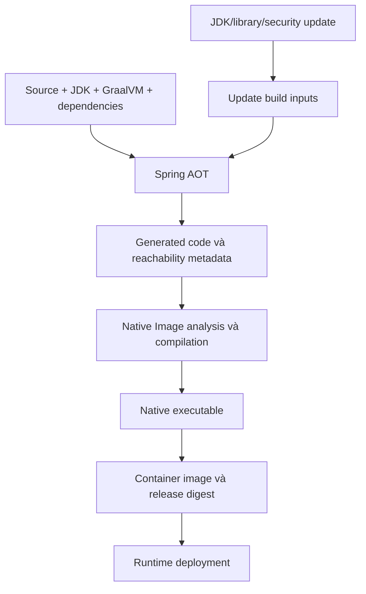

# Cập nhật JDK, GraalVM hoặc thư viện có thể yêu cầu build và phát hành binary mới

Một Spring Boot application chạy trên JVM thường nhận JDK và dependency từ môi trường hoặc classpath lúc khởi động. Với **GraalVM Native Image**, application code, các lớp JDK cần thiết, runtime và một phần native code được biên dịch vào executable tại build time. Spring AOT còn phân tích ApplicationContext và tạo mã/hints dựa trên cấu hình build. Vì vậy, cập nhật JDK, GraalVM, thư viện Java hoặc metadata AOT thường đòi hỏi tạo lại native executable và phát hành một release mới.

Không phải mọi thay đổi đều cần biên dịch lại executable. Nếu chỉ cập nhật một shared library động hoặc OS package trong runtime image, có thể chỉ cần build lại container image khi ABI vẫn tương thích. Nếu cấu hình được đọc hoàn toàn lúc runtime, có thể thay cấu hình mà giữ nguyên binary. Bài học này giúp xác định đúng phạm vi cần build, kiểm thử và phát hành để bản vá bảo mật thực sự đi vào production.

## 1. Mục tiêu học tập

Sau bài học, bạn có thể:

- Giải thích vì sao native executable chứa application code, các lớp JDK cần thiết và runtime được chọn lúc build.
- Phân biệt cập nhật cần rebuild native executable với cập nhật chỉ cần rebuild container image.
- Đánh giá tác động của bản vá JDK, GraalVM compiler/runtime và thư viện Java.
- Hiểu Spring AOT, reachability metadata và build-time conditions ảnh hưởng tới kết quả native.
- Quản lý phiên bản dependency, lockfile và checksum để build có thể tái lập.
- Xử lý security advisory/CVE theo mức độ ảnh hưởng và khả năng khai thác.
- Chạy lại AOT, native compilation, native tests và container tests sau khi nâng cấp.
- Tạo SBOM, provenance và release record để chứng minh bản vá đã có trong artifact.
- Phát hành bản native mới bằng digest, theo dõi rollout và rollback khi cần.
- Tránh nhầm lẫn giữa cập nhật runtime configuration, runtime shared libraries và code đã được biên dịch tĩnh.

## 2. Vì sao cập nhật dependency khác với ứng dụng JVM?

Native Image phân tích bytecode và metadata để xác định code có thể chạy, sau đó biên dịch phần reachable thành executable cho OS và architecture cụ thể. Executable chứa application classes, các standard-library classes cần thiết, language runtime và native code được liên kết từ JDK. Nó không khởi động một JVM đầy đủ rồi đọc lại toàn bộ JAR dependency như cách chạy ứng dụng thông thường.

Hệ quả:

- Đổi source code hoặc JAR dependency làm thay đổi input của Native Image builder.
- Đổi JDK có thể thay đổi standard-library classes, security implementation và native runtime code được đưa vào executable.
- Đổi GraalVM có thể thay đổi compiler, Native Image runtime, collector, optimizer hoặc metadata processing.
- Đổi Spring AOT inputs có thể làm thay đổi mã khởi tạo context, bean graph và runtime hints.
- Nếu không build lại, binary đang chạy vẫn là sản phẩm của các phiên bản cũ, kể cả khi source repository đã được cập nhật.



Sửa dependency trong `pom.xml` hoặc `build.gradle` chưa thay đổi executable đang chạy. Chỉ sau khi AOT/native build thành công, test đạt và image mới được triển khai thì bản cập nhật mới có hiệu lực.

## 3. Những thay đổi nào cần build lại?

Phân loại phạm vi thay đổi trước khi chạy pipeline:

| Thay đổi | Cần build lại native executable? | Cần build lại container image? | Lý do |
| --- | --- | --- | --- |
| Application source code | Có | Có | Machine code và application resources thay đổi |
| JDK patch/version | Có | Có | Các lớp JDK, runtime/security code được đóng gói theo build toolchain |
| GraalVM distribution/compiler/runtime | Có | Có | Native executable được tạo bởi compiler/runtime version mới |
| Spring Boot hoặc Java library dependency | Có | Có | Dependency bytecode và reachability graph thay đổi |
| Reachability metadata/reflection/resource hints | Có | Có | Native Image analysis cần tạo lại executable với metadata mới |
| Spring AOT profile/property ảnh hưởng bean conditions | Có | Có | AOT đã đánh giá conditions và sinh mã theo build-time environment |
| Runtime environment variable không ảnh hưởng AOT graph | Không | Không nhất thiết | Ứng dụng đọc giá trị lúc khởi động |
| ConfigMap/Secret được mount hoặc inject lúc runtime | Không | Không nhất thiết | Giá trị không nằm trong binary/image |
| CA certificate được mount lúc runtime | Không | Không nhất thiết | Client đọc trust material từ file ngoài executable |
| Default TrustStore được Native Image capture lúc build | Có nếu muốn cập nhật truststore nhúng; hoặc cấu hình truststore runtime tường minh | Có nếu thay image | CA store trên build host có thể được capture vào executable |
| OS package trong runtime image | Không, nếu binary không phụ thuộc nội dung package mới | Có | Cần đưa package đã vá vào container |
| Shared library liên kết động | Thường không nếu ABI tương thích và library chỉ được cung cấp ở runtime | Có | Container phải chứa library mới đúng architecture/ABI |
| Native library được static link vào executable | Có | Có | Code native đã được nhúng vào binary |
| File resource được đóng gói trong executable | Có | Có | Resource content nằm trong build output |
| Runtime file nằm ngoài image và được mount | Không | Không nhất thiết | Có thể cập nhật file qua deployment/configuration |

### 3.1. JDK update

Nếu nâng JDK từ một patch release lên patch release mới, hãy build lại native executable bằng JDK/GraalVM toolchain đã được cập nhật. Native Image chứa các lớp standard library cần thiết và một phần native code từ JDK; binary cũ không tự nhận các bản vá của JDK mới trên build server.

Ví dụ:

1. Security advisory xác định một lỗi trong TLS, crypto provider, serialization hoặc thư viện JDK.
2. CI cập nhật GraalVM/JDK distribution tới bản đã vá và được hỗ trợ.
3. Chạy Spring AOT và Native Image build lại.
4. Kiểm thử các đường đi chịu ảnh hưởng, chẳng hạn HTTPS, certificate validation, cryptography hoặc parsing.
5. Đóng gói image mới và triển khai digest mới.

Không giả định thay JAVA_HOME của container là đủ để vá một native executable đã được biên dịch trước đó. Executable không chạy bằng JVM nằm trong JAVA_HOME.

### 3.2. GraalVM update

GraalVM cung cấp compiler, Native Image builder và runtime components. Khi nâng version, build output có thể thay đổi về:

- Compiler optimizations và generated machine code.
- Native Image runtime và garbage collector.
- Hỗ trợ OS/architecture hoặc CPU instruction set.
- Cách xử lý reflection, resources, serialization và proxies.
- Reachability metadata và third-party library compatibility.
- Debugging, monitoring và security features.

Hãy xem compatibility/release notes của GraalVM và Spring Boot version đang dùng. Không tự động chọn GraalVM mới nhất nếu Spring Boot/Native Build Tools chưa hỗ trợ version đó trong tổ hợp dự án.

### 3.3. Java library update

Khi cập nhật Spring Framework, Jackson, Netty, database driver, logging hoặc thư viện bên thứ ba:

- JAR mới trở thành input của AOT/native build.
- Transitive dependency graph có thể thay đổi.
- Library có thể thêm reflection, proxy, serialization hoặc resource access mới.
- Reachability metadata có thể cần cập nhật.
- Native library classifier hoặc JNI implementation có thể thay đổi.

Vì vậy cần chạy lại AOT và Native Image build. Nếu chỉ cập nhật version trong dependency manifest mà không build/redeploy, production vẫn chạy code cũ.

### 3.4. OS package và shared library

Nếu executable liên kết động tới libssl, libstdc++, glibc hoặc thư viện hệ điều hành khác, có thể cập nhật package trong runtime image mà không compile lại application code, miễn ABI và symbol versions vẫn tương thích. Tuy nhiên, phải build lại container image để nhận package đã vá, sau đó chạy smoke/integration tests trên image mới.

Nếu thư viện được static link vào native executable, thay package trên runtime base image không thay đổi phần code đã nhúng. Cần rebuild native executable bằng toolchain/library đã vá.

Đừng suy luận chỉ từ tên package. Kiểm tra binary bằng readelf, ldd, linker configuration và cách Native Image build đã liên kết native dependencies.

## 4. Spring AOT và build-time configuration

Spring AOT phân tích ứng dụng lúc build và sinh mã tối ưu để Spring ApplicationContext có thể chạy trong Native Image. Các điều kiện cấu hình và một số lựa chọn bean được đánh giá trong giai đoạn này.

### 4.1. Vì sao profile lúc build quan trọng?

Ví dụ ứng dụng có hai bean:

```java
@Configuration(proxyBeanMethods = false)
class PaymentConfiguration {

    @Bean
    @Profile("sandbox")
    PaymentGateway sandboxGateway() {
        return new SandboxPaymentGateway();
    }

    @Bean
    @Profile("production")
    PaymentGateway productionGateway() {
        return new ProductionPaymentGateway();
    }
}
```

Nếu AOT được chạy với profile sandbox, generated context có thể phản ánh bean graph của môi trường sandbox. Chỉ đổi SPRING_PROFILES_ACTIVE=production khi chạy executable không đảm bảo bean production đã được đưa vào kết quả AOT.

Hãy chọn build-time profile phù hợp với cách triển khai. Nếu một binary cần hỗ trợ nhiều môi trường, thiết kế cấu hình sao cho các khác biệt cần thiết được đọc lúc runtime mà không làm thay đổi bean graph đã đóng băng trong AOT.

### 4.2. Thay đổi AOT inputs phải rebuild

Các thay đổi sau thường yêu cầu chạy lại AOT và native compilation:

- Profile/property được dùng để chọn bean trong lúc AOT.
- Điều kiện auto-configuration hoặc conditional bean.
- Package/classpath và dependency version.
- AOT processor, annotation processor hoặc generated source.
- Runtime hints cho reflection, resources, serialization, JNI và proxies.
- Native Image build arguments.

Với thay đổi cấu hình thuần runtime như endpoint, log level hoặc credential được inject đúng cách, có thể giữ nguyên executable. Luôn xác định property đó được tiêu thụ lúc build hay lúc chạy.

## 5. Quản lý dependency và toolchain có kiểm soát

### 5.1. Tránh version động

Tránh khai báo:

```kotlin
dependencies {
    implementation("com.example:partner-client:1.+")
}
```

Version động có thể resolve thành phiên bản khác ở hai lần build. Điều này làm khó tái lập native executable và khó xác định dependency nào đã đi vào release.

Ưu tiên version cụ thể hoặc version catalog/BOM được quản lý tập trung. Ghi lại dependency graph đã resolve trong release pipeline.

### 5.2. Gradle dependency locking

Bật dependency locking cho các configuration cần quản lý:

```kotlin
configurations.all {
    resolutionStrategy.activateDependencyLocking()
}
```

Tạo hoặc cập nhật lock state:

```bash
./gradlew dependencies --write-locks
```

Commit gradle.lockfile vào source control. Khi nâng version, review diff của lockfile để biết transitive dependencies nào cũng thay đổi.

Dependency locking giữ nguyên phiên bản đã resolve; nó không chứng minh artifact tải về là đáng tin cậy. Kết hợp với dependency verification.

### 5.3. Gradle dependency verification

Gradle có thể xác minh checksum hoặc chữ ký của dependency bằng file gradle/verification-metadata.xml.

Khởi tạo metadata:

```bash
./gradlew --write-verification-metadata sha256 help
```

Lệnh bootstrap ghi nhận checksum từ repository đang được cấu hình. Đây chưa phải bằng chứng độc lập rằng artifact an toàn. Review checksum với nguồn phát hành đáng tin cậy, cập nhật verification metadata có kiểm soát và giữ file này trong source control.

Khi build:

```bash
./gradlew --dependency-verification strict build
```

Nếu thêm hoặc nâng dependency, verification metadata có thể cần cập nhật. Không tự động chấp nhận mọi checksum mới mà không kiểm tra nguồn và diff.

### 5.4. Maven dependency graph

Với Maven, xem dependency tree trước và sau nâng cấp:

```bash
./mvnw dependency:tree
```

Để tập trung vào một thư viện:

```bash
./mvnw dependency:tree -Dincludes=com.example:partner-client
```

Quản lý version qua parent/BOM hoặc dependency management để tránh các module dùng version lệch nhau. Maven Wrapper giúp chuẩn hóa Maven version trong CI. Kết hợp repository policy, checksum/signature verification hoặc công cụ supply-chain của tổ chức để kiểm soát artifact đầu vào.

### 5.5. Ghi lại GraalVM và JDK

Trong CI, ghi:

```bash
java -version
native-image --version
./mvnw --version
```

Với Gradle:

```bash
./gradlew --version
```

Lưu output vào build log/release metadata. Pin builder image theo version/digest để tránh cùng commit nhưng hai lần build dùng toolchain khác nhau.

## 6. Xử lý security advisory và CVE

Khi scanner báo CVE, không nên chỉ nâng version theo tên package rồi phát hành ngay. Cần xác định component, đường phụ thuộc và mức độ ảnh hưởng.

### 6.1. Triage

Thu thập:

- CVE/advisory ID và điểm severity.
- Component bị ảnh hưởng, version hiện tại và version đã vá.
- Direct hay transitive dependency.
- Component có nằm trong image/SBOM hoặc native dependency graph không.
- Code path có reachable trong native executable không.
- Ứng dụng có gọi chức năng bị ảnh hưởng không.
- Exposure: input từ internet, authenticated user hay internal-only.
- Workaround và thời hạn vá theo policy.

Reachability có thể giúp đánh giá khả năng ảnh hưởng, nhưng không tự động chứng minh một CVE không liên quan. Reflection, dynamic loading, JNI và metadata có thể làm đường thực thi khó nhận diện. Tuân theo security policy của tổ chức; không bỏ qua CVE chỉ vì cho rằng Native Image đã loại code đó.

### 6.2. Chọn cách xử lý

| Tình huống | Hành động |
| --- | --- |
| JDK/GraalVM có security patch | Nâng toolchain và rebuild native executable |
| Java dependency có bản vá | Nâng dependency/BOM, resolve graph và rebuild |
| Native library được static link | Nâng native library/toolchain và rebuild executable |
| Shared library động trong runtime image có CVE | Cập nhật OS package/base image, build lại image và kiểm thử ABI |
| Base image có CVE | Chọn base image đã vá, rebuild container image |
| Reachability metadata thiếu hoặc lỗi | Cập nhật metadata/hints và rebuild native executable |
| Chưa có bản vá | Đánh giá workaround, giảm exposure, chặn vector khai thác và theo dõi advisory |

### 6.3. SBOM cho native application

Native executable có thể chứa Java dependency đã được biên dịch thành machine code. Một SBOM chỉ quét package của container filesystem có thể không nhận diện đầy đủ Java libraries đã được tích hợp vào executable.

Vì vậy, tạo và lưu ít nhất hai góc nhìn:

- **Java/application SBOM:** sinh từ Maven/Gradle dependency graph trước khi compile.
- **Container/OS SBOM:** mô tả base image, OS packages và shared libraries trong image cuối.

Liên kết cả hai với cùng source commit và image digest trong release record. Nếu công cụ SBOM hỗ trợ Native Image hoặc build provenance, dùng thêm metadata đó để tăng khả năng truy vết.

## 7. Quy trình nâng cấp và rebuild native executable

Một quy trình an toàn cần xác minh cả build input lẫn artifact cuối.

### Bước 1: Tạo nhánh nâng cấp

Tách thay đổi JDK/GraalVM/dependency thành commit có thể review. Ghi lý do nâng cấp, advisory/CVE và target version.

### Bước 2: Cập nhật dependency và toolchain

- Chọn JDK/GraalVM version được Spring Boot và Native Build Tools hỗ trợ.
- Cập nhật BOM/parent hoặc dependency catalog.
- Cập nhật Gradle lockfile và verification metadata nếu dùng.
- Kiểm tra transitive dependency changes.
- Kiểm tra native library classifiers và target architecture.

### Bước 3: Chạy JVM tests

```bash
./mvnw test
```

Hoặc:

```bash
./gradlew test
```

Đảm bảo application logic vẫn đúng trước khi điều tra các lỗi đặc thù Native Image.

### Bước 4: Chạy Spring AOT và native build

Maven với native profile:

```bash
./mvnw -Pnative native:compile
```

Gradle:

```bash
./gradlew nativeCompile
```

Spring Boot Maven native profile có thể cấu hình process-aot, Native Build Tools và reachability metadata. Gradle plugin GraalVM Native Image tự tích hợp các AOT tasks của Spring Boot. Nếu dự án không dùng parent/plugin mặc định, kiểm tra AOT executions và build arguments của dự án.

### Bước 5: Kiểm thử native executable

Chạy native executable trên OS/architecture mục tiêu. Tập trung vào những khu vực dễ bị ảnh hưởng khi nâng cấp:

- Reflection và classpath scanning.
- JSON/XML serialization.
- Dynamic proxies và AOP.
- Resource loading.
- TLS, crypto provider và certificate validation.
- JDBC driver, JNI và native libraries.
- Logging, tracing và metrics.
- Shutdown hooks, threads và scheduled tasks.

Nếu nâng GraalVM, kiểm tra build warnings và compatibility changes. Nếu nâng library, kiểm tra reachability metadata tương ứng.

### Bước 6: Build container image mới

Đóng gói binary mới vào runtime base image đã cập nhật. Xác minh:

- OS/architecture đúng.
- libc và shared libraries tương thích.
- CA certificates/timezone/resource cần thiết có mặt.
- Container chạy bằng non-root user.
- Secrets không bị nhúng vào image.
- Image chỉ chứa artifact của đúng commit/toolchain.

### Bước 7: Scan và tạo release evidence

Tạo Java/application SBOM, container SBOM, build provenance và security scan. Ký digest nếu release policy yêu cầu. Lưu GraalVM/JDK versions, dependency lock state và test results.

### Bước 8: Deploy và xác minh

Promote cùng image digest qua staging và production. Chạy smoke tests, theo dõi error rate, latency, restart count, memory/CPU và các chức năng liên quan CVE. Nếu cần rollback, quay về digest đã kiểm chứng trước đó và xác nhận cấu hình tương thích.

## 8. Kiểm thử tương thích sau khi nâng cấp

Không nên chỉ dựa vào unit tests. Một nâng cấp có thể thay đổi compiler behavior, generated code, native library linkage hoặc runtime semantics.

| Lớp test | Điều cần xác minh |
| --- | --- |
| Unit tests trên JVM | Logic nghiệp vụ và API contracts |
| Integration tests trên JVM | Spring wiring, database, messaging và HTTP |
| AOT processing | Conditions, generated code và AOT hints |
| Native compilation | Reachability, reflection, resources, JNI và linker |
| Native tests | Runtime behavior của executable mới |
| Container tests | libc, shared libraries, CA store, user và filesystem |
| Architecture tests | Mỗi binary chạy trên đúng target CPU/OS |
| Security tests | CVE đã vá, TLS/crypto và dependency policy |
| Performance tests | Startup, throughput, latency, heap/RSS sau toolchain update |

### 8.1. Kiểm thử TLS và security provider

JDK/GraalVM update có thể ảnh hưởng security provider, TLS protocol/cipher defaults, certificate parsing hoặc truststore handling. Kiểm tra:

- HTTPS tới server dùng CA công khai.
- HTTPS tới server dùng CA nội bộ.
- Hostname verification.
- Certificate expiry và chain validation.
- Mutual TLS nếu ứng dụng dùng client certificate.
- Thuật toán crypto mà ứng dụng thực sự sử dụng.

Không giải quyết lỗi TLS bằng cách tắt certificate validation. Xác định thay đổi provider, CA store hoặc certificate chain rồi sửa cấu hình đúng.

### 8.2. Kiểm tra reachability metadata

Một dependency mới có thể dùng reflection hoặc dynamic resource access mà Native Image không suy ra được tĩnh. Kiểm tra:

- Metadata do thư viện cung cấp.
- Reachability metadata repository phù hợp với version dependency.
- Spring AOT hints và RuntimeHintsRegistrar của ứng dụng.
- Build output có cảnh báo metadata bị thiếu hay không.
- Các code path ít được gọi nhưng có reflection/serialization có chạy được không.

Nếu metadata thay đổi, phải chạy lại native build và test executable mới. Không thể thêm JSON metadata vào thư mục runtime rồi kỳ vọng binary cũ tự đọc nó nếu metadata đó được dùng ở build time.

## 9. Trường hợp chỉ cần cập nhật runtime image

Ví dụ runtime image dùng Debian slim và native executable liên kết động với một thư viện hệ thống. Khi Debian phát hành security update cho package đó:

1. Cập nhật base image digest/package version.
2. Build lại container image với executable đã có.
3. Kiểm tra ABI và symbol versions bằng readelf/ldd.
4. Chạy container integration tests.
5. Scan lại container SBOM và image.
6. Phát hành digest mới.

Không nhất thiết phải chạy Native Image compiler lại nếu application binary không chứa thư viện bị vá và ABI vẫn tương thích. Nhưng nếu native dependency được static link, được đóng gói vào executable hoặc cần compile lại với header/library mới, phải rebuild executable.

### 9.1. Kiểm tra dynamic linking

```bash
readelf -d target/order-service
ldd target/order-service
```

readelf -d cho biết dynamic section và dependency names. ldd hiển thị shared libraries được resolve trong môi trường đang chạy lệnh. Hãy kiểm tra bằng runtime base image thực tế; kết quả trên build host có thể khác container production.

### 9.2. Static và mostly-static

Với fully static executable, phần lớn native dependencies đã được link vào binary. Cập nhật package trong runtime base image không vá các bản sao đã nhúng. Cần rebuild binary với toolchain/library mới.

Với mostly-static executable, một số thành phần như glibc vẫn có thể được cung cấp từ runtime. Cần hiểu chính xác linking mode của executable trước khi quyết định chỉ cập nhật container image.

### 9.3. Lưu ý riêng về default TrustStore

GraalVM Native Image mặc định có thể capture default TrustStore từ máy build và nhúng certificate vào executable. Vì vậy, cập nhật package CA trong runtime container không nhất thiết thay đổi truststore mặc định mà binary đang dùng.

Khi cần cập nhật CA:

- Nếu ứng dụng dùng default JSSE TrustStore đã capture, rebuild executable trên build environment có CA store đã được kiểm chứng.
- Hoặc cấu hình client sử dụng một truststore file được mount và nạp lúc runtime, rồi kiểm tra chính client đó thực sự dùng truststore mới.
- Nếu dùng Spring Boot SSL Bundle trỏ tới file runtime, xác minh bundle được tạo và load từ file mount; không suy luận rằng thay đổi global truststore sẽ tự áp dụng cho mọi client.

Đây là trường hợp cần phân biệt cập nhật container OS package với cập nhật dữ liệu certificate đã được capture trong native executable.

## 10. Những thay đổi có thể thực hiện lúc runtime

Không phải mọi thay đổi vận hành đều đòi hỏi native compilation:

- Endpoint của database hoặc service ngoài.
- Log level, tracing exporter và một số feature flags.
- Credential được lấy từ secret manager.
- CA/truststore file được mount và nạp lúc runtime, nếu client được cấu hình đọc file đó thay vì dùng default TrustStore đã capture.
- CPU/memory limits của container.
- ConfigMap chứa thuộc tính được ứng dụng đọc lúc chạy.

Điều kiện là ứng dụng thực sự đọc các giá trị này lúc runtime và chúng không làm thay đổi bean graph hoặc resource reachability đã được tạo ở AOT/native build.

Nếu thay đổi profile/property làm một bean chỉ được tạo trong AOT build phải xuất hiện hoặc biến mất, cần chạy AOT và build lại. Khi thiết kế ứng dụng, nên giữ các khác biệt môi trường có thể thay đổi trong runtime configuration thay vì đóng băng chúng vào build.

## 11. Rollout và rollback sau security update

### 11.1. Phát hành bản đã vá

Sau khi native build và test đạt:

1. Push image với version tag mới.
2. Ghi image digest và source commit.
3. Lưu GraalVM/JDK version và dependency graph.
4. Gắn Java SBOM, container SBOM và provenance.
5. Ký digest theo release policy.
6. Deploy staging bằng digest.
7. Chạy native/container/security tests.
8. Promote cùng digest lên production.

Không build lại một artifact khác ở bước production promotion. Nếu build lại, đó là một artifact khác và cần được kiểm chứng lại.

### 11.2. Rollback không thay thế việc vá

Rollback về image cũ có thể khôi phục service availability nhưng cũng có thể đưa CVE đã biết trở lại. Nếu rollback vì regression của bản vá:

- Giới hạn thời gian và phạm vi rollback.
- Áp dụng network/config mitigation nếu có.
- Theo dõi advisory và bản vá tiếp theo.
- Chuẩn bị forward-fix thay vì giữ bản cũ lâu dài.
- Không đánh dấu CVE đã xử lý chỉ vì deployment đã ổn định sau rollback.

Nếu database schema hoặc external contract đã đổi, xác minh bản cũ còn tương thích trước khi rollback.

## 12. Troubleshooting

| Triệu chứng | Nguyên nhân có thể | Cách xử lý |
| --- | --- | --- |
| Đã nâng JDK trong CI nhưng production không có bản vá | Executable cũ vẫn đang được triển khai | Build native executable mới, push digest mới và rollout |
| Dependency tree đã đổi nhưng native behavior không đổi | Chưa tạo và deploy binary mới | Chạy lại AOT/native build, kiểm tra digest Pod đang chạy |
| Native build lỗi sau GraalVM update | Version compatibility, toolchain hoặc metadata thay đổi | Kiểm tra release notes, supported JDK và reachability metadata |
| AOT build tạo bean graph khác | Build-time profile/property thay đổi | Xác minh AOT environment và runtime configuration |
| Reflection/serialization lỗi sau library update | Dependency thêm dynamic access hoặc metadata chưa đủ | Cập nhật hints/reachability metadata rồi rebuild |
| HTTPS lỗi sau JDK/GraalVM update | Provider, TLS defaults, CA store hoặc certificate parsing thay đổi | Đọc exception cause, kiểm tra provider/chain/hostname |
| Container scan vẫn báo CVE sau khi cập nhật Java dependency | Base image hoặc OS package vẫn cũ; scanner đọc SBOM khác nhau | Kiểm tra Java SBOM và container SBOM riêng, rebuild base image nếu cần |
| Shared library thiếu trong container mới | Runtime base image thiếu package hoặc ABI mismatch | Kiểm tra ldd, readelf và runtime dependencies |
| CVE native library vẫn tồn tại sau khi cập nhật OS package | Library đã static link vào executable | Nâng native dependency/toolchain và rebuild executable |
| Gradle build fail vì dependency verification | Checksum/signature mới chưa được review | Xác minh artifact từ nguồn tin cậy rồi cập nhật verification metadata |
| Dependency lockfile không khớp | Version graph đã thay đổi nhưng lock state chưa cập nhật | Review dependency graph và cập nhật lockfile có kiểm soát |
| Bản mới chạy tốt trên JVM nhưng lỗi native | Native reachability, AOT, linker hoặc runtime khác biệt | Chạy native tests và container integration tests |
| Rollback làm CVE quay lại | Digest cũ chứa dependency/JDK đã bị ảnh hưởng | Giới hạn rollback, mitigation và chuẩn bị bản forward-fix đã vá |

## 13. Bài thực hành tổng hợp

**Bối cảnh:** order-service dùng GraalVM Native Image. Security scanner phát hiện CVE trong một thư viện HTTP client và JDK patch hiện tại cũng đã hết thời hạn hỗ trợ. Nhóm cần nâng dependency, cập nhật GraalVM/JDK rồi phát hành binary mới.

Thực hiện:

1. Ghi lại source commit, GraalVM/JDK version, dependency graph và image digest hiện tại.
2. Xác định CVE, version bị ảnh hưởng, version đã vá và các đường code sử dụng component.
3. Chọn GraalVM/JDK version được Spring Boot và Native Build Tools hỗ trợ.
4. Nâng HTTP client dependency/BOM và review toàn bộ transitive dependencies.
5. Cập nhật Gradle lockfile/verification metadata nếu dự án dùng Gradle; kiểm tra Maven dependency tree nếu dùng Maven.
6. Chạy JVM unit/integration tests.
7. Chạy Spring AOT và Native Image build lại.
8. Chạy native tests tập trung vào HTTP, TLS, proxy, timeout và certificate validation.
9. Build runtime container mới, kiểm tra shared libraries và architecture.
10. Tạo Java SBOM, container SBOM, provenance và security scan; xác minh digest/signature.
11. Deploy staging bằng digest mới và chạy smoke/load/security tests.
12. Promote cùng digest lên production, theo dõi latency, error rate và restart count.
13. Nếu regression buộc phải rollback, quay về digest đã kiểm chứng, đánh giá lại CVE exposure và đặt thời hạn forward-fix.

**Câu hỏi tự kiểm tra:** Vì sao đổi JDK trong build environment mà không tạo native executable mới không vá được JDK code đã nằm trong binary? Vì Native Image đã biên dịch các lớp JDK cần thiết và runtime/native code vào executable tại build time. Binary đang chạy vẫn chứa nội dung từ toolchain cũ cho tới khi được build và phát hành lại.

## 14. Ghi nhớ

- Native executable chứa application code, các standard-library classes cần thiết, language runtime và native code được liên kết từ JDK.
- Nâng JDK, GraalVM, Java dependencies, Spring AOT inputs hoặc reachability metadata thường yêu cầu chạy lại AOT và native compilation.
- Thay đổi OS package/shared library động có thể chỉ cần rebuild container image nếu ABI tương thích; static-linked native code cần rebuild executable.
- Spring AOT đánh giá một số conditions lúc build. Profile/property ảnh hưởng bean graph phải được đồng bộ với build-time environment.
- Dùng version cụ thể, dependency locking và dependency verification để giữ build reproducible và kiểm soát nguồn artifact.
- Khi xử lý CVE, xem dependency graph, reachability, exposure và bản vá; không bỏ qua advisory chỉ dựa trên suy đoán.
- Tạo cả Java/application SBOM và container/OS SBOM vì executable có thể chứa Java dependencies dưới dạng machine code.
- Sau nâng cấp, chạy JVM tests, AOT, native compilation, native tests và container tests trên target architecture.
- Phát hành artifact mới bằng digest, provenance và test evidence; promote cùng digest qua các môi trường.
- Rollback có thể khôi phục availability nhưng cũng có thể đưa CVE trở lại. Cần mitigation và forward-fix có thời hạn.

Khi xác định đúng thay đổi nằm ở build-time hay runtime, đội phát triển có thể vá JDK, GraalVM và thư viện một cách có kiểm soát, đồng thời chứng minh binary đang chạy thực sự chứa các bản cập nhật đó.

## Tài liệu tham khảo chính thức

- [GraalVM Native Image](https://www.graalvm.org/reference-manual/native-image/): nội dung executable, static analysis, reachable code và native compilation.
- [Spring Boot Maven Plugin — Ahead-of-Time Processing](https://docs.spring.io/spring-boot/maven-plugin/aot.html): process-aot, native profile và build-time conditions.
- [Spring Boot Gradle Plugin — Ahead-of-Time Processing](https://docs.spring.io/spring-boot/gradle-plugin/aot.html): AOT tasks và tích hợp GraalVM Native Image plugin.
- [Gradle — Locking Versions](https://docs.gradle.org/current/userguide/dependency_locking.html): dependency locking và reproducible resolution.
- [Gradle — Securing Dependencies](https://docs.gradle.org/current/userguide/dependency_verification.html): checksum/signature verification và cập nhật verification metadata.
- [Gradle — Dependency Verification](https://docs.gradle.org/current/userguide/securing_dependencies.html): verification modes và bootstrap security considerations.
