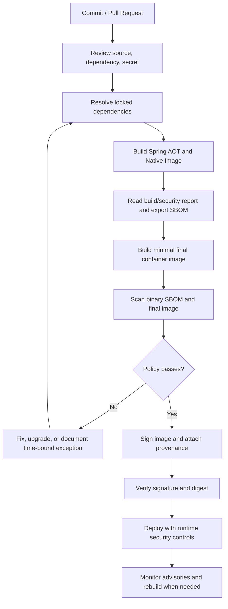

# Giảm thành phần được đóng gói nhưng không coi đó là thay thế kiểm tra bảo mật

## 1. Mục tiêu: giảm bề mặt tấn công có kiểm soát

Ứng dụng Spring Boot thường kéo theo nhiều dependency, thư viện hỗ trợ, công cụ build và thành phần hệ điều hành. Một phần trong số đó chỉ cần khi biên dịch hoặc kiểm thử; một phần khác không được dùng trong luồng chạy thực tế. Đưa tất cả vào production image làm tăng kích thước, số thành phần phải theo dõi và số vị trí có thể chứa lỗ hổng.

GraalVM Native Image và container multi-stage build cung cấp các cơ chế để giảm phần được triển khai. Native Image phân tích code reachable từ entry point và đóng gói các thành phần cần thiết theo mô hình closed-world. Multi-stage build cho phép chỉ copy executable và tài nguyên runtime sang final image, bỏ compiler, Maven/Gradle cache và source build. Có thể chọn base image nhỏ, bỏ shell/package manager không cần thiết, chạy non-root và chỉ cấp quyền tối thiểu.

Tuy nhiên, image nhỏ hoặc không chứa JVM không có nghĩa là ứng dụng đã an toàn. Code reachable vẫn có thể chứa lỗ hổng; thư viện được biên dịch vào binary vẫn cần theo dõi và cập nhật; native executable vẫn có thể có lỗi logic, lỗi memory safety ở thư viện native, deserialization không an toàn hoặc cấu hình TLS yếu. Container vẫn chia sẻ kernel host và cần isolation, patching, scanning và runtime controls.

Bài học này thuộc chương **Bảo mật** của module **SPRING_BOOT_NATIVE_IMAGE**. Module hướng dẫn biên dịch Spring Boot thành GraalVM Native Image bằng Spring AOT để đánh giá thời gian khởi động và bộ nhớ, đồng thời thực hành build Maven/Gradle, cấu hình reflection/resource, kiểm thử tương thích, đóng gói container và vận hành bản native.

Sau bài học, người học có thể:

- Giải thích Native Image loại bỏ code unreachable như thế nào và giới hạn của cơ chế đó.
- Loại dependency và build tool không cần thiết khỏi final image mà không làm mất chức năng.
- Chọn base image phù hợp với native executable và thư viện runtime.
- Kết hợp non-root, read-only filesystem, capability tối thiểu và secret management.
- Tạo và sử dụng SBOM cho native executable và container image.
- Quét lỗ hổng, ký image, xác minh provenance và thiết lập quy trình cập nhật.
- Kiểm thử bảo mật trên artifact cuối cùng thay vì suy luận từ kích thước image.

## 2. Hiểu đúng các lớp thành phần cần giảm

Một deployment Spring Boot Native Image có nhiều lớp thành phần:

| Lớp | Ví dụ | Cách kiểm soát |
|---|---|---|
| Build environment | GraalVM compiler, Maven/Gradle, test tools, source code | Multi-stage build; không copy sang runtime stage |
| Java dependency | Spring modules, database driver, JSON library, logging | Chọn starter/module cần thiết; rà soát dependency tree và SBOM |
| Reachable application code | Controller, service, serializer, reflection targets | Static analysis và reachability metadata |
| Native runtime | GC, thread support, runtime libraries, linked system libraries | Chọn GraalVM/runtime options và base image tương thích |
| OS packages | libc, CA certificates, timezone data, shell, package manager | Chỉ giữ package runtime cần thiết |
| Runtime configuration | Secret, TLS trust, endpoint, feature flag | Inject từ môi trường/secret store; không bake vào image |
| Deployment privileges | UID/GID, Linux capabilities, writable paths | Non-root, read-only root filesystem và security context |

Giảm một lớp không tự động giảm các lớp còn lại. Ví dụ, Native Image có thể bỏ một số method unreachable khỏi executable nhưng final image vẫn chứa shell, package manager và các OS package không cần thiết. Ngược lại, dùng base image rất nhỏ không tự động loại dependency dễ bị khai thác đã được link vào native binary.

Cần xác định mục tiêu cụ thể trước khi tối ưu:

- Giảm kích thước image và thời gian tải image.
- Giảm số package OS cần patch.
- Giảm code/dependency thực sự được đưa vào executable.
- Giảm quyền mà process có thể sử dụng khi bị khai thác.
- Tăng khả năng truy xuất nguồn gốc và phát hiện dependency có CVE.

Đo và báo cáo từng mục tiêu riêng. Kích thước image là chỉ số vận hành, không phải thước đo đầy đủ của mức độ an toàn.

## 3. Native Image loại bỏ code unreachable như thế nào?

Native Image thực hiện static analysis bắt đầu từ entry point của ứng dụng, thường là `main`, rồi lần theo các class, method và field có thể được sử dụng. Chỉ các thành phần được xác định reachable mới được đưa vào executable. Đây là closed-world assumption: các class mới không thể được nạp tùy ý sau khi binary đã được build.

Điều này có thể làm giảm lượng code so với việc đóng gói toàn bộ classpath JVM. Nhưng “unreachable” phụ thuộc vào những gì builder nhìn thấy. Java reflection, JNI, dynamic proxy, resource loading, serialization và một số framework extension có thể truy cập thành phần bằng cơ chế động. Nếu thiếu reachability metadata, một thành phần cần thiết có thể bị loại và gây lỗi runtime. Nếu metadata đăng ký quá rộng, nhiều class/method không cần thiết vẫn có thể được giữ lại.

Ví dụ, ứng dụng deserialize hai DTO qua Jackson. Nếu type được suy ra tĩnh và Spring AOT tạo đủ hints, builder có thể xác định tập type cần thiết. Nếu ứng dụng nhận tên class tùy ý từ message header rồi gọi `Class.forName`, builder không thể mặc nhiên biết mọi class sẽ xuất hiện. Việc thêm metadata cho cả package lớn có thể khiến nhiều type được giữ lại và mở rộng khả năng xử lý động.

Ví dụ đăng ký binding cho một DTO cụ thể:

```java
import org.springframework.aot.hint.annotation.RegisterReflectionForBinding;
import org.springframework.stereotype.Component;

@Component
@RegisterReflectionForBinding(OrderCreated.class)
public class OrderMessageConfiguration {
}
```

Chỉ đăng ký những type ứng dụng thực sự cần. Với custom RuntimeHintsRegistrar, kiểm tra từng reflection member, resource pattern, proxy interface và serialization type. Metadata là mô tả năng lực runtime cần giữ lại, không phải danh sách để thêm wildcard nhằm làm build pass.

Không xóa metadata chỉ để giảm binary size nếu chức năng phụ thuộc vào metadata đó. Thay đổi metadata có thể làm ứng dụng lỗi khi nhận payload hiếm, bật feature flag hoặc xử lý một locale/resource không xuất hiện trong smoke test.

## 4. Code ít hơn không đồng nghĩa lỗ hổng đã biến mất

Static analysis loại thành phần mà builder không xem là reachable. Nó không chứng minh các method còn lại không có lỗ hổng. Một controller có lỗi authorization, một parser có lỗi input validation hoặc một thư viện crypto cũ vẫn có thể được đưa vào native executable nếu ứng dụng sử dụng chúng.

Cũng không nên suy luận rằng một dependency không có trong class-level reachability thì mọi rủi ro của dependency đã biến mất. Cần biết scanner/SBOM đang mô tả lớp nào: Maven dependency graph, class/component trong native binary, OS package trong image hay thư viện native được link. Những inventory này bổ sung cho nhau.

Các rủi ro vẫn cần kiểm soát:

- **Lỗ hổng logic:** authorization, authentication, tenant isolation, input validation.
- **Lỗ hổng thư viện:** parser, JSON/XML, HTTP client, database driver, logging và crypto.
- **Lỗ hổng native:** C/C++ library, libc, compression library và memory handling.
- **Lỗ hổng cấu hình:** TLS trust, CORS, management endpoint, debug endpoint, actuator exposure.
- **Lỗ hổng vận hành:** secret bị lộ, image cũ, quyền container quá rộng, network policy thiếu kiểm soát.
- **Supply-chain attack:** dependency/build image bị thay thế, artifact không rõ nguồn gốc hoặc pipeline bị xâm nhập.

Vì vậy, giảm thành phần chỉ là một biện pháp giảm bề mặt tấn công. Tiếp tục thực hiện dependency review, vulnerability scanning, secure coding review, integration/security testing và patch management.

## 5. Rà soát dependency trước khi build native

Bắt đầu từ dependency graph của ứng dụng. Với Maven:

```bash
./mvnw dependency:tree
./mvnw -Pnative dependency:tree
```

Với Gradle:

```bash
./gradlew dependencies --configuration runtimeClasspath
./gradlew dependencyInsight \
  --dependency jackson-databind \
  --configuration runtimeClasspath
```

Tìm các dependency chỉ phục vụ development/test, module không được sử dụng, duplicate version và thư viện đã thay thế. Chọn Spring Boot starter theo chức năng thực sự cần: không thêm cả WebFlux và MVC, nhiều logging backend hoặc nhiều JSON provider nếu ứng dụng chỉ dùng một lựa chọn.

Nếu dependency là optional hoặc được kéo vào qua starter lớn, kiểm tra lại cách loại bỏ. Ví dụ, Spring Boot build-image mặc định loại một số module như DevTools và Docker Compose trong quá trình repackaging; optional dependencies cũng có quy tắc inclusion riêng. Không dựa vào mặc định này để cho rằng mọi dependency development đã biến mất. Kiểm tra dependency tree và nội dung artifact/image thực tế.

Ví dụ đánh dấu dependency không nên được truyền tự động tới consumer:

```xml
<dependency>
    <groupId>com.example</groupId>
    <artifactId>legacy-client</artifactId>
    <version>${legacy-client.version}</version>
    <scope>runtime</scope>
    <optional>true</optional>
</dependency>
```

`optional` thay đổi cách dependency được truyền tới consumer; nó không có nghĩa dependency biến mất khỏi ứng dụng hiện tại nếu project vẫn khai báo và sử dụng nó. Nếu ứng dụng không cần thư viện, hãy xóa dependency declaration khỏi project hoặc exclude đúng transitive dependency sau khi xác nhận không có đường code nào phụ thuộc.

Ví dụ exclude một transitive dependency:

```xml
<dependency>
    <groupId>com.example</groupId>
    <artifactId>integration-starter</artifactId>
    <version>${integration.version}</version>
    <exclusions>
        <exclusion>
            <groupId>com.example</groupId>
            <artifactId>unused-transport</artifactId>
        </exclusion>
    </exclusions>
</dependency>
```

Chỉ exclude sau khi kiểm tra dependency tree, chức năng và test. Một dependency có vẻ không được gọi trực tiếp có thể được auto-configuration, ServiceLoader, reflection hoặc native library nạp động.

Không xóa thư viện chỉ vì scanner báo CVE nếu thư viện đó vẫn cần thiết. Trước tiên nâng version đã vá hoặc thay thế bằng thư viện được hỗ trợ. Nếu chưa có bản vá, đánh giá khả năng khai thác, đường code có liên quan, mitigation, thời hạn chấp nhận rủi ro và owner chịu trách nhiệm. Không dùng exclusion như cách che cảnh báo trong pipeline.

## 6. Tách build stage và runtime stage

Multi-stage Docker build là cách trực tiếp để không đưa toolchain vào production image. Stage build có GraalVM Native Image, Maven/Gradle và compiler hệ điều hành. Stage runtime chỉ nhận executable và các tài nguyên cần thiết.

Ví dụ minh họa:

```dockerfile
# syntax=docker/dockerfile:1
FROM <graalvm-builder-image>@sha256:<builder-digest> AS build
WORKDIR /workspace

COPY . .
RUN ./mvnw -Pnative native:compile

FROM <minimal-runtime-image>@sha256:<runtime-digest> AS runtime
WORKDIR /app

COPY --from=build --chown=10001:10001 \
    /workspace/target/application /app/application

USER 10001:10001
EXPOSE 8080
ENTRYPOINT ["/app/application"]
```

Vì builder stage nhận build context, thêm `.dockerignore` để không gửi file không cần thiết hoặc secret vào Docker build context:

```text
.git
.idea
.gradle
target
build
.env
.env.*
*.pem
*.key
secrets/
```

Điều chỉnh danh sách theo project; không ignore output hoặc file cấu hình mà build thực sự cần. `.dockerignore` giảm dữ liệu gửi vào builder nhưng không thay thế secret manager hoặc kiểm tra secret trong repository. Nếu cần credential để tải dependency private, dùng BuildKit secret mount hoặc cơ chế credential của CI thay vì `ARG`/`ENV` chứa secret.

Các placeholder image/digest cần được thay bằng version và digest đã được tổ chức phê duyệt. Base image runtime phải tương thích với native executable và thư viện được link. Nếu binary cần glibc hoặc thư viện hệ điều hành, một image `scratch` không có các thư viện đó sẽ không chạy được.

Multi-stage build loại compiler và cache khỏi final stage, nhưng builder vẫn là một phần của supply chain. Pin builder digest, cập nhật định kỳ, quét builder image và kiểm soát nguồn image. Không coi việc build bằng multi-stage là bằng chứng artifact đáng tin cậy.

Với Spring Boot Buildpacks, có thể tạo OCI image qua Maven `spring-boot:build-image` hoặc Gradle `bootBuildImage`. Buildpacks thường tạo image có cấu trúc runtime hợp lý và chạy bằng non-root user; vẫn phải kiểm tra run image, SBOM, digest, package và cấu hình security của image đã tạo.

## 7. Chọn base image nhỏ nhưng tương thích

Base image càng ít package thì càng ít package OS phải cập nhật, nhưng không phải image nhỏ nhất luôn phù hợp. Native executable có thể phụ thuộc vào libc, DNS/NSS, CA certificate, timezone data, font hoặc thư viện hệ thống khác.

Trước khi chọn `scratch`, distroless hoặc slim image:

1. Xác định binary link động hay tĩnh và thư viện nào cần lúc runtime.
2. Kiểm tra `ldd` hoặc `readelf -d` trên binary Linux khi các công cụ đó phù hợp.
3. Kiểm tra CA certificates nếu ứng dụng gọi HTTPS.
4. Kiểm tra timezone/locale nếu nghiệp vụ phụ thuộc vào chúng.
5. Kiểm tra DNS resolution và user/group lookup.
6. Chạy integration test trong chính final image, không chỉ trong builder stage.

Ví dụ trên Linux:

```bash
file target/application
readelf -d target/application
ldd target/application
```

Một số executable static có thể khiến `ldd` không áp dụng hoặc trả thông tin khác nhau; đọc kết quả theo loại binary và toolchain. Đừng copy ngẫu nhiên shared library từ builder sang runtime; dùng runtime base image được thiết kế tương thích với cách binary được build.

Cân nhắc các lựa chọn:

| Loại image | Ưu điểm | Điều phải xác minh |
|---|---|---|
| Slim OS image | Tương thích rộng, dễ debug | Package dư thừa, shell/package manager và CVE |
| Distroless | Ít công cụ runtime, giảm package | CA certs, timezone, user, libc và cách debug |
| Minimal/micro image | Footprint nhỏ | Thư viện runtime, DNS, TLS, locale |
| `scratch` | Không có OS package mặc định | Binary và mọi runtime dependency phải tự đủ |
| Buildpacks run image | Có cấu trúc runtime và user đã chuẩn bị | Version stack, packages, non-root, lifecycle update |

Không xóa CA certificate, timezone data hoặc thư viện bảo mật chỉ để giảm vài MB. Nếu ứng dụng cần TLS ra ngoài, thiếu trust store có thể khiến kết nối thất bại hoặc dẫn tới cách khắc phục không an toàn như tắt certificate validation.

## 8. Giới hạn quyền runtime sau khi giảm image

Ngay cả một image nhỏ cũng có thể bị khai thác nếu process chạy root, có Linux capabilities dư thừa hoặc được mount filesystem ghi tùy ý.

Các cấu hình nên cân nhắc:

- Chạy bằng UID/GID không phải 0.
- Đặt root filesystem read-only.
- Chỉ mount writable volume vào các path cần thiết như `/tmp` hoặc thư mục upload.
- Drop capabilities không cần thiết.
- Tắt privilege escalation.
- Dùng seccomp profile và AppArmor/SELinux policy phù hợp.
- Giới hạn CPU/memory/process và file descriptor.
- Dùng network policy để giới hạn kết nối vào/ra.
- Không bật `--privileged` nếu ứng dụng không có yêu cầu đặc biệt đã được đánh giá.

Ví dụ Docker runtime:

```bash
docker run --rm \
  --read-only \
  --user 10001:10001 \
  --cap-drop=ALL \
  --security-opt no-new-privileges:true \
  --tmpfs /tmp:rw,noexec,nosuid,size=64m,mode=1777 \
  --memory=512m \
  --cpus=1 \
  -p 8080:8080 \
  my-service:native
```

Đây là baseline minh họa. Ứng dụng có thể cần thêm writable path, group hoặc capability cụ thể; chỉ cấp đúng quyền đã chứng minh là cần. Test upload, TLS, report generation, graceful shutdown và health checks trong cấu hình hardening cuối cùng.

Với Kubernetes, cấu hình `runAsNonRoot`, `readOnlyRootFilesystem`, `allowPrivilegeEscalation: false`, drop capabilities, seccomp và volume tạm. Đừng mặc định `fsGroup` sẽ hoạt động giống nhau trên mọi CSI driver; kiểm tra quyền mount thực tế. Các lớp hardening này bổ sung cho nhau và không thay thế patch kernel/container runtime.

## 9. Không đưa secret vào build hoặc image snapshot

Native Image có thể chạy một số static initializer trong quá trình build và lưu state của chúng trong image heap. Nếu initializer đọc environment variable, file credential, truststore hoặc sinh random seed ở build time, giá trị đó có thể được lưu trong binary. Builder output cũng có thể ghi thông tin nhạy cảm vào log hoặc cache.

GraalVM khuyến cáo chạy Native Image builder trong môi trường build riêng không chứa secret. Những class xử lý dữ liệu nhạy cảm hoặc cần tạo state mới khi ứng dụng khởi động nên được xem xét để khởi tạo ở runtime, chẳng hạn bằng `--initialize-at-run-time` hoặc RuntimeClassInitialization API phù hợp với version.

Ví dụ option minh họa:

```bash
native-image \
  --initialize-at-run-time=com.example.security.SecretProvider \
  -jar target/application.jar
```

Không áp dụng option này hàng loạt. Thay đổi thời điểm khởi tạo có thể ảnh hưởng hiệu năng, thứ tự khởi động và tương thích; kiểm thử kỹ class được chỉ định và các dependency của nó.

Các nguyên tắc quản lý secret:

- Không truyền password/token bằng build argument hoặc ghi vào Dockerfile layer.
- Không commit secret vào source, `application.yml`, resource hoặc RuntimeHints.
- Không bake private key, database password hoặc API token vào native executable.
- Inject secret lúc runtime qua secret manager, orchestrator hoặc file mount có quyền phù hợp.
- Không in secret vào log khi diagnostics hoặc build thất bại.
- Rotate secret theo quy trình vận hành và giới hạn quyền truy cập.

Build-time config và runtime config phải được phân biệt rõ. URL/credential của production không nên xuất hiện trong build environment của native image.

## 10. Tạo SBOM cho Native Image và container

Software Bill of Materials (SBOM) là inventory các thành phần, thư viện và module được sử dụng để tạo artifact. Nó giúp nhóm bảo mật biết ứng dụng chứa thành phần nào, version nào và có dependency relationship ra sao.

Một số Oracle GraalVM distribution hỗ trợ tạo SBOM cho Native Image bằng `--enable-sbom`; tính năng và tùy chọn cụ thể phụ thuộc distribution/version. Theo tài liệu GraalVM hiện hành, SBOM native image có thể được embed trong executable hoặc export ra JSON, định dạng mặc định là CycloneDX. Không giả định tùy chọn này có trên mọi GraalVM Community/vendor distribution; kiểm tra docs của toolchain thực tế.

Ví dụ với Oracle GraalVM Native Image:

```bash
native-image \
  --enable-sbom=classpath,export \
  -jar target/application.jar
```

Nếu binary được build qua Native Build Tools plugin, cấu hình các native image build arguments tương ứng trong Maven/Gradle theo phiên bản plugin đang dùng. Lưu SBOM export cùng artifact và build metadata.

Có thể trích SBOM đã embed bằng Native Image Utils hoặc Syft, nếu distribution/binary hỗ trợ:

```bash
$GRAALVM_HOME/bin/native-image-utils extract-sbom \
  --image-path=target/application

syft scan target/application -o cyclonedx-json
```

SBOM của Native Image có thể liệt kê Java libraries và component có thể nhận diện từ metadata của artifact. SBOM của container image lại có thể liệt kê OS packages và các thành phần trong image layers. Tạo/giữ cả hai nếu pipeline hỗ trợ; một inventory không nhất thiết bao phủ tất cả lớp còn lại.

Không xem SBOM là bằng chứng rằng artifact không có CVE. SBOM chỉ mô tả thành phần; cần đối chiếu với advisory database và hiểu giới hạn nhận diện version/component. Nếu một thư viện được shading hoặc không có metadata version, scanner có thể không phân loại chính xác. SBOM cũng không phát hiện lỗi logic trong source code.

## 11. Quét dependency và final image

Quét bảo mật ở nhiều thời điểm:

| Thời điểm | Đối tượng | Mục tiêu |
|---|---|---|
| Pull request | Maven/Gradle dependency graph | Phát hiện dependency vulnerable trước khi merge |
| Build | Source, IaC, Dockerfile, secret | Phát hiện lỗi code/config và secret bị lộ |
| Native build | SBOM của executable | Kiểm tra Java/GraalVM component có CVE |
| Container build | Final OCI image | Kiểm tra OS packages, libraries và image metadata |
| Release | Image digest, signature, provenance | Xác minh artifact được build từ pipeline tin cậy |
| Runtime | Image đang deploy và config | Phát hiện CVE mới, drift và cấu hình không an toàn |

Ví dụ dùng Syft và Grype:

```bash
# Sinh SBOM cho final image.
syft my-service:native -o cyclonedx-json \
  > image-sbom.cdx.json

# Quét image theo vulnerability database của Grype.
grype my-service:native

# Quét SBOM đã export từ Native Image.
grype native-image.sbom.json
```

Ví dụ dùng Trivy:

```bash
trivy image --scanners vuln,misconfig,secret my-service:native
```

Công cụ và option thực tế tùy version; kiểm tra tài liệu scanner trước khi đưa vào CI. Scanner có thể tìm package trong image layer, nhưng một số thư viện được link tĩnh hoặc mã được biên dịch vào native executable cần SBOM/native binary support để inventory chính xác. Vì vậy, hãy scan final image và scan SBOM/binary khi có thể.

Đặt policy theo mức độ nghiêm trọng, khả năng khai thác, đường code có liên quan, môi trường triển khai và thời hạn khắc phục. Không nên bỏ qua tất cả cảnh báo chỉ vì binary nhỏ hoặc không có JVM. Với false positive, lưu bằng chứng, lý do, owner và thời hạn review; không suppress vô thời hạn.

## 12. Ký image, pin digest và truy xuất nguồn gốc

Một image có CVE scan sạch vẫn có thể bị thay thế sau khi scan hoặc bị đẩy từ pipeline không đáng tin. Cần xác minh nguồn gốc và tính toàn vẹn artifact.

Các thực hành nên áp dụng:

- Pin base image/builder image theo digest trong build được kiểm soát.
- Lưu commit SHA, dependency lock/hash, GraalVM version, plugin version và build arguments.
- Tạo provenance/attestation liên kết artifact với source revision và workflow.
- Ký image theo digest sau khi build và scan.
- Khi deploy, verify signature/identity và policy của registry.
- Dùng immutable digest trong manifest production thay vì tag có thể bị ghi đè.

Ví dụ ký và xác minh bằng Cosign trong pipeline đã cấu hình OIDC/identity:

```bash
cosign sign registry.example.com/team/service@sha256:<image-digest>

cosign verify \
  registry.example.com/team/service@sha256:<image-digest> \
  --certificate-identity=<expected-workflow-identity> \
  --certificate-oidc-issuer=<expected-oidc-issuer>
```

Các giá trị identity/issuer phải lấy từ trust policy của tổ chức. Lệnh ký cần quyền truy cập registry và cơ chế xác thực đã cấu hình; không hardcode private key trong repository hoặc log CI.

Chữ ký xác nhận artifact gắn với identity đã ký theo policy. Nó không chứng minh source code an toàn, scanner không bỏ sót CVE hoặc pipeline không có lỗi. Provenance giúp truy vết cách build, nhưng vẫn cần kiểm tra nguồn dependency, builder và quyền pipeline.

## 13. Build report và security report của Native Image

Native Image build output có thể chứa security report với thông tin bảo mật liên quan đến binary. Hãy đọc report sau mỗi thay đổi dependency, reachability metadata hoặc class initialization. Đặc biệt chú ý:

- Deserialization code có được đưa vào attack surface hay không.
- Các thành phần serialization được đăng ký.
- Những component nào có thể được nhận diện trong SBOM.
- Component nào thiếu hash hoặc metadata cần thiết nếu bật tính năng SBOM/hash.
- Các class được initialize ở build time có thể lưu state vào image heap.

Native Image không ngăn chặn một mình các lỗ hổng deserialization. Nếu ứng dụng deserialize dữ liệu không tin cậy, vẫn phải dùng allow-list type, validate input, giới hạn payload, kiểm soát producer và cập nhật thư viện. Không dựa vào closed-world assumption để cho phép nhận class name tùy ý.

Với JCA/security provider, Native Image có cơ chế phân tích và đăng ký security services; một số đường đi dùng reflection hoặc provider architecture. Nếu tắt automatic security services feature hoặc tự cấu hình provider, cần cung cấp metadata phù hợp và test các thuật toán thực tế: TLS handshake, certificate validation, signature, digest, encryption và key management.

Không tắt security provider hoặc bỏ truststore để làm binary nhỏ hơn nếu ứng dụng cần chúng. Giảm một provider có thể làm thuật toán/format hợp lệ không còn hoạt động, hoặc khiến nhóm phát triển vô tình chuyển sang cấu hình TLS yếu hơn.

## 14. Kiểm thử chức năng và bảo mật trên final artifact

Test trên JVM không đủ để chứng minh native executable hoạt động giống nhau. Test trên native executable không đủ để chứng minh final container đã được harden. Chạy test theo các lớp:

1. **Functional parity:** cùng endpoint, authentication, authorization, input validation, serialization và error handling.
2. **Native compatibility:** reflection, resources, proxy, JNI, serialization, TLS và security provider.
3. **Container runtime:** non-root, read-only filesystem, temp path, mounted config/secret, DNS và CA certificates.
4. **Security tests:** dependency CVE, image CVE, secret scanning, misconfiguration, API authorization và deserialization.
5. **Supply chain:** SBOM, digest, signature, provenance và registry policy.
6. **Operational tests:** patch image, rollback, rotate secret, revoke signing identity và kiểm tra lại artifact sau rebuild.

Ví dụ kiểm tra nhanh final image:

```bash
docker image inspect \
  --format 'User={{.Config.User}} Entrypoint={{json .Config.Entrypoint}}' \
  my-service:native

docker run --rm --read-only \
  --cap-drop=ALL \
  --security-opt no-new-privileges:true \
  --tmpfs /tmp:rw,noexec,nosuid,size=64m,mode=1777 \
  my-service:native
```

Đây chỉ là smoke check minh họa. Bổ sung writable volume, port mapping, environment và health probe phù hợp với ứng dụng. Xác minh process thật sự chạy non-root, endpoint cần thiết hoạt động và không có đường dẫn ghi ngoài danh sách đã cho phép.

## 15. Quy trình CI/CD tham khảo

Một pipeline bảo mật có thể sắp xếp theo thứ tự:



Pipeline cần giữ lại artifact và kết quả để audit:

- Native executable và final image digest.
- SBOM native binary và container image.
- Vulnerability scan result cùng database timestamp/version.
- Native Image security/build report.
- Commit SHA, dependency lock/hash và toolchain versions.
- Signature verification và provenance/attestation.
- Exception có owner, lý do, deadline và trạng thái khắc phục.

Khi cập nhật dependency hoặc base image, build lại native executable và container image, chạy test tương thích, tạo SBOM mới và scan lại. Không chỉ rebuild image từ binary cũ nếu CVE nằm trong dependency đã được link vào executable; cần rebuild binary với dependency đã vá.

## 16. Các sai lầm thường gặp

| Sai lầm | Hệ quả | Cách làm đúng |
|---|---|---|
| Coi binary nhỏ là binary an toàn | Bỏ qua lỗ hổng trong code còn reachable | Quét dependency/binary và review source |
| Xóa reflection hints để giảm kích thước | Lỗi runtime ở luồng động ít được test | Thu hẹp metadata có căn cứ và test đầy đủ |
| Exclude dependency có CVE mà không kiểm tra | Có thể phá chức năng hoặc chỉ che cảnh báo | Upgrade/replace, đánh giá exploitability và ghi exception |
| Dùng `scratch` mà không kiểm tra native linkage | Thiếu libc, CA cert, DNS hoặc timezone | Kiểm tra binary/runtime dependencies và integration test |
| Chỉ scan container layer | Bỏ sót library đã link vào executable | Scan image và native SBOM/binary |
| Chỉ scan SBOM Java | Bỏ sót OS package và base image | Tạo SBOM/scan cả final OCI image |
| Tắt SBOM vì tăng kích thước | Mất khả năng inventory và theo dõi dependency | Chọn cách embed/export phù hợp; lưu artifact ngoài image |
| Bake secret vào build-time initializer | Secret/state có thể nằm trong image heap | Dùng build environment sạch và runtime secret injection |
| Tin chữ ký image chứng minh image an toàn | Signature chỉ xác thực artifact/identity theo policy | Kết hợp scan, provenance, tests và runtime controls |
| Pin digest nhưng không cập nhật | Cố định image cũ có CVE | Theo dõi base image update và rebuild có kiểm soát |
| Dùng non-root nhưng mount volume sai quyền | App lỗi ghi file hoặc mở quyền quá rộng | Kiểm tra UID/GID/mode và writable path cụ thể |

## 17. Bài tập thực hành

### Bài tập A — So sánh dependency graph và native reachability

Chọn một Spring Boot service có Web, Data và Security. Xuất dependency tree, build Native Image, đọc SBOM/build report và xác định module nào được đưa vào. Ghi lý do các dependency quan trọng vẫn cần thiết.

**Tiêu chí hoàn thành:** phân biệt dependency khai báo với component/class thực sự được đưa vào native executable; giải thích được tác động của reflection metadata.

### Bài tập B — Tạo multi-stage image

Tạo Dockerfile có stage build và runtime riêng. Chỉ copy executable và runtime assets cần thiết. Pin base image digest, đặt user non-root và cấu hình writable path tối thiểu.

**Tiêu chí hoàn thành:** final image không chứa Maven/Gradle cache, source và Native Image compiler; application chạy được trong final image.

### Bài tập C — Tạo SBOM và scan

Nếu distribution hỗ trợ, export SBOM Native Image. Tạo SBOM cho final image bằng Syft hoặc công cụ tương đương rồi quét bằng Grype/Trivy/Docker Scout.

**Câu hỏi:** vì sao kết quả scan SBOM native executable và scan final container image có thể khác nhau?

### Bài tập D — Kiểm tra build-time initialization

Tạo một class static initializer đọc một giá trị từ môi trường build. Build native executable rồi kiểm tra giá trị có được lưu vào binary hay không. Chuyển class phù hợp sang runtime initialization và lặp lại kiểm thử.

**Tiêu chí hoàn thành:** giải thích được rủi ro secret/random state khi class initialization diễn ra ở build time.

### Bài tập E — Ký và xác minh image

Ký image theo digest bằng Cosign trong môi trường có OIDC identity đã cấu hình. Xác minh bằng identity/issuer policy mong đợi. Thử xác minh một digest khác hoặc identity không khớp.

**Tiêu chí hoàn thành:** pipeline chỉ deploy artifact đã được verify và scan theo policy.

## 18. Checklist trước khi phát hành

- [ ] Dependency graph đã được rà soát; không loại dependency chỉ để làm build pass hoặc che CVE.
- [ ] Native Image reachability metadata được giới hạn theo type/member/resource/proxy thực sự cần.
- [ ] Functional test bao phủ các luồng reflection, serialization, JNI, TLS và provider.
- [ ] Build stage và runtime stage được tách; compiler/cache/source không có trong final image.
- [ ] Base image/runtime libraries tương thích với native executable.
- [ ] CA certificates, timezone, DNS và thư viện hệ thống cần thiết vẫn có mặt.
- [ ] Final process chạy non-root; capability và privilege được giới hạn.
- [ ] Root filesystem read-only khi có thể; writable paths được khai báo rõ.
- [ ] Không có secret production trong build environment, build log, resource hoặc image heap.
- [ ] Class initialization được review để tránh snapshot sensitive state ở build time.
- [ ] Native Image security/build report đã được xem xét.
- [ ] SBOM native binary và final container image được tạo/lưu khi toolchain hỗ trợ.
- [ ] Dependency, binary/SBOM và final image đã được scan.
- [ ] CVE exception có owner, lý do và thời hạn.
- [ ] Base image/builder được pin digest và có quy trình update.
- [ ] Image được ký, provenance được lưu và digest được verify trước deploy.
- [ ] Final artifact đã được test với security context production.
- [ ] Có quy trình rebuild, patch, rollback và theo dõi advisory mới.

## Tài liệu tham khảo

- [GraalVM — Security Considerations in Native Image](https://www.graalvm.org/latest/security-guide/native-image/): security report, class initialization, dữ liệu nhạy cảm trong image heap, SBOM và deserialization.
- [GraalVM — Native Image Basics](https://www.graalvm.org/latest/reference-manual/native-image/basics/): static analysis, reachable code, build time/run time và closed-world assumption.
- [GraalVM — Reachability Metadata](https://www.graalvm.org/latest/reference-manual/native-image/metadata/): reflection, JNI, resource, proxy và serialization metadata.
- [GraalVM — SBOM in Native Image](https://www.graalvm.org/latest/security-guide/native-image/sbom/): CycloneDX SBOM, extraction bằng Native Image Utils/Syft, Grype scanning và component hashes.
- [Spring Boot — Advanced Native Image Topics](https://docs.spring.io/spring-boot/reference/packaging/native-image/advanced-topics.html): AOT assets, Native Image và Buildpacks.
- [Spring Boot — Packaging OCI Images](https://docs.spring.io/spring-boot/maven-plugin/build-image.html): Buildpacks image, non-root execution và dependency exclusion.
- [Docker — Multi-stage builds](https://docs.docker.com/build/building/multi-stage/): copy artifact cần thiết giữa build stage và final stage.
- [Docker — Build best practices](https://docs.docker.com/build/building/best-practices/): pin image digest, cập nhật base image và chạy non-root user.
- [Docker Scout — Image analysis](https://docs.docker.com/scout/explore/analysis/): inventory image, SBOM và vulnerability analysis.
- [Sigstore — Signing containers](https://docs.sigstore.dev/cosign/signing/signing_with_containers/): ký container image.
- [Sigstore — Verifying signatures](https://docs.sigstore.dev/cosign/verifying/verify/): xác minh signature, identity và OIDC issuer.

## Kết luận

Native Image có thể giảm lượng code unreachable trong executable; multi-stage build và base image tối giản có thể giảm package runtime và công cụ triển khai. Những thay đổi này giúp giảm bề mặt tấn công và chi phí quản lý, nhưng không chứng minh code còn lại không có lỗ hổng. Hãy rà soát dependency, giữ reachability metadata chính xác, review build-time class initialization, tạo SBOM, quét cả native binary lẫn final container, ký và xác minh artifact, rồi chạy test trong cấu hình production đã harden. An toàn của ứng dụng đến từ toàn bộ vòng đời phát triển và vận hành, trong đó giảm thành phần được đóng gói chỉ là một lớp kiểm soát.
