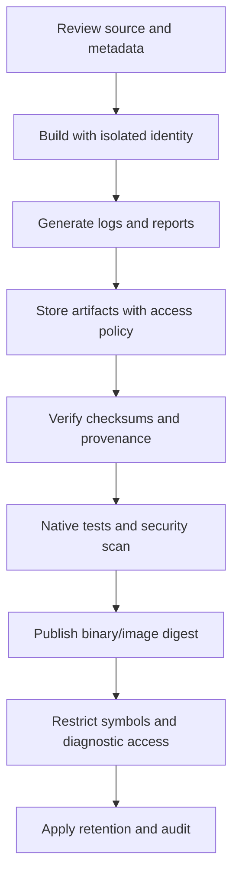

# Bảo vệ metadata, log, profile PGO, debug symbol và dữ liệu chẩn đoán

## 1. Vì sao các artifact hỗ trợ build và debug cần được bảo vệ?

Quy trình Spring Boot Native Image tạo ra nhiều dữ liệu ngoài executable: RuntimeHints và reachability metadata, generated AOT sources, build logs, profile-guided optimization (PGO) profiles, debug symbols, build reports, core dumps, heap dumps và JFR recordings. Những dữ liệu này giúp compiler tối ưu binary và giúp đội vận hành điều tra sự cố, nhưng chúng cũng có thể tiết lộ cấu trúc ứng dụng, đường dẫn source, dependency, cấu hình nội bộ hoặc dữ liệu đang nằm trong bộ nhớ process.

Trong module **SPRING_BOOT_NATIVE_IMAGE**, bảo mật không dừng ở việc scan dependency và tạo binary. Cần kiểm soát ai được tạo, đọc, sửa, tải xuống và giữ các artifact hỗ trợ build/diagnostics. Một profile PGO bị thay thế có thể làm build không còn đáng tin cậy; metadata bị sửa có thể thay đổi phạm vi truy cập được compiler giữ lại; core dump có thể chứa token hoặc payload nhạy cảm.

Bài này xây dựng cách bảo vệ metadata, log, PGO profiles, debug symbols và dữ liệu chẩn đoán trong toàn bộ vòng đời CI/CD và vận hành: phân loại dữ liệu, kiểm soát quyền, tính toàn vẹn, lưu trữ, chia sẻ, retention và ứng phó sự cố.

## 2. Phân loại dữ liệu theo độ nhạy cảm

Không phải mọi artifact có cùng mức độ rủi ro. Hãy phân loại trước khi chọn storage và access policy:

| Dữ liệu | Thông tin có thể lộ | Kiểm soát cần có |
|---|---|---|
| RuntimeHints/reachability metadata | Tên class, member, package và capability được bật | Review thay đổi, quyền ghi hạn chế, version control |
| Generated AOT sources | Cấu trúc bean/configuration và tên nội bộ | Access theo project, tránh chứa secret |
| Build logs | Đường dẫn, dependency, environment, compiler arguments | Redaction, giới hạn đọc và retention |
| PGO profiles | Đặc điểm workload và đường code được thực thi | Integrity, provenance, access hạn chế |
| Debug symbols | Tên function, source paths, symbol mapping | Artifact store riêng, quyền tải có kiểm soát |
| Build reports | Reachability, dependency, compiler diagnostics | Phân loại nội bộ và giới hạn chia sẻ |
| Core dumps/heap dumps | Nội dung memory, token, request payload, key | Dữ liệu nhạy cảm cao, mã hóa và retention ngắn |
| JFR recordings | Thread, class, allocation, event và có thể có dữ liệu ứng dụng | Access hạn chế, sampling và retention |
| SBOM/provenance | Dependency, toolchain, source/build identity | Integrity, chữ ký/attestation nếu hỗ trợ |

Phân loại phải dựa trên nội dung thực tế và policy tổ chức. Không giả định file không chứa secret chỉ vì tên file là `*.json`, `*.iprof` hoặc `*.debug`.

## 3. Metadata là một phần của đầu vào bảo mật

Native Image metadata mô tả những đường truy cập động mà compiler cần giữ hoặc hỗ trợ, ví dụ reflection, resource, proxy, serialization và JNI. Metadata sai hoặc bị sửa có thể làm thay đổi code/resource được đưa vào executable và hành vi runtime.

Bảo vệ metadata bằng các nguyên tắc:

- Chỉ cho developer/automation được phân quyền sửa.
- Review thay đổi cùng source code và dependency update.
- Không nhận metadata tùy ý từ artifact không tin cậy.
- Gắn metadata với commit và toolchain version.
- Kiểm tra diff bất thường như đăng ký reflection quá rộng hoặc include resource nhạy cảm.
- Chạy tests xác nhận hints và behavior sau thay đổi.

Metadata không phải secret store. Không đưa password, token, private key hoặc giá trị cấu hình môi trường vào RuntimeHints hay generated source. Hãy inject secret tại runtime qua secret manager hoặc cơ chế mount/injection của nền tảng.

## 4. Tránh đăng ký metadata quá rộng

Metadata quá rộng có thể làm tăng reachability và giữ lại nhiều thành phần hơn cần thiết. Điều đó có thể ảnh hưởng image size, attack surface và khả năng audit.

Ví dụ cấu hình reflection mở rộng cho toàn bộ package hoặc mọi member có thể khiến nhiều class được giữ lại. Hãy ưu tiên khai báo type/member cụ thể theo feature thật sự sử dụng.

Review metadata cần hỏi:

- Class nào cần reflection và vì sao?
- Constructor/method/field nào thực sự được truy cập?
- Resource pattern có bao phủ file cấu hình nhạy cảm không?
- Proxy interface set có đúng không?
- Metadata đến từ framework/dependency hay do dự án tự khai báo?
- Có test predicate/runtime test xác nhận không?

Không loại bỏ metadata hợp lệ chỉ để giảm binary size. Mục tiêu là quyền truy cập đủ dùng, có lý do và có thể truy vết.

## 5. Bảo vệ build logs

Native build logs có thể chứa:
- Full compiler arguments.
- Dependency coordinates và repository URLs.
- Workspace/source paths.
- Environment variable names/values.
- Diagnostics về class, resource và reachability.
- Đường dẫn artifact, cache và toolchain.
- Thông tin từ exception hoặc test payload.

Không bật debug logging toàn bộ pipeline lâu dài nếu không cần. Với log điều tra, bật theo thời gian giới hạn và kiểm tra nội dung trước khi chia sẻ ra ngoài tổ chức.

Không in toàn bộ environment bằng `env`, `set` hoặc dump system properties trong CI nếu chúng có thể chứa credentials. Khi cần xác nhận cấu hình, chỉ log tên property và trạng thái có/không hoặc giá trị đã được redact.

## 6. Redact secret và dữ liệu cá nhân trong log

Log cần giữ đủ ngữ cảnh nhưng không sao chép dữ liệu nhạy cảm. Tránh ghi:
- Authorization header, bearer token, cookie/session ID.
- Password, API key, private key, database connection secret.
- Full payment card/bank data.
- Request body có dữ liệu cá nhân không cần thiết.
- Secret được truyền qua system property hoặc command-line argument.
- Nội dung file credential hoặc environment dump.

Dùng structured logging với trường allowlist. Nếu cần correlation, dùng request ID/trace ID đã chuẩn hóa thay vì lưu token của người dùng. Với dữ liệu cần đối chiếu, dùng identifier nội bộ đã được policy cho phép.

Redaction nên được thực hiện ở application logging boundary và collector khi phù hợp. Redaction ở collector không thể thu hồi dữ liệu đã được ghi vào log file tạm hoặc artifact CI trước đó.

## 7. Kiểm soát quyền truy cập theo nguyên tắc least privilege

Chia quyền theo vai trò:

| Vai trò | Quyền thường cần |
|---|---|
| Developer | Đọc log build của project, sửa metadata qua review |
| CI build identity | Đọc source/dependency, ghi artifact của run hiện tại |
| Release automation | Đọc artifact đã kiểm chứng, publish image/digest |
| On-call engineer | Đọc runtime logs/metrics và diagnostics theo incident |
| Security team | Đọc SBOM/scan/provenance và dữ liệu cần cho triage |
| Artifact administrator | Quản lý retention/access policy, không mặc định đọc mọi dump |

Dùng RBAC và service identity riêng cho từng pipeline/job. Tránh dùng một credential có quyền ghi mọi artifact và registry cho tất cả pull request, nhánh và môi trường.

Với core/heap dumps, giới hạn người đọc hẹp hơn log thông thường. Quyền truy cập nên được audit và tự hết hạn khi incident kết thúc nếu nền tảng hỗ trợ.

## 8. Bảo vệ CI secrets và build environment

Native build có thể chạy plugin, annotation processor, code generator và script từ dependency. Build job vì vậy có quyền truy cập đáng kể tới source, package registry và artifact store.

Thực hành:
- Chỉ cấp secret cần thiết cho đúng job/step.
- Không expose release credentials cho untrusted pull request.
- Không lưu secret trong Gradle/Maven cache hoặc generated files.
- Dùng short-lived credentials và OIDC/workload identity khi có.
- Tách job build thường với job ký/phát hành.
- Không cho build script từ fork ghi vào protected cache.
- Pin action/plugin/toolchain theo policy.
- Giới hạn network egress và repository sources khi có thể.

Nếu build log bị upload công khai, kiểm tra cả secret masking lẫn URL chứa credential. Secret masking theo chuỗi không bảo đảm mọi encoding hoặc dạng biến đổi đều được che.

## 9. PGO profile chứa thông tin gì?

Profile-Guided Optimization sử dụng dữ liệu profile từ workload đại diện để hỗ trợ compiler tối ưu code. Trong Native Image, quy trình có thể thu profile từ executable instrumented và dùng profile đó ở lần build tối ưu, tùy GraalVM distribution/version.

PGO profile có thể phản ánh:
- Các code path được thực thi thường xuyên.
- Phân bố call/branch và hành vi workload.
- Đặc điểm request mix hoặc feature usage ở mức gián tiếp.
- Thông tin build/runtime gắn với lần thu thập.

Không mặc định profile chỉ là dữ liệu vô hại. Nếu profile gắn với workload nội bộ, endpoint hoặc feature hiếm, nó có thể tiết lộ đặc điểm vận hành. Bảo vệ profile tương tự artifact build nội bộ: access hạn chế, provenance rõ, integrity check và retention.

## 10. Đảm bảo tính toàn vẹn của PGO profile

Profile dùng cho build phải đến từ nguồn tin cậy và workload được kiểm soát. Nếu profile bị thay thế, build có thể tạo ra executable tối ưu theo dữ liệu không đại diện hoặc bị thao túng.

Quy trình đề xuất:
1. Thu profile từ binary được tạo bởi pipeline tin cậy.
2. Ghi commit, binary digest, toolchain version và workload test ID.
3. Lưu profile trong artifact store có quyền ghi hạn chế.
4. Tính checksum và xác minh khi tải về.
5. Review nguồn workload và điều kiện thu thập.
6. Không dùng profile từ pull request không tin cậy cho release build.
7. Giữ profile gắn với đúng target architecture/toolchain theo yêu cầu.
8. Build lại và benchmark sau khi profile thay đổi.

Không trộn profile từ các phiên bản ứng dụng không tương thích hoặc workload khác biệt mà không đánh giá. Profile cũ có thể không đại diện cho traffic hiện tại.

## 11. Không để PGO workload thu thập dữ liệu production nhạy cảm

PGO thường cần workload đại diện, nhưng không nhất thiết phải dùng dữ liệu production thật. Ưu tiên:
- Synthetic workload dựa trên traffic distribution.
- Sanitized fixtures.
- Test account và sandbox integration.
- Payload đã loại bỏ thông tin cá nhân/secret.
- Dataset có version và quyền sử dụng rõ.

Nếu cần thu profile từ production-like environment, thực hiện theo policy dữ liệu, hạn chế thời gian, không ghi payload hoặc credential và đánh giá việc chuyển profile ra khỏi môi trường đó.

PGO profile không thay thế log/tracing và không nên được tạo bằng cách sao chép dữ liệu request thực vào artifact build.

## 12. Debug symbols và source path

Debug symbols giúp ánh xạ địa chỉ native về symbol/source location khi debugger và toolchain hỗ trợ. Chúng có thể tiết lộ:
- Tên class/function/package.
- Source file paths và workspace layout.
- Tên module nội bộ.
- Cấu trúc dependency.
- Một phần thông tin build.

Có thể giữ symbol archive riêng và phân phối runtime binary đã strip nếu platform/toolchain hỗ trợ. Điều quan trọng là symbol phải tương ứng chính xác với binary đang chạy.

Không xóa symbols trước khi lưu artifact bảo mật nếu tổ chức cần crash analysis. Cũng không publish symbols rộng rãi nếu không có lý do. Dùng access-controlled artifact store, retention và audit.

## 13. Ghép đúng debug symbols với binary

Khi incident xảy ra, symbol từ một lần build khác có thể tạo stack mapping sai hoặc gây kết luận nhầm. Gắn symbol với:
- SHA-256 hoặc digest của executable.
- Git commit.
- Build ID của binary nếu có.
- GraalVM distribution/version.
- Compiler arguments.
- Target OS/architecture.
- Linker/build environment identity.

Trong release manifest, lưu vị trí symbol artifact và binary digest. Khi tải symbol để điều tra, xác minh digest/build ID trước khi mở core dump.

Không đặt file symbol chung tên `orders-service.debug` rồi ghi đè mỗi lần build. Dùng immutable build ID/version để giữ quan hệ một-một với executable.

## 14. Core dump và heap dump là dữ liệu nhạy cảm cao

Core dump thường ghi trạng thái memory của process tại thời điểm crash. Heap dump chứa object graph và có thể bao gồm request payload, token, thông tin người dùng, cache hoặc credential. Ngay cả khi application đã redact log, dữ liệu thô vẫn có thể xuất hiện trong dump.

Trước khi bật:
- Xác định mục tiêu điều tra cụ thể.
- Kiểm tra dung lượng và quota.
- Hạn chế số process/replica tạo dump.
- Chọn storage mã hóa và access-controlled.
- Xác định người được phép tải/xem.
- Đặt retention ngắn và deletion procedure.
- Không gửi dump qua ticket/email/chat thông thường.
- Kiểm tra policy pháp lý/dữ liệu áp dụng.

Không bật core dump vô hạn cho mọi production pod. Một crash loop có thể tạo nhiều dump lớn, làm đầy disk hoặc tạo thêm sự cố.

## 15. JFR recording và build report

JFR recording và Native Image build report có thể chứa thông tin về thread, class, allocation, dependency, source paths và hoạt động nội bộ. Khả năng JFR/heap dump/JMX trong Native Image phụ thuộc GraalVM distribution/version và build options.

Bảo vệ theo cách tương tự diagnostics:
- Bật capability cần thiết và có mục đích.
- Giới hạn thời gian recording và dung lượng.
- Lưu trong storage nội bộ.
- Kiểm tra trước khi đính kèm vào ticket bên ngoài.
- Xóa theo retention.
- Gắn recording/report với binary digest và environment.

Không giả định JFR của native executable có cùng event set/semantics với HotSpot. Trước khi sử dụng trong incident runbook, xác minh toolchain và diễn tập tạo/đọc recording.

## 16. Mã hóa khi lưu và truyền

Artifact nhạy cảm cần được bảo vệ cả khi truyền và khi lưu:
- Dùng TLS tới artifact store/registry.
- Bật encryption at rest theo khả năng của storage.
- Quản lý encryption keys qua KMS/secret manager.
- Giới hạn download link theo thời gian.
- Tránh public bucket hoặc anonymous artifact access.
- Không ghi URL ký tạm thời vào log.
- Xác minh checksum sau download.
- Audit thao tác đọc/xóa.

Mã hóa storage không thay thế RBAC. Một người có quyền tải dump vẫn có thể giải mã thông qua service; cần kiểm soát cả authorization lẫn key policy.

## 17. Retention và xóa an toàn

Mỗi loại artifact nên có thời hạn lưu phù hợp:
- Build logs: theo thời hạn CI/audit.
- Metadata/generated sources: theo vòng đời source/release.
- PGO profiles: giữ phiên bản đang dùng và lịch sử cần cho reproducibility.
- Debug symbols: theo chính sách support của release.
- Build reports: theo nhu cầu audit/diagnostics.
- Core/heap dumps/JFR: retention ngắn, theo incident.
- SBOM/provenance: theo yêu cầu compliance và vòng đời artifact.

Không dùng một retention policy duy nhất cho tất cả. Dump chứa memory thường cần retention ngắn hơn provenance. Khi incident kết thúc, xác định bản sao trong cache, local download và ticket attachment để xóa theo quy trình.

## 18. Chia sẻ dữ liệu chẩn đoán với vendor hoặc bên thứ ba

Trước khi gửi log, core dump, heap dump, JFR hoặc debug symbols cho vendor:
1. Xác nhận hợp đồng và kênh hỗ trợ được phê duyệt.
2. Xác định dữ liệu có thể chứa secret/PII.
3. Redact hoặc tạo sample tối thiểu khi có thể.
4. Có approval theo policy.
5. Dùng upload portal bảo mật, không gửi attachment qua kênh không mã hóa.
6. Ghi nhận file, checksum, người nhận và thời điểm.
7. Xác định thời hạn lưu/xóa ở phía nhận nếu thỏa thuận cho phép.

Không chia sẻ toàn bộ dump chỉ vì vendor yêu cầu “reproduction data”. Hỏi chính xác vùng dữ liệu cần thiết và xem có thể tái hiện bằng synthetic input hoặc reduced dump hay không.

## 19. Kiểm soát metadata và diagnostics trong CI/CD

Một pipeline có thể thêm các gate sau:

Kiểm tra tự động có thể bao gồm:
- Không có secret pattern trong log/artifact được publish.
- Metadata changes có code review.
- PGO profile có checksum và nguồn tin cậy.
- Debug symbols không được upload vào public registry ngoài policy.
- Dump chỉ được tạo ở môi trường/incident được phép.
- Artifact được gắn build ID và digest.
- Storage access và retention policy được áp dụng.

Không coi secret scanner là bảo đảm tuyệt đối; vẫn cần thiết kế log allowlist và không xuất environment dump.

## 20. Incident runbook khi cần thu thập diagnostics

Khi native process crash hoặc memory tăng:
1. Ghi service version, image digest, pod/container ID và thời điểm.
2. Thu log/metric/trace theo correlation ID.
3. Thu exit code, signal, OOM event và cgroup metrics.
4. Xác định có cần core/heap dump hay không.
5. Nếu cần, bật/thu dump theo incident approval và storage policy.
6. Lấy debug symbols đúng binary digest.
7. Xác minh checksum và quyền truy cập.
8. Phân tích trong môi trường bảo mật.
9. Redact trước khi chia sẻ kết quả.
10. Xóa dump tạm và bản sao không cần sau incident theo retention.

Không restart/redeploy hoặc xóa pod trước khi thu evidence cần thiết, trừ khi hành động đó cần thiết để khôi phục dịch vụ. Việc thu dump có thể gây pause/overhead và phải cân nhắc với availability.

## 21. Bài thực hành: bảo vệ artifact chẩn đoán của Order API

**Bối cảnh:** Order API native dùng PGO, giữ debug symbols cho release và có thể tạo core dump khi crash trên staging.

**Bước 1 — Lập inventory.** Liệt kê RuntimeHints, generated AOT output, build logs, PGO profiles, symbols, build reports và dumps.

**Bước 2 — Phân loại dữ liệu.** Gán mức nhạy cảm, owner, mục đích, nơi lưu và retention cho từng loại.

**Bước 3 — Tách quyền CI.** Dùng identity riêng cho build, artifact upload, release signing và incident diagnostics.

**Bước 4 — Bảo vệ PGO.** Thu profile từ workload đã sanitize, ghi binary digest/toolchain/workload ID và kiểm tra checksum khi sử dụng.

**Bước 5 — Bảo vệ symbols.** Lưu symbol archive theo build ID trong store riêng, không đưa lên public registry.

**Bước 6 — Bảo vệ logs.** Dùng structured logging, redact secret và không dump toàn bộ environment/system properties.

**Bước 7 — Diễn tập dump.** Trên staging, tạo core/heap dump nếu toolchain/platform hỗ trợ; kiểm tra access, encryption và deletion.

**Bước 8 — Audit và retention.** Xác minh ai có thể tải artifact, log thao tác và thử quy trình xóa hết bản sao theo policy.

Tiêu chí hoàn thành: mọi artifact có owner và classification; PGO/symbols có integrity và provenance; logs không chứa secret; dump/JFR được kiểm soát; quyền đọc/ghi và retention được kiểm thử.

## 22. Kết luận

Metadata, PGO profiles, debug symbols, build logs và diagnostic dumps giúp tạo cũng như vận hành native executable, nhưng có thể tiết lộ cấu trúc nội bộ hoặc dữ liệu trong memory. Bảo vệ chúng bằng phân loại rõ, least privilege, checksum/provenance, mã hóa, audit và retention riêng cho từng loại.

Không đưa secret vào metadata/generated source hoặc log; chỉ dùng PGO profile từ workload tin cậy đã được kiểm soát; ghép debug symbols với đúng binary digest; xem core/heap dump là dữ liệu nhạy cảm cao. Chuẩn bị incident workflow trước khi có sự cố để thu đủ evidence, phân tích trong môi trường an toàn và xóa dữ liệu tạm sau khi hoàn tất.
