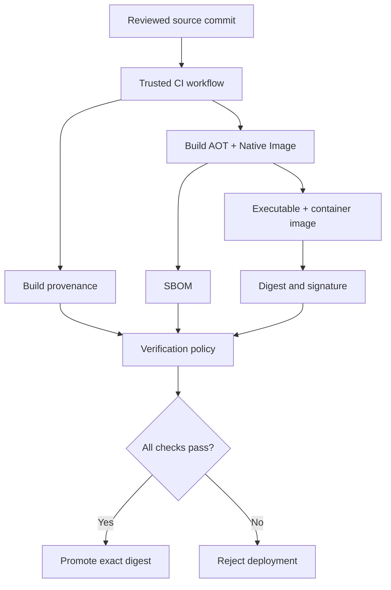

# Xác thực nguồn sản phẩm và kiểm tra tính toàn vẹn trước khi triển khai

## 1. Mục tiêu xác minh trước khi deploy

Spring Boot Native Image tạo executable native, thường được đóng gói trong container image. Artifact đi qua nhiều bước: checkout source, resolve dependencies, chạy Spring AOT, compile native, đóng gói, scan, publish và promote giữa các môi trường. Nếu không xác minh nguồn gốc và tính toàn vẹn, hệ thống có thể triển khai nhầm binary, image bị thay đổi hoặc artifact được tạo từ source revision khác với revision đã review.

**Tính toàn vẹn** trả lời: nội dung artifact có đúng với nội dung đã được ghi nhận không? **Nguồn gốc (provenance)** trả lời: artifact được tạo từ source nào, bởi workflow nào, dùng toolchain và dependency nào? **Chữ ký số** giúp xác minh nội dung được ký bởi identity được tin cậy.

Trong module **SPRING_BOOT_NATIVE_IMAGE**, cần xác minh cả native executable lẫn container image. Checksum đơn lẻ có thể phát hiện thay đổi byte khi so với checksum đáng tin, nhưng checksum được tải cùng artifact từ cùng nguồn không chứng minh ai đã tạo artifact. Cần kết hợp digest, chữ ký, provenance, SBOM và policy triển khai.



## 2. Checksum, digest, signature, provenance và SBOM

| Khái niệm | Mục đích | Điều nó chứng minh |
|---|---|---|
| Checksum/hash | So sánh nội dung theo thuật toán hash | Nội dung khớp digest được tham chiếu |
| Artifact digest | Định danh chính xác file hoặc image content | Deployment dùng đúng nội dung đã ghi nhận |
| Digital signature | Xác minh chữ ký bằng key/identity tin cậy | Nội dung được ký bởi identity tương ứng và không đổi sau khi ký |
| Provenance attestation | Ghi lại quy trình tạo artifact | Artifact gắn với source, builder/workflow và tham số khai báo |
| SBOM | Liệt kê component và dependency | Có inventory phục vụ vulnerability/license review |
| Deployment policy | Quy tắc chấp nhận hoặc từ chối | Artifact đáp ứng điều kiện trước khi triển khai |

SHA-256 hash không phải chữ ký. Nếu kẻ tấn công thay cả artifact lẫn file checksum cùng nơi lưu, phép so sánh vẫn có thể pass. Expected digest cần đến từ metadata được bảo vệ hoặc được xác minh bằng chữ ký/attestation.

Chữ ký cũng không chứng minh code an toàn. Nó xác nhận identity ký và tính toàn vẹn của nội dung được ký. Source review, dependency review, test và security policy vẫn cần thiết.

## 3. Xác định trust boundary

Liệt kê nơi artifact đi qua và nơi có thể bị thay đổi:

- Source repository, branch và release tag.
- CI runner, workflow definition và reusable actions.
- Dependency repositories/proxies.
- GraalVM builder và container builder.
- Artifact registry/container registry.
- Promotion process giữa dev, staging và production.
- Deployment controller/admission policy.
- Secret store và signing identity.

Xác định ai được phép build, ký, publish và deploy. Identity có quyền ghi registry và ký release là nhạy cảm; giới hạn quyền theo repository, branch, environment và thời gian.

Không để pull request từ fork có quyền sử dụng signing key production. Với untrusted code, dùng runner cô lập và credentials read-only hoặc không cấp credential.

## 4. Gắn source revision với build identity

Mỗi artifact cần gắn với source revision bất biến, thường là commit SHA, cùng thông tin build:

- Repository identity và commit SHA.
- Branch/tag được bảo vệ.
- CI workflow identity và run ID/attempt.
- Build timestamp.
- JDK/GraalVM/Native Image version.
- Gradle/Maven Wrapper và plugin versions.
- Resolved dependency graph/lockfiles.
- Builder image digest và target OS/architecture/libc.
- Build arguments không nhạy cảm.
- Test results và scan results.

Không chỉ ghi version ứng dụng như 1.2.0. Hai lần build cùng version string có thể đến từ commit hoặc dependency graph khác nhau.

Không đưa password, access token, private key, signing secret hoặc secret environment variables vào provenance.

## 5. Tính checksum cho executable

Sau khi native executable được tạo, tính SHA-256 và lưu cùng build metadata.

Linux:

```bash
sha256sum build/native/nativeCompile/api-app
```

macOS:

```bash
shasum -a 256 build/native/nativeCompile/api-app
```

PowerShell:

```powershell
Get-FileHash .\build\native\nativeCompile\api-app -Algorithm SHA256
```

Đường dẫn phụ thuộc build plugin/task và OS. Tính hash trên file cuối cùng sau các thao tác strip/package thuộc release. Khi artifact được nén, phân biệt hash của archive với hash executable sau giải nén.

Khi tải artifact về môi trường deploy, tính lại digest và so với metadata đã xác minh. Nếu binary bị chỉnh sửa sau khi tính hash, giá trị cũ không còn đại diện cho binary mới.

## 6. Xác minh checksum từ nguồn đáng tin

Quy trình cơ bản:

1. CI tạo artifact và tính digest.
2. Digest được ghi vào build manifest/provenance hoặc release metadata được bảo vệ.
3. Artifact được publish tới registry/repository.
4. Deployment process tải đúng artifact.
5. Deployment process tính digest lại.
6. So sánh với digest lấy từ metadata đáng tin.
7. Reject nếu khác hoặc metadata không thể xác minh.

Không tải artifact và checksum qua cùng một kênh không được bảo vệ rồi xem phép so sánh là đủ. Dùng TLS, quyền registry phù hợp và chữ ký/attestation để bảo vệ metadata nguồn.

## 7. Dùng OCI image digest thay cho tag mutable

Tag như latest, stable hoặc 1.2 có thể được cập nhật để trỏ tới image content khác. Digest SHA-256 định danh manifest/config/layers của image theo OCI distribution model.

Ví dụ reference:

```text
registry.example.com/platform/native-api@sha256:IMAGE_DIGEST
```

Trong production manifest, tham chiếu digest đã được kiểm tra. Tag vẫn hữu ích cho con người và promotion process, nhưng deployment cần gắn với digest cụ thể.

Với multi-platform image, manifest list/index digest có thể trỏ tới manifest theo architecture. Ghi rõ digest được xác minh là index hay platform-specific manifest; kiểm tra platform cluster chọn.

## 8. Ký container image và xác minh chữ ký

Chữ ký image giúp xác minh image được ký bởi identity tin cậy. Có thể dùng công cụ ký OCI như Cosign hoặc cơ chế ký của registry/cloud platform được tổ chức phê duyệt.

Ví dụ minh họa với Cosign key-based:

```bash
cosign sign --key cosign.key registry.example.com/platform/native-api@sha256:IMAGE_DIGEST
cosign verify --key cosign.pub registry.example.com/platform/native-api@sha256:IMAGE_DIGEST
```

Cú pháp phụ thuộc phiên bản Cosign và mô hình key management. Không lưu private key trong repository hoặc image. Ưu tiên key trong KMS/HSM hoặc keyless signing với OIDC identity được policy giới hạn.

Khi verify, kiểm tra identity/certificate issuer và subject theo policy. Chữ ký hợp lệ chưa đủ nếu bất kỳ identity nào cũng được phép ký.

## 9. Keyless signing và identity của CI

Keyless signing có thể dùng identity ngắn hạn do OIDC provider cấp thay vì lưu private key dài hạn trong CI. Verifier kiểm tra certificate/identity và transparency log theo hệ sinh thái công cụ.

Policy cần ràng buộc:

- OIDC issuer được tin cậy.
- Repository/workflow identity cụ thể.
- Branch/tag/environment được phép ký.
- Build workflow đã được review và bảo vệ.
- Certificate/attestation đáp ứng trust model của verifier.

Không chấp nhận mọi certificate do một issuer rộng cấp. Identity cần gắn với repository và workflow phát hành chính thức.

## 10. Provenance attestation

Provenance là bản ghi có cấu trúc về cách artifact được tạo. Một attestation có thể chứa:

- Subject artifact và digest.
- Source repository và commit.
- Builder identity/workflow.
- Build invocation parameters.
- Dependencies/materials.
- Thời gian và môi trường build.
- Predicate theo chuẩn công cụ hỗ trợ.

Provenance có thể được ký để verifier xác nhận nội dung attestation đến từ builder identity đáng tin. Định dạng phụ thuộc công cụ/chuẩn, ví dụ in-toto attestation hoặc SLSA provenance.

Provenance không tự chứng minh pipeline không bị compromise. Nó cung cấp bằng chứng về process đã khai báo; trust phụ thuộc builder identity, isolation, workflow permissions và policy.

## 11. SBOM cho executable và container image

SBOM (Software Bill of Materials) mô tả các component có trong sản phẩm, thường gồm package name/version, supplier, relationship và identifiers. Với Spring Boot Native Image, inventory nên phản ánh:

- Application dependencies được resolve lúc build.
- Spring Boot/Spring Framework và thư viện Java.
- GraalVM/build toolchain trong phạm vi SBOM build.
- Native libraries và OS packages trong final image.
- Base image và package components.
- License/vulnerability identifiers nếu công cụ hỗ trợ.

SBOM của JAR/dependency graph không nhất thiết mô tả đầy đủ OS packages hoặc native shared libraries trong container. Có thể cần SBOM cho application/build artifact và final image, liên kết bằng digest.

SBOM không phải chứng nhận an toàn. Nó là inventory đầu vào cho vulnerability/license policy và incident response.

## 12. Quét vulnerability trước khi promote

Scan các lớp liên quan:

- Application dependencies.
- Builder image và build tools.
- Final runtime image/OS packages.
- Native shared libraries.
- Base image và package updates.

Định nghĩa policy rõ: severity threshold, exploitability, reachability, exception owner, expiry date và cách xử lý false positive. Không chỉ dựa vào một con số severity mà bỏ qua package thực sự có trong final image hoặc khả năng khai thác.

Nếu có exception, ghi lý do, phạm vi artifact, người phê duyệt và thời hạn. Exception không nên trở thành trạng thái vĩnh viễn.

## 13. Build một lần, promote cùng digest

Một nguyên tắc quan trọng là build artifact một lần từ source revision đã được review, sau đó promote cùng digest qua dev, staging và production.

Không rebuild riêng ở production chỉ để thay URL hoặc secret. Những giá trị runtime nên được cấp bằng environment/config/secret management. Nếu rebuild, đó là artifact mới và cần scan, sign, attest, test lại.

Quy trình promotion:

1. CI build executable và image.
2. Chạy JVM/native/container tests.
3. Tạo SBOM, provenance và signature.
4. Xác minh chữ ký, attestation và policy.
5. Deploy digest vào staging.
6. Chạy smoke/integration/acceptance tests.
7. Promote đúng digest đã xác minh sang production.
8. Ghi deployment record gồm digest, environment và release identity.

## 14. Ví dụ GitHub Actions ở mức khái quát

Pipeline có thể chia thành các job:

```yaml
name: native-image-release

on:
  push:
    tags:
      - "v*"

permissions:
  contents: read
  packages: write
  id-token: write
  attestations: write

jobs:
  build:
    runs-on: ubuntu-latest
    steps:
      - uses: actions/checkout@v4
      - uses: actions/setup-java@v4
        with:
          distribution: graalvm
          java-version: "21"
      - name: Build native executable
        run: ./gradlew clean test nativeCompile
      - name: Build and push image
        run: ./gradlew bootBuildImage
      - name: Generate release evidence
        run: ./scripts/create-release-evidence.sh
      - name: Sign image
        run: ./scripts/sign-image.sh
```

Đây là skeleton minh họa, không phải workflow production hoàn chỉnh. Pin action theo full commit SHA theo chính sách supply-chain; pin JDK/GraalVM, builder image và plugin. Cấu hình builder/run image cụ thể. Các script tạo SBOM/provenance/signature phải được định nghĩa, kiểm tra output và gắn đúng digest.

Không cấp id-token, packages write hoặc attestations write cho job không cần. Tách job chạy untrusted pull request khỏi job ký/publish release. Job ký chỉ chạy trên protected ref và environment được phê duyệt.

## 15. Policy xác minh trước deployment

Một policy triển khai có thể yêu cầu:

- Image reference phải là digest, không phải tag mutable.
- Signature hợp lệ và signer identity thuộc allowlist.
- Provenance subject digest khớp image digest.
- Source repository/commit thuộc repository chính thức và protected ref.
- Builder/workflow identity được chấp thuận.
- SBOM tồn tại và được tạo từ đúng image digest.
- Vulnerability scan đạt threshold hoặc có exception hợp lệ.
- Tests bắt buộc đã pass trên cùng artifact/image digest.
- Artifact target OS/architecture phù hợp cluster.

Policy nên được thực thi trong deployment pipeline hoặc admission controller. Nếu verification service không truy cập được metadata, production nên fail-closed trừ khi có quy trình break-glass được phê duyệt và audit.

## 16. Bảo vệ signing key và quyền CI

Private signing key là credential có giá trị cao. Áp dụng:

- Không commit key vào Git.
- Không bake key vào Docker image hoặc build artifact.
- Dùng KMS/HSM hoặc OIDC keyless signing nếu phù hợp.
- Giới hạn workflow/ref/environment được phép ký.
- Dùng credential ngắn hạn và quyền tối thiểu.
- Audit signing events và key access.
- Có quy trình rotate/revoke key.
- Bảo vệ release workflow khỏi thay đổi trái phép.

Không để job chạy code từ pull request fork truy cập secrets production. Với self-hosted runner, dọn workspace/cache và cô lập job giữa các trust level.

## 17. Xác minh executable bên trong image

Nếu phát hành cả executable và OCI image, ghi digest của executable và image trong release manifest. Image digest không thay thế hash file executable; hai giá trị định danh hai nội dung khác nhau.

Khi điều tra:

1. Trích executable từ image đã phát hành trong môi trường tin cậy.
2. Tính SHA-256 của executable.
3. So với hash trong release manifest đã xác minh.
4. Xác minh image signature/provenance.
5. Kiểm tra binary target và shared library requirements.
6. Lưu kết quả cùng deployment record.

Nếu Dockerfile có thao tác strip, copy, chmod hoặc chỉnh sửa binary sau bước build, tính hash executable sau thao tác cuối cùng trước khi tạo image.

## 18. Xử lý khi verification thất bại

Không bỏ qua lỗi signature/digest để “deploy tạm”. Phân loại:

| Lỗi | Hành động |
|---|---|
| Digest mismatch | Reject artifact, tải lại từ registry tin cậy và điều tra mutation |
| Signature invalid | Reject; kiểm tra signer, key rotation và artifact reference |
| Signer identity không được phép | Reject; xác minh workflow/ref và policy |
| Provenance thiếu hoặc subject không khớp | Reject; kiểm tra attestation gắn đúng digest |
| SBOM thiếu | Chặn promotion theo policy và tạo inventory đúng artifact |
| Vulnerability policy fail | Sửa dependency/base image hoặc xin exception có thời hạn |
| Artifact architecture sai | Build/publish đúng target platform |
| Metadata registry unavailable | Retry có giới hạn; production fail-closed hoặc dùng break-glass có audit |

Không sửa metadata để làm cho artifact cũ có vẻ hợp lệ. Tạo build mới từ source đã xác định, ký/attest lại và chạy verification.

## 19. Checklist trước khi triển khai

- Source commit và release tag được bảo vệ.
- CI workflow dùng quyền tối thiểu và runner phù hợp trust boundary.
- JDK/GraalVM/plugin/dependency/builder versions được ghi nhận.
- Executable SHA-256 và OCI image digest được lưu.
- Artifact đến từ registry/repository tin cậy.
- Signature hợp lệ và signer identity đúng policy.
- Provenance subject khớp chính xác artifact digest.
- Source revision và builder/workflow identity được xác minh.
- SBOM gắn với đúng executable/image.
- Vulnerability scan có kết quả và exception được audit.
- Tests pass trên artifact/image sẽ triển khai.
- Deployment dùng digest thay cho tag mutable.
- Signing key không nằm trong repository, image hoặc logs.
- Promotion staging/production dùng cùng digest đã xác minh.
- Deployment record lưu digest, environment và release identity.

## 20. Câu hỏi tự kiểm tra

1. Checksum khác chữ ký số như thế nào?
2. Vì sao checksum và artifact tải từ cùng một nguồn không đủ chứng minh nguồn phát hành?
3. OCI image digest định danh điều gì và vì sao nên deploy bằng digest?
4. Signature verification cần kiểm tra identity nào ngoài việc chữ ký hợp lệ?
5. Provenance attestation cho biết những thông tin gì?
6. SBOM của application dependencies khác SBOM của final container image thế nào?
7. Vì sao nên build một lần rồi promote cùng digest qua các môi trường?
8. Làm thế nào bảo vệ signing key và tách untrusted pull request khỏi release signing?
9. Khi provenance subject không khớp image digest, pipeline cần xử lý ra sao?
10. Những bằng chứng nào cần lưu trong deployment record?

**Ghi nhớ:** trước khi triển khai native executable/container, xác minh digest, chữ ký và signer identity, provenance gắn với đúng source/build, SBOM và vulnerability policy. Build một lần, promote đúng image digest đã được kiểm tra, đồng thời bảo vệ signing identity và lưu bằng chứng cho audit/rollback.
