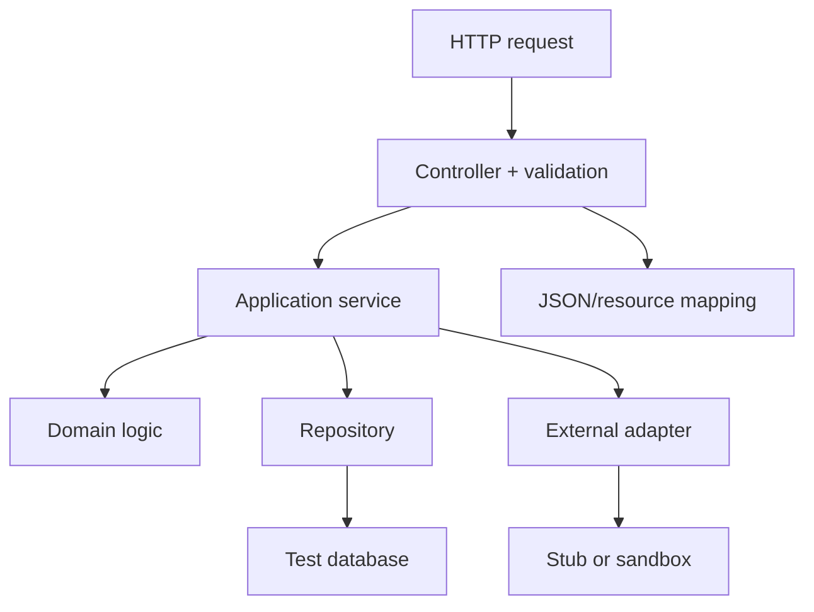

# Chọn lát cắt nhỏ để chạy AOT và native trước khi mở rộng toàn ứng dụng

## 1. Vì sao nên bắt đầu từ một lát cắt nhỏ?

Chuyển một ứng dụng Spring Boot lớn sang GraalVM Native Image cùng lúc có thể tạo ra nhiều loại lỗi khó phân tách: cấu hình Spring AOT, reflection, resource, proxy, serialization, JNI, thư viện hệ thống và đóng gói container. Nếu toàn bộ ứng dụng thay đổi trong một lần, nhóm khó xác định dependency hoặc module nào gây lỗi, đồng thời chi phí sửa và rollback tăng lên.

Một lát cắt nhỏ (vertical slice) cho phép kiểm chứng toàn bộ đường đi có ý nghĩa từ cấu hình Spring đến endpoint hoặc job: bean registration, request binding, service logic, persistence/client, resource và native executable. Khi lát cắt đó chạy ổn định, nhóm có bằng chứng về toolchain, cách khai báo hints, kiểm thử và vận hành trước khi áp dụng cho phạm vi rộng hơn.

Trong module **SPRING_BOOT_NATIVE_IMAGE**, cách tiếp cận này giúp chuyển đổi theo từng phần có thể đo, kiểm thử và rollback. Bài học trình bày tiêu chí chọn slice, cách xác định ranh giới phụ thuộc, các stage AOT/native, quality gates, rollout và điều kiện mở rộng.

## 2. Vertical slice khác với việc chỉ chọn một package

Một lát cắt dọc đi qua các tầng cần thiết để hoàn thành một capability nghiệp vụ. Ví dụ “xem chi tiết đơn hàng” có thể bao gồm:

- HTTP controller và request/response DTO.
- Validation và JSON serialization.
- Service/use case.
- Repository hoặc HTTP client.
- Domain model và converter.
- Cấu hình Spring, security và transaction.
- Resource hoặc message bundle nếu endpoint sử dụng.
- Logging, metrics và error mapping.

Chỉ chọn package controller để build native có thể không chạm đến persistence, serializer hoặc dependency động. Ngược lại, một slice nhỏ nhưng hoàn chỉnh giúp xác minh nhiều rủi ro runtime trong một phạm vi dễ hiểu.

Không cần đưa toàn bộ nghiệp vụ vào slice đầu tiên. Chọn một luồng có giá trị nhưng đủ độc lập để chạy trong môi trường test.

## 3. Tiêu chí chọn slice đầu tiên

Slice đầu tiên nên có phạm vi vừa phải và có thể đo kết quả. Đánh giá:

| Tiêu chí | Dấu hiệu phù hợp |
|---|---|
| Giá trị nghiệp vụ | Luồng thật, có thể xác nhận bằng contract |
| Ranh giới rõ | Có input/output và dependency xác định |
| Dependency manageable | Ít plugin động, ít thư viện native đặc thù |
| Testability | Có fixture và integration environment tái lập |
| AOT complexity | Context/profile/condition không quá nhiều biến thể |
| Native risk | Có thể bao phủ reflection/resource/proxy cần thiết |
| Rollback | Có thể giữ đường JVM hoạt động độc lập |
| Ownership | Có nhóm chịu trách nhiệm sửa và vận hành |

Không nhất thiết chọn slice đơn giản nhất đến mức không đại diện cho ứng dụng. Nếu slice đầu không có database, serializer hoặc proxy mà ứng dụng production dùng rộng rãi, kết quả pass có thể tạo cảm giác an toàn giả.

## 4. Tránh chọn slice đầu tiên có quá nhiều rủi ro đồng thời

Một luồng vừa dùng JNI, plugin loading, dynamic scripting, nhiều database, nhiều profile và classpath scanning tùy biến sẽ khó làm pilot. Nếu thất bại, nhóm không biết nên sửa toolchain, dependency hay kiến trúc trước.

Hãy lập inventory capability và chọn slice có một số rủi ro đại diện nhưng có thể cô lập. Ví dụ:
- Một controller JSON với validation.
- Một service và repository.
- Một transaction boundary.
- Một resource/template nếu cần.
- Một proxy/AOP path đang dùng trong production.

Các capability khó hơn như plugin runtime hoặc JNI có thể được kiểm tra trong spike riêng. Không loại chúng khỏi migration plan; chỉ tránh để tất cả cùng trở thành biến số của slice đầu tiên.

## 5. Lập dependency map trước khi tách slice

Vẽ các thành phần mà slice gọi tới:



Ghi dependency theo ba nhóm:

- **Nằm trong slice:** code được compile và đóng gói cùng application.
- **External dependency:** database, broker, HTTP service cần môi trường runtime.
- **Shared dependency:** security, logging, configuration, common model hoặc library dùng chung.

Nếu slice phụ thuộc shared module có nhiều dynamic behavior, phải kiểm tra module đó cũng tương thích native. Không thể coi một package là độc lập chỉ vì source code nằm trong thư mục riêng.

## 6. Chọn ranh giới context Spring phù hợp

Spring AOT phân tích ApplicationContext theo cấu hình thực tế. Nếu toàn ứng dụng có nhiều profile và condition, slice cần một context đủ đại diện cho deployment mode dự kiến.

Xem xét:
- Component scan có phạm vi nào?
- Auto-configuration nào được bật?
- Bean nào được tạo theo `@ConditionalOnProperty`?
- Profile nào được kích hoạt?
- Security/filter/interceptor nào áp dụng?
- Repository và client nào được khởi tạo?
- Test configuration có thay đổi bean graph không?

Có thể tạo một Spring Boot test slice hoặc application configuration gọn cho pilot, nhưng cần hiểu nó đang loại bỏ những thành phần nào. Nếu production context khác hoàn toàn, native success của test slice không chứng minh production application context tương thích.

## 7. Phân biệt test slice với migration slice

Các annotation như `@WebMvcTest`, `@DataJpaTest` tạo test context tập trung vào một tầng. Chúng hữu ích cho test nhanh, nhưng không nhất thiết đại diện cho một vertical slice hoàn chỉnh.

Migration slice là phạm vi capability được chọn để đưa qua AOT/native. Nó có thể dùng nhiều test slice để kiểm tra từng tầng, nhưng cần ít nhất một integration scenario chạy qua cấu hình gần production.

Ví dụ:
- `@WebMvcTest` xác minh binding/controller.
- `@DataJpaTest` xác minh repository/entity mapping.
- `@SpringBootTest` xác minh application context và luồng tích hợp.
- Native executable/container test xác minh artifact thực tế.

Không đánh đồng một `@WebMvcTest` pass với toàn bộ endpoint đã sẵn sàng chạy native.

## 8. Đặt contract và tiêu chí pass trước khi bắt đầu

Trước khi chạy AOT, ghi rõ slice phải làm được gì. Ví dụ với “xem chi tiết đơn hàng”:

- Nhận request hợp lệ và trả đúng schema.
- Request không hợp lệ trả lỗi validation theo contract.
- Repository truy vấn đúng dữ liệu.
- Security áp dụng đúng authorization.
- JSON serializer xử lý các DTO/subtype cần thiết.
- Resource được đọc nếu luồng có dùng.
- Native executable khởi động và readiness pass.
- Container chạy non-root với cấu hình production-like.

Tiêu chí nên có kết quả quan sát được, không dùng câu “không có lỗi”. Ghi test class, fixture, expected status/response, dependency và metric cần thu.

## 9. Xác định baseline JVM trước khi chuyển

JVM baseline giúp phân biệt lỗi migration với lỗi đã tồn tại. Chạy test hiện tại trên cùng commit:

- Unit tests của domain/service.
- Controller/contract tests.
- Repository/integration tests.
- Security tests.
- End-to-end scenario của slice.
- Startup/readiness và resource usage nếu có.

Lưu test reports và fixture. Nếu JVM baseline fail, sửa hoặc ghi nhận trước khi chuyển. Không dùng native build như cách vô tình thay đổi logic và khó xác định lỗi gốc.

Baseline cũng giúp so sánh hành vi JVM/native sau này: response, exception mapping, transaction, serialization và performance phải giữ đúng contract.

## 10. Chạy Application AOT cho slice

Khi context và structural properties đã xác định, chạy Spring AOT bằng lifecycle được Spring Boot/Native Build Tools version của dự án hỗ trợ. Tùy plugin, AOT có thể được gọi tự động bởi native task hoặc cần task/goal riêng.

Kiểm tra:
- Đúng application main class.
- Đúng profile và structural properties.
- Đúng classpath/dependency graph.
- Generated source/resource được tạo.
- AOT warnings/errors được xử lý.
- Không vô tình dùng test-only bean trong production context.
- Task graph chứng minh AOT đã chạy.

Không sửa generated files bằng tay. Nếu AOT output sai, sửa source/configuration/hints rồi chạy lại.

## 11. Bổ sung RuntimeHints theo bằng chứng

Khi native analysis phát hiện reflection/resource/proxy/serialization/JNI thiếu metadata, xác định đúng đường truy cập và bổ sung hints cần thiết.

Ví dụ registrar:

```java
final class OrderSliceHints implements RuntimeHintsRegistrar {

    @Override
    public void registerHints(
            RuntimeHints hints,
            ClassLoader classLoader) {
        hints.resources().registerPattern("templates/order/*.html");
    }
}
```

Ví dụ này chỉ phù hợp nếu slice thực sự đọc các template đó và resource pattern là đúng. Có thể gắn registrar bằng `@ImportRuntimeHints` trên configuration phù hợp.

Không đăng ký rộng toàn bộ package chỉ để build pass. Mỗi hint nên có lý do, owner và test chứng minh. Ưu tiên Spring/dependency native metadata đã có trước khi viết metadata trùng lặp.

## 12. Chạy native build trong phạm vi slice

Sau khi AOT và metadata sẵn sàng, build native executable theo Maven hoặc Gradle plugin đã pin. Ghi:
- GraalVM distribution/version.
- JDK, Spring Boot và Native Build Tools versions.
- OS/architecture và C toolchain.
- Native build arguments.
- Build duration và peak memory.
- Binary size và build logs.
- Commit/source revision.

Build thành công chỉ chứng minh compiler tạo được executable. Cần chạy binary và kiểm thử các đường đi của slice. Nếu native compile fail, phân loại lỗi thành toolchain, reachability, class initialization, dependency compatibility hoặc build configuration.

## 13. Kiểm thử slice trên native executable

Chọn tests theo contract đã định:
- Khởi động ApplicationContext.
- Gọi endpoint hoặc use case.
- Binding/validation và JSON serialization.
- Repository/query hoặc external adapter.
- Security/authorization.
- Proxy/transaction nếu có.
- Resource/template/locale nếu có.
- Exception/error mapping.

Nếu test framework native không hỗ trợ một số test class, có thể chạy black-box contract suite từ process test riêng tới native application. Ghi rõ test nào chạy trong native executable và test nào chỉ gọi application từ bên ngoài.

Không chỉ kiểm tra process exit code 0 hoặc health endpoint. Cần chứng minh business behavior của slice.

## 14. Đóng gói final container image cho slice

Native binary cần runtime image tương thích với architecture, libc và shared libraries. Image cũng có thể cần CA certificates, timezone data, config và writable paths.

Kiểm tra:
- Base image và binary ABI.
- Runtime shared libraries.
- UID/GID non-root.
- Exec-form entrypoint.
- Read-only filesystem và writable mounts.
- Runtime profile/config/secrets.
- TLS/DNS/network.
- Startup/readiness/liveness.
- Graceful shutdown.

Chạy test trên final image, không chỉ builder stage. Gắn kết quả với image digest để biết chính xác artifact nào đã được xác minh.

## 15. Đo kết quả của pilot

So sánh JVM và native trên cùng workload:

| Nhóm | Chỉ số |
|---|---|
| Build | Wall-clock, peak RAM, cache state |
| Artifact | JAR/binary size, container image size |
| Startup | Process start và time-to-ready |
| Runtime | RSS/cgroup memory, CPU, throughput |
| Latency | p50/p95/p99 |
| Stability | Error, restart, OOM |
| Compatibility | Số hints/workarounds và dependency issues |
| Engineering | Thời gian sửa, test và vận hành |

Đo nhiều lần, dùng cùng request mix, CPU/RAM limits, data và môi trường. Native có thể khởi động nhanh nhưng không nhất thiết cải thiện throughput hoặc tổng chi phí. Pilot cần trả lời cả câu hỏi kỹ thuật và vận hành.

## 16. Dùng feature flag hoặc route riêng khi rollout

Nếu ứng dụng có thể chạy JVM và native như hai deployment, rollout có thể bắt đầu bằng traffic nhỏ hoặc route riêng. Giữ contract giống nhau và không để hai deployment cùng thực hiện side effect cho một request nếu chưa có idempotency.

Các lựa chọn:
- Canary native cho một tỷ lệ traffic.
- Route nội bộ chỉ dành cho test.
- Một nhóm tenant/test account.
- Shadow traffic chỉ đọc hoặc có cơ chế loại bỏ side effect.
- Batch job native chạy trên dataset test riêng.

Theo dõi error rate, latency, readiness, restart và dependency behavior. Có rollback route về JVM nếu native candidate không đạt SLO.

## 17. Mở rộng theo capability, không chỉ theo số package

Sau pilot, mở rộng bằng cách phân nhóm capability:

1. Spring context/AOT configuration.
2. JSON binding, validation và serialization.
3. Data access và transaction.
4. HTTP clients, messaging và external SDK.
5. Reflection/resource/proxy.
6. JNI/native libraries và dynamic behavior.
7. Security, observability và container runtime.

Mỗi capability có thể được dùng ở nhiều package. Nếu mở rộng theo package thuần túy, nhóm có thể bỏ sót shared dependency được nhiều package gọi.

Tạo compatibility matrix ghi capability, dependency version, hints, tests và trạng thái native. Khi nâng dependency, chạy lại test của capability liên quan.

## 18. Điều kiện để mở rộng sang slice tiếp theo

Không mở rộng chỉ vì native compile pass. Slice hiện tại cần đạt:

- Contract/business tests pass trên native.
- Final image tests pass.
- Runtime dependencies và resource được xác minh.
- Không có blocker CVE/compatibility chưa được chấp thuận.
- Startup/readiness và SLO đạt mục tiêu.
- Observability đủ để vận hành.
- Rollback đã được thử.
- Hints và workaround có tài liệu/owner.
- Build pipeline có thể tái lập từ commit và toolchain đã pin.

Nếu còn issue chưa giải quyết, ghi rõ phạm vi ảnh hưởng và quyết định có chấp nhận để mở rộng hay cần sửa trước. Không che lỗi bằng cách bỏ test hoặc thêm metadata quá rộng.

## 19. Quản lý shared module và dependency dùng chung

Một slice nhỏ có thể phụ thuộc module common chứa DTO, serializer, security, logging hoặc utility. Khi slice native pass, module common đó có thể đã được kiểm chứng một phần, nhưng chưa chắc mọi feature của nó đã được bao phủ.

Lập danh sách:
- API/module được slice gọi.
- Bean/configuration được AOT phát hiện.
- Type được serialize/deserialize.
- Resource được đọc.
- Proxy được tạo.
- Dependency version và native metadata.
- Những code path chưa được chạy.

Khi slice sau sử dụng một capability khác trong shared module, bổ sung test. Không gắn nhãn toàn bộ shared module “native compatible” chỉ từ một endpoint.

## 20. Các sai lầm thường gặp khi pilot

| Sai lầm | Hệ quả | Cách tránh |
|---|---|---|
| Chọn slice quá đơn giản | Không đại diện dependency production | Chọn vertical flow có rủi ro thực |
| Chọn slice quá lớn | Khó tìm nguyên nhân lỗi | Giới hạn một capability/business flow |
| Chỉ chạy controller test | Bỏ sót repository/client/resource | Có native integration scenario |
| Dùng test profile khác production | AOT context không đại diện | Ghi rõ structural inputs |
| Thêm hints rộng | Binary lớn và khó audit | Đăng ký đúng member/resource |
| Chỉ test binary trên builder | Final image có thể thiếu dependency | Test đúng image digest |
| Mở rộng ngay sau build pass | Chưa có bằng chứng vận hành | Chờ test/SLO/rollback gates |
| Chuyển nhiều dependency cùng lúc | Khó cô lập regression | Mở rộng theo capability và version |

## 21. Bài thực hành: pilot native cho luồng Order Detail

**Bối cảnh:** Order API có nhiều module, nhưng nhóm chọn luồng đọc chi tiết đơn hàng để làm pilot. Luồng dùng controller, JSON DTO, service, repository và database; chưa bao gồm payment SDK/JNI.

**Bước 1 — Chốt phạm vi.** Liệt kê class, bean, repository, profile, dependency và endpoint thuộc luồng.

**Bước 2 — Lập contract.** Chuẩn bị request/response fixtures, authorization cases, validation và expected errors.

**Bước 3 — Chạy JVM baseline.** Chạy unit, repository, controller và integration tests; lưu reports.

**Bước 4 — Cấu hình AOT.** Cố định profile/structural properties, chạy Application AOT và kiểm tra generated outputs.

**Bước 5 — Xử lý metadata.** Bổ sung hints tối thiểu cho resource/reflection/proxy nếu bằng chứng yêu cầu; viết test kiểm tra.

**Bước 6 — Build native.** Pin toolchain, ghi build duration/peak RAM và lưu binary digest.

**Bước 7 — Chạy native contract tests.** Gọi endpoint từ native process, kiểm tra JSON, security, repository và database.

**Bước 8 — Build final image.** Chạy non-root, kiểm tra TLS/DNS/config/readiness và graceful shutdown.

**Bước 9 — Đo và canary.** So sánh JVM/native theo cùng workload; route một phạm vi traffic được kiểm soát.

**Bước 10 — Quyết định mở rộng.** Chỉ thêm slice mới khi pilot đạt contract, SLO, observability và rollback criteria.

Tiêu chí hoàn thành: phạm vi pilot được ghi rõ; JVM baseline và native tests pass; AOT/native artifact có provenance; final image được kiểm chứng; số liệu so sánh có thể tái lập; nhóm có quyết định mở rộng dựa trên quality gates.

## 22. Kết luận

Chuyển Spring Boot sang Native Image theo từng vertical slice giúp giảm số biến số, khoanh vùng dependency và tạo bằng chứng trước khi mở rộng. Slice đầu tiên cần đại diện cho một capability nghiệp vụ thật, có ranh giới phụ thuộc rõ, contract test và đường rollback.

Hãy đi từ JVM baseline qua Spring AOT, RuntimeHints có căn cứ, native build, native integration tests và final container validation. Đo build, startup/readiness, memory, latency và chi phí kỹ thuật trên cùng workload. Chỉ mở rộng khi slice hiện tại đạt quality gates, có observability và rollback rõ ràng; mở rộng theo capability dùng chung để không bỏ sót rủi ro nằm ngoài ranh giới package.
