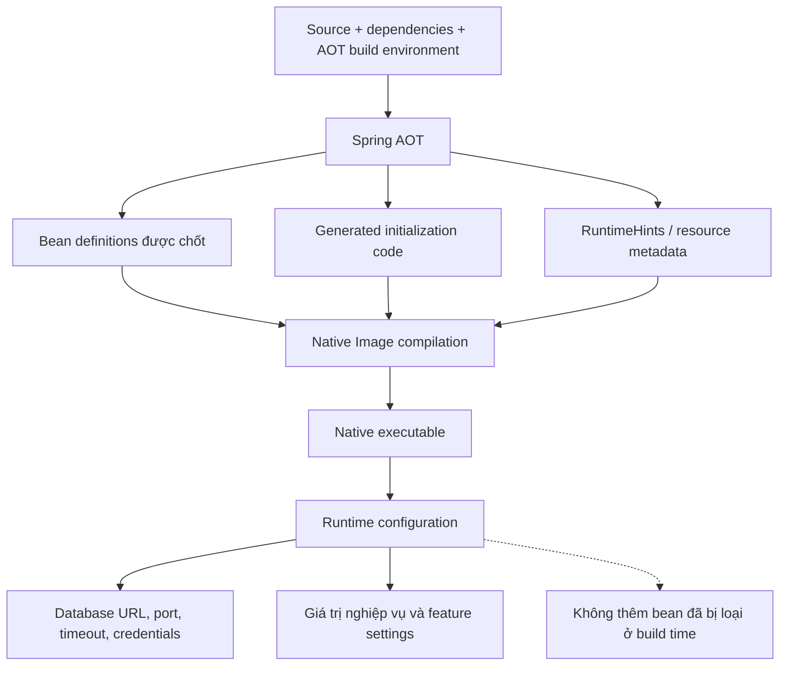

# Chuyển cách đăng ký bean, tải tài nguyên và cấu hình môi trường

> **Chương: Di chuyển và nâng cấp.** Module **SPRING_BOOT_NATIVE_IMAGE** biên dịch ứng dụng Spring Boot thành GraalVM Native Image bằng Spring AOT để cải thiện thời gian khởi động và bộ nhớ. Khi chuyển một ứng dụng JVM sang AOT/Native Image, phần lớn code nghiệp vụ vẫn có thể giữ nguyên, nhưng cách Spring khám phá bean, cách thư viện tìm resource và cách cấu hình môi trường cần được kiểm tra lại. Bài học này hướng dẫn chuyển các cơ chế đăng ký động sang bean definition có thể phân tích ở build time, chuyển việc đọc tài nguyên sang API tương thích native và tách cấu hình cố định của bean graph khỏi giá trị môi trường được cung cấp khi chạy.

## 1. Mục tiêu học tập

Sau bài học, bạn có thể:

1. Giải thích phần nào của Spring ApplicationContext được quyết định ở build time khi chạy AOT.
2. Nhận diện các cách đăng ký bean động không thể được chuyển đổi trực tiếp sang AOT.
3. Chuyển đăng ký singleton và callback runtime sang @Configuration, @Bean hoặc ImportBeanDefinitionRegistrar.
4. Khai báo kiểu bean chính xác để Spring AOT phân tích injection, lifecycle và proxy.
5. Chọn cách dùng @Profile, @Conditional và feature flag phù hợp với bean graph cố định.
6. Chuyển việc đọc classpath resource từ File/URL sang Resource/InputStream và đăng ký RuntimeHints khi tên resource được tạo động.
7. Chuyển cấu hình từ hard-code hoặc profile build thành @ConfigurationProperties, Environment và externalized config.
8. Dùng environment variables, file cấu hình ngoài và config tree cho môi trường container.
9. Phân biệt cấu hình ảnh hưởng bean registration ở build time với cấu hình chỉ thay đổi hành vi lúc chạy.
10. Kiểm thử ứng dụng đã AOT trên JVM trước khi biên dịch và chạy native executable.

## 2. Thay đổi tư duy khi chuyển sang Spring AOT

Ứng dụng Spring trên JVM thường tạo ApplicationContext lúc khởi động. Trong quá trình refresh, Spring đọc cấu hình, scan classpath, đánh giá điều kiện, đăng ký bean definition, tạo bean và chạy các callback mở rộng.

Spring AOT thực hiện một phần discovery và chuẩn bị ApplicationContext ngay trong build. AOT tạo mã khởi tạo, bytecode cần thiết và RuntimeHints cho reflection, resource, serialization hoặc JDK proxy. Native Image dùng các thông tin này để tạo executable có tập code và metadata đã xác định.

Điều đó tạo ra ba nhóm quyết định:

| Nhóm | Ví dụ | Thời điểm quyết định |
|---|---|---|
| Cấu trúc ứng dụng | Classpath, bean definition, component scan, import, điều kiện tạo bean | Build time |
| Tài nguyên được đóng gói | Classpath resource, resource bundle, reflection/proxy hints | Build time |
| Giá trị vận hành | Database URL, port, timeout, credentials, log level, endpoint bên ngoài | Runtime, nếu không làm thay đổi bean graph |

Một giá trị property vẫn có thể được đọc từ Environment lúc chạy. Nhưng nếu property đó quyết định một bean có được tạo hay không qua @Conditional, Spring AOT đã đánh giá điều kiện trong quá trình build. Đổi property sau khi executable được tạo không tự bổ sung bean đã bị loại khỏi ApplicationContext.



Vì vậy, khi di chuyển ứng dụng, hãy hỏi riêng ba câu: bean nào cần tồn tại, resource nào cần được đóng gói, và giá trị nào cần thay đổi theo môi trường chạy.

## 3. Bản đồ chuyển đổi từ ứng dụng JVM sang AOT/Native

| Cách làm trong ứng dụng JVM cũ | Cách chuyển phù hợp |
|---|---|
| Gọi registerSingleton để thêm instance sau khi context bắt đầu | Đăng ký bean definition qua @Bean hoặc BeanDefinitionRegistry |
| Quét classpath/plugin directory tùy ý lúc runtime | Xác định tập component/plugin trong build hoặc dùng registry tường minh |
| Đăng ký bean bằng callback không được Spring AOT xử lý | Dùng @Import, ImportBeanDefinitionRegistrar hoặc AOT contribution phù hợp |
| @Bean khai báo kiểu trả về quá chung | Khai báo kiểu triển khai cụ thể khi cần AOT phân tích |
| Đổi @Profile để thay bean graph sau khi deploy | Chọn profile khi process AOT hoặc giữ bean graph ổn định và thay đổi hành vi bằng property runtime |
| Dùng @ConditionalOnProperty để bật/tắt bean tùy môi trường sau deploy | Chỉ dùng condition cho lựa chọn build-time; dùng feature flag trong bean ổn định cho lựa chọn runtime |
| Dùng URL.getFile() hoặc Resource.getFile() cho resource trong JAR | Đọc InputStream; copy ra file tạm nếu thư viện bắt buộc cần File |
| Ghép tên resource động nhưng không khai báo metadata | Đăng ký RuntimeHints cho tập resource hợp lệ |
| Ghi database URL, password hoặc path vào code | Dùng @ConfigurationProperties và externalized configuration |
| Đóng gói secret trong application.yaml | Mount secret bằng config tree hoặc secret manager |

Không cần viết lại toàn bộ ứng dụng chỉ vì chuyển sang Native Image. Hãy ưu tiên sửa các điểm phụ thuộc vào classpath động, instance có sẵn ở runtime hoặc filesystem giả định.

## 4. Chuyển cách đăng ký bean

### 4.1. Ưu tiên cấu hình Spring có thể phân tích

Các cơ chế sau được Spring AOT hiểu trực tiếp trong quá trình xử lý cấu hình:

- @Configuration và @Bean.
- @Component, @Service, @Repository và component scanning được xác định ở build time.
- @Import và ImportSelector.
- @Profile và các @Conditional được đánh giá trong AOT environment.
- BeanDefinition được đăng ký trong quá trình configuration class parsing.

Ví dụ cấu hình tường minh:

```java
@Configuration(proxyBeanMethods = false)
@Import({OrderRepositoryConfiguration.class, PaymentConfiguration.class})
public class OrderApplicationConfiguration {
}

@Configuration(proxyBeanMethods = false)
public class PaymentConfiguration {

    @Bean
    public StripePaymentGateway stripePaymentGateway(
            PaymentClient paymentClient) {
        return new StripePaymentGateway(paymentClient);
    }
}
```

Khai báo này cho AOT biết bean definition, kiểu bean và quan hệ dependency ngay trong build. Nếu cấu hình được import bởi application configuration, Spring có thể đưa các bean tương ứng vào AOT context.

### 4.2. Thay registerSingleton bằng bean definition

Một số ứng dụng JVM cũ tạo instance rồi đăng ký trực tiếp:

```java
// Cách cũ: đăng ký instance có sẵn trong lúc runtime.
singletonRegistry.registerSingleton("paymentGateway", new StripePaymentGateway(client));
```

Bean được đăng ký bằng registerSingleton không thể được Spring AOT chuyển đổi như bean definition thông thường. AOT cần biết cách tạo bean, kiểu bean và dependency của nó trước khi instance tồn tại.

Chuyển sang @Bean:

```java
@Configuration(proxyBeanMethods = false)
public class PaymentConfiguration {

    @Bean
    public StripePaymentGateway paymentGateway(PaymentClient client) {
        return new StripePaymentGateway(client);
    }
}
```

Nếu cần đăng ký một số bean theo metadata của module, dùng ImportBeanDefinitionRegistrar:

```java
public final class PaymentModuleRegistrar
        implements ImportBeanDefinitionRegistrar {

    @Override
    public void registerBeanDefinitions(
            AnnotationMetadata importingClassMetadata,
            BeanDefinitionRegistry registry) {

        RootBeanDefinition definition =
                new RootBeanDefinition(StripePaymentGateway.class);
        registry.registerBeanDefinition("stripePaymentGateway", definition);
    }
}

@Configuration(proxyBeanMethods = false)
@Import(PaymentModuleRegistrar.class)
class PaymentModuleConfiguration {
}
```

Registrar chạy trong giai đoạn phân tích cấu hình, vì vậy bean definition được tạo trước khi Spring AOT sinh mã khởi tạo. Nếu bean cần constructor arguments hoặc property, khai báo constructor/factory method rõ ràng trong BeanDefinition hoặc cân nhắc dùng @Bean để code dễ đọc hơn.

### 4.3. Khi nào dùng BeanDefinitionRegistryPostProcessor?

BeanDefinitionRegistryPostProcessor vẫn là một extension point hợp lệ nếu cần thao tác trên registry. Tuy nhiên, nếu chính processor được đăng ký thành bean, nó có thể được gọi lại khi ứng dụng chạy. Trong AOT, callback cần có đóng góp build-time phù hợp để hành vi được tái tạo đúng.

Spring Framework khuyến nghị ImportBeanDefinitionRegistrar cho phần lớn trường hợp đăng ký bean tùy chỉnh vì nó chạy trong quá trình parse cấu hình. Chỉ dùng BeanFactoryInitializationAotProcessor hoặc BeanRegistrationAotProcessor khi đang phát triển hạ tầng cần tùy biến sâu quá trình sinh mã AOT.

Nếu triển khai AOT processor:

- Giữ dependency của processor nhỏ và ổn định.
- Tránh phụ thuộc vào bean instance được tạo muộn.
- Nếu khai báo bằng @Bean, cân nhắc factory method static để không phải khởi tạo enclosing configuration class trong AOT phase.
- Đảm bảo đóng góp AOT tái tạo hành vi runtime tương đương.
- Viết test cho generated context và native executable.

Không nên tạo AOT processor riêng chỉ để thay một vài @Bean method thông thường.

### 4.4. Khai báo kiểu bean chính xác

Spring AOT cần biết kiểu bean để nhận diện annotation, injection point, lifecycle callback và proxy. Tránh khai báo kiểu trả về quá chung khi implementation có metadata quan trọng.

Ví dụ chưa đủ thông tin:

```java
@Bean
public PaymentGateway paymentGateway() {
    return new StripePaymentGateway();
}
```

Nếu bean implementation có method được Spring phát hiện hoặc cần inject theo kiểu triển khai, khai báo kiểu cụ thể:

```java
@Bean
public StripePaymentGateway paymentGateway() {
    return new StripePaymentGateway();
}
```

Các component khác vẫn có thể inject qua interface PaymentGateway. Điều quan trọng là bean definition thể hiện kiểu triển khai chính xác để AOT phân tích đầy đủ.

### 4.5. Tránh bean definition phụ thuộc instance supplier động

Bean definition có instance supplier là lambda hoặc method reference tùy biến có thể không được chuyển đổi thành mã AOT. Tương tự, singleton được đăng ký bằng instance không cung cấp đủ thông tin để AOT tái tạo bean.

Thay vì tạo supplier từ dữ liệu runtime:

```java
RootBeanDefinition definition = new RootBeanDefinition(OrderHandler.class);
definition.setInstanceSupplier(
        () -> handlerFactory.create(resolveHandlerType()));
registry.registerBeanDefinition("handler", definition);
```

Hãy xác định loại handler ở build time và đăng ký bean definition cụ thể, hoặc tạo một router bean ổn định nhận các implementation đã được đăng ký:

```java
@Component
public class HandlerRouter {

    private final Map<String, OrderHandler> handlers;
    private final HandlerProperties properties;

    public HandlerRouter(
            Map<String, OrderHandler> handlers,
            HandlerProperties properties) {
        this.handlers = handlers;
        this.properties = properties;
    }

    public OrderHandler currentHandler() {
        OrderHandler handler = handlers.get(properties.handler());
        if (handler == null) {
            throw new IllegalStateException(
                    "Unknown order handler: " + properties.handler());
        }
        return handler;
    }
}
```

Router giữ bean graph ổn định. Property handler có thể được bind lúc chạy để chọn implementation trong số các bean đã có.

## 5. Chuyển @Profile, @Conditional và feature flag

### 5.1. Điều kiện tạo bean được đánh giá khi build

Spring AOT đánh giá @Conditional trong môi trường dùng cho process AOT. @Profile cũng được triển khai dựa trên condition, vì vậy profile ảnh hưởng việc bean nào được tạo phải được chọn trong quá trình build.

Ví dụ:

```java
@Configuration(proxyBeanMethods = false)
@Profile("cloud")
class CloudStorageConfiguration {

    @Bean
    CloudStorage cloudStorage() {
        return new CloudStorage();
    }
}
```

Nếu profile cloud không được kích hoạt khi process AOT, bean cloudStorage có thể không được đưa vào generated context. Đặt SPRING_PROFILES_ACTIVE=cloud khi chạy executable không thể khôi phục bean đã bị loại trong build.

### 5.2. Chọn profile khi chạy process AOT

Với Maven, cấu hình profiles trong execution của spring-boot:process-aot:

```xml
<plugin>
    <groupId>org.springframework.boot</groupId>
    <artifactId>spring-boot-maven-plugin</artifactId>
    <executions>
        <execution>
            <id>process-aot</id>
            <goals>
                <goal>process-aot</goal>
            </goals>
            <configuration>
                <profiles>cloud</profiles>
            </configuration>
        </execution>
    </executions>
</plugin>
```

Với Gradle, cấu hình task ProcessAot:

```groovy
tasks.withType(
        org.springframework.boot.gradle.tasks.aot.ProcessAot
).configureEach {
    args('--spring.profiles.active=cloud')
}
```

Tên task và API cấu hình có thể thay đổi theo Spring Boot plugin version. Hãy dùng tài liệu đúng phiên bản đang khai báo trong dự án.

### 5.3. Profile chỉ thay đổi giá trị cấu hình

Không phải mọi profile đều cần tạo một native executable riêng. Profile chỉ thay đổi giá trị property mà không ảnh hưởng điều kiện tạo bean vẫn có thể dùng khi chạy AOT.

Ví dụ:

```yaml
# application-prod.yaml
orders:
  retry:
    max-attempts: 5
    delay: 2s
```

Nếu profile prod chỉ thay retry count và delay của bean đã tồn tại, giá trị có thể được bind từ runtime config. Nếu profile đó bật/tắt một @Configuration hoặc @Bean qua @Profile/@Conditional, lựa chọn đó phải được thực hiện khi AOT build.

### 5.4. Chuyển feature flag từ bean condition sang runtime behavior

Giả sử ứng dụng cũ dùng @ConditionalOnProperty để tạo bean chỉ khi payment.enabled=true. Nếu muốn bật/tắt tính năng này theo môi trường sau deploy, hãy giữ bean và đọc property khi thực thi:

```java
@ConfigurationProperties("payment")
public record PaymentProperties(boolean enabled) {
}

@Configuration(proxyBeanMethods = false)
@EnableConfigurationProperties(PaymentProperties.class)
class PaymentFeatureConfiguration {
}

@Component
public class PaymentService {

    private final PaymentProperties properties;
    private final PaymentGateway gateway;

    public PaymentService(
            PaymentProperties properties,
            PaymentGateway gateway) {
        this.properties = properties;
        this.gateway = gateway;
    }

    public PaymentResult pay(PaymentRequest request) {
        if (!properties.enabled()) {
            throw new IllegalStateException("Payment is disabled");
        }
        return gateway.pay(request);
    }
}
```

Bean PaymentService và PaymentGateway luôn có mặt trong graph; property chỉ quyết định hành vi của method. Cách này phù hợp khi implementation cần thiết đã nằm trong classpath và được đăng ký.

Nếu các implementation cần thư viện/native dependency khác nhau hoặc tạo bean graph rất khác nhau, hãy tạo các build variant riêng, mỗi variant chạy process AOT với profile phù hợp. Không mong đợi một binary thay đổi tùy ý cấu trúc ApplicationContext sau khi chạy.

## 6. Chuyển cách tải resource

### 6.1. Phân biệt classpath resource và file bên ngoài

Classpath resource được đóng gói trong JAR/dependency, ví dụ:

```text
src/main/resources/
  templates/
    invoice.html
  dictionaries/
    en.txt
    vi.txt
  config/
    payment-rules.yml
```

File bên ngoài executable có thể được mount từ volume, ví dụ:

```text
/etc/orders/application.yaml
/run/secrets/database-password
/opt/orders/templates/custom-invoice.html
```

Hai loại này có vòng đời khác nhau:

| Nguồn | Có trong native executable? | Cách thay đổi |
|---|---|---|
| Classpath resource | Chỉ khi được phát hiện hoặc đăng ký hint | Thường cần build lại executable để thay nội dung |
| File ngoài filesystem | Không được nhúng tự động | Thay file/mount/config mà không cần biên dịch lại |
| URL bên ngoài | Không được nhúng | Truy cập qua network khi chạy |

Không dùng RuntimeHints cho file production chỉ tồn tại trên volume. Ngược lại, không giả định file trong src/main/resources sẽ tự có mặt dưới dạng file vật lý sau khi native executable chạy.

### 6.2. Dùng Resource và InputStream thay cho File

Code cũ có thể giả định classpath resource luôn là File:

```java
URL url = getClass().getResource("/templates/invoice.html");
File templateFile = new File(url.getFile());
legacyRenderer.render(templateFile);
```

Trong Native Image, resource có thể được lưu bên trong executable và URL không phải file URL. Hãy dùng Spring Resource:

```java
Resource template = new ClassPathResource("templates/invoice.html");

try (InputStream input = template.getInputStream()) {
    invoiceRenderer.render(input);
}
```

Nếu thư viện cũ chỉ nhận File, copy resource sang file tạm:

```java
Path temporaryFile = Files.createTempFile("invoice-", ".html");
try (InputStream input = template.getInputStream()) {
    Files.copy(input, temporaryFile, StandardCopyOption.REPLACE_EXISTING);
}
try {
    legacyRenderer.render(temporaryFile.toFile());
}
finally {
    Files.deleteIfExists(temporaryFile);
}
```

Thư mục tạm phải có quyền ghi và đủ dung lượng. Không lưu file tạm chứa dữ liệu nhạy cảm ở vị trí có thể bị đọc bởi user khác.

### 6.3. Đăng ký resource được chọn động bằng RuntimeHints

Nếu tên resource được tạo từ locale hoặc property runtime, Native Image có thể không suy ra toàn bộ tập file cần giữ.

```java
@Component
@ImportRuntimeHints(DictionaryResourceHints.class)
public class DictionaryService {

    private final ResourceLoader resourceLoader;

    public DictionaryService(ResourceLoader resourceLoader) {
        this.resourceLoader = resourceLoader;
    }

    public String load(Locale locale) throws IOException {
        String language = locale.getLanguage();
        Resource resource = resourceLoader.getResource(
                "classpath:dictionaries/" + language + ".txt");
        try (InputStream input = resource.getInputStream()) {
            return new String(input.readAllBytes(), StandardCharsets.UTF_8);
        }
    }

    static class DictionaryResourceHints implements RuntimeHintsRegistrar {

        @Override
        public void registerHints(RuntimeHints hints, ClassLoader classLoader) {
            hints.resources().registerPattern("dictionaries/*.txt");
        }
    }
}
```

Đăng ký pattern chỉ bao phủ các resource hợp lệ mà ứng dụng hỗ trợ. Nếu locale được chọn từ request, hãy giới hạn tập locale bằng allowlist. Không tạo path từ input tùy ý rồi cho phép truy cập mọi resource.

### 6.4. Giữ resource ngoài để có thể thay đổi sau deploy

Nếu template hoặc policy cần được cập nhật mà không build lại executable, đặt chúng trên filesystem hoặc external store:

```java
@ConfigurationProperties("orders.templates")
public record TemplateProperties(Path directory) {
}

@Configuration(proxyBeanMethods = false)
@EnableConfigurationProperties(TemplateProperties.class)
class TemplateConfiguration {
}

@Component
public class ExternalTemplateLoader {

    private final TemplateProperties properties;

    public ExternalTemplateLoader(TemplateProperties properties) {
        this.properties = properties;
    }

    public String read(String name) throws IOException {
        Path root = properties.directory().toAbsolutePath().normalize();
        Path file = root.resolve(name + ".html").normalize();
        if (!file.startsWith(root)) {
            throw new IllegalArgumentException("Invalid template path");
        }
        return Files.readString(file, StandardCharsets.UTF_8);
    }
}
```

Mount thư mục template vào container và cấu hình orders.templates.directory từ environment. Luôn chuẩn hóa path và kiểm tra path traversal trước khi mở file.

## 7. Chuyển cấu hình môi trường sang externalized configuration

### 7.1. Dùng @ConfigurationProperties thay cho giá trị hard-code

Thay vì đọc biến môi trường rải rác hoặc hard-code endpoint:

```java
@ConfigurationProperties(prefix = "orders.client")
@Validated
public record OrdersClientProperties(
        @NotNull URI baseUrl,
        @NotNull Duration timeout,
        @Min(1) int maxAttempts) {
}
```

Đăng ký properties:

```java
@Configuration(proxyBeanMethods = false)
@EnableConfigurationProperties(OrdersClientProperties.class)
public class OrdersClientConfiguration {

    @Bean
    OrdersClient ordersClient(OrdersClientProperties properties) {
        return new OrdersClient(
                properties.baseUrl(),
                properties.timeout(),
                properties.maxAttempts());
    }
}
```

Hoặc dùng @ConfigurationPropertiesScan nếu dự án tổ chức các properties class theo package. Spring Boot AOT tự tạo nhiều reflection hints cần thiết cho configuration properties.

### 7.2. Kiểm tra nested configuration properties

Với nested type không phải inner class, có thể cần @NestedConfigurationProperty để Spring Boot nhận diện và bind đầy đủ trong native image:

```java
@ConfigurationProperties("orders")
public class OrdersProperties {

    private String name;

    @NestedConfigurationProperty
    private RetryProperties retry = new RetryProperties();

    public String getName() {
        return name;
    }

    public void setName(String name) {
        this.name = name;
    }

    public RetryProperties getRetry() {
        return retry;
    }

    public void setRetry(RetryProperties retry) {
        this.retry = retry;
    }
}

public class RetryProperties {
    private int maxAttempts;
    private Duration delay;
    // getters and setters
}
```

Với record hoặc constructor binding, đặt annotation trên component/parameter tương ứng theo hướng dẫn của Spring Boot. Đảm bảo accessor công khai để Binder có thể bind property.
Đăng ký OrdersProperties bằng @EnableConfigurationProperties hoặc @ConfigurationPropertiesScan để Spring tạo bean cấu hình.

### 7.3. Dùng environment variables theo relaxed binding

Spring Boot ánh xạ property name sang environment variable theo quy tắc:

1. Đổi dấu chấm thành dấu gạch dưới.
2. Bỏ dấu gạch ngang.
3. Chuyển thành chữ hoa.

Ví dụ:

| Property | Environment variable |
|---|---|
| orders.client.base-url | ORDERS_CLIENT_BASEURL |
| orders.client.timeout | ORDERS_CLIENT_TIMEOUT |
| orders.client.max-attempts | ORDERS_CLIENT_MAXATTEMPTS |
| spring.profiles.active | SPRING_PROFILES_ACTIVE |
| spring.config.additional-location | SPRING_CONFIG_ADDITIONALLOCATION |

Environment variable thích hợp cho endpoint, port, timeout và các giá trị cấu hình nhỏ. Với secret hoặc cấu hình nhiều dòng, cân nhắc config tree hay secret manager.

### 7.4. Tách giá trị mặc định và cấu hình theo môi trường

application.yaml nên chứa giá trị mặc định an toàn:

```yaml
orders:
  client:
    base-url: https://orders.internal
    timeout: 2s
    max-attempts: 3

spring:
  config:
    import: optional:configtree:/run/secrets/
```

Runtime environment có thể ghi đè giá trị:

```bash
export ORDERS_CLIENT_BASEURL=https://orders.prod.internal
export ORDERS_CLIENT_TIMEOUT=1500ms
```

Không đặt password hoặc private key trong application.yaml được đóng gói cùng executable. Khi dùng Kubernetes Secret hoặc Docker secret, mount file vào container và import bằng configtree.

Ví dụ cấu trúc secret:

```text
/run/secrets/
  spring.datasource.username
  spring.datasource.password
  orders.client.api-key
```

Với cấu hình:

```yaml
spring:
  config:
    import: optional:configtree:/run/secrets/
```

Spring Boot đưa tên file và nội dung file thành property trong Environment. Giá trị secret được đọc khi ứng dụng khởi động; thay đổi file sau đó không mặc nhiên làm mọi bean refresh theo. Nếu cần rotation secret khi process đang chạy, dùng integration hỗ trợ refresh hoặc thiết kế client lấy credential động.

### 7.5. Chọn config location đúng mục đích

Spring Boot hỗ trợ:

- spring.config.location: thay thế các vị trí tìm kiếm mặc định.
- spring.config.additional-location: bổ sung vị trí mới và cho phép override cấu hình mặc định.
- spring.config.import: import file, config tree hoặc nguồn config được hỗ trợ.

Ví dụ thêm config directory bên ngoài:

```bash
SPRING_CONFIG_ADDITIONAL_LOCATION=file:/etc/orders/
```

Directory location cần dấu / ở cuối. Nếu vị trí có thể không tồn tại, dùng prefix optional:. Các thuộc tính spring.config.name, spring.config.location và spring.config.additional-location được xử lý rất sớm, vì vậy nên truyền bằng environment variable, system property hoặc command-line argument.

Không đặt toàn bộ external config vào classpath nếu mục tiêu là thay đổi endpoint và credential theo môi trường mà không build lại binary.

## 8. Phân biệt cấu hình build time và runtime

| Thuộc tính/quyết định | Build time | Runtime |
|---|---|---|
| Classpath/dependency có thư viện nào | Có | Không thể thêm JAR tùy ý sau build |
| @Profile quyết định bean graph | Có | Không thể đổi bean graph bằng profile khác |
| @ConditionalOnProperty tạo bean | Có | Property đổi sau build không thêm/xóa bean |
| Database URL của bean đã tồn tại | Không cần cố định | Có thể lấy từ Environment |
| HTTP port của server đã được tạo | Không cần cố định | Có thể override bằng environment |
| Timeout, retry, log level | Không cần cố định | Có thể override nếu code đọc runtime config |
| Classpath template/resource được nhúng | Có | Không thể thay nội dung nhúng mà không build lại |
| File cấu hình được mount ngoài | Không cần nhúng | Được đọc từ filesystem khi khởi động |
| Secret được mount bằng config tree | Không cần đưa vào binary | Được đọc từ volume khi khởi động |

Nguyên tắc này giúp tránh hai lỗi thường gặp: build một binary với profile không phù hợp và cố dùng runtime environment để bật bean mà AOT đã loại bỏ.

## 9. Thử AOT trên JVM trước khi build native

Một bước chuyển đổi an toàn là chạy ứng dụng với AOT generated code trên JVM. Cách này giúp phát hiện vấn đề về bean graph và cấu hình trước khi tốn thời gian native compilation.

Với Maven, dùng native profile để chạy process AOT và đóng gói:

```bash
./mvnw -Pnative package
```

Với Gradle, bật Spring Boot AOT plugin; khi GraalVM Native Image plugin được áp dụng, plugin AOT thường được tích hợp tự động:

```bash
./gradlew processAot
```

Sau khi JAR chứa AOT generated assets, chạy:

```bash
java -Dspring.aot.enabled=true -jar target/orders-service.jar
```

Đối chiếu:

- Bean nào xuất hiện trong ApplicationContext?
- Profile nào đã được chọn khi process AOT?
- Conditional bean có đúng với artifact variant không?
- Runtime config có override endpoint/timeout như dự kiến không?
- Template và resource có được đọc bằng API tương thích không?
- Config tree và external file có được load từ đúng mount path không?

Nếu AOT trên JVM đã sai, hãy sửa cấu hình trước khi chạy nativeCompile/native-image.

## 10. Kiểm thử sau khi chuyển đổi

### 10.1. Kiểm thử bean graph

Viết test xác nhận các bean bắt buộc tồn tại trong AOT context:

```java
@SpringBootTest
class AotBeanGraphTests {

    @Autowired
    ApplicationContext context;

    @Test
    void registersExpectedApplicationComponents() {
        assertThat(context.getBean(PaymentService.class)).isNotNull();
        assertThat(context.getBean(HandlerRouter.class)).isNotNull();
    }
}
```

Chạy test với AOT-generated application setup hoặc native test task. Một test chỉ chạy trên JVM thông thường chưa chứng minh bean graph được tái tạo đúng trong AOT.

### 10.2. Kiểm thử RuntimeHints

Nếu tự đăng ký resource hints, dùng RuntimeHintsPredicates để xác nhận:

```java
@Test
void registersDictionaryResources() {
    RuntimeHints hints = new RuntimeHints();
    new DictionaryResourceHints().registerHints(
            hints, getClass().getClassLoader());

    assertThat(RuntimeHintsPredicates.resource()
            .forResource("dictionaries/vi.txt"))
            .accepts(hints);
}
```

Test hint kiểm tra metadata được đăng ký, nhưng vẫn cần test đọc resource thật trên native executable.

### 10.3. Kiểm thử cấu hình runtime

Chạy cùng một binary với hai cấu hình khác nhau:

- Database URL và API endpoint khác nhau.
- Timeout hoặc retry count khác nhau.
- Secret được mount ở config tree.
- Profile chỉ thay property, không thay bean graph.

Xác nhận ứng dụng nhận đúng giá trị mà không cần biên dịch lại. Không in secret ra log khi kiểm tra cấu hình.

### 10.4. Kiểm thử profile ảnh hưởng bean graph

Nếu production cần bean graph khác staging:

1. Build AOT artifact cho từng profile/variant cần thiết.
2. Ghi profile và build arguments vào metadata release.
3. Chạy test AOT trên JVM cho từng variant.
4. Build native executable từng variant.
5. Test bean graph và native behavior của từng binary.

Nếu chỉ khác giá trị endpoint hoặc credential, giữ một bean graph và cung cấp cấu hình runtime để tránh phải tạo nhiều binary.

## 11. Quy trình migration từng bước

1. **Lập danh sách bean động:** tìm registerSingleton, registerBeanDefinition, BeanFactoryPostProcessor, custom scanner và supplier lambda.
2. **Phân loại bean:** bean nào luôn cần, bean nào chỉ khác implementation, bean nào thực sự cần build variant.
3. **Chuyển registration:** ưu tiên @Bean/@Import; dùng ImportBeanDefinitionRegistrar cho module registration tùy chỉnh.
4. **Làm rõ kiểu bean:** khai báo return type cụ thể và constructor dependency rõ ràng.
5. **Chốt profile/condition:** xác định môi trường được dùng khi process AOT; bỏ kỳ vọng đổi bean graph sau deploy.
6. **Tách feature flag:** chuyển property bật/tắt hành vi sang runtime config nếu bean cần luôn tồn tại.
7. **Rà resource access:** tìm getResource, getResourceAsStream, getFile, URL.getFile, classpath scan và dynamic resource name.
8. **Đăng ký hints:** thêm RuntimeHints cho resource/reflection/proxy cần thiết; chỉ include tập tài nguyên hợp lệ.
9. **Externalize config:** chuyển URL, timeout, credential và path ra @ConfigurationProperties, env hoặc config tree.
10. **Chạy AOT trên JVM:** kiểm tra context và resource trước native build.
11. **Build và test native:** chạy native test, integration test và smoke test trên đúng binary/container.
12. **Ghi lại build variant:** lưu profile AOT, GraalVM/JDK, dependency và config schema theo release.

## 12. Lỗi thường gặp khi migration

| Triệu chứng | Nguyên nhân | Cách xử lý |
|---|---|---|
| Bean có trên JVM nhưng thiếu trong native | Đăng ký singleton hoặc callback runtime không được AOT xử lý | Chuyển sang bean definition được đăng ký trong AOT phase |
| Bean theo @Profile không xuất hiện | Profile không được bật khi process AOT | Cấu hình profiles cho Maven/Gradle AOT task |
| Đổi SPRING_PROFILES_ACTIVE nhưng bean không đổi | Bean graph đã được chốt ở build time | Build variant mới hoặc giữ bean graph ổn định |
| @ConditionalOnProperty không phản ứng với env runtime | Condition được đánh giá lúc AOT build | Chuyển property thành runtime behavior của bean luôn tồn tại |
| Bean implementation thiếu annotation/lifecycle metadata | @Bean khai báo return type quá chung | Trả về kiểu triển khai cụ thể |
| Custom BeanDefinition không được sinh mã AOT | Dùng callback hoặc supplier động không được hỗ trợ | Dùng ImportBeanDefinitionRegistrar hoặc AOT contribution |
| Classpath scan không thấy plugin mới | Plugin được thêm sau build | Chốt plugin set lúc build hoặc dùng external plugin protocol có thiết kế riêng |
| Resource có trong JAR nhưng không đọc được native | Resource chưa được include trong executable | Đăng ký RuntimeHints và kiểm tra Build Report |
| Resource đọc được trên JVM nhưng FileNotFound trên native | Code giả định classpath resource là File | Dùng InputStream hoặc copy ra temp file |
| ConfigurationProperties nested không bind | Nested type ngoài chưa được nhận diện | Thêm @NestedConfigurationProperty đúng vị trí |
| Native binary không nhận env var | Tên env var sai quy tắc relaxed binding | Ánh xạ property sang uppercase/underscore đúng cách |
| Config file ngoài không được load | Dùng spring.config.location sai hoặc thiếu dấu / | Kiểm tra config location và thứ tự precedence |
| Secret không có trong Environment | Config tree path hoặc volume mount sai | Kiểm tra mount path, file key và spring.config.import |
| Chạy native trong container nhưng thiếu config | File được giả định nằm trong source directory | Mount file hoặc config tree tại runtime |

## 13. Bài tập thực hành

Một dịch vụ quản lý đơn hàng trên JVM đang có ba cơ chế:

- Payment provider được tạo bằng registerSingleton dựa trên biến PAYMENT_PROVIDER.
- Template email được nạp bằng URL.getFile().
- Database URL và password được hard-code trong application-prod.yaml.

Hãy chuyển ứng dụng sang Spring AOT/Native Image:

1. Tạo PaymentGateway implementations dưới dạng bean definitions rõ ràng.
2. Dùng PaymentGatewayRouter và PaymentProperties để chọn provider trong runtime nếu các provider cùng được đóng gói.
3. Nếu provider cần dependency/native library khác nhau, tạo build variant với AOT profile tương ứng.
4. Chuyển template loading sang Resource/InputStream; đăng ký resource pattern nếu template được chọn động.
5. Chuyển database URL và timeout sang @ConfigurationProperties.
6. Mount password dưới dạng secret file và import bằng configtree.
7. Chạy process AOT trên JVM với đúng profile của build variant.
8. Test bean graph, template rendering và config binding.
9. Build native executable, chạy integration test với database test và smoke test.
10. Chạy cùng binary với endpoint/credential khác nhau để xác nhận runtime config có thể thay đổi mà không cần rebuild.

Mẫu báo cáo:

| Hạng mục | Trước migration | Sau migration | Kết quả |
|---|---|---|---|
| Payment bean registration | registerSingleton | @Bean/ImportBeanDefinitionRegistrar | Pass/Fail |
| Provider selection | Build/runtime callback | AOT profile hoặc runtime router | Pass/Fail |
| Email template | URL.getFile() | Resource/InputStream + hints | Pass/Fail |
| Database URL | Hard-code | Environment/ConfigurationProperties | Pass/Fail |
| Database password | Packaged YAML | Config tree/secret mount | Pass/Fail |
| AOT JVM test | Không có | AOT-generated context | Pass/Fail |
| Native integration test | Không có | Test trên executable native | Pass/Fail |

## 14. Câu hỏi tự kiểm tra

1. Vì sao Spring AOT cần biết bean definition trước khi tạo native executable?
2. Vì sao registerSingleton không tương đương với @Bean trong AOT?
3. ImportBeanDefinitionRegistrar giúp chuyển đăng ký bean động như thế nào?
4. Vì sao @Bean nên khai báo kiểu trả về chính xác?
5. @Profile và @Conditional được đánh giá ở thời điểm nào trong AOT?
6. Làm thế nào để bật/tắt một tính năng sau deploy mà không thay bean graph?
7. Vì sao classpath resource không nên bị ép thành File?
8. Khi nào cần RuntimeHints cho resource?
9. Cấu hình runtime nào có thể thay đổi mà không build lại native executable?
10. Vì sao nên chạy AOT-generated application trên JVM trước khi native compilation?

## Ghi nhớ

**Hãy chuyển các quyết định về cấu trúc ứng dụng sang build time và giữ giá trị vận hành ở runtime.** Đăng ký bean qua configuration/registry có thể phân tích, chọn profile phù hợp khi process AOT, dùng Resource/InputStream cùng RuntimeHints cho classpath resource, và externalize URL/timeout/secret bằng ConfigurationProperties, environment hoặc config tree. Cuối cùng, kiểm thử AOT trên JVM rồi chạy native integration test để chứng minh cả bean graph, resource và cấu hình đều hoạt động trong executable cuối.

## Tài liệu tham khảo chính thức

- [Spring Framework — Ahead of Time Optimizations](https://docs.spring.io/spring-framework/reference/core/aot.html): giới hạn bean graph, programmatic registration, AOT contributions và RuntimeHints.
- [Spring Boot — Ahead-of-Time Processing](https://docs.spring.io/spring-boot/reference/packaging/aot.html): AOT processing trên JVM và generated application setup.
- [Spring Boot — Ahead-of-Time Processing with Maven](https://docs.spring.io/spring-boot/maven-plugin/aot.html): process-aot goal và cấu hình build-time profiles.
- [Spring Boot — Ahead-of-Time Processing with Gradle](https://docs.spring.io/spring-boot/gradle-plugin/aot.html): ProcessAot task, processTestAot và native tasks.
- [Spring Boot — Ahead-of-Time Processing Questions](https://docs.spring.io/spring-boot/how-to/aot.html): điều kiện, profile và cách cấu hình environment khi AOT build.
- [Spring Boot — Externalized Configuration](https://docs.spring.io/spring-boot/reference/features/external-config.html): Environment, property precedence, environment variables, config locations và config trees.
- [Spring Boot — Advanced Native Image Topics](https://docs.spring.io/spring-boot/reference/packaging/native-image/advanced-topics.html): nested configuration properties, custom hints và RuntimeHintsPredicates.
- [Spring Framework — Resources](https://docs.spring.io/spring-framework/reference/core/resources.html): Resource abstraction, classpath/file/URL và ResourcePatternResolver.
