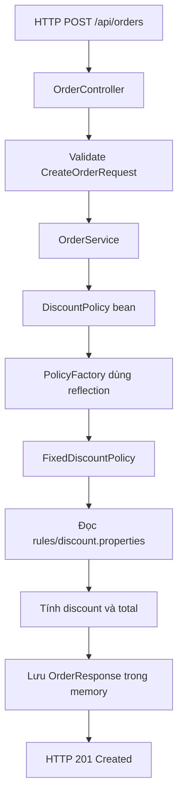
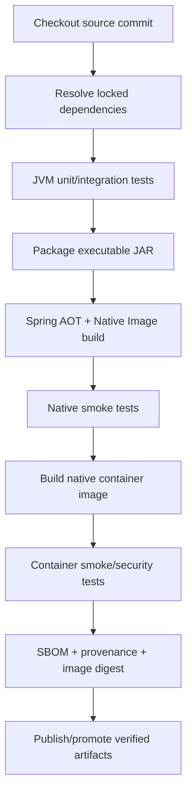

# Build cùng một ứng dụng thành JAR, native executable và container native

Bài thực hành này đưa một ứng dụng Spring Boot nhỏ qua ba cách đóng gói: **JAR chạy trên JVM, native executable được tạo bằng GraalVM Native Image và container image chạy native executable**. Cả ba artifact dùng cùng source code và cung cấp cùng REST API. Nhờ vậy, bạn có thể kiểm tra tính đúng đắn, quan sát giới hạn của Spring AOT, đo startup/resource usage và hiểu chính xác phần nào thay đổi giữa các cách triển khai.

Ứng dụng mẫu là `order-service`: nhận yêu cầu tạo đơn hàng, tính chiết khấu từ một file classpath resource và lưu đơn hàng trong bộ nhớ. Policy được khởi tạo qua reflection có đăng ký runtime hints. Đây là ví dụ nhỏ nhưng đủ để thực hành Spring AOT, reflection, resource inclusion, JVM tests, native build, Docker packaging và kiểm thử container.

## 1. Kết quả cần đạt

Sau khi hoàn thành, bạn có thể:

- Xây dựng ứng dụng Spring Boot REST có validation, service, policy và health endpoint.
- Chạy cùng một source code dưới dạng executable JAR.
- Chạy Spring AOT và biên dịch thành native executable bằng GraalVM.
- Đăng ký reflection và resource hints cho các truy cập động.
- Chạy JVM tests và xác minh native executable bằng smoke tests.
- Đóng gói native executable vào container image chạy non-root.
- So sánh JAR, native executable và native container trong điều kiện đo được kiểm soát.
- Xác minh architecture, shared libraries, health checks và shutdown behavior.
- Chuẩn bị artifact và metadata cho pipeline CI.

Kết quả cuối cùng gồm:

| Artifact | Cách chạy | Nội dung |
| --- | --- | --- |
| `target/order-service.jar` | `java -jar` | Bytecode ứng dụng và dependency chạy trên JVM |
| `target/order-service` | Chạy trực tiếp | Native executable theo OS/architecture lúc build |
| `order-service:native` | `docker run` | Native executable cùng runtime files cần thiết trong container |

## 2. Kiến trúc ứng dụng thực hành

API có hai endpoint:

| Method | Path | Mục đích |
| --- | --- | --- |
| `POST` | `/api/orders` | Tạo đơn hàng và tính chiết khấu |
| `GET` | `/api/orders/{id}` | Đọc đơn hàng đã tạo |
| `GET` | `/actuator/health` | Health status |
| `GET` | `/actuator/health/liveness` | Liveness state |
| `GET` | `/actuator/health/readiness` | Readiness state |

Luồng xử lý:



Ví dụ request:

```http
POST /api/orders
Content-Type: application/json

{
  "customer": "Lan",
  "subtotal": 100.00
}
```

Ví dụ response:

```json
{
  "id": "a0c8f34a-2a4c-4b64-9d50-9f9c6b3f3c11",
  "customer": "Lan",
  "subtotal": 100.00,
  "discount": 5.00,
  "total": 95.00
}
```

Ứng dụng dùng in-memory storage để tập trung vào build và runtime. Dữ liệu sẽ mất khi process khởi động lại; trong hệ thống thực tế, thay repository bằng database và kiểm thử JDBC driver/native compatibility riêng.

## 3. Chuẩn bị môi trường

Bạn cần:

- JDK được Spring Boot version đã chọn hỗ trợ.
- GraalVM distribution tương ứng JDK và OS/architecture.
- Native Image component đã cài đặt và chạy được `native-image --version`.
- Maven Wrapper hoặc Gradle Wrapper.
- C compiler/linker và các development libraries mà Native Image builder yêu cầu trên OS đang dùng.
- Docker Engine/Desktop hoặc runtime tương đương để build/run container.
- `curl` để gửi HTTP request.

Kiểm tra toolchain:

```bash
java -version
native-image --version
./mvnw --version
docker version
```

Nếu dùng Gradle:

```bash
./gradlew --version
```

Ví dụ trong bài dùng Spring Boot 3.5.16, Java 21 và Native Build Tools 0.10.6. Đây là bộ version minh họa có thể thay bằng patch release tương thích đã được dự án phê duyệt; pin version của Spring Boot, GraalVM, Native Build Tools và base image trong source/CI. Không dùng tag `latest` làm bằng chứng về toolchain.

Trên Linux, Native Image cần C toolchain và các development headers phù hợp. Trên Windows/macOS, yêu cầu build khác nhau theo nền tảng. Nếu đích triển khai là Linux container, ưu tiên build và test native executable trên Linux runner có architecture tương ứng.

## 4. Tạo cấu trúc project

Tạo project Maven có cấu trúc:

```text
order-service/
├── pom.xml
├── mvnw
├── Dockerfile.native
├── Dockerfile.jvm
├── measure-startup.sh
├── load.js
├── .mvn/
└── src/
    ├── main/
    │   ├── java/com/example/orders/
    │   │   ├── OrderApplication.java
    │   │   ├── api/
    │   │   │   ├── CreateOrderRequest.java
    │   │   │   ├── OrderResponse.java
    │   │   │   └── OrderController.java
    │   │   ├── service/
    │   │   │   └── OrderService.java
    │   │   └── policy/
    │   │       ├── DiscountPolicy.java
    │   │       ├── DiscountPolicyConfiguration.java
    │   │       ├── DiscountPolicyFactory.java
    │   │       ├── FixedDiscountPolicy.java
    │   │       └── OrderRuntimeHints.java
    │   └── resources/
    │       ├── application.properties
    │       └── rules/discount.properties
    └── test/
        └── java/com/example/orders/api/
            └── OrderControllerTest.java
```

Đặt package root là `com.example.orders` để Spring Boot tìm component và configuration bên dưới package đó.

## 5. Khai báo Maven dependencies và native profile

Ví dụ `pom.xml`:

```xml
<?xml version="1.0" encoding="UTF-8"?>
<project xmlns="http://maven.apache.org/POM/4.0.0"
         xmlns:xsi="http://www.w3.org/2001/XMLSchema-instance"
         xsi:schemaLocation="http://maven.apache.org/POM/4.0.0
         https://maven.apache.org/xsd/maven-4.0.0.xsd">
    <modelVersion>4.0.0</modelVersion>

    <parent>
        <groupId>org.springframework.boot</groupId>
        <artifactId>spring-boot-starter-parent</artifactId>
        <version>3.5.16</version>
        <relativePath/>
    </parent>

    <groupId>com.example</groupId>
    <artifactId>order-service</artifactId>
    <version>1.0.0</version>
    <name>order-service</name>

    <properties>
        <java.version>21</java.version>
    </properties>

    <dependencies>
        <dependency>
            <groupId>org.springframework.boot</groupId>
            <artifactId>spring-boot-starter-web</artifactId>
        </dependency>
        <dependency>
            <groupId>org.springframework.boot</groupId>
            <artifactId>spring-boot-starter-validation</artifactId>
        </dependency>
        <dependency>
            <groupId>org.springframework.boot</groupId>
            <artifactId>spring-boot-starter-actuator</artifactId>
        </dependency>
        <dependency>
            <groupId>org.springframework.boot</groupId>
            <artifactId>spring-boot-starter-test</artifactId>
            <scope>test</scope>
        </dependency>
    </dependencies>

    <build>
        <finalName>order-service</finalName>
        <plugins>
            <plugin>
                <groupId>org.springframework.boot</groupId>
                <artifactId>spring-boot-maven-plugin</artifactId>
            </plugin>
            <plugin>
                <groupId>org.graalvm.buildtools</groupId>
                <artifactId>native-maven-plugin</artifactId>
                <version>0.10.6</version>
                <extensions>true</extensions>
                <configuration>
                    <imageName>order-service</imageName>
                    <buildArgs>
                        <buildArg>--no-fallback</buildArg>
                    </buildArgs>
                </configuration>
            </plugin>
        </plugins>
    </build>
</project>
```

`--no-fallback` yêu cầu build thất bại nếu Native Image không thể tạo executable native hoàn chỉnh, thay vì tạo artifact fallback chạy trên JVM. Đây là lựa chọn hữu ích cho bài thực hành để lỗi reachability/toolchain được phát hiện ngay trong build.

Nếu project đã dùng Spring Boot parent hoặc plugin management riêng, không cần copy nguyên POM. Tích hợp `native-maven-plugin` vào cấu hình hiện có và giữ version đồng bộ với toolchain đã chọn.

## 6. Viết application code

### 6.1. Main application

File `OrderApplication.java`:

```java
package com.example.orders;

import org.springframework.boot.SpringApplication;
import org.springframework.boot.autoconfigure.SpringBootApplication;

@SpringBootApplication
public class OrderApplication {

    public static void main(String[] args) {
        SpringApplication.run(OrderApplication.class, args);
    }
}
```

### 6.2. Request và response model

File `CreateOrderRequest.java`:

```java
package com.example.orders.api;

import jakarta.validation.constraints.DecimalMin;
import jakarta.validation.constraints.NotBlank;
import jakarta.validation.constraints.NotNull;
import java.math.BigDecimal;

public record CreateOrderRequest(
        @NotBlank String customer,
        @NotNull @DecimalMin("0.01") BigDecimal subtotal) {
}
```

File `OrderResponse.java`:

```java
package com.example.orders.api;

import java.math.BigDecimal;
import java.util.UUID;

public record OrderResponse(
        UUID id,
        String customer,
        BigDecimal subtotal,
        BigDecimal discount,
        BigDecimal total) {
}
```

### 6.3. Discount policy

File `DiscountPolicy.java`:

```java
package com.example.orders.policy;

import java.math.BigDecimal;

public interface DiscountPolicy {
    BigDecimal discountFor(BigDecimal subtotal);
}
```

File `FixedDiscountPolicy.java`:

```java
package com.example.orders.policy;

import java.io.IOException;
import java.io.InputStream;
import java.math.BigDecimal;
import java.math.RoundingMode;
import java.util.Properties;

public class FixedDiscountPolicy implements DiscountPolicy {

    public FixedDiscountPolicy() {
    }

    @Override
    public BigDecimal discountFor(BigDecimal subtotal) {
        try (InputStream input = FixedDiscountPolicy.class
                .getResourceAsStream("/rules/discount.properties")) {
            if (input == null) {
                throw new IllegalStateException("Missing discount policy resource");
            }

            Properties properties = new Properties();
            properties.load(input);
            BigDecimal rate = new BigDecimal(properties.getProperty("discount.rate"));
            return subtotal.multiply(rate).setScale(2, RoundingMode.HALF_UP);
        } catch (IOException exception) {
            throw new IllegalStateException("Cannot load discount policy", exception);
        }
    }
}
```

Tạo file `src/main/resources/rules/discount.properties`:

```properties
discount.rate=0.05
```

Policy đọc resource từ classpath khi được gọi. Với Native Image, resource cần được đưa vào executable qua reachability metadata/runtime hints nếu builder không tự suy ra được đường truy cập.

### 6.4. Factory khởi tạo policy qua reflection

File `DiscountPolicyFactory.java`:

```java
package com.example.orders.policy;

public final class DiscountPolicyFactory {

    private DiscountPolicyFactory() {
    }

    public static DiscountPolicy create() {
        try {
            Class<?> type = Class.forName(
                    "com.example.orders.policy.FixedDiscountPolicy");
            return (DiscountPolicy) type.getDeclaredConstructor().newInstance();
        } catch (ReflectiveOperationException exception) {
            throw new IllegalStateException("Cannot create discount policy", exception);
        }
    }
}
```

Factory dùng tên class dạng string và gọi constructor bằng reflection. Static analysis không phải lúc nào cũng xác định được đầy đủ class/constructor cần giữ lại; bài thực hành sẽ khai báo hint tường minh.

### 6.5. Đăng ký runtime hints

File `OrderRuntimeHints.java`:

```java
package com.example.orders.policy;

import org.springframework.aot.hint.MemberCategory;
import org.springframework.aot.hint.RuntimeHints;
import org.springframework.aot.hint.RuntimeHintsRegistrar;

public class OrderRuntimeHints implements RuntimeHintsRegistrar {

    @Override
    public void registerHints(RuntimeHints hints, ClassLoader classLoader) {
        hints.reflection().registerType(
                FixedDiscountPolicy.class,
                MemberCategory.INVOKE_DECLARED_CONSTRUCTORS);

        hints.resources().registerPattern("rules/discount.properties");
    }
}
```

File `DiscountPolicyConfiguration.java`:

```java
package com.example.orders.policy;

import org.springframework.context.annotation.Bean;
import org.springframework.context.annotation.Configuration;
import org.springframework.context.annotation.ImportRuntimeHints;

@Configuration(proxyBeanMethods = false)
@ImportRuntimeHints(OrderRuntimeHints.class)
public class DiscountPolicyConfiguration {

    @Bean
    DiscountPolicy discountPolicy() {
        return DiscountPolicyFactory.create();
    }
}
```

Hai hint có hai mục đích:

- `reflection().registerType(...)` giữ constructor cần cho việc tạo policy qua reflection.
- `resources().registerPattern(...)` đưa file `rules/discount.properties` vào native executable.

Chỉ đăng ký đúng member/resource cần thiết. Hạn chế mở reflection cho toàn bộ package vì làm tăng phạm vi metadata, kích thước và bề mặt phân tích của executable.

### 6.6. Service và REST controller

File `OrderService.java`:

```java
package com.example.orders.service;

import com.example.orders.api.CreateOrderRequest;
import com.example.orders.api.OrderResponse;
import com.example.orders.policy.DiscountPolicy;
import java.math.BigDecimal;
import java.util.Map;
import java.util.Optional;
import java.util.UUID;
import java.util.concurrent.ConcurrentHashMap;
import org.springframework.stereotype.Service;

@Service
public class OrderService {

    private final DiscountPolicy discountPolicy;
    private final Map<UUID, OrderResponse> orders = new ConcurrentHashMap<>();

    public OrderService(DiscountPolicy discountPolicy) {
        this.discountPolicy = discountPolicy;
    }

    public OrderResponse create(CreateOrderRequest request) {
        BigDecimal discount = discountPolicy.discountFor(request.subtotal());
        BigDecimal total = request.subtotal().subtract(discount);

        OrderResponse order = new OrderResponse(
                UUID.randomUUID(),
                request.customer(),
                request.subtotal(),
                discount,
                total);

        orders.put(order.id(), order);
        return order;
    }

    public Optional<OrderResponse> find(UUID id) {
        return Optional.ofNullable(orders.get(id));
    }
}
```

File `OrderController.java`:

```java
package com.example.orders.api;

import com.example.orders.service.OrderService;
import jakarta.validation.Valid;
import java.net.URI;
import java.util.UUID;
import org.springframework.http.HttpStatus;
import org.springframework.http.ResponseEntity;
import org.springframework.web.bind.annotation.GetMapping;
import org.springframework.web.bind.annotation.PathVariable;
import org.springframework.web.bind.annotation.PostMapping;
import org.springframework.web.bind.annotation.RequestBody;
import org.springframework.web.bind.annotation.RequestMapping;
import org.springframework.web.bind.annotation.RestController;
import org.springframework.web.server.ResponseStatusException;

@RestController
@RequestMapping("/api/orders")
public class OrderController {

    private final OrderService orderService;

    public OrderController(OrderService orderService) {
        this.orderService = orderService;
    }

    @PostMapping
    public ResponseEntity<OrderResponse> create(
            @Valid @RequestBody CreateOrderRequest request) {
        OrderResponse order = orderService.create(request);
        return ResponseEntity.created(URI.create("/api/orders/" + order.id()))
                .body(order);
    }

    @GetMapping("/{id}")
    public OrderResponse find(@PathVariable UUID id) {
        return orderService.find(id)
                .orElseThrow(() -> new ResponseStatusException(
                        HttpStatus.NOT_FOUND, "Order not found"));
    }
}
```

### 6.7. Cấu hình ứng dụng

File `application.properties`:

```properties
server.port=8080
management.endpoints.web.exposure.include=health,info
management.endpoint.health.probes.enabled=true
server.shutdown=graceful
spring.lifecycle.timeout-per-shutdown-phase=20s
```

Các health endpoints sẽ dùng để kiểm tra ứng dụng trong JVM, native executable và container. Không expose toàn bộ Actuator endpoints ra public network trong production.

## 7. Viết integration test

File `OrderControllerTest.java`:

```java
package com.example.orders.api;

import org.junit.jupiter.api.Test;
import org.springframework.beans.factory.annotation.Autowired;
import org.springframework.boot.test.autoconfigure.web.servlet.AutoConfigureMockMvc;
import org.springframework.boot.test.context.SpringBootTest;
import org.springframework.http.MediaType;
import org.springframework.test.web.servlet.MockMvc;

import static org.springframework.test.web.servlet.request.MockMvcRequestBuilders.post;
import static org.springframework.test.web.servlet.result.MockMvcResultMatchers.jsonPath;
import static org.springframework.test.web.servlet.result.MockMvcResultMatchers.status;

@SpringBootTest
@AutoConfigureMockMvc
class OrderControllerTest {

    @Autowired
    MockMvc mockMvc;

    @Test
    void createsOrderAndAppliesDiscount() throws Exception {
        mockMvc.perform(post("/api/orders")
                        .contentType(MediaType.APPLICATION_JSON)
                        .content("""
                                {
                                  "customer": "Lan",
                                  "subtotal": 100.00
                                }
                                """))
                .andExpect(status().isCreated())
                .andExpect(jsonPath("$.customer").value("Lan"))
                .andExpect(jsonPath("$.discount").value(5.00))
                .andExpect(jsonPath("$.total").value(95.00));
    }

    @Test
    void rejectsInvalidOrder() throws Exception {
        mockMvc.perform(post("/api/orders")
                        .contentType(MediaType.APPLICATION_JSON)
                        .content("""
                                {
                                  "customer": "",
                                  "subtotal": 0
                                }
                                """))
                .andExpect(status().isBadRequest());
    }
}
```

Test này kiểm tra controller, validation, Spring bean wiring, reflection factory và resource loading trong JVM. Native executable vẫn cần được chạy và kiểm tra riêng vì JVM test không chứng minh mọi dynamic access đều được giữ trong binary.

## 8. Build và chạy JAR trên JVM

Chạy test và đóng gói:

```bash
./mvnw clean package
```

Kiểm tra artifact:

```bash
ls -lh target/order-service.jar
```

Chạy ứng dụng:

```bash
java -jar target/order-service.jar
```

Ở terminal khác, kiểm tra health:

```bash
curl -i http://localhost:8080/actuator/health
curl -i http://localhost:8080/actuator/health/readiness
```

Tạo order:

```bash
curl -i -X POST http://localhost:8080/api/orders \
  -H 'Content-Type: application/json' \
  -d '{"customer":"Lan","subtotal":100.00}'
```

Response phải có HTTP `201`, discount `5.00` và total `95.00`. Lưu `id` từ response rồi gọi:

```bash
curl -i http://localhost:8080/api/orders/ORDER_ID
```

Thay `ORDER_ID` bằng UUID vừa nhận. Vì storage là in-memory, GET chỉ tìm thấy order trong cùng process đang chạy.

## 9. Chạy Spring AOT và build native executable

### 9.1. Build bằng Maven

Dừng JVM app trước để tránh trùng port, sau đó chạy:

```bash
./mvnw -Pnative native:compile
```

Spring Boot parent cung cấp profile `native`; khi profile được bật, Maven chạy AOT processing và Native Image compilation theo cấu hình của parent cùng plugin đã khai báo trong `build/plugins`. Lệnh trên tạo executable native, không chỉ tạo JAR.

Kết quả mong đợi:

```text
target/order-service
```

Kiểm tra:

```bash
file target/order-service
```

Binary phải là executable native cho OS/architecture của build runner.

### 9.2. Build bằng Gradle

Nếu project dùng Gradle, tích hợp plugin tương ứng trong `build.gradle`:

```groovy
plugins {
    id 'java'
    id 'org.springframework.boot' version '3.5.16'
    id 'io.spring.dependency-management' version '1.1.7'
    id 'org.graalvm.buildtools.native' version '0.10.6'
}

group = 'com.example'
version = '1.0.0'

java {
    toolchain {
        languageVersion = JavaLanguageVersion.of(21)
    }
}

dependencies {
    implementation 'org.springframework.boot:spring-boot-starter-web'
    implementation 'org.springframework.boot:spring-boot-starter-validation'
    implementation 'org.springframework.boot:spring-boot-starter-actuator'
    testImplementation 'org.springframework.boot:spring-boot-starter-test'
}

repositories {
    mavenCentral()
}
```

Chạy:

```bash
./gradlew clean test bootJar
./gradlew nativeCompile
```

Gradle native executable thường nằm trong `build/native/nativeCompile/order-service` (tên có thể theo project name).

Spring Boot Gradle plugin tích hợp AOT tasks với GraalVM Native Image plugin. Kiểm tra build output để xác nhận `processAot` và `nativeCompile` đã chạy theo cấu hình project.

Không dùng đồng thời Maven và Gradle build file trong cùng một pipeline nếu project chỉ chọn một build system. Các đoạn trên là hai cách cấu hình tương đương cho cùng source code.

### 9.3. Nếu native build thất bại

Đọc lỗi đầu tiên có ý nghĩa trong Native Image build output. Phân loại:

- Thiếu compiler/linker/header: sửa C toolchain trên build host.
- Không tìm thấy class hoặc member qua reflection: bổ sung runtime hints có phạm vi tối thiểu.
- Resource không có trong executable: kiểm tra resource pattern và đường dẫn classpath.
- Library không hỗ trợ Native Image: kiểm tra version, metadata và native support của dependency.
- Vượt memory khi build: cấp đủ RAM/swap cho builder hoặc giảm mức song song phù hợp.

Không thêm reflection metadata toàn cục để che mọi lỗi. Xác định chính xác class, constructor, method, proxy hoặc resource mà stack trace yêu cầu.

## 10. Chạy và kiểm thử native executable

Khởi chạy:

```bash
./target/order-service
```

Kiểm tra health:

```bash
curl -i http://localhost:8080/actuator/health
curl -i http://localhost:8080/actuator/health/liveness
curl -i http://localhost:8080/actuator/health/readiness
```

Gửi lại request tạo order:

```bash
curl -i -X POST http://localhost:8080/api/orders \
  -H 'Content-Type: application/json' \
  -d '{"customer":"Lan","subtotal":100.00}'
```

Kết quả phải tương đương JAR: HTTP `201`, discount `5.00`, total `95.00`. Nếu JVM chạy được nhưng native lỗi, kiểm tra:

1. Reflection hint có đăng ký constructor của `FixedDiscountPolicy` chưa.
2. Resource pattern có đúng `rules/discount.properties` chưa.
3. File resource có nằm trong `src/main/resources` không.
4. `@ImportRuntimeHints` có gắn vào configuration được Spring AOT phát hiện không.
5. Có lỗi native library, TLS hoặc filesystem không liên quan tới policy không.

Kiểm tra endpoint GET với UUID vừa nhận để xác minh lưu/đọc trong cùng process. Sau đó gửi payload không hợp lệ và xác nhận HTTP `400`.

### 10.1. Kiểm tra shutdown

Gửi SIGTERM bằng cơ chế dừng process phù hợp OS/container. Spring Boot graceful shutdown sẽ ngừng nhận request mới và chờ request đang xử lý trong khoảng timeout đã cấu hình. Quan sát log và exit code; nếu chạy trong Kubernetes, `terminationGracePeriodSeconds` phải đủ dài cho shutdown phase.

## 11. Đóng gói native executable vào container

### 11.1. Tạo Dockerfile native

Tạo `Dockerfile.native`:

```dockerfile
FROM debian:bookworm-slim

RUN apt-get update \
    && apt-get install -y --no-install-recommends ca-certificates zlib1g \
    && rm -rf /var/lib/apt/lists/*

WORKDIR /app
COPY --chown=10001:10001 target/order-service /app/order-service

USER 10001:10001
EXPOSE 8080
ENTRYPOINT ["/app/order-service"]
```

Đây là runtime image mẫu cho executable tương thích với glibc và các package được cài. Danh sách package cuối cùng phải dựa trên kết quả `ldd` của binary và kiểm thử trong đúng base image. Nếu executable liên kết thêm shared library, phải cài package tương ứng. Nếu dùng fully static executable, vẫn cần xác minh CA certificates, timezone data, resource và filesystem mà ứng dụng sử dụng.

### 11.2. Build image

Trước hết build native executable trên đúng Linux architecture. Sau đó:

```bash
docker build \
  -f Dockerfile.native \
  -t order-service:native \
  .
```

Xem metadata:

```bash
docker image inspect order-service:native \
  --format '{{.Os}}/{{.Architecture}}'
```

Chạy:

```bash
docker run --rm \
  --name order-service-native \
  -p 8080:8080 \
  --cpus=1.5 \
  --memory=768m \
  order-service:native
```

Kiểm tra health và API qua `localhost:8080` như bước native executable. Container chạy dưới user `10001`, do đó không nên dựa vào quyền root để ghi file. Nếu ứng dụng cần thư mục ghi, tạo/chown thư mục đó trong image hoặc mount volume với quyền phù hợp.

### 11.3. Đóng gói JAR để so sánh container

Để so sánh trong cùng điều kiện container, có thể tạo `Dockerfile.jvm`:

```dockerfile
FROM eclipse-temurin:21-jre

WORKDIR /app
COPY target/order-service.jar /app/order-service.jar

USER 10001:10001
EXPOSE 8080
ENTRYPOINT ["java", "-jar", "/app/order-service.jar"]
```

Build:

```bash
docker build -f Dockerfile.jvm -t order-service:jvm .
```

Chạy với cùng CPU/memory limits:

```bash
docker run --rm \
  --name order-service-jvm \
  -p 8081:8080 \
  --cpus=1.5 \
  --memory=768m \
  order-service:jvm
```

JVM container dùng JRE; native container dùng executable. Base image khác nhau nên phải ghi nhận OS packages và image size khi so sánh. Để đánh giá runtime CPU/RAM, giữ host, CPU quota, memory limit và workload giống nhau.

## 12. Đo startup, memory và throughput

Không kết luận chỉ từ thời gian build hoặc kích thước file. Hãy đo riêng startup, steady-state và resource usage.

### 12.1. Đo startup

Trên Linux, không dùng `time` đơn lẻ để đo startup của server vì lệnh đó đo toàn bộ thời gian process sống. Tạo script `measure-startup.sh`:

```bash
#!/usr/bin/env bash
set -euo pipefail

if [ "$#" -eq 0 ]; then
  echo "Usage: ./measure-startup.sh command [args...]" >&2
  exit 2
fi

start_ns=$(date +%s%N)
"$@" &
app_pid=$!
trap 'kill -TERM "$app_pid" 2>/dev/null || true; wait "$app_pid" 2>/dev/null || true' EXIT
deadline=$((SECONDS + 30))

until curl -fsS http://localhost:8080/actuator/health/readiness >/dev/null; do
  if ! kill -0 "$app_pid" 2>/dev/null; then
    wait "$app_pid" || true
    echo "Application exited before readiness" >&2
    exit 1
  fi
  if (( SECONDS >= deadline )); then
    echo "Readiness timeout" >&2
    exit 1
  fi
  sleep 0.05
done

ready_ns=$(date +%s%N)
echo "Readiness time: $(( (ready_ns - start_ns) / 1000000 )) ms"
```

Cấp quyền thực thi script:

```bash
chmod +x measure-startup.sh
```

Chạy hai lượt riêng, bảo đảm port 8080 đang trống:

```bash
./measure-startup.sh java -jar target/order-service.jar
./measure-startup.sh ./target/order-service
```

Đo startup của native container ở một lượt riêng:

```bash
start_ns=$(date +%s%N)
docker run -d --name order-service-native -p 8080:8080 \
  --cpus=1.5 --memory=768m order-service:native
deadline=$((SECONDS + 30))
until curl -fsS http://localhost:8080/actuator/health/readiness >/dev/null; do
  if (( SECONDS >= deadline )); then
    docker logs order-service-native
    docker stop order-service-native
    exit 1
  fi
  sleep 0.05
done
ready_ns=$(date +%s%N)
echo "Container readiness time: $(( (ready_ns - start_ns) / 1000000 )) ms"
docker stop order-service-native
```

Dùng cùng cách đo cho JAR container, đổi image name và giữ nguyên CPU/RAM limits. Xóa container cũ hoặc dùng tên khác trước mỗi lượt.

Script process đo wall-clock từ lúc khởi chạy đến readiness và tự gửi SIGTERM khi kết thúc. Ví dụ container cũng đo từ lệnh `docker run -d` tới readiness rồi dừng container. Lặp lại nhiều lần trên cùng host, với cùng dependency availability và trạng thái cache. Báo cáo median và độ dao động, không chỉ chọn lần nhanh nhất.

Không so sánh JAR chạy trên host với native chạy trong container rồi gán toàn bộ chênh lệch cho compiler. Khi đo container, chạy cả hai image dưới cùng điều kiện.

### 12.2. Đo container memory và CPU

Trong khi workload chạy:

```bash
docker stats order-service-jvm order-service-native
```

Ghi:

- Container memory usage và peak.
- CPU usage.
- Restart count và exit reason.
- Throughput, error rate và p50/p95/p99 latency.

RSS của process, Java heap và cgroup memory không phải cùng một chỉ số. Native executable vẫn dùng native memory, thread stacks, direct buffers và shared libraries. Đừng xem Xmx hoặc heap usage là tổng RAM của container.

### 12.3. Workload có thể lặp lại

Dùng cùng request mix, payload, concurrency và thời lượng. Ví dụ k6 script tối giản `load.js`:

```javascript
import http from 'k6/http';
import { check } from 'k6';

export const options = {
  vus: 20,
  iterations: 5000,
};

export default function () {
  const payload = JSON.stringify({
    customer: 'Load Test',
    subtotal: 100.00,
  });

  const response = http.post(
    'http://localhost:8080/api/orders',
    payload,
    { headers: { 'Content-Type': 'application/json' } },
  );

  check(response, {
    'created': (res) => res.status === 201,
  });
}
```

Chạy:

```bash
k6 run load.js
```

Đổi base URL/port theo image đang đo. Chạy JAR container và native container ở các lượt riêng; không để hai workload tranh CPU/RAM trên cùng host trong cùng khoảng đo.

### 12.4. Mẫu bảng kết quả

| Artifact | Startup median | Peak process/container memory | CPU/request | Throughput | p95 | p99 | Error rate |
| --- | ---: | ---: | ---: | ---: | ---: | ---: | ---: |
| JAR trên JVM | Ghi số đo | Ghi số đo | Ghi số đo | Ghi số đo | Ghi số đo | Ghi số đo | Ghi số đo |
| Native executable | Ghi số đo | Ghi số đo | Ghi số đo | Ghi số đo | Ghi số đo | Ghi số đo | Ghi số đo |
| Native container | Ghi số đo | Ghi số đo | Ghi số đo | Ghi số đo | Ghi số đo | Ghi số đo | Ghi số đo |

Không điền số benchmark giả định. Ghi rõ CPU model, OS/kernel, GraalVM/JDK version, base image digest, CPU/RAM limits và workload để người khác có thể lặp lại.

## 13. So sánh ba artifact một cách công bằng

| Tiêu chí | JAR | Native executable | Native container |
| --- | --- | --- | --- |
| Phụ thuộc JVM lúc chạy | Có | Không cần JVM cài riêng | Không cần JVM cài riêng |
| Portability | Cao giữa các OS có JDK tương thích | Phụ thuộc OS/architecture/ABI | Phụ thuộc platform của image và node |
| Startup | Có JVM startup và class loading | Thường nhanh, tùy ứng dụng | Gồm container startup và native app startup |
| Build time | Thường ngắn hơn | Thường dài hơn đáng kể | Gồm native build và image packaging |
| Runtime memory | Heap và JVM/native runtime | Heap Native Image và native runtime | Cộng toàn bộ memory mà container/cgroup tính |
| Reflection/resources | JVM runtime linh hoạt | Cần reachability/hints cho dynamic access | Giống executable bên trong image |
| Debug/profiling | JFR/JMX và JVM tooling | Hỗ trợ tùy Native Image build/runtime | Cần cấu hình monitoring và quyền/container access |
| Release unit | JAR + JRE | Binary theo target | OCI image digest |

Để benchmark có ý nghĩa:

1. Dùng cùng source commit và dependency versions.
2. Dùng cùng business behavior và test payload.
3. Chạy trên cùng loại CPU/host hoặc ghi rõ khác biệt.
4. Dùng cùng CPU quota và memory limit khi so sánh container.
5. Tách startup test khỏi steady-state load test.
6. Warm-up JVM trước steady-state measurement; native vẫn cần warm-up connection pool/cache.
7. Lặp lại và báo cáo median cùng độ phân tán.
8. Kiểm tra error rate trước khi so sánh throughput.

Native Image thường có lợi thế startup/footprint trong một số workload, nhưng kết quả phụ thuộc collector, allocation pattern, CPU, heap sizing, dependencies và mức tải. Hãy dùng số liệu thực tế để chọn artifact.

## 14. CI pipeline cho ba artifact

Một pipeline có thể chia thành các job:



Ví dụ các lệnh Maven:

```bash
./mvnw clean package
./mvnw -Pnative native:compile
docker build -f Dockerfile.native -t order-service:native .
```

Nếu phát hành AMD64 và ARM64, chạy native build trên runner tương ứng hoặc builder đã được cấu hình emulation/cross toolchain. Không đóng gói binary AMD64 vào image ARM64 chỉ bằng cách truyền `docker buildx --platform linux/arm64`.

Lưu cùng release:

- Git commit SHA.
- JDK/GraalVM/Native Build Tools versions.
- OS, architecture, libc và `-march`.
- Dependency lock state.
- Native Image build arguments.
- JVM/native/container test reports.
- Container base image digest.
- Image digest, SBOM và provenance.

Promote cùng một digest từ staging sang production. Nếu build lại, đó là artifact mới và cần chạy lại các bước kiểm chứng liên quan.

## 15. Troubleshooting

| Triệu chứng | Nguyên nhân có thể | Cách xử lý |
| --- | --- | --- |
| JAR chạy nhưng native build lỗi | Reflection/resource/JNI chưa được phân tích | Đọc Native Image diagnostics, bổ sung hint chính xác và build lại |
| ClassNotFoundException hoặc constructor reflection fail | Class/member không được giữ trong native executable | Đăng ký reflection hint và xác minh class name |
| discount.properties không tìm thấy | Resource không được đưa vào executable hoặc path sai | Kiểm tra classpath path và resource hint |
| native-image không tìm thấy | Native Image component chưa cài hoặc PATH sai | Kiểm tra GraalVM distribution và native-image --version |
| C compiler/linker error | Thiếu toolchain hoặc development headers | Cài dependency build theo OS và GraalVM version |
| Native build bị OOM | Builder thiếu RAM hoặc build concurrency quá cao | Tăng memory cho build runner và giới hạn parallelism |
| exec format error trong container | Binary không đúng architecture | Kiểm tra file, readelf -h và platform image |
| libXYZ.so không tìm thấy | Runtime image thiếu shared library | Dùng ldd trong base image tương ứng và cài package cần thiết |
| HTTPS lỗi trong native/container | CA certificates hoặc truststore khác build/runtime | Kiểm tra default TrustStore capture, CA store và cấu hình client |
| Container thoát ngay | Startup exception, thiếu config/resource hoặc permission | Xem docker logs, exit code và filesystem permissions |
| Health probe fail | Probe path chưa expose hoặc app chưa ready | Kiểm tra Actuator configuration và startup logs |
| JVM/native benchmark dao động | Host contention, warm-up hoặc workload khác nhau | Chạy riêng từng lượt, cố định tải và báo cáo median |
| Image lớn bất thường | Debug symbols, build tools hoặc package thừa lọt vào runtime stage | Dùng runtime image riêng, multi-stage build và inspect layers |

## 16. Tiêu chí hoàn thành bài thực hành

Đánh dấu hoàn thành khi tất cả điều kiện sau đạt:

- [ ] JVM unit/integration tests pass.
- [ ] JAR được tạo và chạy được bằng `java -jar`.
- [ ] Spring AOT/native compilation tạo executable không fallback.
- [ ] Reflection factory tạo được `FixedDiscountPolicy` trong native executable.
- [ ] Resource `rules/discount.properties` đọc được trong native executable.
- [ ] REST API trả kết quả tính chiết khấu giống JAR.
- [ ] Validation trả HTTP 400 với payload không hợp lệ.
- [ ] Health, liveness và readiness endpoints hoạt động.
- [ ] Native container image build thành công và chạy non-root.
- [ ] Container có đủ shared libraries, CA certificates và runtime files cần thiết.
- [ ] SIGTERM/graceful shutdown được kiểm tra.
- [ ] JAR và native container được đo trong cùng CPU/RAM limits.
- [ ] Có bảng kết quả với môi trường, workload và số liệu thực tế.
- [ ] Release metadata lưu source commit, GraalVM/JDK, architecture và image digest.

## 17. Mở rộng sau bài thực hành

Sau khi hoàn thành bản cơ bản, có thể mở rộng theo các hướng:

- Thay in-memory repository bằng PostgreSQL và kiểm thử JDBC driver trong native executable.
- Thêm Spring Security, JWT validation và kiểm tra crypto provider/TLS.
- Thêm Redis hoặc Kafka client để đánh giá native compatibility của thư viện ngoài.
- Tạo multi-platform image cho `linux/amd64` và `linux/arm64`.
- Bật JFR hoặc GC logs trong build native để phân tích runtime.
- Thêm SBOM/provenance và ký image digest trong CI.
- Triển khai Kubernetes với startup/readiness/liveness probes và rolling update.
- Đo CPU, GC, RSS và cgroup memory dưới các resource limits khác nhau.

## 18. Ghi nhớ

- Một source code có thể tạo JAR, native executable và native container; mỗi artifact có runtime và phạm vi portability khác nhau.
- JAR cần JVM lúc chạy; native executable đã được biên dịch AOT và phụ thuộc OS, architecture, ABI cùng native libraries.
- Spring AOT và Native Image build là bước bắt buộc để tạo binary; chỉ đổi dependency sau khi build không cập nhật executable cũ.
- Reflection và resource access động cần metadata/hints phù hợp. Bài thực hành dùng `RuntimeHintsRegistrar` để giữ constructor và file properties.
- Native executable cần được kiểm thử trực tiếp; JVM tests không chứng minh mọi dynamic access đã có trong binary.
- Container native cần đúng libc/shared libraries, CA certificates, permissions và runtime resources.
- So sánh hiệu năng phải dùng cùng source, workload, host và resource limits; tách startup khỏi steady-state.
- Chọn JAR hay native dựa trên số liệu và yêu cầu portability, startup, memory, build time và vận hành.

Khi hoàn thành bài này, bạn đã có một quy trình đầu cuối từ source Spring Boot tới JAR, native executable và container native, kèm cách kiểm thử và đo lường để quyết định artifact phù hợp với môi trường triển khai.

## Tài liệu tham khảo chính thức

- [Spring Boot — Native Images](https://docs.spring.io/spring-boot/reference/packaging/native-image/): Spring AOT, native build và triển khai native executable.
- [Spring Boot — Maven Plugin](https://docs.spring.io/spring-boot/maven-plugin/): cấu hình Maven plugin và native profile.
- [Spring Boot — Gradle Plugin](https://docs.spring.io/spring-boot/gradle-plugin/): tích hợp AOT tasks với Gradle.
- [Spring Framework — Runtime Hints](https://docs.spring.io/spring-framework/reference/core/aot.html): reflection/resource hints và RuntimeHintsRegistrar.
- [GraalVM — Native Image](https://www.graalvm.org/reference-manual/native-image/): Native Image build, reachability analysis và executable.
- [GraalVM — Native Image Build Tools](https://graalvm.github.io/native-build-tools/latest/index.html): Maven/Gradle integration và native build tasks.
- [Docker — Multi-stage builds](https://docs.docker.com/build/building/multi-stage/): tách build environment khỏi runtime image.
- [Docker — Resource constraints](https://docs.docker.com/engine/containers/resource_constraints/): giới hạn CPU và memory khi đo container.
