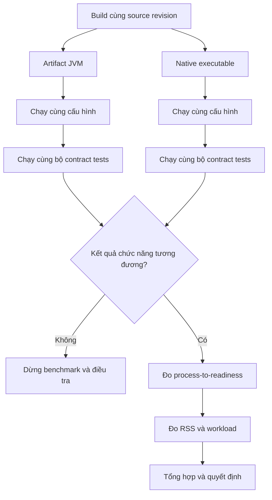

# So sánh chức năng và đo khởi động, RSS bằng cùng một kịch bản

## Mục tiêu bài thực hành

Trong bài này, bạn sẽ tạo hai cách chạy cho cùng một ứng dụng Spring Boot:

- JAR chạy trên JVM.
- Native executable được tạo bằng GraalVM Native Image và Spring AOT.

Hai biến thể được build từ cùng source revision, dùng cùng cấu hình nghiệp vụ và được kiểm tra bằng cùng một bộ test black-box. Sau khi xác nhận chức năng tương đương, bạn đo thời gian từ lúc khởi chạy process tới lúc ứng dụng sẵn sàng nhận request, sau đó đo RSS ở thời điểm readiness và dưới cùng một workload.

Mục tiêu là trả lời bằng dữ liệu:

1. Hai artifact có thực hiện cùng hành vi nghiệp vụ không?
2. Native có rút ngắn thời gian từ process start tới readiness không?
3. RSS của hai biến thể khác nhau thế nào ngay sau startup và khi chịu tải?
4. Chênh lệch có đủ lớn để đáp ứng mục tiêu vận hành của service không?

Không thay đổi logic, dependency, profile hoặc tài nguyên giữa hai lần chạy nếu đó không phải biến thử nghiệm đã được ghi rõ.

## 1. Kịch bản ứng dụng

### 1.1. Service mẫu

Giả sử bạn có một Spring Boot service tên `catalog-service`, cung cấp API đọc thông tin sản phẩm:

| Thành phần | Giá trị |
|---|---|
| Business endpoint | `GET /api/products/sku-001` |
| Readiness endpoint | `GET /actuator/health/readiness` |
| Port | `8080` |
| Profile benchmark | `benchmark` |
| Response | JSON gồm SKU, tên và giá |

Ví dụ response nghiệp vụ:

```json
{
  "sku": "sku-001",
  "name": "Mechanical Keyboard",
  "price": 1250000
}
```

Giá trị trên chỉ là dữ liệu fixture để minh họa. Trong dự án thật, dùng endpoint và dữ liệu ổn định của service đang benchmark.

### 1.2. Vì sao dùng readiness thay vì chỉ nhìn log startup?

Spring Boot có thể ghi log application started trước khi toàn bộ điều kiện nhận traffic của hệ thống đã thỏa mãn. Một process mở port nhưng chưa sẵn sàng xử lý nghiệp vụ cũng chưa được tính là ready.

Sử dụng readiness endpoint làm mốc kết thúc phép đo. Nếu service cần kết nối database, cache hoặc message broker trước khi nhận request, readiness group phải phản ánh đúng các dependency thực sự bắt buộc cho traffic.

Sơ đồ kịch bản:



### 1.3. Điều kiện tiên quyết

Trước khi bắt đầu, cần có:

- Ứng dụng Spring Boot chạy được trên JVM.
- Spring Boot Actuator với health probes được bật.
- GraalVM Native Image và cấu hình Spring AOT tương thích với phiên bản Spring Boot đang dùng.
- Một bộ test HTTP/contract có thể chạy với base URL tùy chọn.
- Cùng database, cache, broker và dữ liệu test cho cả hai biến thể nếu service sử dụng chúng.
- Công cụ quan sát process RSS và tạo tải, chẳng hạn `ps`, `curl` và `wrk` hoặc `hey`.

Ghi lại OS, CPU architecture, Java/GraalVM version, Spring Boot version và phiên bản build plugin. Native executable phụ thuộc target OS/architecture và thư viện hệ điều hành.

Các lệnh shell trong bài dùng Bash trên Linux, với GNU coreutils. Nếu chạy trên Windows, có thể dùng WSL/Linux runner hoặc chuyển phép đo process/RSS sang công cụ tương đương của môi trường đó; không so số liệu lấy từ hai hệ điều hành khác nhau trong cùng một bảng benchmark.

## 2. Giữ nguyên điều kiện so sánh

### 2.1. Hai artifact phải đến từ cùng một revision

Ghi commit trước khi build:

```bash
git rev-parse HEAD
git status --short
```

Build JVM và native từ cùng revision đó. Nếu working tree có thay đổi chưa commit, ghi lại rõ để hai lần build không vô tình sử dụng source khác nhau.

Không sửa code giữa hai lần build. Nếu cần thử một tối ưu, tạo revision riêng và benchmark lại cả hai biến thể từ revision mới.

### 2.2. Giữ cấu hình nghiệp vụ giống nhau

Các giá trị sau phải tương đương:

| Yếu tố | Điều kiện |
|---|---|
| Spring profile | Cùng profile, ví dụ `benchmark` |
| Environment variables | Cùng giá trị cho port, database, cache và feature flags |
| Dependency services | Cùng version, endpoint, dataset và trạng thái |
| Authentication | Cùng user/token và policy |
| Request payload | Cùng dữ liệu và kích thước |
| Logging | Cùng mức log và appender |
| Metrics/tracing | Cùng instrumentation để overhead tương đương |
| Cache | Cùng chính sách và trạng thái ban đầu |
| Connection pool | Cùng cấu hình pool và timeout |

Không để JVM dùng profile development còn native dùng profile production. Cũng không tắt metrics/tracing ở một biến thể nếu biến thể còn lại vẫn bật.

### 2.3. Giữ giới hạn tài nguyên giống nhau

Nếu chạy trong container, đặt cùng:

- CPU quota và CPU set.
- Memory limit.
- PID limit.
- Network mode và DNS.
- Volume/mount.
- User và security context.

Ví dụ cả hai image cùng chạy với `--cpus=1.0` và `--memory=512m`. Nếu một biến thể có nhiều CPU hoặc RAM hơn, kết quả startup và RSS không còn so sánh trực tiếp được.

### 2.4. Phân biệt process cold start và host cold start

Trong bài này, **cold start** là khởi động một process/container mới. Không nhất thiết phải reboot máy hoặc xóa page cache của hệ điều hành.

Nếu production có yêu cầu cold host hoặc node mới, đó là một kịch bản khác. Ghi riêng image pull, container scheduling, filesystem cache và thời gian process startup; không gộp các mốc thành một con số mà không giải thích.

Với benchmark process startup, pull image trước và giữ trạng thái external dependencies nhất quán giữa các lượt.

## 3. Build hai biến thể từ cùng ứng dụng

### 3.1. Build JAR JVM bằng Maven

Ví dụ:

```bash
./mvnw clean package
```

Xác định executable JAR thực tế trong `target/`. Ghi checksum để nhận diện artifact:

```bash
sha256sum target/catalog-service.jar
```

Thay tên file theo `artifactId` và cấu hình package của dự án.

### 3.2. Build native bằng Maven

Với dự án đã cấu hình Native Build Tools và native profile, một lệnh thường dùng là:

```bash
./mvnw -Pnative native:compile
```

Một số dự án dùng Spring Boot Maven plugin/buildpack để tạo native container image:

```bash
./mvnw -Pnative spring-boot:build-image
```

Chỉ dùng lệnh phù hợp với plugin/execution mà dự án đã cấu hình. Kiểm tra build log và đường dẫn native executable được tạo ra; không giả định mọi dự án đều đặt binary ở cùng một thư mục.

### 3.3. Build JAR JVM bằng Gradle

Ví dụ:

```bash
./gradlew clean bootJar
```

Xác định executable JAR trong `build/libs/` và ghi checksum:

```bash
sha256sum build/libs/catalog-service.jar
```

### 3.4. Build native bằng Gradle

Với Gradle Native Build Tools đã cấu hình:

```bash
./gradlew nativeCompile
```

Nếu dự án tạo container image bằng Spring Boot buildpacks, task có thể là:

```bash
./gradlew bootBuildImage
```

Tên task và build arguments phụ thuộc plugin/version. Kiểm tra output của task để xác định đúng binary/image.

### 3.5. Ghi thông tin build

Tạo một bản ghi cho mỗi lần build:

| Trường | JVM | Native |
|---|---|---|
| Git commit | ... | ... |
| Artifact checksum | ... | ... |
| Spring Boot version | ... | ... |
| Java/GraalVM version | ... | ... |
| Maven/Gradle plugin version | ... | ... |
| OS/architecture | ... | ... |
| Build profile | ... | ... |
| Build arguments | JVM flags | Native Image arguments |
| Build duration | ... | ... |
| Artifact size | ... | ... |

Build duration và artifact size là thông tin phụ trợ. Bài thực hành tập trung vào chức năng, startup và RSS; không dùng thời gian compile để thay thế thời gian runtime startup.

## 4. Kiểm tra chức năng tương đương trước khi đo

### 4.1. Dùng cùng bộ contract tests

Contract tests phải gọi HTTP endpoint thật của ứng dụng đang chạy. Chạy cùng một test suite với base URL trỏ lần lượt tới JVM và native.

Các hành vi nên kiểm tra:

- HTTP status code.
- Response JSON và kiểu dữ liệu.
- Validation khi thiếu/sai input.
- Error response và error code.
- Authentication/authorization.
- Serialization/deserialization.
- Truy vấn và cập nhật database.
- Cache hit/eviction nếu có.
- Transaction commit/rollback nếu có.
- Async/event processing nếu nằm trong phạm vi service.
- Health/readiness endpoint.

Không chỉ kiểm tra endpoint trả HTTP 200. Hai biến thể phải có kết quả nghiệp vụ giống nhau với cùng input.

### 4.2. Smoke test endpoint nghiệp vụ

Ví dụ kiểm tra JSON bằng `curl` và `jq`:

```bash
BASE_URL=http://127.0.0.1:8080

BODY=$(curl -fsS "$BASE_URL/api/products/sku-001")

printf '%s\n' "$BODY" | jq -e '
  .sku == "sku-001" and
  .name == "Mechanical Keyboard" and
  .price == 1250000
'
```

Nếu service trả dữ liệu từ database, chuẩn bị fixture trước mỗi lượt test và xác nhận dữ liệu giống nhau. Không dùng response đã cache ở một biến thể nhưng cache rỗng ở biến thể còn lại.

### 4.3. Kiểm tra HTTP error và validation

Ví dụ kiểm tra một SKU không tồn tại:

```bash
STATUS=$(curl -sS -o /tmp/missing-product.json \
  -w '%{http_code}' \
  "$BASE_URL/api/products/not-found")

test "$STATUS" = "404"
```

Nếu API dùng status/error schema khác, thay expected value theo contract thật. Kiểm tra cả body lỗi, không chỉ status.

### 4.4. Chạy cùng test suite cho hai base URL

Ví dụ nếu test runner nhận biến `BASE_URL`:

```bash
BASE_URL=http://127.0.0.1:8080 ./scripts/contract-tests.sh
```

Chạy lệnh trên một lần khi JVM đang chạy và một lần khi native đang chạy. Giữ nguyên test data và test order; reset database/cache giữa các lượt nếu test có side effect.

Nếu dự án dùng JUnit/RestAssured, Newman, Karate hoặc một công cụ khác, chỉ cần cấu hình base URL để tái sử dụng cùng test definitions.

### 4.5. Tiêu chí dừng

Nếu bất kỳ contract test nào chỉ pass trên JVM hoặc chỉ pass trên native:

1. Dừng benchmark hiệu năng.
2. Lưu request, response, log và exception.
3. Xác định khác biệt do cấu hình, reflection/resource metadata, serialization, proxy hay dependency.
4. Sửa nguyên nhân và build lại cả hai artifact từ cùng revision.
5. Chạy lại toàn bộ contract tests.

Một binary nhanh hơn nhưng thực hiện sai nghiệp vụ không phải là kết quả benchmark hợp lệ.

## 5. Chạy hai biến thể với cùng cấu hình

### 5.1. Chạy JVM

Ví dụ:

```bash
SPRING_PROFILES_ACTIVE=benchmark \
  java -jar target/catalog-service.jar
```

Nếu cần JVM flags, ghi lại đầy đủ. Đối với phép so sánh production, dùng cấu hình JVM dự kiến triển khai và có thể thêm một baseline JVM đã tuning riêng.

### 5.2. Chạy native executable

Ví dụ:

```bash
SPRING_PROFILES_ACTIVE=benchmark \
  ./target/catalog-service
```

Thay đường dẫn bằng binary thực tế. Cùng profile, port, environment variables, external services và feature flags với JVM.

### 5.3. Chỉ chạy một biến thể tại một thời điểm

Hai process không thể cùng bind một port. Quy trình cho mỗi lượt:

1. Khởi chạy một biến thể.
2. Chờ readiness.
3. Chạy contract tests và phép đo đã chọn.
4. Gửi SIGTERM và chờ process thoát.
5. Xác nhận port và external resources đã được giải phóng.
6. Reset fixture/cache nếu kịch bản yêu cầu.
7. Khởi chạy biến thể còn lại.

Không chạy song song hai biến thể trên cùng runner nếu mục tiêu là so sánh tài nguyên; chúng sẽ tranh CPU, memory và I/O.

## 6. Đo thời gian process start tới readiness

### 6.1. Định nghĩa mốc đo

Sử dụng:

```text
startup_to_ready_ms =
    readiness_timestamp - process_start_timestamp
```

`process_start_timestamp` là thời điểm ngay trước lệnh khởi chạy process. `readiness_timestamp` là thời điểm đầu tiên readiness endpoint trả thành công.

Không tính thời gian Maven/Gradle build vào startup. Nếu muốn đo end-to-end deployment, đo riêng image pull, container creation, scheduling và readiness.

### 6.2. Chuẩn bị readiness endpoint

Với Spring Boot Actuator:

```properties
management.endpoint.health.probes.enabled=true
management.endpoints.web.exposure.include=health
management.endpoint.health.show-details=never
```

Endpoint thường dùng:

```text
http://127.0.0.1:8080/actuator/health/readiness
```

Đảm bảo endpoint này được bật trên cả hai biến thể và dùng cùng port. Nếu service có management port riêng, phải xác định readiness thực sự của web server chính, tránh đo một management server healthy trong khi API server chưa nhận request.

### 6.3. Đo startup của JVM trên Linux

Mở terminal thứ nhất:

```bash
START_MS=$(date +%s%3N)
READY_MS=""

SPRING_PROFILES_ACTIVE=benchmark \
  java -jar target/catalog-service.jar \
  > jvm.log 2>&1 &
APP_PID=$!

for attempt in $(seq 1 900); do
  if curl -fsS --max-time 1 \
      http://127.0.0.1:8080/actuator/health/readiness \
      > /dev/null; then
    READY_MS=$(date +%s%3N)
    break
  fi

  if ! kill -0 "$APP_PID" 2>/dev/null; then
    break
  fi

  sleep 0.1
done

if [ -z "$READY_MS" ]; then
  echo "JVM did not become ready"
  cat jvm.log
  kill -TERM "$APP_PID" 2>/dev/null || true
  wait "$APP_PID" 2>/dev/null || true
  exit 1
fi

echo "JVM startup_to_ready_ms=$((READY_MS - START_MS))"
echo "JVM pid=$APP_PID"
```

Lệnh dùng GNU `date` trên Linux để lấy millisecond timestamp. Vòng lặp chờ tối đa khoảng 90 giây; điều chỉnh giới hạn nếu startup SLO của ứng dụng khác.

### 6.4. Đo startup của native executable

Dừng JVM sau khi hoàn tất lượt đo:

```bash
kill -TERM "$APP_PID"
wait "$APP_PID"
```

Sau đó chạy cùng cách đo với native:

```bash
START_MS=$(date +%s%3N)
READY_MS=""

SPRING_PROFILES_ACTIVE=benchmark \
  ./target/catalog-service \
  > native.log 2>&1 &
APP_PID=$!

for attempt in $(seq 1 900); do
  if curl -fsS --max-time 1 \
      http://127.0.0.1:8080/actuator/health/readiness \
      > /dev/null; then
    READY_MS=$(date +%s%3N)
    break
  fi

  if ! kill -0 "$APP_PID" 2>/dev/null; then
    break
  fi

  sleep 0.1
done

if [ -z "$READY_MS" ]; then
  echo "Native executable did not become ready"
  cat native.log
  kill -TERM "$APP_PID" 2>/dev/null || true
  wait "$APP_PID" 2>/dev/null || true
  exit 1
fi

echo "Native startup_to_ready_ms=$((READY_MS - START_MS))"
echo "Native pid=$APP_PID"
```

Giữ cùng cách đo, cùng readiness URL và cùng timeout. Chênh lệch do dùng log startup làm mốc cho JVM nhưng dùng readiness cho native sẽ khiến kết quả sai.

### 6.5. Đo nhiều lượt cold start

Mỗi lượt cần process mới. Ghi:

- Số thứ tự lượt.
- Biến thể JVM/native.
- Process start time.
- Readiness time.
- Startup duration.
- Exit status nếu process không ready.
- Trạng thái dependency và cache.

Nên chạy ít nhất 10 lượt cho mỗi biến thể trong một môi trường benchmark ổn định; tăng số lượt nếu kết quả dao động nhiều. Xen kẽ thứ tự JVM/native để giảm ảnh hưởng của tải nền và cache.

Tính median và p95 của startup duration. Không chỉ lấy lượt nhanh nhất.

## 7. Đo RSS và memory footprint

### 7.1. Phân biệt process RSS và container memory

RSS (Resident Set Size) là lượng trang bộ nhớ của process hiện đang cư trú trong RAM theo cách hệ điều hành báo cáo. Nó bao gồm các trang shared được map vào process, vì vậy tổng RSS của nhiều process có thể đếm lặp trang dùng chung.

Container memory/cgroup usage đo memory được kernel tính cho cgroup. Đây là chỉ số phù hợp hơn khi mục tiêu là tránh OOM hoặc tính mật độ container trên node.

Trong bài này, ghi rõ đang so:

- Process RSS của JVM và native.
- Container/cgroup memory của hai image.
- Managed heap metrics nếu có.

Không so JVM heap used với native RSS rồi kết luận native dùng ít memory hơn.

### 7.2. Đọc RSS tại thời điểm readiness

Khi process đã ready, lấy PID đã lưu ở bước startup:

```bash
ps -o pid=,rss=,etime=,args= -p "$APP_PID"
```

Trường `rss` của `ps` thường được hiển thị theo KiB trên Linux. Ghi đơn vị vào báo cáo; không so một giá trị KiB với một giá trị MiB mà không đổi đơn vị.

Đo ở thời điểm readiness cho biết footprint ban đầu, nhưng chưa phản ánh cache được nạp, connection pool tăng hoặc request đang được xử lý.

### 7.3. Lấy mẫu RSS trong thời gian chạy

Trong khi process đang chạy, mở terminal khác và lấy mẫu định kỳ:

```bash
APP_PID=12345
: > jvm-rss-kb.txt

while kill -0 "$APP_PID" 2>/dev/null; do
  ps -o rss= -p "$APP_PID" >> jvm-rss-kb.txt || true
  sleep 0.2
done

sort -n jvm-rss-kb.txt | tail -n 1
```

Thay `12345` bằng PID của biến thể đang đo. Lưu một file riêng cho mỗi lượt và mỗi biến thể, ví dụ `jvm-rss-kb.txt` và `native-rss-kb.txt`. Có thể tính median, maximum và xu hướng tăng memory từ các mẫu này.

Lấy mẫu mỗi 0,2 giây vẫn có thể bỏ lỡ spike rất ngắn. Nếu cần peak chính xác hơn, dùng cgroup v2 `memory.peak`, công cụ giám sát container hoặc profiler phù hợp.

### 7.4. Đo container memory

Khi chạy bằng Docker, dùng cùng CPU/memory limits cho cả hai image:

```bash
docker run -d \
  --name catalog-jvm \
  --cpus="1.0" \
  --memory="512m" \
  -e SPRING_PROFILES_ACTIVE=benchmark \
  -p 8080:8080 \
  catalog-service:jvm
```

Khi container JVM đang chạy, lấy memory snapshot:

```bash
docker stats --no-stream \
  --format "table {{.Name}}\t{{.CPUPerc}}\t{{.MemUsage}}\t{{.MemPerc}}"
```

Chạy lệnh này trước khi dừng container và lưu kết quả riêng cho JVM.

Chỉ chạy một container tại một thời điểm vì cả hai cùng dùng port 8080. Pull image trước khi đo để không đưa thời gian tải image vào process startup. Sau khi đo JVM, dừng và xóa container:

```bash
docker stop catalog-jvm
docker rm catalog-jvm
```

Sau đó chạy native image với cùng cấu hình, chỉ đổi tên container và image:

```bash
docker run -d \
  --name catalog-native \
  --cpus="1.0" \
  --memory="512m" \
  -e SPRING_PROFILES_ACTIVE=benchmark \
  -p 8080:8080 \
  catalog-service:native
```

Lặp lại lệnh `docker stats --no-stream` khi container native đang chạy và lưu kết quả riêng.

Sau khi đo native, dọn container tương ứng:

```bash
docker stop catalog-native
docker rm catalog-native
```

Nếu muốn đo container-to-readiness thay vì process-to-readiness, ghi timestamp ngay trước `docker run` và timestamp khi readiness endpoint lần đầu trả thành công. Giữ image đã pull sẵn và dùng cùng cách đo cho cả hai image.

`docker stats --no-stream` chỉ cho một snapshot tại thời điểm gọi, không phải peak memory. Lặp sampling trong toàn bộ workload hoặc dùng cgroup metrics để lấy peak.

### 7.5. Đọc cgroup v2 memory peak

Trên Linux host dùng cgroup v2, container có thể có file `memory.peak` trong cgroup tương ứng. Khi truy cập được đúng cgroup, giá trị này cho biết peak memory kể từ khi cgroup được tạo hoặc reset theo cơ chế của hệ thống.

Các file thường hữu ích:

```bash
cat /sys/fs/cgroup/memory.current
cat /sys/fs/cgroup/memory.peak
cat /sys/fs/cgroup/memory.max
```

Đường dẫn trên chỉ đúng khi process đang ở cgroup tương ứng và mount hierarchy cho phép truy cập. Trong host có nhiều container hoặc cgroup con, cần xác định đúng path qua `/proc/self/cgroup` và cgroup mount.

## 8. Chạy cùng workload để đo RSS dưới tải

### 8.1. Phân biệt footprint sau startup và steady-state

Ghi ít nhất ba mốc:

1. RSS ngay sau readiness.
2. RSS sau warm-up.
3. RSS/peak memory trong khoảng đo steady-state hoặc burst.

Một service có thể có RSS thấp ngay sau startup nhưng tăng đáng kể sau khi cache, thread pool và connection pool được sử dụng.

### 8.2. Chuẩn bị workload cố định

Ví dụ với `wrk`:

```bash
wrk -t2 -c20 -d60s \
  http://127.0.0.1:8080/api/products/sku-001
```

Hoặc với `hey`:

```bash
hey -z 60s -c 20 \
  http://127.0.0.1:8080/api/products/sku-001
```

Chọn một công cụ và giữ nguyên:

- Số worker/thread.
- Concurrency.
- Duration.
- Request path, headers và payload.
- Máy phát tải.
- Network topology.

Load generator nên chạy trên máy riêng hoặc có đủ tài nguyên để không tranh CPU/RAM với service đang đo.

Ví dụ nếu dùng `wrk`, có thể chạy một lượt warm-up 60 giây rồi mới chạy cửa sổ đo 120 giây:

```bash
wrk -t2 -c20 -d60s \
  http://127.0.0.1:8080/api/products/sku-001

wrk -t2 -c20 -d120s \
  http://127.0.0.1:8080/api/products/sku-001 \
  | tee native-or-jvm-load-result.txt
```

Thay tên file output theo biến thể và lượt đo. Dùng cùng duration, concurrency và request mix cho JVM/native; nếu ứng dụng có warm-up policy riêng, ghi rõ thời gian đó trong báo cáo.

### 8.3. Warm-up và steady-state

Với phép đo steady-state:

1. Khởi động process mới.
2. Chờ readiness.
3. Gửi cùng workload warm-up trong khoảng thời gian đã định.
4. Bắt đầu cửa sổ đo.
5. Giữ concurrency và request mix cố định.
6. Ghi RSS, container memory, throughput, p95/p99 và error rate.
7. Dừng process và lưu kết quả.

JVM có thể JIT compile hot path trong warm-up. Native executable không có JIT như JVM, nhưng vẫn có thể hoàn tất lazy initialization, nạp cache hoặc thiết lập connection. Dùng cùng lượng request và thời gian warm-up để so sánh điều kiện vận hành; ghi riêng sự khác biệt của hai runtime.

### 8.4. Không gộp cold-start với warm-up

Cold-start đo process mới tới readiness. Steady-state đo sau khi ứng dụng đã xử lý workload. Nếu gộp hai giai đoạn, bạn sẽ không biết lợi ích đến từ startup hay runtime.

Nếu production thường xuyên scale-to-zero, cold-start có trọng số cao. Nếu service chạy liên tục nhiều giờ/ngày, RSS và latency steady-state thường quan trọng hơn.

## 9. Lặp lại và tổng hợp số liệu

### 9.1. Ma trận phép đo

| Kịch bản | JVM | Native | Số lượt |
|---|---|---|---:|
| Contract tests | Pass/Fail | Pass/Fail | Cùng test suite |
| Process-to-readiness | Đo ms | Đo ms | 10+ |
| RSS tại readiness | Đo KiB/MiB | Đo KiB/MiB | 10+ |
| RSS sau warm-up | Đo KiB/MiB | Đo KiB/MiB | 5+ |
| Peak container memory | Đo MiB | Đo MiB | 5+ |
| Steady-state throughput | Đo req/s | Đo req/s | 3+ |
| p95/p99 latency | Đo ms | Đo ms | 3+ |
| Error rate | Đo % | Đo % | 3+ |

Số lượt trong bảng là gợi ý cho bài lab, không phải quy tắc thống kê cho mọi hệ thống. Tăng số lượt khi workload hoặc runner có độ biến động cao.

### 9.2. Mẫu bảng kết quả

Không điền số liệu trước khi chạy. Ghi kết quả đo thật:

| Chỉ số | JVM median | Native median | Chênh lệch |
|---|---:|---:|---:|
| Startup-to-ready (ms) | ... | ... | ... |
| RSS tại readiness (MiB) | ... | ... | ... |
| RSS sau warm-up (MiB) | ... | ... | ... |
| Peak container memory (MiB) | ... | ... | ... |
| Throughput (req/s) | ... | ... | ... |
| p95 latency (ms) | ... | ... | ... |
| p99 latency (ms) | ... | ... | ... |
| Error rate (%) | ... | ... | ... |

Ghi thêm p95 startup và khoảng dao động nếu số lượt đủ lớn. Với RSS, ghi cả median và peak; chỉ một lần lấy mẫu không thể đại diện toàn bộ memory profile.

### 9.3. Tính phần trăm thay đổi

Với chỉ số càng thấp càng tốt, chẳng hạn startup hoặc RSS:

```text
improvement_percent =
    (JVM_value - Native_value) / JVM_value * 100
```

Giá trị dương nghĩa native thấp hơn JVM ở chỉ số đó. Giá trị âm nghĩa native cao hơn.

Với throughput, hướng diễn giải ngược lại: giá trị cao hơn thường tốt hơn, nhưng vẫn phải xét latency và error rate.

### 9.4. Dùng median và percentile đúng cách

- Median giảm ảnh hưởng của một lượt bất thường.
- p95/p99 cho biết tail behavior.
- Min/max giúp phát hiện outlier nhưng không nên là số liệu đại diện duy nhất.
- Ghi rõ số lượt, duration và cách loại trừ lỗi đo.

Không loại một lượt chậm chỉ vì nó làm kết quả kém. Chỉ loại khi có nguyên nhân ngoại lệ được ghi lại, ví dụ runner bị tác vụ khác chiếm CPU hoặc dependency test bị gián đoạn.

## 10. Phân tích kết quả

### 10.1. Native startup nhanh hơn nhưng RSS tương đương

Điều này có thể phù hợp với service cần scale-out nhanh nhưng không bị giới hạn memory. Kiểm tra lợi ích ở cấp readiness và first-request latency có đủ cải thiện SLO không.

### 10.2. Native RSS thấp hơn nhưng throughput giảm

Tính số replica cần thiết để đáp ứng cùng tải và xem CPU cost/request. Nếu phải chạy nhiều replica hơn hoặc CPU tăng đáng kể, lợi ích memory có thể không chuyển thành tiết kiệm chi phí.

### 10.3. Native startup nhanh hơn nhưng readiness không cải thiện nhiều

Kiểm tra phần thời gian còn lại nằm ở database connection, cache warm-up, service discovery, image pull hoặc orchestration. Native chỉ cải thiện phần process/application startup mà nó kiểm soát.

### 10.4. JVM RSS cao hơn tại startup nhưng giảm hoặc ổn định sau warm-up

Ghi nhận cả hai mốc. JVM heap sizing, GC và JIT có thể thay đổi memory profile sau khi xử lý workload. So sánh chỉ tại readiness có thể không phản ánh service chạy liên tục.

### 10.5. Native RSS tăng mạnh dưới tải

Kiểm tra cache, object retention, thread pool, direct/native allocations, connection pool và request concurrency. Native Image không loại bỏ các vấn đề memory leak hoặc tăng trưởng dữ liệu trong ứng dụng.

## 11. Tiêu chí quyết định

### 11.1. Chọn chỉ số chính theo mục tiêu triển khai

| Mục tiêu | Chỉ số ưu tiên | Guardrail |
|---|---|---|
| Scale-to-zero/scale-out | Startup-to-ready và first-request latency | Error rate, readiness stability |
| Giảm mật độ RAM | RSS/container memory | Throughput, p95/p99, CPU |
| API chạy liên tục | Throughput và latency steady-state | Memory, GC/runtime behavior, error rate |
| Short-lived job | Tổng thời gian hoàn thành | Kết quả nghiệp vụ, peak memory |

### 11.2. Điều kiện để kết luận

Chỉ kết luận native phù hợp khi:

- Cùng bộ contract tests pass.
- Startup hoặc RSS cải thiện theo mục tiêu đã đặt.
- Throughput và latency vẫn đáp ứng SLO.
- Error rate không tăng vượt ngưỡng.
- Peak container memory còn headroom dưới limit.
- Kết quả ổn định qua nhiều lượt.
- Chi phí build và vận hành được chấp nhận.

Nếu chỉ một chỉ số cải thiện nhưng guardrail bị vi phạm, chưa nên chuyển production.

## 12. Mẫu báo cáo benchmark

Sau khi chạy lab, ghi lại:

```text
Service:
Source revision:
Build date:
OS / CPU architecture:
Spring Boot version:
GraalVM version:
Maven/Gradle plugin version:

Environment:
CPU quota:
Memory limit:
Database/cache/broker:
Spring profile:
Load generator:

Functional parity:
JVM contract tests: PASS/FAIL
Native contract tests: PASS/FAIL
Known differences:

Startup:
JVM startup-to-ready median:
JVM startup-to-ready p95:
Native startup-to-ready median:
Native startup-to-ready p95:
Number of trials:

Memory:
JVM RSS at readiness:
Native RSS at readiness:
JVM RSS after warm-up:
Native RSS after warm-up:
JVM peak container memory:
Native peak container memory:
Sampling interval / source:

Steady-state:
JVM throughput / p95 / p99 / error rate:
Native throughput / p95 / p99 / error rate:
Warm-up duration:
Measurement duration:

Decision:
Primary objective met:
Guardrails met:
Trade-offs:
Limitations:
Next action:
```

## 13. Lỗi thường gặp và cách xử lý

| Triệu chứng | Nguyên nhân có thể | Hướng xử lý |
|---|---|---|
| Native pass health nhưng contract test fail | Serialization, reflection, resource hoặc cấu hình khác | Dừng benchmark và sửa parity trước |
| JVM/native dùng dữ liệu khác nhau | Fixture/cache/database state không được reset | Reset state và chạy lại cùng test suite |
| Startup time dao động mạnh | Runner contention, dependency latency hoặc CPU throttling | Cô lập runner, đo dependency và xen kẽ thứ tự |
| Readiness báo success quá sớm | Probe không phản ánh dependency bắt buộc | Điều chỉnh readiness group theo traffic thực |
| RSS native thấp nhưng container memory cao | Native memory, page cache hoặc process phụ | So process RSS với cgroup/container usage |
| Peak RSS không ổn định | Sampling interval quá thưa hoặc workload khác nhau | Tăng tần suất lấy mẫu hoặc dùng cgroup peak |
| JVM bị đo khi chưa warm-up | Chỉ chạy một request ngay sau startup | Tách cold-start và steady-state |
| Native bị đo sau khi đã warm cache | Không reset dependency state giữa lượt | Chuẩn hóa cache và thứ tự chạy |
| Một biến thể có nhiều CPU/RAM hơn | Container limits khác nhau | Dùng cùng resource limits |
| Startup nhanh nhưng first request chậm | Lazy initialization hoặc dependency chưa sẵn sàng | Đo riêng first-request latency và readiness semantics |

## 14. Bài tập mở rộng

### Bài 1 — So sánh process startup và container startup

Đo process-to-readiness khi chạy trực tiếp trên cùng runner. Sau đó build hai container image, pull image trước và đo container creation-to-readiness. Ghi riêng image pull, container startup và application readiness.

### Bài 2 — So sánh memory theo concurrency

Chạy lần lượt concurrency 1, 10, 20 và 50 với cùng request mix. Ghi RSS, peak cgroup memory, throughput và p95/p99. Xác định mức tải mà memory bắt đầu tăng nhanh.

### Bài 3 — Kiểm tra độ ổn định qua nhiều lượt

Chạy tối thiểu 10 cold starts cho mỗi biến thể, xen kẽ thứ tự. So sánh median/p95 và giải thích các outlier bằng log hoặc số liệu runner.

### Bài 4 — Đưa kết quả vào quyết định triển khai

Chọn một mục tiêu production cụ thể: scale-out nhanh, giảm memory density hoặc giữ throughput. Đặt một chỉ số chính và ít nhất hai guardrail. Dùng bảng kết quả để kết luận có nên triển khai native hay cần tối ưu tiếp.

### Câu hỏi tự kiểm tra

1. Vì sao phải chạy cùng contract tests trước khi so sánh hiệu năng?
2. Vì sao readiness timestamp phù hợp hơn thời điểm log application started cho phép đo startup?
3. Process RSS và cgroup memory khác nhau như thế nào?
4. Vì sao cần đo RSS tại readiness, sau warm-up và peak dưới tải?
5. Vì sao phải tách process cold start khỏi image pull và scheduling?
6. Vì sao JVM cần warm-up khi đo steady-state và native cũng cần cùng workload warm-up?
7. Vì sao một native executable giảm RSS nhưng giảm throughput có thể không giúp giảm chi phí?
8. Khi nào cần dùng p95/p99 thay vì chỉ median?

## Tài liệu tham khảo

- [Spring Boot Actuator — Kubernetes Probes](https://docs.spring.io/spring-boot/reference/actuator/endpoints.html#actuator.endpoints.kubernetes-probes)
- [GraalVM Native Image Reference Manual](https://www.graalvm.org/latest/reference-manual/native-image/)
- [Docker — Resource Constraints](https://docs.docker.com/engine/containers/resource_constraints/)
- [Linux Kernel — Control Group v2](https://docs.kernel.org/admin-guide/cgroup-v2.html)

**Ghi nhớ:** hai biến thể phải đến từ cùng source revision, dùng cùng cấu hình, dependency, resource limits và workload. Chỉ benchmark sau khi cùng bộ contract tests pass. Đo process-to-readiness, RSS tại nhiều giai đoạn và cgroup memory bằng cùng phương pháp; lặp nhiều lượt, dùng median/percentile và kiểm tra guardrail trước khi quyết định.
