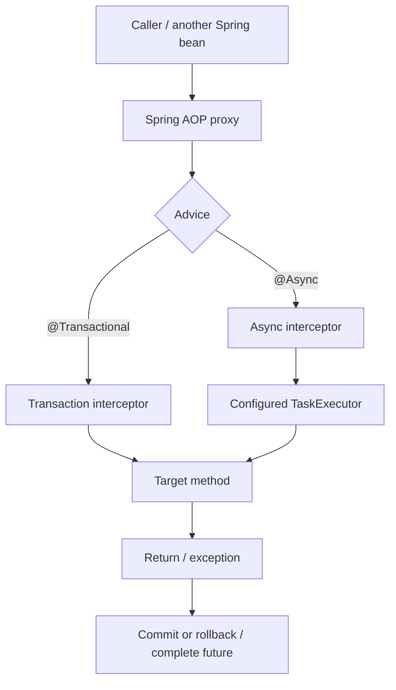

# Kiểm chứng @Transactional hoặc @Async đi qua proxy sau AOT

Spring AOP áp dụng `@Transactional` và `@Async` thông qua proxy. Khi một service được gọi từ bean khác, proxy nhận lời gọi, chạy interceptor tương ứng rồi mới chuyển tiếp tới method của object đích. Spring AOT phải chuẩn bị các thành phần cần thiết để cơ chế đó tiếp tục hoạt động trong Native Image.

Bài thực hành này tạo một ứng dụng Spring Boot nhỏ có hai service: một service kiểm chứng transaction commit/rollback và một service thực thi công việc bất đồng bộ. Ta sẽ xác nhận bean thực sự được bọc proxy, kiểm tra interceptor đã được gọi, sau đó chạy cùng bộ test trên JVM và trong native test executable.

Mục tiêu là chứng minh ba điều:

- Method được gọi qua proxy nên transaction advice hoặc async advice thực sự chạy.
- Hành vi vẫn đúng sau Spring AOT và khi test chạy bằng Native Image.
- Những lỗi thiết kế như self-invocation vẫn có thể xảy ra trong native application, vì AOT không thay đổi quy tắc proxy của Spring.

## 1. Luồng gọi qua proxy

Với `@Transactional`, proxy áp dụng transaction interceptor: mở hoặc tham gia transaction, gọi method đích, sau đó commit hoặc rollback theo kết quả và rollback rules.

Với `@Async`, proxy gửi lời gọi method tới executor được chỉ định. Caller nhận một Future/CompletableFuture và không cần thực thi phần thân method trên thread gọi ban đầu.



Trong Native Image, Spring AOT xử lý bean definitions và các proxy có thể xác định từ application context. Runtime hints cần thiết cho các cơ chế Spring-managed cũng được đóng góp trong quá trình AOT. Điều này không có nghĩa mọi proxy tạo động tùy ý trong code đều tự động được phát hiện.

Một lời gọi nội bộ từ method này sang method khác trên cùng object không đi qua proxy. Vì vậy, một method gọi `this.someTransactionalMethod()` sẽ không kích hoạt transaction interceptor chỉ vì method đích có annotation `@Transactional`. Quy tắc này giống nhau trên JVM và Native Image.

## 2. Chuẩn bị project thực hành

Ví dụ dùng Java 21 và Spring Boot 3.x có hỗ trợ Spring AOT/Native Image. Hãy dùng cùng phiên bản Spring Boot, GraalVM và Native Build Tools đã được pin trong project thực tế; task names và plugin configuration có thể khác giữa các phiên bản.

Cấu trúc source tối thiểu:

```text
src/
├── main/
│   └── java/com/example/proxydemo/
│       ├── ProxyDemoApplication.java
│       ├── ProxyInfrastructureConfiguration.java
│       ├── TransactionalProbe.java
│       └── AsyncProbe.java
└── test/
    └── java/com/example/proxydemo/
        ├── ProxyAotIntegrationTest.java
        └── RecordingTransactionManager.java
```

Test dùng một TransactionManager nhỏ chỉ để ghi nhận begin/commit/rollback. Cách này cô lập việc kiểm chứng transaction interceptor khỏi database và JDBC driver, vốn có thể tạo thêm yêu cầu native metadata. Nó chứng minh lời gọi đã đi qua transaction advice; nó không thay thế integration test xác nhận rollback dữ liệu trên database thật. Phần mở rộng cuối bài sẽ chỉ ra cách bổ sung kiểm thử đó.

### 2.1. Dependencies

Các dependency cốt lõi cho Gradle:

```groovy
dependencies {
    implementation("org.springframework.boot:spring-boot-starter")
    implementation("org.springframework.boot:spring-boot-starter-aop")
    implementation("org.springframework:spring-tx")

    testImplementation("org.springframework.boot:spring-boot-starter-test")
}
```

Với Maven:

```xml
<dependencies>
    <dependency>
        <groupId>org.springframework.boot</groupId>
        <artifactId>spring-boot-starter</artifactId>
    </dependency>
    <dependency>
        <groupId>org.springframework.boot</groupId>
        <artifactId>spring-boot-starter-aop</artifactId>
    </dependency>
    <dependency>
        <groupId>org.springframework</groupId>
        <artifactId>spring-tx</artifactId>
    </dependency>
    <dependency>
        <groupId>org.springframework.boot</groupId>
        <artifactId>spring-boot-starter-test</artifactId>
        <scope>test</scope>
    </dependency>
</dependencies>
```

Các version được quản lý bởi Spring Boot dependency management/BOM. Nếu ứng dụng đã có starter JDBC, JPA hoặc dependency cung cấp transaction API thì không thêm dependency trùng lặp. Native Build Tools và cấu hình AOT phải được bật theo hướng dẫn build hiện có của project.

## 3. Tạo application và bật infrastructure

Tạo class khởi động:

```java
package com.example.proxydemo;

import org.springframework.boot.SpringApplication;
import org.springframework.boot.autoconfigure.SpringBootApplication;

@SpringBootApplication
public class ProxyDemoApplication {

    public static void main(String[] args) {
        SpringApplication.run(ProxyDemoApplication.class, args);
    }
}
```

Bật async và transaction management, đồng thời đăng ký executor có tên rõ ràng:

```java
package com.example.proxydemo;

import org.springframework.context.annotation.Bean;
import org.springframework.context.annotation.Configuration;
import org.springframework.scheduling.annotation.EnableAsync;
import org.springframework.scheduling.concurrent.ThreadPoolTaskExecutor;
import org.springframework.transaction.annotation.EnableTransactionManagement;

@Configuration(proxyBeanMethods = false)
@EnableAsync
@EnableTransactionManagement
public class ProxyInfrastructureConfiguration {

    @Bean(name = "nativeTaskExecutor")
    ThreadPoolTaskExecutor nativeTaskExecutor() {
        ThreadPoolTaskExecutor executor = new ThreadPoolTaskExecutor();
        executor.setCorePoolSize(2);
        executor.setMaxPoolSize(2);
        executor.setQueueCapacity(20);
        executor.setThreadNamePrefix("native-proxy-");
        executor.setWaitForTasksToCompleteOnShutdown(true);
        executor.setAwaitTerminationSeconds(5);
        return executor;
    }
}
```

Trong một ứng dụng Spring Boot có transaction manager được auto-configure, transaction annotation có thể đã được bật bởi auto-configuration. Ở lab này, `@EnableTransactionManagement` được khai báo rõ để thể hiện infrastructure mà proxy cần. Không đăng ký hai transaction management configuration trùng nhau nếu project đã có cấu hình tương đương.

Executor được đặt tên `nativeTaskExecutor` để annotation `@Async` tham chiếu trực tiếp, tránh phụ thuộc vào việc chọn executor mặc định khi ứng dụng có nhiều pool.

## 4. Tạo service dùng @Transactional

Service có hai đường chạy: một method kết thúc bình thường để kiểm tra commit, và một method ném runtime exception để kiểm tra rollback.

```java
package com.example.proxydemo;

import org.springframework.stereotype.Service;
import org.springframework.transaction.annotation.Transactional;

@Service
public class TransactionalProbe {

    @Transactional
    public String complete() {
        return "completed";
    }

    @Transactional
    public void fail() {
        throw new IllegalStateException("expected failure");
    }

    public void invokeFailInternally() {
        this.fail();
    }
}
```

Method được đánh dấu `@Transactional` phải được gọi qua Spring proxy. Ví dụ `complete()` và `fail()` là public, class không final và bean được Spring quản lý.

Method `invokeFailInternally()` cố ý minh họa self-invocation. Caller gọi method không có transaction; phần thân method gọi trực tiếp `this.fail()` trên target object. Lời gọi đó không quay lại proxy nên transaction manager không nhận begin/rollback cho `fail()`. Không dùng kiểu gọi này trong code nghiệp vụ nếu kỳ vọng transaction advice được áp dụng.

## 5. Tạo service dùng @Async

Service async trả về `CompletableFuture`. Giá trị trả về chứa tên thread đang thực thi phần thân method, giúp test xác nhận lời gọi đã chuyển sang executor.

```java
package com.example.proxydemo;

import java.util.concurrent.CompletableFuture;

import org.springframework.scheduling.annotation.Async;
import org.springframework.stereotype.Service;

@Service
public class AsyncProbe {

    @Async("nativeTaskExecutor")
    public CompletableFuture<String> execute() {
        return CompletableFuture.completedFuture(
                Thread.currentThread().getName());
    }
}
```

Không gọi method async qua `this.execute()` bên trong cùng bean nếu muốn gửi công việc sang executor. Hãy inject bean khác hoặc tách phần async thành collaborator riêng để lời gọi đi qua proxy.

Các method async nên có kiểu trả về được Spring hỗ trợ, thường là `void` hoặc `Future`/`CompletableFuture`. Với kiểu Future, exception trong tác vụ được chuyển tới Future và caller có thể quan sát bằng `get()` hoặc completion stage. Nếu method trả `void`, cần cấu hình `AsyncUncaughtExceptionHandler` để xử lý exception không có Future nhận kết quả.


## 6. Tạo TransactionManager quan sát trong test

Để xác nhận transaction interceptor thực sự được gọi, tạo một transaction manager test-only đếm số lần begin, commit và rollback. Nó không quản lý connection hay dữ liệu; mục đích là quan sát lời gọi do `TransactionInterceptor` phát ra.

```java
package com.example.proxydemo;

import java.util.concurrent.atomic.AtomicInteger;

import org.springframework.transaction.TransactionDefinition;
import org.springframework.transaction.support.AbstractPlatformTransactionManager;
import org.springframework.transaction.support.DefaultTransactionStatus;

public class RecordingTransactionManager
        extends AbstractPlatformTransactionManager {

    private final AtomicInteger begins = new AtomicInteger();
    private final AtomicInteger commits = new AtomicInteger();
    private final AtomicInteger rollbacks = new AtomicInteger();

    @Override
    protected Object doGetTransaction() {
        return new Object();
    }

    @Override
    protected void doBegin(
            Object transaction,
            TransactionDefinition definition) {
        begins.incrementAndGet();
    }

    @Override
    protected void doCommit(DefaultTransactionStatus status) {
        commits.incrementAndGet();
    }

    @Override
    protected void doRollback(DefaultTransactionStatus status) {
        rollbacks.incrementAndGet();
    }

    public int beginCount() {
        return begins.get();
    }

    public int commitCount() {
        return commits.get();
    }

    public int rollbackCount() {
        return rollbacks.get();
    }
}
```

Đây là test fixture, không dùng làm transaction manager production. Một transaction manager thực tế như `DataSourceTransactionManager` hoặc `JpaTransactionManager` còn phải quản lý resource, connection, synchronization và rollback dữ liệu.

## 7. Viết integration test xác nhận proxy

Test khởi động Spring ApplicationContext thật, lấy bean từ container và kiểm tra proxy cũng như hành vi của advice.

```java
package com.example.proxydemo;

import java.util.concurrent.TimeUnit;

import org.junit.jupiter.api.Test;
import org.junit.jupiter.api.parallel.Execution;
import org.junit.jupiter.api.parallel.ExecutionMode;

import org.springframework.aop.support.AopUtils;
import org.springframework.beans.factory.annotation.Autowired;
import org.springframework.boot.test.context.SpringBootTest;
import org.springframework.boot.test.context.TestConfiguration;
import org.springframework.context.annotation.Bean;
import org.springframework.context.annotation.Import;

import static org.assertj.core.api.Assertions.assertThat;
import static org.assertj.core.api.Assertions.assertThatThrownBy;

@SpringBootTest
@Execution(ExecutionMode.SAME_THREAD)
@Import(ProxyAotIntegrationTest.TransactionTestConfiguration.class)
class ProxyAotIntegrationTest {

    @Autowired
    TransactionalProbe transactionalProbe;

    @Autowired
    AsyncProbe asyncProbe;

    @Autowired
    RecordingTransactionManager transactionManager;

    @Test
    void transactionalMethodRunsThroughProxyAndCommits() {
        assertThat(AopUtils.isAopProxy(transactionalProbe)).isTrue();

        int beginsBefore = transactionManager.beginCount();
        int commitsBefore = transactionManager.commitCount();

        assertThat(transactionalProbe.complete()).isEqualTo("completed");

        assertThat(transactionManager.beginCount())
                .isEqualTo(beginsBefore + 1);
        assertThat(transactionManager.commitCount())
                .isEqualTo(commitsBefore + 1);
    }

    @Test
    void transactionalMethodRunsThroughProxyAndRollsBack() {
        assertThat(AopUtils.isAopProxy(transactionalProbe)).isTrue();

        int beginsBefore = transactionManager.beginCount();
        int rollbacksBefore = transactionManager.rollbackCount();

        assertThatThrownBy(transactionalProbe::fail)
                .isInstanceOf(IllegalStateException.class)
                .hasMessage("expected failure");

        assertThat(transactionManager.beginCount())
                .isEqualTo(beginsBefore + 1);
        assertThat(transactionManager.rollbackCount())
                .isEqualTo(rollbacksBefore + 1);
    }

    @Test
    void selfInvocationDoesNotEnterTransactionalProxy() {
        int beginsBefore = transactionManager.beginCount();
        int rollbacksBefore = transactionManager.rollbackCount();

        assertThatThrownBy(transactionalProbe::invokeFailInternally)
                .isInstanceOf(IllegalStateException.class)
                .hasMessage("expected failure");

        assertThat(transactionManager.beginCount()).isEqualTo(beginsBefore);
        assertThat(transactionManager.rollbackCount())
                .isEqualTo(rollbacksBefore);
    }

    @Test
    void asyncMethodRunsOnConfiguredExecutor() throws Exception {
        assertThat(AopUtils.isAopProxy(asyncProbe)).isTrue();

        String callerThread = Thread.currentThread().getName();
        String workerThread = asyncProbe.execute()
                .get(5, TimeUnit.SECONDS);

        assertThat(workerThread).startsWith("native-proxy-");
        assertThat(workerThread).isNotEqualTo(callerThread);
    }

    @TestConfiguration(proxyBeanMethods = false)
    static class TransactionTestConfiguration {

        @Bean
        RecordingTransactionManager transactionManager() {
            return new RecordingTransactionManager();
        }
    }
}
```

Để code ngắn, ví dụ dùng tên đầy đủ cho `@Autowired` ngay tại field. Trong project có thể thêm import `org.springframework.beans.factory.annotation.Autowired` và đặt annotation trực tiếp.

### 7.1. Kết quả mong đợi

| Test | Điều được chứng minh |
| --- | --- |
| `transactionalMethodRunsThroughProxyAndCommits` | Bean là AOP proxy; transaction manager nhận begin và commit |
| `transactionalMethodRunsThroughProxyAndRollsBack` | Runtime exception thoát khỏi method; transaction interceptor gọi rollback |
| `selfInvocationDoesNotEnterTransactionalProxy` | Lời gọi `this.fail()` không đi qua proxy và không mở transaction |
| `asyncMethodRunsOnConfiguredExecutor` | Bean là AOP proxy; method chạy trên executor thread có prefix đã cấu hình |

Không kiểm tra tên class proxy cụ thể bằng `isCglibProxy` hoặc `isJdkDynamicProxy` nếu mục tiêu chỉ là xác nhận advice. Kiểu proxy có thể thay đổi theo interface, cấu hình Spring AOP và phiên bản framework. `AopUtils.isAopProxy()` cùng assertion về behavior là kiểm tra ít phụ thuộc implementation hơn.

## 8. Chạy test trên JVM trước

Bắt đầu bằng test JVM để xác nhận source code, context và assertion đúng trước khi chuyển sang AOT/native.

Với Gradle:

```bash
./gradlew test --tests "com.example.proxydemo.ProxyAotIntegrationTest"
```

Với Maven:

```bash
./mvnw -B -Dtest=ProxyAotIntegrationTest test
```

Nếu test thất bại ở đây, xử lý context, bean scan, transaction manager hoặc executor trước. Chưa cần điều tra Native Image.

Kiểm tra test report để bảo đảm cả bốn test được phát hiện và chạy. Một task thành công nhưng test bị skip hoặc không được discover không chứng minh proxy hoạt động.

## 9. Chạy Spring AOT cho main và test context

Spring AOT phân tích ApplicationContext và sinh các đóng góp cần thiết cho runtime. Với test, test context cũng cần được xử lý để native test có thể khởi tạo đúng cấu hình.

Gradle:

```bash
./gradlew processAot processTestAot
```

Maven:

```bash
./mvnw -B spring-boot:process-aot
./mvnw -B spring-boot:process-test-aot
```

Task/goal phụ thuộc Spring Boot plugin version và build configuration. Kiểm tra task graph hoặc Maven plugin help nếu tên goal khác. Đặc biệt xác nhận test AOT đang xử lý test class `ProxyAotIntegrationTest` và nested `TransactionTestConfiguration`.

Nếu AOT thất bại, xem ApplicationContext startup log và condition evaluation. Những nguyên nhân thường gặp gồm bean được đăng ký động sau thời điểm AOT không thể phân tích, condition phụ thuộc môi trường build, test context customizer không được hỗ trợ hoặc bean definition không thể dự đoán.

## 10. Chạy test bằng Native Image

Khi JVM test và AOT processing đã pass, chạy test suite qua native test task.

Gradle với GraalVM Native Build Tools đã cấu hình:

```bash
./gradlew nativeTest
```

Maven cần profile/execution native test đã được cấu hình trong project, ví dụ:

```bash
./mvnw -B -PnativeTest test
```

Tên profile `nativeTest` chỉ là quy ước thường gặp; Maven không tự tạo profile đó. Profile cần nối Native Build Tools test goal và cấu hình test AOT phù hợp.

Native test có thể mất thời gian compile lâu hơn JVM test. Hãy phân biệt rõ:

- Test JVM: test chạy trên Java runtime.
- Test AOT: Spring sinh metadata/source cho test context.
- Native test: test được compile thành native executable rồi chạy.
- Native application build: ứng dụng production được compile thành executable riêng.

Native test pass là bằng chứng mạnh hơn cho proxy behavior trong Native Image. Tuy nhiên, nó vẫn chỉ bao phủ các context và đường chạy mà test thực sự khởi tạo.

### 10.1. Build và chạy native application

Có thể build ứng dụng riêng sau khi native tests pass.

Gradle:

```bash
./gradlew nativeCompile
./gradlew nativeRun
```

Maven, với native profile đã cấu hình:

```bash
./mvnw -B -Pnative native:compile
```

Chạy executable được tạo trong thư mục output của project và xác nhận ApplicationContext khởi tạo thành công. Lab này không thêm web server nên không có HTTP endpoint; khi áp dụng vào service web thực tế, hãy gọi thêm endpoint nghiệp vụ qua smoke test. Tên file và output directory phụ thuộc cấu hình final name/plugin.


## 11. Mở rộng test để xác nhận rollback dữ liệu thật

RecordingTransactionManager ở lab chứng minh transaction interceptor gọi begin/commit/rollback. Nó không quản lý database resource, nên không chứng minh row đã được rollback.

Với ứng dụng thật, thêm integration test sử dụng transaction manager production và database tương thích:

```java
@Service
class OrderWriter {

    private final JdbcTemplate jdbcTemplate;

    OrderWriter(JdbcTemplate jdbcTemplate) {
        this.jdbcTemplate = jdbcTemplate;
    }

    @Transactional
    public void insertThenFail(String orderId) {
        jdbcTemplate.update(
                "insert into orders(id) values (?)",
                orderId);
        throw new IllegalStateException("force rollback");
    }
}
```

Test gọi method qua bean được inject, bắt exception rồi truy vấn database bằng một transaction/query độc lập để xác nhận row không tồn tại:

```java
@Test
void failedTransactionalWriteLeavesNoRow() {
    assertThatThrownBy(() -> orderWriter.insertThenFail("order-42"))
            .isInstanceOf(IllegalStateException.class);

    Integer count = jdbcTemplate.queryForObject(
            "select count(*) from orders where id = ?",
            Integer.class,
            "order-42");

    assertThat(count).isZero();
}
```

Không đặt `@Transactional` trên chính test này nếu muốn kiểm chứng transaction của service độc lập; test-level transaction có thể làm kết quả khó diễn giải. Dùng database test instance/schema riêng và dọn dữ liệu có kiểm soát.

Có thể dùng PostgreSQL Testcontainers hoặc database integration environment tương đương. Nếu dùng H2, kiểm tra driver và phiên bản H2 có tương thích Native Image trong toolchain mục tiêu. Native test phải chạy với đúng database driver, datasource configuration và transaction manager mà ứng dụng phát hành sử dụng.

## 12. Đọc kết quả và điều tra lỗi native-only

Nếu JVM test pass nhưng native test fail, thu thập bằng chứng theo thứ tự:

1. Xác nhận native test thực sự được compile và chạy; kiểm tra test count/report.
2. Đọc lỗi khởi tạo ApplicationContext trước khi thêm hints.
3. Kiểm tra bean proxy có được tạo và injected đúng type.
4. Xác nhận transaction manager hoặc executor bean được phát hiện.
5. Kiểm tra lỗi liên quan reflection, dynamic proxy hoặc class initialization.
6. Kiểm tra AOT generated output và Native Image build diagnostics.
7. Tạo reproducer nhỏ nhất có thể để tách framework issue khỏi logic nghiệp vụ.

| Triệu chứng | Hướng điều tra |
| --- | --- |
| `AopUtils.isAopProxy()` trả false | Kiểm tra bean scan, `@EnableAsync`/`@EnableTransactionManagement`, annotation và cách lấy bean |
| Transaction method chạy nhưng commit count không đổi | Kiểm tra PlatformTransactionManager được chọn và method có đi qua proxy |
| Async thread name vẫn là caller | Kiểm tra `@EnableAsync`, self-invocation và executor qualifier |
| JVM test pass, native test báo thiếu proxy | Kiểm tra proxy type/interfaces và AOT contribution trước khi thêm JDK proxy hint |
| Native test báo thiếu reflection metadata | Xác định class/member được truy cập động; thêm RuntimeHints chính xác nếu Spring không thể suy ra |
| AOT test context không khởi tạo | Kiểm tra nested test configuration, bean overrides, dynamic property source và context customizers |
| Native test timeout | Kiểm tra executor shutdown, Future wait, thread pool và tài nguyên runner |

Không xử lý mọi lỗi bằng cách bật option cho phép reflection rộng hoặc thêm hàng loạt proxy hints. Hint dư thừa có thể làm tăng image metadata và che khuất nguyên nhân thật.


## 13. Quy trình thực hành hoàn chỉnh

1. Tạo project và pin Spring Boot/GraalVM/Native Build Tools versions.
2. Thêm AOP và transaction dependencies.
3. Bật `@EnableTransactionManagement` và `@EnableAsync`.
4. Đăng ký `nativeTaskExecutor`.
5. Tạo `TransactionalProbe` và `AsyncProbe`.
6. Tạo `RecordingTransactionManager` trong test source.
7. Viết test commit, rollback, self-invocation và async thread.
8. Chạy test JVM và kiểm tra đủ bốn test pass.
9. Chạy main/test AOT processing.
10. Chạy native test executable và kiểm tra cùng assertions pass.
11. Build native application executable.
12. Chạy smoke test và quan sát log/executor shutdown.
13. Nếu có database thật, chạy thêm native integration test xác nhận dữ liệu rollback.
14. Lưu test reports, toolchain versions và native build diagnostics.

### 13.1. Bảng kết quả cần ghi nhận

| Kiểm tra | JVM | AOT | Native test |
| --- | --- | --- | --- |
| ApplicationContext khởi tạo | PASS/FAIL | PASS/FAIL | PASS/FAIL |
| Transaction bean là AOP proxy | PASS/FAIL | Proxy contribution được sinh | PASS/FAIL |
| Transaction commit callback | PASS/FAIL | AOT processing pass | PASS/FAIL |
| Transaction rollback callback | PASS/FAIL | AOT processing pass | PASS/FAIL |
| Self-invocation không kích hoạt advice | PASS/FAIL | Không đổi proxy semantics | PASS/FAIL |
| Async chạy trên executor thread | PASS/FAIL | AOT processing pass | PASS/FAIL |
| Database rollback thật (nếu có) | PASS/FAIL | Test AOT pass | PASS/FAIL |

AOT là giai đoạn sinh output, không phải một runtime test độc lập. Vì vậy, cột AOT ghi nhận việc xử lý/generate thành công; behavior cuối cùng phải được xác nhận bằng native test hoặc executable test.

## 14. Checklist hoàn thành lab

- [ ] Service được Spring container quản lý và test lấy bean qua injection.
- [ ] `@EnableTransactionManagement` được bật hoặc transaction auto-configuration tương đương hoạt động.
- [ ] `@EnableAsync` được bật.
- [ ] Transactional method là method có thể được proxy.
- [ ] Test xác nhận bean transactional là AOP proxy.
- [ ] Test xác nhận commit callback được gọi.
- [ ] Test xác nhận runtime exception kích hoạt rollback callback.
- [ ] Test self-invocation chứng minh lời gọi nội bộ không qua proxy.
- [ ] Async method dùng executor có tên rõ ràng.
- [ ] Test xác nhận async task chạy trên thread của executor.
- [ ] Test chờ Future với timeout hữu hạn.
- [ ] JVM test pass và test count đúng.
- [ ] Main AOT và test AOT processing pass.
- [ ] Native test thực sự compile và chạy.
- [ ] Native test pass cùng các assertion như JVM.
- [ ] Không thêm Runtime Hints dư thừa để che lỗi wiring/proxy.
- [ ] Đã phân biệt transaction callback test với rollback database thật.
- [ ] Nếu ứng dụng dùng DB, đã có native integration test trên driver/database mục tiêu.
- [ ] Đã lưu toolchain versions, logs và test reports.

### Câu hỏi tự đánh giá

1. Vì sao `@Transactional` và `@Async` cần lời gọi đi qua Spring proxy?
2. Spring AOT hỗ trợ các proxy do Spring quản lý như thế nào khi tạo Native Image?
3. Test `AopUtils.isAopProxy()` chứng minh điều gì và chưa chứng minh điều gì?
4. Vì sao self-invocation không kích hoạt transaction hoặc async advice?
5. RecordingTransactionManager chứng minh transaction interceptor hoạt động ở mức nào?
6. Vì sao cần thêm database integration test để chứng minh rollback dữ liệu?
7. Runtime exception và checked exception có rollback behavior mặc định khác nhau thế nào?
8. Vì sao test async nên dùng Future timeout thay cho sleep?
9. Transaction của caller có tự truyền sang thread do `@Async` tạo ra không?
10. Khi JVM test pass nhưng native test fail, cần kiểm tra gì trước khi thêm Runtime Hints?

## 15. Vì sao proxy test có ý nghĩa trong Native Image?

Native Image không dùng classpath động như JVM. Những class, proxy interfaces, reflection access và resources cần thiết phải nằm trong tập mà build process có thể xác định hoặc được khai báo qua runtime hints.

Với proxy do Spring quản lý và có thể nhận diện từ ApplicationContext, Spring AOT có thể đóng góp proxy metadata và code cần thiết. Vì vậy, cách kiểm chứng đúng là:

1. Bean được khai báo trong Spring context.
2. Method được gọi qua bean lấy từ context.
3. Test xác nhận bean là AOP proxy.
4. Test xác nhận transaction manager nhận commit/rollback hoặc async method chạy trên executor.
5. Chạy cùng test trong native test executable.

Đừng tạo instance bằng `new TransactionalProbe()` trong test. Instance đó không được Spring quản lý và không có proxy.

Cũng không nên thêm Runtime Hints tùy tiện để che một lỗi proxy. Trước hết kiểm tra bean có được Spring scan/import, annotation infrastructure có bật, method có thể được proxy và lời gọi có đi qua bean proxy hay không.

### 15.1. Khi nào cần khai báo Runtime Hints thủ công?

Chỉ cân nhắc hint thủ công khi ứng dụng tự tạo proxy hoặc truy cập động mà Spring AOT không thể suy ra, ví dụ:

- Dùng `Proxy.newProxyInstance()` với danh sách interface được tạo từ cấu hình runtime.
- Tạo proxy bằng `ProxyFactory` trong code tùy biến mà không có AOT contribution tương ứng.
- Dùng reflection để tìm method/constructor theo tên lấy từ file hoặc database.
- Nạp implementation theo class name sau khi process đã chạy.

Với JDK dynamic proxy do ứng dụng tự tạo, có thể đăng ký interface cần proxy qua RuntimeHints:

```java
import org.springframework.aot.hint.RuntimeHints;
import org.springframework.aot.hint.RuntimeHintsRegistrar;

public class ClientProxyHints implements RuntimeHintsRegistrar {

    @Override
    public void registerHints(RuntimeHints hints, ClassLoader classLoader) {
        hints.proxies().registerJdkProxy(InventoryClient.class);
    }
}
```

Có thể gắn registrar vào cấu hình qua `@ImportRuntimeHints`:

```java
import org.springframework.context.annotation.Configuration;
import org.springframework.context.annotation.ImportRuntimeHints;

@Configuration(proxyBeanMethods = false)
@ImportRuntimeHints(ClientProxyHints.class)
class NativeClientConfiguration {
}
```

Đăng ký registrar theo cơ chế Spring AOT phù hợp với phiên bản Spring Framework đang dùng. Ví dụ trên chỉ dành cho JDK proxy tự tạo. Không dùng hint này thay thế cấu hình Spring AOP hoặc để xử lý self-invocation.

## 16. Những điều kiện khiến @Transactional không được áp dụng

Khi test proxy fail hoặc transaction manager không nhận callback, kiểm tra các điều kiện sau:

| Điều kiện | Vấn đề | Cách kiểm tra/sửa |
| --- | --- | --- |
| Bean không do Spring quản lý | Không có proxy | Inject bean từ ApplicationContext |
| Gọi method qua `new ...()` | Bỏ qua container | Inject collaborator |
| Self-invocation | Lời gọi `this.method()` không qua proxy | Tách method sang bean khác |
| Class/method final với class-based proxy | Không thể override để tạo proxy | Bỏ final hoặc dùng interface proxy phù hợp |
| Method không nằm trên interface khi dùng JDK proxy | Caller không thể gọi method qua interface proxy | Đưa method vào interface hoặc dùng class proxy |
| Annotation đặt trên method không được gọi | Interceptor không chạy | Đặt annotation trên method/contract được proxy áp dụng |
| Không có transaction manager | Không thể mở transaction | Đăng ký đúng PlatformTransactionManager |
| Checked exception | Mặc định không rollback | Khai báo `rollbackFor` nếu nghiệp vụ yêu cầu |
| Gọi private method | Proxy mode thông thường không intercept private method | Đặt transaction boundary trên public method được gọi từ bên ngoài |

Ví dụ rollback cho checked exception:

```java
@Transactional(rollbackFor = Exception.class)
public void updateAndFail() throws Exception {
    // Thực hiện cập nhật
    throw new Exception("business failure");
}
```

Mặc định, `@Transactional` rollback với `RuntimeException` và `Error`. Checked exception thường không kích hoạt rollback trừ khi cấu hình rollback rule. Hãy đặt rule theo semantics nghiệp vụ, không mặc định rollback mọi exception nếu có checked exception biểu thị kết quả cần commit.

## 17. Những điều kiện khiến @Async không chạy bất đồng bộ

| Điều kiện | Triệu chứng | Cách kiểm tra/sửa |
| --- | --- | --- |
| Thiếu `@EnableAsync` | Method chạy đồng bộ | Bật async infrastructure |
| Bean không qua Spring container | Không có async proxy | Inject bean được quản lý |
| Self-invocation | Method chạy trên caller thread | Gọi qua collaborator bean |
| Sai tên executor | Không tìm thấy executor hoặc dùng pool khác dự kiến | Đối chiếu qualifier trong `@Async` và tên bean |
| Method trả kiểu không được hỗ trợ | Kết quả/exception khó quan sát | Dùng `void` hoặc `Future`/`CompletableFuture` |
| Executor queue đầy hoặc shutdown | Task bị từ chối hoặc không hoàn tất | Cấu hình pool, queue và rejection policy |
| Test không chờ Future | Test kết thúc trước khi task hoàn tất | Dùng `get(timeout)` hoặc awaitility |
| Thread starvation | Future không hoàn tất đúng hạn | Kiểm tra pool size, blocking call và queue |

Không dùng sleep cố định để chờ async task trong test. Hãy đợi Future với timeout hữu hạn để test nhanh và phát hiện deadlock/hang.

## 18. Transaction không tự truyền sang @Async thread

Spring transaction thông thường gắn với thread hiện tại. Khi một method gọi công việc qua `@Async`, executor chạy trên thread khác; transaction của caller không tự truyền sang thread đó.

Ví dụ thiết kế dễ hiểu:

```java
@Service
class AsyncOrderWorkflow {

    private final TransactionalOrderWriter writer;

    AsyncOrderWorkflow(TransactionalOrderWriter writer) {
        this.writer = writer;
    }

    @Async("nativeTaskExecutor")
    public CompletableFuture<String> process(String orderId) {
        writer.persist(orderId);
        return CompletableFuture.completedFuture(orderId);
    }
}

@Service
class TransactionalOrderWriter {

    @Transactional
    public void persist(String orderId) {
        // Ghi dữ liệu trong transaction của worker thread
    }
}
```

Khi `process()` chạy trên executor, lời gọi `writer.persist()` đi qua proxy của bean khác và mở transaction trên worker thread. Đây là transaction riêng của tác vụ, không phải transaction đã mở ở caller thread.

Nếu nghiệp vụ cần bảo đảm atomic giữa cập nhật đồng bộ và công việc bất đồng bộ, cần thiết kế workflow rõ ràng, chẳng hạn outbox pattern, message broker hoặc transaction boundary riêng. Không dựa vào việc truyền ThreadLocal transaction qua executor.
## Tài liệu tham khảo

- [Spring Framework — AOP Proxies](https://docs.spring.io/spring-framework/reference/core/aop/proxying.html): cách proxy hoạt động và giới hạn self-invocation.
- [Spring Framework — Declarative Transaction Management](https://docs.spring.io/spring-framework/reference/data-access/transaction/declarative.html): transaction interceptor, rollback rules và proxy mode.
- [Spring Framework — Task Execution and Scheduling](https://docs.spring.io/spring-framework/reference/integration/scheduling.html): `@Async`, executor và exception handling.
- [Spring Framework — AOT Processing](https://docs.spring.io/spring-framework/reference/core/aot.html): AOT contributions và runtime hints.
- [Spring Boot — GraalVM Native Images](https://docs.spring.io/spring-boot/reference/packaging/native-image/): build và kiểm thử ứng dụng native.
- [GraalVM Native Build Tools](https://graalvm.github.io/native-build-tools/latest/): task/goal native test và native compilation cho Maven/Gradle.

**Kết quả cần đạt:** có một integration test chứng minh `@Transactional` thực sự đi qua proxy và gọi commit/rollback, một test chứng minh `@Async` chạy trên executor thread, hiểu self-invocation và transaction thread-bound, đồng thời chạy được cùng các kiểm tra đó sau Spring AOT trong Native Image.
