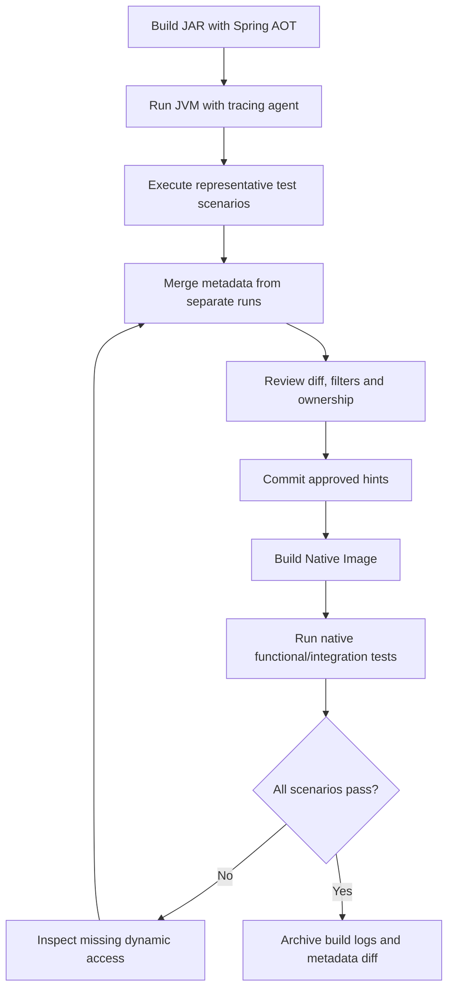

# Thu thập metadata bằng tracing agent rồi rà soát, kiểm thử lại

## 1. Mục tiêu của bài thực hành

Spring AOT và GraalVM Native Image phân tích ứng dụng theo những gì có thể xác định ở build time. Tuy nhiên, một số tính năng Java chỉ bộc lộ khi ứng dụng chạy, chẳng hạn reflection, JNI, dynamic proxy, serialization hoặc đọc resource theo tên được tạo động. Khi static analysis không thể xác định đầy đủ những truy cập đó, Native Image cần reachability metadata để giữ đúng class, member, proxy hoặc resource.

GraalVM Tracing Agent giúp quan sát các truy cập động khi ứng dụng chạy trên JVM và sinh cấu hình JSON. Bài thực hành này dùng agent để thu thập metadata từ một Spring Boot service, rà soát kết quả, đưa metadata cần thiết vào project, sau đó build và kiểm thử lại Native Image.

Bài học thuộc chương **Thực hành tổng hợp** của module **SPRING_BOOT_NATIVE_IMAGE**. Module hướng dẫn biên dịch ứng dụng Spring Boot thành GraalVM Native Image bằng Spring AOT để đánh giá thời gian khởi động và bộ nhớ; đồng thời thực hành build Maven/Gradle, cấu hình reflection và resource, kiểm thử tương thích, đóng gói container và vận hành bản native.

Sau bài học, người học có thể:

- Chuẩn bị một Spring Boot executable JAR đã có AOT generated assets để chạy với tracing agent.
- Chạy workload đại diện để ghi nhận reflection, resource, proxy, JNI và serialization cần thiết.
- Thu thập nhiều lần chạy và hợp nhất metadata.
- Nhận diện metadata phát sinh từ test infrastructure hoặc đường chạy không thuộc production.
- Chọn cách lưu metadata phù hợp: JSON reachability metadata hoặc Spring `RuntimeHints`.
- Build Native Image từ metadata đã rà soát và kiểm tra các luồng nghiệp vụ trên binary.
- Thiết lập quy trình thu thập, review và cập nhật metadata có thể lặp lại trong CI.

Kết quả mong đợi là một tập metadata có lý do rõ ràng, được kiểm thử trên native executable. Tracing agent hỗ trợ tìm các truy cập động bị bỏ sót; nó không chứng minh ứng dụng đã bao phủ mọi đường chạy hoặc đã an toàn.

## 2. Hiểu tracing agent thu thập điều gì

Tracing Agent chạy cùng một JVM thông thường và theo dõi các truy cập động mà Native Image có thể cần metadata, ví dụ:

| Loại metadata | Tình huống thường gặp | Ví dụ trong Spring Boot |
|---|---|---|
| Reflection | Tìm class, constructor, field hoặc method bằng tên/runtime API | JSON binding, mapper, framework extension |
| Resource | Đọc file trên classpath theo tên hoặc pattern | JSON schema, template, XML mapping |
| Dynamic proxy | Tạo proxy từ interface lúc runtime | Client proxy, một số thư viện tích hợp |
| JNI | Gọi method/field hoặc native library qua JNI | Thư viện mã hóa, xử lý ảnh, driver |
| Serialization | Serialize/deserialize bằng Java serialization | Legacy message hoặc cache payload |

Agent chỉ ghi nhận hoạt động thực sự diễn ra trong process được gắn agent. Nếu ứng dụng có nhánh import CSV nhưng workload không gửi file CSV, agent không thể tự suy ra các reflection/resource cần cho nhánh đó. Nếu test chỉ chạy với locale mặc định, metadata của resource cho locale khác có thể chưa được ghi nhận.

Spring AOT đã tự sinh nhiều hints cho các pattern Spring phổ biến. Vì vậy, nên dùng tracing agent để tìm phần còn thiếu, nhất là thư viện bên thứ ba hoặc cách truy cập động mà Spring không suy luận được. Không thêm metadata rộng cho mọi class chỉ vì agent có thể tạo ra nó.

Tracing agent cũng không phải vulnerability scanner. Nó không tìm CVE, không đánh giá authorization và không chứng minh dữ liệu đầu vào an toàn. Mục đích của agent là ghi lại các truy cập động để Native Image có thể đóng gói đúng thành phần cần thiết.

## 3. Kịch bản thực hành: dịch vụ quản lý đơn hàng

Giả sử ứng dụng Spring Boot có các chức năng sau:

| Chức năng | Luồng cần chạy | Metadata có thể liên quan |
|---|---|---|
| Xem đơn hàng | `GET /api/orders/{id}` | DTO binding, JSON serialization |
| Tạo đơn hàng | `POST /api/orders` | Request DTO, validation, response DTO |
| Import đơn hàng | `POST /api/orders/import` | Multipart upload, CSV parser, resource/schema |
| Xuất báo cáo | `GET /api/orders/{id}/report` | Template/resource, serializer |
| Gửi sự kiện | Publish/consume `OrderCreated` | Message serialization, proxy/client |
| Xử lý lỗi | Payload sai, thiếu field, không có quyền | Error DTO, validation, security path |

Đây là kịch bản minh họa; thay endpoint và dữ liệu bằng nghiệp vụ thực tế của project. Nếu ứng dụng không có import, report hoặc messaging, hãy thay bằng các tính năng tương ứng. Không thêm thư viện hoặc code giả chỉ để tạo ra metadata.

Chuẩn bị một test dataset có thể tái tạo. Dùng tài khoản kiểm thử, secret giả lập và dịch vụ phụ trợ dành cho môi trường test. Không chạy tracing agent với credential production hoặc dữ liệu khách hàng thật.

## 4. Chuẩn bị toolchain và AOT executable JAR

Cần có GraalVM JDK tương thích với phiên bản Spring Boot, Native Build Tools và Java của project. Dùng lệnh `java` từ chính GraalVM JDK có tracing agent; nếu dùng một JDK khác, agent có thể không tồn tại hoặc không tương thích.

Kiểm tra toolchain:

```bash
echo "$GRAALVM_HOME"
"$GRAALVM_HOME/bin/java" -version
"$GRAALVM_HOME/bin/native-image" --version
```

Trên Windows PowerShell:

```powershell
$env:GRAALVM_HOME
& "$env:GRAALVM_HOME\bin\java.exe" -version
& "$env:GRAALVM_HOME\bin\native-image.cmd" --version
```

Trước khi gắn agent, build executable JAR có Spring AOT generated assets. Với Maven project dùng `spring-boot-starter-parent` và Native Build Tools plugin, profile `native` cấu hình AOT processing. Có thể chuẩn bị JAR bằng:

```bash
./mvnw -Pnative package -DskipTests
```

Với Gradle, bảo đảm project áp dụng plugin `org.graalvm.buildtools.native` tương ứng với phiên bản Native Build Tools. Spring Boot sẽ kết nối AOT tasks với build. Ví dụ:

```bash
./gradlew bootJar
```

Các tên task và plugin DSL có thể thay đổi theo phiên bản. Dùng wrapper của project và kiểm tra build script hiện tại. Điều quan trọng là executable JAR phải chứa AOT generated classes/resources; một JAR JVM thông thường chưa có AOT assets sẽ không đại diện đúng cấu hình sẽ chạy trên Native Image.

Có thể kiểm tra nội dung JAR:

```bash
jar tf target/orders-service.jar | grep -E 'META-INF/native-image|springframework/aot'
```

Nếu build Gradle, thay đường dẫn JAR bằng file trong `build/libs`. Xác nhận AOT assets đã được đóng gói trước khi tiếp tục.

## 5. Khởi chạy ứng dụng trực tiếp với tracing agent

Tạo thư mục riêng cho metadata. Agent sẽ ghi JSON vào thư mục này khi JVM kết thúc bình thường.

Trên Linux/macOS:

```bash
mkdir -p target/native-agent/run-01

"$GRAALVM_HOME/bin/java" \
  -Dspring.aot.enabled=true \
  -agentlib:native-image-agent=config-output-dir=target/native-agent/run-01 \
  -jar target/orders-service.jar
```

Trên Windows PowerShell:

```powershell
$metadataDir = "target/native-agent/run-01"
New-Item -ItemType Directory -Force -Path $metadataDir | Out-Null
& "$env:GRAALVM_HOME\bin\java.exe" -Dspring.aot.enabled=true "-agentlib:native-image-agent=config-output-dir=$metadataDir" -jar "target\orders-service.jar"
```

Các chi tiết cần giữ đúng:

- `java` phải đến từ GraalVM JDK có Native Image Tracing Agent.
- `-Dspring.aot.enabled=true` yêu cầu Spring Boot sử dụng AOT generated initialization code đã đóng gói trong JAR.
- `-agentlib:native-image-agent=...` phải đứng trước `-jar` và tên ứng dụng.
- `config-output-dir` là thư mục agent ghi metadata; tạo thư mục riêng cho mỗi lần chạy đầu tiên.
- Khi hoàn thành workload, dừng ứng dụng bằng cơ chế shutdown bình thường, ví dụ `Ctrl+C`, để agent có cơ hội ghi file.

Không dùng `kill -9`, Task Manager End Process hoặc cách kết thúc cưỡng bức khác cho lần thu thập cuối. JVM bị kết thúc đột ngột có thể không chạy được bước ghi metadata khi shutdown.

Khi ứng dụng chạy lâu và muốn ghi metadata định kỳ, agent hỗ trợ `config-write-period-secs` và `config-write-initial-delay-secs`. Chỉ bật khi có nhu cầu; với bài thực hành ngắn, ghi khi JVM shutdown thường dễ kiểm soát hơn.

## 6. Chạy workload có chủ đích

Sau khi ứng dụng sẵn sàng, chạy lần lượt các luồng nghiệp vụ. Không chỉ gọi health endpoint rồi kết luận metadata đã đầy đủ.

Ví dụ request HTTP:

```bash
# Đọc đơn hàng
curl --fail http://localhost:8080/api/orders/1001

# Tạo đơn hàng bằng DTO JSON
curl --fail -X POST http://localhost:8080/api/orders \
  -H 'Content-Type: application/json' \
  -d '{"customerId":"C-100","items":[{"sku":"SKU-01","quantity":2}]}'

# Gửi payload sai để kiểm tra error/validation path
curl -i -X POST http://localhost:8080/api/orders \
  -H 'Content-Type: application/json' \
  -d '{"customerId":"","items":[]}'

# Kiểm tra báo cáo nếu ứng dụng có chức năng này
curl --fail http://localhost:8080/api/orders/1001/report
```

Đường dẫn và JSON chỉ là ví dụ. Dùng payload hợp lệ với schema thật của project. Nếu endpoint yêu cầu authentication, cung cấp token test bằng cơ chế an toàn của môi trường; không ghi token vào script được commit hoặc metadata repository.

Lập ma trận workload trước khi chạy:

| Nhóm | Ví dụ cần thực thi | Câu hỏi cần trả lời |
|---|---|---|
| API chính | GET/POST/PUT/DELETE với dữ liệu hợp lệ | DTO và serializer có được quan sát không? |
| Validation/error | Thiếu field, sai kiểu, record không tồn tại | Error handler và error resource có được chạy không? |
| Security | Anonymous, user đúng role, user sai role | Các nhánh security và response liên quan có được chạy không? |
| File/resource | Upload, download, report, template, schema | Resource và parser có được truy cập không? |
| Serialization | JSON message, legacy payload nếu có | Type động nào được deserialize? |
| Proxy/client | Gọi database, HTTP client, messaging | Có proxy interface hoặc dynamic feature nào được dùng? |
| Background work | Async task, scheduler, consumer | Luồng không đi qua HTTP có được chạy không? |
| Biến thể cấu hình | Profile, feature flag, locale được hỗ trợ | Có resource/type nào chỉ xuất hiện ở một biến thể? |

Chỉ chạy những tính năng thực sự có trong ứng dụng. Nếu một luồng cần database hoặc broker, dùng dịch vụ test có trạng thái ban đầu xác định. Nếu workload thay đổi dữ liệu, reset fixture trước lần chạy tiếp theo để kết quả có thể lặp lại.

Nên ghi lại request/test case đã chạy và kết quả mong đợi. Điều này giúp biết chính xác nhánh nào chưa được agent quan sát, thay vì chỉ nhìn số lượng JSON được sinh ra.

## 7. Thu thập nhiều lần chạy và hợp nhất metadata

Một lần chạy thường chưa đủ. Chạy các nhóm workload khác nhau để mở rộng coverage: API cơ bản, upload/report, messaging, security branch và các profile cần hỗ trợ.

Có hai cách hợp nhất:

**Chạy tuần tự vào cùng thư mục:** lần đầu dùng `config-output-dir`, các lần sau dùng `config-merge-dir` để bổ sung vào tập metadata hiện có.

```bash
# Lần chạy đầu
"$GRAALVM_HOME/bin/java" \
  -Dspring.aot.enabled=true \
  -agentlib:native-image-agent=config-output-dir=target/native-agent/merged \
  -jar target/orders-service.jar

# Các lần chạy tiếp theo: đổi workload, sau đó dừng ứng dụng bình thường
"$GRAALVM_HOME/bin/java" \
  -Dspring.aot.enabled=true \
  -agentlib:native-image-agent=config-merge-dir=target/native-agent/merged \
  -jar target/orders-service.jar
```

Mỗi lần chạy sau phải thực sự thực thi các nhánh mới. `config-merge-dir` bổ sung quan sát vào cấu hình đã có; nó không tạo ra coverage cho code chưa chạy.

**Chạy song song hoặc tách biệt:** mỗi process ghi vào một output directory riêng để tránh nhiều process cùng ghi một thư mục. Sau đó dùng `native-image-utils` của GraalVM hiện hành để hợp nhất:

```bash
native-image-utils generate \
  --input-dir=target/native-agent/run-api \
  --input-dir=target/native-agent/run-import \
  --input-dir=target/native-agent/run-messaging \
  --output-dir=target/native-agent/merged
```

Một số GraalVM version cũ dùng tên công cụ `native-image-configure`. Kiểm tra `native-image-utils help` hoặc công cụ được phân phối cùng GraalVM đang dùng; không sao chép lệnh của version khác mà chưa xác minh.

Không dùng một output directory chung cho nhiều test fork chạy đồng thời. Nếu gắn agent vào test JVM, cấu hình một fork hoặc cấp output directory riêng cho từng process rồi merge. Với test framework, metadata có thể chứa truy cập của JUnit, Spring Test và thư viện test; cần review/filter trước khi dùng cho production.

## 8. Đọc cấu trúc metadata được sinh ra

Tùy phiên bản GraalVM và format metadata, thư mục có thể chứa các file riêng hoặc reachability metadata dạng hợp nhất. Các file riêng thường gặp:

| File | Nội dung |
|---|---|
| `reflect-config.json` | Class, constructor, field, method được truy cập bằng reflection |
| `resource-config.json` | Resource hoặc pattern resource cần giữ trong image |
| `proxy-config.json` | Interface dùng để tạo dynamic proxy |
| `jni-config.json` | Class/member được truy cập qua JNI |
| `serialization-config.json` | Type cần Java serialization |
| `reachability-metadata.json` | Metadata reachability theo format hợp nhất được hỗ trợ ở các version hiện hành |

Không phải lần chạy nào cũng sinh đủ các file. File không xuất hiện không chứng minh ứng dụng không dùng tính năng đó; có thể workload chưa chạm tới hoặc Spring AOT/metadata có sẵn đã xử lý phần đó.

Ví dụ một entry reflection có thể mô tả class và member được truy cập:

```json
[
  {
    "name": "com.example.orders.OrderImportRequest",
    "allDeclaredConstructors": true,
    "allPublicMethods": true
  }
]
```

Đây chỉ là ví dụ minh họa cấu trúc, không phải metadata lấy từ project. Agent có thể sinh các member cụ thể hơn hoặc flag khác. Giữ nguyên schema và nội dung mà version toolchain tạo ra cho đến khi đã hiểu tác động của từng thay đổi.

Metadata phải được đọc cùng source, call path và test case. Một entry xuất hiện trong JSON có thể đến từ ứng dụng, thư viện bên thứ ba hoặc test framework. Chỉ nhìn tên class không đủ để quyết định có thể xóa entry hay không.

## 9. Rà soát chất lượng metadata trước khi đưa vào project

Trước khi copy metadata, review từng file và trả lời các câu hỏi:

1. Entry này phục vụ luồng nghiệp vụ nào?
2. Caller là code ứng dụng, thư viện runtime hay test infrastructure?
3. Entry đã được Spring AOT hoặc thư viện cung cấp reachability metadata xử lý chưa?
4. Entry có quá rộng không, ví dụ đăng ký cả package hoặc mọi member trong khi chỉ cần một method?
5. Có chứa đường dẫn máy local, tên file test, dữ liệu nhạy cảm hoặc thông tin môi trường không?
6. Có thể thay metadata JSON bằng một Spring `RuntimeHintsRegistrar` nhỏ, có test rõ ràng không?
7. Nếu bỏ entry, test nào sẽ phát hiện hồi quy?

Có thể dùng `git diff --no-index` để so sánh các lần chạy, hoặc đưa metadata đã review vào Git rồi xem diff như thay đổi source. Không commit nguyên thư mục output tạm nếu nó chứa dữ liệu chưa lọc, nhiều file trùng lặp hoặc metadata chỉ dành cho test.

Không xóa entry chỉ vì nó làm binary lớn hơn. Hãy xác nhận entry không cần cho production bằng cách bỏ trong một nhánh thử nghiệm, build native và chạy lại đúng test case đã từng sử dụng entry đó. Nếu không thể chứng minh an toàn, giữ entry hoặc thay bằng hint hẹp hơn có test.

Cũng không thêm wildcard như `allDeclaredMethods` cho cả package để làm build thành công nếu chưa có lý do. Metadata quá rộng có thể làm executable lớn hơn và giữ nhiều dynamic access không cần thiết.

## 10. Lọc metadata phát sinh từ test infrastructure

Spring Boot documentation lưu ý rằng chạy agent qua test suite có thể tạo metadata cho cả test infrastructure. Đây là lý do nên ưu tiên chạy ứng dụng trực tiếp để tìm hints của thư viện hoặc pattern chưa được Spring nhận diện, sau đó dùng test để bổ sung coverage có chủ đích.

Tracing Agent hỗ trợ hai loại filter có ý nghĩa khác nhau:

- **Caller filter:** lọc theo class thực hiện truy cập động. Phù hợp khi muốn loại truy cập bắt nguồn từ test class hoặc test framework.
- **Access filter:** lọc theo class/type đích đang được truy cập. Phù hợp khi đã xác định target package không cần ghi vào metadata.

Ví dụ caller filter minh họa để loại các truy cập bắt nguồn từ package test:

```json
{
  "rules": [
    { "excludeClasses": "com.example.orders.test.**" },
    { "excludeClasses": "org.springframework.test.**" },
    { "excludeClasses": "org.junit.**" }
  ]
}
```

Chỉ áp dụng filter sau khi kiểm tra package thực tế. Nếu một thư viện production cũng gọi từ package bị exclude, filter có thể bỏ mất metadata cần thiết. Quy tắc filter được xử lý theo thứ tự; quy tắc phía sau có thể ghi đè quy tắc trước.

Khởi chạy agent với caller filter:

```bash
"$GRAALVM_HOME/bin/java" \
  -Dspring.aot.enabled=true \
  -agentlib:native-image-agent=caller-filter-file=caller-filter.json,config-output-dir=target/native-agent/filtered \
  -jar target/orders-service.jar
```

Không tắt built-in caller filter hoặc heuristic filter để tạo metadata production nếu chưa hiểu hậu quả. Các tùy chọn này có thể làm output chứa nhiều truy cập JVM/library không cần thiết. Giữ một lần chạy raw không filter để đối chiếu nếu cần.

## 11. Đưa metadata đã duyệt vào Spring Boot project

Với Spring Boot, metadata JSON tĩnh có thể được đặt trong `src/main/resources/META-INF/native-image/`. Spring AOT cũng sinh hints trong một thư mục riêng theo `groupId` và `artifactId`. Đặt metadata bổ sung ở một thư mục con khác để không ghi đè output do AOT tạo ra.

Ví dụ:

```text
src/main/resources/
└── META-INF/
    └── native-image/
        └── com.example/
            └── orders-service-additional-hints/
                ├── reflect-config.json
                ├── resource-config.json
                └── proxy-config.json
```

Tên file và thư mục phải khớp với output đã review. Chỉ copy những file có nội dung cần thiết; không tạo file rỗng hoặc đổi tên schema tùy tiện.

Trên Linux/macOS, ví dụ copy metadata:

```bash
mkdir -p src/main/resources/META-INF/native-image/com.example/orders-service-additional-hints
cp target/native-agent/merged/*.json \
  src/main/resources/META-INF/native-image/com.example/orders-service-additional-hints/
```

Trên Windows PowerShell:

```powershell
$hintDir = "src/main/resources/META-INF/native-image/com.example/orders-service-additional-hints"
New-Item -ItemType Directory -Force -Path $hintDir | Out-Null
Copy-Item "target/native-agent/merged/*.json" -Destination $hintDir -Force
```

Nếu project dùng multi-module, đặt metadata trong module tạo executable hoặc module cung cấp library tương ứng theo cách đóng gói. Kiểm tra JAR sau khi build để xác nhận các file đã nằm trong classpath.

## 12. Khi nào nên chuyển JSON thành Spring RuntimeHints?

Giữ JSON là lựa chọn hợp lệ khi metadata được sinh tự động, tương thích với GraalVM version và có thể review dễ dàng. Với metadata thuộc code của chính ứng dụng, `RuntimeHintsRegistrar` có thể diễn đạt rõ hơn ý định, gắn với type Java và được kiểm thử bằng Spring API.

Ví dụ đăng ký một resource được đọc động:

```java
import org.springframework.aot.hint.RuntimeHints;
import org.springframework.aot.hint.RuntimeHintsRegistrar;

public class OrderResourceHints implements RuntimeHintsRegistrar {

    @Override
    public void registerHints(RuntimeHints hints, ClassLoader classLoader) {
        hints.resources().registerPattern("schemas/orders/*.json");
    }
}
```

Kích hoạt registrar bằng cấu hình:

```java
import org.springframework.context.annotation.Configuration;
import org.springframework.context.annotation.ImportRuntimeHints;

@Configuration(proxyBeanMethods = false)
@ImportRuntimeHints(OrderResourceHints.class)
class OrderNativeHintsConfiguration {
}
```

Có thể dùng `@RegisterReflectionForBinding` cho DTO cần binding động, hoặc đăng ký cụ thể reflection/proxy/serialization bằng `RuntimeHints` API. Không chuyển toàn bộ JSON sang code một cách máy móc; chọn cách biểu diễn mà team có thể hiểu, review và duy trì.

Nếu metadata thuộc thư viện bên thứ ba, ưu tiên reachability metadata do nhà phát triển thư viện hoặc GraalVM Reachability Metadata Repository cung cấp khi phù hợp. Tránh sao chép metadata của dependency vào project nếu dependency đã đóng gói metadata chính thức, vì hai nguồn có thể lệch version.

## 13. Kiểm thử Spring RuntimeHints và JSON metadata

Với `RuntimeHintsRegistrar`, Spring cung cấp `RuntimeHintsPredicates` để kiểm tra metadata đã đăng ký.

Ví dụ kiểm tra resource:

```java
import org.junit.jupiter.api.Test;
import org.springframework.aot.hint.RuntimeHints;
import org.springframework.aot.hint.predicate.RuntimeHintsPredicates;

import static org.assertj.core.api.Assertions.assertThat;

class OrderResourceHintsTests {

    @Test
    void registersOrderSchemaResources() {
        RuntimeHints hints = new RuntimeHints();

        new OrderResourceHints().registerHints(
            hints, getClass().getClassLoader()
        );

        assertThat(
            RuntimeHintsPredicates.resource()
                .forResource("schemas/orders/order-v1.json")
        ).accepts(hints);
    }
}
```

Test trên xác nhận registrar khai báo resource mong đợi. Nó không thay thế việc chạy ứng dụng native. Với JSON metadata, kiểm tra file được đóng gói và để Native Image build xác thực schema; sau đó chạy luồng thực tế cần entry đó.

Tạo test tương ứng cho từng loại hint do project tự quản lý:

- Reflection: class/member cần được truy cập có metadata.
- Resource: resource path được đăng ký và có trong artifact.
- Proxy: interface set được đăng ký đúng thứ tự.
- Serialization: type được đăng ký theo API phù hợp.
- JNI: class/member/native library được kiểm thử trên nền tảng đích.

## 14. Build lại Native Image từ metadata đã duyệt

Sau khi metadata nằm trong classpath, build native executable bằng cấu hình project.

Maven:

```bash
./mvnw -Pnative native:compile
```

Gradle:

```bash
./gradlew nativeCompile
```

Nếu project dùng Buildpacks, có thể tạo native container image bằng lệnh build-image tương ứng của Maven/Gradle. Đảm bảo Buildpacks builder và run image phù hợp với version GraalVM/Java của project.

Khi build thất bại, phân biệt lỗi metadata với lỗi toolchain:

| Dấu hiệu | Việc cần kiểm tra |
|---|---|
| JSON parse/schema error | File metadata có đúng format của GraalVM version không? |
| Class/member not found | Tên class, package, dependency version có đúng không? |
| Duplicate/conflicting metadata | Nhiều file cùng khai báo entry hoặc thư viện đã có metadata riêng? |
| Missing resource | Resource path và pattern có khớp classpath thực tế không? |
| Native compiler error | GCC/Clang/MSVC, linker, SDK và architecture |
| Build pass nhưng native runtime fail | Workload chưa phủ đủ hoặc metadata chưa được tích hợp đúng vào artifact |

Không sửa lỗi bằng cách thêm toàn bộ package vào reflection. Đọc thông báo build, xác định dynamic access cụ thể, bổ sung hint nhỏ nhất có thể và tạo test tái hiện.

## 15. Kiểm thử lại trên native executable

Khi native build thành công, chạy đúng workload đã dùng để thu metadata và so sánh kết quả với JVM AOT run.

Kiểm tra tối thiểu:

- Ứng dụng khởi động và readiness probe thành công.
- API chính trả cùng status code và response schema.
- JSON binding/serialization hoạt động với payload thực tế.
- Upload, report và resource loading hoạt động nếu ứng dụng có các chức năng đó.
- Security/authorization branch vẫn hoạt động đúng.
- Message listener, scheduler và async task được kiểm thử nếu có.
- Error path trả lỗi có kiểm soát, không có `MissingReflectionRegistrationError`, lỗi resource hoặc proxy.
- Log không chứa lỗi khởi tạo class hoặc provider.
- Container final vẫn hoạt động với non-root/read-only policy nếu đó là cách triển khai mục tiêu.

Không chỉ test happy path. Các lỗi do metadata thiếu thường xuất hiện ở luồng hiếm: một loại payload khác, một endpoint ít dùng, một locale, một template hoặc một nhánh xử lý lỗi. Chạy lại toàn bộ ma trận workload và giữ cùng test fixture.

Nếu native runtime thất bại nhưng JVM AOT chạy được, hãy xem stack trace để tìm dynamic access đầu tiên bị thiếu. Bổ sung metadata hoặc Spring RuntimeHint cho đúng class/member/resource, build lại và chạy lại test hồi quy. Không thêm hint rộng trước khi xác định access bị thiếu.

## 16. Quy trình lặp lại trong CI

Một quy trình CI có thể tổ chức như sau:



Trong CI thông thường, không nhất thiết thu metadata ở mọi build. Có thể chạy agent trong job chuyên biệt khi dependency, framework, AOT config hoặc dynamic feature thay đổi. Sau khi metadata được review và commit, các build tiếp theo sử dụng metadata đã duyệt và chạy native regression tests.

Lưu các bằng chứng:

- GraalVM, Java, Spring Boot và Native Build Tools versions.
- Git commit, dependency lock/version và build profile.
- Danh sách scenario đã chạy cùng kết quả.
- Metadata trước/sau merge và diff đã review.
- Filter files và lý do sử dụng.
- Native build logs và native integration test report.

Metadata phải được cập nhật khi thay đổi dependency, reflection usage, resource naming, proxy, serialization hoặc tính năng nghiệp vụ. Một lần tracing thành công không đảm bảo metadata vẫn đúng sau khi nâng version thư viện.

## 17. Các lỗi thường gặp khi thu thập metadata

| Triệu chứng | Nguyên nhân có thể | Cách xử lý |
|---|---|---|
| `agent library failed to init` | Dùng Java từ JDK không có agent hoặc sai GraalVM installation | Chạy bằng `java` trong GraalVM JDK tương thích |
| Thư mục output rỗng | Chưa chạy dynamic path, app chưa shutdown bình thường hoặc sai output path | Kiểm tra workload, process exit và path |
| Metadata chỉ có reflection cơ bản | Chưa chạy resource/proxy/JNI/serialization path | Mở rộng workload theo ma trận |
| Metadata quá lớn | Test infrastructure, filter quá rộng hoặc workload gọi nhiều class động | Phân tích caller/target, lọc có căn cứ |
| Native build báo thiếu hint dù đã chạy agent | Code path thiếu coverage hoặc metadata không nằm trên classpath | Tái hiện nhánh lỗi, kiểm tra JAR/resource path |
| JVM AOT chạy được nhưng native fail | JVM linh hoạt hơn và có thể che thiếu metadata | Dùng stack trace native để bổ sung hint cụ thể |
| Build pass nhưng request hiếm fail | Chỉ test happy path | Bổ sung regression scenario cho request/locale/feature đó |
| Nhiều process ghi đè output | Dùng chung `config-output-dir` cho parallel forks | Dùng directory riêng và merge |
| JSON không được nhận | Sai thư mục `META-INF/native-image` hoặc schema/version | Kiểm tra JAR contents và format được GraalVM hỗ trợ |

Khi agent không tạo output, nhớ rằng metadata thường được ghi khi JVM kết thúc. Nếu process bị dừng cưỡng bức, file có thể chưa được flush. Với ứng dụng dài hạn, dùng ghi định kỳ hoặc dừng theo shutdown path đã cấu hình.

## 18. Bài tập thực hành và tiêu chí hoàn thành

### Bài tập A — Thu thập metadata từ ứng dụng trực tiếp

Build JAR có AOT assets, chạy với tracing agent và thực hiện ít nhất ba nhóm scenario: API/JSON, resource/file và một nhánh security hoặc background phù hợp với project.

**Tiêu chí hoàn thành:** có output JSON từ agent, ghi lại các scenario đã chạy và xác định metadata thuộc từng luồng.

### Bài tập B — Hợp nhất nhiều lần chạy

Thu thập hai output directory độc lập hoặc dùng `config-merge-dir` qua các lần chạy tuần tự. Tạo một tập metadata hợp nhất.

**Tiêu chí hoàn thành:** metadata hợp nhất giữ được entry từ các scenario khác nhau và không dùng chung output directory cho process song song.

### Bài tập C — Rà soát và lọc

Xác định entry phát sinh từ test infrastructure hoặc class không thuộc production. Thử filter trên một bản output riêng, so sánh trước/sau và xác minh không loại metadata nghiệp vụ.

**Tiêu chí hoàn thành:** mỗi entry bị loại có lý do và có test xác nhận chức năng production không phụ thuộc entry đó.

### Bài tập D — Tích hợp hint và test

Đưa metadata đã duyệt vào `META-INF/native-image` hoặc chuyển hint của code ứng dụng thành `RuntimeHintsRegistrar`. Viết test với `RuntimeHintsPredicates` cho ít nhất một resource hoặc reflection hint.

**Tiêu chí hoàn thành:** metadata được đóng gói trong JAR và test hint chạy thành công.

### Bài tập E — Build và kiểm thử Native Image

Build executable bằng Maven/Gradle, chạy native binary và thực hiện lại toàn bộ scenario đã thu thập.

**Tiêu chí hoàn thành:** native executable khởi động, các luồng đã chọn hoạt động, không có lỗi metadata còn thiếu và kết quả nghiệp vụ tương đương JVM AOT.

## 19. Checklist trước khi chốt metadata

- [ ] Đã dùng GraalVM JDK tương thích và xác nhận tracing agent khởi chạy.
- [ ] Executable JAR có Spring AOT generated assets.
- [ ] Đã bật `spring.aot.enabled=true` khi chạy ứng dụng JVM với AOT assets.
- [ ] Agent option đứng trước `-jar`/main class.
- [ ] Output directory riêng cho từng process chạy song song.
- [ ] Đã chạy workload đại diện cho các endpoint và tính năng production.
- [ ] Đã kiểm thử cả payload lỗi, security branch và resource path quan trọng.
- [ ] Đã chạy lại nhiều lần hoặc merge output đúng cách.
- [ ] Đã phân biệt caller filter và access filter.
- [ ] Đã rà soát test infrastructure và entry metadata quá rộng.
- [ ] Không xóa metadata nếu chưa có test chứng minh entry không cần thiết.
- [ ] JSON/hints nằm trong `META-INF/native-image` hoặc được đăng ký qua Spring RuntimeHints.
- [ ] Thư mục bổ sung không ghi đè AOT generated hints.
- [ ] RuntimeHints tự viết có test `RuntimeHintsPredicates`.
- [ ] Native Image build đã sử dụng metadata đã duyệt.
- [ ] Native executable đã chạy lại cùng workload và regression tests.
- [ ] Đã lưu toolchain version, scenario, metadata diff và build/test logs.

## Tài liệu tham khảo

- [GraalVM — Collect Metadata with the Tracing Agent](https://www.graalvm.org/latest/reference-manual/native-image/metadata/AutomaticMetadataCollection/): cách gắn agent, config-output-dir, config-merge-dir, filter, trace output và merge metadata.
- [GraalVM — Reachability Metadata](https://www.graalvm.org/latest/reference-manual/native-image/metadata/): các loại metadata và cách cung cấp metadata cho Native Image.
- [Spring Boot — Advanced Native Image Topics](https://docs.spring.io/spring-boot/reference/packaging/native-image/advanced-topics.html): tracing agent, Spring RuntimeHints, metadata tĩnh và kiểm thử hints.
- [Spring Boot — Developing Your First GraalVM Native Application](https://docs.spring.io/spring-boot/how-to/native-image/developing-your-first-application.html): cấu hình Maven/Gradle, profile native và AOT executable.
- [Spring Boot Maven Plugin — Ahead-of-Time Processing](https://docs.spring.io/spring-boot/maven-plugin/aot.html): process-aot, process-test-aot và native test profile.

## Kết luận

Tracing Agent giúp phát hiện các truy cập động mà static analysis hoặc Spring AOT chưa mô tả đầy đủ bằng cách quan sát ứng dụng trên JVM. Giá trị của metadata phụ thuộc vào độ phủ workload và chất lượng review: chạy nhiều scenario, hợp nhất output, loại nhiễu có căn cứ, đặt hints đúng vị trí và kiểm thử lại trên Native Image. Khi metadata được quản lý như một phần có version của source code, mỗi thay đổi dependency hoặc dynamic feature đều có thể được xác minh bằng build và regression tests thay vì dựa vào một lần chạy agent duy nhất.
