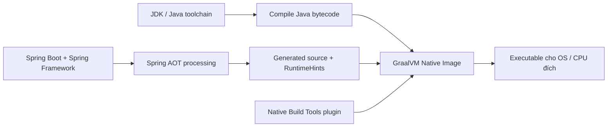

# Chọn bộ phiên bản tương thích giữa Spring Boot, Java, GraalVM và plugin

## 1. Mục tiêu của việc chọn phiên bản đồng bộ

Một ứng dụng Spring Boot chạy tốt trên JVM chưa chắc đã build thành GraalVM Native Image. Ngoài mã Java, quá trình native build còn cần **Spring AOT**, bộ biên dịch **GraalVM Native Image**, các **plugin Maven/Gradle** và toolchain phù hợp. Mỗi thành phần có vòng đời phát hành và yêu cầu tương thích riêng.

Trong module **SPRING_BOOT_NATIVE_IMAGE**, mục tiêu không dừng ở việc tạo được một binary. Ta còn cần kiểm thử reflection và resource, đóng gói container, vận hành bản native, rồi so sánh thời gian khởi động và bộ nhớ với bản JVM. Muốn phép so sánh đáng tin cậy, trước tiên phải chọn và cố định một bộ công cụ có thể tái tạo.

Bài này trả lời bốn câu hỏi:

1. Spring Boot phiên bản đang dùng hỗ trợ những phiên bản Java và GraalVM nào?
2. JDK để biên dịch Java có tương thích với GraalVM Native Image thực sự được sử dụng không?
3. Spring Boot Maven/Gradle plugin, GraalVM Native Build Tools và Maven/Gradle wrapper có hoạt động với nhau không?
4. Bộ công cụ trên máy lập trình, CI và môi trường container có đang nhắm cùng hệ điều hành, kiến trúc và Java major version không?

**Nguyên tắc quan trọng:** không thể quyết định tương thích chỉ bằng việc thấy từng công cụ chạy được lệnh `--version`. Cần đối chiếu ràng buộc **giữa các công cụ**, build thử và kiểm thử binary native.

## 2. Bốn lớp phiên bản và trách nhiệm của từng lớp

| Thành phần | Vai trò trong Native Image | Điều cần kiểm tra |
|---|---|---|
| **Spring Boot** và Spring Framework | Cung cấp hạ tầng ứng dụng, xử lý AOT và runtime hints cho cấu hình Spring | Yêu cầu Java, các phiên bản GraalVM/Native Build Tools được tài liệu hỗ trợ, hỗ trợ native của starter và dependency |
| **Java/JDK** | Biên dịch bytecode ứng dụng, cung cấp các API Java và toolchain | Java major version, mức bytecode target, `JAVA_HOME`, cấu hình Maven/Gradle toolchain |
| **GraalVM for JDK ...** | Chứa `native-image` để phân tích và biên dịch ứng dụng thành binary native | Phiên bản GraalVM, **JDK major** đi kèm, hỗ trợ hệ điều hành/kiến trúc |
| **Build plugins và build tool** | Kích hoạt Spring AOT, gọi Native Image, quản lý dependency và lifecycle build | Spring Boot plugin, GraalVM Native Build Tools plugin, Maven hoặc Gradle wrapper, các profile/task cần thiết |

Đường đi tiêu biểu:



Sơ đồ chỉ mô tả những đầu vào quan trọng. Khi build thực tế, Spring AOT, Java compilation, resource processing, reachability analysis và native compilation được điều phối thành nhiều task hoặc goal phụ thuộc nhau.

### Những cặp phiên bản dễ nhầm

- **Spring Boot và Java:** Spring Boot có yêu cầu **Java tối thiểu**, đồng thời tài liệu của từng release nêu phiên bản Java được hỗ trợ. Khả năng chạy trên JVM mới hơn không tự động chứng minh Native Image đã hỗ trợ tổ hợp đó.
- **Java và GraalVM:** “GraalVM for JDK 21” cung cấp toolchain dựa trên JDK 21. Nó khác “GraalVM for JDK 17”. Nếu ứng dụng đã được biên dịch với bytecode Java 21 thì không thể đưa nguyên bytecode đó vào trình xử lý chỉ hỗ trợ class-file Java 17.
- **Spring Boot plugin và GraalVM Native Build Tools plugin:** Đây là hai plugin khác nhiệm vụ và **không cần cùng số version**. Plugin Spring Boot thường theo release Spring Boot; Native Build Tools có chuỗi phiên bản độc lập.
- **Build tool và plugin:** Một plugin Gradle mới có thể yêu cầu Gradle wrapper mới hơn. Tương tự, phiên bản Maven hoặc Maven plugin cũng có ngưỡng hỗ trợ riêng.
- **Build host và runtime:** Native executable nhắm tới OS, kiến trúc CPU và thư viện hệ thống cụ thể. Chọn Java/GraalVM đúng chưa đủ để bảo đảm binary Linux chạy được trên Windows hoặc ngược lại.

## 3. Bắt đầu từ phiên bản Spring Boot, rồi chốt Java major

### 3.1. Chọn dòng Spring Boot đang được duy trì

Với dự án mới, chọn một dòng Spring Boot còn được hỗ trợ và **bản vá mới nhất phù hợp với chính sách dự án**. Sau đó đọc tài liệu *System Requirements* và *GraalVM Native Image Support* ứng với **đúng dòng/release**, không dùng tài liệu của một major khác để suy ra tương thích.

Một số mốc cần nhận biết:

- **Spring Boot 2.x:** hệ thống Native Image cũ từng sử dụng Spring Native với cơ chế/tích hợp khác. Không áp dụng máy móc cú pháp AOT và hướng dẫn của Spring Boot 3.x/4.x cho dự án này.
- **Spring Boot 3.x:** Spring AOT và hỗ trợ GraalVM Native Image là một phần của hệ sinh thái Spring Boot. Dòng 3.x yêu cầu Java 17 trở lên, nhưng Java tối đa được hỗ trợ phụ thuộc release cụ thể.
- **Spring Boot 4.x và các dòng tương lai:** tiếp tục xác minh điều kiện hỗ trợ riêng của release. Không kết luận từ việc phiên bản trước tương thích rằng phiên bản sau chắc chắn tương thích với plugin hoặc GraalVM hiện tại.

Cần phân biệt **chạy được** (một bản JVM tình cờ khởi động thành công) với **được hỗ trợ** (tổ hợp được tài liệu và kiểm thử chính thức xác nhận).

### 3.2. Chọn Java LTS được release Boot hỗ trợ

Java 17 và Java 21 là các mốc LTS thường gặp trong dự án Spring Boot 3.x. Java 25 cũng là một mốc LTS, nhưng sử dụng được trong native build hay không phải dựa vào **release cụ thể** của Spring Boot, GraalVM và plugin. Một lựa chọn phổ biến cho dự án đang triển khai Java 21 là dùng **GraalVM for JDK 21** và thống nhất bytecode target Java 21.

Không cần nâng Java chỉ để sử dụng Native Image nếu bộ phiên bản hiện tại đã được hỗ trợ. Ngược lại, cũng không nên khóa Java quá cũ khiến không thể dùng dòng Spring Boot hoặc plugin cần thiết.

### 3.3. Chốt GraalVM theo Java major và release được hỗ trợ

Ví dụ nếu chốt Java 21, hãy tìm một bản GraalVM for JDK 21 được tài liệu Spring Boot và GraalVM Native Build Tools của bộ release đó hỗ trợ. Không lấy một bản “GraalVM mới nhất” tùy ý khi nó đi cùng Java major khác.

Cần kiểm tra cả:

- Phiên bản JDK trong `java -version` và trong `native-image --version`.
- Native Image đã được cài/đi kèm và xuất hiện trên `PATH`.
- Kiến trúc GraalVM khớp máy build (ví dụ Linux x86_64 hay Linux AArch64).
- Native compiler và các thư viện hệ thống mà GraalVM yêu cầu trên OS đó.
- Các thư viện ứng dụng có dùng JNI, thư viện native hoặc tính năng không hỗ trợ trong image không.

Một JDK GraalVM tương ứng **không có nghĩa** mọi ứng dụng Java theo major đó đều được hỗ trợ tự động; reflection, resource, proxy và class initialization vẫn phải được đánh giá ở cấp ứng dụng.

## 4. Lập ma trận lựa chọn trước khi cấu hình dự án

Ma trận sau là **cách ghi quyết định**, không phải ma trận chứng nhận hỗ trợ chính thức hay khuyến nghị bản mới nhất tính đến hiện tại:

| Kịch bản | Spring Boot | Java target | GraalVM | Native Build Tools | Đánh giá ban đầu |
|---|---|---|---|---|---|
| A. Dự án Boot 3.x đã chạy Java 21 | 3.x, bản vá đã xác minh | 21 | GraalVM **for JDK 21** đã được hỗ trợ | Bản plugin được tài liệu Boot và NBT xác nhận | **Ứng viên hợp lý**; phải kiểm tra release cụ thể |
| B. Dự án Boot 3.x chạy Java 17 | 3.x hỗ trợ Java 17 | 17 | GraalVM **for JDK 17** được hỗ trợ | Bản plugin tương thích | **Ứng viên hợp lý**; không suy luận rằng mọi release 3.x hỗ trợ mọi bản GraalVM |
| C. Java bytecode 21, native-image dựa trên JDK 17 | Dòng nào cũng vậy | 21 | GraalVM **for JDK 17** | Bất kỳ | **Lệch major**; bytecode 21 không thể được xử lý như Java 17 |
| D. Plugin lấy từ hướng dẫn Boot release khác | Bất kỳ | Hợp lệ | Hợp lệ | Chưa xác minh | **Chưa đủ căn cứ**; phải đối chiếu plugin và wrapper |
| E. Build binary Linux để chạy trực tiếp trên Windows | Phù hợp | Phù hợp | GraalVM dành cho Linux | Phù hợp | **Không tương thích nền tảng runtime** nếu không build đúng target |

Một **bộ phiên bản hoàn chỉnh** nên được ghi thành một bản cấu hình có thể tái hiện:

```text
Spring Boot release:          <đúng release và patch>
Java language/bytecode:       <major, ví dụ 21>
GraalVM distribution:         <tên distribution + release + JDK major>
Spring Boot Maven/Gradle plugin: <version theo Spring Boot release>
GraalVM Native Build Tools:   <plugin version đã xác nhận>
Maven/Gradle wrapper:         <version được các plugin hỗ trợ>
Build OS / CPU / libc:        <ví dụ Linux x86_64 / glibc>
Runtime OS / CPU / libc:      <đích tương thích với bản build>
Container builder/run image:  <image đã pin tag/digest và cấu hình Java>
```

Các giá trị trong dấu ngoặc nhọn `<...>` là chỗ để điền phiên bản sau khi đối chiếu tài liệu, **không phải** cấu hình copy chạy trực tiếp. Cách ghi này hữu ích khi so sánh kết quả native/JVM hoặc tái hiện lỗi trên CI.

## 5. Quy trình chọn phiên bản ít sai sót

Thực hiện lần lượt:

1. **Xác định ràng buộc từ sản phẩm:** ứng dụng đang chạy Spring Boot nào, dependency nào không thể nâng cấp, OS/CPU nào sẽ triển khai, có yêu cầu Java LTS hoặc hỗ trợ lâu dài không.
2. **Đọc yêu cầu phiên bản của Spring Boot mục tiêu:** kiểm tra Java minimum/maximum và tài liệu Native Image của cùng release. Nếu chọn nâng major Boot, tính cả việc đổi Spring Framework và các starter.
3. **Chọn Java major:** dựa trên hệ thống hiện tại, dependency, release Boot và thời hạn duy trì.
4. **Chọn GraalVM for JDK cùng major:** đối chiếu hướng dẫn GraalVM mà release Boot áp dụng và hỗ trợ OS/kiến trúc.
5. **Chọn plugin và wrapper:** plugin Spring Boot theo version Boot; Native Build Tools theo phiên bản tương thích; Maven/Gradle wrapper phải được cả hai plugin hỗ trợ.
6. **Khóa các phiên bản vào repo/CI:** wrapper, plugin version, Java toolchain, distribution/container image của GraalVM và buildpack image nếu có.
7. **Chạy kiểm chứng:** JVM build/test, AOT/native build và test trực tiếp binary; kiểm tra output `--version` trên cùng môi trường build.
8. **Ghi bộ phiên bản đã qua kiểm chứng:** khi nâng một thành phần, chạy lại kiểm thử native thay vì cho rằng những thành phần còn lại tự động tương thích.

Nếu có xung đột, chỉ thay đổi một biến cấu hình mỗi lượt (ví dụ GraalVM release hoặc plugin) để biết chính xác thay đổi nào giải quyết lỗi.

## 6. Ví dụ Maven: phối hợp Spring Boot, JDK và GraalVM

Đối với Spring Boot dùng `spring-boot-starter-parent`, Spring Boot quản lý nhiều phiên bản dependency và tích hợp sẵn các cấu hình build cần thiết. Cấu hình rút gọn để thấy vị trí khóa phiên bản:

```xml
<project xmlns="http://maven.apache.org/POM/4.0.0"
         xmlns:xsi="http://www.w3.org/2001/XMLSchema-instance"
         xsi:schemaLocation="http://maven.apache.org/POM/4.0.0
             https://maven.apache.org/xsd/maven-4.0.0.xsd">
    <modelVersion>4.0.0</modelVersion>

    <parent>
        <groupId>org.springframework.boot</groupId>
        <artifactId>spring-boot-starter-parent</artifactId>
        <version>3.5.0</version>
        <relativePath/>
    </parent>

    <groupId>com.example</groupId>
    <artifactId>native-demo</artifactId>
    <version>0.0.1-SNAPSHOT</version>

    <properties>
        <java.version>21</java.version>
    </properties>

    <dependencies>
        <dependency>
            <groupId>org.springframework.boot</groupId>
            <artifactId>spring-boot-starter-web</artifactId>
        </dependency>
    </dependencies>

    <build>
        <plugins>
            <plugin>
                <groupId>org.springframework.boot</groupId>
                <artifactId>spring-boot-maven-plugin</artifactId>
            </plugin>
        </plugins>
    </build>
</project>
```

**Giải thích ví dụ:** `3.5.0` chỉ minh họa cách khai báo **một release cụ thể của Spring Boot 3.x**; không hàm ý đó là bản vá được khuyến nghị để triển khai hiện tại. Trước khi dùng thực tế, thay bằng patch còn được hỗ trợ và đối chiếu lại GraalVM/Native Build Tools phù hợp. `<java.version>21</java.version>` kiểm soát mục tiêu Java; nó **không cài** GraalVM và cũng **không đổi** JDK thực sự Maven đang dùng.

Kiểm tra môi trường:

```bash
java -version
native-image --version
./mvnw -version
./mvnw test
```

Với project sử dụng `spring-boot-starter-parent` và profile native do phiên bản Boot tương ứng cung cấp, cách build thường là:

```bash
./mvnw -Pnative native:compile
```

Profile `native` kích hoạt quá trình Spring AOT và GraalVM Native Image theo tích hợp của bộ plugin đó. Nếu dự án **không kế thừa** `spring-boot-starter-parent`, dùng parent tùy biến hoặc phiên bản Boot khác, phải kiểm tra `pom.xml`/effective POM để chắc chắn đã khai báo **Spring Boot Maven Plugin**, **GraalVM Native Maven Plugin**, các goal AOT và profile cần thiết. Không thể giả định profile `native` tự xuất hiện trong mọi POM.

Để xác minh dependency/plugin được Maven sử dụng:

```bash
./mvnw help:effective-pom
./mvnw dependency:tree
```

Các lệnh này giúp phát hiện dependency bị override hoặc plugin version bị thay đổi ở parent/project; cần đọc phần liên quan thay vì dựa vào log dài như một chứng nhận tương thích.

### Các điểm Maven dễ bị bỏ sót

- `<java.version>21</java.version>` không bảo đảm `JAVA_HOME` đang trỏ GraalVM for JDK 21.
- Một profile native được cấu hình đúng vẫn có thể lỗi vì thiếu native compiler hoặc tài nguyên máy.
- Dependency có thể được quản lý bằng Spring Boot BOM; đừng tự nâng Spring Framework hoặc thư viện cốt lõi ngoài tập dependency được Boot kiểm thử nếu chưa có lý do và kiểm chứng.
- Nếu CI dùng Maven/JDK khác local, cùng source code có thể tạo kết quả khác; nên cố định Maven wrapper và toolchain CI.

## 7. Ví dụ Gradle: phiên bản plugin và Java toolchain

Với Gradle, thường khai báo cả Spring Boot plugin và GraalVM Native Build Tools plugin:

```kotlin
plugins {
    java
    id("org.springframework.boot") version "3.5.0"
    id("io.spring.dependency-management") version "1.1.7"
    id("org.graalvm.buildtools.native") version "0.10.6"
}

group = "com.example"
version = "0.0.1-SNAPSHOT"

java {
    toolchain {
        languageVersion = JavaLanguageVersion.of(21)
    }
}

repositories {
    mavenCentral()
}

dependencies {
    implementation("org.springframework.boot:spring-boot-starter-web")
    testImplementation("org.springframework.boot:spring-boot-starter-test")
}

tasks.withType<Test> {
    useJUnitPlatform()
}
```

**Phạm vi ví dụ:** bộ số `3.5.0`, `1.1.7` và `0.10.6` được dùng để minh họa ba dòng khai báo plugin **độc lập**. Trước khi áp dụng, xác nhận chúng thuộc một tổ hợp có trong tài liệu của release Boot và Native Build Tools mà dự án chọn; đặc biệt, cần cập nhật Spring Boot patch và plugin để đáp ứng các bản sửa lỗi/bảo mật. Không suy luận các plugin phải cùng major/minor version.

Sau khi bảo đảm Gradle wrapper tương thích và cấu hình toolchain trỏ tới **GraalVM JDK 21** thực sự, kiểm tra:

```bash
java -version
native-image --version
./gradlew --version
./gradlew -q javaToolchains
./gradlew test
./gradlew nativeCompile
```

`java.toolchain.languageVersion = 21` yêu cầu **một** JDK 21, nhưng một máy có nhiều JDK 21 vẫn có thể khiến Gradle chọn JDK 21 thông thường thay cho GraalVM JDK 21. Kiểm tra danh sách toolchain mà Gradle phát hiện, `JAVA_HOME` và log `nativeCompile` để xác nhận công cụ Native Image được chọn. Với cấu hình phức tạp, có thể khai báo thêm tiêu chí `vendor`/`implementation` theo khả năng Gradle và Native Build Tools phiên bản đó hỗ trợ.

**Đừng nhầm:** phiên bản **Gradle wrapper** (`gradle-wrapper.properties`) khác phiên bản **Spring Boot Gradle plugin** và khác phiên bản **GraalVM Native Build Tools Gradle plugin**. Cả ba đều cần xác minh.

## 8. Kiểm tra toolchain thật sự trên máy và CI

### 8.1. Linux/macOS

```bash
echo "$JAVA_HOME"
java -version
javac -version
native-image --version
./mvnw -version
./gradlew --version
```

Nếu project dùng Maven thì không bắt buộc có Gradle, và ngược lại. Các lệnh nhằm đối chiếu **JDK công cụ** với **JDK mà build tool khởi chạy**, chứ không phải kiểm tra tên thư mục.

Một cách chọn toolchain trong phiên shell:

```bash
export JAVA_HOME="/path/to/graalvm-jdk-21"
export PATH="$JAVA_HOME/bin:$PATH"

java -version
native-image --version
```

Thay `/path/to/graalvm-jdk-21` bằng thư mục cài GraalVM thực tế. Có distribution GraalVM đã cung cấp `native-image`, còn một số distribution/phiên bản cũ cần bước cài thành phần riêng; kiểm tra theo hướng dẫn chính xác của distribution đang sử dụng.

### 8.2. Windows PowerShell

```powershell
$env:JAVA_HOME = "C:\path\to\graalvm-jdk-21"
$env:Path = "$env:JAVA_HOME\bin;$env:Path"

java -version
native-image --version
.\mvnw.cmd -version
.\gradlew.bat --version
```

Native Image trên Windows còn yêu cầu công cụ C/C++ phù hợp theo tài liệu của GraalVM cho Windows, thường là môi trường Microsoft Visual C++/Windows SDK. Việc thêm `JAVA_HOME` không tự động cài các compiler đó.

### 8.3. Công cụ native trên hệ điều hành

| Hệ điều hành build | Thành phần thường cần xác minh | Điều cần nhớ |
|---|---|---|
| Linux | C toolchain, linker, C library và thư viện phát triển theo yêu cầu của release GraalVM | Binary phụ thuộc ABI, kiến trúc và loại liên kết; `glibc` và `musl` không đồng nhất |
| macOS | Xcode Command Line Tools/Clang và SDK phù hợp | Binary macOS không chạy trực tiếp như binary Linux |
| Windows | Native C/C++ toolchain, SDK và shell được GraalVM hỗ trợ | Không dùng binary Windows để triển khai trực tiếp trên Linux |
| Container build | Image builder chứa toolchain cho OS/CPU mục tiêu | Toolchain trong container có thể khác GraalVM cài trên host |

Môi trường compile native tiêu thụ tài nguyên đáng kể hơn bước Java compile thông thường. Bộ nhớ và dung lượng đĩa cần thiết phụ thuộc số lượng dependency, mức tối ưu và cấu hình build; đừng đặt một ngưỡng cố định cho mọi dự án.

## 9. Container và buildpack: JDK trên host chưa chắc là JDK trong builder

Spring Boot có thể xây dựng container image bằng Cloud Native Buildpacks qua `spring-boot:build-image` hoặc `bootBuildImage`. Khi đó **builder image** có các buildpack và cơ chế chọn JDK/Native Image riêng. Lệnh `java -version` trên host **không đủ** chứng minh builder đang dùng cùng Java major.

Ví dụ với Paketo buildpacks có hỗ trợ các biến môi trường tương ứng, cấu hình mong muốn có thể là:

```text
BP_JVM_VERSION=21
BP_NATIVE_IMAGE=true
```

Đây là tên biến theo hệ sinh thái buildpack hỗ trợ chúng, **không phải hợp đồng chung cho mọi builder**. Cần xác minh tài liệu builder và log build thực tế. Tùy phiên bản Spring Boot và cấu hình profile native, cách truyền biến cho Maven/Gradle sẽ khác nhau. Đồng thời kiểm tra run image phù hợp với binary và các native library cần dùng.

Một checklist container cần có:

- Builder và run image có được lựa chọn/pin phiên bản hoặc digest phù hợp không?
- Builder có dùng Java major đã chốt và GraalVM Native Image được hỗ trợ không?
- Nền tảng image (Linux x86_64/arm64), libc và thư viện hệ thống có khớp nơi triển khai không?
- Image có thật sự chứa **native executable**, thay vì JAR chạy qua JVM không?
- Có test chạy container và probe endpoint sau khi build không?

Nếu sử dụng Dockerfile tự biên dịch, chỉ định rõ build stage có GraalVM for JDK tương ứng, target stage đáp ứng phụ thuộc hệ thống và nền tảng build. Không giả định rằng công cụ native mặc định cross-compile giữa các hệ điều hành/kiến trúc.

## 10. Triệu chứng nhận biết bộ phiên bản không tương thích

| Triệu chứng | Nguyên nhân nên kiểm tra đầu tiên | Cách xác minh/khắc phục |
|---|---|---|
| `Unsupported class file major version` hoặc lỗi đọc bytecode | Java toolchain, target bytecode và GraalVM JDK major khác nhau | Xem `javac -version`, `java -version`, `native-image --version`, kiểm tra `--release`/toolchain |
| `native-image` không tìm thấy | `JAVA_HOME`/`PATH` trỏ JDK khác, hoặc distribution chưa có thành phần | Kiểm tra đường dẫn executable và hướng dẫn cài Native Image của distribution |
| Gradle báo plugin không tương thích | Wrapper quá cũ/mới so với plugin, hoặc thiếu plugin repository | Đối chiếu requirements của Spring Boot Gradle plugin, Native Build Tools và wrapper |
| Maven không nhận `native:compile` hoặc profile native thiếu | Native plugin/profile chưa có trong effective POM | Kiểm tra parent, plugin goals/profile; cấu hình theo đúng tài liệu release |
| AOT task thất bại do API bị thay đổi | Spring Framework, Boot, AOT plugin hoặc thư viện liên quan bị override lệch version | Xem dependency tree/lockfile, phục hồi bộ dependency được Boot quản lý |
| Lỗi C linker, header hay thư viện hệ thống | Native compiler/SDK/linker thiếu hoặc build image không hợp nền tảng | Xác nhận prerequisites OS, công cụ C/C++, glibc/musl và target architecture |
| Native build thành công nhưng một nhánh runtime lỗi reflection/resource | Runtime hints hoặc khả năng tương thích dependency chưa đầy đủ | Gọi nhánh lỗi thực tế, xem stack trace, bổ sung `RuntimeHints` thích hợp |
| Native chạy local nhưng không chạy container | ABI, kiến trúc, libc, dynamic library hoặc run image không phù hợp | Kiểm tra target platform và thư viện runtime của container |
| JVM test pass nhưng native test fail | Khác biệt về AOT, class initialization, dynamic feature hoặc config lúc chạy | Chạy test trực tiếp trên binary native; phân biệt lỗi nội dung với lỗi toolchain |

**Ví dụ bytecode:** Java 17 tạo class-file major `61` và Java 21 tạo major `65`. Nếu Native Image dựa trên một JDK cũ hơn không hỗ trợ bytecode của Java mới, có thể gặp lỗi version ở bước build. Tuy nhiên, thông điệp cụ thể thay đổi theo toolchain; hãy dựa vào log thực tế.

Lỗi do thiếu reflection/resource có thể biểu hiện **sau khi** build native thành công. Vì vậy, không quy mọi lỗi Native Image về “sai phiên bản plugin”.

## 11. Quy trình kiểm chứng một bộ phiên bản đã chọn

Một quy trình tối thiểu cho ứng dụng demo `/hello` hoặc `/greet`:

### Bước 1: xác minh yêu cầu bằng tài liệu chính thức

Tra cứu cùng một mốc release tại các nguồn:

- **Spring Boot Reference Documentation:** *System Requirements*, *GraalVM Native Image Support*, hướng dẫn Maven và Gradle.
- **GraalVM Native Image Documentation:** phiên bản JDK hỗ trợ, prerequisite theo OS, class initialization, reachability metadata và tùy chọn Native Image.
- **GraalVM Native Build Tools:** requirements, plugin Maven/Gradle, Gradle compatibility và release notes.
- **Maven/Gradle documentation:** tương thích của wrapper với JDK và plugin sử dụng.

Ghi lại release và ngày kiểm tra trong tài liệu kỹ thuật/CI. Không sử dụng một trang “current” của phiên bản khác để kết luận cho dự án đã pin bản cũ.

### Bước 2: build/test JVM trước

```bash
# Chọn một công cụ đang dùng trong repo:
./mvnw clean verify
# hoặc
./gradlew clean test bootJar
```

Bước này xác nhận bytecode, dependency và phần logic phổ thông. Nếu JVM build thất bại, chưa nên phân tích lỗi native.

### Bước 3: build/test native

```bash
# Maven với native profile đã được xác minh:
./mvnw -Pnative native:compile

# Hoặc Gradle đã cấu hình Native Build Tools:
./gradlew nativeCompile
```

Maven/Gradle phải sử dụng **GraalVM toolchain đã chọn**, không chỉ Java major trùng hợp. Tài liệu plugin sẽ chỉ rõ khi cần bật cấu hình phát hiện toolchain hoặc truyền environment.

### Bước 4: chạy binary và kiểm tra các chức năng đặc trưng

Chạy native executable được tạo ra trên nền tảng tương thích. Kiểm tra:

- HTTP endpoint và xử lý request/response.
- Binding JSON, reflection, resource (ví dụ template trong classpath).
- Proxy, transaction, security, serialization nếu ứng dụng dùng.
- Profile và biến môi trường runtime; không giả định mọi giá trị cấu hình lúc chạy đã xuất hiện lúc AOT processing.
- Startup, RSS/bộ nhớ và tải thực tế theo cùng phương pháp đo khi so sánh bản JVM.

Một ví dụ lỗi chỉ xuất hiện ở nhánh đọc resource cho thấy cần kiểm tra resource hints; không nên vội thay toàn bộ GraalVM khi build nền tảng đã thành công.

### Bước 5: cố định bộ build để chạy lại được

Nên commit Maven/Gradle wrapper, khóa plugin version, khai báo Java toolchain và chuẩn hóa GraalVM distribution trong môi trường CI. Với container, pin builder/run image phù hợp. Ghi thông tin artifact gồm Spring Boot release, Java major, GraalVM Native Image version, plugin version, target OS/architecture và build command.

Việc **nâng bản vá** dù cùng major vẫn có thể làm thay đổi tối ưu hóa, metadata hoặc behavior. Với những thay đổi ảnh hưởng native, build và chạy lại kiểm thử thực tế.

## 12. Thực hành: chọn bộ phiên bản cho ba tình huống

### Tình huống A — Ứng dụng Spring Boot 3.x hiện tại chạy Java 21

Nhóm muốn build native bằng Maven. Chưa biết nên cài GraalVM for JDK 17 hay 21.

**Cách chọn:** giữ Java 21 làm mục tiêu; tìm GraalVM **for JDK 21** và release Native Build Tools phù hợp với **release Boot cụ thể**. Khóa các version đã xác minh, chạy `./mvnw -Pnative native:compile` trên cấu hình Maven có profile native. Không lấy GraalVM for JDK 17 chỉ vì tool đó có thể được cài sẵn.

### Tình huống B — Build qua CI trên Linux, triển khai Kubernetes node ARM64

Laptop lập trình viên dùng macOS x86_64; CI hiện tạo binary Linux x86_64 và đưa trực tiếp vào image ARM64.

**Cách chọn:** quyết định **nền tảng triển khai cuối** trước. Thiết lập builder/CI có khả năng build cho Linux ARM64 với GraalVM và công cụ native hỗ trợ kiến trúc đó; chọn container image và runtime dependency tương ứng. Không kỳ vọng binary của laptop hoặc binary Linux x86_64 chạy trực tiếp như ARM64.

### Tình huống C — Dự án đổi Spring Boot major và giữ nguyên Gradle wrapper cũ

JVM build có thể còn chạy, nhưng task native AOT hoặc plugin mới không được nạp.

**Cách chọn:** đọc requirements của **Spring Boot Gradle plugin** và **GraalVM Native Build Tools plugin** ứng với Boot major mới; cập nhật wrapper và JDK/GraalVM nếu release yêu cầu. Kiểm tra dependency overrides và build lại JVM trước native. Chỉ kiểm tra Java major là chưa đủ.

## 13. Các câu hỏi tự kiểm tra

**Câu 1.** Nếu `java -version` in Java 21 nhưng `native-image --version` báo GraalVM dựa trên JDK 17, bộ công cụ đã đồng bộ chưa?

*Trả lời:* Chưa. Phải xác định executable nào đang được gọi, cập nhật `JAVA_HOME`/`PATH` hoặc toolchain để Native Image phù hợp bytecode và release đã chọn.

**Câu 2.** Spring Boot plugin `3.x` có bắt buộc Native Build Tools plugin cũng mang version `3.x` không?

*Trả lời:* Không. Hai plugin được phát hành và đánh số độc lập. Cần đối chiếu compatibility/requirements của từng plugin thay vì ghép các số giống nhau.

**Câu 3.** Cài đúng GraalVM trên host có đủ bảo đảm `bootBuildImage` tạo native image bằng cùng toolchain không?

*Trả lời:* Không. Builder có thể chứa toolchain riêng; phải đọc log và cấu hình buildpack để xác minh Java/GraalVM trong builder.

**Câu 4.** Native executable chạy thành công với endpoint `/greet` có chứng minh tất cả nhánh reflection/resource hoạt động không?

*Trả lời:* Không. Cần gọi các nhánh nghiệp vụ và kiểm thử bản native trực tiếp, vì metadata thiếu có thể chỉ bộc lộ ở thời điểm runtime.

## Kết luận

Chọn bộ phiên bản cho Spring Boot Native Image là quyết định **liên kết nhiều lớp**: release Spring Boot và Spring Framework, Java target/JDK, GraalVM for JDK tương ứng, Native Build Tools plugin, Maven/Gradle wrapper và hệ điều hành/kiến trúc build. Cách tiếp cận hiệu quả là chốt release Boot, đối chiếu tài liệu hỗ trợ, chọn một Java major nhất quán, khóa các công cụ vào cấu hình có thể tái tạo và kiểm chứng bằng **build native cùng test trực tiếp trên binary**. Khi đã có nền tảng ổn định, việc đánh giá hiệu năng khởi động, bộ nhớ, compatibility, reflection/resource và đóng gói container mới có ý nghĩa.
