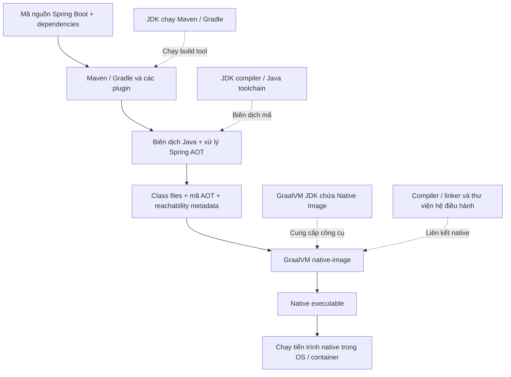

# Phân biệt GraalVM JDK, `native-image` và JDK dùng để chạy Gradle hoặc Maven

Trong quá trình chuyển một ứng dụng Spring Boot thành **GraalVM Native Image**, một nhầm lẫn phổ biến là: đã cài GraalVM thì mặc nhiên Gradle/Maven đang chạy bằng GraalVM; hoặc `java -version` đúng thì chắc chắn `native-image` sẽ dùng đúng bản JDK. Thực tế, đây là **các vai trò khác nhau** trong hệ thống build.

Ở chương **Môi trường build** của module **`SPRING_BOOT_NATIVE_IMAGE`**, chúng ta sẽ nhận diện từng thành phần, xác định nơi nó được chọn, kiểm chứng bằng lệnh thực tế và thiết lập môi trường build có thể lặp lại trên máy lập trình, CI và container. Phân biệt đúng ba thành phần này là tiền đề để chạy Spring AOT, build bằng Maven/Gradle, cấu hình reflection/resource, kiểm thử tính tương thích và đánh giá startup time cùng mức sử dụng bộ nhớ của bản native.

## 1. Mục tiêu học tập

Sau bài này, bạn có thể:

1. Giải thích **GraalVM JDK** khác gì với lệnh **`native-image`** và với **JDK mà Maven hoặc Gradle đang sử dụng**.
2. Phân biệt JDK chạy build tool, JDK biên dịch Java qua *toolchain* và JDK chứa công cụ Native Image.
3. Xác định chính xác phiên bản và đường dẫn công cụ trên Linux/macOS/Windows, kể cả trường hợp `JAVA_HOME`, `PATH` và IDE trỏ đến các JDK khác nhau.
4. Chọn cách cấu hình đơn giản cho người mới và nhận biết khi nào cần tách JDK trong CI.
5. Khoanh vùng các lỗi build do chọn sai JDK, thiếu `native-image` hoặc thiếu bộ công cụ C/C++ của hệ điều hành.

## 2. Ba khái niệm quan trọng nhất

### 2.1. GraalVM JDK: một bộ Java Development Kit

**GraalVM JDK** là một bản phân phối JDK có các công cụ Java quen thuộc như `java`, `javac` và thư viện nền tảng, đồng thời cung cấp khả năng tích hợp với hệ sinh thái GraalVM. Tùy phiên bản và cách phân phối, bộ cài có thể đã kèm Native Image hoặc cần cài thêm thành phần tương ứng.

Vì là JDK, GraalVM JDK vẫn có thể:

- Chạy chương trình Java trên JVM qua `java -jar app.jar`.
- Chạy Maven hoặc Gradle, nếu build tool chọn bộ JDK này.
- Biên dịch mã Java bằng `javac`, khi các công cụ build chọn nó làm compiler/toolchain.
- Cung cấp môi trường và công cụ cần thiết để dùng **Native Image**, khi thành phần đó đã được cài.

**Điểm mấu chốt:** dùng GraalVM JDK để chạy Java **không đồng nghĩa** đang tạo native executable. Câu lệnh `java -jar app.jar` vẫn chạy ứng dụng trên JVM; muốn có chương trình máy độc lập với JVM thông thường cần bước biên dịch Native Image.

### 2.2. `native-image`: công cụ tạo native executable

**`native-image`** là chương trình dòng lệnh thuộc hệ sinh thái GraalVM Native Image. Nó xử lý classpath/module path, phân tích mã và khả năng truy cập, thực hiện biên dịch ahead of time (AOT), liên kết thành tệp thực thi native cho hệ điều hành/kiến trúc mục tiêu được hỗ trợ.

Đầu vào thường là các class Java đã biên dịch và các metadata cần cho reflection, proxy, resource hoặc JNI; đầu ra thường là **native executable**, ví dụ `my-app` trên Linux hoặc `my-app.exe` trên Windows.

Với Spring Boot, plugin build gọi `native-image` trong quy trình gồm xử lý Spring AOT và chuẩn bị metadata. Nhà phát triển thường kích hoạt qua `native:compile` của Maven hoặc `nativeCompile` của Gradle thay vì tự gọi mọi tham số `native-image`.

Lưu ý:

- `native-image` **không phải** một JDK thứ hai độc lập với GraalVM JDK.
- Tìm được lệnh `native-image` trong `PATH` chưa đủ chứng minh Maven/Gradle đang sử dụng đúng GraalVM.
- `native-image` cần các công cụ hệ điều hành thích hợp, thường gồm compiler/linker C/C++ và thư viện hệ thống; chỉ cài JDK không đảm bảo mọi điều kiện build đã đầy đủ.
- Native executable đã build có thể chạy **không cần cài một JVM đầy đủ** trên máy đích, nhưng vẫn cần môi trường hệ điều hành và thư viện native phù hợp với cách build.

### 2.3. JDK dùng để chạy Maven hoặc Gradle: JVM của công cụ build

Maven và Gradle là các ứng dụng chạy trên JVM. Để khởi động build tool, máy cần có Java runtime phù hợp với **phiên bản Maven/Gradle và plugin**.

JDK này có thể là:

- GraalVM JDK, chẳng hạn một GraalVM JDK 21.
- Một JDK thông thường như Eclipse Temurin, Oracle JDK hoặc bản phân phối tương thích khác.
- JDK do IDE/CI chọn, có thể khác JDK của terminal đang mở.

Với **Maven**, lệnh `mvn -version` hoặc `./mvnw -version` cho biết Java đang chạy Maven trong lần gọi đó. Với **Gradle**, launcher và daemon có thể dùng cấu hình JVM riêng; kiểm tra bằng `./gradlew --version`, cấu hình daemon và log của build. Gradle có thể chọn JDK cho **daemon**, **compiler** và **Native Image toolchain** theo các cơ chế khác nhau.

**Đừng gộp JDK chạy build tool với JDK biên dịch source.** Maven Toolchains hoặc Java Toolchains của Gradle có thể chỉ định một JDK khác để biên dịch hoặc chạy một số tác vụ, dù Maven/Gradle vẫn hoạt động trong JVM ban đầu.

## 3. Bảng so sánh nhanh

| Thành phần | Bản chất | Công việc chính | Cách nhận diện |
|---|---|---|---|
| **GraalVM JDK** | Bản phân phối JDK | Cung cấp Java runtime, compiler và nền tảng GraalVM | Kiểm tra bản `java` trong thư mục GraalVM và `java -version` |
| **`native-image`** | Công cụ dòng lệnh của GraalVM | Biên dịch class Java thành chương trình native | `native-image --version`, đường dẫn executable |
| **JDK chạy Maven** | Java runtime của tiến trình Maven | Chạy lifecycle, plugins và các tác vụ Maven | `mvn -version` hoặc `./mvnw -version` |
| **JDK chạy Gradle** | Java runtime của launcher/daemon Gradle | Chạy build scripts, plugins và Gradle tasks | `gradle --version` hoặc `./gradlew --version`, daemon JVM/log |
| **JDK biên dịch Java** | JDK được chọn qua compiler/toolchain | Biên dịch `*.java` thành `*.class` | Cấu hình compiler, Gradle Java toolchain/Maven Toolchains |

Đây là **vai trò**, không phải bắt buộc là năm bản cài đặt riêng. Một **GraalVM JDK** phù hợp có thể đảm nhiệm đồng thời tất cả vai trò JDK, trong khi công cụ `native-image` nằm cùng bộ cài. Ngược lại, một pipeline phức tạp có thể dùng JDK thông thường để chạy Gradle nhưng dùng GraalVM JDK khác để biên dịch native.

## 4. Dòng chảy của bản build Spring Boot Native Image



Sơ đồ thể hiện **trách nhiệm logic**, không hàm ý mỗi ô luôn dùng một tiến trình hoặc một JDK riêng. Cách Maven/Gradle định vị công cụ native phụ thuộc plugin và cấu hình đã chọn. Các bước Spring AOT có thể chạy trong JVM của build, còn binary cuối không phải một tệp JAR thông thường.

### Ví dụ một môi trường có nhiều JDK

Giả sử máy CI có:

```text
/opt/jdks/temurin-21/       JDK A: chạy Gradle daemon
/opt/jdks/graalvm-jdk-21/   JDK B: chứa native-image
```

Gradle có thể chạy bằng **JDK A** và vẫn biên dịch native bằng `native-image` từ **JDK B**, *nếu* plugin build được cấu hình để chọn đúng JDK B. Chỉ vì cả hai JDK đều được cài trên máy không có nghĩa build sẽ tự chọn đúng.

Thiết lập đơn giản hơn cho dự án mới là dùng **cùng một GraalVM JDK** làm JDK chạy Maven/Gradle và JDK chứa `native-image`; cách này giảm số biến môi trường cần điều phối. Khi thật sự cần tách các JDK, cần kiểm chứng từng đường dẫn một cách riêng biệt.

## 5. Bốn biến thể thường gặp

| Tình huống | Maven/Gradle chạy bằng | Công cụ build native | Điều cần nhớ |
|---|---|---|---|
| A. Một JDK cho toàn bộ pipeline | GraalVM JDK | `native-image` trong cùng bộ GraalVM | Dễ thiết lập và khắc phục sự cố ban đầu |
| B. JDK thường chạy build, GraalVM tạo native | Temurin/Oracle JDK | `native-image` thuộc GraalVM JDK riêng | Phải cấu hình toolchain hoặc đường dẫn công cụ rõ ràng |
| C. IDE và terminal khác nhau | IDE chọn JDK X, terminal chọn JDK Y | Có thể khác theo nơi chạy build | Kết quả build có thể khác dù cùng repository |
| D. Build qua Cloud Native Buildpacks | JDK trên máy chạy Maven/Gradle để điều khiển build | JDK/Native Image trong môi trường builder image | GraalVM trên máy host có thể không cần, tùy đường build |

Trường hợp D rất đáng chú ý khi đóng gói container: `spring-boot:build-image` của Maven hoặc `bootBuildImage` của Gradle có thể dùng **buildpack builder** với toolchain riêng bên trong container. Khi đó `native-image --version` trên máy host không phải bằng chứng xác định phiên bản Native Image đã dùng **trong builder**. Hãy kiểm tra cấu hình builder và log build image.

## 6. Kiểm tra đúng JDK và Native Image trên máy

### 6.1. Linux/macOS

Chạy trong terminal đang định dùng để build:

```bash
echo "JAVA_HOME=$JAVA_HOME"
command -v java
command -v javac
command -v native-image
java -version
javac -version
native-image --version
```

Kiểm tra **Maven Wrapper** hoặc **Gradle Wrapper** tùy dự án:

```bash
./mvnw -version
# Hoặc, đối với dự án Gradle:
./gradlew --version
```

Nếu không dùng Wrapper, thay bằng `mvn -version` hoặc `gradle --version`. Wrapper giúp cố định **phiên bản build tool** phù hợp với dự án, nhưng **không tự cố định JDK mà build tool sử dụng**.

### 6.2. Windows PowerShell

```powershell
$env:JAVA_HOME
Get-Command java, javac, native-image | Select-Object Name, Source
java -version
javac -version
native-image --version

# Dự án Maven:
.\mvnw.cmd -version

# Hoặc dự án Gradle:
.\gradlew.bat --version
```

Nếu `native-image` không được tìm thấy, PowerShell có thể báo lỗi `CommandNotFoundException`. Lúc đó kiểm tra bản GraalVM đang cài, sự hiện diện của executable trong thư mục `bin`, và cách thiết lập `PATH`.

### 6.3. Đọc kết quả theo đúng ý nghĩa

Giả sử đầu ra thể hiện:

```text
java -version          -> Eclipse Temurin 21
./mvnw -version        -> Java version: 21, vendor: GraalVM
native-image --version -> GraalVM Native Image 21
```

Điều này **không tự mâu thuẫn**: lệnh `java` trong `PATH` có thể là Temurin, trong khi Maven Wrapper khởi chạy bằng `JAVA_HOME` trỏ đến GraalVM. `native-image` lại là executable được tìm thấy qua một mục khác trong `PATH`. Muốn kết luận build dùng đúng công cụ nào, phải kiểm tra **đường dẫn thực tế** và log tác vụ native, không chỉ nhìn các con số `21`.

Thêm một tình huống:

```text
java -version          -> GraalVM JDK 21
native-image --version -> command not found
```

Kết quả này có thể xảy ra vì Native Image chưa được cài trong bản phân phối đang dùng, hoặc vì executable chưa có trong `PATH`. Với một số thế hệ GraalVM cũ, thành phần Native Image được cài qua `gu`; với các bản phát hành khác, executable đã được đóng gói sẵn. **Không giả định lệnh `gu install native-image` luôn có sẵn hoặc áp dụng cho mọi bản GraalVM.** Hãy chọn hướng cài đặt theo đúng phiên bản và nhà phân phối JDK.

## 7. Cấu hình thực hành: dùng một GraalVM JDK cho local build

Để bắt đầu thuận lợi, dùng GraalVM JDK có phiên bản Java tương thích với dự án Spring Boot và có Native Image. Ví dụ dưới đây giả định dự án dùng **Java 21**; nếu dự án chọn Java khác, thay bằng phiên bản phù hợp thay vì sao chép cứng số `21`.

### 7.1. Linux/macOS

```bash
# Thay bằng đường dẫn GraalVM JDK thực tế.
export JAVA_HOME=/opt/jdks/graalvm-jdk-21
export PATH="$JAVA_HOME/bin:$PATH"

java -version
javac -version
native-image --version
./mvnw -version
```

Với Gradle, thay dòng cuối bằng `./gradlew --version`. Việc đặt `$JAVA_HOME/bin` lên đầu `PATH` giúp các lệnh Java và Native Image trong terminal ưu tiên bộ JDK đã chọn.

Chạy build **Maven** nếu dự án có cấu hình Spring Boot/Maven Native profile và plugin Native Build Tools phù hợp:

```bash
./mvnw -Pnative native:compile
```

Chạy build **Gradle** nếu dự án đã áp dụng plugin `org.graalvm.buildtools.native`:

```bash
./gradlew nativeCompile
```

Hai lệnh trên là **hai lựa chọn theo loại dự án**, không phải hai bước tuần tự phải chạy trên cùng repository. Đường dẫn binary đầu ra tùy plugin, tên dự án và cấu hình.

### 7.2. Windows PowerShell

```powershell
# Thay bằng đường dẫn GraalVM JDK đã cài trên máy.
$env:JAVA_HOME = 'C:\jdks\graalvm-jdk-21'
$env:PATH = "$env:JAVA_HOME\bin;$env:PATH"

java -version
native-image --version
.\mvnw.cmd -version
```

Hoặc với dự án Gradle:

```powershell
.\gradlew.bat --version
.\gradlew.bat nativeCompile
```

Với Maven:

```powershell
.\mvnw.cmd -Pnative native:compile
```

Trên Windows, Native Image còn cần **bộ công cụ biên dịch native tương thích**, điển hình là các thành phần C/C++ và Windows SDK từ Visual Studio Build Tools. Tùy bản GraalVM và cấu hình hệ thống, bạn có thể cần chạy trong môi trường terminal đã nạp toolchain tương ứng. `java -version` thành công không chứng minh linker đã sẵn sàng.

**Cẩn trọng về phạm vi:** cách gán biến môi trường ở trên chỉ áp dụng cho **terminal hiện tại**. Mở terminal khác, chạy build từ IDE hoặc CI có thể cho ra lựa chọn JDK khác.

## 8. Gradle có nhiều “JDK” như thế nào?

Gradle tách **JVM thực thi Gradle** với **Java Toolchains** dùng cho các task như compile và test. Plugin GraalVM Native Build Tools còn có cơ chế phát hiện hoặc chọn công cụ Native Image.

Ví dụ một dự án Java/Groovy DSL dùng Java 21:

```groovy
java {
    toolchain {
        languageVersion = JavaLanguageVersion.of(21)
    }
}

graalvmNative {
    toolchainDetection = true
}
```

Trong ví dụ, khối `java.toolchain` nói rằng tác vụ Java cần công cụ Java 21. `toolchainDetection` yêu cầu plugin GraalVM Native Build Tools thực hiện cơ chế phát hiện toolchain của nó. **Chỉ khai báo `languageVersion = 21` không bảo đảm Gradle đã chọn bản phân phối GraalVM**, vì máy có thể cài nhiều JDK cùng phiên bản Java. Cần kiểm tra JDK nào được phát hiện và executable Native Image nào thực sự được gọi. Cú pháp và hành vi phát hiện phụ thuộc phiên bản plugin.

Nếu cần yêu cầu cụ thể **vendor GraalVM** cho Java toolchain trong một phiên bản Gradle hỗ trợ bộ lọc vendor này, có thể viết:

```groovy
java {
    toolchain {
        languageVersion = JavaLanguageVersion.of(21)
        vendor = JvmVendorSpec.GRAAL_VM
    }
}
```

Đây là **ràng buộc chọn JDK**, không phải lệnh tải GraalVM hoặc cài `native-image`. Gradle cần thấy JDK tương ứng qua các thư mục phát hiện hoặc một **toolchain resolver** được cấu hình; nếu không, quá trình chọn toolchain có thể thất bại.

### Ba nơi cần kiểm tra khi Gradle chọn sai Java

1. **JVM chạy Gradle daemon:** `JAVA_HOME`, cài đặt Gradle JVM của IDE, `org.gradle.java.home`, cấu hình daemon JVM tương ứng phiên bản Gradle.
2. **JDK phục vụ Java Toolchains:** khối `java.toolchain`, danh sách JDK Gradle phát hiện và nguồn cấp toolchain nếu có.
3. **JDK/công cụ Native Image:** cấu hình plugin `graalvmNative`, khả năng phát hiện GraalVM và lệnh `native-image` được ghi trong log build.

Khi cần xem đường dẫn và lý do lựa chọn, chạy:

```bash
./gradlew --version
./gradlew javaToolchains
./gradlew nativeCompile --info
```

Các lệnh phù hợp với dự án đã cài plugin native và có tác vụ tương ứng. `javaToolchains` giúp liệt kê các installation mà Gradle nhận biết; `--info` giúp xem chi tiết tác vụ build. Nếu vừa thay JDK cho Gradle daemon mà daemon cũ còn ảnh hưởng, có thể dừng daemon của dự án trước khi thử lại:

```bash
./gradlew --stop
```

**Không đổi toàn bộ JDK hệ thống chỉ để sửa một tác vụ Gradle** nếu nguyên nhân là Gradle Toolchains hoặc plugin native đang chọn sai executable.

## 9. Maven chọn JDK như thế nào?

Maven thông thường được khởi động qua `mvn` hoặc Maven Wrapper `mvnw` bằng Java được chọn trong môi trường của tiến trình. Lệnh sau cung cấp thông tin trực tiếp hơn `java -version` khi điều tra Maven:

```bash
./mvnw -version
```

Ví dụ output có thể hiển thị:

```text
Apache Maven ...
Java version: 21.x, vendor: GraalVM
Java home: /opt/jdks/graalvm-jdk-21
```

Trong `pom.xml`, nhiều dự án Spring Boot chỉ định:

```xml
<properties>
    <java.version>21</java.version>
    <maven.compiler.release>21</maven.compiler.release>
</properties>
```

Các property này giúp khai báo **mức Java nguồn/bytecode** theo cấu hình compiler, **không tự cài GraalVM và không tự đổi JDK đang chạy Maven**. Ví dụ `maven.compiler.release=21` không biến một JDK 17 thành compiler có khả năng biên dịch Java 21.

Maven cũng có cơ chế **Toolchains** để cho một số plugin sử dụng JDK khác với JDK chạy Maven, nếu plugin hỗ trợ và đã cấu hình đúng. Khi biên dịch native, plugin GraalVM Native Build Tools phải tìm được **công cụ Native Image tương thích**; cách định vị công cụ phụ thuộc phiên bản plugin và cách dự án thiết lập.

Với dự án Spring Boot được cấu hình profile native (chẳng hạn profile do các mẫu dự án Spring Boot tạo ra), ví dụ lệnh thường gặp:

```bash
./mvnw -Pnative native:compile
```

Nếu báo `Unknown lifecycle phase`, không tìm thấy goal hoặc không thấy plugin, hãy kiểm tra **profile và plugin đã được khai báo hay chưa**; việc cài GraalVM không tự tạo các mục này trong `pom.xml`.

Muốn phân tích build kỹ hơn có thể dùng:

```bash
./mvnw -version
./mvnw -Pnative native:compile -X
```

Log `-X` rất dài, chỉ dùng khi cần truy đường dẫn JDK/executable, classpath, argument hoặc lỗi plugin. Với môi trường CI, tránh công bố log có thông tin cấu hình nhạy cảm.

## 10. JDK chạy tool khác JDK tạo native: khi nào phù hợp?

Trong nhóm phát triển lớn, CI có thể chuẩn hóa một JDK để chạy Gradle/Maven, trong khi Native Image cần một bản GraalVM khác phù hợp với plugin và target. Điều này hợp lệ nếu **mọi thành phần được cấu hình và kiểm chứng nhất quán**.

Ví dụ:

```text
Máy CI:
  JDK chạy Gradle:      Temurin 21
  Java toolchain:       GraalVM JDK 21
  Native Image:         GraalVM Native Image 21
  Target:               Linux x86_64
  C/C++ toolchain:      Linux compiler/linker + thư viện cần thiết
```

Trong trường hợp này, chạy `java -version` chỉ trả lời JDK trong `PATH` của shell; chưa trả lời Gradle daemon đang chạy bằng JDK nào hoặc `nativeCompile` dùng công cụ nào. Build log và cơ chế toolchain mới là bằng chứng cuối cùng.

### Nguyên tắc tương thích

- **Ngôn ngữ/bytecode:** JDK dùng biên dịch Java cần hỗ trợ phiên bản source/release của dự án.
- **Native Image:** bản GraalVM Native Image được chọn phải hỗ trợ phiên bản class files/thư viện của ứng dụng và yêu cầu từ Spring Boot, GraalVM Native Build Tools.
- **Build tool:** bản Gradle/Maven cần chạy được trên JDK được chọn và tương thích với phiên bản plugin.
- **Nền tảng native:** hệ điều hành, kiến trúc CPU, C/C++ toolchain và thư viện liên kết phải phù hợp với binary mục tiêu.

Nếu sử dụng JDK biên dịch Java quá mới rồi dùng Native Image quá cũ, bạn có thể gặp lỗi phân tích/đọc class file, chẳng hạn thông báo không hỗ trợ **class file major version**. Nếu JDK chạy Maven/Gradle quá cũ, build có thể lỗi trước khi tác vụ Native Image khởi động.

**Phiên bản Java giống nhau chưa đủ bảo đảm tương thích tuyệt đối.** Cần đối chiếu phiên bản Spring Boot, GraalVM, Gradle/Maven plugin, công cụ hệ điều hành và thư viện được dùng trong dự án.

## 11. Native Image được build ở môi trường nào?

### Local build trực tiếp trên máy

Với `native:compile` hoặc `nativeCompile`, công cụ Native Image thường được gọi trong **môi trường máy đang build**. Trên Linux cần toolchain và thư viện hệ thống thích hợp; trên macOS cần công cụ phát triển từ Xcode Command Line Tools hoặc tương đương; trên Windows thường cần toolchain Microsoft C/C++ tương thích.

Binary được tạo ra hướng đến **nền tảng native mục tiêu được toolchain hỗ trợ**. Việc build native trực tiếp từ Windows rồi sao chép `.exe` vào container Linux sẽ không biến nó thành binary Linux. Cần build đúng môi trường/target hoặc dùng quy trình cross-compilation được hỗ trợ cụ thể.

### Build bằng Cloud Native Buildpacks

Spring Boot hỗ trợ hướng build image qua các buildpack, ví dụ các goal/task như:

```bash
# Maven, khi dự án đã có cấu hình profile native tương ứng:
./mvnw -Pnative spring-boot:build-image

# Gradle, khi build task đã được cấu hình để bật Native Image trong buildpack:
./gradlew bootBuildImage
```

Trong hướng này, các thành phần Java/Native Image dùng để build có thể **nằm trong builder image**, độc lập với JDK của host. Đừng suy ra phiên bản GraalVM bên trong container chỉ từ `JAVA_HOME` ở laptop. Kiểm tra cấu hình builder, môi trường buildpack (ví dụ cờ `BP_NATIVE_IMAGE=true` khi dùng buildpack hỗ trợ và cần bật native) và log thực tế.

Khi vận hành bản native, image runtime còn cần môi trường thư viện hệ thống tương thích. Cấu hình reflection, resource và Runtime Hints liên quan đến **những gì Native Image cần giữ lại trong ứng dụng**, không thể thay thế bước cài hoặc chọn JDK/Native Image phù hợp.

## 12. Quy trình kiểm chứng có thể lặp lại

Khi nhận một dự án Spring Boot mới và cần build native, làm theo các bước sau:

1. **Xác định phiên bản Java của dự án** từ cấu hình build và phiên bản Spring Boot/plugin liên quan. Đừng chọn GraalVM tùy ý.
2. **Cài GraalVM JDK tương thích** và xác nhận executable `native-image` có thể chạy; cài công cụ linker/compiler phù hợp với hệ điều hành.
3. **Xác nhận JDK chạy Maven/Gradle** bằng `mvnw -version` hoặc `gradlew --version`, chú ý JDK daemon và IDE.
4. **Xác nhận compiler/toolchain Java**, nếu dự án có dùng Maven Toolchains hoặc Gradle Java Toolchains.
5. **Xác nhận công cụ Native Image thật sự được plugin gọi** bằng log tác vụ native; không chỉ xem `PATH`.
6. **Chạy build native** bằng goal/task đã khai báo sẵn, rồi chạy thử native executable.
7. **Kiểm thử kết quả**: endpoint, reflection, resource, serialization và môi trường triển khai; đo startup, memory và kích thước image trong điều kiện nhất quán.

### Checklist kiểm tra trước khi báo lỗi cho đồng đội

```text
[ ] Biết chính xác Java version mà dự án yêu cầu
[ ] JDK chạy Maven/Gradle được xác minh
[ ] JDK compiler / Java toolchain được xác minh (nếu dùng)
[ ] GraalVM JDK đã cài đúng phiên bản tương thích
[ ] `native-image --version` hoạt động trong môi trường build native
[ ] Maven/Gradle Native plugin trỏ đến đúng Native Image
[ ] Compiler/linker C/C++ và thư viện OS có sẵn
[ ] Biết build trực tiếp trên host hay bên trong buildpack/container
[ ] Binary đầu ra chạy trên OS/architecture dự kiến
```

## 13. Chẩn đoán các lỗi thường gặp

| Hiện tượng | Nguyên nhân có thể | Hướng kiểm tra và sửa |
|---|---|---|
| `java -version` báo đúng GraalVM nhưng `native-image` không tồn tại | Thành phần Native Image chưa có hoặc `PATH` không trỏ đúng | Kiểm tra thư mục `bin` của GraalVM và cách cài Native Image của bản phát hành đó |
| `mvnw -version` dùng JDK khác `java -version` | `JAVA_HOME`/Wrapper/môi trường chạy chọn JVM khác PATH | So sánh `JAVA_HOME`, `Java home` từ Maven và đường dẫn `Get-Command`/`command -v` |
| Gradle dùng JDK khác terminal | Daemon JVM, IDE Gradle JVM, `org.gradle.java.home` hoặc toolchain | Kiểm tra `gradlew --version`, cấu hình daemon, `gradlew javaToolchains` và `--info` |
| Java compile thành công nhưng task native dùng sai GraalVM | Plugin native phát hiện toolchain/executable khác dự kiến | Xem log native task, cấu hình toolchain/plugin và các installation JDK |
| `invalid target release` hoặc lỗi class file version | JDK compiler/Native Image không hỗ trợ Java level được yêu cầu | Đối chiếu `--release`, phiên bản JDK compiler và Native Image |
| Native Image báo thiếu `cl.exe`, linker, compiler hoặc header | Thiếu bộ công cụ native của hệ điều hành | Cài và nạp toolchain C/C++/SDK phù hợp với platform |
| Maven không nhận goal `native:compile` | Plugin native chưa được khai báo hoặc profile sai | Kiểm tra `pom.xml`, profile và plugin version |
| Build native xong nhưng ứng dụng lỗi reflection/resource | Thiếu reachability metadata hoặc cách dùng thư viện động | Kiểm tra Spring AOT, Runtime Hints, metadata và kiểm thử thực tế; đây không nhất thiết là lỗi chọn JDK |

### Hai tình huống phân tích

**Tình huống A.** Máy có Temurin 21 và GraalVM JDK 21. `java -version` hiển thị Temurin; `./mvnw -version` hiển thị GraalVM; `native-image --version` chạy được. Có cần cài lại tất cả JDK không?

Không. Trước tiên kiểm tra **đường dẫn mà Maven và native plugin đang sử dụng**. Bộ công cụ có thể vẫn hoạt động chính xác. Nếu muốn thống nhất local build, đặt `JAVA_HOME` và `PATH` về cùng GraalVM JDK, sau đó xác minh lại. Không nên cài lại chỉ dựa trên việc ba lệnh hiển thị khác nhau.

**Tình huống B.** Gradle daemon đang chạy bằng Temurin 21, nhưng Java toolchain của dự án chọn GraalVM 21. Có thể chạy `nativeCompile` thành công không?

Có thể, khi Gradle/plugin hỗ trợ kết hợp phiên bản đó và **native plugin thực sự chọn đúng GraalVM Native Image**. Gradle daemon không nhất thiết phải chạy trên GraalVM JDK. Nếu task thất bại, điều tra log chọn executable/Java toolchain thay vì kết luận nguyên nhân chỉ từ tên JDK của daemon.

## 14. Câu hỏi tự kiểm tra

**1. GraalVM JDK và `native-image` có phải cùng một thứ?**  
Không. GraalVM JDK là **bản phân phối JDK**; `native-image` là **công cụ** thuộc hệ sinh thái GraalVM để tạo native executable.

**2. `java -version` hiển thị GraalVM thì chắc chắn Maven/Gradle chạy trên GraalVM?**  
Không. Maven thường theo Java môi trường khi khởi động; Gradle còn có launcher, daemon, cấu hình IDE. Kiểm tra `mvnw -version` hoặc `gradlew --version` và đường dẫn JVM thực tế.

**3. Đặt `maven.compiler.release=21` có tự chọn GraalVM JDK 21 không?**  
Không. Đây là yêu cầu về mức Java cho compiler, không phải lệnh chọn nhà phân phối JDK hoặc cài Native Image.

**4. Native executable đã tạo có cần chạy bằng `java -jar` không?**  
Không. Nó là chương trình native chạy trực tiếp trên nền tảng phù hợp; nó không phải JAR chứa bytecode để JVM thực thi.

**5. Nếu `spring-boot:build-image` tạo được native container, có thể kết luận máy host đã cài đúng GraalVM Native Image không?**  
Không. Native Image có thể chạy bên trong **buildpack builder**, sử dụng JDK/toolchain khác với host.

**6. Cài GraalVM Native Image thành công nhưng linker báo lỗi thì có phải do Spring AOT?**  
Không nhất thiết. Đây có thể là vấn đề compiler, linker, header hoặc thư viện native của hệ điều hành; kiểm tra thông báo lỗi gốc và môi trường liên kết trước.

## 15. Ghi nhớ để dùng trong dự án thật

Ba câu hỏi độc lập giúp tránh phần lớn lỗi môi trường:

- **Ai chạy build?** → JDK/JVM của Maven hoặc Gradle.
- **Ai tạo executable?** → Công cụ `native-image` từ GraalVM và toolchain native của OS.
- **Ai biên dịch mã Java?** → Compiler JDK được build chọn, có thể qua Java/Maven Toolchains.

Bạn **có thể** dùng cùng GraalVM JDK cho cả ba vai trò JDK và Native Image khi bắt đầu, hoặc tách chúng trong CI nếu có lý do rõ ràng. Khi kiểm thử Spring Boot Native Image, luôn ghi lại chính xác **phiên bản/đường dẫn JDK chạy build, JDK compiler, bản `native-image`, môi trường linker và cách build container**. Chỉ khi nhận diện rõ các thành phần này mới có thể đánh giá công bằng lợi ích khởi động, bộ nhớ và độ tương thích của bản native.
