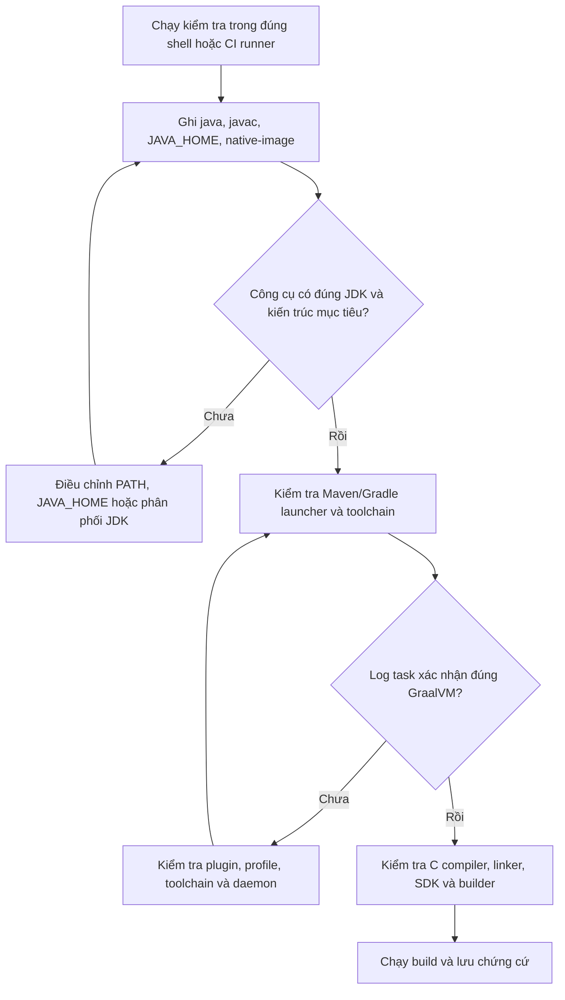

# Kiểm tra java, native-image, JAVA_HOME và toolchain thực sự được chọn

## 1. Vì sao phải xác định đúng công cụ trước khi build?

Trong module **SPRING_BOOT_NATIVE_IMAGE**, người học biên dịch ứng dụng Spring Boot thành GraalVM Native Image bằng Spring AOT, kiểm tra reflection/resource, so sánh thời gian khởi động và bộ nhớ, rồi đóng gói container để vận hành. Một điều kiện đầu vào của toàn bộ quy trình là **biết chính xác JDK, Native Image và bộ biên dịch hệ điều hành nào đang được sử dụng**.

Máy phát triển có thể cài nhiều JDK. Khi đó, bốn thông tin sau có thể khác nhau:

- `java -version` cho biết phiên bản **lệnh `java` được shell tìm thấy** qua `PATH`.
- `JAVA_HOME` là **biến môi trường trỏ tới một thư mục JDK**, không nhất thiết là JDK đứng đầu `PATH`.
- Maven/Gradle có thể chạy bằng một JVM, nhưng **Java toolchain dùng để biên dịch** lại là JDK khác.
- Tác vụ Native Image có thể chọn `native-image` từ một bản GraalVM khác với lệnh được gõ trực tiếp, tùy plugin, cấu hình và cách build.

Nếu chỉ nhìn một dòng `java -version`, người học rất dễ kết luận sai rằng native build đang dùng đúng GraalVM. Bài này hướng dẫn truy vết từng lớp, ghi lại bằng chứng và tìm nguyên nhân khi các giá trị không khớp.

### Phạm vi kiểm tra

| Lớp thực thi | Cần trả lời câu hỏi gì? | Nguồn chứng cứ |
| --- | --- | --- |
| Terminal/shell | Lệnh `java`, `javac`, `native-image` nào được tìm thấy trước? | Đường dẫn thực thi, `PATH`, kết quả `--version`. |
| `JAVA_HOME` | Biến trỏ tới đúng **gốc JDK** và có các chương trình cần thiết? | Giá trị biến và chạy trực tiếp từ `JAVA_HOME/bin`. |
| Maven launcher | Maven wrapper chạy bằng JVM nào? | `./mvnw -version` hoặc `mvn -version`. |
| Maven compiler/native plugin | Plugin thực sự dùng Java toolchain/Native Image nào? | Toolchains/config và log thực thi plugin. |
| Gradle launcher/daemon | Gradle client/daemon chạy trên JVM nào? | `./gradlew --version`, thông tin daemon. |
| Gradle Java/native toolchain | Tác vụ `compileJava`, AOT, `nativeCompile` chọn JDK nào? | `javaToolchains`, cấu hình task/plugin, log `--info`. |
| OS toolchain | Trình biên dịch C, linker, SDK và thư viện mục tiêu nào được dùng? | `cc`, `clang`, `ld`, MSVC/Windows SDK, log linker. |
| Buildpack/container | Native build chạy trong builder nào, kiến trúc nào? | Builder, stack/run image, log build, metadata image. |

**Tiêu chuẩn đạt:** có đường dẫn hoặc chứng cứ log cho **công cụ thật được tác vụ build sử dụng**, chứ không chỉ biết công cụ có tồn tại trên máy.

## 2. Phân biệt `PATH`, `JAVA_HOME`, JDK và `native-image`

### 2.1. Shell phân giải lệnh như thế nào?

Giả sử một máy Linux có:

```text
JAVA_HOME=/opt/graalvm-jdk-21
PATH=/usr/lib/jvm/temurin-21/bin:/opt/graalvm-jdk-21/bin:...

java         -> /usr/lib/jvm/temurin-21/bin/java
native-image -> /opt/graalvm-jdk-21/bin/native-image
```

Đây là **ví dụ giả định**. `JAVA_HOME` trỏ GraalVM, nhưng `java` từ shell là Temurin vì thư mục Temurin đứng trước trên `PATH`. Vì vậy `java -version` có thể hiển thị Temurin, còn `native-image --version` lại cho thấy GraalVM. Điều này có thể dẫn đến kết quả khó dự đoán khi các plugin dùng nguồn chọn công cụ khác nhau.

`JAVA_HOME` phải trỏ vào **thư mục gốc JDK**, chẳng hạn `/opt/graalvm-jdk-21` hoặc `C:\\Java\\graalvm-jdk-21`; không trỏ vào chính `bin` hay tệp `java`. Một JDK dùng cho build Java thường có `bin/java` và `bin/javac`; một bản GraalVM JDK dùng cho native build cần có khả năng chạy Native Image theo phân phối/cài đặt đang sử dụng.

Để biết chương trình **nào** chạy, cần kiểm tra đường dẫn lệnh, không chỉ số phiên bản. Hai bản JDK cùng Java 21 vẫn có thể khác nhà cung cấp, bản vá, kiến trúc hoặc công cụ native.

### 2.2. Kiểm tra trên Linux và macOS (Bash)

Chạy từng nhóm lệnh trong **terminal thực sự sẽ dùng để build**:

```bash
# 1. Giá trị môi trường và thứ tự chương trình có thể được chọn
printf 'JAVA_HOME=%s\n' "${JAVA_HOME:-<chua-dat>}"
type -a java || true
type -a javac || true
type -a native-image || true

# 2. Thực thi được chọn bởi PATH
command -v java
java -version
command -v javac
javac -version

# 3. Thực thi nằm trong JAVA_HOME (nếu đã khai báo)
if [ -n "${JAVA_HOME:-}" ]; then
  "$JAVA_HOME/bin/java" -version
  "$JAVA_HOME/bin/javac" -version
  if [ -x "$JAVA_HOME/bin/native-image" ]; then
    "$JAVA_HOME/bin/native-image" --version
  else
    echo 'JAVA_HOME/bin/native-image khong co hoac khong the thuc thi'
  fi
fi

# 4. Native Image tìm được trên PATH (nếu có)
if command -v native-image >/dev/null 2>&1; then
  native-image --version
fi
```

`type -a` cho thấy nhiều kết quả trùng tên trong các thư mục `PATH`. `command -v` cho biết shell hiện tại chọn tên lệnh ở đâu, nhưng trên môi trường có alias/function hoặc launcher trung gian, cần tiếp tục xác nhận thực thể cuối cùng. Trên Linux có thể xem liên kết bằng `ls -l` hoặc `readlink -f` (nếu có); `readlink -f` không mặc định có trên mọi macOS.

Lấy các thuộc tính runtime do chính Java báo cáo:

```bash
java -XshowSettings:properties -version 2>&1 \
  | grep -E '^[[:space:]]*(java.home|java.vendor|java.version|os.arch) ='
```

`java.home` là thuộc tính runtime mà JVM công bố; nó **không phải phép kiểm chứng duy nhất của biến `JAVA_HOME`**. So sánh cả đường dẫn thực thi, vendor, version và architecture.

Trên macOS, lệnh sau liệt kê các JDK được hệ điều hành nhận diện:

```bash
/usr/libexec/java_home -V
```

Lệnh này hữu ích để tìm JDK đã cài, nhưng danh sách JDK khả dụng không chứng minh tác vụ Maven/Gradle đang chọn bản nào.

### 2.3. Kiểm tra trên Windows (PowerShell)

PowerShell không dùng `which`/`type -a` theo cùng cách Bash. Sử dụng:

```powershell
# 1. Biến môi trường và các lệnh trùng tên
"JAVA_HOME=$env:JAVA_HOME"
Get-Command java -All -ErrorAction SilentlyContinue | Select-Object Name, Source
Get-Command javac -All -ErrorAction SilentlyContinue | Select-Object Name, Source
Get-Command native-image -All -ErrorAction SilentlyContinue | Select-Object Name, Source

# 2. Kết quả thực thi từ PATH
where.exe java
where.exe native-image
java -version
javac -version
native-image --version

# 3. Thực thi trực tiếp từ JAVA_HOME, nếu có
if ($env:JAVA_HOME) {
  & (Join-Path $env:JAVA_HOME 'bin\java.exe') -version
  & (Join-Path $env:JAVA_HOME 'bin\javac.exe') -version
  $nativeCmd = Join-Path $env:JAVA_HOME 'bin\native-image.cmd'
  if (Test-Path $nativeCmd) {
    & $nativeCmd --version
  }
}
```

Các lệnh dành cho công cụ **chưa cài** có thể báo không tìm thấy; đó là dữ kiện cần ghi lại. `where.exe` được viết đầy đủ để tránh nhầm với alias `where` trong PowerShell. Với Native Image trên Windows, tên launcher có thể là `native-image.cmd`; đối chiếu phân phối đang sử dụng trước khi kết luận thiếu công cụ.

Để nhận biết môi trường đang chạy Windows hay WSL, quan sát shell, đường dẫn (`C:\\...` so với `/usr/...`) và kết quả `java -version` trong **chính môi trường đó**. `JAVA_HOME` của Windows không tự động là `JAVA_HOME` của distro WSL, và binary native tạo cho Linux không phải executable Windows.

## 3. Khi nào cần sửa `JAVA_HOME` và `PATH`?

Chỉ đổi cấu hình khi đã xác định bản JDK/GraalVM mục tiêu phù hợp với phiên bản Java của dự án và plugin native. Ví dụ trên Bash:

```bash
# Giá trị minh họa; thay bằng thư mục JDK thực sự đã cài
export JAVA_HOME="/opt/graalvm-jdk-21"
export PATH="$JAVA_HOME/bin:$PATH"
hash -r  # Làm mới cache tìm đường dẫn lệnh của Bash nếu cần

command -v java
java -version
"$JAVA_HOME/bin/java" -version
native-image --version
```

Ví dụ trong một phiên PowerShell:

```powershell
# Giá trị minh họa; thay bằng thư mục JDK thực sự đã cài
$env:JAVA_HOME = 'C:\Java\graalvm-jdk-21'
$env:Path = "$env:JAVA_HOME\bin;$env:Path"

Get-Command java | Select-Object Source
java -version
& (Join-Path $env:JAVA_HOME 'bin\java.exe') -version
native-image --version
```

Các thay đổi trên chỉ áp dụng cho **phiên shell hiện tại**. Nếu chạy build trong IDE, terminal tích hợp, CI runner, WSL hoặc container, phải kiểm tra lại **môi trường của tiến trình đó**. Thay đổi biến hệ thống sau khi IDE đã mở có thể không ảnh hưởng đến phiên làm việc đang chạy.

Không cài Native Image bằng một lệnh cố định cho mọi release: một số phân phối GraalVM đã bao gồm công cụ, một số bản cũ dùng component manager, và phương pháp cung cấp công cụ phụ thuộc vào release. Hãy đối chiếu bộ cài chính thức tương ứng, sau đó kiểm tra lại `native-image --version`.

## 4. Maven đang dùng JVM và Native Image nào?

### 4.1. Tách Maven launcher khỏi compiler toolchain

Tại thư mục gốc của dự án Maven, chạy:

```bash
./mvnw -version
# Trên Windows: .\mvnw.cmd -version
```

Kết quả thường hiển thị **Java version**, **Java home**, hệ điều hành và kiến trúc mà Maven đang chạy. Đây là bằng chứng của **JVM chạy Maven**, chưa chắc là JDK được Maven Compiler Plugin chọn. Một dự án có Maven Toolchains Plugin và cấu hình toolchain trong `~/.m2/toolchains.xml` có thể yêu cầu JDK khác cho tác vụ biên dịch. Một số plugin không sử dụng Maven toolchain, vì thế cần kiểm tra plugin thực tế thay vì mặc định rằng tất cả dùng chung một JDK.

Ví dụ kết quả cần so sánh:

```text
Terminal: java               -> /usr/lib/jvm/temurin-21/bin/java
JAVA_HOME                      -> /opt/graalvm-jdk-21
./mvnw -version: Java home    -> /opt/graalvm-jdk-21
Compiler toolchain (nếu có)   -> cần kiểm tra log tác vụ compile
Native Image executable       -> cần kiểm tra log native plugin
```

Tình huống giả định trên có thể hoàn toàn hợp lệ nếu các toolchain được cấu hình có chủ đích. Vấn đề xuất hiện khi người phát triển **không biết** những sự khác nhau này, hoặc native build chọn nhầm JDK/kiến trúc.

### 4.2. Kiểm tra profile, goal và đường dẫn native thực tế

Đối với dự án đã cấu hình Spring Boot Maven Plugin và GraalVM Native Build Tools, dùng các lệnh sau theo thứ tự:

```bash
./mvnw -version
./mvnw help:active-profiles -Pnative
./mvnw -Pnative spring-boot:process-aot

# Chỉ khi chuẩn bị thực hiện một native build thực sự:
./mvnw -Pnative native:compile
```

`spring-boot:process-aot` cho biết bước xử lý trước thời điểm chạy có hoàn tất không; nó **không tự xác nhận** trình biên dịch máy nào sẽ được chọn. `native:compile` là goal thuộc native plugin và có thể tiêu tốn đáng kể CPU, RAM, thời gian. Các lệnh trên giả định dự án **đã khai báo đúng plugin/profile**; `-Pnative` chỉ kích hoạt profile nếu profile đó tồn tại, không tự cài cấu hình còn thiếu.

Khi cần truy vết, bật log chi tiết **có mục tiêu**:

```bash
./mvnw -Pnative native:compile -X
```

Đọc phần log native plugin để xác nhận đường dẫn công cụ, tham số Native Image, phiên bản GraalVM, cấu hình classpath và platform. Log `-X` dài và có thể chứa thông tin nhạy cảm do cấu hình build; chỉ trích xuất phần cần thiết khi chia sẻ. Tránh lấy dòng `java -version` của shell để suy đoán thay cho log build.

Với Maven Compiler Plugin và Maven toolchains, kiểm tra **cấu hình chọn JDK** và thông báo compiler/toolchain được dùng trong log của tác vụ `compile`. Một file `toolchains.xml` có JDK 21 chỉ mô tả các bản **có thể được chọn**; vẫn cần xác nhận toolchain đã match yêu cầu của build.

**Điểm dừng của Maven:** ghi lại được Java home của Maven, JDK compiler thực sự sử dụng (nếu khác), Native Image được native plugin gọi và phiên bản tương ứng.

## 5. Gradle: launcher, daemon, Java toolchain và Native Image

Gradle có thêm một lớp cần phân biệt: trình chạy Gradle, **Gradle daemon** và Java toolchain của các task có thể dùng các JDK khác nhau.

### 5.1. Liệt kê các JDK Gradle biết đến

```bash
./gradlew --version
./gradlew -q javaToolchains

# Khi cần thấy thông tin task compile và cách Gradle chọn compiler:
./gradlew compileJava --info
```

Trên Windows dùng `gradlew.bat`. Tác vụ `javaToolchains` thường có trong dự án áp dụng Java plugin và liệt kê các JDK Gradle phát hiện được, bao gồm đường dẫn và khả năng dùng làm compiler. **Danh sách được phát hiện không đồng nghĩa với toolchain mà `compileJava` chọn**. Kiểm tra cấu hình `java { toolchain { ... } }`, log task và cấu hình Gradle tương ứng.

Ví dụ cấu hình định hướng Java toolchain trong `build.gradle` dùng Groovy DSL:

```groovy
java {
    toolchain {
        languageVersion = JavaLanguageVersion.of(21)
    }
}
```

Đây là yêu cầu **phiên bản ngôn ngữ 21**, không nhất thiết là yêu cầu dùng GraalVM. Nếu máy có nhiều JDK 21, Gradle có thể chọn một bản khác. Để ép vendor hoặc đường dẫn, cần cấu hình toolchain phù hợp với phiên bản Gradle/plugin của dự án và kiểm chứng bằng log thực thi. Những file cấu hình như `gradle.properties` (`org.gradle.java.home`), Java toolchains, quy tắc daemon JVM và cấu hình IDE cũng có thể ảnh hưởng đến quá trình chọn JDK.

### 5.2. Kiểm chứng task AOT và native

Với dự án đã áp dụng plugin Spring Boot và `org.graalvm.buildtools.native` tương thích:

```bash
./gradlew processAot --info

# Build Native Image thực sự, thường mất nhiều tài nguyên:
./gradlew nativeCompile --info
```

Quan sát log của **chính task `nativeCompile`** để nhận diện executable/installation GraalVM mà plugin dùng. GraalVM Native Build Tools hỗ trợ cơ chế phát hiện Java toolchain tùy phiên bản và cấu hình, vì vậy có thể sử dụng một bản GraalVM khác với Java shell đang thấy. `./gradlew --version` chỉ mô tả Gradle runtime/daemon; muốn xác định compiler cần thông tin của task.

Nếu vừa đổi `JAVA_HOME` hoặc cấu hình daemon, Gradle daemon đang tồn tại có thể vẫn chạy với JVM trước đó. Khi cần chẩn đoán việc đổi JDK, có thể dừng daemon của **dự án hiện tại** và chạy lại để kiểm tra:

```bash
./gradlew --stop
./gradlew --version
```

Lưu ý `--stop` dừng các daemon phù hợp với phiên bản Gradle trong môi trường hiện tại, nên tránh gọi tùy tiện khi có build khác đang chạy. Dừng daemon không sửa cấu hình chọn toolchain; điều quyết định vẫn là kết quả log ở task tiếp theo.

**Điểm dừng của Gradle:** biết JDK chạy daemon, JDK `compileJava` chọn, GraalVM `nativeCompile` dùng và cấu hình nào quyết định sự lựa chọn đó.

## 6. Native Image còn phụ thuộc compiler và linker của hệ điều hành

`native-image --version` thành công là điều kiện cần nhưng **chưa đủ** để biên dịch native. Native Image còn phải làm việc với C toolchain, linker, header, thư viện nền tảng và kiến trúc CPU phù hợp.

### 6.1. Linux

```bash
uname -s
uname -m
command -v cc
cc --version
command -v ld
ld --version
```

Ghi lại compiler thực sự (`gcc` hay `clang` tùy hệ), linker và phiên bản. Tên package yêu cầu như `gcc`, `glibc-devel`, `zlib-devel` hoặc tương đương thay đổi theo distro và cách liên kết; kiểm tra tài liệu GraalVM và log thiếu header/library để cài đúng gói. Nếu cần binary tĩnh hoặc musl, đây là lựa chọn build riêng với điều kiện libc/linker khác; không mặc nhiên dùng cùng bước lệnh với glibc thông thường.

### 6.2. macOS

```bash
uname -m
xcode-select -p
xcrun --find clang
xcrun clang --version
xcrun --find ld
```

Kiểm tra Command Line Tools hoặc bộ công cụ Xcode phù hợp. Với máy Apple Silicon, xác nhận Java, `native-image` và target architecture tương thích; chạy Terminal qua Rosetta hoặc dùng nhầm JDK `x86_64` có thể tạo sai khác so với `arm64` mong muốn.

### 6.3. Windows

Native Image trên Windows thường cần **MSVC Build Tools/Visual Studio C++ toolchain** cùng Windows SDK tương ứng. Mở Developer Command Prompt/Developer PowerShell có môi trường build thích hợp rồi kiểm tra:

```powershell
where.exe cl
where.exe link
cl.exe
```

`cl.exe` có thể in thông báo thiếu source và trả mã lỗi khi gọi không có đối số; mục tiêu của phép thử này là xác nhận compiler có trong môi trường và xem phiên bản. Kiểm tra native-image error log để phát hiện thiếu Windows SDK, linker hoặc sai architecture. Có `gcc` của MinGW trong `PATH` không có nghĩa plugin Windows đang sử dụng đúng toolchain được GraalVM hỗ trợ.

### 6.4. Quy tắc tương thích OS/architecture

Native executable thường gắn với **hệ điều hành và kiến trúc mà nó được build cho**. Một binary Linux `x86_64` không thể dùng như binary Windows, và không tự động chạy trên Linux `aarch64`. Đừng nhầm JAR Java, có thể chạy trên nhiều JVM tương thích, với native executable phụ thuộc nền tảng. Xây dựng image đa kiến trúc cần build/cung cấp artifact phù hợp cho từng target architecture.

## 7. Nếu build qua Buildpacks hoặc container thì phải kiểm tra ở đâu?

Khi dùng Spring Boot `build-image`/`bootBuildImage` với Cloud Native Buildpacks, nhiều thao tác biên dịch xảy ra **bên trong builder image**. Do đó:

- `java -version` hay `native-image --version` **trên host** có thể không giống, thậm chí host không cài `native-image` vẫn có thể build native nhờ buildpack cung cấp công cụ.
- Phiên bản GraalVM và toolchain dùng trong build phụ thuộc builder, buildpack, environment và stack; xem **log build của builder** để xác nhận.
- Container chạy cuối cùng có thể dùng một runtime image/stack khác với môi trường build; cần xác minh kiến trúc, libc/thư viện động, entrypoint và khả năng vận hành thực tế.

Ví dụ Maven sau đây yêu cầu dự án đã cấu hình profile native và có Docker daemon/buildpack builder thích hợp:

```bash
docker version
./mvnw -Pnative spring-boot:build-image \
  -Dspring-boot.build-image.imageName=example/spring-native:local

docker image inspect example/spring-native:local
```

Với Gradle, một dự án cấu hình builder/native phù hợp có thể dùng `bootBuildImage`; chỉ có tên task không chứng minh image sinh ra là native. Kiểm tra các log buildpack, tên builder/stack, thiết lập native và thành phần executable trong image.

Nếu native build diễn ra trong CI hoặc Docker, bộ bằng chứng tối thiểu phải xuất phát từ **runner/builder thực tế**. Kết quả kiểm tra môi trường trên máy cá nhân không thể thay thế kết quả trên CI. Khi điều tra lỗi, ghi image digest/tag cố định, phiên bản builder và target architecture để tái hiện chính xác.

## 8. Quy trình chẩn đoán khi các kết quả mâu thuẫn



| Hiện tượng | Nguyên nhân có thể | Cần làm gì để xác minh |
| --- | --- | --- |
| `java -version` đúng nhưng `native-image` không tìm thấy | Đang dùng JDK không có Native Image hoặc `PATH` chưa chứa launcher. | Kiểm tra thư mục `JAVA_HOME/bin`, vị trí `native-image`, phân phối GraalVM được cài. |
| `JAVA_HOME` trỏ GraalVM nhưng `java -version` lại là JDK khác | Một thư mục JDK khác đứng trước trong `PATH`, alias hoặc shell cache. | `type -a`/`Get-Command -All`; chạy `"$JAVA_HOME/bin/java" -version` trực tiếp. |
| `native-image --version` khác phiên bản Java Maven đang báo | PATH và JVM launcher Maven sử dụng công cụ khác nhau. | `./mvnw -version`, đường dẫn `native-image` và log native plugin. |
| Gradle phát hiện nhiều JDK 21 | `javaToolchains` liệt kê bản khả dụng nhưng task chỉ chọn một bản. | Kiểm tra Java toolchain, task `compileJava --info`, `nativeCompile --info`. |
| Đổi `JAVA_HOME` nhưng Gradle vẫn dùng JVM cũ | Daemon chưa thay, IDE hoặc `org.gradle.java.home` đang chọn JDK khác. | Kiểm tra Gradle daemon, cấu hình runtime và log task; dừng daemon nếu phù hợp. |
| `native-image` chạy được nhưng build lỗi linker/headers | Thiếu C compiler, libc header, SDK, thư viện hoặc không đúng kiến trúc. | Xác minh compiler/linker/SDK và lỗi đầu tiên có ý nghĩa trong log. |
| Local build đúng, CI hoặc Docker build khác | CI runner, container builder, Java toolchain/kiến trúc khác. | Ghi fingerprint **trong CI/builder**, đối chiếu log và image metadata. |
| Build thành công nhưng binary không khởi chạy trên máy khác | OS/architecture hoặc thư viện runtime không tương thích. | Kiểm tra binary target, image `Architecture`/`Os`, libc, thư viện cần thiết. |
| `javac` không tìm thấy nhưng `java` chạy được | Cài runtime thay vì JDK hoặc PATH trỏ vào bản Java khác. | Kiểm tra `JAVA_HOME/bin/javac`, `javac -version`, nội dung bộ cài JDK. |

Khi xử lý sự cố, đi từ **đường dẫn thực thi → cấu hình launcher/toolchain → log task → toolchain hệ điều hành**, thay vì thay nhiều biến cùng lúc. Thay một yếu tố, kiểm tra lại đúng lớp bị ảnh hưởng và lưu khác biệt để có thể tái hiện.

## 9. Thực hành: tạo biên bản xác nhận môi trường build

### Bối cảnh giả định

Một nhóm đang chuyển API Spring Boot sang Native Image để so sánh startup/RSS. Máy phát triển cài cả Temurin JDK 21 và GraalVM JDK 21; Gradle chọn Java 21 cho `compileJava`, còn CI dùng builder container.

**Bài tập:** dựa vào các lệnh ở trên, xác định chính xác `java`, `javac`, `JAVA_HOME`, JVM chạy Maven hoặc Gradle, toolchain compiler của dự án, Native Image được tác vụ build chọn và C compiler/linker. Chạy kiểm tra riêng cho môi trường local và CI/buildpack, rồi điền bảng dưới đây bằng **số liệu thật**, không dùng kết quả ví dụ giả định.

| Thuộc tính cần lưu | Local | CI/builder | Cách xác minh |
| --- | --- | --- | --- |
| Hệ điều hành / CPU architecture | *Điền khi chạy* | *Điền khi chạy* | `uname`, hệ điều hành, metadata container. |
| JDK mà shell gọi | *Đường dẫn + phiên bản* | *Đường dẫn + phiên bản* | `command -v`/`Get-Command`, `java -version`. |
| `JAVA_HOME` | *Đường dẫn* | *Đường dẫn* | Đọc biến trong môi trường thực. |
| JDK tại `JAVA_HOME/bin` | *Vendor + phiên bản* | *Vendor + phiên bản* | Chạy trực tiếp tệp `java`. |
| JVM Maven/Gradle launcher | *Java home + version* | *Java home + version* | `mvnw -version`/`gradlew --version`. |
| JDK compiler Java được task chọn | *Đường dẫn + version* | *Đường dẫn + version* | Log compile + toolchain. |
| Native Image **được build task gọi** | *Đường dẫn/version* | *Đường dẫn/version* | Log `native:compile`/`nativeCompile` hoặc builder. |
| C compiler/linker/SDK | *Tên + version* | *Tên + version* | Công cụ OS + build log. |
| Profile/plugin/builder | *Cấu hình/version* | *Cấu hình/version* | Log và cấu hình build có hiệu lực. |
| Commit và thời điểm ghi nhận | *Điền* | *Điền* | Revision CI và timestamp. |

### Checklist kết thúc

- [ ] `java`, `javac` và `native-image` đã được kiểm tra cả **đường dẫn** và **phiên bản**, kể cả trường hợp công cụ không tồn tại.
- [ ] `JAVA_HOME` trỏ đúng JDK dự định, và giá trị này được xác nhận trong tiến trình build thực tế.
- [ ] Phân biệt được JVM chạy Maven/Gradle với Java toolchain dùng để compile.
- [ ] Có log chứng minh native plugin hoặc buildpack dùng GraalVM/Native Image nào.
- [ ] C compiler/linker/SDK và OS/architecture phù hợp với target native.
- [ ] Môi trường local, CI và builder đã được ghi riêng; các sai khác có giải thích.
- [ ] Chỉ sau đó mới chuyển sang biên dịch AOT/native, kiểm thử reflection/resource, startup, bộ nhớ và đóng gói container.

**Kết quả mong đợi:** một biên bản có thể đọc độc lập để bất kỳ thành viên nào trong nhóm cũng nhận diện được toolchain thực sự tạo ra native executable, hiểu cách tái hiện build và phân biệt lỗi môi trường với lỗi ứng dụng.

## 10. Câu hỏi tự đánh giá

1. Vì sao `java -version` hiện GraalVM chưa đủ chứng minh Maven Native Build Tools đang dùng đúng GraalVM đó?
2. Khi `JAVA_HOME` và `PATH` chọn hai JDK khác nhau, nên dùng lệnh nào để kiểm tra chính xác cả hai?
3. `./gradlew -q javaToolchains` khác gì với việc chứng minh task `compileJava` đã chọn một JDK cụ thể?
4. Nếu `native-image --version` chạy được nhưng native build báo không tìm thấy linker, cần kiểm tra nhóm công cụ nào?
5. Tại sao kết quả kiểm tra `native-image` trên host không đủ để xác nhận version dùng trong Cloud Native Buildpacks?
6. Bằng chứng tối thiểu nào cần lưu để tái hiện native build trên CI và phân tích khác biệt so với local?

## 11. Tài liệu đối chiếu chính thức

Các cách chọn toolchain và yêu cầu build có thể thay đổi theo phiên bản Java, Gradle, Maven, Spring Boot, GraalVM và hệ điều hành. Hãy đối chiếu tài liệu đúng release của dự án:

- [Spring Boot Reference — GraalVM Native Image](https://docs.spring.io/spring-boot/reference/packaging/native-image/index.html): build native bằng Maven/Gradle và Buildpacks.
- [GraalVM Native Image](https://www.graalvm.org/latest/reference-manual/native-image/): yêu cầu nền tảng, công cụ native và cơ chế biên dịch.
- [GraalVM Native Build Tools](https://graalvm.github.io/native-build-tools/latest/): plugin Maven/Gradle và cấu hình Java toolchain.
- [Gradle — Toolchains for JVM projects](https://docs.gradle.org/current/userguide/toolchains.html): phân biệt JVM chạy Gradle, compiler và toolchain discovery.
- [Apache Maven — Guide to Using Toolchains](https://maven.apache.org/guides/mini/guide-using-toolchains.html): cơ chế chọn JDK riêng cho plugin hỗ trợ toolchain.

Khi đã chứng minh được **công cụ nào thực sự được build gọi**, các bước tiếp theo của SPRING_BOOT_NATIVE_IMAGE — Spring AOT, xử lý reflection/resource, native tests, benchmark startup/bộ nhớ và đóng gói container — mới có nền tảng cấu hình đủ rõ để đánh giá đáng tin cậy.
