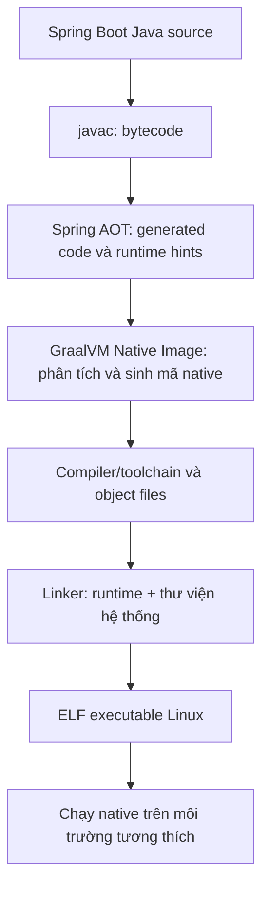

# Công cụ C, linker và các thư viện phát triển cần có trên Linux

## 1. Vì sao biên dịch Java thành Native Image lại cần công cụ C?

Trong module **SPRING_BOOT_NATIVE_IMAGE**, ứng dụng Spring Boot được xử lý bằng Spring AOT rồi biên dịch thành GraalVM Native Image để đánh giá thời gian khởi động, bộ nhớ, tương thích thư viện và cách đóng gói container. Dù phần lớn mã ứng dụng viết bằng Java, **quá trình build native trên Linux vẫn cần một toolchain hệ thống**, thường gồm C compiler, linker, headers và thư viện phát triển phù hợp.

GraalVM Native Image phân tích bytecode Java, dịch các phần có thể truy cập thành mã máy, kết hợp mã runtime native và cuối cùng liên kết những thành phần đó thành executable ELF của Linux. C compiler/toolchain được Native Image sử dụng cho một số bước biên dịch/liên kết các thành phần native; linker nối các object file và thư viện. Những công cụ này chạy trên **máy build**, không có nghĩa chương trình native phải có `gcc` trên máy production.

### Các khâu chính



Cần phân biệt hai bộ công cụ: **JDK và Native Image** xử lý Java/AOT; **toolchain hệ thống Linux** phục vụ biên dịch và liên kết native. Một máy đã cài JDK GraalVM nhưng thiếu compiler, linker hoặc development headers vẫn có thể chạy `java -jar` bình thường mà không build được native executable.

## 2. Thành phần thiết yếu trong Linux toolchain

| Thành phần | Vai trò | Cách kiểm tra thường gặp |
|---|---|---|
| `gcc` hoặc toolchain C tương thích | Driver biên dịch C và điều phối link theo cấu hình Native Image | `gcc --version` |
| `ld` và binutils | Link các object, quản lý symbol, đọc thông tin ELF | `ld --version`, `readelf --version` |
| `make` (khi quy trình build cần) | Chạy các target biên dịch native phụ thuộc | `make --version` |
| GNU libc (glibc) headers và development files | Header, startup object và các thành phần hỗ trợ link với libc của Linux | Kiểm tra gói `libc6-dev` / `glibc-devel` theo distro |
| zlib development files | Header và thư viện nén cần cho một số bản/cấu hình Native Image | Kiểm tra gói `zlib1g-dev` / `zlib-devel` |
| JDK GraalVM có Native Image | Chạy công cụ `native-image` và biên dịch Java AOT | `java -version`, `native-image --version` |

Danh sách là **điểm bắt đầu phổ biến**, không phải danh mục cố định cho mọi bản GraalVM hoặc dự án. Một số môi trường cần thêm `libstdc++`, `libstdc++-devel`, công cụ LLVM, thư viện `-dev` của JNI dependency hoặc các gói khác. Kiểm tra yêu cầu của chính **phiên bản GraalVM và hệ điều hành đích**.

**Runtime library khác development package:** thư viện chia sẻ như `libz.so` có thể tồn tại để chạy chương trình nhưng build vẫn thất bại nếu thiếu header `zlib.h`, linker symlink hoặc file phát triển do gói `-dev`/`-devel` cung cấp.

## 3. Cài đặt trên các họ bản phân phối Linux

### Debian và Ubuntu

Ví dụ môi trường build dùng `apt`:

```bash
sudo apt-get update
sudo apt-get install -y build-essential zlib1g-dev
```

`build-essential` thường kéo theo `gcc`, `g++`, `make` và các thành phần libc development trên Debian/Ubuntu. `zlib1g-dev` bổ sung header và thông tin link dành cho zlib.

Với môi trường build tối giản, có thể kiểm tra package thực sự được cài thay vì suy ra rằng `build-essential` đã có sẵn.

### Fedora, RHEL, Rocky Linux và AlmaLinux

Tên công cụ quản lý gói thay đổi theo distro và phiên bản. Một cấu hình thường gặp:

```bash
sudo dnf install -y gcc glibc-devel zlib-devel binutils
```

Nếu workflow cần `make` hoặc C++, cài thêm các gói tương ứng. Một số tài liệu dùng nhóm công cụ `Development Tools`; tên nhóm và cách hỗ trợ nhóm có thể khác giữa bản phân phối, nên kiểm tra trực tiếp repository của hệ thống.

### Oracle Linux

Ví dụ trên Oracle Linux bản dùng `dnf`:

```bash
sudo dnf install -y gcc glibc-devel zlib-devel binutils
```

Bản phát hành hoặc image container Oracle Linux tối giản có thể cần bật repository phù hợp mới cài được đầy đủ development files. Tên gói thực tế phụ thuộc bản phân phối và repository.

### Alpine Linux và musl

Alpine dùng **musl libc**, khác glibc của Debian/Ubuntu/RHEL. Toolchain Alpine thường liên quan `build-base`, `musl-dev` và `zlib-dev`, nhưng **không thể coi mọi GraalVM JDK/Native Image tải cho Linux glibc là tương thích Alpine**. Muốn build hoặc chạy binary dựa trên musl, phải chọn bản công cụ và chiến lược link được hỗ trợ cho target đó. Không nên lấy binary build trên Ubuntu rồi giả định chạy được trong Alpine chỉ vì đều là Linux.

Các lệnh cài đặt là ví dụ cho hệ thống mà người build được quyền quản trị; CI/CD hoặc container builder thường cài những gói này trong Dockerfile thay vì thay đổi host.

## 4. Kiểm tra JDK, Native Image và trình biên dịch đang được sử dụng

Kiểm tra tuần tự:

```bash
java -version
javac -version
native-image --version
gcc --version
ld --version
```

Các lệnh cần chạy **trong cùng môi trường** dùng để build: CI runner, container builder hoặc máy local. Việc shell của host tìm được `gcc` không chứng minh `gcc` cũng có trong container build.

Kiểm tra đường dẫn để tránh dùng nhầm nhiều bản JDK:

```bash
command -v java
command -v javac
command -v native-image
command -v gcc
command -v ld
printf '%s\n' "$JAVA_HOME"
```

Nếu `native-image: command not found`, kiểm tra GraalVM distribution và cách cài đặt công cụ Native Image của phiên bản đang dùng; không giả định mọi JDK có sẵn chương trình này. Nếu Maven/Gradle chạy bằng một JDK khác `JAVA_HOME`, plugin có thể nhận toolchain không phù hợp.

Ví dụ đặt `JAVA_HOME` trong phiên shell (đường dẫn chỉ minh họa):

```bash
export JAVA_HOME=/opt/graalvm
export PATH="$JAVA_HOME/bin:$PATH"
java -version
native-image --version
```

Dùng `java -version` để xác nhận đây là distribution và Java version phù hợp dự án Spring Boot; tên `/opt/graalvm` phải được thay bằng đường dẫn cài đặt thật.

## 5. Linker thực hiện công việc gì?

**Compiler** chuyển mã nguồn hoặc mã trung gian thành object code; **linker** ghép các object và thư viện, giải quyết symbol, relocation và tạo executable. Trong build Native Image, linker cần biết các object runtime và thư viện native đúng kiến trúc và ABI.

Trên Linux, một executable ELF có thể:

- **Liên kết động:** phụ thuộc một số shared library (`.so`) như libc hoặc thư viện của hệ thống. Khi chạy, dynamic loader tìm đúng phiên bản và kiến trúc của chúng.
- **Liên kết tĩnh:** mã từ nhiều thư viện được đưa vào executable khi build; mức độ liên kết tĩnh có thể khác nhau theo tùy chọn và toolchain. Một executable tĩnh vẫn phải được kiểm tra về khả năng tương thích hệ thống, DNS, chứng chỉ và hành vi của các thành phần native.

Ví dụ xem thông tin sau khi build:

```bash
file ./myapp
readelf -h ./myapp
ldd ./myapp
```

`file` xác định ELF và kiến trúc; `readelf` đọc header. `ldd` thường liệt kê thư viện động của binary tương thích; một binary static có thể hiện `not a dynamic executable`. Với binary không tin cậy, hạn chế chạy `ldd` trực tiếp vì có những rủi ro tùy môi trường; dùng `readelf -d` để kiểm tra mục `NEEDED` an toàn hơn khi chỉ muốn đọc metadata.

```bash
readelf -d ./myapp
```

Nếu binary phụ thuộc `libc.so.6`, việc copy nó sang base image không có glibc có thể thất bại dù build thành công. Đây là vấn đề **linking/runtime ABI**, tách biệt với reflection metadata của Spring AOT.

## 6. glibc, musl và tính di động của executable

**Linux** là tên hệ điều hành tổng quát; executable lại được tạo cho **kiến trúc CPU** và **ABI/thư viện hệ thống** cụ thể. Các yếu tố cần quan tâm:

| Yếu tố | Tại build | Tại runtime |
|---|---|---|
| CPU architecture | Build cho `x86_64`, `aarch64`, v.v. | Host/container phải chạy được kiến trúc đó |
| libc và ABI | Link với glibc hoặc musl tùy toolchain | Cần thư viện/loader tương thích khi link động |
| Thư viện phụ thuộc | Cần headers và linker files nếu có mã native | Cần shared library tương ứng nếu executable còn liên kết động |
| Nền tảng | Build Native Image thường nhắm một OS/architecture cụ thể | Không coi Linux binary chạy trực tiếp trên Windows |
| Kiểu đóng gói | Tạo ELF và xác định dependency | Chọn base image phù hợp |

Một lỗi phổ biến là build trên bản Linux có glibc mới, rồi chạy trên image có glibc cũ hơn và gặp lỗi phiên bản symbol. Để tránh, dùng môi trường build tương thích với deployment, thường là builder image chuẩn và runtime image được kiểm soát theo phiên bản.

Khái niệm **static linking** không đồng nghĩa mặc định có binary hoàn toàn không phụ thuộc gì. Các thư viện native, hệ thống NSS/DNS, chứng chỉ CA hoặc thư viện JNI có thể đòi cấu hình riêng. Chỉ kết luận tính di động sau khi kiểm tra metadata executable và chạy smoke test trong image thực tế.

## 7. Ví dụ build ứng dụng Spring Boot Native Image

Giả định dự án Spring Boot đã bật AOT và thiết lập plugin native phù hợp, Java/GraalVM và toolchain Linux đã hoạt động.

### Maven

```bash
./mvnw -Pnative native:compile
```

Lệnh thường dùng khi Spring Boot Maven Plugin và GraalVM Native Build Tools đã được cấu hình theo mẫu Native Image tương ứng. Maven profile `native` có thể kích hoạt phần cấu hình cần thiết. Tên và vị trí executable phụ thuộc artifact/project và phiên bản plugin; thường xuất hiện trong `target/`.

### Gradle

```bash
./gradlew nativeCompile
```

Task `nativeCompile` do GraalVM Native Build Tools cung cấp, khi plugin được áp dụng đúng. Output thường nằm dưới `build/native/nativeCompile/`, nhưng cần xem build configuration thay vì giả định tên file.

### Chạy kiểm tra

```bash
# Thay đường dẫn bằng executable vừa tạo
./target/myapp
```

Dùng một terminal khác gọi các endpoint, kiểm tra startup, health và những nhánh sử dụng JSON binding, reflection, resource, database, SSL hoặc messaging. Native build thành công chỉ chứng minh **bước biên dịch và link** qua được; lỗi metadata hoặc hành vi runtime vẫn có thể xuất hiện khi chạy.

## 8. Phân biệt lỗi toolchain với lỗi Spring AOT và GraalVM metadata

| Thông báo hoặc triệu chứng | Nhóm nguyên nhân | Cách xử lý đầu tiên |
|---|---|---|
| `gcc: command not found` | Thiếu compiler hoặc PATH sai | Cài C compiler phù hợp trong môi trường build |
| `ld: cannot find -lz` | Thiếu development library/linker file của zlib | Kiểm tra `zlib1g-dev` hoặc `zlib-devel` và search path |
| `fatal error: zlib.h: No such file or directory` | Thiếu headers | Cài gói development và kiểm tra include path |
| `cannot find crt1.o` hoặc lỗi startup object | Thiếu/không tương thích libc development files hoặc toolchain | Kiểm tra gói libc development và kiến trúc |
| `undefined reference to ...` | Thiếu symbol khi link, ABI hoặc dependency mismatch | Xem log command link, thư viện và phiên bản tương ứng |
| `GLIBC_x.y not found` khi chạy | Bản build yêu cầu glibc mới hơn bản runtime | Dùng builder/runtime tương thích hoặc chiến lược build khác |
| `Exec format error` | Sai kiến trúc hoặc định dạng executable | Kiểm tra `file`, `uname -m`, target architecture |
| Native chạy nhưng thiếu class, reflection, resource | Reachability metadata hoặc Spring AOT | Kiểm tra runtime hints và luồng nghiệp vụ; không sửa bằng cách cài thêm GCC |
| `native-image: command not found` | Thiếu công cụ Native Image/JDK không phù hợp | Xác định distribution và cài công cụ theo phiên bản |

**Quy tắc debug:** tìm **lỗi đầu tiên có ý nghĩa** trong log. Một lỗi `ld` có thể tạo nhiều thông báo phía sau; sửa phần headers hoặc thư viện bị thiếu trước rồi build lại. Nếu compilation/link hoàn tất nhưng executable lỗi khi request đến, tập trung vào runtime/configuration/AOT metadata.

Các lệnh hữu ích khi xác minh công cụ:

```bash
uname -m
cat /etc/os-release
command -v gcc
command -v ld
gcc -print-search-dirs
```

`gcc -print-search-dirs` cho biết các đường dẫn công cụ và thư viện mà GCC biết. Khi kiểm tra image container, chạy các lệnh tương đương bên trong builder image để tái hiện chính xác môi trường CI.

## 9. Thiết kế Docker multi-stage build

Thông thường nên dùng **builder stage** có GraalVM JDK, Native Image và toolchain C; **runtime stage** chỉ chứa executable cùng các shared library/certificates cần thiết. Cách này giúp giảm kích thước image và không mang compiler vào production.

Một Dockerfile **mang tính minh họa**:

```dockerfile
# Chọn builder image GraalVM có Native Image và hệ điều hành phù hợp.
FROM <graalvm-builder-image> AS build
WORKDIR /workspace

# Cài toolchain bằng trình quản lý gói phù hợp với builder image
# trước khi chạy bước build native.
COPY . .
RUN ./mvnw -Pnative native:compile

# Runtime base phải tương thích libc/architecture của binary.
FROM <compatible-linux-runtime-image>
WORKDIR /app
COPY --from=build /workspace/target/myapp /app/myapp
USER 10001
ENTRYPOINT ["/app/myapp"]
```

Các placeholder `<graalvm-builder-image>` và `<compatible-linux-runtime-image>` **phải được thay** bằng image thực, có tag và khả năng tương thích đã xác minh. Không copy nguyên ví dụ để build khi chưa chọn JDK, kiến trúc và runtime base. Nếu executable có linked shared libraries, runtime base phải chứa các thư viện đó. Nếu ứng dụng dùng TLS, DNS, zone ID hoặc đọc file từ filesystem, cần kiểm tra CA certificates, timezone data và quyền đọc theo user không phải root.

Spring Boot còn hỗ trợ các cách build OCI image cho native thông qua plugin/buildpacks ở cấu hình phù hợp. Khi dùng buildpacks, nhiều gói toolchain được builder xử lý; vẫn nên xác minh runtime image và dependency của binary sau khi tạo.

## 10. Xây dựng môi trường CI ổn định

Native compilation thường tiêu tốn **nhiều CPU, RAM và thời gian build** hơn đóng gói JAR thông thường, do phân tích toàn chương trình và biên dịch mã native. Với CI, nên:

1. **Pin phiên bản** GraalVM JDK, Spring Boot/Native Build Tools, builder image và các dependency quan trọng.
2. **Đồng bộ kiến trúc** runner với target hoặc dùng giải pháp cross-build được toolchain hỗ trợ; không coi cross-compilation là mặc định.
3. **Cài development packages tại builder stage** theo một Dockerfile hoặc image chuẩn có thể tái lập.
4. **Kiểm tra binary** bằng `file`, `readelf -d` và smoke test trong runtime image.
5. **Chạy native integration tests** bao phủ reflection, resource, serialization và những luồng ít gặp.
6. **So sánh hiệu năng** với bản JVM cùng workload, cấu hình, tài nguyên và giới hạn container; thu thập startup-to-readiness, RSS, throughput và độ trễ.

Không nên tối ưu build bằng cách loại bỏ hệ thống kiểm thử chỉ để giảm thời gian CI. Một binary biên dịch được nhưng thiếu resource hoặc sai ABI là artifact phát hành chưa đủ tin cậy.

## 11. Bài thực hành: từ lỗi linker đến executable chạy được

**Mục tiêu:** xác định vì sao ứng dụng Spring Boot Native Image cần compiler, linker và development libraries.

**Bước 1 — Kiểm tra môi trường.** Chạy `java -version`, `native-image --version`, `gcc --version`, `ld --version`. Ghi lại Linux distribution, architecture và phiên bản GraalVM.

**Bước 2 — Cài các gói phù hợp.** Trên Debian/Ubuntu cài `build-essential zlib1g-dev`; trên Fedora/RHEL-like cài `gcc glibc-devel zlib-devel binutils` theo repository thực tế.

**Bước 3 — Build native.** Chạy Maven hoặc Gradle đã cấu hình AOT. Nếu có lỗi thiếu compiler/linker/header, phân loại nó theo bảng ở phần 8, xác minh package liên quan rồi build lại.

**Bước 4 — Kiểm tra executable.** Dùng `file` và `readelf -d` để nhận diện kiến trúc và shared libraries; chạy executable ở máy build, sau đó trong runtime container tương thích.

**Bước 5 — Đo và đối chiếu.** Chạy JAR trên JVM và executable native với cùng profile, lượng RAM, CPU và tải. Đo thời gian từ process start tới readiness và RSS khi nhàn rỗi/có tải; ghi rõ cách đo và sai số.

**Câu hỏi tự kiểm tra:** Tại sao thiếu `zlib-devel` có thể khiến build thất bại dù có `libz.so` ở runtime? Vì sao một binary Linux x86-64 build thành công vẫn có thể không chạy trên container Alpine? Lỗi thiếu reflection metadata có thể khắc phục bằng cài `gcc` không?

## 12. Kết luận

Để biên dịch **Spring Boot Native Image trên Linux**, GraalVM và Spring AOT cần được hỗ trợ bởi **C compiler, linker, libc development files và các thư viện phát triển liên quan**. Những thành phần này hoàn tất quá trình tạo executable ELF; chúng khác với metadata reflection/resource giúp ứng dụng native hoạt động đúng. Việc chọn toolchain phải đi cùng lựa chọn kiến trúc, libc và runtime container, vì một binary build thành công chưa chắc chạy được trên image đích. Kiểm tra dependency thực tế, tái lập CI và kiểm thử executable là điều kiện cần trước khi kết luận về hiệu năng khởi động và bộ nhớ của bản native.
