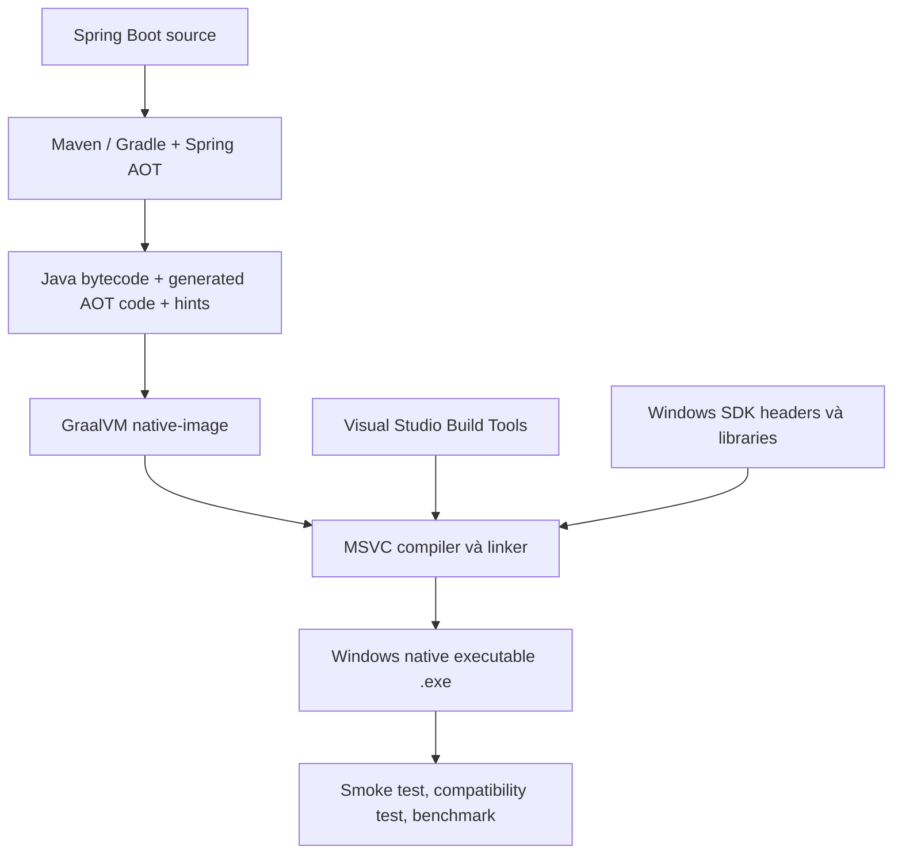
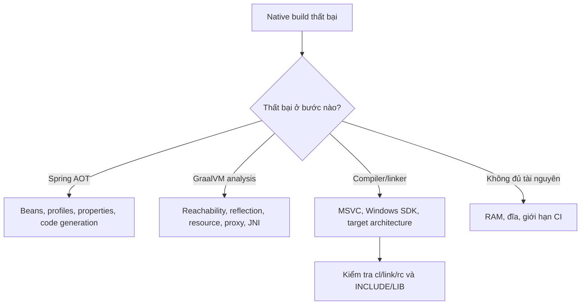

# MSVC, Visual Studio Build Tools và Windows SDK trên Windows

## 1. Vì sao GraalVM Native Image cần công cụ C/C++ trên Windows?

Trong module **SPRING_BOOT_NATIVE_IMAGE**, chúng ta dùng **Spring AOT** và **GraalVM Native Image** để chuyển ứng dụng Spring Boot thành tệp thực thi native, sau đó kiểm tra tính tương thích, thời gian khởi động, mức sử dụng bộ nhớ và khả năng chạy trong container. Khi build trực tiếp trên Windows, ngoài JDK và Maven/Gradle, quy trình còn cần bộ công cụ biên dịch và liên kết native phù hợp.

Spring AOT sinh mã Java và metadata hỗ trợ phân tích trước. GraalVM Native Image phân tích chương trình, tạo mã máy, sau đó cần compiler/linker và các thư viện hệ thống để hoàn thiện executable. Trên Windows với toolchain MSVC, các thành phần thường gặp là:

- **MSVC (Microsoft Visual C++ toolset)**: compiler `cl.exe`, linker `link.exe` cùng các công cụ và thư viện C/C++ hỗ trợ.
- **Visual Studio Build Tools**: bộ cài cung cấp các workload và component build C/C++ mà không yêu cầu cài IDE Visual Studio đầy đủ.
- **Windows SDK**: headers, import libraries và công cụ Windows, cần thiết để liên kết với API hệ điều hành. Ví dụ Windows SDK cung cấp thư viện như `kernel32.lib` và các công cụ dành cho target Windows.
- **Developer Command Prompt / Developer PowerShell**: shell được khởi tạo các biến môi trường cần thiết để compiler/linker tìm thấy executable, header và thư viện.

Tập thành phần cụ thể và phiên bản hỗ trợ phụ thuộc **phiên bản GraalVM Native Image**, **kiến trúc CPU** và công cụ build. Nên kiểm tra tài liệu yêu cầu Windows prerequisites của bản GraalVM đang sử dụng trước khi cài đặt.



**Quan trọng:** lỗi ở giai đoạn Spring AOT, lỗi phân tích reachability và lỗi liên kết MSVC là ba nhóm vấn đề khác nhau. Cài thêm Windows SDK có thể xử lý lỗi thiếu header/library tại bước liên kết; nó không tự giải quyết lỗi reflection metadata hoặc `BeanCreationException` trong AOT.

## 2. Vai trò từng thành phần

| Thành phần | Chức năng chính | Dấu hiệu khi thiếu hoặc cấu hình sai |
|---|---|---|
| GraalVM JDK có Native Image | Cung cấp `java`, `javac`, `native-image` | Không tìm thấy `native-image`, version không phù hợp |
| Maven/Gradle và plugin | Gọi Spring AOT, chuẩn bị classpath, điều phối native build | Tác vụ `native:compile` hoặc `nativeCompile` không tồn tại/chạy lỗi |
| MSVC compiler `cl.exe` | Xử lý các bước biên dịch native cần toolchain MSVC | `cl` không được nhận diện hoặc lỗi phát hiện compiler |
| MSVC linker `link.exe` | Liên kết mã máy thành executable Windows | Lỗi `LNK...`, không tìm được linker hay thư viện |
| Windows SDK | Windows API headers, libraries, resource tools | `LNK1104` hoặc lỗi không tìm thấy Windows SDK headers/libs |
| Developer shell | Thiết lập `PATH`, `INCLUDE`, `LIB`, v.v. | Công cụ có trên ổ đĩa nhưng không tìm thấy khi build |

Tên như `link.exe` có thể trùng với executable khác trong `PATH`. Cần kiểm tra đường dẫn của **Microsoft linker**, không chỉ nhìn tên lệnh.

### Visual Studio IDE có bắt buộc không?

Không. Cài đặt **Visual Studio Build Tools** với thành phần C++ tương thích thường đủ cho pipeline dòng lệnh. Nếu đã cài Visual Studio IDE và workload C++ cần thiết, có thể dùng luôn toolchain đó. Trọng tâm là những component được cài và đường dẫn được khởi tạo, không phải giao diện IDE.

### Windows SDK và .NET SDK có giống nhau không?

Không. Windows SDK cung cấp headers và libraries cho Windows native development. .NET SDK phục vụ phát triển ứng dụng .NET; cài .NET SDK không thay thế đầy đủ Windows SDK/MSVC cho GraalVM Native Image.

## 3. Chuẩn bị môi trường Windows x64

Một môi trường thực hành phổ biến là Windows 64-bit, GraalVM JDK có `native-image`, Maven/Gradle và bản Visual Studio Build Tools tương thích với yêu cầu Native Image.

### Bước 1 — Chọn các thành phần của Visual Studio Build Tools

Trong Visual Studio Installer, chọn workload **Desktop development with C++** hoặc bộ component tương đương. Xác nhận đã có:

1. **MSVC C++ x64/x86 build tools** của phiên bản được GraalVM hỗ trợ (có compiler và linker).
2. **Windows SDK** tương thích (ví dụ một bản Windows 10 SDK hoặc Windows 11 SDK được hỗ trợ).
3. Các thành phần phụ trợ build native được yêu cầu bởi toolchain và tài liệu phiên bản.

Tên workload, tên MSVC toolset, SDK và cách bố trí tùy phiên bản Visual Studio Installer. Không mặc định rằng bản mới nhất luôn tương thích với mọi bản GraalVM cũ; ưu tiên **ma trận hỗ trợ phiên bản** từ GraalVM.

### Bước 2 — Mở Developer Command Prompt đúng kiến trúc

Từ Start Menu, mở shell dạng **x64 Native Tools Command Prompt for VS** hoặc Developer Command Prompt được cấu hình target x64. Với môi trường dùng `cmd.exe`, có thể khởi tạo bằng script `vcvars64.bat` của bộ cài Visual Studio phù hợp:

```bat
REM Chạy trong Command Prompt; thay đường dẫn theo bản cài thực tế.
call "C:\Program Files\Microsoft Visual Studio\2022\BuildTools\VC\Auxiliary\Build\vcvars64.bat"
```

Đây là **đường dẫn ví dụ**, không bảo đảm đúng ở mọi máy. Bản Visual Studio, edition, đường dẫn cài và kiến trúc có thể khác. Dùng shortcut developer shell do Installer tạo là cách thuận tiện hơn.

Sau khi khởi tạo, các biến `PATH`, `INCLUDE`, `LIB` và có thể `LIBPATH` được thiết lập để MSVC tìm compiler, headers và libraries. Mở terminal PowerShell thường từ IDE mà chưa chạy cấu hình developer shell có thể dẫn đến sai khác, dù máy đã cài đủ công cụ.

### Bước 3 — Kiểm tra bộ compiler và SDK

Trong **Developer Command Prompt**:

```bat
where cl
where link
where rc
cl
link
echo %VSCMD_ARG_TGT_ARCH%
echo %WindowsSdkDir%
```

`cl` và `link` được chạy không có đối số có thể trả exit code khác 0 hoặc hiển thị cảnh báo về thiếu input; mục đích ở bước này là xác nhận executable được tìm thấy và in thông tin phiên bản. `rc.exe` là Windows Resource Compiler, một công cụ thường có từ SDK. Nếu `where link` trả nhiều đường dẫn, cần xác nhận thứ tự ưu tiên chứa **MSVC `link.exe`**.

Một kết quả hợp lý sẽ có đường dẫn MSVC `...\VC\Tools\MSVC\...\bin\Hostx64\x64\cl.exe`, cùng `link.exe` tương ứng. Nếu `where cl` không tìm thấy gì, hãy kiểm tra workload, thành phần MSVC và môi trường developer shell trước khi thay đổi code Spring Boot.

**Đừng nhầm `x64` là một tùy chọn trình biên dịch Java.** Ở đây đó là kiến trúc của native executable và toolchain. Với build x64, nên nhất quán GraalVM JDK, MSVC target và thư viện native của dependency ở x64.

### Bước 4 — Kiểm tra GraalVM JDK

```bat
java -version
javac -version
where java
native-image --version
where native-image
```

Cần kiểm tra output thực tế chứa GraalVM và phiên bản JDK dự kiến. Máy có nhiều JDK có thể trỏ `java` vào HotSpot JDK khác trong `PATH`. Dùng `JAVA_HOME` trỏ tới GraalVM JDK tương ứng và đặt `%JAVA_HOME%\bin` trước các JDK khác trong `PATH`.

Không suy diễn chỉ từ kết quả `java -version` rằng Native Image đã cài hoặc có trong PATH; cần xác nhận riêng lệnh `native-image --version`. Cách phân phối Native Image phụ thuộc nhà cung cấp và phiên bản GraalVM; nếu thành phần chưa có, làm theo hướng dẫn cài đặt của đúng bản JDK đang dùng.

## 4. Thực hành build Spring Boot bằng Maven

Giả sử dự án Spring Boot đã thiết lập plugin Spring Boot và GraalVM Native Build Tools tương thích, có Maven Wrapper và profile `native`.

Trong **x64 Native Tools Command Prompt** tại thư mục project:

```bat
mvnw.cmd -Pnative native:compile
```

Lệnh này chạy chuỗi tác vụ build theo cấu hình Maven. Spring AOT chuẩn bị code và hints; Native Image dùng kết quả ấy để biên dịch executable Windows. Với Windows, artifact cuối thường có đuôi `.exe` tại thư mục output của plugin (thường dưới `target\`, tùy cấu hình).

Phân biệt kiểm tra giai đoạn:

```bat
mvnw.cmd spring-boot:process-aot
```

Lệnh trên chỉ chủ động chạy **Spring AOT** theo cấu hình của Maven plugin. Thành công của nó không chứng minh linker MSVC đã được gọi hay native executable tồn tại. Khi `native:compile` thất bại, đọc task/goal đầu tiên báo lỗi để phân biệt AOT, javac, GraalVM analysis hoặc MSVC/linker.

### Chạy artifact

Ví dụ khi artifact tên `app.exe`:

```bat
target\app.exe
```

Trong terminal khác, nếu ứng dụng có Actuator health endpoint ở cổng 8080:

```bat
curl.exe -fsS http://localhost:8080/actuator/health
```

Tên file, đường dẫn, cổng và endpoint chỉ là ví dụ. Xác nhận đúng artifact vừa build thay vì chạy nhầm executable cũ.

## 5. Thực hành build bằng Gradle

Với Gradle Wrapper, Spring Boot plugin và GraalVM Native Build Tools:

```bat
gradlew.bat nativeCompile
```

Nếu muốn chỉ xác nhận AOT:

```bat
gradlew.bat processAot
```

Thông thường output native của Gradle nằm dưới `build\native\nativeCompile\`. Thư mục chính xác còn phụ thuộc cấu hình plugin. Tác vụ `processAot` thành công không bảo đảm `nativeCompile` sẽ thành công; MSVC, Windows SDK và bộ nhớ build chỉ được kiểm tra đầy đủ khi pipeline chạy qua bước native.

Nếu IDE gọi Gradle bằng daemon tồn tại từ trước khi thay đổi `JAVA_HOME` hoặc `PATH`, daemon có thể tiếp tục dùng môi trường cũ. Hãy dừng daemon Gradle của workspace đang dùng theo cách phù hợp rồi khởi động lại build từ developer shell đã thiết lập đúng. Không thay đổi Gradle daemon của workspace khác khi không cần thiết.

## 6. Các lỗi Windows thường gặp và cách xác định nguyên nhân

| Triệu chứng | Nguyên nhân thường gặp | Cách kiểm tra và xử lý |
|---|---|---|
| `'cl' is not recognized` / không phát hiện MSVC | Thiếu MSVC hoặc terminal chưa được khởi tạo | Kiểm tra workload; mở x64 Developer Prompt; chạy `where cl` |
| Không tìm thấy `link.exe` hoặc dùng linker khác | `PATH` thiếu MSVC hoặc thứ tự đường dẫn sai | `where link`, kiểm tra vị trí `Hostx64\x64` |
| `LNK1104: cannot open file 'kernel32.lib'` | `LIB` hoặc Windows SDK library path thiếu/sai | Kiểm tra `%WindowsSdkDir%`, `LIB`, kiến trúc x64 |
| Lỗi không tìm được Windows headers | Thiếu SDK hoặc `INCLUDE` chưa được thiết lập | Xác nhận SDK trong Installer và dùng developer shell |
| `LNK1112: module machine type conflicts with target machine type` | Trộn target x86/x64 hoặc native library khác kiến trúc | Đảm bảo GraalVM, MSVC target, dependency đều phù hợp |
| `native-image` không được nhận diện | GraalVM thiếu Native Image hoặc `PATH` sai | Kiểm tra `where java`, `JAVA_HOME`, `native-image --version` |
| `OutOfMemoryError` hoặc build bị hệ thống hủy | Không đủ RAM/heap hoặc giới hạn tài nguyên build | Đo RAM build, đối chiếu log, tăng tài nguyên phù hợp |
| AOT báo `BeanCreationException` | Bean/property/profile không hợp lệ lúc AOT | Sửa cấu hình Spring, kiểm tra build-time environment |
| Executable chạy nhưng thiếu resource/reflection | Hints/metadata chưa đủ hoặc lỗi path | Kiểm tra Spring AOT Runtime Hints, test native dưới tải |

Thông báo lỗi chỉ là dấu hiệu ban đầu: ví dụ `LNK1104` cũng có thể xuất hiện vì một thư viện tùy biến bị thiếu, không nhất thiết do Windows SDK. Cần đọc **tên file mà linker không tìm được** trước khi chọn hướng khắc phục.

### Phân tích lỗi theo tầng



Cách phân tầng này giúp tránh cài lại toàn bộ Visual Studio khi nguyên nhân thật là Spring bean không thể khởi tạo lúc AOT hoặc thư viện dùng dynamic class loading không được hỗ trợ.

## 7. Windows CI: môi trường cần được tái tạo nhất quán

Khi chuyển build từ máy phát triển sang CI, hãy ghi rõ:

1. Phiên bản Windows runner và kiến trúc target.
2. Phiên bản GraalVM JDK, Native Image, Maven/Gradle và Spring Boot.
3. Phiên bản Visual Studio Build Tools, MSVC toolset, Windows SDK.
4. Cách khởi tạo developer shell và các biến môi trường cần thiết.
5. RAM, dung lượng đĩa, cache và giới hạn thời gian build.

Một ví dụ gọi developer environment và build Maven trong cùng **cmd.exe**:

```bat
@echo off
call "C:\Program Files\Microsoft Visual Studio\2022\BuildTools\VC\Auxiliary\Build\vcvars64.bat"
if errorlevel 1 exit /b 1
call mvnw.cmd -Pnative native:compile
if errorlevel 1 exit /b 1
```

Đây là đoạn mẫu trong môi trường có đúng đường dẫn và phiên bản công cụ. Nếu CI dùng PowerShell, script `.bat` chạy trong process `cmd.exe` riêng sẽ không tự truyền các biến đã khởi tạo ngược lại cho PowerShell cha; nên thực hiện khởi tạo và build trong cùng một phiên `cmd.exe`, hoặc dùng đúng Developer PowerShell module/phương pháp của Visual Studio.

**Lưu ý về cache:** cache Maven/Gradle giúp giảm thời gian tải dependencies, nhưng không thay thế MSVC/SDK và cũng không đảm bảo giảm peak RAM của giai đoạn native-image. Artifact native được biên dịch cho Windows thường không chạy được trong Linux container; khi target production là Linux, cần dùng toolchain/build environment tạo **Linux executable**, phổ biến là runner Linux hoặc buildpack/container build phù hợp.

## 8. Windows executable và Linux container là hai mục tiêu khác nhau

Một file `app.exe` biên dịch native trên Windows dùng định dạng executable và ABI của Windows. Không thể sao chép file `.exe` vào một image Linux tối giản và kỳ vọng chạy trực tiếp như ELF native executable. Điều này ảnh hưởng ngay từ bước chọn pipeline:

| Mục tiêu triển khai | Môi trường build phù hợp | Artifact cần tạo |
|---|---|---|
| Chạy native trên Windows x64 | GraalVM Windows x64 + MSVC + Windows SDK | Windows `.exe` |
| Chạy native trong Linux container x64 | GraalVM/Linux-native toolchain, hoặc buildpacks phù hợp | Linux ELF executable và các thư viện cần thiết |
| Chạy trên Linux ARM64 | Toolchain/container hỗ trợ Linux ARM64 | ELF cho kiến trúc ARM64 |

Việc tạo executable cho hệ điều hành hoặc kiến trúc khác không chỉ đơn giản là đổi đuôi file; cần toolchain và dependency native phù hợp. Nếu sản phẩm sử dụng Docker/Kubernetes Linux, nên xây dựng artifact Linux theo pipeline tương ứng, ngay cả khi máy lập trình viên chạy Windows.

Với Windows container, còn cần đối chiếu nền tảng Windows image, kiến trúc, thư viện runtime và yêu cầu tương thích máy chủ; đây là cấu hình khác với Linux container.

## 9. Quy trình xác minh sau khi cài đặt

Để xác nhận môi trường trước khi benchmark lợi ích startup và bộ nhớ của Spring Boot native:

- **Toolchain:** `java -version` và `native-image --version` đúng bản GraalVM; `where cl`, `where link`, `where rc` đúng toolchain MSVC/SDK.
- **AOT:** tác vụ `process-aot` hoặc `processAot` hoàn tất, generated outputs được tạo.
- **Native build:** tác vụ `native:compile` hoặc `nativeCompile` thành công, executable **mới** có đuôi `.exe` trên Windows.
- **Smoke test:** ứng dụng native thực sự khởi động và endpoint kiểm tra sức khỏe trả đúng kết quả.
- **Compatibility:** các luồng sử dụng reflection, resources, dynamic proxy và JNI nếu có đều được kiểm thử trên executable.
- **Hiệu năng:** đo riêng peak RAM của quá trình build với RSS/working set lúc ứng dụng chạy; so sánh JAR/native trên workload và cấu hình tương đương.
- **Triển khai:** artifact được tạo đúng hệ điều hành/kiến trúc của môi trường chạy và có đủ thư viện, cấu hình, file mount cần thiết.

Trên Windows, **Working Set** là chỉ số bộ nhớ thường gặp trong Task Manager/Process Explorer; không mặc định nó tương đương hoàn toàn với RSS/PSS trên Linux. Khi báo cáo benchmark xuyên nền tảng, cần ghi rõ công cụ đo và định nghĩa chỉ số.

## 10. Câu hỏi tự kiểm tra

1. Vì sao cài GraalVM và Maven chưa đủ để biên dịch Spring Boot Native Image trên Windows trong môi trường dùng MSVC?
2. Vai trò khác nhau của `cl.exe`, `link.exe`, Windows SDK và developer shell là gì?
3. Vì sao `where link` trả về một đường dẫn chưa chắc chứng minh đang dùng linker MSVC?
4. Khi gặp `LNK1104` với `kernel32.lib`, bạn kiểm tra thông tin nào trước?
5. Vì sao `processAot` thành công không chứng minh hệ thống đã có MSVC và SDK hoạt động?
6. Tại sao executable Windows `.exe` không thể dùng trực tiếp làm binary chạy trong Linux container?
7. Nếu build native thất bại trên CI nhưng thành công trên máy dev, nên so sánh những thành phần môi trường nào?

**Ghi nhớ:** Spring AOT giải quyết giai đoạn chuẩn bị application context và metadata; GraalVM Native Image tạo mã native; còn **MSVC và Windows SDK** cung cấp công cụ biên dịch, liên kết cần thiết trên Windows. Chuẩn hóa phiên bản, kiến trúc và developer shell là điều kiện để build có thể tái hiện, trước khi đánh giá tương thích và hiệu năng bản native.
