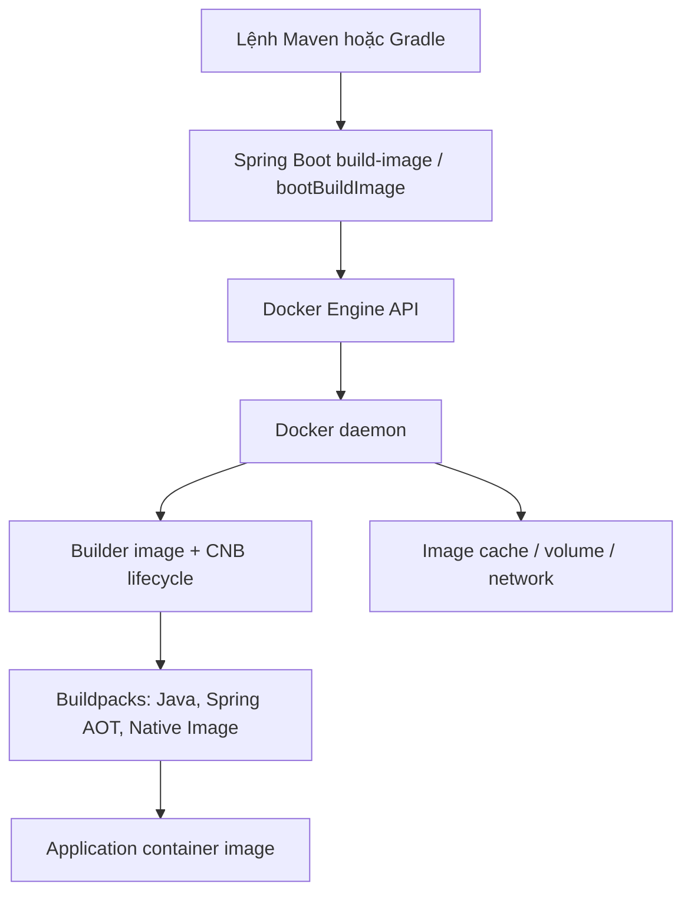
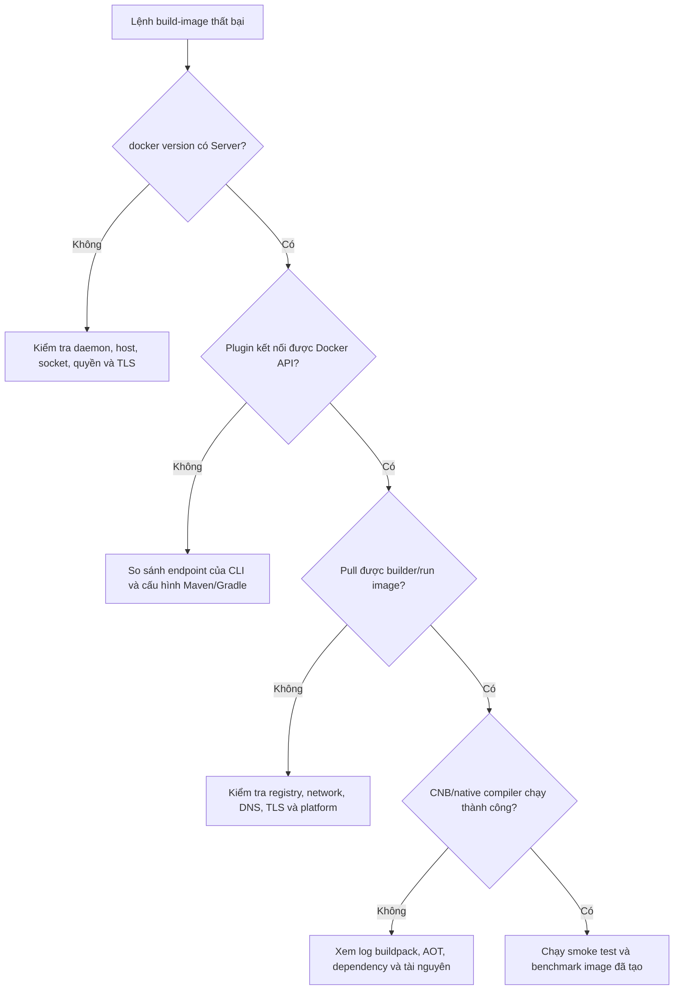

# Quyền truy cập Docker khi build bằng Cloud Native Buildpacks

## 1. Vấn đề thực tế: vì sao build Spring Boot Native Image lại cần Docker?

Trong module **Spring Boot Native Image**, chúng ta dùng **Spring AOT** và **GraalVM Native Image** để biên dịch ứng dụng Spring Boot thành chương trình native, rồi đánh giá thời gian khởi động và mức sử dụng bộ nhớ. Có hai con đường build thường gặp:

- **Biên dịch native trực tiếp:** sử dụng GraalVM Native Build Tools với Maven/Gradle; máy chạy lệnh thường cần GraalVM và native toolchain tương thích.
- **Build container image bằng Cloud Native Buildpacks (CNB):** sử dụng tác vụ `spring-boot:build-image` hoặc `bootBuildImage`; một *builder image* cung cấp môi trường build phù hợp và tạo ra *application image*. Với quy trình Spring Boot phổ biến dùng Docker, công cụ build cần **kết nối được tới Docker daemon**.

Ví dụ, khi chạy:

```bash
# Dự án Maven đã cấu hình Spring Boot plugin và hỗ trợ native
./mvnw -Pnative spring-boot:build-image

# Dự án Gradle đã cấu hình Spring Boot plugin và hỗ trợ native
./gradlew bootBuildImage
```

Bạn có thể gặp thông báo dạng:

```text
Cannot connect to the Docker daemon at unix:///var/run/docker.sock.
Is the docker daemon running?
```

Thông báo này **không khẳng định mã Java, Spring AOT hay GraalVM bị lỗi**. Công cụ build chưa kết nối được tới dịch vụ quản lý container. Cần kiểm tra môi trường Docker trước khi điều tra reflection hints, resources hoặc mã ứng dụng.

> Phạm vi bài học: tìm hiểu quyền truy cập và cách chẩn đoán kết nối Docker khi xây dựng **container image bằng Cloud Native Buildpacks**. Đây là tiền đề để kiểm thử khả năng tương thích, đóng gói và vận hành bản Spring Boot native. Các lệnh và thiết lập minh họa cần điều chỉnh theo phiên bản Spring Boot, Docker và chính sách môi trường thực tế.

## 2. Những thành phần tham gia vào quá trình build

### 2.1. Docker client, Docker daemon và Docker Engine API

Ba khái niệm thường bị nhầm lẫn:

| Thành phần | Vai trò | Điều kiện cần |
|---|---|---|
| Docker CLI (`docker`) | Chương trình dòng lệnh gửi yêu cầu tới Docker Engine | Có CLI chưa đủ để thực hiện build |
| Docker daemon (`dockerd`) | Dịch vụ quản lý image, container, network và volume | Phải đang chạy và chấp nhận kết nối từ tiến trình build |
| Docker Engine API | Giao diện để CLI và công cụ như plugin Maven/Gradle trao đổi với daemon | Địa chỉ endpoint, giao thức, quyền truy cập và chứng chỉ (nếu dùng TLS) phải đúng |

Trong một quy trình CNB thông thường, Maven/Gradle **không chỉ kiểm tra Docker CLI có được cài hay không**. Plugin của Spring Boot tương tác với Docker Engine để lấy các image cần thiết, khởi chạy quá trình build và tạo ra image thành phẩm.



Với build native, builder phù hợp có thể sử dụng GraalVM và các công cụ cần thiết **bên trong môi trường build**. Điều này giúp giảm nhu cầu cài toàn bộ toolchain native trực tiếp lên máy phát triển; tuy nhiên Docker Engine phải hoạt động và builder phải hỗ trợ cấu hình native tương ứng.

### 2.2. Cloud Native Buildpacks có bắt buộc Docker trong mọi trường hợp?

**Không.** Đặc tả Cloud Native Buildpacks hỗ trợ nhiều cách tích hợp và nền tảng thực thi. Nhưng với hai tác vụ Spring Boot thông dụng `spring-boot:build-image` và `bootBuildImage` theo cách sử dụng Docker tiêu chuẩn, **phải có Docker daemon/endpoint tương thích mà plugin truy cập được**. Bài này tập trung vào trường hợp đó; môi trường CI dùng dịch vụ build hoặc nền tảng khác cần tài liệu cấu hình riêng.

### 2.3. Các quyền mà tiến trình build thực sự cần

Buildpacks cần hơn khả năng đọc danh sách image. Tùy plugin và cấu hình, Docker Engine phải cho phép các thao tác như:

- Kết nối và trao đổi thông tin phiên bản/cấu hình của daemon.
- Kéo (*pull*) builder image và run image từ registry, hoặc sử dụng image có sẵn.
- Tạo và vận hành container phục vụ lifecycle build; dùng cache/volume và network khi cần.
- Tạo, gắn nhãn, lưu và kiểm tra application image sau build.
- Nếu được cấu hình xuất bản image, xác thực và *push* image lên registry.

Docker Engine truyền thống thường trao quyền API rất rộng cho những ai có thể truy cập socket. Vì vậy, không nên hiểu quyền truy cập socket chỉ là "quyền được build một ứng dụng".

## 3. Kiểm tra Docker trước khi chạy Maven hoặc Gradle

Các kiểm tra đầu tiên nên chạy **trong cùng môi trường và với cùng tài khoản** sẽ thực thi lệnh build. Chạy thành công trong terminal cá nhân chưa chứng minh job CI, IDE, container dev hoặc tài khoản service cũng truy cập được Docker.

### 3.1. Kiểm tra nhanh theo từng tầng

```bash
# Kiểm tra máy có Docker CLI hay không
docker --version

# Kiểm tra cả phía client và server, xem Docker daemon có trả lời không
docker version

# Xem thông tin daemon; lỗi tại bước này là vấn đề kết nối/quyền
docker info

# Thử gọi API liệt kê container
docker ps

# Xem context mà Docker CLI hiện chọn
docker context show
```

**Cách đọc kết quả:**

| Kết quả | Ý nghĩa | Bước tiếp theo |
|---|---|---|
| `docker --version` chạy, nhưng `docker version` chỉ hiển thị Client và báo lỗi Server | CLI đã cài; Docker daemon chưa truy cập được | Kiểm tra daemon, endpoint và quyền |
| `docker info` trả dữ liệu Server | Tài khoản hiện tại gọi được Docker Engine API | Kiểm tra plugin Maven/Gradle đang dùng đúng endpoint và chế độ build |
| `docker ps` báo `permission denied` trên socket | Endpoint có thể tồn tại, tài khoản không đủ quyền | Kiểm tra ownership/group hoặc cấu hình rootless |
| Docker CLI chạy ổn nhưng build-image báo lỗi | Plugin có thể dùng endpoint/cấu hình khác; hoặc lỗi xảy ra ở bước pull/create container | Đọc nguyên văn thông báo lỗi và kiểm tra cấu hình plugin |

`docker version` hữu ích hơn `docker --version`: lệnh thứ nhất kiểm tra giao tiếp với server, lệnh thứ hai chỉ đọc phiên bản CLI đã cài.

### 3.2. Kiểm tra Docker Engine có đang chạy không

Trên hệ thống Linux sử dụng systemd và Docker Engine dạng service:

```bash
systemctl status docker

# Nếu được phép quản trị và daemon chưa chạy:
sudo systemctl start docker

# Xác nhận sau khi service đã chạy:
docker info
```

Không phải mọi hệ Linux đều có `systemd` hoặc Docker Engine service cùng tên. Với **Docker Desktop trên Windows/macOS**, hãy kiểm tra ứng dụng Docker Desktop và trạng thái engine trong giao diện, sau đó chạy `docker version`. Chế độ container **Linux** thường là lựa chọn thích hợp khi build một Spring Boot Linux Native Image.

## 4. Docker socket: địa chỉ kết nối và quyền truy cập

### 4.1. Endpoint mặc định và những biến thể thường gặp

Docker API có thể được truy cập qua socket cục bộ hoặc kết nối tới máy khác:

| Môi trường | Ví dụ địa chỉ | Ghi chú |
|---|---|---|
| Linux Docker Engine thông thường | `unix:///var/run/docker.sock` | Quyền file socket quyết định ai có thể kết nối |
| Linux rootless Docker | `unix:///run/user/<UID>/docker.sock` | Socket thuộc tài khoản vận hành rootless daemon; đường dẫn thực tế có thể lấy từ `XDG_RUNTIME_DIR` |
| Windows Docker Engine / Docker Desktop | `npipe:////./pipe/docker_engine` | Named pipe; quyền truy cập phụ thuộc cấu hình Windows/Docker Desktop |
| Docker Desktop trên macOS | Socket Unix theo cấu hình Desktop/context hiện tại | Có thể không giống `/var/run/docker.sock`; cần kiểm tra endpoint đang dùng |
| Docker Engine từ xa dùng TLS | `tcp://docker.example.internal:2376` | Cần xác minh mạng, TLS, chứng chỉ và quyền tại phía server |

Các giá trị trên là **ví dụ điển hình**, không phải hằng số áp dụng cho mọi phiên bản. Docker context, Docker Desktop, rootless mode và biến môi trường có thể khiến endpoint khác mặc định.

Trên Linux, kiểm tra socket và nhóm của user:

```bash
ls -l /var/run/docker.sock
id
id -nG

# Xem endpoint của context đang được CLI chọn
docker context show
docker context inspect "$(docker context show)"
```

Ví dụ kết quả có thể là:

```text
srw-rw---- 1 root docker ... /var/run/docker.sock
```

Quyền `rw` của nhóm `docker` nghĩa là các user thuộc nhóm đó thường có thể mở socket. `root` cũng có thể truy cập tùy thiết lập. Tên nhóm và quyền thật cần đọc từ kết quả trên máy, không giả định mọi môi trường giống nhau.

### 4.2. Phân biệt Docker context và môi trường của plugin

Docker CLI có thể được cấu hình qua **context**. Maven/Gradle plugin thường có cách riêng để xác định Docker host, thông qua biến môi trường hoặc cấu hình `docker` của plugin. Vì vậy, sau khi chuyển Docker context, cần xác nhận **plugin thực sự dùng endpoint nào**.

Kiểm tra các biến môi trường liên quan:

```bash
# Linux/macOS terminal
printf 'DOCKER_HOST=%s\n' "${DOCKER_HOST:-<unset>}"
printf 'DOCKER_TLS_VERIFY=%s\n' "${DOCKER_TLS_VERIFY:-<unset>}"
printf 'DOCKER_CERT_PATH=%s\n' "${DOCKER_CERT_PATH:-<unset>}"
```

Trong PowerShell:

```powershell
$env:DOCKER_HOST
$env:DOCKER_TLS_VERIFY
$env:DOCKER_CERT_PATH
docker context show
docker info
```

**Không nên sao chép giá trị `DOCKER_HOST` từ máy khác** mà không kiểm tra nó có thể truy cập được từ nơi chạy Maven/Gradle. Ví dụ, hostname `docker` trong job CI thường chỉ tồn tại trên mạng nội bộ của job đó, không tự phân giải trên máy cá nhân.

## 5. Quyền truy cập Docker trên Linux

### 5.1. Tại sao chạy `sudo docker ps` được mà `docker ps` lại lỗi?

Trong cách cấu hình Docker Engine phổ biến, socket `/var/run/docker.sock` thuộc tài khoản `root` và một nhóm chuyên dùng (thường có tên `docker`). Người dùng ngoài nhóm có thể gặp lỗi:

```text
permission denied while trying to connect to the Docker daemon socket
```

`sudo docker ps` thành công là một **dấu hiệu chẩn đoán** rằng daemon có thể đang chạy và quyền user hiện tại còn thiếu. Tuy nhiên, không nên giải quyết lâu dài bằng cách mặc định chạy mọi Maven/Gradle build dưới quyền `root`.

Trong hệ thống do bạn quản trị và được phép cấp quyền, quản trị viên có thể thêm tài khoản vào nhóm phù hợp:

```bash
sudo usermod -aG docker "$USER"
```

Sau khi thay đổi nhóm, thường cần đăng xuất/đăng nhập lại hoặc mở session mới để quyền có hiệu lực, rồi kiểm tra `id -nG` và `docker ps`. **Quyền thuộc nhóm `docker` có thể tương đương quyền quản trị cao trên host**, vì người sở hữu quyền Docker Engine có thể yêu cầu daemon tạo container với nhiều khả năng truy cập máy chủ. Chỉ cấp quyền khi chính sách bảo mật của tổ chức cho phép.

Không dùng cách mở toàn bộ quyền socket như `chmod 666 /var/run/docker.sock` để "sửa nhanh": điều đó cấp khả năng điều khiển Docker daemon cho nhiều tài khoản không được xác thực theo nhu cầu sử dụng.

### 5.2. Rootless Docker

**Rootless mode** cho phép daemon và container hoạt động dưới tài khoản không phải root, với những giới hạn/quy tắc riêng. Cấu hình này có thể phù hợp cho môi trường phát triển hoặc runner chuyên dụng.

```bash
# Minh họa cho Linux đã cài đặt rootless Docker
systemctl --user status docker

# Socket rootless thông thường nằm trong thư mục runtime của user
printf '%s\n' "${XDG_RUNTIME_DIR:-<unset>}"

# Chỉ đặt khi đã xác nhận daemon rootless đang nghe trên socket này
export DOCKER_HOST="unix://${XDG_RUNTIME_DIR}/docker.sock"
docker info
```

Nếu đã dùng Docker context dành cho rootless, môi trường plugin cần khớp với context/endpoint đó. Rootless Docker có các điều kiện riêng về cgroups, network, storage và giới hạn tài nguyên; cần thử quy trình buildpacks thực tế thay vì suy từ việc `docker ps` chạy thành công.

## 6. Docker Desktop trên Windows và macOS

Với Docker Desktop, các điểm cần kiểm tra là:

1. Docker Desktop đã khởi động và engine hoạt động, không chỉ có Docker CLI trong `PATH`.
2. Người dùng/tiến trình chạy lệnh có quyền truy cập Docker Desktop theo thiết lập của máy.
3. Context và endpoint đang chọn trỏ tới daemon mong muốn.
4. Với mục tiêu xuất bản **Linux** native container image, daemon đang hỗ trợ Linux containers và kiến trúc build phù hợp.

Lệnh kiểm tra có thể dùng trong PowerShell hoặc terminal macOS:

```bash
docker version
docker info
docker context ls

# Cần thấy loại hệ điều hành daemon mục tiêu, ví dụ 'linux'
docker info --format '{{.OSType}}'

# Kiểm tra kiến trúc daemon, ví dụ x86_64/aarch64
docker info --format '{{.Architecture}}'
```

**Điểm quan trọng:** Spring Boot Native Image build bằng Linux builder image sẽ tạo chương trình Linux; bản thân máy Windows/macOS chạy Docker Desktop không có nghĩa executable bên trong image là `.exe` Windows hay Mach-O macOS. Tính tương thích phụ thuộc môi trường builder/container và kiến trúc CPU mà Docker Engine cung cấp.

Nếu Docker Desktop đang chọn Windows containers và builder/run image yêu cầu Linux, build sẽ lỗi ở bước pull, chạy builder hoặc kiểm tra platform. Cần xác nhận chế độ của daemon trước khi điều tra ứng dụng.

## 7. Cấu hình Spring Boot build-image và GraalVM Native Image

### 7.1. Maven

Với dự án dùng Spring Boot Maven plugin, GraalVM Native Build Tools và profile `native` đã được thiết lập tương thích, lệnh build container image thường là:

```bash
./mvnw -Pnative spring-boot:build-image
```

Để hình dung cấu hình buildpack cho native, phần Maven plugin có thể khai báo biến môi trường cho builder:

```xml
<plugin>
    <groupId>org.springframework.boot</groupId>
    <artifactId>spring-boot-maven-plugin</artifactId>
    <configuration>
        <image>
            <env>
                <BP_NATIVE_IMAGE>true</BP_NATIVE_IMAGE>
            </env>
        </image>
    </configuration>
</plugin>
```

`BP_NATIVE_IMAGE=true` là cấu hình được các buildpack Java hỗ trợ native, ví dụ những builder phù hợp thuộc hệ sinh thái Paketo, sử dụng để yêu cầu native image. Cách profile `native` và plugin tự cấu hình biến này có thể thay đổi theo bộ phiên bản dự án; không nhất thiết phải khai báo trùng hai lần. Điều kiện là **builder hỗ trợ native** và pipeline đã thực hiện các tác vụ Spring AOT cần thiết.

### 7.2. Gradle

Với Spring Boot Gradle plugin:

```bash
./gradlew bootBuildImage
```

Trong dự án đã cấu hình GraalVM Native Build Tools, tích hợp plugin có thể tự bổ sung cấu hình native. Nếu cần cấu hình buildpack tường minh, ví dụ Groovy DSL:

```groovy
tasks.named('bootBuildImage') {
    environment = ['BP_NATIVE_IMAGE': 'true']
}
```

Nếu `bootBuildImage` đã có các biến buildpack khác, hãy **gộp** `BP_NATIVE_IMAGE` vào cấu hình hiện hữu thay vì vô tình thay thế toàn bộ biến môi trường. Lệnh build và khả năng tự cấu hình phụ thuộc plugin và phiên bản Spring Boot đang dùng.

### 7.3. Docker host được cấu hình ở đâu?

Điểm chung của Maven và Gradle là plugin cần địa chỉ Docker daemon mà **tiến trình build có thể truy cập**. Những nguồn cấu hình thường gặp:

- Cấu hình Docker trong chính Spring Boot build plugin.
- Biến môi trường như `DOCKER_HOST` (nếu phiên bản plugin hỗ trợ và không bị cấu hình khác ghi đè).
- Endpoint mặc định của môi trường khi không có cấu hình tùy chỉnh.

Đối với Maven, phần cấu hình Docker có thể chỉ rõ host trong những môi trường cần thiết:

```xml
<plugin>
    <groupId>org.springframework.boot</groupId>
    <artifactId>spring-boot-maven-plugin</artifactId>
    <configuration>
        <docker>
            <host>unix:///var/run/docker.sock</host>
        </docker>
    </configuration>
</plugin>
```

Đây chỉ là **ví dụ cho Linux daemon dùng socket mặc định**. Không nên áp dụng nguyên xi trên Windows/macOS, rootless Docker hoặc CI có Docker Engine riêng. Plugin Gradle cũng có khối cấu hình Docker tương ứng; tên và kiểu tùy chọn chính xác cần đối chiếu với phiên bản Spring Boot được sử dụng.

### 7.4. Docker đang chạy nhưng vẫn không build native được?

Quyền truy cập Docker chỉ giải quyết **bước kết nối và sử dụng daemon**. Một quy trình native build thành công còn cần:

- Builder image hỗ trợ Java, GraalVM Native Image và bộ công cụ tương thích với dự án.
- Nguồn dữ liệu và dependency Maven/Gradle/buildpack có thể tải từ mạng hoặc cache hợp lệ.
- Đủ CPU, RAM và dung lượng lưu trữ cho quá trình phân tích/biên dịch AOT, vốn thường nặng hơn tạo JAR thông thường.
- Cấu hình Spring AOT, reflection, resources, proxy và thư viện native phù hợp ứng dụng.
- Kiến trúc của image đích tương ứng với nền tảng chạy production.

Nếu lỗi xảy ra **sau khi Docker pull image và builder bắt đầu chạy**, hãy đọc lỗi của lifecycle/buildpack hoặc native compiler. Khi đó lỗi có thể nằm ở tài nguyên build, cấu hình ứng dụng hoặc khả năng tương thích, không còn là quyền truy cập Docker socket.

## 8. Docker daemon từ xa và môi trường CI/CD

### 8.1. Hai mô hình CI phổ biến

| Mô hình | Cách job tiếp cận Docker | Điều cần chú ý |
|---|---|---|
| Runner dùng Docker Engine trên host | Job được phép kết nối tới Docker socket của host | Quyền truy cập socket, cô lập runner, chính sách bảo mật và khả năng chia sẻ tài nguyên |
| Docker daemon chuyên dụng/remote cho job | Job kết nối qua endpoint API trên mạng, thường với TLS | DNS, network, port, certificate và phạm vi quyền của daemon |

Nếu job CI chạy **bên trong container**, nó không mặc nhiên thấy socket của host. Việc máy host có Docker Engine không đủ; runner phải được cấu hình để job có endpoint phù hợp. Tương tự, nếu Docker daemon chạy trong dịch vụ riêng, `localhost` bên trong job thường chỉ chính **container job**, không phải daemon của dịch vụ đó.

### 8.2. Kết nối từ xa qua TLS

Trong môi trường tổ chức đã cấu hình remote Docker daemon bảo mật, các biến môi trường có thể giống:

```bash
# Ví dụ; endpoint và chứng chỉ do hệ thống CI cấp
export DOCKER_HOST=tcp://docker.example.internal:2376
export DOCKER_TLS_VERIFY=1
export DOCKER_CERT_PATH=/secure/docker-client-certs

docker version
docker info
```

Một endpoint TCP không được bảo vệ bằng TLS hoặc không được giới hạn truy cập có thể cho phép điều khiển daemon từ xa. Với CI, nên dùng kết nối xác thực, cách quản lý chứng chỉ theo chính sách tổ chức và runner/daemon được cô lập hợp lý. **Không ghi nội dung certificate hoặc thông tin đăng nhập vào log build**.

Nếu CLI kết nối được nhưng Maven/Gradle plugin vẫn lỗi, hãy kiểm tra plugin có nhận các biến môi trường tương ứng hay không, hoặc đã bị khai báo host/TLS khác trong build configuration.

### 8.3. Phân biệt ba loại xác thực

| Loại | Câu hỏi phải trả lời | Ví dụ triệu chứng |
|---|---|---|
| Quyền Docker daemon | Job có được gọi Docker Engine API không? | `permission denied`, không kết nối tới socket |
| Quyền container registry | Có được pull builder/run image hoặc push application image không? | Registry trả `401 Unauthorized` hoặc `denied` |
| Quyền truy cập nguồn dependency | Builder có tải được Maven artifact, Gradle dependency, JDK/buildpack dependency không? | HTTP 401/403, lỗi proxy, timeout khi tải dependency |

Một người dùng có quyền gọi `docker ps` **không đồng nghĩa** có quyền kéo builder image từ registry riêng. Ngược lại, đã đăng nhập Docker Hub cũng không tự cấp quyền truy cập Docker socket.

### 8.4. Cache và giới hạn tài nguyên trong CI

Buildpacks có thể sử dụng cache để giảm thời gian tải dependency và build lặp lại. Nhưng trong runner tạm thời, cache có thể bị xóa mỗi lần; trong runner dùng chung, cache và image có thể chiếm nhiều dung lượng.

Đối với native build, nên quan sát:

- Bộ nhớ được cấp cho **Docker daemon/VM và builder container**, không chỉ RAM của terminal Maven/Gradle.
- Dung lượng ổ đĩa Docker lưu layers, images và volumes.
- CPU và thời gian dành cho native compiler.
- Khả năng truy cập registry, kho Maven/Gradle và nguồn dependency buildpack.

Nếu builder bị dừng với `Killed`, lỗi không đủ bộ nhớ hoặc exit code `137`, cần kiểm tra OOM/memory limit và log daemon/container trước khi giả định là lỗi Java reflection.

## 9. Bảng chẩn đoán nhanh

| Triệu chứng | Nguyên nhân đáng kiểm tra | Cách xử lý hướng đích |
|---|---|---|
| `docker: command not found` | Docker CLI chưa có trong `PATH` | Cài hoặc cấu hình công cụ phù hợp; xác nhận daemon riêng |
| `Cannot connect to the Docker daemon` | Daemon chưa chạy, sai socket/host hoặc network không đến được | `docker version`, `docker info`, kiểm tra Desktop/service/endpoint |
| `permission denied ... docker.sock` | User hoặc job không có quyền socket | Kiểm tra owner/group, rootless endpoint, quyền runner |
| `No such file or directory` với Docker socket | Đường dẫn socket được cấu hình không tồn tại trong môi trường chạy lệnh | Xem Docker context, `DOCKER_HOST`, vị trí socket thật |
| CLI hoạt động nhưng `build-image` báo không tìm thấy Docker | Plugin dùng cấu hình host/context khác CLI | Kiểm tra các tùy chọn Docker của plugin và log lỗi thực tế |
| `x509: certificate signed by unknown authority` | Chứng chỉ CA hoặc TLS trust chưa đúng | Kiểm tra CA, client cert, cert path và endpoint an toàn |
| `server gave HTTP response to HTTPS client` | Nhầm cấu hình HTTP/TLS ở Docker API | Khớp protocol, TLS settings và cổng của daemon |
| `401 Unauthorized` hoặc `denied` khi pull/push | Thiếu quyền truy cập registry; khác với quyền daemon | Kiểm tra nguồn builder/run image và thông tin xác thực registry |
| Lỗi khi kéo builder image | Mạng, proxy, DNS, registry hoặc phiên bản image | Kiểm tra log pull, mirror và quyền registry |
| `no matching manifest for linux/arm64` | Image không có biến thể cho nền tảng đó | Chọn builder/run image hỗ trợ kiến trúc hoặc môi trường build khác |
| Builder bị `Killed`/OOM | Thiếu RAM cho native compiler/container | Kiểm tra limit của Docker/runner và tăng tài nguyên hợp lý |
| Build xong nhưng ứng dụng lỗi khi chạy | Reflection/resource, thư viện native, OS/CPU hoặc cấu hình runtime | Kiểm thử executable và container trên đúng nền tảng đích |

**Quy tắc chẩn đoán:** luôn bắt đầu ở tầng xuất hiện lỗi đầu tiên, không tự động quy mọi lỗi của `spring-boot:build-image` về cùng một nguyên nhân.



## 10. Bài thực hành: kiểm tra quyền Docker và tạo Native Image container

**Bối cảnh:** dịch vụ Spring Boot có endpoint HTTP, được cấu hình Spring AOT/GraalVM Native Image cùng Spring Boot Maven hoặc Gradle plugin. Máy/runner có Docker Engine được cấp quyền hợp lệ. Mục tiêu là xác nhận build-image truy cập daemon và tạo bản native có thể chạy.

### Bước 1 — Ghi lại môi trường build

```bash
docker version
docker info --format '{{.OSType}}/{{.Architecture}}'
docker context show
```

Trên Linux, ghi thêm trạng thái socket hoặc endpoint rootless. Trên máy dùng Docker Desktop, ghi lại context, chế độ Linux containers và bộ nhớ cấu hình cho Docker.

### Bước 2 — Xác nhận quyền của đúng tài khoản build

Chạy `docker ps` bằng **cùng user và trong cùng môi trường** sẽ chạy Maven/Gradle. Nếu build chạy từ runner service/container, lặp lại phép kiểm tra trong chính job hoặc môi trường tương đương. Đối với lỗi, ghi nguyên văn thông báo, endpoint được sử dụng và loại quyền đang thiếu.

### Bước 3 — Build bằng Maven hoặc Gradle

```bash
# Chọn một trong hai theo dự án, với native plugin/profile đã cấu hình
./mvnw -Pnative spring-boot:build-image

# Hoặc
./gradlew bootBuildImage
```

Quan sát log để xác định giai đoạn: truy cập daemon → pull builder/run image → phát hiện/chuẩn bị buildpacks → Spring AOT/GraalVM Native Image → export application image. Nếu builder không tạo native như mong muốn, kiểm tra cấu hình `BP_NATIVE_IMAGE` và cơ chế tích hợp AOT của phiên bản plugin.

### Bước 4 — Kiểm tra application image

```bash
docker image ls

# Thay bằng tên:tag thực tế mà plugin in ra sau build
APP_IMAGE="ten-image:tag"
docker image inspect "$APP_IMAGE"
```

Mục tiêu là chứng minh image đã được tạo trong đúng daemon. Để xác nhận đây **thực sự là bản native**, cần đối chiếu log builder, cấu hình buildpack và kiểm tra thành phần ứng dụng/khả năng chạy; sự tồn tại của image không đủ để kết luận đó là native image.

### Bước 5 — Chạy smoke test ở môi trường phù hợp

```bash
# Gán tên:tag của image thật trong terminal chạy smoke test
APP_IMAGE="ten-image:tag"
docker run --rm -p 8080:8080 "$APP_IMAGE"

# Ở một terminal khác, ví dụ ứng dụng có Actuator readiness đã cấu hình
curl -fsS http://localhost:8080/actuator/health/readiness
```

Nếu ứng dụng dùng cổng khác hoặc chưa bật readiness endpoint, thay đường dẫn kiểm tra bằng endpoint thực tế. Khi container chạy trên node khác với máy build, xác minh OS/CPU và thư viện hệ thống tương thích.

### Bước 6 — Ghi nhận kết quả

| Phép kiểm tra | Kết quả kỳ vọng | Ghi chú điền thực tế |
|---|---|---|
| `docker version` | Có thông tin Client và Server | _(ghi)_ |
| `docker info` | Trả thông tin daemon | _(ghi)_ |
| `docker ps` bằng đúng user | Thành công | _(ghi)_ |
| Docker endpoint của plugin | Đúng daemon đã kiểm tra | _(ghi)_ |
| Pull builder và run image | Thành công | _(ghi)_ |
| Spring AOT và native build | Thành công | _(ghi)_ |
| Application image | Có tên/tag và platform phù hợp | _(ghi)_ |
| Container smoke/readiness | Ứng dụng nhận request | _(ghi)_ |
| Startup và RSS so với JVM | Có dữ liệu đo trong điều kiện tương đương | _(ghi)_ |

Sau khi kết nối Docker và build thành công, mới đo thời gian khởi động, mức sử dụng RAM và kiểm thử tương thích reflection/resources, database, TLS hoặc thư viện JNI. **Quyền Docker là điều kiện của quy trình build**, không phải bằng chứng ứng dụng native có hiệu năng tốt hơn hay đã sẵn sàng production.

## 11. Những nhầm lẫn cần tránh

**"Cài `docker` là đủ để chạy `bootBuildImage`."** Không đúng. CLI có thể đã cài nhưng Docker daemon chưa chạy hoặc tài khoản build không có quyền truy cập.

**"Chạy `sudo` cho Maven/Gradle là cách sửa lỗi Docker chuẩn."** Cách đó có thể che giấu vấn đề quyền và tạo ra file build thuộc root. Trước hết phải xác định mô hình phân quyền Docker được phép sử dụng trong môi trường hiện tại.

**"Docker CLI kết nối được thì plugin chắc chắn kết nối được."** Không luôn đúng. Context, biến môi trường hoặc cấu hình plugin có thể dẫn tới những endpoint khác nhau.

**"Có quyền Docker daemon tức là có quyền registry."** Không đúng. Truy cập daemon, xác thực registry và quyền tải dependency thuộc những hệ thống xác thực khác nhau.

**"Cloud Native Buildpacks luôn cần cài GraalVM trên máy host."** Không đúng với quy trình builder image hỗ trợ native: toolchain có thể được cung cấp bên trong builder. Điều đó vẫn đòi hỏi CPU/RAM, network và Docker Engine tương thích.

**"Build thành công image nghĩa là sản phẩm đã được biên dịch native."** Không đúng. Buildpacks cũng có thể tạo image chạy JVM; cần xác nhận buildpack configuration, logs và artifact thật.

**"Đã có bản native trong container thì chạy được trên mọi hệ điều hành hoặc CPU."** Không đúng. Executable native vẫn phụ thuộc vào OS, kiến trúc CPU và thư viện hệ thống thích hợp.

## 12. Kết luận

Trong quy trình **Spring Boot Native Image bằng Cloud Native Buildpacks**, Maven/Gradle cần quyền truy cập Docker Engine API để builder tạo container image. Cần xác minh ba tầng theo thứ tự: **daemon có hoạt động không**, **tiến trình build có kết nối đúng endpoint với quyền phù hợp không**, và **builder có thể pull image, cấp tài nguyên, thực hiện Spring AOT/GraalVM Native Image không**.

Việc phân biệt quyền Docker socket với quyền registry, nhận diện sự khác biệt giữa CLI context và cấu hình plugin, cùng kiểm tra Docker Desktop/rootless/CI sẽ giúp phát hiện lỗi môi trường sớm. Khi image native đã được tạo và kiểm thử đúng nền tảng, nhóm mới có cơ sở đánh giá lợi ích về startup, RSS, đóng gói và vận hành.

### Tài liệu chính thức

- [Spring Boot — Container Images: Cloud Native Buildpacks](https://docs.spring.io/spring-boot/reference/packaging/container-images/cloud-native-buildpacks.html)
- [Spring Boot — GraalVM Native Images](https://docs.spring.io/spring-boot/reference/packaging/native-image/)
- [Docker — Protect the Docker daemon socket](https://docs.docker.com/engine/security/protect-access/)
- [Docker — Rootless mode](https://docs.docker.com/engine/security/rootless/)
- [Docker — Docker contexts](https://docs.docker.com/engine/manage-resources/contexts/)
- [Cloud Native Buildpacks — Documentation](https://buildpacks.io/docs/)
