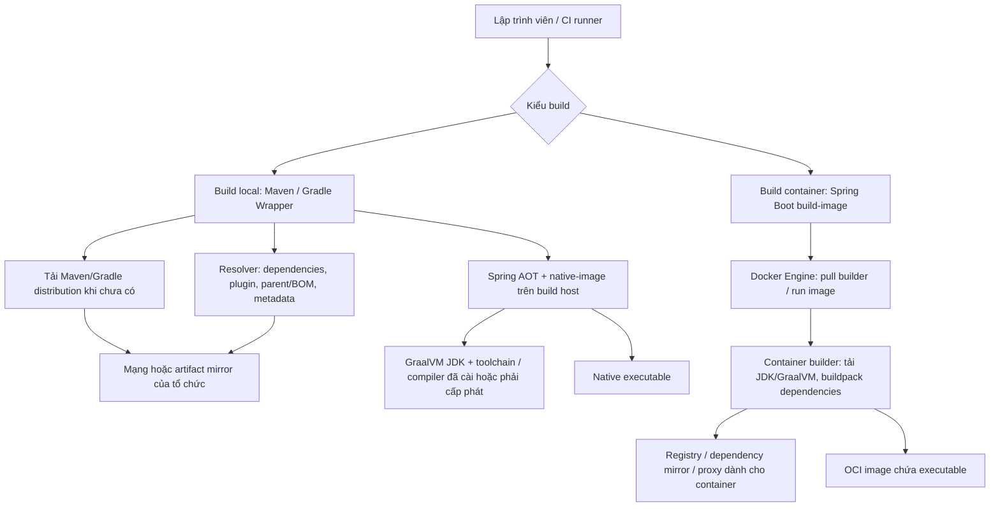

# Ảnh hưởng của proxy mạng, kho dependency và tải công cụ build

> **Chương: Môi trường build** — Module **SPRING_BOOT_NATIVE_IMAGE** hướng tới biên dịch ứng dụng Spring Boot thành **GraalVM Native Image** qua Spring AOT, xây dựng bằng Maven/Gradle, kiểm thử khả năng tương thích, đóng gói container và so sánh thời gian khởi động, bộ nhớ với bản chạy trên JVM. Trước khi đo hiệu năng native, cần bảo đảm môi trường build tải được đúng công cụ, plugin, dependency và image mà không bị ảnh hưởng bởi proxy hoặc cache không nhất quán.

## 1. Mục tiêu học tập

Sau bài học, bạn có thể:

1. Chỉ ra **mỗi yêu cầu mạng** phát sinh ở đâu trong quá trình build Spring Boot Native Image: Wrapper, Maven/Gradle, công cụ GraalVM, Docker và Buildpacks.
2. Phân biệt cấu hình **HTTP/HTTPS proxy**, **non-proxy hosts**, **kho dependency**, **kho plugin**, **Docker registry** và **CA certificate**.
3. Cấu hình cơ bản Maven `settings.xml`, Gradle `gradle.properties`/`settings.gradle` và proxy truyền cho Cloud Native Buildpacks.
4. Chẩn đoán lỗi timeout, DNS, xác thực proxy, TLS, dependency không tìm thấy và thiếu `native-image` theo từng lớp.
5. Thiết kế build ổn định trên CI/CD có cache, kho nội bộ, cách kiểm chứng offline và thông tin cấu hình đủ để tái hiện kết quả.

## 2. Một lần build native có thể đi qua nhiều điểm tải

Chạy `./mvnw -Pnative native:compile`, `./gradlew nativeCompile` hoặc `spring-boot:build-image` không nhất thiết chỉ kết nối một máy chủ. Tùy cấu hình và cache, build có thể cần nhiều lần truy cập mạng độc lập.



> **Nguyên tắc chẩn đoán:** phải tìm ra **tiến trình thực sự tạo yêu cầu HTTP** và **môi trường mạng nơi tiến trình đó đang chạy**. Proxy cấu hình cho shell của developer có thể không áp dụng cho Maven Wrapper, Java process, Docker daemon hoặc container của Buildpacks.

### 2.1. Bản đồ các điểm phụ thuộc mạng

| Giai đoạn | Thành phần cần tải | Nguồn thường gặp | Cấu hình liên quan |
|---|---|---|---|
| Khởi động Maven Wrapper | Bản phân phối Maven; đôi khi Wrapper JAR | URL trong `.mvn/wrapper/maven-wrapper.properties` | Wrapper, URL mirror, biến môi trường của Wrapper |
| Khởi động Gradle Wrapper | Bản phân phối Gradle | `distributionUrl` trong `gradle/wrapper/gradle-wrapper.properties` | Wrapper, JVM proxy, cache `GRADLE_USER_HOME` |
| Resolve Maven | Parent POM, BOM, JAR, Maven plugins, plugin dependencies, metadata | Maven Central, kho nội bộ, plugin repositories | `settings.xml`, `mirrors`, `servers`, `profiles`, `proxies` |
| Resolve Gradle | Plugin markers/plugin implementation, JAR, metadata, version catalogs | Gradle Plugin Portal, Maven repositories | `pluginManagement`, `dependencyResolutionManagement`, `gradle.properties` |
| Tìm công cụ native | GraalVM JDK, `native-image`, C compiler/native libraries, optional toolchain provisioning | Bản cài local, trình quản lý JDK, nguồn phân phối được CI tải | `JAVA_HOME`, `GRAALVM_HOME`, Gradle Java toolchains, CI image |
| Buildpacks | Builder/run image và các gói được buildpack sử dụng, có thể gồm GraalVM | Container registry, buildpack dependency URLs | Docker daemon proxy + buildpack environment proxy |
| Xuất/push image | OCI image, layers, manifest | Registry public/private | Registry credentials, Docker daemon network và TLS |

**Đừng nhầm Maven Central với Gradle Plugin Portal hoặc Docker registry**: truy cập được một nguồn chỉ chứng minh kết nối tới nguồn đó. Cũng không nên suy rằng `native-image` tự động tải toàn bộ toolchain: với build native local, nhiều phiên bản plugin yêu cầu GraalVM đã cài sẵn; chỉ một số cấu hình/toolchain resolver có thể tự cấp phát JDK hoặc thành phần bổ sung.

## 3. Proxy mạng ảnh hưởng đến build như thế nào?

Proxy là máy trung gian cho yêu cầu đi tới HTTP/HTTPS endpoint. Trong mạng tổ chức, proxy có thể chặn truy cập trực tiếp, yêu cầu xác thực, lọc domain, giải mã TLS để kiểm tra lưu lượng hoặc chỉ cho phép truy cập kho mirror nội bộ.

| Biểu hiện | Nguyên nhân có thể | Việc xác minh đầu tiên |
|---|---|---|
| `Connection timed out` / `Read timed out` | Không tới được proxy/endpoint, proxy chậm, firewall hoặc thời hạn chờ quá ngắn | Đúng host/port? Từ **máy/tiến trình phát sinh request** có truy cập được không? |
| `UnknownHostException` | DNS của máy/container không phân giải tên proxy hoặc repository | Kiểm tra tên miền, DNS container/runner, `NO_PROXY` |
| HTTP `407 Proxy Authentication Required` | Proxy yêu cầu xác thực hoặc credential không được đưa vào đúng tiến trình | Xác thực proxy, tài khoản, cơ chế hỗ trợ |
| HTTP `401` / `403` từ repository | Sai quyền truy cập/credentials repository, hoặc policy ở proxy | Phân biệt response từ proxy hay artifact repository |
| `PKIX path building failed` / `SSLHandshakeException` | Java truststore thiếu CA của server/proxy TLS inspection hoặc chain sai | Kiểm tra chứng chỉ, CA của **JDK/Java runtime đang tải** |
| `Could not find artifact` / `Could not resolve plugin` | Repo không chứa artifact/phiên bản, thiếu kho plugin, lỗi routing, metadata bị cache | Kiểm tra tọa độ, repo thực tế, plugin marker, cache và log |
| HTTP `429` / `502` / `503` | Rate limit hoặc dịch vụ trung gian quá tải | Kiểm tra retry có kiểm soát, cache, repository manager |
| Buildpack báo không tải được JDK/GraalVM | Container builder không đi được tới nguồn tải | Kiểm tra proxy **trong builder container**, khác proxy của Maven |

### 3.1. HTTP_PROXY, HTTPS_PROXY và NO_PROXY không phải cấu hình chung cho tất cả

Ví dụ biến môi trường cho chương trình hỗ trợ cách đọc này:

```bash
# Ví dụ Linux/macOS, thay host/port bằng môi trường thật
export HTTP_PROXY=http://proxy.corp.example:8080
export HTTPS_PROXY=http://proxy.corp.example:8080
export NO_PROXY=localhost,127.0.0.1,.corp.example
```

Địa chỉ có `http://` trong `HTTPS_PROXY` **có thể đúng**: nhiều proxy HTTP tạo đường hầm `CONNECT` để truy cập URL HTTPS. Phải lấy đúng scheme theo yêu cầu của proxy; không tự đổi `http` thành `https` chỉ vì tên biến là `HTTPS_PROXY`.

`NO_PROXY` thường phân tách bằng dấu phẩy, trong khi `http.nonProxyHosts` của Java/Maven/Gradle dùng quy tắc riêng (thường danh sách phân cách bằng ký tự `|`). Không sao chép nguyên giá trị của biến này giữa các công cụ mà không kiểm tra cú pháp. Mặt khác, thiết lập biến `HTTP_PROXY` trong shell không bảo đảm JVM tải Maven dependency sẽ sử dụng nó: Maven và Gradle có cách cấu hình proxy riêng.

## 4. Maven: phân biệt Wrapper, dependency, plugin và mirror

### 4.1. Maven Wrapper chạy **trước** phần lớn logic Maven

`./mvnw` có thể phải tải Maven distribution theo `.mvn/wrapper/maven-wrapper.properties` trước khi `settings.xml` của Maven được xử lý. Nếu lỗi xuất hiện ngay khi Wrapper tải distribution, thay đổi `<repositories>` trong `pom.xml` chưa giải quyết được.

Kiểm tra:

```bash
# Trong dự án Maven có Wrapper
./mvnw --version

# Sau khi wrapper hoạt động:
./mvnw help:effective-settings
```

Nếu mạng không cho truy cập URL distribution public, đội vận hành có thể cấu hình `distributionUrl` tới bản phân phối Maven đã được mirror nội bộ và kiểm tra checksum theo [Apache Maven Wrapper](https://maven.apache.org/tools/wrapper/). Không đưa username/password vào URL đã commit. Với Maven Wrapper hỗ trợ tương ứng, cơ chế `MVNW_REPOURL` và các biến xác thực Wrapper có thể giúp đi qua repository manager; phải kiểm tra phiên bản Wrapper đang dùng.

### 4.2. Maven `settings.xml`: proxy và repository mirror

Đặt cấu hình dành riêng cho môi trường người dùng/CI trong `~/.m2/settings.xml` hoặc cung cấp file xác định bằng `./mvnw -s /path/to/settings.xml ...`. Ví dụ không chứa secret:

```xml
<settings xmlns="http://maven.apache.org/SETTINGS/1.2.0">
  <proxies>
    <proxy>
      <id>corporate-proxy</id>
      <active>true</active>
      <protocol>http</protocol>
      <host>proxy.corp.example</host>
      <port>8080</port>
      <nonProxyHosts>localhost|127.0.0.1|*.corp.example</nonProxyHosts>
    </proxy>
  </proxies>

  <mirrors>
    <mirror>
      <id>company-artifacts</id>
      <mirrorOf>external:*</mirrorOf>
      <url>https://repo.corp.example/repository/maven-public/</url>
    </mirror>
  </mirrors>
</settings>
```

Giải thích:

- `<proxies>` chỉ định cách Maven kết nối khi mạng yêu cầu proxy; `nonProxyHosts` giúp truy cập repo nội bộ trực tiếp nếu chính sách cho phép.
- `<mirrors>` thay URL của các repo phù hợp bằng URL repository manager; ví dụ `external:*` áp dụng cho repo bên ngoài theo quy tắc Maven. Repository manager phải thực sự **proxy/host đủ cả artifact và plugin cần thiết**.
- `<servers>` dùng cấu hình xác thực **repository**, khớp với `id` của server/mirror được truy cập; không dùng nó như cơ chế xác thực mạng của mọi proxy. Tham số username/password không nên để trong `pom.xml` hay trong file đã commit.
- `<repositories>` và `<pluginRepositories>` là hai nhóm khai báo khác nhau; dependency tải được chưa đảm bảo `spring-boot-maven-plugin` và `native-maven-plugin` resolve được.

Một yêu cầu tải có thể đi từ Maven tới mirror nội bộ mà **không đi qua proxy** khi `nonProxyHosts` khớp. Nếu repo nội bộ là nơi duy nhất được phép truy cập, cân nhắc quy định mirror trung tâm và khóa việc dùng repo ngoài, thay vì thêm rất nhiều URL công khai vào POM.

### 4.3. Maven offline và cache

Maven lưu phần lớn dependency/plugin trong `~/.m2/repository` (hoặc đường dẫn `localRepository` tùy biến). Khi đã chuẩn bị đầy đủ, thử:

```bash
./mvnw -o -Pnative native:compile
```

`-o` chỉ yêu cầu Maven dùng tài nguyên có sẵn trong cache; nếu thiếu parent POM, plugin, native metadata hoặc dependency chưa tải, build **sẽ lỗi**, không có cơ chế thần kỳ để tải offline. Bản native còn cần **GraalVM/Native Image, compiler và native libraries** đã được chuẩn bị sẵn. Thực thi build container bằng `spring-boot:build-image` có thể vẫn cần registry hoặc buildpack download, ngay cả khi Maven được đặt offline.

Nếu nghi metadata cũ, kiểm tra repository thực tế và phạm vi artifact lỗi trước khi dùng `-U` hoặc làm sạch cache. Xóa toàn bộ `~/.m2/repository` thường khiến CI phải tải lại nhiều thành phần, che khuất lỗi DNS/proxy ban đầu.

## 5. Gradle: Wrapper, kho plugin và kho dependency là ba điểm khác nhau

### 5.1. Gradle Wrapper

`./gradlew` tải phiên bản Gradle theo `gradle/wrapper/gradle-wrapper.properties` nếu bản phân phối chưa có trong cache Wrapper. Mạng có thể chặn `services.gradle.org` dù Maven Central/Plugin Portal truy cập được.

Ví dụ cấu hình đã được tổ chức mirror:

```properties
# gradle/wrapper/gradle-wrapper.properties — minh họa
distributionUrl=https\://repo.corp.example/gradle-distributions/gradle-9.0.0-bin.zip
distributionSha256Sum=<sha256-do-nha-cung-cap-uy-tin-xac-minh>
```

`distributionSha256Sum` là một giá trị SHA-256 **thật gồm 64 ký tự hex** lấy từ nguồn đáng tin cậy, không dùng nguyên placeholder trong file chạy thực tế. Phiên bản `9.0.0` chỉ là ví dụ; chọn theo compatibility matrix của Gradle, Spring Boot plugin và JDK đang dùng. Đừng vô hiệu hóa kiểm tra checksum hoặc dùng nguồn mirror không được kiểm soát để sửa lỗi tải Wrapper.

### 5.2. Proxy cho JVM chạy Gradle

Theo tài liệu [Networking with Gradle](https://docs.gradle.org/current/userguide/networking.html), đặt các Java system properties trong **`~/.gradle/gradle.properties`** để không commit thông tin mạng/credential của từng máy:

```properties
systemProp.http.proxyHost=proxy.corp.example
systemProp.http.proxyPort=8080
systemProp.https.proxyHost=proxy.corp.example
systemProp.https.proxyPort=8080
systemProp.http.nonProxyHosts=localhost|127.0.0.1|*.corp.example
```

Đối với Java `https`, Gradle cũng sử dụng thuộc tính **`http.nonProxyHosts`** cho danh sách host không qua proxy. Nếu proxy cần authentication, dùng cơ chế cấp phát secret của CI/user-home phù hợp để đặt thông số tài khoản, không đưa mật khẩu vào `gradle.properties` thuộc repository.

### 5.3. Plugin portal và dependency repositories

Trong Gradle, các plugin dùng khối `plugins { ... }` thường được resolve từ `pluginManagement.repositories` ở `settings.gradle`, trong khi dependency của ứng dụng lấy từ `dependencyResolutionManagement.repositories` hoặc `repositories` của project. Ví dụ Groovy DSL khi tổ chức có hai kho mirror đã cấu hình đúng:

```groovy
// settings.gradle
pluginManagement {
    repositories {
        maven {
            url = uri("https://repo.corp.example/repository/gradle-plugins/")
        }
    }
}

dependencyResolutionManagement {
    repositoriesMode = RepositoriesMode.FAIL_ON_PROJECT_REPOS
    repositories {
        maven {
            url = uri("https://repo.corp.example/repository/maven-public/")
        }
    }
}
```

Để đoạn cấu hình này hoạt động, repo `gradle-plugins` phải phục vụ được **plugin marker artifact** và plugin implementation tương ứng (chẳng hạn `org.graalvm.buildtools.native`); nhiều plugin còn cần dependency từ Maven repositories. Nếu tổ chức chỉ mirror Maven Central nhưng chặn Plugin Portal, việc `implementation("...")` thành công không giúp plugin `org.graalvm.buildtools.native` tự resolve được.

`RepositoriesMode.FAIL_ON_PROJECT_REPOS` là một lựa chọn khóa repo ở cấp settings, giúp build chỉ liên hệ những repo đã duyệt; nếu project/plugin cũ còn khai báo repository ở subproject, Gradle sẽ báo lỗi rõ ràng và cấu hình cần được thống nhất.

### 5.4. Gradle cache và offline

`GRADLE_USER_HOME` thường chứa cache dependency, plugin, metadata và bản phân phối Wrapper. Chế độ offline:

```bash
./gradlew --offline nativeCompile
```

Chỉ hoạt động khi dependency, plugin và toolchain cần thiết đã sẵn có. Nếu Wrapper distribution chưa được tải, Wrapper vẫn phải tìm bản phân phối trước khi Gradle thực sự có thể xử lý `--offline`. Ngoài ra cache Gradle ghi cả metadata liên quan đến repository cụ thể, nên **đổi URL từ public sang mirror có thể tạo request mới** dù những file JAR giống nhau đã nằm trong cache.

`--refresh-dependencies` yêu cầu Gradle kiểm tra lại dữ liệu metadata/artifact; nó có thể làm tăng request mạng và không phải cách chữa lỗi proxy. Xem [Dependency Caching — Gradle](https://docs.gradle.org/current/userguide/dependency_caching.html).

## 6. GraalVM và Native Build Tools: kiểm tra nơi tải công cụ

Với native build chạy **trực tiếp trên máy**, Maven/Gradle thường cần:

- JDK/GraalVM phù hợp phiên bản Spring Boot và mức Java của project;
- executable `native-image` có thể gọi được;
- C compiler, linker và development libraries đúng OS;
- plugin GraalVM Native Build Tools và những dependency/metadata liên quan đã resolve.

Kiểm tra bằng các lệnh (chạy trong môi trường build thật):

```bash
java -version
native-image --version
./mvnw --version
# Hoặc:
./gradlew --version
```

Điểm dễ bỏ qua: JDK chạy **Gradle daemon** có thể khác JDK mà **Gradle toolchain** chọn để biên dịch Java hoặc chạy `native-image`. Theo [Native Build Tools Gradle plugin](https://graalvm.github.io/native-build-tools/latest/gradle-plugin), plugin có quy tắc chọn launcher từ cấu hình toolchain/`GRAALVM_HOME`/`JAVA_HOME`; hành vi fallback và tự cài công cụ có thể phụ thuộc phiên bản plugin. Vì vậy đừng chỉ nhìn `java -version` rồi kết luận mọi task native đang dùng đúng GraalVM.

Đối với CI:

1. Nếu runner được **cài sẵn GraalVM**, kiểm tra cả version JDK và `native-image`, đồng thời ghi cách cung cấp compiler/linker.
2. Nếu CI action/toolchain resolver **tự tải GraalVM**, đó là một nguồn tải bổ sung; proxy và allowlist phải bao gồm endpoint phân phối thực tế.
3. Nếu Maven/Gradle plugin đã resolve nhưng xuất hiện `Cannot find native-image executable`, hãy điều tra **toolchain/đường dẫn**, không bắt đầu bằng việc thêm Maven Central.
4. Nếu lỗi diễn ra ở `native-image` trong pha phân tích hoặc AOT, phân biệt vấn đề **metadata/tương thích** với network. Một bản tải đủ thư viện vẫn có thể không biên dịch native vì reflection hay class initialization.

**Không nên sửa lỗi mạng bằng cách trộn tùy tiện JDK/GraalVM versions.** Chọn bộ version dựa trên trang yêu cầu hệ thống của đúng Spring Boot release và thử trên OS/CPU đích.

## 7. Container: Docker daemon và Buildpacks dùng mạng khác nhau

Đối với `./mvnw -Pnative spring-boot:build-image` hoặc Gradle `bootBuildImage`, luồng làm việc khác với build local:

1. Maven/Gradle bên ngoài container vẫn phải resolve wrapper, plugin và project dependencies.
2. Spring Boot plugin nói chuyện với **Docker Engine** để lấy builder/run images từ registry (nếu chưa cache).
3. **Builder container** thực thi Cloud Native Buildpacks; buildpack có thể tải GraalVM, Native Image và các thành phần khác từ Internet/repository được cấu hình.
4. Thành phẩm được tạo thành OCI image; bước push lên registry là kết nối tiếp theo.

Điều này tạo ra ít nhất **hai phạm vi proxy riêng**:

| Phạm vi | Ai cần mạng? | Cấu hình |
|---|---|---|
| Docker daemon | Pull builder/run image, registry access | Docker Engine proxy hoặc cấu hình Docker Desktop; certificate trust cho registry |
| Buildpacks builder container | Tải JDK/GraalVM và các artifact của buildpack | Environment `HTTP_PROXY`, `HTTPS_PROXY`, `NO_PROXY` được truyền cho builder; CA/trust phù hợp |

Theo [Spring Boot Maven plugin — Packaging OCI Images](https://docs.spring.io/spring-boot/maven-plugin/build-image.html), có thể truyền proxy cho **builder** qua `image.env`:

```xml
<!-- Trích đoạn cấu hình trong pom.xml; host chỉ là ví dụ -->
<plugin>
  <groupId>org.springframework.boot</groupId>
  <artifactId>spring-boot-maven-plugin</artifactId>
  <configuration>
    <image>
      <env>
        <HTTP_PROXY>http://proxy.corp.example:8080</HTTP_PROXY>
        <HTTPS_PROXY>http://proxy.corp.example:8080</HTTPS_PROXY>
        <NO_PROXY>localhost,127.0.0.1,.corp.example</NO_PROXY>
      </env>
    </image>
  </configuration>
</plugin>
```

Tương đương với [Spring Boot Gradle plugin — Packaging OCI Images](https://docs.spring.io/spring-boot/gradle-plugin/packaging-oci-image.html) trong project dùng Groovy DSL:

```groovy
tasks.named("bootBuildImage") {
    environment["HTTP_PROXY"] = "http://proxy.corp.example:8080"
    environment["HTTPS_PROXY"] = "http://proxy.corp.example:8080"
    environment["NO_PROXY"] = "localhost,127.0.0.1,.corp.example"
}
```

Ví dụ đặt **proxy không chứa tài khoản**. Nếu phải xác thực, hãy dùng kênh truyền secret bảo mật của CI và cơ chế Buildpacks hỗ trợ; tránh ghi token/mật khẩu trong POM, Gradle script, Dockerfile, môi trường được lưu trong image hoặc log công khai.

**Lưu ý về Docker:** proxy cho Docker daemon khác proxy do Spring Boot truyền vào builder. Docker Desktop có màn hình cấu hình proxy riêng; `daemon.json` proxy trên Docker Engine Linux không phải lúc nào cũng áp dụng cho Docker Desktop. Đồng thời `docker build --build-arg HTTP_PROXY=...` là cú pháp dành cho một lệnh **Dockerfile build**, không tự động thiết lập mọi đường kết nối của Spring Boot `build-image`. Xem [Docker — Daemon Proxy Configuration](https://docs.docker.com/engine/daemon/proxy/) và [Paketo — Building Behind a Firewall](https://paketo.io/docs/howto/configuration/).

### 7.1. Vì sao Maven tải được mà Buildpacks vẫn lỗi?

Giả sử Maven dùng mirror `repo.corp.example` nên `./mvnw package` thành công. Nhưng khi chạy `spring-boot:build-image`, logs cho thấy builder không tải được JDK hoặc Native Image. Nguyên nhân có thể là:

- Docker daemon chưa thể pull builder/run image từ container registry;
- image có sẵn, nhưng **container builder không được truyền proxy**;
- builder được truyền proxy, nhưng domain nội bộ cần nằm trong `NO_PROXY` hoặc DNS trong container khác máy host;
- proxy TLS inspection yêu cầu CA bổ sung **trong builder**, dù Java ở máy host đã tin tưởng chứng chỉ;
- endpoint phân phối dependency của buildpack không có trong allowlist, hoặc buildpack cache thiếu;
- giới hạn CPU/RAM hoặc thiếu compiler của builder bị nhầm với download timeout.

Kiểm tra **dòng lỗi đầu tiên nêu URL/host hoặc bước tải**, rồi xác định nó xuất phát từ Maven/Gradle, Docker daemon hay CNB builder. Một lần `curl` thành công trên host không đủ để xác nhận kết nối bên trong builder container.

### 7.2. CA certificate và TLS inspection

Tổ chức có thể dùng proxy kiểm tra HTTPS và phát hành certificate qua CA riêng. Khi đó cần cài CA hợp lệ vào **truststore của ứng dụng Java/build tool hoặc builder container cần sử dụng nó**. Thông báo `PKIX path building failed` thường khác bản chất với lỗi mất kết nối, sai host hoặc sai tài khoản.

Với Paketo, có cơ chế CA Certificates Buildpack và service bindings phù hợp [Paketo CA Certificates](https://paketo.io/docs/howto/configuration/). Với Maven/Gradle dùng Java, kiểm tra truststore của đúng JDK đang thực thi. Không dùng `-k`, `insecure` hoặc tắt xác minh TLS để “sửa nhanh” pipeline chính thức.

## 8. Thiết kế build ổn định trong CI/CD hoặc mạng bị giới hạn

**Repository manager** (như kho Maven/Gradle nội bộ) và **container registry mirror** giải quyết những loại artifact khác nhau. Cần có bảng kiểm kê đường tải thực tế:

| Vật tư build | Có thể cache/mirror ở đâu? | Rủi ro nếu bỏ sót |
|---|---|---|
| Maven/Gradle Wrapper distribution | Kho binary nội bộ; cache runner | Build chết trước khi Maven/Gradle khởi chạy |
| Maven parent/BOM/dependencies và plugin | Maven repository manager, `~/.m2` | Không resolve Spring Boot plugin hoặc Native Build Tools |
| Gradle plugin marker và project dependencies | Plugin portal mirror + Maven repo, `GRADLE_USER_HOME` | Task `nativeCompile` không tồn tại vì plugin chưa nạp |
| GraalVM JDK + compiler | CI runner image, artifact archive có kiểm tra checksum, toolchain cache | Thiếu `native-image` hoặc sai Java version |
| Buildpacks builder/run images | Registry mirror, cache Docker daemon | Pull image lỗi trước pha compile |
| Gói GraalVM/JDK bên trong builder | Buildpack dependency mirror hoặc buildpack cache được hỗ trợ | Image đã pull nhưng builder vẫn không chạy được |

### 8.1. Các nguyên tắc bảo đảm tính tái hiện

- **Khóa phiên bản** Spring Boot, Maven/Gradle Wrapper, Native Build Tools, Java/GraalVM, plugin, dependency và builder/run image. Không phụ thuộc tùy tiện vào `latest`, version `+` hoặc artifact SNAPSHOT khi benchmark.
- **Bảo đảm nguồn tải** có checksum/verification, certificate đáng tin và repository owner rõ ràng. Đặc biệt cần kiểm chứng bản phân phối Wrapper và binary GraalVM.
- **Làm ấm cache có chủ đích** trên runner dùng cùng version, repository URL, OS/kiến trúc; tránh giả định cache của một máy sẽ dùng được nguyên vẹn trên máy khác.
- **Tách số đo thời gian tải khỏi thời gian native compile**: cold build có thể chậm vì Internet/proxy, trong khi warm build đã cache đủ. Khi so sánh native với JAR, ghi cả hai phép đo và nguồn cache.
- **Quản lý thông tin xác thực riêng**: Maven `settings.xml`/`servers` với secret injection, Gradle credentials của CI, Docker registry credentials và Buildpacks bindings; không lưu chúng vào artifact hoặc repository.
- **Lưu evidence cho build failure**: lỗi đầu tiên, URL host (đã che secret), loại bước tải, version, proxy chain, certificate thumbprint/truststore, cache hit/miss và runner OS.

### 8.2. Mạng offline và air-gapped

“Maven offline” hoặc “Gradle `--offline`” **chỉ nói về cách build tool resolve dependency từ cache**, không bảo đảm cả pipeline native không truy cập mạng. Một môi trường air-gapped cần chuẩn bị sẵn mọi vật tư theo luồng build cụ thể: wrapper distribution, plugin/dependency, GraalVM, C compiler, metadata, builder/run images, buildpack dependencies và private registry.

Nếu dùng local native compile, có thể đưa GraalVM/toolchain vào runner image chuẩn để không cần tải lúc chạy job. Nếu dùng Buildpacks, cần builder/run images và cách cấp phát dependency tương thích với chiến lược offline của buildpack được chọn. Không suy rằng chỉ cần `docker pull` builder image một lần là đủ, vì các buildpack có thể cần tải thêm các lớp runtime/JDK bên ngoài image.

## 9. Runbook chẩn đoán theo thứ tự

Khi build lỗi, **không xóa cache ngay** và không chỉnh ngẫu nhiên nhiều proxy/repository cùng lúc. Đi lần lượt:

1. **Xác định pha lỗi:** Wrapper download, plugin/dependency resolution, toolchain/native-image discovery, Spring AOT/native compilation, Docker pull, builder download hay registry push.
2. **Đọc URL/host và HTTP status** từ lỗi đầu tiên; phân biệt `proxy.corp.example`, `repo.corp.example`, Plugin Portal, Docker registry và buildpack dependency server.
3. **Xác định môi trường phát request:** máy local, CI runner, Gradle daemon, Docker daemon hay container builder. Ghi route DNS/proxy/CA ở môi trường đó.
4. **Kiểm tra ủy quyền:** HTTP 407 là tín hiệu proxy authentication; HTTP 401/403 từ repository thường là access token/permission hoặc chính sách cho endpoint. Xác minh log sau khi che secret.
5. **Kiểm tra TLS:** nếu báo PKIX, xác định CA chain và truststore đúng JDK/container, không tắt xác thực.
6. **Kiểm tra metadata và kho:** dependency có tồn tại ở kho nội bộ không, Maven có pluginRepositories/mirror phù hợp không, Gradle có plugin marker và repo application dependency không?
7. **Kiểm tra công cụ:** `java -version`, `native-image --version`, wrapper version, JDK toolchain, compiler, OS/CPU. Nếu lỗi xuất hiện sau khi download hoàn tất, xem xét Native Image metadata/AOT thay vì network.
8. **Thử lại có kiểm soát:** chạy lại đúng task bị lỗi sau khi sửa đúng một nguyên nhân; ghi cache status và log để so sánh.

Một vài lệnh kiểm tra khả dụng khi **đang có nguồn mạng được phép**:

```bash
# Maven Wrapper có lấy được distribution chưa?
./mvnw --version

# Maven effective settings (không công bố output chưa che secrets)
./mvnw help:effective-settings

# Gradle Wrapper và khả năng resolve với cache hiện có
./gradlew --version
./gradlew --offline help

# Toolchain native có khả dụng trên đúng runner?
java -version
native-image --version

# Docker daemon có liên lạc được không? (không tự kiểm tra builder networking)
docker info
```

Các lệnh này chỉ là **bước thăm dò**, không tự đảm bảo toàn bộ build native đã sẵn sàng. Đặc biệt `./gradlew --offline help` có thể thành công dù dependency của `nativeCompile` hoặc Buildpacks chưa được cache.

### Bảng quyết định nhanh

| Lỗi đầu tiên | Xử lý đúng lớp | Không nên làm ngay |
|---|---|---|
| Wrapper không tải được distribution ZIP | Wrapper URL, proxy cho downloader, mirror/checksum | Chỉnh reflection hints |
| Maven không tìm thấy `native-maven-plugin` | Maven mirror, plugin repository, quyền access và cache | Đổi GraalVM runtime tùy tiện |
| Gradle không tìm thấy `org.graalvm.buildtools.native` | `pluginManagement.repositories`, plugin marker, proxy/JVM trust | Chỉ sửa `repositories` của ứng dụng |
| `native-image` không tìm thấy | `JAVA_HOME`/`GRAALVM_HOME`, toolchain detection, CI setup | Xóa tất cả Maven/Gradle cache |
| `PKIX path building failed` | CA chain/truststore của tiến trình gây lỗi | Tắt TLS verification |
| Docker không pull được builder/run image | Docker daemon proxy, registry auth, registry certificate | Chỉ cấu hình Maven `settings.xml` |
| Builder pull được nhưng không tải được GraalVM | Buildpack env proxy, DNS/NO_PROXY, CA/container cache | Chỉ sửa Docker CLI proxy |
| Native Image phân tích lỗi sau khi tải đủ | Spring AOT, reflection/resource hints, tương thích dependency | Tăng timeout proxy không có căn cứ |

## 10. Bài tập tình huống

**Tình huống A — Jenkins runner trong mạng công ty.** `./mvnw package` tạo JAR được, nhưng `./mvnw -Pnative native:compile` báo `native-image: command not found`. Hãy chỉ ra vì sao lỗi này thuộc **phát hiện/cài đặt toolchain**, không được giải quyết bằng việc đổi mirror Maven. Cần đối chiếu version GraalVM, `JAVA_HOME` và plugin.

**Tình huống B — Maven build-image không truy cập được mạng.** `./mvnw -Pnative spring-boot:build-image` tải xong parent POM và plugin; Docker pull builder thành công; log trong builder báo lỗi tải JDK. Xác định proxy phải áp dụng **vào builder container** và cách kiểm tra certificate hoặc DNS ở đó.

**Tình huống C — Gradle Plugin Portal bị chặn.** Project dùng `org.graalvm.buildtools.native` và mirror Maven Central nội bộ. Build báo plugin not found trong khi dependency `spring-boot-starter-web` tải được. Hãy chỉ ra cấu hình thiếu trong `pluginManagement` và yêu cầu repository mirror phải có plugin marker/implementation.

**Tình huống D — CI lúc nhanh lúc chậm.** Một runner có cache warm, runner khác tải lại Wrapper, JAR, builder và GraalVM. Hãy phân tách thời gian **network download**, **Spring AOT**, **native-image compilation** và **Docker image assembly** trước khi kết luận Native Image build chậm bất thường.

Ghi lại kết quả vào bảng thực hành:

| Môi trường | Lệnh build | Pha lỗi / URL tải | Proxy/repo thực dùng | Cache hit/miss | Cách xử lý / bằng chứng |
|---|---|---|---|---|---|
| Local JVM build | … | … | … | … | … |
| Local native build | … | … | … | … | … |
| CI native build | … | … | … | … | … |
| Buildpacks native image | … | … | … | … | … |

## 11. Câu hỏi tự kiểm tra

1. Vì sao `./gradlew` có thể lỗi trước khi Gradle đọc `settings.gradle`?
2. Trong Maven, `<proxies>`, `<mirrors>` và `<servers>` khác nhau như thế nào?
3. Vì sao Gradle cần cấu hình kho plugin riêng với kho dependency ứng dụng?
4. Cùng một pipeline, HTTP 407 khác HTTP 401 từ kho artifact ra sao?
5. Vì sao `docker pull` thành công không chứng minh Buildpacks có thể tải GraalVM?
6. Maven/Gradle offline mode có bảo đảm quá trình `spring-boot:build-image` hoạt động khi ngắt mạng không?
7. Trong benchmark JAR/JVM và native, vì sao cần tách thời gian tải dependency khỏi thời gian biên dịch?

## Tổng kết

Sự ổn định của build Spring Boot Native Image phụ thuộc vào **nguồn tải và môi trường kết nối của từng giai đoạn**, không chỉ vào mã Java hoặc cờ `-Pnative`. Maven/Gradle Wrapper, kho plugin và dependency, GraalVM/toolchain, Docker daemon và Buildpacks builder có thể dùng các proxy, cache, chứng chỉ và thông tin xác thực khác nhau. Khi lỗi xảy ra, xác định đúng **tiến trình + URL + pha lỗi**, cấu hình đúng lớp, khóa phiên bản và kiểm chứng lại. Chỉ sau khi pipeline tạo được native binary/image ổn định mới có cơ sở đo và so sánh startup, bộ nhớ hoặc hành vi vận hành với bản JAR trên JVM.

## Tài liệu tham khảo

- [Apache Maven — Settings Reference](https://maven.apache.org/settings.html): `proxies`, `mirrors`, `servers`, repositories và pluginRepositories.
- [Apache Maven Wrapper](https://maven.apache.org/tools/wrapper/): tải Maven distribution qua Wrapper, mirror và checksum.
- [Gradle — Networking](https://docs.gradle.org/current/userguide/networking.html): Java system properties cho HTTP/HTTPS proxy.
- [Gradle — Gradle Wrapper](https://docs.gradle.org/current/userguide/gradle_wrapper.html): `distributionUrl`, distribution checksum, cache.
- [Gradle — Declaring Repositories](https://docs.gradle.org/current/userguide/declaring_repositories_adv.html): plugin và dependency resolution.
- [Gradle — Dependency Caching](https://docs.gradle.org/current/userguide/dependency_caching.html): cache metadata/artifact, offline mode.
- [GraalVM Native Build Tools — Gradle Plugin](https://graalvm.github.io/native-build-tools/latest/gradle-plugin): phát hiện `native-image` và JDK/toolchain.
- [GraalVM Native Build Tools — Maven Plugin](https://graalvm.github.io/native-build-tools/latest/maven-plugin): tích hợp GraalVM vào Maven.
- [Spring Boot Maven Plugin — Packaging OCI Images](https://docs.spring.io/spring-boot/maven-plugin/build-image.html): image build và cấu hình proxy cho builder.
- [Spring Boot Gradle Plugin — Packaging OCI Images](https://docs.spring.io/spring-boot/gradle-plugin/packaging-oci-image.html): `bootBuildImage` và `environment` của Buildpacks.
- [Docker — Daemon Proxy Configuration](https://docs.docker.com/engine/daemon/proxy/): proxy cho Docker daemon.
- [Docker — Proxy Configuration for Docker CLI](https://docs.docker.com/engine/cli/proxy/): phân biệt proxy trong build container, Dockerfile và container runtime.
- [Paketo Buildpacks — Configuration](https://paketo.io/docs/howto/configuration/): proxy, CA certificates và biến môi trường buildpack.
