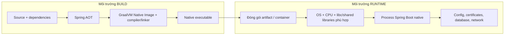
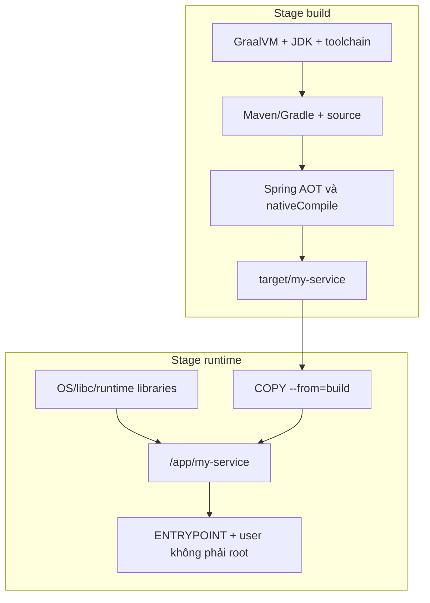
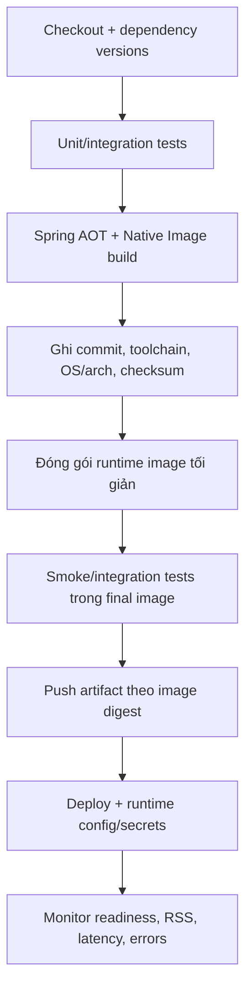

# Tách môi trường build khỏi môi trường chạy tệp thực thi

Khi xây dựng **Spring Boot Native Image** bằng **Spring AOT** và **GraalVM**, máy biên dịch thường cần JDK, Native Image toolchain, Maven hoặc Gradle, compiler/linker hệ thống và lượng CPU/RAM đáng kể. Nhưng sau khi biên dịch xong, ứng dụng native có thể chạy mà **không cần cài JDK/JRE, Maven, Gradle hay GraalVM trên máy triển khai**. Đây là lý do phải phân biệt rõ môi trường **build** với môi trường **runtime**.

Tuy nhiên, **không cần JVM không đồng nghĩa binary độc lập với mọi thứ**. Tệp native vẫn có thể cần đúng hệ điều hành, kiến trúc CPU, dynamic loader, libc, shared libraries, chứng chỉ CA, cấu hình và quyền truy cập tài nguyên. Nếu build trên môi trường không tương thích với đích triển khai, ứng dụng có thể build thành công nhưng không khởi động được.

## 1. Mục tiêu và mô hình hai môi trường

Sau bài này, bạn sẽ có thể:

1. Phân loại công cụ cần **khi tạo native executable** và thành phần cần **khi chạy executable**.
2. Giải thích việc Spring AOT, GraalVM Native Image, Maven/Gradle và compiler/linker tham gia giai đoạn build như thế nào.
3. Nhận diện ràng buộc OS, kiến trúc CPU, glibc/musl, dynamic libraries và tài nguyên runtime.
4. Viết Dockerfile **multi-stage** để chỉ đưa những thành phần cần thiết vào image runtime.
5. Kiểm tra binary, chẩn đoán lỗi triển khai và thiết kế quy trình build/test phù hợp.
6. Đánh giá lợi ích về startup, bộ nhớ và kích thước image mà không nhầm lẫn chi phí build với chi phí vận hành.



Trong ứng dụng JVM thông thường, Maven/Gradle đóng gói JAR và môi trường chạy phải có JVM tương thích. Với Native Image, GraalVM phân tích và biên dịch chương trình thành mã máy **trước khi triển khai**. Phần lớn công cụ dùng để *tạo* mã máy không cần mang theo vào container chỉ để *thực thi* mã máy đó.

## 2. Môi trường build khác môi trường runtime ở đâu?

| Thành phần | Khi build Spring Boot Native Image | Khi chạy Native Image | Lý do |
| --- | --- | --- | --- |
| Source code, mã test | Có | Thường không | Không cần source để chạy executable đã tạo |
| Maven/Gradle, plugin, wrapper | Có | Không | Điều phối Spring AOT, biên dịch, test, đóng gói |
| JDK/GraalVM Native Image | Có | Không cần JVM/JDK cho native executable thông thường | Native Image đã tạo mã máy trước runtime |
| C compiler, linker, headers, thư viện phát triển | Có thể cần | Thông thường không | Phục vụ biên dịch và liên kết, không phải xử lý request |
| RAM/CPU lớn cho quá trình native compilation | Thường cần | Theo nhu cầu nghiệp vụ | Yêu cầu build không phải định mức memory của service |
| Native executable | Đầu ra | Có | Phải đúng nền tảng mục tiêu |
| Dynamic loader, libc và shared libraries | Có trong môi trường build | Có thể cần | Phụ thuộc kiểu liên kết của binary |
| CA certificates, DNS, timezone, locale | Có thể cần | Phụ thuộc tính năng | TLS, mạng và địa phương hóa vẫn hoạt động tại runtime |
| Properties, profiles, secrets | Một số giá trị ảnh hưởng phân tích AOT | Các giá trị vận hành khi chạy | Cần xác định giá trị nào quyết định bean graph |
| Logs, metrics, health checks | Dùng phục vụ CI | Cần cho quan sát vận hành | Không nhất thiết phải giữ shell/compiler trong image runtime |

**Ví dụ:** API Spring Boot dùng PostgreSQL có thể được build trên CI runner Linux với GraalVM và Maven. Ở runtime, container chỉ mang executable, những thư viện Linux tương thích, cơ chế đọc cấu hình kết nối PostgreSQL và kết nối mạng. Không cần cài Java compiler, Maven hay GraalVM trong container đó.

Điểm dễ nhầm là **native executable không mặc định liên kết tĩnh hoàn toàn**: không chứa JVM nhưng có thể vẫn phụ thuộc một số thư viện hệ điều hành. Phải kiểm tra chính artifact trước khi chọn image tối giản.

## 3. Những gì chỉ thuộc môi trường build

### 3.1. Toolchain và công cụ biên dịch

Trong một dự án Spring Boot hỗ trợ AOT, môi trường build thường phải xác nhận tính tương thích giữa:

- Phiên bản **Spring Boot/Spring Framework** với xử lý AOT và native.
- **JDK và GraalVM Native Image** theo Java version dự án dùng.
- **Spring Boot Maven/Gradle plugin** và **GraalVM Native Build Tools**.
- Compiler, linker, headers và các gói hệ thống mà Native Image build yêu cầu trên nền tảng đó.
- Bộ nhớ, CPU, dung lượng đĩa, network để tải dependencies và khả năng truy cập repository.
- Hệ điều hành và kiến trúc CPU mà executable đích sẽ chạy.

Với dự án Maven đã có profile `native` và plugin phù hợp:

```bash
./mvnw -Pnative native:compile
```

Với dự án Gradle đã áp dụng plugin GraalVM Native Build Tools:

```bash
./gradlew nativeCompile
```

Đây là ví dụ cho dự án **đã cấu hình toolchain**. Các lệnh không tự bảo đảm Maven Wrapper, plugin, JDK/GraalVM hay native build dependencies đã được cài đúng.

Thông thường binary Maven sẽ được tạo trong `target/` và binary Gradle trong `build/native/nativeCompile/`; tên file phụ thuộc artifact và cấu hình của dự án. Trên Windows, tệp thực thi có thể mang hậu tố `.exe`.

### 3.2. Spring AOT chuẩn bị gì?

Trong chuỗi build, Spring AOT phân tích cấu hình và bean graph, tạo mã phục vụ khởi tạo container cùng runtime hints khi cần. Sau đó GraalVM Native Image sử dụng mã, dependencies và metadata để phân tích reachability, biên dịch và liên kết executable.

```text
Source + dependencies
   -> biên dịch bytecode Java
   -> Spring AOT: generated sources / hints
   -> GraalVM Native Image: reachability analysis
   -> native compiler + linker
   -> executable cho nền tảng đích
```

Các cấu hình quyết định **tập bean** như `@Profile`, `@ConditionalOnProperty`, thành phần trên classpath có thể được xử lý ở build time. Nếu bean chỉ được thêm khi một điều kiện đúng lúc AOT, chỉ đổi property lúc chạy không bảo đảm Spring sẽ xây dựng lại graph và thêm bean mới.

Ngược lại, các giá trị được đọc **để vận hành** như endpoint, timeout, credentials hoặc feature data có thể được cấp ở runtime nếu ứng dụng được thiết kế đọc chúng tại runtime. Phải phân biệt:

1. **Build-time configuration:** xác định cấu trúc application/bean graph, công cụ biên dịch, tài nguyên cần đóng gói.
2. **Runtime configuration:** tham số mà binary đã build sẽ đọc khi chạy, trong ranh giới Spring AOT và ứng dụng hỗ trợ.

Không đóng gói secrets sản phẩm vào mã AOT chỉ để thỏa điều kiện build. Khi một quyết định có/không tạo bean phụ thuộc dữ liệu chỉ có ở production, nên xem lại ranh giới cấu hình hoặc tạo artifact phù hợp cho môi trường đó.

### 3.3. Build reproducibility

Hai executable từ cùng source có thể khác nhau nếu toolchain, thư viện hệ thống, profile hoặc flags thay đổi. Với mỗi release nên ghi:

| Nhóm | Thông tin nên lưu |
| --- | --- |
| Source | Commit SHA/tag, dependency lock hoặc phiên bản phụ thuộc |
| Spring | Spring Boot, Spring Framework, các plugin build |
| Toolchain | Java/GraalVM/Native Image version, build flags |
| Nền tảng | OS/base image, CPU architecture, libc |
| AOT | Profile và properties ảnh hưởng bean graph |
| Artifact | Tên executable, checksum SHA-256, image digest |
| Xác minh | Test, smoke test và môi trường đã kiểm chứng |

Đó là dữ liệu quan trọng khi CI build trên môi trường khác nơi deploy hoặc khi tái tạo bản phát hành nhiều tháng sau.

## 4. Những thứ runtime thật sự cần

### 4.1. OS và CPU architecture tương thích

Tệp executable được tạo cho hệ điều hành và kiến trúc cụ thể. Ví dụ:

- Binary **Linux x86-64** không chạy trực tiếp trên **Linux ARM64** nếu không có tầng giả lập thích hợp.
- Tệp **Windows `.exe`** không chạy trực tiếp trong Linux container.
- Binary build cho **macOS ARM64** không tự chạy trên Linux ARM64, dù cùng architecture.
- Nếu chọn compiler flag tối ưu cho một tập lệnh CPU mới, tệp có thể không chạy trên CPU cũ thiếu tập lệnh đó.

Vì vậy cần ghi rõ platform đích, chẳng hạn `linux/amd64` hoặc `linux/arm64`. Nếu triển khai đa kiến trúc, hãy tạo và kiểm thử **artifact native riêng cho từng platform**. Gắn nhãn multi-architecture lên một image không tự biến đổi mã máy của executable bên trong.

`docker buildx` có thể điều phối nhiều môi trường build và chọn platform, nhưng không nên mặc định Native Image có thể cross-compile tự do giữa các OS/architecture. Cách chắc chắn là build trên toolchain dành cho đích và kiểm thử trên nền tảng đó.

### 4.2. Liên kết động và liên kết tĩnh

**Native Image không đồng nghĩa fully static binary**. Một executable Linux có thể:

- **Liên kết động:** phụ thuộc dynamic loader và các thư viện chia sẻ như `libc.so.6`, `libz.so`, `libstdc++.so` tùy bản build.
- **Liên kết tĩnh hoàn toàn hoặc một phần:** một số/thậm chí nhiều thư viện được đóng vào executable, nhưng khả năng build và yêu cầu runtime còn phụ thuộc libc, toolchain và tính năng ứng dụng.

Một binary liên kết động vẫn có thể chạy tốt trong runtime image nhỏ, miễn image cung cấp đúng loader và shared libraries. Nếu dùng image chỉ chứa binary mà thiếu loader, hệ điều hành có thể từ chối chạy mặc dù file executable có tồn tại.

Trên máy Linux tương thích, có thể kiểm tra artifact:

```bash
# Loại file, kiến trúc và định dạng executable
file ./my-service

# Các thư viện được resolve; chỉ chạy với binary đáng tin cậy
ldd ./my-service

# Dynamic section và các thư viện NEEDED
readelf -d ./my-service

# Đường dẫn ELF interpreter / dynamic loader (nếu có)
readelf -l ./my-service
```

Ví dụ *minh họa*, không phải output bắt buộc của mọi ứng dụng:

```text
$ ldd ./my-service
    linux-vdso.so.1 (...)
    libz.so.1 => /lib64/libz.so.1 (...)
    libc.so.6 => /lib64/libc.so.6 (...)
    /lib64/ld-linux-x86-64.so.2 (...)
```

Các công cụ `file`, `ldd`, `readelf` có thể không có trong runtime image tối giản; nên kiểm tra ở builder, runner Linux tương thích hoặc image debug. Danh sách thư viện thực tế phải dựa trên artifact cụ thể.

### 4.3. glibc, musl và khả năng tương thích ABI

Nếu build trên một Linux distribution có **glibc** mới rồi chạy trên bản phân phối có glibc cũ, tệp thực thi có thể lỗi:

```text
./my-service: /lib64/libc.so.6: version 'GLIBC_2.xx' not found
```

Nếu builder tạo binary phụ thuộc glibc, chỉ thay runtime image thành **Alpine (musl)** cũng có thể không chạy vì loader và ABI khác. Những hướng xử lý:

1. Dùng builder và runtime cùng họ hệ điều hành/libc, hoặc xác minh kỹ khả năng tương thích.
2. Nếu runtime là hệ điều hành cũ, build với baseline libc tương thích với đích.
3. Nếu muốn musl hoặc static linking, chọn công cụ/flags hỗ trợ và test riêng; không chỉ thay dòng `FROM`.
4. Khi cần nhiều đích, tạo và kiểm thử artifact cho từng OS/architecture.

**Không nên** copy riêng một file `libc.so.6` từ builder vào image runtime khác họ để “vá” lỗi. Dynamic loader, libc và các thư viện nền tảng cần tương thích với nhau.

### 4.4. Tài nguyên hệ thống và dữ liệu ngoài binary

Ngoài shared libraries, một Spring Boot Native Image có thể cần:

| Phụ thuộc runtime | Trường hợp sử dụng | Cần kiểm tra |
| --- | --- | --- |
| CA certificates/truststore | Gọi HTTPS, kết nối TLS | Đường dẫn/thiết lập truststore và chứng chỉ thực tế |
| DNS, network, proxy | REST client, database, broker | Resolve hostname, firewall, biến proxy |
| Timezone/locale | Lịch, báo cáo, dữ liệu địa phương hóa | Nguồn timezone và cách app xử lý thời gian |
| File system và `/tmp` | Upload, file tạm, cache, log | Quyền ghi, UID/GID, mounted volume |
| Runtime properties | URL database, timeout, feature data | Thời điểm property được đọc và có ảnh hưởng bean graph không |
| Secrets | Password, API token, private key | Cấp an toàn ở thời điểm chạy, không nhúng trong image |
| Packaged resource | Template, JSON, static files | Resource có được đưa vào native binary hoặc copy đúng nơi không |
| OS native library | JNI hoặc native dependency | Dynamic linkage và phiên bản thư viện phù hợp |

Spring AOT có thể sinh metadata hỗ trợ Native Image, nhưng reflection hoặc resource được truy cập động trong code riêng vẫn có thể cần **runtime hints**. Có tệp trong `src/main/resources` chưa đủ để kết luận tất cả thao tác đọc resource đều thành công trong native executable.

## 5. Tách builder khỏi runtime bằng Docker multi-stage

**Multi-stage Dockerfile** dùng một stage để biên dịch với toolchain đầy đủ, sau đó stage cuối chỉ lấy executable và những dependency cần thiết. Không cần đưa source, Maven cache, compiler hay JDK sang image cuối.



### 5.1. Dockerfile mẫu cho Maven

Ví dụ dưới đây **minh họa cách tách môi trường** cho project dùng JDK 21, Maven Wrapper và native profile; giả định artifact đặt tên `my-service`. Cần xác nhận tag base image, công cụ có sẵn, thư viện hệ thống và tên artifact trước khi dùng trong dự án thật.

```dockerfile
# syntax=docker/dockerfile:1
# Giai đoạn build: có GraalVM và Native Image toolchain.
FROM ghcr.io/graalvm/native-image-community:21 AS build
WORKDIR /workspace
COPY . .
RUN chmod +x ./mvnw \
    && ./mvnw -Pnative -DskipTests native:compile

# Giai đoạn runtime: hệ điều hành gọn, cùng họ Linux với builder.
FROM oraclelinux:9-slim AS runtime

# Chỉ cài thư viện thực sự cần; kiểm tra bằng ldd/readelf.
RUN microdnf install -y ca-certificates libstdc++ zlib \
    && microdnf clean all

WORKDIR /app
COPY --from=build --chmod=0755 \
    /workspace/target/my-service /app/my-service

USER 10001:10001
EXPOSE 8080
ENTRYPOINT ["/app/my-service"]
```

Ý nghĩa từng phần:

- **`build`** cung cấp GraalVM, source và các công cụ để chạy Spring AOT + native compilation.
- **`runtime`** chứa base Linux và những gói phục vụ chạy executable. Các gói cài ở ví dụ là giả định; danh sách thật phải căn cứ vào binary của bạn và môi trường cần triển khai.
- **`COPY --from=build`** chỉ chuyển tệp đã biên dịch; không copy JDK, Maven, compiler, source hay cache sang final image.
- **`USER 10001:10001`** chạy bằng UID/GID không phải root. Ứng dụng phải có quyền ghi ở thư mục tạm, cache hoặc mounted volume cần thiết.
- **`ENTRYPOINT`** chạy executable trực tiếp, không phải `java -jar`.

Ví dụ dùng `-DskipTests` để tập trung vào build stage; **không** thay thế việc chạy unit/integration test trong pipeline thực tế. Khi phát hành, nên pin image base bằng **digest** để tránh thay đổi toolchain không kiểm soát được.

Hãy dùng `.dockerignore` thích hợp để tránh gửi `.git/`, `target/`, `build/`, file lớn và secret vào Docker build context. Nếu context có thông tin nhạy cảm, nên giới hạn các đường `COPY` vào đúng tệp build thay vì copy tràn lan.

### 5.2. Build, chạy và kiểm thử image cuối

Trên hệ thống Docker hỗ trợ platform đích:

```bash
docker build -t spring-native:demo .
docker run --rm -p 8080:8080 spring-native:demo
```

Khi Spring Boot Actuator/readiness được bật và cấu hình:

```bash
curl -fsS http://localhost:8080/actuator/health/readiness
```

Nếu không có endpoint này, dùng health endpoint hoặc API kiểm thử phù hợp của dự án. Cần bảo đảm `server.port` tương thích với port mapping.

Ví dụ truyền runtime configuration thông thường (giả sử ứng dụng hỗ trợ `REPORT_TIMEOUT_MS`):

```bash
docker run --rm -p 8080:8080 \
  -e SERVER_PORT=8080 \
  -e REPORT_TIMEOUT_MS=3000 \
  spring-native:demo
```

`REPORT_TIMEOUT_MS` ở đây là **biến minh họa do ứng dụng tự định nghĩa**, không phải property Spring Boot mặc định. Với credentials và secrets, dùng cơ chế cấp secret của môi trường triển khai; tránh lưu secret trong lệnh build, Dockerfile hoặc image layer.

### 5.3. Thay thế bằng Gradle

Mô hình vẫn như trên, chỉ thay cách build và đường dẫn artifact:

```dockerfile
# Trong stage build Gradle, khi project đã cấu hình plugin tương ứng:
COPY . .
RUN chmod +x ./gradlew && ./gradlew nativeCompile

# Stage runtime copy từ:
# /workspace/build/native/nativeCompile/my-service
```

Tên file cuối phụ thuộc cấu hình Gradle. Không cần chuyển Gradle hoặc build cache sang runtime stage.

### 5.4. Buildpacks như một phương án khác

Spring Boot có khả năng tạo OCI image thông qua **Cloud Native Buildpacks**, với native compilation khi project và builder hỗ trợ:

```bash
./mvnw -Pnative spring-boot:build-image \
  -Dspring-boot.build-image.imageName=example/spring-native:demo
```

Buildpacks thường cung cấp cặp **builder image/run image** được thiết kế để làm việc cùng nhau, giúp giảm công quản lý Dockerfile và runtime layers. Dù vậy vẫn cần xác nhận image thu được thực sự là **native**, phiên bản builder/run image, OS/architecture, các thư viện cần thiết và kết quả smoke test.

Multi-stage Dockerfile phù hợp khi muốn kiểm soát chi tiết base image và các file được copy. Buildpacks phù hợp khi muốn dựa trên chu trình build, runtime base và cập nhật image do hệ sinh thái buildpacks quản lý. Cả hai đều thực hiện mục tiêu **tách toolchain khỏi môi trường vận hành**.

## 6. Kiểm tra đúng artifact và platform trước triển khai

| Cần xác nhận | Cách kiểm tra |
| --- | --- |
| Binary được build cho OS/architecture nào? | `file`, thông tin CI runner, image manifest |
| Binary có dynamic linkage không? | `ldd`/`readelf` trên Linux tương thích |
| Image cuối có loader và shared libraries? | Đối chiếu `NEEDED` và test chạy trong final image |
| libc/ABI có khớp? | Họ base image, phiên bản libc và smoke test trên đích |
| Spring AOT dùng profile/property nào? | Lưu thông tin build, kiểm tra các quyết định tạo bean |
| Reflection/resources hoạt động? | Integration test **trên native executable** |
| TLS, network, timezone và quyền file ổn? | Thử các luồng chức năng thật trong runtime image |
| Image cuối có mang JDK/compiler không? | Xem Dockerfile stages và filesystem/image contents |
| Artifact đã test có đúng artifact deploy? | SHA-256 checksum và image digest |

Đối với nhiều kiến trúc, có thể xuất bản image manifest chứa cả `linux/amd64` và `linux/arm64`, nhưng manifest chỉ hợp lệ khi **mỗi biến thể chứa binary đã biên dịch và kiểm thử cho kiến trúc tương ứng**. Không thể lấy binary amd64 rồi đặt nhãn arm64 để làm nó trở nên tương thích.

## 7. Lỗi thường gặp khi di chuyển executable sang môi trường chạy

### 7.1. `exec format error`

```text
exec /app/my-service: exec format error
```

**Khả năng:** binary cho sai architecture hoặc sai OS/định dạng file. Chẳng hạn binary macOS được copy vào Linux container, hoặc image amd64 chạy trên ARM64 không có cơ chế phù hợp.

**Cách xử lý:** dùng `file` để xem executable, kiểm tra platform node và image manifest, rồi build lại trên toolchain đúng OS/architecture. Build native ngay trên máy macOS không tự tạo ra Linux ELF chỉ vì sau đó copy artifact vào Docker container.

### 7.2. File tồn tại nhưng báo `No such file or directory`

```text
/app/my-service: No such file or directory
```

Ngoài sai đường dẫn, nguyên nhân có thể là **ELF interpreter/dynamic loader bị thiếu** trong image đích. Hệ điều hành không nạp được file thực thi dù `/app/my-service` tồn tại.

**Cách xử lý:** kiểm tra đường dẫn và quyền file, đọc `readelf -l` để biết interpreter và xác nhận interpreter đó có trong runtime image. Không mặc định đây là lỗi `COPY`.

### 7.3. Thiếu symbol glibc hoặc shared library

```text
./my-service: /lib64/libc.so.6: version 'GLIBC_2.xx' not found
error while loading shared libraries: libXYZ.so: cannot open shared object file
```

**Khả năng:** binary phụ thuộc ABI/libc mới hơn runtime hoặc runtime thiếu một thư viện động.

**Cách xử lý:** chọn runtime base tương thích, build trên baseline libc cần hỗ trợ hoặc bổ sung runtime package đúng phiên bản. Không vá bằng cách copy tùy tiện một thư viện hệ thống từ builder sang base khác.

### 7.4. `Permission denied`

```text
exec /app/my-service: permission denied
```

**Khả năng:** thiếu execute bit, quyền thư mục không đủ, filesystem có tùy chọn không cho execute hoặc user bị hạn chế.

**Cách xử lý:** kiểm tra quyền executable và các thư mục cha, chế độ mount, UID/GID và chính sách container. Với Docker BuildKit có thể dùng `COPY --chmod=0755` trong ví dụ. Nếu app chạy được nhưng không ghi file tạm, hãy kiểm tra thư mục ghi dưới user không phải root.

### 7.5. Runtime thiếu certificate, resource hoặc metadata

```text
SSLHandshakeException: PKIX path building failed
Resource not found: templates/report.html
```

**Khả năng:** thiếu CA/truststore hoặc cấu hình TLS, resource chưa được đóng gói/copy, hoặc ứng dụng dùng reflection và resource lookup động mà Native Image chưa được cung cấp metadata cần thiết.

**Cách xử lý:** phân biệt resource trong binary với file mount ngoài, xác minh certificate/trust settings và cung cấp runtime hints nếu cần; chạy lại integration test **trong image runtime cuối cùng**.

### 7.6. Native build OOM nhưng runtime vẫn đủ RAM

Nếu compiler hết bộ nhớ trong CI, vấn đề nằm ở **RAM build stage**. Không lấy yêu cầu RAM của native compiler làm chuẩn dung lượng memory cho service ở production. Runtime cần đo RSS, CPU và latency theo workload thực tế.

## 8. Tổ chức pipeline CI/CD để giữ ranh giới sạch



### Ranh giới quan trọng trong CI

- CI build cho `linux/amd64` nên dùng compiler và toolchain phù hợp `linux/amd64`; nếu cần `linux/arm64`, có thể dùng runner/build setup riêng.
- Chỉ đưa **binary và runtime dependencies** vào image cuối; cache `.m2`, `.gradle`, source và compiler chỉ phục vụ builder.
- Không nhúng password database, API token hoặc private key vào AOT metadata, Dockerfile, build arguments hay image layers.
- Đối với điều kiện Spring AOT ảnh hưởng bean graph, ghi nhận đúng cấu hình build. Một số thay đổi profile ở runtime **không** tự thay đổi tập bean đã chuẩn bị.
- Chạy lại kiểm thử chức năng trên **native executable** và **final image**, đặc biệt với reflection, JSON binding, resources, TLS và hệ thống ngoài.
- Dùng checksum/digest liên kết artifact đã kiểm thử với artifact thực sự được deploy; tránh vô tình rebuild bằng toolchain mới khi promotion.

## 9. Đo lợi ích của cách tách môi trường

Mục tiêu không chỉ là tạo image nhỏ. Khi đánh giá bản Spring Boot Native Image, phải đo đúng ranh giới:

| Metric | Thu thập ở đâu? | Ý nghĩa |
| --- | --- | --- |
| Build time, CPU/RAM compiler | CI/build | Chi phí tạo native artifact |
| Kích thước builder image | Build infrastructure | Chỉ liên quan chi phí phân phối/cache builder |
| Kích thước runtime image | Artifact phát hành | Chi phí lưu trữ và truyền image vận hành |
| Startup tới readiness | Container runtime | Tốc độ tiến trình sẵn sàng phục vụ |
| RSS/working set | Container runtime | Bộ nhớ cư trú tại idle và khi có tải |
| Latency p95/p99, throughput | Container runtime | Khả năng đáp ứng workload |
| Tương thích và vận hành | Final image | Tỷ lệ test đạt, log, metrics, health, khả năng debug |

Đừng so kích thước builder image với JAR runtime image để kết luận Native Image hiệu quả hơn, và đừng dùng RAM compiler lúc build để kết luận runtime tốn RAM. Khi so sánh JVM với native, hãy dùng **cùng commit, cấu hình nghiệp vụ, workload và tài nguyên runtime**, đồng thời báo cáo riêng chi phí build.

## 10. Bài thực hành: chứng minh sự tách biệt

Giả sử dự án có endpoint HTTP và Maven đã cấu hình GraalVM Native Build Tools. Tiến hành:

1. Ghi nhận toolchain Spring Boot/JDK/GraalVM, OS và kiến trúc build.
2. Biên dịch executable bằng `./mvnw -Pnative native:compile` hoặc builder stage tương đương.
3. Dùng `file`, `ldd`, `readelf` trong môi trường Linux tương thích để nhận diện định dạng binary, loader và libraries.
4. Build final image bằng Dockerfile multi-stage, chỉ copy executable và cung cấp runtime packages đã xác minh.
5. Chạy `docker run --rm -p 8080:8080 spring-native:demo`. Gọi health endpoint và ít nhất một luồng nghiệp vụ thật.
6. Kiểm tra TLS, resource, file permissions, external connections và khả năng chạy dưới user không phải root.
7. Xác nhận container khởi động được **không cần cài Java, Maven, Gradle hay GraalVM**.
8. Nếu có nền tảng CPU khác, build lại trên toolchain phù hợp và chạy kiểm thử trên nền tảng đó; không copy một binary rồi suy đoán portability.

Sau thực hành, hãy trả lời câu hỏi: **“Tại sao máy build cần GraalVM, compiler và nhiều RAM, trong khi container chạy không cần JDK nhưng vẫn có thể lỗi do libc?”** Câu trả lời đúng phải tách được **công cụ sản xuất executable** và **những điều kiện hệ thống cần để OS chạy executable**.

## 11. Những điểm cần nhớ

- **Build environment** có source, toolchain Java/GraalVM, Spring AOT, Maven/Gradle và compiler/linker để tạo native executable.
- **Runtime environment** cần executable đúng nền tảng và những thư viện/tài nguyên mà binary thực sự phụ thuộc; thường **không cần JVM/JDK**.
- **Native không đồng nghĩa static**. Kiểm tra libc, shared libraries, ELF interpreter và CPU architecture trước khi chọn runtime image.
- **Multi-stage Dockerfile hoặc buildpacks** giúp tách toolchain khỏi image vận hành, giảm thành phần không cần thiết.
- Cấu hình ảnh hưởng bean graph **khi Spring AOT chạy** cần được quản lý nhất quán giữa build và triển khai; secrets và dữ liệu vận hành cần được cấp ở runtime nếu thiết kế hỗ trợ.
- Smoke test và integration test **trên image cuối** mới xác minh tính tương thích; startup, RSS và throughput phải đo độc lập với chi phí native compilation.

Tách đúng hai môi trường giúp Spring Boot Native Image dễ triển khai, ít phụ thuộc build tool trong production và giảm các lỗi do nhầm lẫn giữa **nơi tạo executable** với **nơi chạy executable**.
