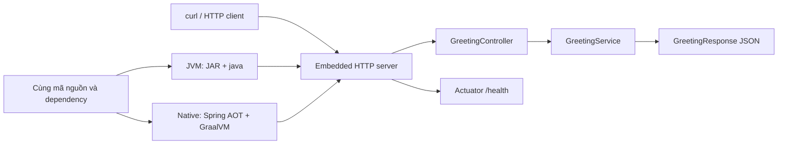
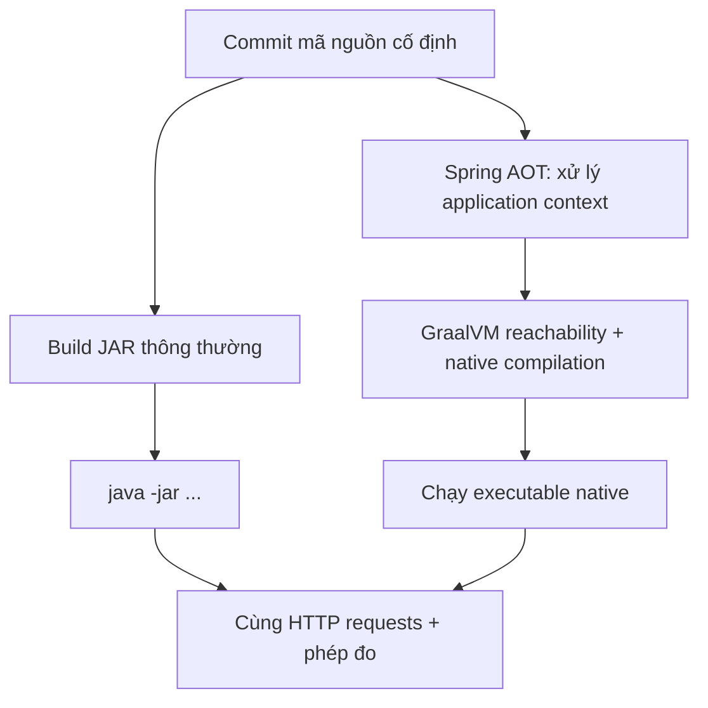

# Chọn một ứng dụng Spring Boot nhỏ làm mốc so sánh JVM và native

Để học cách biên dịch **Spring Boot** thành **GraalVM Native Image** bằng **Spring AOT**, bước đầu tiên không phải tối ưu một hệ thống lớn. Ta cần chọn một ứng dụng nhỏ, dễ kiểm soát, có cùng hành vi ở hai cách chạy: **Spring Boot trên JVM** và **Spring Boot dưới dạng native executable**. Ứng dụng đó sẽ là **baseline** — mốc tham chiếu để đo thời gian khởi động, mức sử dụng bộ nhớ, kích thước artifact và xác minh tính tương thích.

Bài này hướng dẫn chọn một ứng dụng đủ nhỏ để dễ tái lập nhưng vẫn đủ “thật”: có dependency injection, HTTP endpoint, JSON serialization và health check. Từ một mã nguồn duy nhất, ta tạo bản JVM và bản native, rồi xây dựng quy trình đo công bằng. Các giá trị đo thực tế được người học điền sau khi chạy; bài học không giả định trước native chắc chắn tốt hơn ở mọi chỉ số.

## 1. Mục tiêu của baseline

Một baseline tốt phải trả lời được các câu hỏi có thể kiểm chứng:

1. **Hành vi:** Hai bản build có cùng trả về dữ liệu đúng cho cùng request không?
2. **Khởi động:** Từ lúc tạo tiến trình đến lúc endpoint sẵn sàng nhận yêu cầu mất bao lâu?
3. **Bộ nhớ:** Sau khi ứng dụng sẵn sàng và ở trạng thái tương đương, mỗi tiến trình dùng bao nhiêu **RSS** (resident set size)?
4. **Artifact:** JAR và native executable có kích thước bao nhiêu? Nếu đóng gói container, kích thước image thay đổi thế nào?
5. **Độ phức tạp build:** Mỗi bản cần những công cụ nào, mất bao lâu để build, có lỗi AOT/reflection/resource nào không?
6. **Khả năng tái lập:** Người khác có thể dùng cùng commit, phiên bản JDK, cấu hình và kịch bản đo để có kết quả có thể so sánh không?

Không nên gọi một mẫu là baseline chỉ vì nó “chạy được”. Nếu một biến thể dùng database, cache và logging khác biến thể kia, chênh lệch thời gian hoặc bộ nhớ không còn phản ánh riêng cách đóng gói JVM/native.

### Phân biệt phạm vi so sánh

| Cần biết | Cách nhìn phù hợp | Không nên suy diễn |
| --- | --- | --- |
| **Startup time** | Thời gian từ khi bắt đầu tiến trình đến lúc HTTP health endpoint trả thành công | Không đồng nhất với thời gian Spring in trong dòng `Started ... in ... seconds` |
| **Idle RSS** | Bộ nhớ thực resident của tiến trình khi đã sẵn sàng, sau một khoảng ổn định cố định | Không đồng nhất với Java heap usage hoặc `-Xmx` |
| **Binary/JAR size** | Kích thước tệp có thể kiểm tra trên đĩa | Không đồng nghĩa tổng kích thước container image |
| **Build duration** | Thời gian tạo artifact theo toolchain | Không dùng để kết luận runtime khởi động nhanh hay chậm |
| **Response correctness** | HTTP status, content-type và JSON đều hợp lệ | Health check thành công chưa chứng minh mọi nhánh nghiệp vụ đều tương thích |
| **Throughput/latency** | Cần bài thử tải riêng, warm-up và đo ổn định | Không suy ra từ kết quả startup hoặc RSS |

Ở bước ứng dụng đầu tiên, hãy ưu tiên **độ đúng, startup time, idle RSS và kích thước artifact**. Bài thử throughput/latency có thể bổ sung sau, khi đã kiểm soát JIT warm-up, tải, GC và các biến môi trường.

## 2. Tiêu chí chọn ứng dụng thử nghiệm

Ứng dụng được chọn nên đáp ứng những điều kiện sau:

- **Ít phụ thuộc ngoài:** Không bắt buộc phải có PostgreSQL, Redis, Kafka, cloud credentials hoặc kết nối mạng để khởi động.
- **Có đường chạy Spring thực:** Ít nhất một controller, một bean do Spring quản lý và hoạt động trả JSON. Chương trình `public static void main` thuần Java không phản ánh chi phí Spring Boot.
- **Kết quả xác định:** Cùng input tạo cùng output, dễ kiểm tra tự động bằng `curl` hoặc test.
- **Ít cấu hình:** Một port HTTP cố định và vài property rõ ràng; không cần profile riêng cho JVM hay native.
- **Thư viện hỗ trợ native tốt:** Ưu tiên các starter Spring phổ biến đã có tích hợp AOT, tránh tải lớp/plugin runtime không biết trước.
- **Có điểm báo sẵn sàng:** Một health endpoint hoặc endpoint nghiệp vụ xác định, dùng cùng tiêu chí cho cả hai bản.
- **Có thể build độc lập:** Source, phiên bản dependency và cấu hình build được chốt trong một commit.

So sánh một số lựa chọn:

| Ứng dụng ứng viên | Độ phức tạp | Tín hiệu học được | Phù hợp làm baseline đầu tiên? |
| --- | --- | --- | --- |
| Java `main` in “Hello” | Rất thấp | Chỉ cho biết mức tối thiểu của Java/native | **Không đủ đại diện cho Spring Boot** |
| Spring Boot CLI không mở HTTP | Thấp | Context và bean initialization | Có thể dùng, nhưng thiếu HTTP readiness/JSON |
| **Spring Boot REST API nhỏ, trả JSON + health** | **Thấp** | **AOT, web server, bean wiring, JSON, HTTP readiness** | **Nên chọn** |
| CRUD API + database | Trung bình | Database, serialization, pool, mạng | Hợp bài mở rộng, dễ tạo nhiễu ban đầu |
| Microservice có Kafka/Redis/Security | Cao | Hệ sinh thái thực tế | Chưa phù hợp với phép đo đầu tiên |

**Lựa chọn cho bài học:** một ứng dụng tên `native-baseline`, có một endpoint greeting trả JSON và một health endpoint từ Spring Boot Actuator. Nó đủ để quan sát Spring context và embedded web server, đồng thời tránh biến động do kết nối hệ thống bên ngoài.

## 3. Thiết kế ứng dụng baseline

### Chức năng cố định

| Endpoint | Request | Kết quả mong đợi |
| --- | --- | --- |
| `GET /api/greeting` | Không có query parameter | HTTP 200 và JSON `{"message":"Xin chào, bạn!"}` |
| `GET /api/greeting?name=Lan` | `name=Lan` | HTTP 200 và JSON `{"message":"Xin chào, Lan!"}` |
| `GET /actuator/health` | Không cần query parameter | HTTP 200 và trạng thái `UP` khi ứng dụng khỏe |

Đây là workload nhỏ có chủ đích. Chi phí HTTP, khởi tạo context, bean registration và JSON serialization vẫn xuất hiện, trong khi nội dung nghiệp vụ gần như không chiếm thời gian. Vì vậy kết quả startup và idle memory phản ánh khá trực tiếp **baseline của Spring Boot Web**; kết quả này **không đại diện** cho một hệ thống có database, Security, ORM, template engine hoặc lượng dữ liệu lớn.

### Các thành phần



Trong mô hình này, `GreetingController` phụ thuộc vào `GreetingService` qua constructor injection. Spring AOT có thể phân tích quan hệ bean và controller. Response là một Java record đơn giản để kiểm tra serialization; không cần reflection tự viết hoặc tải class theo tên trong baseline đầu tiên.

### Cấu trúc dự án đề xuất

```text
native-baseline/
├── pom.xml                           # Hoặc build.gradle[.kts]
├── mvnw / mvnw.cmd                   # Nếu dùng Maven Wrapper
├── src/
│   ├── main/
│   │   ├── java/com/example/baseline/
│   │   │   ├── NativeBaselineApplication.java
│   │   │   ├── GreetingController.java
│   │   │   ├── GreetingService.java
│   │   │   └── GreetingResponse.java
│   │   └── resources/
│   │       └── application.properties
│   └── test/java/com/example/baseline/
│       └── ...                      # Test chức năng
└── README.md                        # Ghi phiên bản và các phép đo
```

Cấu trúc trên minh họa nội dung project người học tạo. Bài học này chỉ cung cấp hướng dẫn và ví dụ; nó không tự tạo thêm những file project đó trong repository kiến thức.

## 4. Khởi tạo một project Spring Boot đơn giản

Có thể tạo project bằng **Spring Initializr** hoặc dùng project Spring Boot trống đã có. Nên chọn một phiên bản Spring Boot ổn định có hỗ trợ AOT/native, dùng **Java 17 hoặc Java 21 theo yêu cầu của phiên bản đã chọn**, đồng thời khóa cùng phiên bản JDK/GraalVM cho phép đo.

Các lựa chọn khởi tạo:

| Thiết lập | Gợi ý | Lý do |
| --- | --- | --- |
| Project | Maven **hoặc** Gradle | Một tool duy nhất để giữ kết quả tái lập |
| Language | Java | Khớp với ví dụ; dễ dùng Spring AOT |
| Group | `com.example` | Namespace mẫu |
| Artifact | `native-baseline` | Dễ nhận diện trong kết quả build |
| Packaging | JAR | Phù hợp chạy JVM và làm đầu vào Native Image |
| Dependencies | Spring Web MVC, Spring Boot Actuator | REST JSON + readiness endpoint |
| Native support | GraalVM Native Build Tools / GraalVM Native Support | Có plugin/tasks để tạo executable |

Tên starter thực tế có thể thay đổi theo phiên bản Spring Boot; chọn tùy chọn **Spring Web MVC** tương ứng với phiên bản được khởi tạo. Nếu project có lựa chọn **GraalVM Native Support**, hãy bật nó để Initializr cấu hình tích hợp build native. Thêm test starter phù hợp nếu cần kiểm thử với JUnit.

**Không chốt một phiên bản Spring Boot theo trí nhớ rồi cho phép build tự động lấy “latest”.** Hãy dùng phiên bản được khai báo tường minh trong `pom.xml` hoặc Gradle build file, khóa dependencies và ghi lại JDK/GraalVM version. Người học vẫn có thể chọn một phiên bản mới hơn, nhưng cả hai artifact phải được tạo từ **cùng một commit**.

## 5. Mã nguồn minh họa

Đặt cả bốn class dưới package `com.example.baseline`.

**`NativeBaselineApplication.java`**

```java
package com.example.baseline;

import org.springframework.boot.SpringApplication;
import org.springframework.boot.autoconfigure.SpringBootApplication;

@SpringBootApplication
public class NativeBaselineApplication {
    public static void main(String[] args) {
        SpringApplication.run(NativeBaselineApplication.class, args);
    }
}
```

**`GreetingService.java`**

```java
package com.example.baseline;

import org.springframework.stereotype.Service;

@Service
public class GreetingService {

    public String messageFor(String name) {
        return "Xin chào, " + name + "!";
    }
}
```

**`GreetingResponse.java`**

```java
package com.example.baseline;

public record GreetingResponse(String message) {
}
```

**`GreetingController.java`**

```java
package com.example.baseline;

import org.springframework.web.bind.annotation.GetMapping;
import org.springframework.web.bind.annotation.RequestMapping;
import org.springframework.web.bind.annotation.RequestParam;
import org.springframework.web.bind.annotation.RestController;

@RestController
@RequestMapping("/api")
public class GreetingController {

    private final GreetingService greetingService;

    public GreetingController(GreetingService greetingService) {
        this.greetingService = greetingService;
    }

    @GetMapping("/greeting")
    public GreetingResponse greeting(
            @RequestParam(defaultValue = "bạn") String name) {
        return new GreetingResponse(greetingService.messageFor(name));
    }
}
```

**`src/main/resources/application.properties`**

```properties
spring.application.name=native-baseline
server.port=8080
spring.main.lazy-initialization=false
management.endpoints.web.exposure.include=health
```

Cấu hình `spring.main.lazy-initialization=false` ghi rõ cách khởi tạo mặc định để không vô tình trì hoãn các singleton và làm phép đo startup có vẻ nhanh hơn, trong khi chuyển phần chi phí đó sang request đầu tiên.

Trong ví dụ, Spring chịu trách nhiệm tạo `GreetingService` và `GreetingController`; Jackson chuyển `GreetingResponse` thành JSON. Đây là những cơ chế Spring thường được AOT hỗ trợ. Tuy nhiên, vẫn phải **kiểm tra thực tế bản native**, không suy ra khả năng tương thích chỉ từ việc chạy thành công trên JVM.

### Xác nhận hành vi trước khi đo

Trên JVM hoặc native, gọi:

```bash
curl --fail --silent --show-error \
  "http://127.0.0.1:8080/api/greeting?name=Lan"

curl --fail --silent --show-error \
  "http://127.0.0.1:8080/actuator/health"
```

Phản hồi nghiệp vụ dự kiến:

```json
{"message":"Xin chào, Lan!"}
```

Health endpoint thông thường trả một đối tượng JSON có trạng thái `UP`, ví dụ `{"status":"UP"}`. Không nên phụ thuộc vào thứ tự key hoặc whitespace JSON; nếu viết test, hãy kiểm tra cấu trúc/giá trị của JSON. Đồng thời kiểm tra HTTP 200 và `Content-Type` phù hợp.

## 6. Tạo bản JVM và native từ cùng source

Spring Boot JVM build giữ ứng dụng dưới dạng bytecode/JAR. Native build dùng **Spring AOT** để chuẩn bị phần cấu hình Spring có thể phân tích trước và **GraalVM Native Image** để tạo executable.



### Nếu dùng Maven

Với project đã cấu hình Spring Boot plugin và Native Build Tools:

```bash
# Test ứng dụng và tạo executable JAR cho JVM.
./mvnw clean verify

# Chạy bản JVM (đổi tên JAR theo artifact/version thực tế).
java -jar target/native-baseline-0.0.1-SNAPSHOT.jar

# Sau khi dừng bản JVM, tạo native executable.
./mvnw -Pnative native:compile

# Chạy executable native (tên/path do cấu hình Maven quyết định).
./target/native-baseline
```

Các lệnh trên là ví dụ quy trình Maven thường dùng. `-Pnative` và goal `native:compile` phải có plugin/profile thích hợp; nếu Initializr chưa tạo cấu hình, cần bổ sung Native Build Tools theo hướng dẫn của phiên bản Spring Boot đang dùng. Trên Windows, dùng `mvnw.cmd` và executable có thể mang đuôi `.exe`.

### Nếu dùng Gradle

Với project đã áp dụng plugin Spring Boot và Native Build Tools:

```bash
# Chạy test và tạo executable JAR.
./gradlew clean test bootJar

# Chạy JAR; tên file phụ thuộc artifact/version.
java -jar build/libs/native-baseline-0.0.1-SNAPSHOT.jar

# Sau khi dừng JVM, build native.
./gradlew nativeCompile

# Chạy native executable; tên file phụ thuộc cấu hình.
./build/native/nativeCompile/native-baseline
```

Trên Windows, dùng `gradlew.bat`. **Chọn Maven hoặc Gradle cho một baseline**; không nhất thiết build cả hai để so sánh JVM và native. Với mỗi phương án, test JAR và executable phải được tạo từ cùng nội dung source, cùng dependency graph và cấu hình tương thích.

Native compilation thường đòi hỏi toolchain và tài nguyên build lớn hơn JVM JAR. Cần có GraalVM/Native Image tương thích và compiler/linker của hệ điều hành. Đó là **chi phí build**, nên ghi nhận riêng với runtime startup.

## 7. Xác định “ứng dụng đã sẵn sàng” một cách nhất quán

Không nên so thời gian bằng cách đọc thủ công hai dòng `Started NativeBaselineApplication in ... seconds`. Dòng này đo một phần quy trình khởi động của Spring và có thể không phản ánh chính xác thời gian tạo tiến trình, bắt đầu bind socket và xử lý HTTP request.

Chọn định nghĩa chung:

> **Startup-to-ready = thời điểm health endpoint trả HTTP 200 lần đầu − thời điểm bắt đầu khởi chạy tiến trình.**

Với ứng dụng demo không dùng dependency ngoài, `GET /actuator/health` là chỉ báo đơn giản và lặp lại được. Ở hệ thống thật có readiness probe riêng, phải thống nhất xem endpoint nào phản ánh “ready” theo mục tiêu đo.

### Script đo khởi động trên Linux

Ví dụ sau dùng Bash, GNU `date`, `curl` và `ps`. Lưu tạm thành một script khi thực hành, chẳng hạn `measure-startup.sh`, rồi chạy **một bản tại một thời điểm**. Đây là ví dụ hướng dẫn đo; bài học không thực thi script thay người học.

```bash
#!/usr/bin/env bash
set -euo pipefail

# Usage: ./measure-startup.sh java -jar target/native-baseline-0.0.1-SNAPSHOT.jar
#        ./measure-startup.sh ./target/native-baseline

if [ "$#" -eq 0 ]; then
  echo "Usage: $0 <command> [args...]" >&2
  exit 2
fi

health_url="http://127.0.0.1:8080/actuator/health"
log_file="$(mktemp)"

# Không đo nếu port đang được tiến trình cũ sử dụng.
if curl -fsS --max-time 1 "$health_url" >/dev/null 2>&1; then
  echo "Port 8080 already responds: stop the prior application first." >&2
  rm -f "$log_file"
  exit 1
fi

cleanup() {
  kill "$pid" 2>/dev/null || true
  wait "$pid" 2>/dev/null || true
  rm -f "$log_file"
}

start_ms="$(date +%s%3N)"
"$@" >"$log_file" 2>&1 &
pid=$!
trap cleanup EXIT

for (( attempt = 0; attempt < 600; attempt++ )); do
  if curl -fsS --max-time 1 "$health_url" >/dev/null 2>&1; then
    ready_ms="$(date +%s%3N)"
    echo "startup_to_ready_ms=$((ready_ms - start_ms))"

    # Đợi cùng một khoảng thời gian sau readiness rồi lấy idle RSS.
    sleep 10
    rss_kib="$(ps -o rss= -p "$pid" | tr -d '[:space:]')"
    echo "idle_rss_kib=$rss_kib"
    exit 0
  fi

  if ! kill -0 "$pid" 2>/dev/null; then
    echo "Application stopped before health became ready." >&2
    cat "$log_file" >&2
    exit 1
  fi

  sleep 0.05
done

echo "Timeout waiting for /actuator/health." >&2
cat "$log_file" >&2
exit 1
```

Trong script này, vòng polling `sleep 0.05` tạo độ phân giải thực tế khoảng vài chục mili giây cộng độ trễ của `curl` và scheduler. Với ứng dụng khởi động rất nhanh, sai số polling có thể đáng kể; muốn số liệu chính xác hơn, cần đo bằng công cụ chuyên dụng hoặc điều chỉnh chu kỳ và ghi lại độ phân giải. Lệnh `ps -o rss=` báo **RSS bằng KiB trên Linux**, chỉ là **một mẫu ở thời điểm sau readiness 10 giây**, không phải peak RSS.

Trước mỗi lần đo, cần bảo đảm port 8080 trống, không còn tiến trình cũ. Script sẽ tắt tiến trình nó khởi chạy sau khi thu thập một mẫu. Không nên chạy song song hai bản trên cùng port.

### Chạy lặp nhiều lần

Thực hiện cùng quy trình, ví dụ **15 lần cho JVM và 15 lần cho native**, xen kẽ thứ tự hoặc áp dụng quy tắc thứ tự cố định có ghi nhận. Mỗi lần tạo **tiến trình mới**, không chỉ gọi lại endpoint ở một tiến trình đang chạy. Chọn một số lần thử làm warm-up ngoài mẫu thống kê nếu muốn giảm ảnh hưởng của page cache và class/file loading lần đầu; hãy áp dụng quy tắc thống nhất cho cả hai chế độ.

Khi tổng hợp số liệu:

- **Median (p50):** biểu diễn lần chạy điển hình, ít bị kéo lệch bởi outlier hơn trung bình.
- **p95:** cho thấy độ biến động phía chậm khi có đủ số mẫu; với chỉ 15 lần đo, p95 khá nhạy cảm, nên ghi thêm min/max và tăng số lần nếu cần kết luận chắc chắn.
- **Idle RSS:** báo median hoặc giá trị phân bố của các mẫu sau thời gian ổn định giống nhau.
- **Khả năng tái lập:** lưu thời gian, kết quả từng run và cấu hình máy, không chỉ giữ một ảnh chụp kết quả đẹp nhất.

Nếu dùng Windows, hãy sử dụng công cụ tương đương để đo thời điểm HTTP ready và working set của tiến trình, đồng thời ghi rõ loại metric. **Không so trực tiếp Working Set trên Windows với RSS trên Linux** rồi coi là cùng phép đo.

## 8. Kiểm soát biến để phép so sánh công bằng

Giữ các yếu tố sau càng giống nhau càng tốt:

| Yếu tố | Cách kiểm soát |
| --- | --- |
| Mã nguồn | Cùng Git commit, không thêm code riêng chỉ cho native |
| Spring Boot/dependencies | Cùng version và dependency lock/BOM |
| JDK | Ghi đầy đủ vendor và version; để giảm khác biệt, có thể dùng JDK từ cùng GraalVM distribution cho bản JVM |
| OS, CPU, RAM | Đo trên cùng host, cùng kiến trúc, tránh thay máy giữa hai phép đo |
| Cấu hình | Cùng profile, port, logging, actuator exposure, environment, các property liên quan |
| Nhiệt độ hệ thống/tải nền | Không chạy tác vụ build, IDE indexing hoặc benchmark khác đồng thời |
| Tình trạng tiến trình | Mỗi lần đo là một tiến trình mới; dừng sạch trước lần tiếp theo |
| Mốc readiness | Cùng health URL và cùng điều kiện HTTP thành công |
| Thời điểm lấy RSS | Cùng thời lượng chờ sau khi ready, cùng mức tải idle |
| Container | Nếu so trong container, giữ CPU/memory limits, nền tảng và phương pháp đo nhất quán |

**Không bật lazy initialization hoặc tắt actuator riêng cho một bản.** Tương tự, không so ứng dụng native chạy local với JVM chạy trong container có giới hạn bộ nhớ, vì môi trường trở thành một biến độc lập.

### Khác nhau về JVM heap và bộ nhớ hệ điều hành

`-Xmx256m` giới hạn Java heap tối đa (theo ngữ nghĩa JVM), không cho biết toàn bộ bộ nhớ tiến trình. RSS còn gồm nhiều vùng khác như native memory, thread stacks, runtime data, code cache và thư viện. Native Image cũng có heap và runtime riêng; cách quản lý memory khác JVM.

Nếu chỉ đo **idle RSS**, đừng diễn giải kết quả thành “native sử dụng ít hơn X% heap”. Hãy gọi đúng tên metric. Nếu cần benchmark dưới tải, đo thêm trạng thái sau số lượng request tương đương, CPU, GC và độ trễ để tránh tối ưu một chỉ số bằng cách dồn chi phí sang chỉ số khác.

### Khác nhau về thời gian khởi động và tốc độ xử lý

Native Image có thể khởi động nhanh nhờ AOT và không cần JIT compilation như một tiến trình JVM thông thường. Ngược lại, JVM có JIT tối ưu mã nóng sau warm-up. Vì vậy **lợi thế startup không đồng nghĩa throughput hoặc latency dưới tải của native luôn tốt hơn**.

Với ứng dụng trả một chuỗi cố định, phép thử tải có thể chủ yếu đo HTTP/framework overhead. Kết luận về hiệu năng nghiệp vụ chỉ nên đưa ra sau khi thêm workload đại diện và điều kiện test rõ ràng.

## 9. Mẫu bảng kết quả cần điền sau khi thực nghiệm

Dùng một bảng chứa giá trị đo được thay vì một con số lấy từ blog hoặc máy khác:

| Chỉ số | JVM JAR | Native executable | Ghi chú |
| --- | --- | --- | --- |
| Startup-to-ready median (ms) | _Điền sau đo_ | _Điền sau đo_ | Cùng endpoint, ít nhất 15 run |
| Startup-to-ready p95 (ms) | _Điền sau đo_ | _Điền sau đo_ | Kèm min/max nếu số mẫu ít |
| Idle RSS median (MiB) | _Điền sau đo_ | _Điền sau đo_ | Đo sau readiness 10 giây |
| Artifact size (MiB) | _Điền sau đo_ | _Điền sau đo_ | JAR và executable có nội dung/phụ thuộc khác cách đóng gói |
| Build duration (s hoặc phút) | _Điền sau đo_ | _Điền sau đo_ | Cùng loại build sạch hoặc ghi trạng thái cache |
| HTTP correctness | _Pass/Fail_ | _Pass/Fail_ | /api/greeting, /actuator/health |
| Công cụ và cấu hình | _Version/flags_ | _Version/flags_ | JDK, GraalVM, OS, Spring Boot |

Chênh lệch phần trăm có thể tính khi cả hai giá trị hợp lệ và cùng đơn vị:

```text
Mức giảm startup (%) = (startup_JVM - startup_native) / startup_JVM * 100

Mức giảm RSS (%) = (RSS_JVM - RSS_native) / RSS_JVM * 100
```

Giá trị âm nghĩa là native **không giảm** chỉ số đó trong phép đo đã thực hiện. Nên báo cả giá trị tuyệt đối và phần trăm; phần trăm riêng lẻ không cho thấy hai tiến trình thực tế chênh bao nhiêu mili giây hoặc MiB.

### Ví dụ metadata để lưu cùng kết quả

```yaml
experiment: spring-boot-native-baseline
gitCommit: "<commit SHA>"
application: "native-baseline"
springBootVersion: "<version thực tế>"
javaVersion: "<java -version>"
graalVmVersion: "<native-image --version>"
buildTool: "<Maven hoặc Gradle + version>"
operatingSystem: "<OS + version>"
cpu: "<CPU/cores>"
memory: "<RAM và giới hạn cgroup/container nếu có>"
port: 8080
readyEndpoint: "/actuator/health"
runsPerVariant: 15
idleRssAfterReadySeconds: 10
jvmFlags: "<các tham số thực tế>"
nativeFlags: "<các tham số thực tế>"
```

Đây là **mẫu ghi chú thí nghiệm**, không phải tệp cấu hình bắt buộc của Spring Boot và không dùng để thay thế `application.properties`.

## 10. Các trường hợp làm baseline sai lệch

**Lấy một hệ thống quá lớn làm bài đầu tiên.** Khi thời gian khởi động phụ thuộc vào database migration, DNS, network retries và cloud SDK, rất khó biết Native Image đã thay đổi điều gì. Hãy khởi đầu từ REST API nhỏ, sau đó tăng dần từng dependency.

**Chỉ test `/actuator/health`.** Health UP có thể xuất hiện ngay cả khi nhánh JSON serialization hoặc reflection nghiệp vụ chưa được thực thi. Hãy gọi cả `/api/greeting` ở **hai bản**, xác nhận HTTP status và JSON.

**Dùng hai artifact khác commit.** Khi thêm dependency hoặc đổi cấu hình rồi build native, kết quả không còn so một ứng dụng với hai runtime. Ghi commit và rebuild cả hai biến thể khi source thay đổi.

**Dùng log Spring làm toàn bộ thước đo startup.** Log Spring là tín hiệu hữu ích để debug, nhưng không nhất thiết trùng với thời điểm client nhận HTTP 200. Hãy thống nhất start-to-ready từ bên ngoài tiến trình.

**Nhầm heap với RSS, RSS với peak RSS.** Một mẫu RSS sau 10 giây không cho biết mức sử dụng cực đại trong toàn bộ khởi động; một giới hạn `-Xmx` không phải mức RAM thực đã sử dụng.

**Để môi trường build ảnh hưởng phép đo.** Đang chạy native compilation đồng thời với một lần đo JVM có thể gây cạnh tranh CPU/RAM và tăng startup bất thường. Tách build và đo.

**Đưa thêm phản xạ hoặc plugin động khi chưa có baseline.** Những cơ chế này có thể cần runtime hints và metadata riêng. Hãy xác lập một ứng dụng hoạt động ở cả hai chế độ trước, rồi thêm từng tính năng để biết thay đổi nào làm phát sinh lỗi native.

## 11. Mở rộng theo từng lớp phức tạp

Sau khi baseline đầu tiên đã ổn định, có thể mở rộng có kiểm soát:

1. **Mức 1 — REST JSON + Actuator:** bài này, tập trung startup và idle RSS.
2. **Mức 2 — @ConfigurationProperties và validation:** quan sát binding và cấu hình runtime, kiểm tra code generation và metadata.
3. **Mức 3 — Persistence:** thêm database cùng dataset, network và pool configuration; tách thời gian chờ DB khỏi thời gian Spring khởi tạo.
4. **Mức 4 — Reflection/resource động:** thêm trường hợp cụ thể để luyện `RuntimeHintsRegistrar`, resource hints và xác minh native compatibility.
5. **Mức 5 — Container:** build image JVM/native, ghi image size, CPU/memory limits, health/readiness và phương thức đo trong cùng runtime container.

Mỗi mức thêm một nhóm yếu tố đủ nhỏ để giải thích được thay đổi. Mốc đầu tiên cần được giữ nguyên để đối chiếu, không sửa lại baseline sau khi thêm các tính năng mở rộng.

## 12. Bài thực hành và tiêu chí hoàn thành

**Yêu cầu:** từ project `native-baseline` ở phần trên, tạo hai artifact bằng cùng commit: JAR chạy JVM và native executable bằng Spring AOT/GraalVM.

Thực hiện tuần tự:

1. Tạo project Spring Boot có Spring Web MVC, Actuator và cấu hình native build tools tương thích với phiên bản chọn.
2. Cài bốn class và `application.properties` trong bài; chạy trên JVM và kiểm tra greeting JSON cùng health.
3. Build native executable, chạy tại cùng port sau khi đã tắt bản JVM, rồi gọi lại đúng hai endpoint để so kết quả.
4. Đo ít nhất 15 lần khởi động độc lập cho mỗi bản; ghi **startup-to-ready** và **idle RSS** với cùng một phương pháp.
5. Ghi artifact size, thông tin máy, JDK/GraalVM, dependency versions, commit và các cờ runtime.
6. Điền bảng kết quả, nêu một nhận xét có số đo và một giới hạn của phép thử.

Để tự kiểm tra mức hiểu, hãy giải thích:

- Vì sao ứng dụng Java `main` thuần không đủ làm baseline cho Spring Boot?
- Vì sao cả REST JSON và actuator health đều cần được kiểm thử?
- Tại sao một native executable nhỏ hoặc khởi động nhanh chưa đủ để kết luận nó xử lý nhiều request mỗi giây hơn JVM?
- Tại sao phải ghi thời điểm lấy RSS và giữ nguyên cấu hình giữa hai bản?
- Nếu thêm database sau bài này, những biến ngoại sinh nào phải đo hoặc kiểm soát?

**Tiêu chí đạt:** chọn được một ứng dụng Spring Boot Web nhỏ, **cùng hành vi và cùng nguồn build** ở JVM/native; mô tả được các metrics phù hợp; thu thập được dữ liệu khởi động và bộ nhớ có thể lặp lại; diễn giải kết quả mà không nhầm lẫn build-time với runtime, heap với RSS, hoặc startup với throughput.
