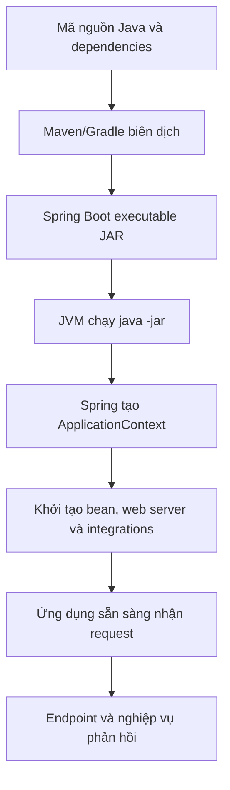

# Chạy và kiểm chứng hành vi trên JVM trước khi bật AOT

## 1. Vì sao cần kiểm chứng bản JVM trước?

Khi xây dựng ứng dụng đầu tiên trong module **SPRING_BOOT_NATIVE_IMAGE**, mục tiêu cuối cùng là biên dịch ứng dụng Spring Boot bằng Spring AOT và GraalVM Native Image, sau đó so sánh thời gian khởi động, bộ nhớ, khả năng tương thích và vận hành container. Muốn so sánh đáng tin cậy, trước hết phải có một **mốc chuẩn (baseline) JVM chạy đúng chức năng**.

Nếu một endpoint lỗi ngay từ bản JVM, chuyển sang native có thể chỉ làm lỗi khó tìm hơn. Ngược lại, khi xác nhận chính xác bản JVM đáp ứng những request nào, trả về cấu trúc dữ liệu gì và khởi động với cấu hình nào, chúng ta có thể phân biệt lỗi nghiệp vụ thông thường với lỗi liên quan Spring AOT, reachability metadata, reflection hoặc tài nguyên không được đóng gói.

Bài học này tập trung vào ba kết quả trước khi bật AOT:

1. Ứng dụng Spring Boot có thể build, khởi động và dừng đúng trên JVM.
2. Những hành vi quan trọng được kiểm chứng bằng request và kiểm thử có kết quả lặp lại được.
3. Một bản ghi baseline lưu lại phiên bản, cấu hình và chỉ số cần thiết để đối chiếu với native về sau.

**Lưu ý thuật ngữ:** chạy `java -jar` là chạy bản JVM. Các task `processAot`, `nativeCompile`, `native:compile` hay profile Maven `native` thuộc bước sau và chưa cần dùng để kiểm chứng mốc chuẩn này.

## 2. Hiểu đường đi thực thi trên JVM

Một ứng dụng Spring Boot thông thường trải qua các bước:



JVM có thể nạp class khi chạy, thực thi reflection và các cơ chế động khác theo classpath và quyền truy cập. Đây là điểm khác với Native Image, nơi phần mã/metadata cần được xác định đủ lúc build. Tuy nhiên, bản JVM thành công **không bảo đảm** bản native tương thích: nó chỉ cung cấp đầu vào đối chứng về hành vi và cấu hình.

Để thử nghiệm công bằng, giữ nguyên mã nghiệp vụ và API giữa các bản JVM/native, chỉ thay những cấu hình hoặc phần code thực sự cần thiết cho native; phải ghi nhận rõ mọi thay đổi đó.

## 3. Chọn một ứng dụng mẫu đủ nhỏ nhưng có hành vi cần quan sát

Một ứng dụng REST đơn giản phù hợp cho lần thực hành đầu tiên vì không cần database ngoài hay kết nối mạng thứ ba. Ví dụ dùng Spring Web và Java record (Java version cần phù hợp Spring Boot version của dự án).

`DemoApplication.java`:

```java
package com.example.demo;

import org.springframework.boot.SpringApplication;
import org.springframework.boot.autoconfigure.SpringBootApplication;

@SpringBootApplication
public class DemoApplication {
    public static void main(String[] args) {
        SpringApplication.run(DemoApplication.class, args);
    }
}
```

`GreetingController.java`:

```java
package com.example.demo;

import org.springframework.http.HttpStatus;
import org.springframework.web.bind.annotation.GetMapping;
import org.springframework.web.bind.annotation.RequestParam;
import org.springframework.web.bind.annotation.RestController;
import org.springframework.web.server.ResponseStatusException;

@RestController
public class GreetingController {

    public record Greeting(String message) {}

    @GetMapping("/api/greeting")
    public Greeting greet(
            @RequestParam(defaultValue = "World") String name) {
        String normalized = name.trim();
        if (normalized.isEmpty()) {
            throw new ResponseStatusException(
                    HttpStatus.BAD_REQUEST, "Name must not be blank");
        }
        return new Greeting("Hello, " + normalized + "!");
    }
}
```

Với Spring Boot web starter và JSON converter phù hợp, endpoint `GET /api/greeting` trả JSON. Trường hợp `name` rỗng hoặc chỉ toàn dấu cách cần nhận mã HTTP 400, còn tên hợp lệ trả HTTP 200.

Ví dụ này có chủ đích kiểm chứng cả **đường đi thành công** và **đường đi lỗi**. Khi chuyển sang native, thiếu metadata ở serializer hay lỗi config có thể biểu hiện ở các đường đi đó; việc chỉ thấy server khởi động chưa đủ chứng minh tương thích.

## 4. Kiểm tra điều kiện trước khi chạy

Cần JDK tương thích với phiên bản Spring Boot được sử dụng và Maven hoặc Gradle wrapper của dự án. Chạy từ thư mục chứa `pom.xml` hoặc `build.gradle`/`build.gradle.kts`.

```bash
java -version
javac -version
```

Nếu dùng Maven wrapper:

```bash
./mvnw -version
```

Nếu dùng Gradle wrapper:

```bash
./gradlew --version
```

Trên Windows PowerShell/cmd, sử dụng `mvnw.cmd` và `gradlew.bat` tương ứng. Ghi lại phiên bản **Java thực sự được tool build sử dụng**, vì lệnh `java` của shell có thể khác JDK cấu hình cho Maven/Gradle.

Kiểm tra cấu hình profile, cổng web, môi trường và dependency trước khi bắt đầu. Nếu ứng dụng yêu cầu database, cache hoặc credentials, phải đưa chúng vào điều kiện test rõ ràng. Với ứng dụng mẫu không có tích hợp bên ngoài, có thể bắt đầu từ cấu hình tối thiểu, ví dụ `server.port=8080` nếu cổng này đang rảnh.

## 5. Build và chạy trên JVM bằng Maven

Trong dự án Maven có Spring Boot Maven Plugin, đóng gói JAR bằng:

```bash
./mvnw clean package
```

Lệnh `clean` xóa artifact build cũ thuộc dự án và `package` biên dịch, chạy test phù hợp cấu hình, tạo artifact. Khi thử trong dự án đang có dữ liệu build cần giữ, có thể bỏ `clean` và dùng `./mvnw package`. Không dùng `-DskipTests` cho bước baseline nếu cần chứng minh các test đều chạy.

Với executable JAR do Spring Boot plugin repackaging tạo ra, chạy:

```bash
java -jar target/demo-0.0.1-SNAPSHOT.jar
```

Tên JAR **chỉ minh họa**: thay bằng tên artifact thật. Nếu Maven không tạo executable JAR, kiểm tra cấu hình Spring Boot Maven Plugin và packaging; đừng mặc định mọi JAR tạo bởi `mvn package` đều có thể chạy bằng `java -jar`.

Khi phát triển có thể dùng:

```bash
./mvnw spring-boot:run
```

Cách này thuận tiện để thử nhanh, nhưng để đo baseline tương đương khi so sánh với executable native, nên ưu tiên chạy **artifact đã đóng gói**, ghi lại đúng lệnh và flags.

## 6. Build và chạy trên JVM bằng Gradle

Với Spring Boot Gradle Plugin, sử dụng:

```bash
./gradlew clean bootJar
```

Task `bootJar` tạo executable Spring Boot JAR theo cấu hình dự án. Lệnh trên không tự bảo đảm đã chạy mọi kiểm thử; trước khi công nhận baseline, chạy riêng:

```bash
./gradlew test
```

Sau đó chạy artifact trong `build/libs/`:

```bash
java -jar build/libs/demo-0.0.1-SNAPSHOT.jar
```

Hoặc dùng task tiện ích:

```bash
./gradlew bootRun
```

Tương tự Maven, tên file do version và archive configuration quyết định. Nếu build script tạo cả JAR thông thường và `bootJar`, chọn đúng executable của Spring Boot.

Không cần kích hoạt task `processAot` hoặc `nativeCompile` trong giai đoạn này. Baseline cần mô tả **hành vi JVM chuẩn** của bản ứng dụng hiện tại.

## 7. Kiểm chứng ứng dụng khởi động và sẵn sàng

Quan sát log startup để xác nhận ApplicationContext khởi tạo thành công, web server bind cổng như mong đợi và ứng dụng đã sẵn sàng xử lý request. Dòng log “Started ... in ... seconds” hữu ích để tham khảo, nhưng không nên xem đó là số đo duy nhất cho readiness vì ý nghĩa và thời điểm ghi log có thể khác trạng thái thực sự mà hệ thống giám sát quan sát.

Dùng một terminal khác gọi HTTP endpoint:

```bash
curl -i "http://localhost:8080/api/greeting"
```

Kết quả dự kiến có mã `HTTP/1.1 200` và body JSON tương đương:

```json
{"message":"Hello, World!"}
```

Gọi với tên có dấu cách mã hóa trong query:

```bash
curl -i "http://localhost:8080/api/greeting?name=Spring%20Boot"
```

Body kỳ vọng:

```json
{"message":"Hello, Spring Boot!"}
```

Trường hợp lỗi nghiệp vụ:

```bash
curl -i "http://localhost:8080/api/greeting?name=%20%20"
```

Kỳ vọng status **400 Bad Request**. Cấu trúc body lỗi có thể khác theo phiên bản Spring Boot, cấu hình xử lý exception hoặc Problem Details; bài thực hành nên kiểm tra status code trước và chỉ so sánh body nếu đã chuẩn hóa định dạng phản hồi.

Lệnh `curl -i` cho phép xem header và body. Nếu cần kiểm tra tự động, nên dùng assertions thay vì nhìn bằng mắt.

## 8. Viết integration test để xác minh contract

Một smoke test thủ công là điểm bắt đầu. Để so sánh với native lặp lại được, nên chuyển các kết quả quan trọng thành test. Với Spring Boot Test và MockMvc (khi dự án sử dụng Spring MVC), ví dụ:

```java
package com.example.demo;

import static org.springframework.test.web.servlet.request.MockMvcRequestBuilders.get;
import static org.springframework.test.web.servlet.result.MockMvcResultMatchers.*;

import org.junit.jupiter.api.Test;
import org.springframework.beans.factory.annotation.Autowired;
import org.springframework.boot.test.autoconfigure.web.servlet.AutoConfigureMockMvc;
import org.springframework.boot.test.context.SpringBootTest;
import org.springframework.test.web.servlet.MockMvc;

@SpringBootTest
@AutoConfigureMockMvc
class GreetingControllerTest {

    @Autowired
    MockMvc mvc;

    @Test
    void defaultGreeting() throws Exception {
        mvc.perform(get("/api/greeting"))
                .andExpect(status().isOk())
                .andExpect(jsonPath("$.message").value("Hello, World!"));
    }

    @Test
    void trimsInput() throws Exception {
        mvc.perform(get("/api/greeting").param("name", " Spring Boot "))
                .andExpect(status().isOk())
                .andExpect(jsonPath("$.message").value("Hello, Spring Boot!"));
    }

    @Test
    void rejectsBlankName() throws Exception {
        mvc.perform(get("/api/greeting").param("name", "   "))
                .andExpect(status().isBadRequest());
    }
}
```

Đây là ví dụ cho cấu hình có **Spring Boot Test, Spring MVC và JUnit 5**. Annotation/test setup có thể khác theo phiên bản Spring Boot hoặc cấu trúc dependency. Nếu dùng WebFlux thì cần `WebTestClient` thay vì MockMvc.

MockMvc xác nhận MVC pipeline trong test JVM nhưng **không khởi động server HTTP thật**. Khi chuẩn bị đối chứng native, nên bổ sung test black-box gửi HTTP tới process đã khởi chạy, vì bản native có thể có vấn đề đóng gói hoặc AOT không xuất hiện trong JVM test.

## 9. Chụp baseline có thể tái lập

Tạo một bảng ghi nhận trong báo cáo thí nghiệm, giữ nguyên cấu hình khi chuyển sang native.

| Trường cần ghi | Ví dụ/giá trị ghi nhận |
|---|---|
| Revision mã | Git commit cụ thể đang test |
| Spring Boot và JDK | Version thực tế in từ build/runtime |
| Build tool | Maven/Gradle cùng version và lệnh build |
| Chế độ thực thi | `java -jar ...`, không bật AOT/native |
| Profile/config | `spring.profiles.active`, server port và flags liên quan |
| Môi trường | OS, CPU architecture, giới hạn CPU/RAM, container hay host |
| API contract | Request, status, JSON và trường hợp lỗi |
| Mức độ sẵn sàng | Thời điểm ứng dụng thực sự nhận được request |
| Memory | Chỉ số RSS cùng cách đo và thời điểm đo |
| Kết quả test | Số test pass/fail và log lỗi nếu có |

Không ghi secret, token hay password vào bảng. Với các dependency như database, ghi cấu hình kết nối ở mức mô tả và phiên bản dịch vụ, không sao chép credential.

Ví dụ bảng kết quả chức năng:

| Thao tác | Kỳ vọng | Kết quả JVM |
|---|---|---|
| GET `/api/greeting` | HTTP 200; `Hello, World!` | Điền PASS/FAIL sau khi chạy |
| GET với `name=Spring%20Boot` | HTTP 200; đúng tên | Điền PASS/FAIL |
| GET với `name=%20%20` | HTTP 400 | Điền PASS/FAIL |
| Dừng ứng dụng | Process kết thúc có kiểm soát | Điền PASS/FAIL |

Các ô “Điền PASS/FAIL” cố ý chưa được đánh dấu: bài học không giả định người đọc đã chạy lệnh.

## 10. Đo startup và bộ nhớ JVM đúng cách

Spring Boot Native Image thường được quan tâm vì khả năng cải thiện startup và mức sử dụng bộ nhớ. Trước khi build native, nên xác định **định nghĩa phép đo** để tránh so sánh khác tiêu chí.

### Thời gian khởi động

Có ít nhất hai khái niệm:

- **Process startup:** thời gian từ khi hệ điều hành bắt đầu process đến một mốc được xác định.
- **Readiness:** thời gian từ lúc bắt đầu process đến khi ứng dụng có thể phục vụ request hoặc health readiness đạt trạng thái cho phép nhận traffic.

`Started ... in ... seconds` của Spring Boot là số liệu trong ứng dụng, có thể không bao gồm toàn bộ thời gian hệ điều hành tạo process hoặc cách client nhìn thấy readiness. Khi so sánh JVM và native, nên chọn một phép đo bên ngoài như khởi chạy process rồi polling `/actuator/health/readiness` nếu đã bật Actuator/readiness probes, hoặc polling endpoint ứng dụng.

Không áp dụng endpoint Actuator nếu dự án chưa thêm Spring Boot Actuator và cấu hình tương ứng; endpoint `/api/greeting` đủ làm probe đơn giản cho ví dụ này.

Để tránh gây sai lệch, chạy nhiều lần sau khi xác nhận môi trường ổn định và báo cáo trung vị hoặc phân phối, thay vì công bố duy nhất một lần khởi động.

### Bộ nhớ

Trên Linux có thể kiểm tra RSS của process JVM bằng công cụ `ps`, `top` hoặc hệ thống quan trắc container. Ví dụ khi đã biết PID:

```bash
ps -o pid,rss,vsz,etime,cmd -p <PID>
```

`rss` của `ps` thường hiển thị bằng KiB trên Linux. Thay `<PID>` bằng PID thực. Phân biệt **RSS** (bộ nhớ vật lý process đang giữ), **heap JVM** và **tổng bộ nhớ container**; các con số này không đồng nhất. Lưu flags như `-Xms`, `-Xmx` và `-XX:MaxRAMPercentage` vì chúng có thể ảnh hưởng kết quả.

Đo lúc mới startup, lúc idle sau khi ổn định và khi có tải tương đương. Native không mặc định dùng ít bộ nhớ hơn trong mọi bài toán; cần xác nhận bằng số liệu thực tế.

## 11. Kiểm tra các yếu tố thường thay đổi giữa JVM và native

Khi app có hành vi động, baseline nên chạm đến các điểm mà Native Image cần metadata:

| Nhóm chức năng | Kiểm tra ở bản JVM | Điều cần đối chiếu khi chuyển native |
|---|---|---|
| JSON serialization/deserialization | Request/body với DTO phổ biến và hiếm gặp | Reflection/serialization hints và kiểu dữ liệu |
| Bean wiring/proxy | Controller/service, transactional method | AOT bean graph và proxy interface/class |
| Resource | Đọc template, JSON/schema, file classpath | Resource có được đóng vào image không |
| Validation | Input hợp lệ và không hợp lệ | Constraint metadata và hành vi lỗi |
| Database/JPA | Kết nối, truy vấn, mapping entity | Hỗ trợ native của driver, ORM và metadata |
| SSL/TLS | Kết nối đến endpoint test | Chứng chỉ, truststore và cấu hình runtime |
| Scheduling/messaging | Job, listener và handler có điều kiện | Đường đi runtime có được giữ và kiểm thử không |

Không cần thêm tất cả tính năng vào ứng dụng mẫu. Với ứng dụng thực tế, hãy liệt kê các đường đi mà dịch vụ đang sử dụng, rồi xác nhận chúng trên JVM trước khi lập kế hoạch native.

Một nguyên tắc quan trọng: **bản JVM pass chỉ chứng minh contract hiện tại hoạt động trên JVM**. Không kết luận “sẽ chạy native” nếu chưa chạy binary native trong môi trường tương ứng.

## 12. Các lỗi baseline thường gặp

| Hiện tượng | Nguyên nhân có thể | Cách xử lý |
|---|---|---|
| `java: command not found` | JDK chưa cài hoặc PATH sai | Cài/đặt JDK phù hợp và kiểm tra `java -version` |
| `no main manifest attribute` | JAR chưa được repackaged thành executable | Kiểm tra Spring Boot Maven/Gradle plugin và artifact |
| `UnsupportedClassVersionError` | JVM runtime thấp hơn phiên bản biên dịch | Đồng bộ Java version của build và runtime |
| `Port 8080 was already in use` | Cổng bị chiếm | Dừng process cũ hoặc chọn cổng khác, cập nhật URL test |
| 404 khi gọi endpoint | Sai mapping, context path, package scanning hoặc port | Kiểm tra annotation và URL thực |
| HTTP 500 | Lỗi nghiệp vụ, serialization hoặc dependency | Đọc stack trace và sửa nguyên nhân trên JVM trước |
| Test pass nhưng `java -jar` lỗi | Khác profile, dependency, môi trường hoặc packaging | Chạy kiểm thử trực tiếp trên artifact đã đóng gói |
| Cùng chức năng nhưng đo memory chênh lệch lớn | Khác heap flags, giới hạn container, thời điểm đo | Chuẩn hóa cấu hình và lặp phép đo |

Khi gặp lỗi, lưu lại request gây lỗi, stack trace liên quan và cách tái hiện. Không vội thêm GraalVM reflection hints để sửa lỗi đang xảy ra trên JVM: hints phục vụ giai đoạn AOT/native, còn lỗi JVM phải được hiểu bằng stack trace và hành vi hiện tại.

## 13. Quy trình thực hành và tiêu chí hoàn thành

Bài thực hành được xem là hoàn thành khi có đủ bằng chứng sau:

1. **Build JVM:** Maven `package` hoặc Gradle `bootJar` tạo executable JAR hợp lệ.
2. **Chạy artifact:** `java -jar` khởi động với JDK/profile đã ghi nhận, không có startup exception.
3. **Smoke test:** ít nhất hai request thành công và một input không hợp lệ được kiểm chứng với status/body kỳ vọng.
4. **Automated test:** các test cốt lõi pass; chạy thêm HTTP black-box test nếu cần bảo đảm artifact đang phục vụ thật.
5. **Baseline:** có bảng ghi commit, Java/Spring Boot version, hệ điều hành, cấu hình, startup/readiness và RSS với phương pháp đo.
6. **Đóng ứng dụng:** dừng process và xác nhận không còn chiếm cổng hoặc tài nguyên kiểm thử.

Sau mốc này mới kích hoạt Spring AOT, bổ sung runtime hints khi cần, build bằng Maven/Gradle Native Build Tools, thử trong container và **chạy lại cùng bộ request/test** để so sánh hai chế độ.

## 14. Kết luận

Chạy và kiểm chứng Spring Boot trên JVM là bước mở đầu cần thiết trước khi bật AOT. Mốc chuẩn không chỉ là thông báo server đã khởi động mà còn là **bộ hợp đồng chức năng có thể chạy lại**, phiên bản môi trường, cấu hình triển khai và cách đo startup/bộ nhớ. Khi bản native khác biệt, baseline giúp xác định đó là vấn đề nghiệp vụ sẵn có, thay đổi cấu hình, thiếu metadata hay khác biệt thực tế của Native Image. Đây là nền tảng để đánh giá lợi ích hiệu năng và khả năng tương thích một cách có cơ sở.
