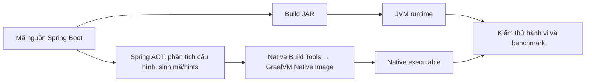

# Bật tích hợp Spring AOT và Native Build Tools

## 1. Mục tiêu của bài học

Trong chương **Ứng dụng đầu tiên** của module **SPRING_BOOT_NATIVE_IMAGE**, ta cấu hình một ứng dụng Spring Boot đơn giản để có hai đường build: **JAR chạy bằng JVM** và **GraalVM Native Image**. Ở đường native, Spring AOT chuẩn bị mã khởi tạo ứng dụng cùng những runtime hint cần thiết; **GraalVM Native Build Tools** nối bước xử lý AOT vào Maven hoặc Gradle và gọi trình biên dịch `native-image` để tạo executable.

Sau bài này, bạn có thể:

- Kiểm tra máy phát triển hoặc runner CI đã đủ JDK, GraalVM Native Image và công cụ biên dịch native.
- Bật Spring AOT và Native Build Tools trong **một** dự án Maven **hoặc** Gradle.
- Tạo cùng một ứng dụng Spring Boot dưới dạng JAR và native executable.
- Quan sát sản phẩm được Spring AOT sinh ra và nhận biết khi nào cần khai báo reflection/resource hints.
- Chạy smoke test và đối chiếu kết quả JVM/native trước khi đo thời gian khởi động, bộ nhớ hay đóng gói container.

> Các ví dụ dùng **Spring Boot 3.5.0, Java 21** làm mốc thực hành, không khẳng định đây là phiên bản mới nhất. Nếu dự án đang dùng phiên bản khác, chọn **Spring Boot, GraalVM, Native Build Tools và Java** theo ma trận tương thích của chính phiên bản đó; không nâng từng thành phần một cách độc lập. Hai mẫu Maven và Gradle là **hai lựa chọn thay thế**, không cần đưa cả hai vào cùng dự án.

## 2. Vì sao chỉ thêm thư viện GraalVM là chưa đủ?

Ở chế độ JVM, Spring Boot có thể thực hiện classpath scanning, phân tích annotation, quyết định bean definition và tạo proxy khi ứng dụng khởi động. Native Image phân tích ứng dụng từ trước khi chạy, vì vậy những thao tác phụ thuộc reflection, tạo JDK dynamic proxy, đọc classpath resource hay serialization phải được đưa vào kết quả phân tích ở build time.

Spring AOT giải quyết phần việc thuộc framework: xử lý trước các cấu hình Spring có thể xác định tại build time, sinh mã khởi tạo và đóng góp **`RuntimeHints`**. Native Build Tools tích hợp quá trình này với pipeline build. GraalVM Native Image nhận mã, bytecode, dependency, resource và metadata để tiếp tục phân tích, biên dịch thành executable dành cho hệ điều hành/kiến trúc CPU đích.



Lưu ý sự khác biệt:

| Thành phần | Vai trò | Có bắt buộc cho native build không? |
| --- | --- | --- |
| Spring Boot plugin | Quản lý tác vụ build Spring Boot và xử lý AOT | Có, trong quy trình minh họa |
| Spring AOT | Sinh mã khởi tạo/context và runtime hints từ cấu hình Spring | Có cho ứng dụng Spring Boot native theo hướng tích hợp chuẩn |
| GraalVM Native Build Tools | Tích hợp `native-image` vào lifecycle Maven/Gradle | Có trong hướng dẫn này |
| GraalVM Native Image | Biên dịch ứng dụng thành executable dành cho nền tảng đích | Có, hoặc được builder image cung cấp khi build trong container |
| `RuntimeHintsRegistrar` tự viết | Khai báo các truy cập động framework chưa tự suy ra được | Chỉ khi ứng dụng/thư viện thực sự cần |

**Spring AOT không phải một thư viện tùy ý gọi tại runtime.** Những tác vụ như `process-aot`, `processAot` và `nativeCompile` là một phần của giai đoạn build. Không nên coi một dòng `spring.aot.enabled=true` trong `application.properties` là cách thay thế cho cấu hình plugin và quy trình build native.

## 3. Chuẩn bị môi trường

### 3.1. Yêu cầu chính

Cho ví dụ này, máy build cần:

1. **JDK/GraalVM dựa trên Java 21** phù hợp với Spring Boot 3.5.0; kiểm tra bằng `java -version`.
2. Công cụ `native-image` thuộc bản GraalVM tương ứng, gọi được từ terminal.
3. **Toolchain native**: trình biên dịch C/C++, linker và các thư viện/phần header cần thiết cho hệ điều hành build.
4. Maven Wrapper (`mvnw`/`mvnw.cmd`) hoặc Gradle Wrapper (`gradlew`/`gradlew.bat`) của dự án; có thể dùng Maven/Gradle đã cài nếu không có wrapper.
5. CPU, RAM và ổ đĩa đủ cho bước phân tích/biên dịch native vốn thường tiêu tốn hơn build JAR.

Lệnh kiểm tra cơ bản trên Linux/macOS:

```bash
java -version
javac -version
native-image --version
./mvnw -version           # Nếu dùng Maven Wrapper
./gradlew --version       # Nếu dùng Gradle Wrapper
```

Trên Windows PowerShell, dùng `.\mvnw.cmd -version`, `.\gradlew.bat --version` và `native-image --version`. Native Image trên Windows còn cần bộ công cụ native được bản GraalVM đó hỗ trợ, thường là Microsoft Visual C++ Build Tools và môi trường linker phù hợp. Trên Linux, chuẩn bị compiler cùng `glibc` và các gói phát triển tương ứng theo bản phân phối và hướng dẫn của GraalVM. Đường cài đặt cụ thể khác nhau theo OS và phiên bản; sau khi cài, **kiểm tra lại kết quả chạy `native-image --version`**.

Nếu `java` chỉ tới JDK khác với `native-image`, build có thể dùng sai toolchain. Đảm bảo cấu hình `JAVA_HOME`, `PATH`, Maven/Gradle Java toolchain và GraalVM nhất quán. Với Gradle, cấu hình toolchain Java giúp chỉ rõ ngôn ngữ cần biên dịch, nhưng vẫn phải xác nhận tác vụ native đã chọn đúng GraalVM.

### 3.2. Khởi tạo ứng dụng tối thiểu

Dùng một dự án Spring Boot có dependency `spring-boot-starter-web`. Cùng ví dụ Java dưới đây có thể dùng cho cả Maven và Gradle:

```text
hello-native/
  src/
    main/
      java/com/example/hellonative/HelloNativeApplication.java
  pom.xml                 # Nếu chọn Maven
  build.gradle            # Nếu chọn Gradle
  settings.gradle         # Nếu chọn Gradle
```

```java
package com.example.hellonative;

import java.util.Map;
import org.springframework.boot.SpringApplication;
import org.springframework.boot.autoconfigure.SpringBootApplication;
import org.springframework.web.bind.annotation.GetMapping;
import org.springframework.web.bind.annotation.RestController;

@SpringBootApplication
@RestController
public class HelloNativeApplication {

    public static void main(String[] args) {
        SpringApplication.run(HelloNativeApplication.class, args);
    }

    @GetMapping("/hello")
    public Map<String, String> hello() {
        return Map.of("message", "Hello Native");
    }
}
```

Endpoint `GET /hello` phải trả JSON có giá trị `{"message":"Hello Native"}` ở cả hai chế độ chạy. Dự án đầu tiên nên cố ý giữ đơn giản: tránh database, secrets, network integration hoặc plugin động cho đến khi đã có baseline native build hoạt động.

## 4. Phương án A: tích hợp bằng Maven

### 4.1. Cấu hình `pom.xml`

Ví dụ sau dùng Spring Boot Starter Parent để quản lý các phiên bản dependency và các thiết lập Maven quen thuộc. Plugin `org.graalvm.buildtools:native-maven-plugin` cung cấp các goal biên dịch native; `spring-boot-maven-plugin` cung cấp xử lý Spring AOT và đóng gói Spring Boot.

```xml
<?xml version="1.0" encoding="UTF-8"?>
<project xmlns="http://maven.apache.org/POM/4.0.0"
         xmlns:xsi="http://www.w3.org/2001/XMLSchema-instance"
         xsi:schemaLocation="http://maven.apache.org/POM/4.0.0
             https://maven.apache.org/xsd/maven-4.0.0.xsd">
    <modelVersion>4.0.0</modelVersion>

    <parent>
        <groupId>org.springframework.boot</groupId>
        <artifactId>spring-boot-starter-parent</artifactId>
        <version>3.5.0</version>
        <relativePath/>
    </parent>

    <groupId>com.example</groupId>
    <artifactId>hello-native</artifactId>
    <version>0.0.1-SNAPSHOT</version>
    <name>hello-native</name>

    <properties>
        <java.version>21</java.version>
    </properties>

    <dependencies>
        <dependency>
            <groupId>org.springframework.boot</groupId>
            <artifactId>spring-boot-starter-web</artifactId>
        </dependency>
        <dependency>
            <groupId>org.springframework.boot</groupId>
            <artifactId>spring-boot-starter-test</artifactId>
            <scope>test</scope>
        </dependency>
    </dependencies>

    <build>
        <plugins>
            <plugin>
                <groupId>org.springframework.boot</groupId>
                <artifactId>spring-boot-maven-plugin</artifactId>
            </plugin>
            <plugin>
                <groupId>org.graalvm.buildtools</groupId>
                <artifactId>native-maven-plugin</artifactId>
            </plugin>
        </plugins>
    </build>
</project>
```

Ở đây **Starter Parent** của Spring Boot cung cấp sẵn cấu hình hỗ trợ `native` profile và quản lý phiên bản plugin trong phạm vi phiên bản Spring Boot được chọn. **Nếu dự án không kế thừa `spring-boot-starter-parent`**, cần tự khai báo phiên bản `native-maven-plugin` và các execution/profiles tương ứng, bao gồm goal `spring-boot:process-aot`; sao chép nguyên đoạn trên nhưng thay parent bằng một parent khác có thể khiến `-Pnative` không làm việc như mong đợi.

Để xác nhận cấu hình Maven thực sự được áp dụng trong một dự án nhiều parent/plugin management, dùng `./mvnw help:effective-pom` (hoặc `mvnw.cmd` trên Windows) và kiểm tra profile `native` cùng phiên bản các plugin đã được giải quyết.

### 4.2. Build JAR và chạy baseline

```bash
./mvnw clean package
java -jar target/hello-native-0.0.1-SNAPSHOT.jar
```

Trong terminal khác:

```bash
curl -fsS http://localhost:8080/hello
# Kỳ vọng: {"message":"Hello Native"}
```

Nếu port 8080 bận, có thể chạy với `--server.port=8081` và đổi URL kiểm tra tương ứng. Đóng ứng dụng trước khi chạy bản native trên cùng cổng.

### 4.3. Build Native Image

```bash
./mvnw -Pnative native:compile
```

Đây là cách dùng phổ biến với cấu hình Spring Boot Starter Parent: profile `native` bật xử lý AOT cần thiết trước khi Native Build Tools biên dịch executable. Có thể gọi riêng goal xử lý AOT để quan sát đầu ra:

```bash
./mvnw -Pnative spring-boot:process-aot
```

Thời gian native compilation tùy kích thước dependency, CPU/RAM, cache và phiên bản GraalVM. Khi thành công, executable thường nằm dưới `target/`, với tên dựa trên artifact; ở ví dụ này có thể là `target/hello-native` (Windows có thể là `target/hello-native.exe`). Xác nhận tên file thực sự trong log/thư mục build.

```bash
./target/hello-native
curl -fsS http://localhost:8080/hello
```

Không chạy cùng lúc JAR và executable trên một cổng. Với native executable, ứng dụng **không cần JVM cài riêng trên máy chạy**, nhưng vẫn cần runtime library và môi trường hệ điều hành phù hợp với cách liên kết binary.

## 5. Phương án B: tích hợp bằng Gradle

Nếu dự án chọn Gradle, thay vì `pom.xml` hãy dùng cấu hình Groovy DSL như dưới đây. Plugin `org.springframework.boot` cung cấp `bootJar`, `processAot`; plugin `org.graalvm.buildtools.native` cung cấp `nativeCompile`, `nativeRun` và các tác vụ liên quan. Sự có mặt của cả hai plugin cho phép nối kết xử lý AOT vào native build.

```groovy
// settings.gradle
rootProject.name = 'hello-native'
```

```groovy
// build.gradle
plugins {
    id 'java'
    id 'org.springframework.boot' version '3.5.0'
    id 'io.spring.dependency-management' version '1.1.7'
    id 'org.graalvm.buildtools.native' version '0.10.6'
}

group = 'com.example'
version = '0.0.1-SNAPSHOT'

java {
    toolchain {
        languageVersion = JavaLanguageVersion.of(21)
    }
}

repositories {
    mavenCentral()
}

dependencies {
    implementation 'org.springframework.boot:spring-boot-starter-web'
    testImplementation 'org.springframework.boot:spring-boot-starter-test'
}

tasks.named('test') {
    useJUnitPlatform()
}

graalvmNative {
    binaries {
        main {
            imageName = 'hello-native'
        }
    }
}
```

Các phiên bản plugin trong ví dụ là mốc để đọc cấu hình, cần được kiểm tra với Gradle Wrapper, GraalVM và Spring Boot của dự án. Tránh vừa chỉnh `pom.xml` vừa chỉnh `build.gradle` nếu dự án chỉ dùng một hệ thống build.

### 5.1. Build và chạy bằng Gradle

```bash
# Build JAR/JVM để có baseline:
./gradlew clean bootJar
java -jar build/libs/hello-native-0.0.1-SNAPSHOT.jar

# Tạo mã Spring AOT riêng để quan sát:
./gradlew processAot

# Build native (bao gồm các dependency cần thiết như xử lý AOT):
./gradlew nativeCompile

# Chạy executable native qua task của plugin:
./gradlew nativeRun
```

Gradle Native Build Tools thường tạo executable trong `build/native/nativeCompile/`. Với `imageName = 'hello-native'`, trên Linux/macOS có thể thấy `build/native/nativeCompile/hello-native`. Trên Windows tên có đuôi `.exe`. Kiểm tra log và đường dẫn thực tế vì có thể thay đổi theo phiên bản plugin.

Ví dụ smoke test khi ứng dụng đã chạy:

```bash
curl -fsS http://localhost:8080/hello
# Kỳ vọng: {"message":"Hello Native"}
```

Trên Windows dùng `.\gradlew.bat processAot`, `.\gradlew.bat nativeCompile`, `.\gradlew.bat nativeRun`. Không cần chạy `processAot` thủ công trước mỗi `nativeCompile`: quan hệ task đã được plugin thiết lập khi các plugin tương thích hoạt động đúng.

## 6. Spring AOT thực sự sinh ra những gì?

Ở quy trình Spring Boot native tích hợp chuẩn, Spring AOT xử lý `ApplicationContext` lúc build và tạo các đầu ra phục vụ runtime. Các nhóm thường gặp:

| Nhóm output | Ý nghĩa |
| --- | --- |
| **Generated source** | Mã Java hỗ trợ tạo bean/khởi tạo context mà Spring đã phân tích |
| **Generated class** | Kết quả biên dịch generated source hoặc proxy cần chuẩn bị trước |
| **Runtime hints/metadata** | Thông tin truy cập reflection, proxy, resource, serialization, JNI mà native compiler cần |
| **AOT resources** | Tài nguyên phụ trợ cần dùng khi chạy hoặc trong native-image analysis |

Các vị trí như `target/spring-aot/`, `target/generated-sources/` hoặc `build/generated/aotSources/`, `build/generated/aotResources/` phụ thuộc phiên bản plugin; không nên coi một đường dẫn minh họa là hợp đồng cố định. Hãy xem log của `spring-boot:process-aot` hoặc `processAot` để tìm thư mục output. Generated code là sản phẩm build: **không sửa bằng tay** vì nó sẽ được tạo lại.

Một điểm quan trọng là **thời điểm đánh giá cấu hình**. Spring AOT có thể quyết định nhiều điều kiện liên quan bean graph từ build time: `@Profile`, `@ConditionalOnProperty` hoặc các cấu hình khiến bean được đăng ký/hủy có thể cho kết quả khác nếu môi trường build và môi trường runtime không nhất quán. Những property thông thường vẫn có thể được đọc lúc chạy, nhưng không thể giả định mọi thay đổi cấu hình đều sẽ tái tạo cấu trúc bean đã được xử lý AOT.

Ví dụ: nếu một bean chỉ được đăng ký khi profile `production` có hiệu lực, hãy xác minh profile và điều kiện build có phản ánh biến thể production mong muốn hay không. Sau đó kiểm thử **chính executable** trong môi trường triển khai để phát hiện sai biệt. Đây là lý do smoke test native quan trọng hơn chỉ nhìn thông báo “BUILD SUCCESS”.

## 7. Khi nào phải bổ sung reflection, proxy và resource hints?

Một ứng dụng REST đơn giản dùng `@SpringBootApplication`, `@RestController` và mapping tĩnh thường đã được Spring Boot/Framework hỗ trợ sẵn. **Không cần viết `RuntimeHintsRegistrar` ngay khi tạo project.** Chỉ thêm hint khi có trường hợp runtime không được Spring hoặc thư viện nhận diện tự động.

Ví dụ ứng dụng đọc tệp `src/main/resources/rules/pricing.json` và dùng reflection để gọi constructor của một kiểu lựa chọn động. Có thể bổ sung một registrar:

```java
package com.example.hellonative;

import org.springframework.aot.hint.MemberCategory;
import org.springframework.aot.hint.RuntimeHints;
import org.springframework.aot.hint.RuntimeHintsRegistrar;
import org.springframework.context.annotation.Configuration;
import org.springframework.context.annotation.ImportRuntimeHints;

@Configuration(proxyBeanMethods = false)
@ImportRuntimeHints(ExtraNativeHints.class)
class NativeHintsConfiguration {
}

final class ExtraNativeHints implements RuntimeHintsRegistrar {

    @Override
    public void registerHints(RuntimeHints hints, ClassLoader classLoader) {
        hints.resources().registerPattern("rules/pricing.json");
        hints.reflection().registerType(
            PricingRule.class,
            MemberCategory.INVOKE_DECLARED_CONSTRUCTORS
        );
    }
}
```

Đoạn minh họa giả định project có lớp `PricingRule` và tài nguyên `rules/pricing.json`. Nó không phải mã cần thêm vào ứng dụng `/hello` ở phần đầu. Tùy mục đích thực tế, bạn có thể đăng ký constructor/method cụ thể để metadata hẹp hơn.

Nếu code tự tạo JDK dynamic proxy trên một interface như `RatePort` mà trình phân tích chưa nhận diện, registrar còn có thể khai báo:

```java
hints.proxies().registerJdkProxy(RatePort.class);
```

**Phân biệt loại hint**:

- **Reflection** hỗ trợ những constructor, method hoặc field truy cập động; không tự động đưa các file JSON vào executable.
- **Resource** đưa classpath resource/resource bundle cần thiết vào image; không biến nội dung file hệ thống ngoài container thành tài nguyên nhúng.
- **JDK proxy** khai báo tập interface cho `java.lang.reflect.Proxy`; không thay thế cơ chế sinh subclass proxy mà Spring AOT hoặc thư viện khác cần thực hiện.
- **Serialization/JNI** có cơ chế metadata riêng; không nên đăng ký tùy tiện mọi kiểu nếu ứng dụng không dùng.

Nếu một dependency sinh bytecode class tùy ý **sau** khi native image đã build, chỉ bổ sung reflection/proxy hints có thể không đủ. Xem tài liệu native support của chính dependency, thay cách tạo code hoặc chuyển việc sinh class sang build time. Chạy lại đúng nhánh gây lỗi trong native executable để xác nhận cách sửa.

## 8. Kiểm thử tích hợp trước khi đo hiệu năng

### 8.1. Baseline chức năng

Với cùng commit và cùng cấu hình nghiệp vụ:

1. Chạy JAR và gọi `GET /hello`; lưu HTTP status, JSON body và các log lỗi.
2. Tắt tiến trình JVM, chạy native executable trên **cùng port/cấu hình**.
3. Gọi cùng request với cùng dữ liệu đầu vào; kiểm tra HTTP status và JSON tương đương.
4. Nếu thêm DB, cache, serialization, proxy hoặc resource, kiểm thử từng luồng thực sự dùng thành phần ấy.
5. Chạy integration test/native test do plugin của dự án hỗ trợ trước khi phát hành.

Test trên JVM giúp phát hiện lỗi Java/Spring chung. Tuy nhiên, **native build thành công không có nghĩa mọi đường đi runtime đều tương thích**. Những lỗi thiếu reflection metadata hoặc resource có thể chỉ xuất hiện khi gọi một endpoint ít dùng, parse một loại payload cụ thể hoặc đọc resource theo tên động.

### 8.2. Native test với Native Build Tools

Với Gradle Native Build Tools và cấu hình test tương ứng:

```bash
./gradlew test
./gradlew nativeTest
```

Với Maven, cách tích hợp native test phụ thuộc profile/plugin cấu hình trong `pom.xml`. Cần bảo đảm các goal phù hợp được bật, rồi kiểm tra bằng `./mvnw -PnativeTest test` **nếu** dự án đã có profile `nativeTest`. Đừng giả định profile này hiện diện trong mọi parent POM.

Kiểm thử native thường tốn thời gian build hơn unit test JVM; hợp lý để chạy unit test nhanh ở mọi commit và dành native smoke/integration test cho các mốc CI đã định. Tuy vậy, thay đổi làm tăng reflection, serialization hoặc tài nguyên động cần được kiểm thử native trước khi phát hành.

### 8.3. Bảng xác minh tối thiểu

| Kiểm tra | Kết quả mong đợi |
| --- | --- |
| `java -version`, `native-image --version` | Java/GraalVM hợp lệ, công cụ có thể chạy |
| Build JAR Maven/Gradle | JAR được đóng gói thành công |
| `process-aot` / `processAot` | Sinh output AOT, không lỗi bean initialization |
| `native:compile` / `nativeCompile` | Có native executable cho đúng OS/CPU |
| Chạy `/hello` trên JVM | 200 OK và JSON đúng |
| Chạy `/hello` trên native | 200 OK và JSON tương đương |
| Restart native executable | Không lỗi khởi động và cấu hình |
| Đọc resource/JSON, reflection/proxy nếu có | Hành vi khớp với bản JVM |

## 9. Những lỗi thường gặp khi bật tích hợp

| Triệu chứng | Nguyên nhân cần kiểm tra | Cách xử lý |
| --- | --- | --- |
| `native-image: command not found` hoặc không có GraalVM toolchain | `PATH` / `JAVA_HOME` sai, GraalVM chưa cài đúng | Cài phiên bản có Native Image, xác minh lại phiên bản và toolchain |
| `-Pnative` bị bỏ qua hoặc goal không chạy Spring AOT | Dự án không dùng Spring Boot parent, thiếu plugin/profile | Kiểm tra `effective-pom`, khai báo execution xử lý AOT và Native Build Tools |
| Gradle không có `nativeCompile` | Chưa áp dụng `org.graalvm.buildtools.native`, plugin không tương thích | Bổ sung plugin phù hợp, kiểm tra Gradle/plugin version |
| Không tìm thấy C compiler, linker hoặc header | Thiếu toolchain native của OS | Cài công cụ C/C++/linker được bản GraalVM yêu cầu |
| Build chết do hết RAM/CPU rất lâu | Native analysis cần nhiều tài nguyên, CI bị giới hạn | Tăng tài nguyên runner, giảm build đồng thời, xem cấu hình và log |
| AOT thất bại khi tạo context | Điều kiện Spring/bean chưa phù hợp build time | Kiểm tra `@Conditional`, profiles, bean definitions, tránh phụ thuộc runtime trong khởi tạo AOT |
| Native chạy nhưng lỗi reflection | Class/constructor/method được chọn động chưa khai báo | Thêm runtime hint đúng loại/phạm vi và chạy lại luồng gây lỗi |
| Native không đọc được file classpath | Resource chưa được khai báo hoặc đường dẫn sai | Kiểm tra file trong resources, thêm resource hint cụ thể |
| JDK proxy hoặc subclass proxy thất bại | Proxy interface chưa khai báo hoặc thư viện sinh bytecode động | Xác định kiểu proxy, dùng AOT/proxy hints hoặc thư viện hỗ trợ native |
| Executable chạy ở máy build nhưng lỗi trong image triển khai | OS/architecture, thư viện native, libc hoặc chứng chỉ khác | Dùng môi trường build tương thích target, kiểm thử container đích |

Với lỗi phức tạp, giữ lại log biên dịch và dependency versions trước khi thêm metadata. Mở rộng reflection cho toàn bộ package mà chưa xác định nguyên nhân thường khiến binary khó phân tích, không giải quyết lỗi khởi tạo class hoặc runtime bytecode generation.

## 10. Bước đầu đóng gói container và vận hành

Khi executable đã chạy đúng trên máy build, cần xem container runtime có hệ điều hành/kiến trúc CPU và thư viện thích hợp không. Hai cách phổ biến:

- **Buildpacks** thông qua Spring Boot Maven/Gradle plugin và builder có khả năng dựng Native Image; cần kiểm tra cấu hình builder và biến `BP_NATIVE_IMAGE=true` trong buildpack. Cách này thuận tiện khi muốn builder tự quản lý toolchain.
- **Dockerfile đa giai đoạn**: giai đoạn build cài GraalVM và native toolchain; giai đoạn runtime sao chép executable cùng các thư viện/chứng chỉ cần thiết. Base image cực nhỏ không tự bảo đảm binary động có đủ thư viện để chạy.

Ví dụ cấu hình buildpack native với Maven, nếu dự án đã thiết lập Docker/Buildpacks phù hợp:

```xml
<!-- Đặt trong spring-boot-maven-plugin: <configuration> ... </configuration> -->
<image>
    <name>hello-native:local</name>
    <env>
        <BP_NATIVE_IMAGE>true</BP_NATIVE_IMAGE>
    </env>
</image>
```

Sau khi cấu hình `spring-boot-maven-plugin` như trên, có thể chạy:

```bash
./mvnw spring-boot:build-image
docker run --rm -p 8080:8080 hello-native:local
```

Buildpack cần Docker daemon hoặc container backend tương ứng, builder hỗ trợ native image và có thể mất thời gian tạo image; đây là **đường build riêng** so với `native:compile` chạy trực tiếp trên máy. Kiểm tra log buildpack để xác nhận thực sự tạo native executable trước khi gắn nhãn image là native.

Với Gradle, task `bootBuildImage` là điểm tích hợp tương tự; cấu hình builder environment chứa `BP_NATIVE_IMAGE=true` khi muốn yêu cầu native build. Tránh giả định chỉ chạy `bootBuildImage` mặc định luôn tạo image native trong mọi phiên bản plugin và dự án.

Trong môi trường sản xuất, kiểm tra health/readiness, cổng mạng, biến môi trường, timezone, CA certificates, quyền chạy tiến trình, logging, graceful shutdown và khả năng debug trên target. Native executable không phụ thuộc JVM ở runtime, nhưng cũng **không phải** artifact chạy được trên mọi hệ điều hành/kiến trúc.

## 11. Đánh giá lợi ích khi cả hai bản đã chạy đúng

Sau khi xác minh tính tương thích, hãy so sánh **cùng commit, cùng endpoints, cùng request load, cùng CPU/memory limit**:

| Chỉ số | Cách đo gợi ý | Câu hỏi cần trả lời |
| --- | --- | --- |
| Thời gian build | CI job elapsed time; tách cache lạnh/nóng | Native tăng chi phí pipeline bao nhiêu? |
| Peak RAM của build | Số liệu runner/cgroup khi native compilation | Runner hiện tại có đủ bộ nhớ? |
| Startup đến readiness | Đo từ ngoài tiến trình đến endpoint sẵn sàng | Native giảm thời gian khởi động thực sự bao nhiêu? |
| RSS lúc nhàn rỗi và khi tải | `ps`/container metrics ở cùng tải | Native có giảm footprint khi phục vụ cùng công việc? |
| p95/p99 và throughput | Load test sau warm-up với RPS xác định | Lợi ích startup có đổi lấy giảm hiệu năng dài hạn? |
| Lỗi và hành vi nghiệp vụ | Smoke/integration/native tests | Hai bản có đáp ứng cùng chức năng và SLO? |

Đừng lấy việc native build thành công làm kết luận về hiệu năng: JVM với JIT có thể tối ưu mạnh khi chạy lâu, trong khi native thường có lợi ở cold start và một số workload cần footprint nhỏ. Mục tiêu là **đo lợi ích thực tế của ứng dụng Spring Boot**, không tìm một bản thắng tuyệt đối cho mọi trường hợp.

## 12. Bài thực hành và tiêu chí hoàn thành

**Đề bài:** Tạo `HelloNativeApplication` với endpoint `/hello`, chọn **Maven hoặc Gradle**, cấu hình Spring AOT và Native Build Tools, biên dịch thành JAR và native executable rồi so sánh kết quả.

**Các bước thực hiện:**

1. Xác minh `java`, `native-image`, Maven/Gradle Wrapper và native toolchain.
2. Xây dựng ứng dụng REST tối thiểu, chạy JAR và lưu kết quả `GET /hello`.
3. Thêm cấu hình plugin, chạy riêng tác vụ Spring AOT và quan sát generated code/metadata.
4. Chạy native build, xác nhận executable được tạo đúng nền tảng.
5. Khởi động executable, gọi `/hello` và so body/status với bản JVM.
6. Tùy chọn: thêm tài nguyên `rules/pricing.json` hoặc một case reflection có kiểm soát, rồi thực hành khai báo `RuntimeHintsRegistrar`.
7. Ghi thời gian build, startup đến readiness và RSS ở cùng điều kiện để bắt đầu đánh giá.

**Kết quả cần nộp hoặc tự lưu:** tệp cấu hình build, source application, lệnh đã chạy, log native build, đường dẫn executable, kết quả HTTP của hai bản, bảng đo các chỉ số và mô tả lỗi/cách xử lý (nếu có).

**Tự kiểm tra:**

- Vì sao có `native-maven-plugin` mà không chạy `process-aot` có thể gây vấn đề ở dự án Maven không dùng Spring Boot Starter Parent?
- Vì sao `nativeCompile` có thể tạo binary nhưng endpoint dùng reflection động vẫn lỗi?
- Khi `/hello` chạy đúng trên cả hai bản, bước tiếp theo nào giúp chứng minh native thực sự tiết kiệm RAM và startup cho workload của bạn?

## 13. Tổng kết

Tích hợp Spring Boot Native Image có ba mắt xích: **Spring Boot plugin** nhận diện cấu hình ứng dụng, **Spring AOT** chuẩn bị mã khởi tạo và các runtime hints, **GraalVM Native Build Tools** phối hợp trình biên dịch Native Image để tạo executable. Với **Maven**, mẫu Spring Boot Starter Parent cho phép dùng profile `native` và goal `native:compile`; với **Gradle**, kết hợp Spring Boot plugin và `org.graalvm.buildtools.native` để chạy `processAot` và `nativeCompile`.

Kết thúc bước tích hợp là khi cả **JAR/JVM** và **native executable** khởi động, trả kết quả nghiệp vụ tương đương và được kiểm thử trên môi trường phù hợp. Từ nền tảng đó, bạn mới tiếp tục xử lý reflection/resource, kiểm thử tính tương thích sâu, đóng gói container và đánh giá lợi ích khởi động/bộ nhớ một cách đáng tin cậy.
