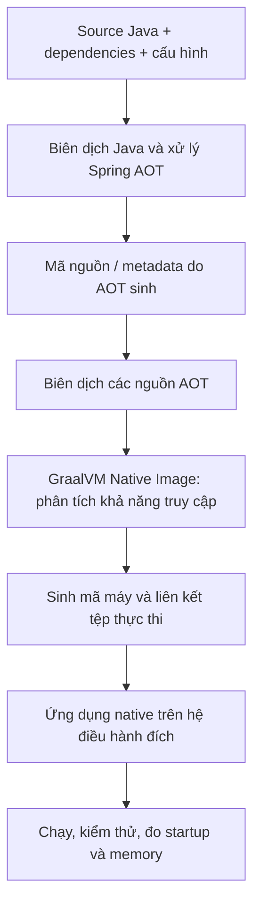

# Build tệp native lần đầu và nhận diện các giai đoạn trong log

## Mục tiêu bài học

Trong module **Spring Boot Native Image**, chúng ta sử dụng **Spring AOT** để chuẩn bị cấu hình ứng dụng ở thời điểm build, sau đó dùng **GraalVM Native Image** biên dịch thành tệp thực thi native. Bài này hướng dẫn bạn đi từ một ứng dụng Spring Boot nhỏ đến **tệp native chạy được**, đồng thời đọc log để biết công cụ đang làm gì, vì sao build mất thời gian và nên tìm lỗi ở giai đoạn nào.

Sau khi hoàn thành, bạn có thể:

- Chuẩn bị môi trường Java, GraalVM và công cụ biên dịch native.
- Build bằng **Maven** hoặc **Gradle**, kiểm tra đường dẫn tệp thực thi.
- Phân biệt log **Spring AOT**, **native compilation** và **khởi động ứng dụng**.
- Nhận diện các pha Native Image như *Initializing*, *Performing analysis*, *Compiling methods* và *Creating image*.
- Đọc thông báo về thời gian, RAM, số class/method reachable và các dấu hiệu lỗi thường gặp.
- Chạy bản native, xác minh chức năng và đo khởi động/bộ nhớ trước khi so với JVM.

> **Lưu ý về phiên bản:** cú pháp log, số lượng pha, tên thư mục output và tên task có thể khác giữa các phiên bản Spring Boot, GraalVM Native Build Tools và GraalVM. Các đoạn log trong bài là **mẫu minh họa có chú thích**, không phải kết quả đo của một hệ thống cụ thể. Luôn dựa vào log thực tế trên máy của bạn.

## 1. Hiểu toàn bộ đường đi của một lần build native

Khi chạy ứng dụng theo cách thông thường, Maven/Gradle biên dịch Java và đóng gói JAR; JVM nạp mã, phân tích phần cấu hình cần thiết và thực thi ứng dụng khi khởi động.

Với Native Image, build cần thêm các công đoạn:



**Spring AOT** chuẩn bị các bean definitions, mã khởi tạo context và runtime hints khi có đủ thông tin ở build time. **GraalVM Native Image** thực hiện phân tích thế giới đóng (*closed-world analysis*), xác định mã cần đưa vào tệp thực thi và biên dịch mã đó thành mã máy.

Các khái niệm cần phân biệt:

| Thuật ngữ | Ý nghĩa | Thấy ở đâu? |
|---|---|---|
| **AOT processing** | Phân tích cấu hình Spring, sinh mã Java và metadata để bootstrap ứng dụng | Task `process-aot` / `processAot`, thư mục generated |
| **Reachability analysis** | Xác định class, method, field và thành phần nào có thể cần khi native chạy | Log giai đoạn analysis của GraalVM |
| **Native compilation** | Biên dịch phần mã reachable thành mã máy, kết hợp runtime và link thành executable | Log `native-image` / `nativeCompile` |
| **Native executable** | Tệp thực thi dành cho OS/CPU cụ thể, chạy trực tiếp mà không cần JVM để khởi động ứng dụng | Thư mục output của Maven/Gradle |
| **Native runtime** | Lúc thực thi ứng dụng đã biên dịch, bao gồm startup Spring, I/O, kết nối DB và nghiệp vụ | Log ứng dụng khi mở executable |

**Một lần build thành công chưa chứng minh ứng dụng chạy đúng.** Native Image có thể biên dịch xong nhưng vẫn thiếu resource, reflection metadata, cấu hình hoặc quyền truy cập ở runtime. Vì vậy, phải có bước chạy thật và kiểm tra chức năng.

## 2. Chuẩn bị môi trường cho lần build đầu

### 2.1. Điều kiện cần có

Trước hết, bảo đảm:

1. Dự án sử dụng phiên bản **Spring Boot có hỗ trợ Spring AOT/Native Image** và Java tương thích (ví dụ Spring Boot 3.x sử dụng Java 17 trở lên).
2. Máy build có **GraalVM JDK và công cụ `native-image`** tương thích với phiên bản Java đang dùng, hoặc bạn chọn hướng build bằng container buildpacks.
3. Hệ điều hành có **native C/C++ toolchain** và những thư viện hệ thống cần thiết cho Native Image. Trên Windows thường sử dụng bộ công cụ C++ tương thích; trên Linux thường cần GCC/Clang, linker và libc; macOS cần command-line developer tools.
4. Có đủ dung lượng đĩa, CPU và RAM. Native compilation thường tiêu thụ nhiều tài nguyên và mất thời gian hơn việc build JAR.
5. Maven Wrapper (`mvnw`) hoặc Gradle Wrapper (`gradlew`) hoạt động; plugin Spring Boot và **GraalVM Native Build Tools** đã được khai báo phù hợp.

Kiểm tra nhanh trong terminal:

```bash
java -version
native-image --version

# Dung lenh tuong ung voi cong cu cua du an
./mvnw --version
# hoac:
./gradlew --version
```

Trên Windows, sử dụng `mvnw.cmd` / `gradlew.bat` (hoặc `.\mvnw.cmd` / `.\gradlew.bat` trong PowerShell) và kiểm tra terminal có quyền truy cập compiler/linker. Nếu `native-image` không nhận diện được, kiểm tra `JAVA_HOME`, `PATH` và việc cài công cụ Native Image cho bản GraalVM cụ thể.

**Không mặc định** lệnh `java -version` đang dùng cùng JDK với Maven/Gradle: kiểm tra thêm đầu ra của `./mvnw --version` hoặc cấu hình Java toolchain của Gradle. Một lỗi điển hình là shell sử dụng GraalVM nhưng build tool lại chọn một JDK khác.

### 2.2. Đường build bạn đang chọn

| Cách build | Điều kiện nổi bật | Kết quả |
|---|---|---|
| Native Image trực tiếp trên máy | GraalVM, `native-image`, compiler/linker phù hợp hệ điều hành | Tệp native cho OS/CPU máy build |
| Native Image bằng container buildpacks | Docker/container runtime, Spring Boot build image plugin/buildpack phù hợp | Container image chứa ứng dụng native |
| Chạy JAR trên JVM | JDK/JRE phù hợp | JAR thực thi bởi JVM, dùng làm đường so sánh |

Đối với lần học đầu, **build tệp native trực tiếp** giúp quan sát log từng pha rõ nhất. Nếu đang dùng Windows nhưng production chạy Linux, cần tạo tệp **Linux native** trong môi trường build Linux phù hợp; một tệp `.exe` của Windows không thể đổi tên để chạy trên Linux.

## 3. Ứng dụng Spring Boot tối giản để thử nghiệm

Giả sử dự án đã tạo bằng Spring Initializr hoặc mẫu Spring Boot tương thích với native và đã có dependency **Spring Web**. Tạo một endpoint đơn giản:

```java
package com.example.nativehello;

import org.springframework.boot.SpringApplication;
import org.springframework.boot.autoconfigure.SpringBootApplication;
import org.springframework.web.bind.annotation.GetMapping;
import org.springframework.web.bind.annotation.RestController;

@SpringBootApplication
public class NativeHelloApplication {

    public static void main(String[] args) {
        SpringApplication.run(NativeHelloApplication.class, args);
    }
}

@RestController
class HelloController {

    @GetMapping("/hello")
    String hello() {
        return "Hello Native Image";
    }
}
```

Lớp `HelloController` có thể nằm cùng tệp `NativeHelloApplication.java` trong ví dụ (chỉ lớp `NativeHelloApplication` là `public`), hoặc ở tệp riêng cùng package. Với Spring Boot 3.x, sử dụng Java 17+ và dependency `spring-boot-starter-web`.

Trước khi thử native, chạy ứng dụng trên JVM:

```bash
# Maven
./mvnw spring-boot:run

# Hoac Gradle
./gradlew bootRun
```

Trong terminal khác, kiểm tra:

```bash
curl -i http://localhost:8080/hello
```

Kết quả mong đợi là HTTP **200** và phần thân `Hello Native Image`. Dừng ứng dụng JVM trước khi chạy bản native để tránh trùng cổng 8080. Nếu ứng dụng đặt `server.port` khác hoặc dùng HTTPS, điều chỉnh URL kiểm tra tương ứng.

## 4. Build tệp native với Maven

### 4.1. Cấu hình Maven cần kiểm tra

Với dự án Spring Boot dùng `spring-boot-starter-parent` và cấu hình native tương thích, `pom.xml` thường có Spring Boot Maven plugin và GraalVM Native Build Tools. Ví dụ **đoạn cấu hình minh họa**:

```xml
<build>
    <plugins>
        <plugin>
            <groupId>org.springframework.boot</groupId>
            <artifactId>spring-boot-maven-plugin</artifactId>
        </plugin>
    </plugins>
</build>

<profiles>
    <profile>
        <id>native</id>
        <build>
            <plugins>
                <plugin>
                    <groupId>org.graalvm.buildtools</groupId>
                    <artifactId>native-maven-plugin</artifactId>
                </plugin>
            </plugins>
        </build>
    </profile>
</profiles>
```

Đoạn trên cần đặt vào **đúng các phần tương ứng của `pom.xml`**, không dán một `<build>` hoặc `<profiles>` trùng vào file đã có. Việc quản lý phiên bản plugin phụ thuộc vào parent/BOM và cấu hình thực tế. Nếu dự án không dùng Spring Boot parent, cần cấu hình phiên bản và các execution thích hợp một cách tường minh.

### 4.2. Chạy build

Từ thư mục gốc dự án:

```bash
./mvnw -Pnative native:compile
```

Với cấu hình Spring Boot Native Build Tools chuẩn, Maven sẽ thực hiện các bước cần thiết để xử lý Spring AOT, biên dịch phần mã đã sinh và gọi GraalVM Native Image. Có thể chạy tác vụ AOT riêng để quan sát:

```bash
./mvnw spring-boot:process-aot
```

**Hai lệnh không có cùng đầu ra:** `spring-boot:process-aot` chỉ sinh phần AOT; `native:compile` nhằm tạo tệp thực thi native. Nếu chạy process AOT thành công nhưng chưa chạy native compilation, bạn **chưa có tệp native**.

Tệp thực thi thường xuất hiện trong `target/`, ví dụ:

```text
target/
├── classes/
├── spring-aot/
└── nativehello          # Linux/macOS, ten thuc te theo artifact/config
```

Trên Windows thường là `nativehello.exe`. Tên tệp có thể được điều chỉnh bởi plugin/build configuration; kiểm tra dòng log kết thúc hoặc liệt kê thư mục đầu ra.

### 4.3. Xác minh output Maven

Trên Linux/macOS:

```bash
ls -lh target/
file target/nativehello
./target/nativehello
```

Trên PowerShell:

```powershell
Get-ChildItem -Path target -File
.\target\nativehello.exe
```

Thay `nativehello` bằng tên tệp native thực tế. Lệnh `file` thường không có sẵn theo mặc định trên Windows; sử dụng lệnh liệt kê và chạy executable phù hợp.

## 5. Build tệp native với Gradle

### 5.1. Cấu hình plugin

Dự án Gradle cần Spring Boot Gradle plugin và **`org.graalvm.buildtools.native`**. Ví dụ minh họa Groovy DSL:

```groovy
plugins {
    id 'java'
    id 'org.springframework.boot' version 'VERSION_SPRING_BOOT'
    id 'io.spring.dependency-management' version 'VERSION_DEPENDENCY_MANAGEMENT'
    id 'org.graalvm.buildtools.native' version 'VERSION_NATIVE_BUILD_TOOLS'
}

dependencies {
    implementation 'org.springframework.boot:spring-boot-starter-web'
    testImplementation 'org.springframework.boot:spring-boot-starter-test'
}
```

Các chuỗi `VERSION_...` là **placeholder**, không phải phiên bản có thể chạy nguyên văn. Hãy dùng phiên bản plugin thực tế được dự án quản lý và tương thích với Spring Boot/GraalVM của bạn; nếu đã tạo dự án từ template có hỗ trợ native, ưu tiên giữ cấu hình đó.

### 5.2. Chạy build

```bash
# Xem riêng dau ra Spring AOT (tuy chon)
./gradlew processAot

# Bien dich thanh tep native
./gradlew nativeCompile
```

`processAot` sinh artifact AOT, còn `nativeCompile` thực hiện các bước liên quan đến Native Image theo task graph và plugin đã cấu hình. Khi thành công, tệp native thường ở:

```text
build/native/nativeCompile/
└── nativehello          # ten file thay doi theo ten project
```

Trên Windows sẽ có phần mở rộng `.exe` khi tạo executable Windows. Kiểm tra đường dẫn bằng cách đọc log của task `nativeCompile` hoặc liệt kê directory:

```bash
ls -lh build/native/nativeCompile/
./build/native/nativeCompile/nativehello
```

**Maven và Gradle tạo cùng loại sản phẩm native executable** nhưng tên goal/task, log wrapper và đường dẫn output có thể khác. Không nên suy luận rằng một build thành công chỉ vì task `processAot` đã hoàn tất.

## 6. Đọc log: xác định đúng tầng đang xử lý

### 6.1. Ba lớp log chính

Một phiên build native thành công thường có ba nhóm thông điệp:

| Nhóm log | Dấu hiệu thường thấy | Mục đích |
|---|---|---|
| **Build tool** | `[INFO] --- ...` của Maven, `> Task :...` của Gradle | Xử lý dependency, Java compilation, AOT task, gọi native compiler |
| **Spring AOT** | `process-aot` / `processAot`, class/resource được sinh | Chuẩn bị context/bean definitions và metadata |
| **GraalVM Native Image** | `GraalVM Native Image`, `Performing analysis`, `Compiling methods`, `Creating image` | Phân tích mã reachable, biên dịch và tạo native executable |

Ví dụ log **minh họa** theo nhánh Maven (đã lược bớt những đoạn không liên quan):

```text
[INFO] --- spring-boot:...:process-aot (...) @ nativehello ---
[INFO] ... processing application AOT ...
[INFO] --- compiler:...:compile (...) @ nativehello ---
[INFO] --- native:...:compile (...) @ nativehello ---

================================================================================
GraalVM Native Image: Generating 'nativehello' ...
================================================================================
[1/8] Initializing...
[2/8] Performing analysis...
[3/8] Building universe...
[4/8] Parsing methods...
[5/8] Inlining methods...
[6/8] Compiling methods...
[7/8] Laying out methods...
[8/8] Creating image...
Finished generating 'nativehello' ...

[INFO] BUILD SUCCESS
```

Đây là **mẫu khái quát**: thứ tự một số goal/task và cách hiển thị cụ thể phụ thuộc cấu hình. Một số bản GraalVM có cách nhóm pha, tên pha và định dạng thống kê khác. Điều bạn cần tìm là **công cụ nào đang chạy**, **pha nào hiện tại**, **pha nào phát lỗi** và **tệp đầu ra được tạo ở đâu**.

### 6.2. Các pha Native Image thường gặp

| Pha được in trong log | Việc đang diễn ra | Điều nên quan sát |
|---|---|---|
| **Initializing** | Chuẩn bị môi trường build, compiler, cấu hình image, classpath và công cụ cần thiết | Version Java/GraalVM, OS, kiến trúc, tùy chọn memory |
| **Performing analysis** | Reachability analysis: dò các phần mã/types cần giữ lại trong image | Số reachable types/methods/fields; lỗi liên quan metadata và khởi tạo lớp |
| **Building universe** | Xây dựng biểu diễn nội bộ cho tập đối tượng/mã cần được đưa vào image | Thời gian và bộ nhớ; phụ thuộc quy mô ứng dụng |
| **Parsing methods** | Chuyển mã phương thức được dùng sang biểu diễn phục vụ tối ưu/biên dịch | Lỗi phân tích hoặc vấn đề đặc biệt trong bytecode |
| **Inlining methods** | Thực hiện các tối ưu có thể bao gồm inlining | Mức tiêu thụ CPU/RAM của tối ưu biên dịch |
| **Compiling methods** | Biên dịch các phương thức thành mã máy | Pha có thể tiêu thụ nhiều CPU và kéo dài |
| **Laying out methods** | Sắp xếp mã máy và thành phần cần có cho image | Dung lượng mã, bộ nhớ và tiến độ build |
| **Creating image** | Tạo/link tệp native cuối cùng và ghi artifact | Đường dẫn, kích thước executable, kết quả link |

**Đừng dựa cứng vào số `[1/8]` hoặc tên thứ tự** để xây công cụ đọc log: đây là hình thức phổ biến của một số phiên bản, không phải cam kết giao diện ổn định. Khi GraalVM nâng cấp, nhãn pha có thể đổi hoặc các bước được gộp/tách.

### 6.3. Đọc thống kê reachability

Ở phần phân tích, GraalVM thường cung cấp thống kê về những loại mã được tìm thấy. Ví dụ **giả lập, chỉ thể hiện định dạng**:

```text
[2/8] Performing analysis...
  12,345 types, 18,901 fields, and 75,432 methods found reachable
  4,567 types, 2,345 fields, and 9,876 methods registered for reflection
  ... native libraries / JNI / resources ...
```

Ý nghĩa:

- **Reachable types/methods:** phần code mà Native Image xác định có khả năng cần đến. Con số lớn không tự động nghĩa là build sai.
- **Registered for reflection:** metadata được khai báo hoặc suy ra để hỗ trợ truy cập động; số lượng này không phải “càng ít càng tốt” nếu ứng dụng thật sự cần reflection.
- **Resources / JNI / proxy:** gợi ý phạm vi các tính năng runtime phải được hỗ trợ.

Các con số phụ thuộc dependency, configuration, phiên bản framework và cách viết ứng dụng. Không có một “ngưỡng chuẩn” về số method reachable dùng chung cho mọi ứng dụng Spring Boot.

### 6.4. Đọc báo cáo tài nguyên và thời gian

GraalVM có thể in các chỉ số như tổng thời gian, peak memory, độ lớn các phần của executable, thời gian dành cho analysis/compilation và tiến độ GC trong build. Nếu build bị chậm, đọc chúng trước khi tối ưu.

Ví dụ minh họa:

```text
Finished generating 'nativehello' in 1m 42s.
Peak RSS: ... GiB
Image size: ... MiB
```

Những giá trị trên được cố ý để dấu `...` vì không phải benchmark. Nếu log không có một số chỉ số, có thể dùng tùy chọn thống kê phù hợp phiên bản Native Image hoặc giám sát của hệ điều hành/CI để bổ sung.

Phân biệt:

- **RAM trong lúc build:** dùng bởi tiến trình compiler khi tạo native executable; có thể cao.
- **RAM khi chạy native:** dùng bởi tiến trình ứng dụng đã build; đo độc lập trong lúc chạy.
- **Kích thước executable:** không bằng kích thước container image, và cũng không suy trực tiếp ra RSS khi chạy.
- **Tổng thời gian build:** có thể gồm tải dependency, test, compile Java, AOT processing và Native Image. Chỉ số của riêng Native Image là một phần của tổng thời gian này.

## 7. Xác nhận tệp native đã build đúng

### 7.1. Thứ tự kiểm tra

Đừng dừng ở dòng `BUILD SUCCESS` hoặc `BUILD SUCCESSFUL`. Thực hiện đủ các bước:

1. **Xem artifact:** tệp native có tồn tại, kích thước khác 0, nằm ở đường dẫn được thông báo trong log.
2. **Chạy executable:** trên đúng OS/kiến trúc mà tệp đã được build.
3. **Kiểm tra startup:** chờ thông báo ứng dụng khởi động thành công và endpoint sẵn sàng.
4. **Gọi API:** `GET /hello` nhận HTTP 200 với `Hello Native Image`.
5. **Dừng chương trình:** xác nhận không phát sinh lỗi bất thường khi shutdown.
6. **Kiểm tra chức năng thực tế:** với ứng dụng có database, serialization, validation, security, file resource..., chạy các bài test liên quan trên bản native.

Trên Linux/macOS, chạy ví dụ:

```bash
./target/nativehello
# Hoac voi Gradle:
./build/native/nativeCompile/nativehello
```

Trong terminal thứ hai:

```bash
curl -i http://localhost:8080/hello
```

Đối với Windows PowerShell, chạy tệp `.exe` sinh ra trong `target` hoặc `build/native/nativeCompile`. Nếu muốn kiểm tra HTTP status một cách rõ ràng, có thể dùng:

```powershell
$response = Invoke-WebRequest -Uri 'http://localhost:8080/hello' -UseBasicParsing
$response.StatusCode
$response.Content
```

### 7.2. So sánh với đường chạy JVM

Việc đọc log native là bước đầu; để đánh giá lợi ích trong module này, cần giữ cùng source, dependency và cấu hình rồi đo:

| Thước đo | JVM | Native |
|---|---|---|
| Startup đến readiness | Đo từ lúc start tiến trình đến khi endpoint sẵn sàng | Đo bằng cùng phương pháp |
| RSS khi idle | Ghi giá trị sau khi app ổn định | Ghi giá trị tại trạng thái tương đương |
| RSS khi chịu tải | Đo cùng mức tải và thời lượng | Đo cùng mức tải và thời lượng |
| p95/p99 latency và throughput | Chạy warm-up và bài load test phù hợp | Chạy bài load test tương đương |
| Build duration và build resource | Đo riêng pipeline JVM | Đo cả AOT và native compilation |
| Tính đúng đắn | Các bài test tích hợp | Các bài test tương tự trên executable native |

Không nên dùng một lần chạy để kết luận Native Image nhanh hoặc tiết kiệm RAM bao nhiêu phần trăm. Lặp lại nhiều lần, phân biệt cold/warm và ghi rõ JDK, GraalVM, OS, CPU, RAM, các cấu hình heap/GC và bản Spring Boot.

## 8. Gặp lỗi ở pha nào, kiểm tra ở pha đó

| Dấu hiệu trong log | Giai đoạn thường liên quan | Cách xử lý ban đầu |
|---|---|---|
| Không nhận lệnh `native-image` | Chuẩn bị môi trường | Xác minh GraalVM, `JAVA_HOME`, `PATH` và việc cài Native Image |
| Lỗi `plugin`/`task` không tồn tại | Maven/Gradle configuration | Kiểm tra cấu hình Native Build Tools, profile/task và phiên bản plugin |
| `process-aot` / `processAot` lỗi vì bean hoặc configuration | Spring AOT | Đọc nguyên nhân gốc trong stack trace; kiểm tra `@Configuration`, conditional bean, profile và code chạy trong AOT |
| `Error: Classes that should be initialized at run time got initialized during image building` (hoặc thông điệp tương đương) | Native analysis/class initialization | Tìm class/tác nhân khởi tạo sớm và cấu hình build-time/runtime initialization theo nhu cầu thật |
| Lỗi reflection, proxy, JNI hoặc dynamic class loading | Analysis hoặc lúc chạy native | Kiểm tra thư viện hỗ trợ Native Image và Runtime Hints/metadata cần thiết |
| `OutOfMemoryError`, image builder bị kill | Native analysis/compilation | Kiểm tra RAM cấp cho builder, giới hạn container/CI và cấu hình build; thu hẹp bài toán nếu cần |
| `C compiler` / `linker` / `libc` error | Native compilation/link | Cài hoặc sửa native toolchain tương thích OS/CPU |
| `BUILD SUCCESS` nhưng không tìm thấy executable | Kiểm tra output | Đọc đường dẫn output plugin, loại artifact và tên file thực tế |
| Chạy native báo thiếu resource hoặc method | Runtime | Bổ sung resource/reflection hints phù hợp, build lại và kiểm thử |
| Native chạy nhưng port 8080 đã chiếm | Runtime ứng dụng | Dừng bản JVM hoặc chọn cổng khác |

### 8.1. Ví dụ: lỗi từ AOT khác lỗi tại native compilation

Nếu Spring AOT báo lỗi khi tạo bean definition, hãy kiểm tra cấu hình Spring **trước**; chuyển sang tìm flags của native compiler thường không giải quyết được lỗi bean.

Nếu mã AOT đã được sinh nhưng Native Image thất bại khi phân tích một class, kiểm tra **dòng `Error:` đầu tiên có nguyên nhân cụ thể** và các đoạn stack trace liên quan; lỗi cuối cùng của Maven/Gradle chỉ có thể là thông báo tổng quát “process exited with non-zero code”.

Nếu compiler chạy xong nhưng endpoint bị lỗi ở runtime, tập trung vào **reflection, serialization, resources, kết nối và dữ liệu thực tế**. Native compilation thành công không có nghĩa mọi đường đi runtime đã được phân tích/kiểm thử.

### 8.2. Ví dụ: resource chỉ được gọi theo tên động

Giả sử ứng dụng có mã:

```java
var input = getClass().getResourceAsStream("/templates/welcome.txt");
```

Với các resource không được nhận diện tự động ở bước build, cần đăng ký hint phù hợp:

```java
import org.springframework.aot.hint.RuntimeHints;
import org.springframework.aot.hint.RuntimeHintsRegistrar;
import org.springframework.context.annotation.Configuration;
import org.springframework.context.annotation.ImportRuntimeHints;

final class TemplateHints implements RuntimeHintsRegistrar {
    @Override
    public void registerHints(RuntimeHints hints, ClassLoader classLoader) {
        hints.resources().registerPattern("templates/welcome.txt");
    }
}

@Configuration(proxyBeanMethods = false)
@ImportRuntimeHints(TemplateHints.class)
class NativeHintsConfiguration {}
```

Ví dụ giả định `templates/welcome.txt` có thật trong `src/main/resources`. Nếu resource đã được Spring hoặc thư viện hỗ trợ đăng ký, không cần khai báo trùng. Với reflection, proxy hoặc serialization, dùng loại `RuntimeHints` tương ứng và chỉ đăng ký thành phần thật sự cần đến.

### 8.3. Cách thu hẹp phạm vi khi build quá nặng

- **Phân biệt thời gian:** chậm khi tải dependency, AOT processing hay ở `Compiling methods`? Mỗi nơi có nguyên nhân khác nhau.
- **Kiểm tra tiến trình:** CPU của native compiler có đang chạy? RAM/swap có bị thiếu? CI có giới hạn tài nguyên?
- **Giảm phần ứng dụng không cần thiết:** rà dependency dư, auto-configuration không sử dụng và tác vụ phụ phát sinh trong build.
- **Giữ bản đối chứng:** xác nhận JVM build/test vẫn thành công; không coi mọi lỗi GraalVM là lỗi Spring Boot.
- **Ghi nhận phiên bản:** cùng một lỗi có thể được giải quyết khác nhau giữa các phiên bản GraalVM/Spring Boot.

Tránh sửa ngẫu nhiên các cấu hình khởi tạo class hoặc tắt kiểm tra để “ép” build qua: nếu làm sai, lỗi có thể chỉ xuất hiện khi native executable chạy dưới tải.

## 9. Đóng gói container sau khi đã chạy thành công tệp native

Sau khi build executable trực tiếp và xác minh API, có thể thử **Cloud Native Buildpacks** của Spring Boot để tạo container image native. Đây là đường build **khác**: buildpack đảm nhiệm môi trường biên dịch/đóng gói bên trong container; tệp executable dùng cho OS/CPU của image, thường là Linux.

Ví dụ Maven với native profile phù hợp:

```bash
./mvnw -Pnative spring-boot:build-image
```

Ví dụ Gradle khi `bootBuildImage` được cấu hình dùng buildpacks và bật native image:

```bash
BP_NATIVE_IMAGE=true ./gradlew bootBuildImage
```

Trên Windows PowerShell, có thể dùng `$env:BP_NATIVE_IMAGE = 'true'` rồi chạy `.\gradlew.bat bootBuildImage`. Lệnh yêu cầu container runtime (thường là Docker) chạy được, buildpack hỗ trợ kiến trúc đích và đủ tài nguyên. **Không mặc định** mọi dự án bật native cho buildpacks chỉ vì có Native Build Tools plugin; kiểm tra cấu hình và log để xác nhận native compiler thực sự chạy.

Khi xem log container build, phân biệt **log lifecycle/buildpack** (phát hiện builder, tải dependencies, tạo layers) với **log GraalVM Native Image** nằm bên trong. Cuối cùng kiểm tra image được tạo, chạy container và test endpoint; một log `Successfully built image` không tự chứng minh ứng dụng native bên trong hoạt động đúng.

## 10. Checklist cho lần build đầu tiên

Trước khi đánh dấu buổi thực hành hoàn tất, hãy tự trả lời:

1. **Environment:** `java -version` và `native-image --version` phản ánh môi trường tương thích? Compiler/linker đã sẵn sàng?
2. **Build tool:** Maven `-Pnative native:compile` hoặc Gradle `nativeCompile` đã chạy hoàn tất?
3. **Spring AOT:** bạn có thể chỉ ra vị trí các Java sources/metadata được sinh không?
4. **Native Image:** log có phần phân tích mã reachable và giai đoạn tạo executable không? Pha nào tốn thời gian nhiều nhất?
5. **Artifact:** tệp thực thi có tồn tại và chạy được trên OS/CPU tương ứng không?
6. **Chức năng:** endpoint `/hello` trả HTTP 200 với nội dung dự kiến trên bản native?
7. **Đo lường:** có kết quả startup, RSS, kích thước binary, build duration và thông tin môi trường để so sánh JVM không?

### Bài tập tự luyện

**Bài 1 – Đọc log:** build ứng dụng mẫu, ghi tên ba đoạn log thuộc Maven/Gradle, Spring AOT và GraalVM. Tìm thời điểm Native Image bắt đầu và kết thúc; phân biệt tổng thời gian Maven/Gradle với thời gian riêng native compiler.

**Bài 2 – Nhận diện pha:** trong log thực tế, tìm `Performing analysis`, `Compiling methods` và phần tạo image. Ghi thời lượng từng pha nếu công cụ cung cấp; giải thích vì sao analysis/compilation thường cần nhiều tài nguyên hơn một lần chạy ứng dụng.

**Bài 3 – So sánh:** chạy bản JAR và native executable với cùng endpoint; đo thời gian tới khi đáp ứng `/hello`, RSS ở idle, kích thước artifact và tổng thời gian build. Viết kết luận dựa trên số đo thực, nêu rõ số lần lặp.

**Bài 4 – Xử lý lỗi có chủ đích:** đưa một resource tùy biến vào `src/main/resources` và truy cập nó từ endpoint. Build/run native để xác định resource có được đóng gói không; nếu thiếu và cần, thêm Runtime Hint rồi build lại, ghi chính xác thông điệp lỗi đã được giải quyết.

**Điểm cần nhớ:** để xác nhận lần build Native Image thành công, bạn phải nhận diện được **Spring AOT → GraalVM analysis → native compilation → executable**, sau đó **chạy tệp native và kiểm tra chức năng**. Log cho biết build đang ở đâu, còn benchmark trên ứng dụng thực tế mới cho biết lợi ích khởi động, bộ nhớ và những đánh đổi so với JVM.
